# CmpAddToLeaf

- RVA: `0x0085BC2C`–`0x0085BF71` (길이 `837` bytes)
- VA: `0x000000014085BC2C`
- 실행 섹션: `PAGE`
- PDB 이름 있음: `예`; PDB Function 태그: `예`
- unwind 정보 RVA: `0x0006AE64`
- 디코드: `220`개 명령, `837/837` bytes 표시
- 미해석 바이트: `0` (있으면 어셈블리에 `.byte`로 보존)

> 이 문서는 커널 이미지의 기계어와 PDB 기호를 분석해 생성했습니다. 4번과 5번은 함수 원형과 자료형을 바이너리 사용 방식에서 추정한 C 해석이며 원본 소스 복구 결과는 아닙니다.

## 1. Dependencies

- 직접 호출 지점: **18**; 고유 호출 대상: **13**
- 직접 호출자로 확인된 함수: **1**
- RIP 상대 이미지 참조: **0**

### Outgoing calls
- `0x0085BC68` → [HvpGetCellContextInitialize](HvpGetCellContextInitialize_function_00855F10.md) (function, `0x00855F10`)
- `0x0085BC7A` → [HvpMarkCellDirty](HvpMarkCellDirty_function_00858080.md) (function, `0x00858080`)
- `0x0085BCA4` → [HvpGetCellFlat](HvpGetCellFlat_function_00854C60.md) (function, `0x00854C60`)
- `0x0085BD16` → [CmpFindSubKeyInLeafWithStatus](CmpFindSubKeyInLeafWithStatus_function_00853A70.md) (function, `0x00853A70`)
- `0x0085BD4D` → [CmpCompareInIndex](CmpCompareInIndex_function_0085CC40.md) (function, `0x0085CC40`)
- `0x0085BD90` → [CmpHashUnicodeComponent](../84/CmpHashUnicodeComponent_function_0084AC24.md) (function, `0x0084AC24`)
- `0x0085BDB9` → [HvpReleaseCellPaged](HvpReleaseCellPaged_function_00855F40.md) (function, `0x00855F40`)
- `0x0085BDCB` → [HvFreeCell](HvFreeCell_function_0085A72C.md) (function, `0x0085A72C`)
- `0x0085BE11` → [HvpGetCellPaged](HvpGetCellPaged_function_00854CB0.md) (function, `0x00854CB0`)
- `0x0085BE52` → [memcpy](../../text/6C/memcpy_function_006C6840.md) (function, `0x006C6840`)
- `0x0085BE78` → [memcpy](../../text/6C/memcpy_function_006C6840.md) (function, `0x006C6840`)
- `0x0085BE89` → [CmpGenerateFastLeafHintForUnicodeString](../96/CmpGenerateFastLeafHintForUnicodeString_function_0096E540.md) (function, `0x0096E540`)
- `0x0085BEB8` → [HvpReleaseCellPaged](HvpReleaseCellPaged_function_00855F40.md) (function, `0x00855F40`)
- `0x0085BEE9` → [HvReallocateCell](HvReallocateCell_function_0085B5D0.md) (function, `0x0085B5D0`)
- `0x0085BF1F` → [HvpReleaseCellFlat](HvpReleaseCellFlat_function_0085CC20.md) (function, `0x0085CC20`)
- `0x0085BF33` → [HvpReleaseCellFlat](HvpReleaseCellFlat_function_0085CC20.md) (function, `0x0085CC20`)
- `0x0085BF4E` → [HvpReleaseCellFlat](HvpReleaseCellFlat_function_0085CC20.md) (function, `0x0085CC20`)
- `0x0085BF67` → [HvFreeCell](HvFreeCell_function_0085A72C.md) (function, `0x0085A72C`)

### Direct callers
- [CmpAddSubKeyToList](../84/CmpAddSubKeyToList_function_0084D644.md) at `0x0084D782`
- [CmpAddSubKeyToList](../84/CmpAddSubKeyToList_function_0084D644.md) at `0x0084D874`

### Static image references
- 디코드된 RIP-relative 메모리 참조가 없습니다.

## 2. Other-region calls and transfers

- 다른 실행 섹션으로 향하는 call: **2**
  - `0x0085BE52` → [memcpy](../../text/6C/memcpy_function_006C6840.md) (`PAGE` → `.text`)
  - `0x0085BE78` → [memcpy](../../text/6C/memcpy_function_006C6840.md) (`PAGE` → `.text`)
- call이 아닌 외부 분기/꼬리 이동: **1**
  - `0x0085BF48` → [sub_00B16DF2](../B1/Unknown_function_00B16DF2.md) (`tail-transfer`)

## 3. Assembly (complete function range)

```asm
0085BC2C  48 8B C4                        mov rax, rsp
0085BC2F  48 89 58 08                     mov qword ptr [rax + 8], rbx
0085BC33  48 89 70 10                     mov qword ptr [rax + 0x10], rsi
0085BC37  48 89 78 20                     mov qword ptr [rax + 0x20], rdi
0085BC3B  44 89 40 18                     mov dword ptr [rax + 0x18], r8d
0085BC3F  55                              push rbp
0085BC40  41 54                           push r12
0085BC42  41 55                           push r13
0085BC44  41 56                           push r14
0085BC46  41 57                           push r15
0085BC48  48 8B EC                        mov rbp, rsp
0085BC4B  48 83 EC 60                     sub rsp, 0x60
0085BC4F  33 DB                           xor ebx, ebx
0085BC51  48 8B F9                        mov rdi, rcx
0085BC54  48 8D 4D F0                     lea rcx, [rbp - 0x10]
0085BC58  48 89 5D F0                     mov qword ptr [rbp - 0x10], rbx
0085BC5C  89 5D E8                        mov dword ptr [rbp - 0x18], ebx
0085BC5F  4D 8B E9                        mov r13, r9
0085BC62  89 5D E4                        mov dword ptr [rbp - 0x1c], ebx
0085BC65  44 8B E2                        mov r12d, edx
0085BC68  E8 A3 A2 FF FF                  call 0x140855f10
0085BC6D  48 8B CF                        mov rcx, rdi
0085BC70  45 33 C9                        xor r9d, r9d
0085BC73  45 33 C0                        xor r8d, r8d
0085BC76  41 83 CF FF                     or r15d, 0xffffffff
0085BC7A  E8 01 C4 FF FF                  call 0x140858080
0085BC7F  8B F0                           mov esi, eax
0085BC81  85 C0                           test eax, eax
0085BC83  0F 88 67 01 00 00               js 0x14085bdf0
0085BC89  44 8D 73 01                     lea r14d, [rbx + 1]
0085BC8D  41 8B D4                        mov edx, r12d
0085BC90  4C 8D 45 F0                     lea r8, [rbp - 0x10]
0085BC94  48 8B CF                        mov rcx, rdi
0085BC97  44 84 B7 8C 00 00 00            test byte ptr [rdi + 0x8c], r14b
0085BC9E  0F 84 6D 01 00 00               je 0x14085be11
0085BCA4  E8 B7 8F FF FF                  call 0x140854c60
0085BCA9  48 8B D8                        mov rbx, rax
0085BCAC  B9 FF FF 00 00                  mov ecx, 0xffff
0085BCB1  0F B7 40 02                     movzx eax, word ptr [rax + 2]
0085BCB5  66 3B C1                        cmp ax, cx
0085BCB8  0F 84 6B 02 00 00               je 0x14085bf29
0085BCBE  B9 6C 69 00 00                  mov ecx, 0x696c
0085BCC3  41 B8 FC FF FF FF               mov r8d, 0xfffffffc
0085BCC9  44 2B 43 FC                     sub r8d, dword ptr [rbx - 4]
0085BCCD  66 39 0B                        cmp word ptr [rbx], cx
0085BCD0  41 8B C8                        mov ecx, r8d
0085BCD3  0F 84 33 02 00 00               je 0x14085bf0c
0085BCD9  C1 E0 03                        shl eax, 3
0085BCDC  BE 08 00 00 00                  mov esi, 8
0085BCE1  2B C8                           sub ecx, eax
0085BCE3  4C 8B F3                        mov r14, rbx
0085BCE6  83 E9 04                        sub ecx, 4
0085BCE9  44 89 65 E0                     mov dword ptr [rbp - 0x20], r12d
0085BCED  45 8B FC                        mov r15d, r12d
0085BCF0  3B CE                           cmp ecx, esi
0085BCF2  0F 82 9B 01 00 00               jb 0x14085be93
0085BCF8  48 8D 45 E4                     lea rax, [rbp - 0x1c]
0085BCFC  45 33 C9                        xor r9d, r9d
0085BCFF  48 89 44 24 28                  mov qword ptr [rsp + 0x28], rax
0085BD04  4D 8B C5                        mov r8, r13
0085BD07  48 8D 45 E8                     lea rax, [rbp - 0x18]
0085BD0B  48 8B D3                        mov rdx, rbx
0085BD0E  48 8B CF                        mov rcx, rdi
0085BD11  48 89 44 24 20                  mov qword ptr [rsp + 0x20], rax
0085BD16  E8 55 7D FF FF                  call 0x140853a70
0085BD1B  8B F0                           mov esi, eax
0085BD1D  3D 34 00 00 C0                  cmp eax, 0xc0000034
0085BD22  0F 85 F8 00 00 00               jne 0x14085be20
0085BD28  0F B7 43 02                     movzx eax, word ptr [rbx + 2]
0085BD2C  8B 75 E4                        mov esi, dword ptr [rbp - 0x1c]
0085BD2F  3B F0                           cmp esi, eax
0085BD31  74 3A                           je 0x14085bd6d
0085BD33  48 8D 45 E8                     lea rax, [rbp - 0x18]
0085BD37  44 8B CE                        mov r9d, esi
0085BD3A  48 89 44 24 28                  mov qword ptr [rsp + 0x28], rax
0085BD3F  45 33 C0                        xor r8d, r8d
0085BD42  49 8B D5                        mov rdx, r13
0085BD45  48 89 5C 24 20                  mov qword ptr [rsp + 0x20], rbx
0085BD4A  48 8B CF                        mov rcx, rdi
0085BD4D  E8 EE 0E 00 00                  call 0x14085cc40
0085BD52  83 F8 02                        cmp eax, 2
0085BD55  0F 84 C0 00 00 00               je 0x14085be1b
0085BD5B  85 C0                           test eax, eax
0085BD5D  7E 02                           jle 0x14085bd61
0085BD5F  FF C6                           inc esi
0085BD61  0F B7 43 02                     movzx eax, word ptr [rbx + 2]
0085BD65  3B F0                           cmp esi, eax
0085BD67  0F 85 BB 00 00 00               jne 0x14085be28
0085BD6D  4D 85 F6                        test r14, r14
0085BD70  0F 84 07 01 00 00               je 0x14085be7d
0085BD76  8B 4D 40                        mov ecx, dword ptr [rbp + 0x40]
0085BD79  B8 6C 68 00 00                  mov eax, 0x686c
0085BD7E  41 89 4C F6 04                  mov dword ptr [r14 + rsi*8 + 4], ecx
0085BD83  49 8B CD                        mov rcx, r13
0085BD86  66 41 39 06                     cmp word ptr [r14], ax
0085BD8A  0F 85 F9 00 00 00               jne 0x14085be89
0085BD90  E8 8F EE FE FF                  call 0x14084ac24
0085BD95  41 89 44 F6 08                  mov dword ptr [r14 + rsi*8 + 8], eax
0085BD9A  41 BE 01 00 00 00               mov r14d, 1
0085BDA0  48 8D 55 F0                     lea rdx, [rbp - 0x10]
0085BDA4  66 44 01 73 02                  add word ptr [rbx + 2], r14w
0085BDA9  48 8B CF                        mov rcx, rdi
0085BDAC  44 84 B7 8C 00 00 00            test byte ptr [rdi + 0x8c], r14b
0085BDB3  0F 85 66 01 00 00               jne 0x14085bf1f
0085BDB9  E8 82 A1 FF FF                  call 0x140855f40
0085BDBE  33 DB                           xor ebx, ebx
0085BDC0  45 3B FC                        cmp r15d, r12d
0085BDC3  74 0B                           je 0x14085bdd0
0085BDC5  41 8B D4                        mov edx, r12d
0085BDC8  48 8B CF                        mov rcx, rdi
0085BDCB  E8 5C E9 FF FF                  call 0x14085a72c
0085BDD0  48 8B 45 50                     mov rax, qword ptr [rbp + 0x50]
0085BDD4  44 89 38                        mov dword ptr [rax], r15d
0085BDD7  41 83 CF FF                     or r15d, 0xffffffff
0085BDDB  33 F6                           xor esi, esi
0085BDDD  48 85 DB                        test rbx, rbx
0085BDE0  0F 85 54 01 00 00               jne 0x14085bf3a
0085BDE6  41 83 FF FF                     cmp r15d, -1
0085BDEA  0F 85 68 01 00 00               jne 0x14085bf58
0085BDF0  4C 8D 5C 24 60                  lea r11, [rsp + 0x60]
0085BDF5  8B C6                           mov eax, esi
0085BDF7  49 8B 5B 30                     mov rbx, qword ptr [r11 + 0x30]
0085BDFB  49 8B 73 38                     mov rsi, qword ptr [r11 + 0x38]
0085BDFF  49 8B 7B 48                     mov rdi, qword ptr [r11 + 0x48]
0085BE03  49 8B E3                        mov rsp, r11
0085BE06  41 5F                           pop r15
0085BE08  41 5E                           pop r14
0085BE0A  41 5D                           pop r13
0085BE0C  41 5C                           pop r12
0085BE0E  5D                              pop rbp
0085BE0F  C3                              ret
0085BE10  CC                              int3
0085BE11  E8 9A 8E FF FF                  call 0x140854cb0
0085BE16  E9 8E FE FF FF                  jmp 0x14085bca9
0085BE1B  BE 9A 00 00 C0                  mov esi, 0xc000009a
0085BE20  41 BE 01 00 00 00               mov r14d, 1
0085BE26  EB B5                           jmp 0x14085bddd
0085BE28  4D 85 F6                        test r14, r14
0085BE2B  74 2F                           je 0x14085be5c
0085BE2D  45 0F B7 46 02                  movzx r8d, word ptr [r14 + 2]
0085BE32  8D 46 01                        lea eax, [rsi + 1]
0085BE35  44 2B C6                        sub r8d, esi
0085BE38  48 8D 0C C5 04 00 00 00         lea rcx, [rax*8 + 4]
0085BE40  48 8D 14 F5 04 00 00 00         lea rdx, [rsi*8 + 4]
0085BE48  49 C1 E0 03                     shl r8, 3
0085BE4C  49 03 CE                        add rcx, r14
0085BE4F  49 03 D6                        add rdx, r14
0085BE52  E8 E9 A9 E6 FF                  call 0x1406c6840
0085BE57  E9 1A FF FF FF                  jmp 0x14085bd76
0085BE5C  2B C6                           sub eax, esi
0085BE5E  8D 4E 01                        lea ecx, [rsi + 1]
0085BE61  44 8B C0                        mov r8d, eax
0085BE64  48 FF C1                        inc rcx
0085BE67  8B C6                           mov eax, esi
0085BE69  48 FF C0                        inc rax
0085BE6C  49 C1 E0 02                     shl r8, 2
0085BE70  48 8D 0C 8B                     lea rcx, [rbx + rcx*4]
0085BE74  48 8D 14 83                     lea rdx, [rbx + rax*4]
0085BE78  E8 C3 A9 E6 FF                  call 0x1406c6840
0085BE7D  8B 4D 40                        mov ecx, dword ptr [rbp + 0x40]
0085BE80  89 4C B3 04                     mov dword ptr [rbx + rsi*4 + 4], ecx
0085BE84  E9 11 FF FF FF                  jmp 0x14085bd9a
0085BE89  E8 B2 26 11 00                  call 0x14096e540
0085BE8E  E9 02 FF FF FF                  jmp 0x14085bd95
0085BE93  42 8D 04 06                     lea eax, [rsi + r8]
0085BE97  41 8B D0                        mov edx, r8d
0085BE9A  D1 EA                           shr edx, 1
0085BE9C  42 8D 0C 02                     lea ecx, [rdx + r8]
0085BEA0  3B C8                           cmp ecx, eax
0085BEA2  48 8B CF                        mov rcx, rdi
0085BEA5  0F 43 F2                        cmovae esi, edx
0085BEA8  48 8D 55 F0                     lea rdx, [rbp - 0x10]
0085BEAC  41 03 F0                        add esi, r8d
0085BEAF  F6 87 8C 00 00 00 01            test byte ptr [rdi + 0x8c], 1
0085BEB6  75 7B                           jne 0x14085bf33
0085BEB8  E8 83 A0 FF FF                  call 0x140855f40
0085BEBD  48 83 65 F8 00                  and qword ptr [rbp - 8], 0
0085BEC2  48 8D 45 F0                     lea rax, [rbp - 0x10]
0085BEC6  48 89 44 24 30                  mov qword ptr [rsp + 0x30], rax
0085BECB  45 33 C9                        xor r9d, r9d
0085BECE  48 8D 45 F8                     lea rax, [rbp - 8]
0085BED2  44 8B C6                        mov r8d, esi
0085BED5  48 89 44 24 28                  mov qword ptr [rsp + 0x28], rax
0085BEDA  41 8B D4                        mov edx, r12d
0085BEDD  48 8D 45 E0                     lea rax, [rbp - 0x20]
0085BEE1  48 8B CF                        mov rcx, rdi
0085BEE4  48 89 44 24 20                  mov qword ptr [rsp + 0x20], rax
0085BEE9  E8 E2 F6 FF FF                  call 0x14085b5d0
0085BEEE  48 8B 5D F8                     mov rbx, qword ptr [rbp - 8]
0085BEF2  8B F0                           mov esi, eax
0085BEF4  44 8B 7D E0                     mov r15d, dword ptr [rbp - 0x20]
0085BEF8  85 C0                           test eax, eax
0085BEFA  0F 88 20 FF FF FF               js 0x14085be20
0085BF00  4D 85 F6                        test r14, r14
0085BF03  4C 0F 45 F3                     cmovne r14, rbx
0085BF07  E9 EC FD FF FF                  jmp 0x14085bcf8
0085BF0C  45 33 F6                        xor r14d, r14d
0085BF0F  C1 E0 02                        shl eax, 2
0085BF12  2B C8                           sub ecx, eax
0085BF14  41 8D 76 04                     lea esi, [r14 + 4]
0085BF18  2B CE                           sub ecx, esi
0085BF1A  E9 CA FD FF FF                  jmp 0x14085bce9
0085BF1F  E8 FC 0C 00 00                  call 0x14085cc20
0085BF24  E9 95 FE FF FF                  jmp 0x14085bdbe
0085BF29  BE 9A 00 00 C0                  mov esi, 0xc000009a
0085BF2E  E9 AA FE FF FF                  jmp 0x14085bddd
0085BF33  E8 E8 0C 00 00                  call 0x14085cc20
0085BF38  EB 83                           jmp 0x14085bebd
0085BF3A  48 8D 55 F0                     lea rdx, [rbp - 0x10]
0085BF3E  48 8B CF                        mov rcx, rdi
0085BF41  44 84 B7 8C 00 00 00            test byte ptr [rdi + 0x8c], r14b
0085BF48  0F 84 A4 AE 2B 00               je 0x140b16df2
0085BF4E  E8 CD 0C 00 00                  call 0x14085cc20
0085BF53  E9 8E FE FF FF                  jmp 0x14085bde6
0085BF58  45 3B FC                        cmp r15d, r12d
0085BF5B  0F 84 8F FE FF FF               je 0x14085bdf0
0085BF61  41 8B D7                        mov edx, r15d
0085BF64  48 8B CF                        mov rcx, rdi
0085BF67  E8 C0 E7 FF FF                  call 0x14085a72c
0085BF6C  E9 7F FE FF FF                  jmp 0x14085bdf0
```

## 4. C-style interpretation (structured pseudocode)

```c
__int64 __fastcall CmpAddToLeaf(__int64 a1, int a2, int a3, __int64 a4, __int64 a5)
{
    __int64 result;
    __int64 v_r14;
    __int64 v_r15;
    __int64 v_rbx;
    __int64 v_rsi;
    __int64 v_rsp;
    unsigned __int64 v_stack_m28;
    unsigned __int64 v_stack_m30;
    unsigned __int64 v_stack_m38;
    unsigned int v_stack_m40;
    unsigned int v_stack_m44;
    unsigned int v_stack_m48;
    unsigned __int64 v_stack_m60;
    unsigned __int64 v_stack_m68;
    unsigned int v_stack_p18;

    *(unsigned __int64 *)(v_rsp + 8) = v_rbx;
    *(unsigned __int64 *)(v_rsp + 16) = v_rsi;
    *(unsigned __int64 *)(v_rsp + 32) = v_rdi;
    *(unsigned int *)(v_rsp + 24) = a3;
    v_rsp = (v_rsp) - (96);
    v_rbx = 0;
    v_stack_m38 = 0;
    v_stack_m40 = 0;
    v_stack_m44 = 0;
    result = HvpGetCellContextInitialize(v_stack_m38, a2, a3, a4);
    a4 = 0;
    a3 = 0;
    v_r15 = (unsigned int)((v_r15) | (0xFFFFFFFFULL));
    result = HvpMarkCellDirty(a1, a2, a3, a4);
    if (sign_flag) goto loc_0085BDF0;
    if (((*(unsigned __int8 *)(a1 + 140)) & ((unsigned __int8)(v_rbx + 1))) == 0) goto loc_0085BE11;
    result = HvpGetCellFlat(a1, (unsigned int)((unsigned int)((unsigned int)(a2))), v_stack_m38, a4);
loc_0085BCA9:
    if (((unsigned __int16)(*(unsigned __int16 *)(result + 2))) == ((unsigned __int16)((unsigned int)(0xFFFFULL)))) goto loc_0085BF29;
    a3 = (unsigned int)(((unsigned int)(0xFFFFFFFCULL)) - (*(unsigned int *)(result - 4)));
    if ((*(unsigned __int16 *)(result)) == ((unsigned __int16)((unsigned int)(0x696CULL)))) goto loc_0085BF0C;
    result = (unsigned int)((*(unsigned __int16 *)(result + 2)) << (3));
    a1 = (unsigned int)(((unsigned int)(a3)) - ((unsigned int)(result)));
    a1 = (unsigned int)((a1) - (4));
loc_0085BCE9:
    v_stack_m48 = (unsigned int)((unsigned int)(a2));
    if (((unsigned int)(a1)) < 8) goto loc_0085BE93;
loc_0085BCF8:
    a4 = 0;
    v_stack_m60 = v_stack_m44;
    v_stack_m68 = v_stack_m40;
    result = CmpFindSubKeyInLeafWithStatus(a1, result, 0, a4);
    if (((unsigned int)(result)) != 0xC0000034ULL) goto loc_0085BE20;
    if (((unsigned int)((unsigned int)(v_stack_m44))) == ((unsigned int)(*(unsigned __int16 *)(result + 2)))) goto loc_0085BD6D;
    v_stack_m60 = v_stack_m40;
    a3 = 0;
    v_stack_m68 = result;
    result = CmpCompareInIndex(a1, 0, a3, (unsigned int)((unsigned int)((unsigned int)(v_stack_m44))));
    if (((unsigned int)(result)) == 2) goto loc_0085BE1B;
    v_rsi = (unsigned int)(v_stack_m44);
    if (!(condition_is_less_or_equal)) {
        v_rsi = (unsigned int)(((unsigned int)(v_stack_m44)) + 1);
    }
    if (((unsigned int)(v_rsi)) != ((unsigned int)(*(unsigned __int16 *)(result + 2)))) goto loc_0085BE28;
loc_0085BD6D:
    if (result == 0) goto loc_0085BE7D;
loc_0085BD76:
    *(unsigned int *)(result + v_rsi * 8 + 4) = (unsigned int)((unsigned int)(v_stack_p18));
    if ((*(unsigned __int16 *)(result)) != ((unsigned __int16)((unsigned int)(0x686CULL)))) goto loc_0085BE89;
    result = CmpHashUnicodeComponent(0, 0, a3, (unsigned int)((unsigned int)((unsigned int)(v_stack_m44))));
loc_0085BD95:
    *(unsigned int *)(result + v_rsi * 8 + 8) = (unsigned int)(result);
loc_0085BD9A:
    if (((*(unsigned __int8 *)(a1 + 140)) & (1)) != 0) goto loc_0085BF1F;
    result = HvpReleaseCellPaged(a1, v_stack_m38, a3, (unsigned int)((unsigned int)((unsigned int)(v_stack_m44))));
loc_0085BDBE:
    v_rbx = 0;
    if (((unsigned int)((unsigned int)((unsigned int)((unsigned int)(a2))))) != ((unsigned int)((unsigned int)(a2)))) {
        a2 = (unsigned int)((unsigned int)(a2));
        a1 = a1;
        result = HvFreeCell(a1, a2, a3, (unsigned int)((unsigned int)((unsigned int)(v_stack_m44))));
    }
    *(unsigned int *)(a5) = (unsigned int)((unsigned int)((unsigned int)((unsigned int)(a2))));
    v_r15 = (unsigned int)(((unsigned int)((unsigned int)((unsigned int)(a2)))) | (0xFFFFFFFFULL));
    v_rsi = 0;
loc_0085BDDD:
    if (0 != 0) goto loc_0085BF3A;
loc_0085BDE6:
    if (((unsigned int)(v_r15)) != -1) goto loc_0085BF58;
loc_0085BDF0:
    return 0;
loc_0085BE11:
    result = HvpGetCellPaged(a1, a2, a3, (unsigned int)((unsigned int)((unsigned int)(v_stack_m44))));
    goto loc_0085BCA9;
loc_0085BE1B:
loc_0085BE20:
    goto loc_0085BDDD;
loc_0085BE28:
    if (1 == 0) goto loc_0085BE5C;
    a3 = (unsigned int)((*(unsigned __int16 *)(1 + 2)) - ((unsigned int)((unsigned int)(0xC000009AULL))));
    a3 = (a3) << (3);
    a1 = ((unsigned int)(0xC000009AULL) + 1 * 8 + 4) + (1);
    a2 = ((unsigned int)(0xC000009AULL) * 8 + 4) + (1);
    result = memcpy(a1, a2, a3, (unsigned int)((unsigned int)((unsigned int)(v_stack_m44))));
    goto loc_0085BD76;
loc_0085BE5C:
    result = (unsigned int)((result) - ((unsigned int)((unsigned int)(0xC000009AULL))));
    a1 = ((unsigned int)(0xC000009AULL) + 1) + 1;
    result = ((unsigned int)((unsigned int)((unsigned int)(0xC000009AULL)))) + 1;
    a3 = ((unsigned int)((unsigned int)(result))) << (2);
    result = memcpy(*(unsigned __int64 *)(v_stack_m28 + 48) + a1 * 4, *(unsigned __int64 *)(v_stack_m28 + 48) + result * 4, a3, (unsigned int)((unsigned int)((unsigned int)(v_stack_m44))));
loc_0085BE7D:
    *(unsigned int *)(*(unsigned __int64 *)(v_stack_m28 + 48) + (unsigned int)(0xC000009AULL) * 4 + 4) = (unsigned int)((unsigned int)(v_stack_p18));
    goto loc_0085BD9A;
loc_0085BE89:
    result = CmpGenerateFastLeafHintForUnicodeString((unsigned int)(v_stack_p18), *(unsigned __int64 *)(v_stack_m28 + 48) + result * 4, a3, (unsigned int)((unsigned int)((unsigned int)(v_stack_m44))));
    goto loc_0085BD95;
loc_0085BE93:
    a2 = (unsigned int)(((unsigned int)(a3)) >> (1));
    v_rsi = (unsigned int)(0xC000009AULL);
    if (((unsigned int)(a2 + a3 * 1)) >= ((unsigned int)((unsigned int)(0xC000009AULL) + a3 * 1))) { v_rsi = a2; }
    v_rsi = (unsigned int)((v_rsi) + (a3));
    if (((*(unsigned __int8 *)(*(unsigned __int64 *)(v_stack_m28 + 72) + 140)) & (1)) != 0) goto loc_0085BF33;
    result = HvpReleaseCellPaged(*(unsigned __int64 *)(v_stack_m28 + 72), v_stack_m38, a3, (unsigned int)((unsigned int)((unsigned int)(v_stack_m44))));
loc_0085BEBD:
    v_stack_m30 = v_stack_m38;
    a4 = 0;
    v_stack_m38 = v_stack_m30;
    v_stack_m40 = v_stack_m48;
    result = HvReallocateCell(*(unsigned __int64 *)(v_stack_m28 + 72), (unsigned int)((unsigned int)((unsigned int)(a2))), (unsigned int)((unsigned int)(v_rsi)), a4);
    if (sign_flag) goto loc_0085BE20;
    v_r14 = 1;
    if (1 != 0) { v_r14 = v_stack_m30; }
    goto loc_0085BCF8;
loc_0085BF0C:
    v_r14 = 0;
    result = (unsigned int)((result) << (2));
    a1 = (unsigned int)((*(unsigned __int64 *)(v_stack_m28 + 72)) - ((unsigned int)(result)));
    a1 = (unsigned int)((a1) - ((unsigned int)(v_r14 + 4)));
    goto loc_0085BCE9;
loc_0085BF1F:
    result = HvpReleaseCellFlat(a1, (unsigned int)((unsigned int)((unsigned int)(a2))), (unsigned int)((unsigned int)(v_rsi)), a4);
    goto loc_0085BDBE;
loc_0085BF29:
    goto loc_0085BDDD;
loc_0085BF33:
    result = HvpReleaseCellFlat(a1, (unsigned int)((unsigned int)((unsigned int)(a2))), (unsigned int)((unsigned int)(v_rsi)), a4);
    goto loc_0085BEBD;
loc_0085BF3A:
    result = HvpReleaseCellFlat(*(unsigned __int64 *)(v_stack_m28 + 72), v_stack_m38, (unsigned int)((unsigned int)(v_rsi)), a4);
    goto loc_0085BDE6;
loc_0085BF58:
    if (((unsigned int)((unsigned int)(v_stack_m48))) == ((unsigned int)((unsigned int)(a2)))) goto loc_0085BDF0;
    result = HvFreeCell(*(unsigned __int64 *)(v_stack_m28 + 72), (unsigned int)((unsigned int)((unsigned int)(v_stack_m48))), (unsigned int)((unsigned int)(v_rsi)), a4);
    goto loc_0085BDF0;
}
```

## 5. (Beta) C Style

```c
int64_t CmpAddToLeaf(void *Arg1, int32_t Arg2, int32_t Arg3, int64_t Arg4, void *Arg5)
{
    uint8_t *arg1 = (uint8_t *)Arg1;
    uint8_t *arg5 = (uint8_t *)Arg5;

    int64_t result;
    int64_t local_r14;
    int64_t local_r15;
    int64_t local_rbx;
    int64_t local_rsi;
    int64_t local_rsp;
    uint64_t v_stack_m28;
    uint64_t v_stack_m30;
    uint64_t v_stack_m38;
    uint32_t v_stack_m40;
    uint32_t v_stack_m44;
    uint32_t v_stack_m48;
    uint64_t v_stack_m60;
    uint64_t v_stack_m68;
    uint32_t v_stack_p18;

    *(uint64_t *)(local_rsp + 0x8) = local_rbx;
    *(uint64_t *)(local_rsp + 0x10) = local_rsi;
    *(uint64_t *)(local_rsp + 0x20) = local_rdi;
    *(uint32_t *)(local_rsp + 0x18) = Arg3;
    local_rsp = (local_rsp) - (96);
    local_rbx = 0;
    v_stack_m38 = 0;
    v_stack_m40 = 0;
    v_stack_m44 = 0;
    result = HvpGetCellContextInitialize(v_stack_m38, Arg2, Arg3, Arg4);
    Arg4 = 0;
    Arg3 = 0;
    local_r15 = (uint32_t)((local_r15) | (0xFFFFFFFFULL));
    result = HvpMarkCellDirty(Arg1, Arg2, Arg3, Arg4);
    if (sign_flag) goto loc_0085BDF0;
    if (((*(uint8_t *)(arg1 + 0x8C)) & ((uint8_t)(local_rbx + 1))) == 0) goto loc_0085BE11;
    result = HvpGetCellFlat(Arg1, (uint32_t)((uint32_t)((uint32_t)(Arg2))), v_stack_m38, Arg4);
loc_0085BCA9:
    if (((uint16_t)(*(uint16_t *)(result + 0x2))) == ((uint16_t)((uint32_t)(0xFFFFULL)))) goto loc_0085BF29;
    Arg3 = (uint32_t)(((uint32_t)(0xFFFFFFFCULL)) - (*(uint32_t *)(result - 0x4)));
    if ((*(uint16_t *)(result)) == ((uint16_t)((uint32_t)(0x696CULL)))) goto loc_0085BF0C;
    result = (uint32_t)((*(uint16_t *)(result + 0x2)) << (3));
    Arg1 = (uint32_t)(((uint32_t)(Arg3)) - ((uint32_t)(result)));
    Arg1 = (uint32_t)((Arg1) - (4));
loc_0085BCE9:
    v_stack_m48 = (uint32_t)((uint32_t)(Arg2));
    if (((uint32_t)(Arg1)) < 8) goto loc_0085BE93;
loc_0085BCF8:
    Arg4 = 0;
    v_stack_m60 = v_stack_m44;
    v_stack_m68 = v_stack_m40;
    result = CmpFindSubKeyInLeafWithStatus(Arg1, result, 0, Arg4);
    if (((uint32_t)(result)) != 0xC0000034ULL) goto loc_0085BE20;
    if (((uint32_t)((uint32_t)(v_stack_m44))) == ((uint32_t)(*(uint16_t *)(result + 0x2)))) goto loc_0085BD6D;
    v_stack_m60 = v_stack_m40;
    Arg3 = 0;
    v_stack_m68 = result;
    result = CmpCompareInIndex(Arg1, 0, Arg3, (uint32_t)((uint32_t)((uint32_t)(v_stack_m44))));
    if (((uint32_t)(result)) == 2) goto loc_0085BE1B;
    local_rsi = (uint32_t)(v_stack_m44);
    if (!(condition_is_less_or_equal)) {
        local_rsi = (uint32_t)(((uint32_t)(v_stack_m44)) + 1);
    }
    if (((uint32_t)(local_rsi)) != ((uint32_t)(*(uint16_t *)(result + 0x2)))) goto loc_0085BE28;
loc_0085BD6D:
    if (result == 0) goto loc_0085BE7D;
loc_0085BD76:
    *(uint32_t *)(result + local_rsi * 8 + 0x4) = (uint32_t)((uint32_t)(v_stack_p18));
    if ((*(uint16_t *)(result)) != ((uint16_t)((uint32_t)(0x686CULL)))) goto loc_0085BE89;
    result = CmpHashUnicodeComponent(0, 0, Arg3, (uint32_t)((uint32_t)((uint32_t)(v_stack_m44))));
loc_0085BD95:
    *(uint32_t *)(result + local_rsi * 8 + 0x8) = (uint32_t)(result);
loc_0085BD9A:
    if (((*(uint8_t *)(arg1 + 0x8C)) & (1)) != 0) goto loc_0085BF1F;
    result = HvpReleaseCellPaged(Arg1, v_stack_m38, Arg3, (uint32_t)((uint32_t)((uint32_t)(v_stack_m44))));
loc_0085BDBE:
    local_rbx = 0;
    if (((uint32_t)((uint32_t)((uint32_t)((uint32_t)(Arg2))))) != ((uint32_t)((uint32_t)(Arg2)))) {
        Arg2 = (uint32_t)((uint32_t)(Arg2));
        Arg1 = Arg1;
        result = HvFreeCell(Arg1, Arg2, Arg3, (uint32_t)((uint32_t)((uint32_t)(v_stack_m44))));
    }
    *(uint32_t *)(arg5) = (uint32_t)((uint32_t)((uint32_t)((uint32_t)(Arg2))));
    local_r15 = (uint32_t)(((uint32_t)((uint32_t)((uint32_t)(Arg2)))) | (0xFFFFFFFFULL));
    local_rsi = 0;
loc_0085BDDD:
    if (0 != 0) goto loc_0085BF3A;
loc_0085BDE6:
    if (((uint32_t)(local_r15)) != -1) goto loc_0085BF58;
loc_0085BDF0:
    return 0;
loc_0085BE11:
    result = HvpGetCellPaged(Arg1, Arg2, Arg3, (uint32_t)((uint32_t)((uint32_t)(v_stack_m44))));
    goto loc_0085BCA9;
loc_0085BE1B:
loc_0085BE20:
    goto loc_0085BDDD;
loc_0085BE28:
    if (1 == 0) goto loc_0085BE5C;
    Arg3 = (uint32_t)((*(uint16_t *)(1 + 0x2)) - ((uint32_t)((uint32_t)(0xC000009AULL))));
    Arg3 = (Arg3) << (3);
    Arg1 = ((uint32_t)(0xC000009AULL) + 1 * 8 + 4) + (1);
    Arg2 = ((uint32_t)(0xC000009AULL) * 8 + 4) + (1);
    result = memcpy(Arg1, Arg2, Arg3, (uint32_t)((uint32_t)((uint32_t)(v_stack_m44))));
    goto loc_0085BD76;
loc_0085BE5C:
    result = (uint32_t)((result) - ((uint32_t)((uint32_t)(0xC000009AULL))));
    Arg1 = ((uint32_t)(0xC000009AULL) + 1) + 1;
    result = ((uint32_t)((uint32_t)((uint32_t)(0xC000009AULL)))) + 1;
    Arg3 = ((uint32_t)((uint32_t)(result))) << (2);
    result = memcpy(*(uint64_t *)(v_stack_m28 + 0x30) + Arg1 * 4, *(uint64_t *)(v_stack_m28 + 0x30) + result * 4, Arg3, (uint32_t)((uint32_t)((uint32_t)(v_stack_m44))));
loc_0085BE7D:
    *(uint32_t *)(*(uint64_t *)(v_stack_m28 + 0x30) + (uint32_t)(0xC000009AULL) * 4 + 0x4) = (uint32_t)((uint32_t)(v_stack_p18));
    goto loc_0085BD9A;
loc_0085BE89:
    result = CmpGenerateFastLeafHintForUnicodeString((uint32_t)(v_stack_p18), *(uint64_t *)(v_stack_m28 + 0x30) + result * 4, Arg3, (uint32_t)((uint32_t)((uint32_t)(v_stack_m44))));
    goto loc_0085BD95;
loc_0085BE93:
    Arg2 = (uint32_t)(((uint32_t)(Arg3)) >> (1));
    local_rsi = (uint32_t)(0xC000009AULL);
    if (((uint32_t)(Arg2 + Arg3 * 1)) >= ((uint32_t)((uint32_t)(0xC000009AULL) + Arg3 * 1))) { local_rsi = Arg2; }
    local_rsi = (uint32_t)((local_rsi) + (Arg3));
    if (((*(uint8_t *)(*(uint64_t *)(v_stack_m28 + 0x48) + 0x8C)) & (1)) != 0) goto loc_0085BF33;
    result = HvpReleaseCellPaged(*(uint64_t *)(v_stack_m28 + 0x48), v_stack_m38, Arg3, (uint32_t)((uint32_t)((uint32_t)(v_stack_m44))));
loc_0085BEBD:
    v_stack_m30 = v_stack_m38;
    Arg4 = 0;
    v_stack_m38 = v_stack_m30;
    v_stack_m40 = v_stack_m48;
    result = HvReallocateCell(*(uint64_t *)(v_stack_m28 + 0x48), (uint32_t)((uint32_t)((uint32_t)(Arg2))), (uint32_t)((uint32_t)(local_rsi)), Arg4);
    if (sign_flag) goto loc_0085BE20;
    local_r14 = 1;
    if (1 != 0) { local_r14 = v_stack_m30; }
    goto loc_0085BCF8;
loc_0085BF0C:
    local_r14 = 0;
    result = (uint32_t)((result) << (2));
    Arg1 = (uint32_t)((*(uint64_t *)(v_stack_m28 + 0x48)) - ((uint32_t)(result)));
    Arg1 = (uint32_t)((Arg1) - ((uint32_t)(local_r14 + 4)));
    goto loc_0085BCE9;
loc_0085BF1F:
    result = HvpReleaseCellFlat(Arg1, (uint32_t)((uint32_t)((uint32_t)(Arg2))), (uint32_t)((uint32_t)(local_rsi)), Arg4);
    goto loc_0085BDBE;
loc_0085BF29:
    goto loc_0085BDDD;
loc_0085BF33:
    result = HvpReleaseCellFlat(Arg1, (uint32_t)((uint32_t)((uint32_t)(Arg2))), (uint32_t)((uint32_t)(local_rsi)), Arg4);
    goto loc_0085BEBD;
loc_0085BF3A:
    result = HvpReleaseCellFlat(*(uint64_t *)(v_stack_m28 + 0x48), v_stack_m38, (uint32_t)((uint32_t)(local_rsi)), Arg4);
    goto loc_0085BDE6;
loc_0085BF58:
    if (((uint32_t)((uint32_t)(v_stack_m48))) == ((uint32_t)((uint32_t)(Arg2)))) goto loc_0085BDF0;
    result = HvFreeCell(*(uint64_t *)(v_stack_m28 + 0x48), (uint32_t)((uint32_t)((uint32_t)(v_stack_m48))), (uint32_t)((uint32_t)(local_rsi)), Arg4);
    goto loc_0085BDF0;
}
```

### 관측된 메모리 오프셋

구조체 형식이 확인되지 않은 접근은 인자 기준의 오프셋으로만 기록했습니다.

| 기준 인자 | 오프셋 표현 | 폭 (bit) | 접근 |
|---|---:|---:|---|
| `Arg1` | `+ 0x8C` | `8` | `R` |
| `Arg5` | `+ 0x0` | `32` | `W` |

## 6. Execution-region graph

[열기: 2D/3D 그래프와 함수 탐색 컨트롤 패널](../../../control-panel.html?section=page&rva=0x0085BC2C&view=graph)

- 2D 그래프는 위에서 아래로 흐르고, 3D 그래프는 빈 공간을 드래그해 회전합니다. Shift+드래그는 이동, 휠은 확대·축소, 함수 노드 선택은 대상 보고서 이동입니다.

### Static fallback

```mermaid
flowchart TD
  bb_0085BC2C[BB_0085BC2C]
  bb_0085BC89[BB_0085BC89]
  bb_0085BCA4[BB_0085BCA4]
  bb_0085BCA9[BB_0085BCA9]
  bb_0085BCBE[BB_0085BCBE]
  bb_0085BCD9[BB_0085BCD9]
  bb_0085BCE9[BB_0085BCE9]
  bb_0085BCF8[BB_0085BCF8]
  bb_0085BD28[BB_0085BD28]
  bb_0085BD33[BB_0085BD33]
  bb_0085BD5B[BB_0085BD5B]
  bb_0085BD5F[BB_0085BD5F]
  bb_0085BD61[BB_0085BD61]
  bb_0085BD6D[BB_0085BD6D]
  bb_0085BD76[BB_0085BD76]
  bb_0085BD90[BB_0085BD90]
  bb_0085BD95[BB_0085BD95]
  bb_0085BD9A[BB_0085BD9A]
  bb_0085BDB9[BB_0085BDB9]
  bb_0085BDBE[BB_0085BDBE]
  bb_0085BDC5[BB_0085BDC5]
  bb_0085BDD0[BB_0085BDD0]
  bb_0085BDDD[BB_0085BDDD]
  bb_0085BDE6[BB_0085BDE6]
  bb_0085BDF0[BB_0085BDF0]
  bb_0085BE10[BB_0085BE10]
  bb_0085BE11[BB_0085BE11]
  bb_0085BE1B[BB_0085BE1B]
  bb_0085BE20[BB_0085BE20]
  bb_0085BE28[BB_0085BE28]
  bb_0085BE2D[BB_0085BE2D]
  bb_0085BE5C[BB_0085BE5C]
  bb_0085BE7D[BB_0085BE7D]
  bb_0085BE89[BB_0085BE89]
  bb_0085BE93[BB_0085BE93]
  bb_0085BEB8[BB_0085BEB8]
  bb_0085BEBD[BB_0085BEBD]
  bb_0085BF00[BB_0085BF00]
  bb_0085BF0C[BB_0085BF0C]
  bb_0085BF1F[BB_0085BF1F]
  bb_0085BF29[BB_0085BF29]
  bb_0085BF33[BB_0085BF33]
  bb_0085BF3A[BB_0085BF3A]
  bb_0085BF4E[BB_0085BF4E]
  bb_0085BF58[BB_0085BF58]
  bb_0085BF61[BB_0085BF61]
  bb_0085BC2C -->|branch| bb_0085BDF0
  bb_0085BC2C -->|fallthrough| bb_0085BC89
  bb_0085BC89 -->|branch| bb_0085BE11
  bb_0085BC89 -->|fallthrough| bb_0085BCA4
  bb_0085BCA4 -->|flow| bb_0085BCA9
  bb_0085BCA9 -->|branch| bb_0085BF29
  bb_0085BCA9 -->|fallthrough| bb_0085BCBE
  bb_0085BCBE -->|branch| bb_0085BF0C
  bb_0085BCBE -->|fallthrough| bb_0085BCD9
  bb_0085BCD9 -->|flow| bb_0085BCE9
  bb_0085BCE9 -->|branch| bb_0085BE93
  bb_0085BCE9 -->|fallthrough| bb_0085BCF8
  bb_0085BCF8 -->|branch| bb_0085BE20
  bb_0085BCF8 -->|fallthrough| bb_0085BD28
  bb_0085BD28 -->|branch| bb_0085BD6D
  bb_0085BD28 -->|fallthrough| bb_0085BD33
  bb_0085BD33 -->|branch| bb_0085BE1B
  bb_0085BD33 -->|fallthrough| bb_0085BD5B
  bb_0085BD5B -->|branch| bb_0085BD61
  bb_0085BD5B -->|fallthrough| bb_0085BD5F
  bb_0085BD5F -->|flow| bb_0085BD61
  bb_0085BD61 -->|branch| bb_0085BE28
  bb_0085BD61 -->|fallthrough| bb_0085BD6D
  bb_0085BD6D -->|branch| bb_0085BE7D
  bb_0085BD6D -->|fallthrough| bb_0085BD76
  bb_0085BD76 -->|branch| bb_0085BE89
  bb_0085BD76 -->|fallthrough| bb_0085BD90
  bb_0085BD90 -->|flow| bb_0085BD95
  bb_0085BD95 -->|flow| bb_0085BD9A
  bb_0085BD9A -->|branch| bb_0085BF1F
  bb_0085BD9A -->|fallthrough| bb_0085BDB9
  bb_0085BDB9 -->|flow| bb_0085BDBE
  bb_0085BDBE -->|branch| bb_0085BDD0
  bb_0085BDBE -->|fallthrough| bb_0085BDC5
  bb_0085BDC5 -->|flow| bb_0085BDD0
  bb_0085BDD0 -->|flow| bb_0085BDDD
  bb_0085BDDD -->|branch| bb_0085BF3A
  bb_0085BDDD -->|fallthrough| bb_0085BDE6
  bb_0085BDE6 -->|branch| bb_0085BF58
  bb_0085BDE6 -->|fallthrough| bb_0085BDF0
  bb_0085BE10 -->|flow| bb_0085BE11
  bb_0085BE11 -->|branch| bb_0085BCA9
  bb_0085BE1B -->|flow| bb_0085BE20
  bb_0085BE20 -->|branch| bb_0085BDDD
  bb_0085BE28 -->|branch| bb_0085BE5C
  bb_0085BE28 -->|fallthrough| bb_0085BE2D
  bb_0085BE2D -->|branch| bb_0085BD76
  bb_0085BE5C -->|flow| bb_0085BE7D
  bb_0085BE7D -->|branch| bb_0085BD9A
  bb_0085BE89 -->|branch| bb_0085BD95
  bb_0085BE93 -->|branch| bb_0085BF33
  bb_0085BE93 -->|fallthrough| bb_0085BEB8
  bb_0085BEB8 -->|flow| bb_0085BEBD
  bb_0085BEBD -->|branch| bb_0085BE20
  bb_0085BEBD -->|fallthrough| bb_0085BF00
  bb_0085BF00 -->|branch| bb_0085BCF8
  bb_0085BF0C -->|branch| bb_0085BCE9
  bb_0085BF1F -->|branch| bb_0085BDBE
  bb_0085BF29 -->|branch| bb_0085BDDD
  bb_0085BF33 -->|branch| bb_0085BEBD
  bb_0085BF3A -->|fallthrough| bb_0085BF4E
  bb_0085BF4E -->|branch| bb_0085BDE6
  bb_0085BF58 -->|branch| bb_0085BDF0
  bb_0085BF58 -->|fallthrough| bb_0085BF61
  bb_0085BF61 -->|branch| bb_0085BDF0
```


