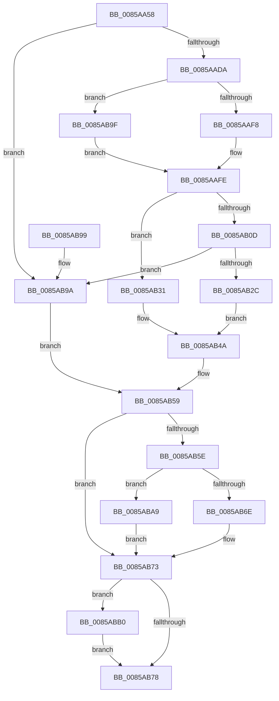

# CmpAddValueKeyNew

- RVA: `0x0085AA58`–`0x0085ABBC` (길이 `356` bytes)
- VA: `0x000000014085AA58`
- 실행 섹션: `PAGE`
- PDB 이름 있음: `예`; PDB Function 태그: `아니요`
- unwind 정보 RVA: `0x0006AD08`
- 디코드: `104`개 명령, `356/356` bytes 표시
- 미해석 바이트: `0` (있으면 어셈블리에 `.byte`로 보존)

> 이 문서는 커널 이미지의 기계어와 PDB 기호를 분석해 생성했습니다. 4번과 5번은 함수 원형과 자료형을 바이너리 사용 방식에서 추정한 C 해석이며 원본 소스 복구 결과는 아닙니다.

## 1. Dependencies

- 직접 호출 지점: **9**; 고유 호출 대상: **9**
- 직접 호출자로 확인된 함수: **3**
- RIP 상대 이미지 참조: **0**

### Outgoing calls
- `0x0085AA96` → [HvpGetCellContextInitialize](HvpGetCellContextInitialize_function_00855F10.md) (function, `0x00855F10`)
- `0x0085AA9E` → [CmpNameSize](CmpNameSize_function_0085ABC4.md) (function, `0x0085ABC4`)
- `0x0085AAC6` → [HvAllocateCell](HvAllocateCell_function_00859C94.md) (function, `0x00859C94`)
- `0x0085AAE6` → [CmpCopyName](CmpCopyName_function_0085AF98.md) (function, `0x0085AF98`)
- `0x0085AB20` → [CmpSetValueDataNew](../A2/CmpSetValueDataNew_function_00A26550.md) (function, `0x00A26550`)
- `0x0085AB45` → [memcpy](../../text/6C/memcpy_function_006C6840.md) (function, `0x006C6840`)
- `0x0085AB6E` → [HvpReleaseCellPaged](HvpReleaseCellPaged_function_00855F40.md) (function, `0x00855F40`)
- `0x0085ABA9` → [HvpReleaseCellFlat](HvpReleaseCellFlat_function_0085CC20.md) (function, `0x0085CC20`)
- `0x0085ABB5` → [HvFreeCell](HvFreeCell_function_0085A72C.md) (function, `0x0085A72C`)

### Direct callers
- [CmSetValueKey](../84/CmSetValueKey_function_008457C0.md) at `0x00845DD2`
- [CmpSetValueKeyNew](CmpSetValueKeyNew_function_0085BB44.md) at `0x0085BBBC`
- [CmpLightWeightPrepareSetValueKeyUoW](../A0/CmpLightWeightPrepareSetValueKeyUoW_function_00A0EF28.md) at `0x00A0F349`

### Static image references
- 디코드된 RIP-relative 메모리 참조가 없습니다.

## 2. Other-region calls and transfers

- 다른 실행 섹션으로 향하는 call: **1**
  - `0x0085AB45` → [memcpy](../../text/6C/memcpy_function_006C6840.md) (`PAGE` → `.text`)
- 별도 외부 분기/꼬리 이동을 확인하지 못했습니다.

## 3. Assembly (complete function range)

```asm
0085AA58  48 89 5C 24 08                  mov qword ptr [rsp + 8], rbx
0085AA5D  48 89 74 24 10                  mov qword ptr [rsp + 0x10], rsi
0085AA62  48 89 7C 24 18                  mov qword ptr [rsp + 0x18], rdi
0085AA67  55                              push rbp
0085AA68  41 54                           push r12
0085AA6A  41 55                           push r13
0085AA6C  41 56                           push r14
0085AA6E  41 57                           push r15
0085AA70  48 8B EC                        mov rbp, rsp
0085AA73  48 83 EC 50                     sub rsp, 0x50
0085AA77  83 4D E0 FF                     or dword ptr [rbp - 0x20], 0xffffffff
0085AA7B  48 8B F1                        mov rsi, rcx
0085AA7E  45 33 ED                        xor r13d, r13d
0085AA81  48 8D 4D E8                     lea rcx, [rbp - 0x18]
0085AA85  4C 89 6D E8                     mov qword ptr [rbp - 0x18], r13
0085AA89  4D 8B F9                        mov r15, r9
0085AA8C  4C 89 6D F0                     mov qword ptr [rbp - 0x10], r13
0085AA90  45 8B E0                        mov r12d, r8d
0085AA93  48 8B FA                        mov rdi, rdx
0085AA96  E8 75 B4 FF FF                  call 0x140855f10
0085AA9B  48 8B CA                        mov rcx, rdx
0085AA9E  E8 21 01 00 00                  call 0x14085abc4
0085AAA3  44 8B 45 58                     mov r8d, dword ptr [rbp + 0x58]
0085AAA7  4C 8D 4D E0                     lea r9, [rbp - 0x20]
0085AAAB  0F B7 D0                        movzx edx, ax
0085AAAE  48 8B CE                        mov rcx, rsi
0085AAB1  48 8D 45 E8                     lea rax, [rbp - 0x18]
0085AAB5  83 C2 14                        add edx, 0x14
0085AAB8  48 89 44 24 28                  mov qword ptr [rsp + 0x28], rax
0085AABD  48 8D 45 F0                     lea rax, [rbp - 0x10]
0085AAC1  48 89 44 24 20                  mov qword ptr [rsp + 0x20], rax
0085AAC6  E8 C9 F1 FF FF                  call 0x140859c94
0085AACB  48 8B 5D F0                     mov rbx, qword ptr [rbp - 0x10]
0085AACF  44 8B F0                        mov r14d, eax
0085AAD2  85 C0                           test eax, eax
0085AAD4  0F 88 C0 00 00 00               js 0x14085ab9a
0085AADA  48 8D 4B 14                     lea rcx, [rbx + 0x14]
0085AADE  66 C7 03 76 6B                  mov word ptr [rbx], 0x6b76
0085AAE3  48 8B D7                        mov rdx, rdi
0085AAE6  E8 AD 04 00 00                  call 0x14085af98
0085AAEB  66 89 43 02                     mov word ptr [rbx + 2], ax
0085AAEF  66 3B 07                        cmp ax, word ptr [rdi]
0085AAF2  0F 83 A7 00 00 00               jae 0x14085ab9f
0085AAF8  66 C7 43 10 01 00               mov word ptr [rbx + 0x10], 1
0085AAFE  8B 7D 50                        mov edi, dword ptr [rbp + 0x50]
0085AB01  49 8B D7                        mov rdx, r15
0085AB04  44 89 63 0C                     mov dword ptr [rbx + 0xc], r12d
0085AB08  83 FF 04                        cmp edi, 4
0085AB0B  76 24                           jbe 0x14085ab31
0085AB0D  44 8B 4D 58                     mov r9d, dword ptr [rbp + 0x58]
0085AB11  48 8D 43 08                     lea rax, [rbx + 8]
0085AB15  44 8B C7                        mov r8d, edi
0085AB18  48 89 44 24 20                  mov qword ptr [rsp + 0x20], rax
0085AB1D  48 8B CE                        mov rcx, rsi
0085AB20  E8 2B BA 1C 00                  call 0x140a26550
0085AB25  44 8B F0                        mov r14d, eax
0085AB28  85 C0                           test eax, eax
0085AB2A  78 6E                           js 0x14085ab9a
0085AB2C  89 7B 04                        mov dword ptr [rbx + 4], edi
0085AB2F  EB 19                           jmp 0x14085ab4a
0085AB31  B8 00 00 00 80                  mov eax, 0x80000000
0085AB36  48 8D 4B 08                     lea rcx, [rbx + 8]
0085AB3A  03 C7                           add eax, edi
0085AB3C  4C 8B C7                        mov r8, rdi
0085AB3F  89 43 04                        mov dword ptr [rbx + 4], eax
0085AB42  44 89 29                        mov dword ptr [rcx], r13d
0085AB45  E8 F6 BC E6 FF                  call 0x1406c6840
0085AB4A  48 8B 4D 60                     mov rcx, qword ptr [rbp + 0x60]
0085AB4E  83 CF FF                        or edi, 0xffffffff
0085AB51  8B 45 E0                        mov eax, dword ptr [rbp - 0x20]
0085AB54  45 8B F5                        mov r14d, r13d
0085AB57  89 01                           mov dword ptr [rcx], eax
0085AB59  48 85 DB                        test rbx, rbx
0085AB5C  74 15                           je 0x14085ab73
0085AB5E  F6 86 8C 00 00 00 01            test byte ptr [rsi + 0x8c], 1
0085AB65  48 8D 55 E8                     lea rdx, [rbp - 0x18]
0085AB69  48 8B CE                        mov rcx, rsi
0085AB6C  75 3B                           jne 0x14085aba9
0085AB6E  E8 CD B3 FF FF                  call 0x140855f40
0085AB73  83 FF FF                        cmp edi, -1
0085AB76  75 38                           jne 0x14085abb0
0085AB78  4C 8D 5C 24 50                  lea r11, [rsp + 0x50]
0085AB7D  41 8B C6                        mov eax, r14d
0085AB80  49 8B 5B 30                     mov rbx, qword ptr [r11 + 0x30]
0085AB84  49 8B 73 38                     mov rsi, qword ptr [r11 + 0x38]
0085AB88  49 8B 7B 40                     mov rdi, qword ptr [r11 + 0x40]
0085AB8C  49 8B E3                        mov rsp, r11
0085AB8F  41 5F                           pop r15
0085AB91  41 5E                           pop r14
0085AB93  41 5D                           pop r13
0085AB95  41 5C                           pop r12
0085AB97  5D                              pop rbp
0085AB98  C3                              ret
0085AB99  CC                              int3
0085AB9A  8B 7D E0                        mov edi, dword ptr [rbp - 0x20]
0085AB9D  EB BA                           jmp 0x14085ab59
0085AB9F  66 44 89 6B 10                  mov word ptr [rbx + 0x10], r13w
0085ABA4  E9 55 FF FF FF                  jmp 0x14085aafe
0085ABA9  E8 72 20 00 00                  call 0x14085cc20
0085ABAE  EB C3                           jmp 0x14085ab73
0085ABB0  8B D7                           mov edx, edi
0085ABB2  48 8B CE                        mov rcx, rsi
0085ABB5  E8 72 FB FF FF                  call 0x14085a72c
0085ABBA  EB BC                           jmp 0x14085ab78
```

## 4. C-style interpretation (structured pseudocode)

```c
__int64 __fastcall CmpAddValueKeyNew(__int64 a1, __int64 a2, int a3, __int64 a4, unsigned int a5, unsigned int a6, __int64 a7)
{
    __int64 result;
    __int64 v_r13;
    __int64 v_rdi;
    __int64 v_rsp;
    unsigned __int64 v_stack_m28;
    unsigned __int64 v_stack_m38;
    unsigned __int64 v_stack_m40;
    unsigned int v_stack_m48;
    unsigned __int64 v_stack_m50;
    unsigned __int64 v_stack_m58;
    unsigned __int64 v_stack_p10;
    unsigned __int64 v_stack_p18;
    unsigned __int64 v_stack_p8;

    v_stack_p8 = v_rbx;
    v_stack_p10 = v_rsi;
    v_stack_p18 = v_rdi;
    v_rsp = (v_rsp) - (80);
    v_r13 = 0;
    v_stack_m40 = 0;
    v_stack_m38 = 0;
    result = HvpGetCellContextInitialize(v_stack_m40, a2, a3, a4);
    result = CmpNameSize(a2, a2, a3, a4);
    a2 = (unsigned int)(((unsigned __int16)(result)) + (20));
    v_stack_m50 = v_stack_m40;
    v_stack_m58 = v_stack_m38;
    result = HvAllocateCell(a1, a2, (unsigned int)(a6), v_stack_m48);
    if (sign_flag) goto loc_0085AB9A;
    *(unsigned __int16 *)(v_stack_m38) = 0x6B76ULL;
    result = CmpCopyName(v_stack_m38 + 20, a2, (unsigned int)(a6), v_stack_m48);
    *(unsigned __int16 *)(v_stack_m38 + 2) = (unsigned __int16)(result);
    if (((unsigned __int16)(result)) >= (*(unsigned __int16 *)(a2))) goto loc_0085AB9F;
    *(unsigned __int16 *)(v_stack_m38 + 16) = 1;
loc_0085AAFE:
    *(unsigned int *)(v_stack_m38 + 12) = (unsigned int)((unsigned int)(a3));
    if (((unsigned int)((unsigned int)(a5))) <= 4) goto loc_0085AB31;
    v_stack_m58 = v_stack_m38 + 8;
    result = CmpSetValueDataNew(a1, a4, (unsigned int)((unsigned int)((unsigned int)(a5))), (unsigned int)(a6));
    if (sign_flag) goto loc_0085AB9A;
    *(unsigned int *)(v_stack_m38 + 4) = (unsigned int)((unsigned int)(a5));
    goto loc_0085AB4A;
loc_0085AB31:
    result = (unsigned int)(((unsigned int)(0x80000000ULL)) + ((unsigned int)((unsigned int)(a5))));
    *(unsigned int *)(v_stack_m38 + 4) = (unsigned int)(result);
    *(unsigned int *)(v_stack_m38 + 8) = 0;
    result = memcpy(v_stack_m38 + 8, a4, (unsigned int)(a5), (unsigned int)(a6));
loc_0085AB4A:
    v_rdi = (unsigned int)(((unsigned int)(a5)) | (0xFFFFFFFFULL));
    *(unsigned int *)(a7) = (unsigned int)((unsigned int)(v_stack_m48));
loc_0085AB59:
    if (v_stack_m38 == 0) goto loc_0085AB73;
    if (((*(unsigned __int8 *)(a1 + 140)) & (1)) != 0) goto loc_0085ABA9;
    result = HvpReleaseCellPaged(a1, v_stack_m40, (unsigned int)(a5), (unsigned int)(a6));
loc_0085AB73:
    if (((unsigned int)(v_rdi)) != -1) goto loc_0085ABB0;
loc_0085AB78:
    return 0;
loc_0085AB9A:
    goto loc_0085AB59;
loc_0085AB9F:
    *(unsigned __int16 *)(*(unsigned __int64 *)(v_stack_m28 + 48) + 16) = 0;
    goto loc_0085AAFE;
loc_0085ABA9:
    result = HvpReleaseCellFlat(a1, v_stack_m40, (unsigned int)(a5), (unsigned int)(a6));
    goto loc_0085AB73;
loc_0085ABB0:
    result = HvFreeCell(*(unsigned __int64 *)(v_stack_m28 + 56), (unsigned int)((unsigned int)((unsigned int)(v_stack_m48))), (unsigned int)(a5), (unsigned int)(a6));
    goto loc_0085AB78;
}
```

## 5. (Beta) C Style

```c
int64_t CmpAddValueKeyNew(void *Arg1, void *Arg2, int32_t Arg3, int64_t Arg4, uint32_t Arg5, uint32_t Arg6, void *Arg7)
{
    uint8_t *arg1 = (uint8_t *)Arg1;
    uint8_t *arg2 = (uint8_t *)Arg2;
    uint8_t *arg7 = (uint8_t *)Arg7;

    int64_t result;
    int64_t local_r13;
    int64_t local_rdi;
    int64_t local_rsp;
    uint64_t v_stack_m28;
    uint64_t v_stack_m38;
    uint64_t v_stack_m40;
    uint32_t v_stack_m48;
    uint64_t v_stack_m50;
    uint64_t v_stack_m58;
    uint64_t v_stack_p10;
    uint64_t v_stack_p18;
    uint64_t v_stack_p8;

    v_stack_p8 = local_rbx;
    v_stack_p10 = local_rsi;
    v_stack_p18 = local_rdi;
    local_rsp = (local_rsp) - (80);
    local_r13 = 0;
    v_stack_m40 = 0;
    v_stack_m38 = 0;
    result = HvpGetCellContextInitialize(v_stack_m40, Arg2, Arg3, Arg4);
    result = CmpNameSize(Arg2, Arg2, Arg3, Arg4);
    Arg2 = (uint32_t)(((uint16_t)(result)) + (20));
    v_stack_m50 = v_stack_m40;
    v_stack_m58 = v_stack_m38;
    result = HvAllocateCell(Arg1, Arg2, (uint32_t)(Arg6), v_stack_m48);
    if (sign_flag) goto loc_0085AB9A;
    *(uint16_t *)(v_stack_m38) = 0x6B76ULL;
    result = CmpCopyName(v_stack_m38 + 20, Arg2, (uint32_t)(Arg6), v_stack_m48);
    *(uint16_t *)(v_stack_m38 + 0x2) = (uint16_t)(result);
    if (((uint16_t)(result)) >= (*(uint16_t *)(arg2))) goto loc_0085AB9F;
    *(uint16_t *)(v_stack_m38 + 0x10) = 1;
loc_0085AAFE:
    *(uint32_t *)(v_stack_m38 + 0xC) = (uint32_t)((uint32_t)(Arg3));
    if (((uint32_t)((uint32_t)(Arg5))) <= 4) goto loc_0085AB31;
    v_stack_m58 = v_stack_m38 + 8;
    result = CmpSetValueDataNew(Arg1, Arg4, (uint32_t)((uint32_t)((uint32_t)(Arg5))), (uint32_t)(Arg6));
    if (sign_flag) goto loc_0085AB9A;
    *(uint32_t *)(v_stack_m38 + 0x4) = (uint32_t)((uint32_t)(Arg5));
    goto loc_0085AB4A;
loc_0085AB31:
    result = (uint32_t)(((uint32_t)(0x80000000ULL)) + ((uint32_t)((uint32_t)(Arg5))));
    *(uint32_t *)(v_stack_m38 + 0x4) = (uint32_t)(result);
    *(uint32_t *)(v_stack_m38 + 0x8) = 0;
    result = memcpy(v_stack_m38 + 8, Arg4, (uint32_t)(Arg5), (uint32_t)(Arg6));
loc_0085AB4A:
    local_rdi = (uint32_t)(((uint32_t)(Arg5)) | (0xFFFFFFFFULL));
    *(uint32_t *)(arg7) = (uint32_t)((uint32_t)(v_stack_m48));
loc_0085AB59:
    if (v_stack_m38 == 0) goto loc_0085AB73;
    if (((*(uint8_t *)(arg1 + 0x8C)) & (1)) != 0) goto loc_0085ABA9;
    result = HvpReleaseCellPaged(Arg1, v_stack_m40, (uint32_t)(Arg5), (uint32_t)(Arg6));
loc_0085AB73:
    if (((uint32_t)(local_rdi)) != -1) goto loc_0085ABB0;
loc_0085AB78:
    return 0;
loc_0085AB9A:
    goto loc_0085AB59;
loc_0085AB9F:
    *(uint16_t *)(*(uint64_t *)(v_stack_m28 + 0x30) + 0x10) = 0;
    goto loc_0085AAFE;
loc_0085ABA9:
    result = HvpReleaseCellFlat(Arg1, v_stack_m40, (uint32_t)(Arg5), (uint32_t)(Arg6));
    goto loc_0085AB73;
loc_0085ABB0:
    result = HvFreeCell(*(uint64_t *)(v_stack_m28 + 0x38), (uint32_t)((uint32_t)((uint32_t)(v_stack_m48))), (uint32_t)(Arg5), (uint32_t)(Arg6));
    goto loc_0085AB78;
}
```

### 관측된 메모리 오프셋

구조체 형식이 확인되지 않은 접근은 인자 기준의 오프셋으로만 기록했습니다.

| 기준 인자 | 오프셋 표현 | 폭 (bit) | 접근 |
|---|---:|---:|---|
| `Arg1` | `+ 0x8C` | `8` | `R` |
| `Arg2` | `+ 0x0` | `16` | `R` |
| `Arg7` | `+ 0x0` | `32` | `W` |

## 6. Execution-region graph

[열기: 2D/3D 그래프와 함수 탐색 컨트롤 패널](../../../control-panel.html?section=page&rva=0x0085AA58&view=graph)

- 2D 그래프는 위에서 아래로 흐르고, 3D 그래프는 빈 공간을 드래그해 회전합니다. Shift+드래그는 이동, 휠은 확대·축소, 함수 노드 선택은 대상 보고서 이동입니다.

### Static fallback


