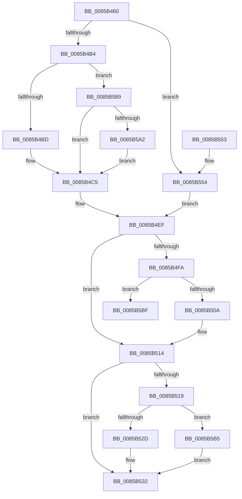

# CmpAddValueToListEx

- RVA: `0x0085B460`–`0x0085B5C8` (길이 `360` bytes)
- VA: `0x000000014085B460`
- 실행 섹션: `PAGE`
- PDB 이름 있음: `예`; PDB Function 태그: `예`
- unwind 정보 RVA: `0x0006ADC0`
- 디코드: `94`개 명령, `360/360` bytes 표시
- 미해석 바이트: `0` (있으면 어셈블리에 `.byte`로 보존)

> 이 문서는 커널 이미지의 기계어와 PDB 기호를 분석해 생성했습니다. 4번과 5번은 함수 원형과 자료형을 바이너리 사용 방식에서 추정한 C 해석이며 원본 소스 복구 결과는 아닙니다.

## 1. Dependencies

- 직접 호출 지점: **5**; 고유 호출 대상: **5**
- 직접 호출자로 확인된 함수: **8**
- RIP 상대 이미지 참조: **0**

### Outgoing calls
- `0x0085B4A0` → [HvpGetCellContextInitialize](HvpGetCellContextInitialize_function_00855F10.md) (function, `0x00855F10`)
- `0x0085B4EA` → [HvReallocateCell](HvReallocateCell_function_0085B5D0.md) (function, `0x0085B5D0`)
- `0x0085B52D` → [HvpReleaseCellPaged](HvpReleaseCellPaged_function_00855F40.md) (function, `0x00855F40`)
- `0x0085B57F` → [HvAllocateCell](HvAllocateCell_function_00859C94.md) (function, `0x00859C94`)
- `0x0085B5B5` → [HvpReleaseCellFlat](HvpReleaseCellFlat_function_0085CC20.md) (function, `0x0085CC20`)

### Direct callers
- [CmpMergeKeyValues](../7F/CmpMergeKeyValues_function_007F2304.md) at `0x007F24B7`
- [CmpSyncKeyValues](../7F/CmpSyncKeyValues_function_007F2DF4.md) at `0x007F2FA1`
- [CmSetValueKey](../84/CmSetValueKey_function_008457C0.md) at `0x00845E0F`
- [CmpCopyKeyPartial](CmpCopyKeyPartial_function_0085AFF4.md) at `0x0085B28C`
- [CmpSetValueKeyNew](CmpSetValueKeyNew_function_0085BB44.md) at `0x0085BBE3`
- [CmpFullPromoteSingleKeyFromKeyNodeStacks](../8B/CmpFullPromoteSingleKeyFromKeyNodeStacks_function_008B1A40.md) at `0x008B1C5D`
- [CmpLightWeightPrepareSetValueKeyUoW](../A0/CmpLightWeightPrepareSetValueKeyUoW_function_00A0EF28.md) at `0x00A0F17E`
- [CmpSetValueKeyTombstone](../AC/CmpSetValueKeyTombstone_function_00AC5D64.md) at `0x00AC5DDA`

### Static image references
- 디코드된 RIP-relative 메모리 참조가 없습니다.

## 2. Other-region calls and transfers

- 다른 실행 섹션으로 향하는 call: **0**
- call이 아닌 외부 분기/꼬리 이동: **1**
  - `0x0085B5C3` → [sub_00B16D98](../B1/Unknown_function_00B16D98.md) (`tail-transfer`)

## 3. Assembly (complete function range)

```asm
0085B460  48 89 5C 24 08                  mov qword ptr [rsp + 8], rbx
0085B465  48 89 74 24 10                  mov qword ptr [rsp + 0x10], rsi
0085B46A  48 89 7C 24 18                  mov qword ptr [rsp + 0x18], rdi
0085B46F  55                              push rbp
0085B470  41 54                           push r12
0085B472  41 55                           push r13
0085B474  41 56                           push r14
0085B476  41 57                           push r15
0085B478  48 8B EC                        mov rbp, rsp
0085B47B  48 83 EC 50                     sub rsp, 0x50
0085B47F  4C 8B 7D 50                     mov r15, qword ptr [rbp + 0x50]
0085B483  33 C0                           xor eax, eax
0085B485  48 8B F9                        mov rdi, rcx
0085B488  89 45 50                        mov dword ptr [rbp + 0x50], eax
0085B48B  48 8D 4D F0                     lea rcx, [rbp - 0x10]
0085B48F  48 89 45 F0                     mov qword ptr [rbp - 0x10], rax
0085B493  48 89 45 F8                     mov qword ptr [rbp - 8], rax
0085B497  45 8B D1                        mov r10d, r9d
0085B49A  45 8B E0                        mov r12d, r8d
0085B49D  44 8B EA                        mov r13d, edx
0085B4A0  E8 6B AA FF FF                  call 0x140855f10
0085B4A5  41 8B 1F                        mov ebx, dword ptr [r15]
0085B4A8  8D 73 01                        lea esi, [rbx + 1]
0085B4AB  83 FE 01                        cmp esi, 1
0085B4AE  0F 86 A0 00 00 00               jbe 0x14085b554
0085B4B4  83 FE 64                        cmp esi, 0x64
0085B4B7  0F 83 CC 00 00 00               jae 0x14085b589
0085B4BD  44 8D 04 B5 00 00 00 00         lea r8d, [rsi*4]
0085B4C5  41 8B 57 04                     mov edx, dword ptr [r15 + 4]
0085B4C9  48 8D 45 F0                     lea rax, [rbp - 0x10]
0085B4CD  48 89 44 24 30                  mov qword ptr [rsp + 0x30], rax
0085B4D2  41 B1 01                        mov r9b, 1
0085B4D5  48 8D 45 F8                     lea rax, [rbp - 8]
0085B4D9  48 8B CF                        mov rcx, rdi
0085B4DC  48 89 44 24 28                  mov qword ptr [rsp + 0x28], rax
0085B4E1  48 8D 45 50                     lea rax, [rbp + 0x50]
0085B4E5  48 89 44 24 20                  mov qword ptr [rsp + 0x20], rax
0085B4EA  E8 E1 00 00 00                  call 0x14085b5d0
0085B4EF  48 8B 55 F8                     mov rdx, qword ptr [rbp - 8]
0085B4F3  44 8B F0                        mov r14d, eax
0085B4F6  85 C0                           test eax, eax
0085B4F8  78 1A                           js 0x14085b514
0085B4FA  8B 45 50                        mov eax, dword ptr [rbp + 0x50]
0085B4FD  41 89 47 04                     mov dword ptr [r15 + 4], eax
0085B501  41 3B DC                        cmp ebx, r12d
0085B504  0F 87 B5 00 00 00               ja 0x14085b5bf
0085B50A  46 89 2C A2                     mov dword ptr [rdx + r12*4], r13d
0085B50E  45 33 F6                        xor r14d, r14d
0085B511  41 89 37                        mov dword ptr [r15], esi
0085B514  48 85 D2                        test rdx, rdx
0085B517  74 19                           je 0x14085b532
0085B519  F6 87 8C 00 00 00 01            test byte ptr [rdi + 0x8c], 1
0085B520  48 8D 55 F0                     lea rdx, [rbp - 0x10]
0085B524  48 8B CF                        mov rcx, rdi
0085B527  0F 85 88 00 00 00               jne 0x14085b5b5
0085B52D  E8 0E AA FF FF                  call 0x140855f40
0085B532  4C 8D 5C 24 50                  lea r11, [rsp + 0x50]
0085B537  41 8B C6                        mov eax, r14d
0085B53A  49 8B 5B 30                     mov rbx, qword ptr [r11 + 0x30]
0085B53E  49 8B 73 38                     mov rsi, qword ptr [r11 + 0x38]
0085B542  49 8B 7B 40                     mov rdi, qword ptr [r11 + 0x40]
0085B546  49 8B E3                        mov rsp, r11
0085B549  41 5F                           pop r15
0085B54B  41 5E                           pop r14
0085B54D  41 5D                           pop r13
0085B54F  41 5C                           pop r12
0085B551  5D                              pop rbp
0085B552  C3                              ret
0085B553  CC                              int3
0085B554  BA 01 00 00 00                  mov edx, 1
0085B559  48 8D 45 F0                     lea rax, [rbp - 0x10]
0085B55D  39 55 58                        cmp dword ptr [rbp + 0x58], edx
0085B560  4C 8D 4D 50                     lea r9, [rbp + 0x50]
0085B564  48 89 44 24 28                  mov qword ptr [rsp + 0x28], rax
0085B569  45 8B C2                        mov r8d, r10d
0085B56C  0F 43 55 58                     cmovae edx, dword ptr [rbp + 0x58]
0085B570  48 8D 45 F8                     lea rax, [rbp - 8]
0085B574  C1 E2 02                        shl edx, 2
0085B577  48 8B CF                        mov rcx, rdi
0085B57A  48 89 44 24 20                  mov qword ptr [rsp + 0x20], rax
0085B57F  E8 10 E7 FF FF                  call 0x140859c94
0085B584  E9 66 FF FF FF                  jmp 0x14085b4ef
0085B589  44 8D 46 63                     lea r8d, [rsi + 0x63]
0085B58D  41 83 E0 9C                     and r8d, 0xffffff9c
0085B591  41 C1 E0 02                     shl r8d, 2
0085B595  41 81 F8 00 10 00 00            cmp r8d, 0x1000
0085B59C  0F 86 23 FF FF FF               jbe 0x14085b4c5
0085B5A2  41 81 C0 FF 0F 00 00            add r8d, 0xfff
0085B5A9  41 81 E0 00 F0 FF FF            and r8d, 0xfffff000
0085B5B0  E9 10 FF FF FF                  jmp 0x14085b4c5
0085B5B5  E8 66 16 00 00                  call 0x14085cc20
0085B5BA  E9 73 FF FF FF                  jmp 0x14085b532
0085B5BF  4C 8D 04 9A                     lea r8, [rdx + rbx*4]
0085B5C3  E9 D0 B7 2B 00                  jmp 0x140b16d98
```

## 4. C-style interpretation (structured pseudocode)

```c
__int64 __fastcall CmpAddValueToListEx(__int64 a1, int a2, int a3, int a4, unsigned int a5, unsigned int a6)
{
    __int64 result;
    __int64 v_r14;
    __int64 v_rsp;
    unsigned __int64 v_stack_m28;
    unsigned __int64 v_stack_m30;
    unsigned __int64 v_stack_m38;
    unsigned __int64 v_stack_m48;
    unsigned __int64 v_stack_m50;
    unsigned __int64 v_stack_m58;
    unsigned __int64 v_stack_p10;
    unsigned __int64 v_stack_p18;
    unsigned int v_stack_p28;
    unsigned __int64 v_stack_p8;

    v_stack_p8 = v_rbx;
    v_stack_p10 = v_rsi;
    v_stack_p18 = v_rdi;
    v_rsp = (v_rsp) - (80);
    result = 0;
    v_stack_p28 = 0;
    v_stack_m38 = 0;
    v_stack_m30 = 0;
    result = HvpGetCellContextInitialize(v_stack_m38, a2, a3, a4);
    if (((unsigned int)((unsigned int)(*(unsigned int *)(a5)) + 1)) <= 1) goto loc_0085B554;
    if (((unsigned int)((unsigned int)(*(unsigned int *)(a5)) + 1)) >= 100) goto loc_0085B589;
loc_0085B4C5:
    v_stack_m48 = v_stack_m38;
    v_stack_m50 = v_stack_m30;
    v_stack_m58 = a5;
    result = HvReallocateCell(a1, (unsigned int)(*(unsigned int *)(a5 + 4)), (unsigned int)(*(unsigned int *)(a5)) + 1 * 4, 1);
loc_0085B4EF:
    if (sign_flag) goto loc_0085B514;
    *(unsigned int *)(a5 + 4) = (unsigned int)((unsigned int)(a5));
    if (((unsigned int)((unsigned int)(*(unsigned int *)(a5)))) > ((unsigned int)((unsigned int)(a3)))) goto loc_0085B5BF;
    *(unsigned int *)(v_stack_m30 + (unsigned int)(a3) * 4) = (unsigned int)((unsigned int)(a2));
    v_r14 = 0;
    *(unsigned int *)(a5) = (unsigned int)((unsigned int)(*(unsigned int *)(a5)) + 1);
loc_0085B514:
    if (v_stack_m30 == 0) goto loc_0085B532;
    if (((*(unsigned __int8 *)(a1 + 140)) & (1)) != 0) goto loc_0085B5B5;
    result = HvpReleaseCellPaged(a1, v_stack_m38, (unsigned int)(*(unsigned int *)(a5)) + 1 * 4, 1);
loc_0085B532:
    return 0;
loc_0085B554:
    v_stack_m28 = v_stack_m38;
    a2 = 1;
    if (a6 >= 1) { a2 = a6; }
    a2 = (unsigned int)((a2) << (2));
    v_stack_m30 = v_stack_m30;
    result = HvAllocateCell(*(unsigned __int64 *)(v_stack_m28 + 64), a2, (unsigned int)((unsigned int)((unsigned int)(a4))), a5);
    goto loc_0085B4EF;
loc_0085B589:
    a3 = (unsigned int)((*(unsigned __int64 *)(v_stack_m28 + 56) + 99) & (0xFFFFFF9CULL));
    a3 = (unsigned int)((a3) << (2));
    if (a3 <= 0x1000ULL) goto loc_0085B4C5;
    a3 = (unsigned int)((a3) + (0xFFFULL));
    a3 = (unsigned int)((a3) & (0xFFFFF000ULL));
    goto loc_0085B4C5;
loc_0085B5B5:
    result = HvpReleaseCellFlat(*(unsigned __int64 *)(v_stack_m28 + 64), a2, a3, a5);
    goto loc_0085B532;
loc_0085B5BF:
}
```

## 5. (Beta) C Style

```c
int64_t CmpAddValueToListEx(void *Arg1, int32_t Arg2, int32_t Arg3, int32_t Arg4, void *Arg5, uint32_t Arg6)
{
    uint8_t *arg1 = (uint8_t *)Arg1;
    uint8_t *arg5 = (uint8_t *)Arg5;

    int64_t result;
    int64_t local_r14;
    int64_t local_rsp;
    uint64_t v_stack_m28;
    uint64_t v_stack_m30;
    uint64_t v_stack_m38;
    uint64_t v_stack_m48;
    uint64_t v_stack_m50;
    uint64_t v_stack_m58;
    uint64_t v_stack_p10;
    uint64_t v_stack_p18;
    uint32_t v_stack_p28;
    uint64_t v_stack_p8;

    v_stack_p8 = local_rbx;
    v_stack_p10 = local_rsi;
    v_stack_p18 = local_rdi;
    local_rsp = (local_rsp) - (80);
    result = 0;
    v_stack_p28 = 0;
    v_stack_m38 = 0;
    v_stack_m30 = 0;
    result = HvpGetCellContextInitialize(v_stack_m38, Arg2, Arg3, Arg4);
    if (((uint32_t)((uint32_t)(*(uint32_t *)(arg5)) + 1)) <= 1) goto loc_0085B554;
    if (((uint32_t)((uint32_t)(*(uint32_t *)(arg5)) + 1)) >= 100) goto loc_0085B589;
loc_0085B4C5:
    v_stack_m48 = v_stack_m38;
    v_stack_m50 = v_stack_m30;
    v_stack_m58 = Arg5;
    result = HvReallocateCell(Arg1, (uint32_t)(*(uint32_t *)(arg5 + 0x4)), (uint32_t)(*(uint32_t *)(arg5)) + 1 * 4, 1);
loc_0085B4EF:
    if (sign_flag) goto loc_0085B514;
    *(uint32_t *)(arg5 + 0x4) = (uint32_t)((uint32_t)(Arg5));
    if (((uint32_t)((uint32_t)(*(uint32_t *)(arg5)))) > ((uint32_t)((uint32_t)(Arg3)))) goto loc_0085B5BF;
    *(uint32_t *)(v_stack_m30 + (uint32_t)(Arg3) * 4) = (uint32_t)((uint32_t)(Arg2));
    local_r14 = 0;
    *(uint32_t *)(arg5) = (uint32_t)((uint32_t)(*(uint32_t *)(arg5)) + 1);
loc_0085B514:
    if (v_stack_m30 == 0) goto loc_0085B532;
    if (((*(uint8_t *)(arg1 + 0x8C)) & (1)) != 0) goto loc_0085B5B5;
    result = HvpReleaseCellPaged(Arg1, v_stack_m38, (uint32_t)(*(uint32_t *)(arg5)) + 1 * 4, 1);
loc_0085B532:
    return 0;
loc_0085B554:
    v_stack_m28 = v_stack_m38;
    Arg2 = 1;
    if (Arg6 >= 1) { Arg2 = Arg6; }
    Arg2 = (uint32_t)((Arg2) << (2));
    v_stack_m30 = v_stack_m30;
    result = HvAllocateCell(*(uint64_t *)(v_stack_m28 + 0x40), Arg2, (uint32_t)((uint32_t)((uint32_t)(Arg4))), Arg5);
    goto loc_0085B4EF;
loc_0085B589:
    Arg3 = (uint32_t)((*(uint64_t *)(v_stack_m28 + 0x38) + 99) & (0xFFFFFF9CULL));
    Arg3 = (uint32_t)((Arg3) << (2));
    if (Arg3 <= 0x1000ULL) goto loc_0085B4C5;
    Arg3 = (uint32_t)((Arg3) + (0xFFFULL));
    Arg3 = (uint32_t)((Arg3) & (0xFFFFF000ULL));
    goto loc_0085B4C5;
loc_0085B5B5:
    result = HvpReleaseCellFlat(*(uint64_t *)(v_stack_m28 + 0x40), Arg2, Arg3, Arg5);
    goto loc_0085B532;
loc_0085B5BF:
}
```

### 관측된 메모리 오프셋

구조체 형식이 확인되지 않은 접근은 인자 기준의 오프셋으로만 기록했습니다.

| 기준 인자 | 오프셋 표현 | 폭 (bit) | 접근 |
|---|---:|---:|---|
| `Arg1` | `+ 0x8C` | `8` | `R` |
| `Arg5` | `+ 0x0` | `32` | `R` |
| `Arg5` | `+ 0x0` | `32` | `W` |
| `Arg5` | `+ 0x4` | `32` | `R` |
| `Arg5` | `+ 0x4` | `32` | `W` |

## 6. Execution-region graph

[열기: 2D/3D 그래프와 함수 탐색 컨트롤 패널](../../../control-panel.html?section=page&rva=0x0085B460&view=graph)

- 2D 그래프는 위에서 아래로 흐르고, 3D 그래프는 빈 공간을 드래그해 회전합니다. Shift+드래그는 이동, 휠은 확대·축소, 함수 노드 선택은 대상 보고서 이동입니다.

### Static fallback


