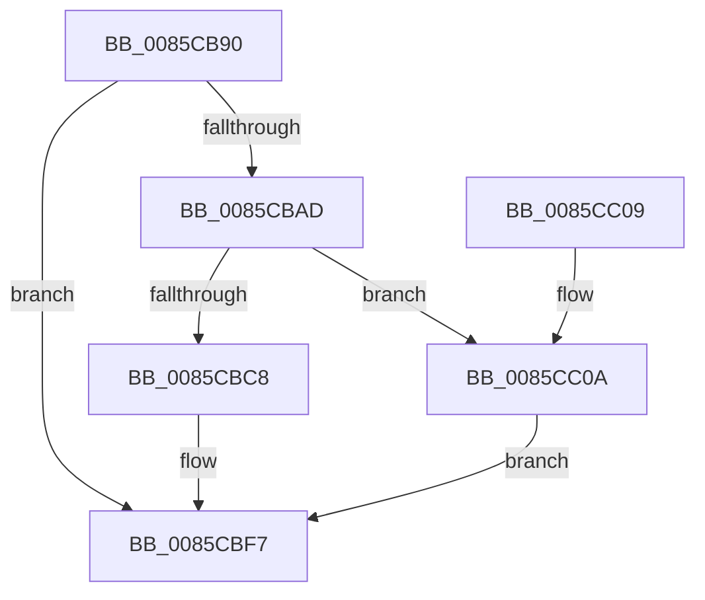

# CmpAllocateLayerInfoForKcb

- RVA: `0x0085CB90`–`0x0085CC11` (길이 `129` bytes)
- VA: `0x000000014085CB90`
- 실행 섹션: `PAGE`
- PDB 이름 있음: `예`; PDB Function 태그: `아니요`
- unwind 정보 RVA: `0x0006383C`
- 디코드: `36`개 명령, `129/129` bytes 표시
- 미해석 바이트: `0` (있으면 어셈블리에 `.byte`로 보존)

> 이 문서는 커널 이미지의 기계어와 PDB 기호를 분석해 생성했습니다. 4번과 5번은 함수 원형과 자료형을 바이너리 사용 방식에서 추정한 C 해석이며 원본 소스 복구 결과는 아닙니다.

## 1. Dependencies

- 직접 호출 지점: **2**; 고유 호출 대상: **2**
- 직접 호출자로 확인된 함수: **3**
- RIP 상대 이미지 참조: **0**

### Outgoing calls
- `0x0085CBBB` → [ExAllocatePool2](../../poolcode/B8/ExAllocatePool2_function_00B820F0.md) (function, `0x00B820F0`)
- `0x0085CBD1` → [memset](../../text/6C/memset_function_006C6C40.md) (function, `0x006C6C40`)

### Direct callers
- [CmRenameKey](../7E/CmRenameKey_function_007E8F48.md) at `0x007E98EE`
- [CmpCreateKeyControlBlock](CmpCreateKeyControlBlock_function_00851DB0.md) at `0x008524D9`
- [CmpCreateKeyControlBlock](CmpCreateKeyControlBlock_function_00851DB0.md) at `0x00852577`
- [CmpCreateLayerLink](CmpCreateLayerLink_function_0085CB00.md) at `0x0085CB17`
- [CmpCreateLayerLink](CmpCreateLayerLink_function_0085CB00.md) at `0x0085CB2F`

### Static image references
- 디코드된 RIP-relative 메모리 참조가 없습니다.

## 2. Other-region calls and transfers

- 다른 실행 섹션으로 향하는 call: **2**
  - `0x0085CBBB` → [ExAllocatePool2](../../poolcode/B8/ExAllocatePool2_function_00B820F0.md) (`PAGE` → `POOLCODE`)
  - `0x0085CBD1` → [memset](../../text/6C/memset_function_006C6C40.md) (`PAGE` → `.text`)
- 별도 외부 분기/꼬리 이동을 확인하지 못했습니다.

## 3. Assembly (complete function range)

```asm
0085CB90  48 89 5C 24 08                  mov qword ptr [rsp + 8], rbx
0085CB95  48 89 74 24 10                  mov qword ptr [rsp + 0x10], rsi
0085CB9A  57                              push rdi
0085CB9B  48 83 EC 20                     sub rsp, 0x20
0085CB9F  33 DB                           xor ebx, ebx
0085CBA1  48 8B F1                        mov rsi, rcx
0085CBA4  48 39 99 C0 00 00 00            cmp qword ptr [rcx + 0xc0], rbx
0085CBAB  75 4A                           jne 0x14085cbf7
0085CBAD  8D 53 40                        lea edx, [rbx + 0x40]
0085CBB0  B9 00 01 00 00                  mov ecx, 0x100
0085CBB5  41 B8 43 4D 6C 69               mov r8d, 0x696c4d43
0085CBBB  E8 30 55 32 00                  call 0x140b820f0
0085CBC0  48 8B F8                        mov rdi, rax
0085CBC3  48 85 C0                        test rax, rax
0085CBC6  74 42                           je 0x14085cc0a
0085CBC8  33 D2                           xor edx, edx
0085CBCA  44 8D 43 40                     lea r8d, [rbx + 0x40]
0085CBCE  48 8B C8                        mov rcx, rax
0085CBD1  E8 6A A0 E6 FF                  call 0x1406c6c40
0085CBD6  48 89 77 10                     mov qword ptr [rdi + 0x10], rsi
0085CBDA  48 8D 4F 20                     lea rcx, [rdi + 0x20]
0085CBDE  48 89 49 08                     mov qword ptr [rcx + 8], rcx
0085CBE2  48 89 09                        mov qword ptr [rcx], rcx
0085CBE5  48 8D 4F 30                     lea rcx, [rdi + 0x30]
0085CBE9  48 89 49 08                     mov qword ptr [rcx + 8], rcx
0085CBED  48 89 09                        mov qword ptr [rcx], rcx
0085CBF0  48 89 BE C0 00 00 00            mov qword ptr [rsi + 0xc0], rdi
0085CBF7  48 8B 74 24 38                  mov rsi, qword ptr [rsp + 0x38]
0085CBFC  8B C3                           mov eax, ebx
0085CBFE  48 8B 5C 24 30                  mov rbx, qword ptr [rsp + 0x30]
0085CC03  48 83 C4 20                     add rsp, 0x20
0085CC07  5F                              pop rdi
0085CC08  C3                              ret
0085CC09  CC                              int3
0085CC0A  BB 9A 00 00 C0                  mov ebx, 0xc000009a
0085CC0F  EB E6                           jmp 0x14085cbf7
```

## 4. C-style interpretation (structured pseudocode)

```c
__int64 __fastcall CmpAllocateLayerInfoForKcb(__int64 a1)
{
    __int64 result;
    __int64 v_rbx;
    __int64 v_rsp;
    unsigned __int64 v_stack_p10;
    unsigned __int64 v_stack_p8;

    v_stack_p8 = v_rbx;
    v_stack_p10 = v_rsi;
    v_rsp = (v_rsp) - (32);
    v_rbx = 0;
    if ((*(unsigned __int64 *)(a1 + 192)) != 0) goto loc_0085CBF7;
    result = ExAllocatePool2(256, v_rbx + 64, (unsigned int)(0x696C4D43ULL), a4);
    if (result == 0) goto loc_0085CC0A;
    a2 = 0;
    result = memset(result, a2, v_rbx + 64, a4);
    *(unsigned __int64 *)(result + 16) = a1;
    *(unsigned __int64 *)(result + 32 + 8) = result + 32;
    *(unsigned __int64 *)(result + 32) = result + 32;
    *(unsigned __int64 *)(result + 48 + 8) = result + 48;
    *(unsigned __int64 *)(result + 48) = result + 48;
    *(unsigned __int64 *)(a1 + 192) = result;
loc_0085CBF7:
    v_rsp = (v_rsp) + (32);
    return 0;
loc_0085CC0A:
    goto loc_0085CBF7;
}
```

## 5. (Beta) C Style

```c
int64_t CmpAllocateLayerInfoForKcb(void *Arg1)
{
    uint8_t *arg1 = (uint8_t *)Arg1;

    int64_t result;
    int64_t local_rbx;
    int64_t local_rsp;
    uint64_t v_stack_p10;
    uint64_t v_stack_p8;

    v_stack_p8 = local_rbx;
    v_stack_p10 = local_rsi;
    local_rsp = (local_rsp) - (32);
    local_rbx = 0;
    if ((*(uint64_t *)(arg1 + 0xC0)) != 0) goto loc_0085CBF7;
    result = ExAllocatePool2(256, local_rbx + 64, (uint32_t)(0x696C4D43ULL), a4);
    if (result == 0) goto loc_0085CC0A;
    a2 = 0;
    result = memset(result, a2, local_rbx + 64, a4);
    *(void **)(result + 0x10) = Arg1;
    *(uint64_t *)(result + 0x20 + 0x8) = result + 32;
    *(uint64_t *)(result + 0x20) = result + 32;
    *(uint64_t *)(result + 0x30 + 0x8) = result + 48;
    *(uint64_t *)(result + 0x30) = result + 48;
    *(uint64_t *)(arg1 + 0xC0) = result;
loc_0085CBF7:
    local_rsp = (local_rsp) + (32);
    return 0;
loc_0085CC0A:
    goto loc_0085CBF7;
}
```

### 관측된 메모리 오프셋

구조체 형식이 확인되지 않은 접근은 인자 기준의 오프셋으로만 기록했습니다.

| 기준 인자 | 오프셋 표현 | 폭 (bit) | 접근 |
|---|---:|---:|---|
| `Arg1` | `+ 0xC0` | `64` | `R` |
| `Arg1` | `+ 0xC0` | `64` | `W` |

## 6. Execution-region graph

[열기: 2D/3D 그래프와 함수 탐색 컨트롤 패널](../../../control-panel.html?section=page&rva=0x0085CB90&view=graph)

- 2D 그래프는 위에서 아래로 흐르고, 3D 그래프는 빈 공간을 드래그해 회전합니다. Shift+드래그는 이동, 휠은 확대·축소, 함수 노드 선택은 대상 보고서 이동입니다.

### Static fallback


