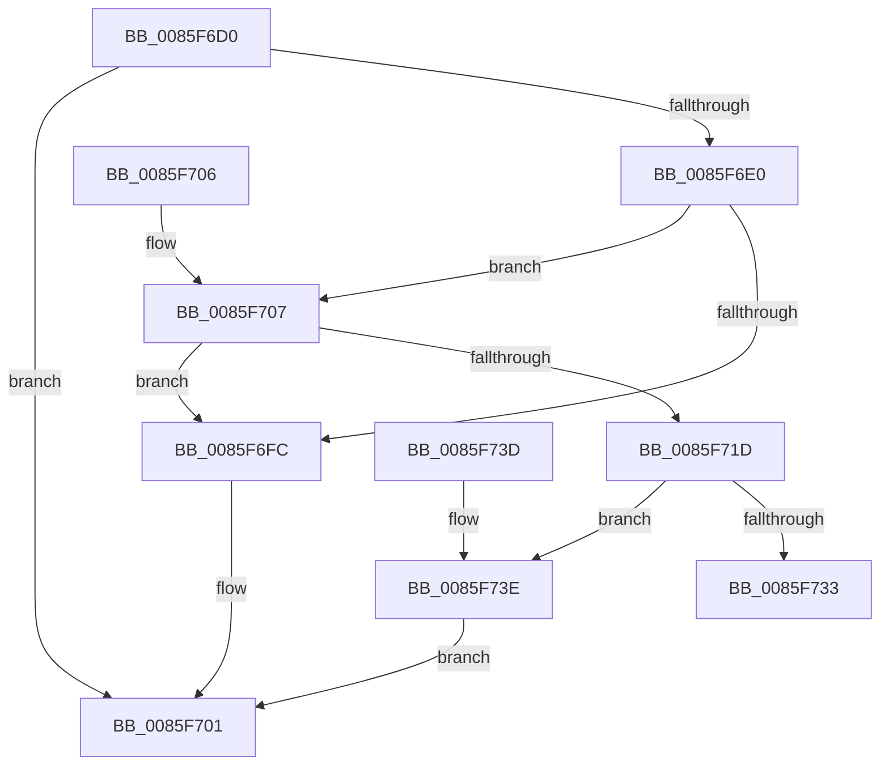

# CmpCleanupPathInfo

- RVA: `0x0085F6D0`–`0x0085F745` (길이 `117` bytes)
- VA: `0x000000014085F6D0`
- 실행 섹션: `PAGE`
- PDB 이름 있음: `예`; PDB Function 태그: `아니요`
- unwind 정보 RVA: `0x0006B4A0`
- 디코드: `32`개 명령, `117/117` bytes 표시
- 미해석 바이트: `0` (있으면 어셈블리에 `.byte`로 보존)

> 이 문서는 커널 이미지의 기계어와 PDB 기호를 분석해 생성했습니다. 4번과 5번은 함수 원형과 자료형을 바이너리 사용 방식에서 추정한 C 해석이며 원본 소스 복구 결과는 아닙니다.

## 1. Dependencies

- 직접 호출 지점: **3**; 고유 호출 대상: **3**
- 직접 호출자로 확인된 함수: **1**
- RIP 상대 이미지 참조: **1**

### Outgoing calls
- `0x0085F6FC` → [ExpInterlockedPushEntrySList](../../text/6B/ExpInterlockedPushEntrySList_function_006BA5B0.md) (function, `0x006BA5B0`)
- `0x0085F733` → [ExFreePool](../../poolcode/B8/ExFreePool_function_00B82850.md) (function, `0x00B82850`)
- `0x0085F73E` → [guard_dispatch_icall](../../text/6B/guard_dispatch_icall_function_006BAAD0.md) (function, `0x006BAAD0`)

### Direct callers
- [CmpDoParseKey](CmpDoParseKey_function_0085F750.md) at `0x008606EE`
- [CmpDoParseKey](CmpDoParseKey_function_0085F750.md) at `0x00860B60`

### Static image references
- `0x0085F724` → RVA `0x00B82850` (`ExFreePool`; read)

## 2. Other-region calls and transfers

- 다른 실행 섹션으로 향하는 call: **3**
  - `0x0085F6FC` → [ExpInterlockedPushEntrySList](../../text/6B/ExpInterlockedPushEntrySList_function_006BA5B0.md) (`PAGE` → `.text`)
  - `0x0085F733` → [ExFreePool](../../poolcode/B8/ExFreePool_function_00B82850.md) (`PAGE` → `POOLCODE`)
  - `0x0085F73E` → [guard_dispatch_icall](../../text/6B/guard_dispatch_icall_function_006BAAD0.md) (`PAGE` → `.text`)
- 별도 외부 분기/꼬리 이동을 확인하지 못했습니다.

## 3. Assembly (complete function range)

```asm
0085F6D0  48 83 EC 28                     sub rsp, 0x28
0085F6D4  48 8B 91 A0 00 00 00            mov rdx, qword ptr [rcx + 0xa0]
0085F6DB  48 85 D2                        test rdx, rdx
0085F6DE  74 21                           je 0x14085f701
0085F6E0  65 4C 8B 04 25 20 00 00 00      mov r8, qword ptr gs:[0x20]
0085F6E9  49 8B 88 80 08 00 00            mov rcx, qword ptr [r8 + 0x880]
0085F6F0  FF 41 1C                        inc dword ptr [rcx + 0x1c]
0085F6F3  0F B7 41 10                     movzx eax, word ptr [rcx + 0x10]
0085F6F7  66 39 01                        cmp word ptr [rcx], ax
0085F6FA  73 0B                           jae 0x14085f707
0085F6FC  E8 AF AE E5 FF                  call 0x1406ba5b0
0085F701  48 83 C4 28                     add rsp, 0x28
0085F705  C3                              ret
0085F706  CC                              int3
0085F707  FF 41 20                        inc dword ptr [rcx + 0x20]
0085F70A  49 8B 88 88 08 00 00            mov rcx, qword ptr [r8 + 0x888]
0085F711  FF 41 1C                        inc dword ptr [rcx + 0x1c]
0085F714  0F B7 41 10                     movzx eax, word ptr [rcx + 0x10]
0085F718  66 39 01                        cmp word ptr [rcx], ax
0085F71B  72 DF                           jb 0x14085f6fc
0085F71D  FF 41 20                        inc dword ptr [rcx + 0x20]
0085F720  48 8B 41 38                     mov rax, qword ptr [rcx + 0x38]
0085F724  48 8D 0D 25 31 32 00            lea rcx, [rip + 0x323125]
0085F72B  48 3B C1                        cmp rax, rcx
0085F72E  48 8B CA                        mov rcx, rdx
0085F731  75 0B                           jne 0x14085f73e
0085F733  E8 18 31 32 00                  call 0x140b82850
0085F738  48 83 C4 28                     add rsp, 0x28
0085F73C  C3                              ret
0085F73D  CC                              int3
0085F73E  E8 8D B3 E5 FF                  call 0x1406baad0
0085F743  EB BC                           jmp 0x14085f701
```

## 4. C-style interpretation (structured pseudocode)

```c
__int64 __fastcall CmpCleanupPathInfo(__int64 a1)
{
    __int64 result;
    __int64 v_rsp;

    v_rsp = (v_rsp) - (40);
    if (*(unsigned __int64 *)(a1 + 160) == 0) goto loc_0085F701;
    if ((*(unsigned __int16 *)(*(unsigned __int64 *)(*(unsigned __int64 *)(gs_base + (0 + 32)) + 2176))) >= ((unsigned __int16)(*(unsigned __int16 *)(*(unsigned __int64 *)(*(unsigned __int64 *)(gs_base + (0 + 32)) + 2176) + 16)))) goto loc_0085F707;
loc_0085F6FC:
    result = ExpInterlockedPushEntrySList(*(unsigned __int64 *)(*(unsigned __int64 *)(gs_base + (0 + 32)) + 2176), *(unsigned __int64 *)(a1 + 160), *(unsigned __int64 *)(gs_base + (0 + 32)), a4);
loc_0085F701:
    v_rsp = (v_rsp) + (40);
    return result;
loc_0085F707:
    if ((*(unsigned __int16 *)(*(unsigned __int64 *)(*(unsigned __int64 *)(gs_base + (0 + 32)) + 2184))) < ((unsigned __int16)(*(unsigned __int16 *)(*(unsigned __int64 *)(*(unsigned __int64 *)(gs_base + (0 + 32)) + 2184) + 16)))) goto loc_0085F6FC;
    if ((*(unsigned __int64 *)(*(unsigned __int64 *)(*(unsigned __int64 *)(gs_base + (0 + 32)) + 2184) + 56)) != (v_rip + 3289381)) goto loc_0085F73E;
    result = ExFreePool(*(unsigned __int64 *)(a1 + 160), *(unsigned __int64 *)(a1 + 160), *(unsigned __int64 *)(gs_base + (0 + 32)), a4);
    v_rsp = (v_rsp) + (40);
    return result;
loc_0085F73E:
    result = guard_dispatch_icall(*(unsigned __int64 *)(a1 + 160), *(unsigned __int64 *)(a1 + 160), *(unsigned __int64 *)(gs_base + (0 + 32)), a4);
    goto loc_0085F701;
}
```

## 5. (Beta) C Style

```c
int64_t CmpCleanupPathInfo(void *Arg1)
{
    uint8_t *arg1 = (uint8_t *)Arg1;

    int64_t result;
    int64_t local_rsp;

    local_rsp = (local_rsp) - (40);
    if (*(uint64_t *)(arg1 + 0xA0) == 0) goto loc_0085F701;
    if ((*(uint16_t *)(*(uint64_t *)(*(uint64_t *)(gs_base + (0 + 0x20)) + 0x880))) >= ((uint16_t)(*(uint16_t *)(*(uint64_t *)(*(uint64_t *)(gs_base + (0 + 0x20)) + 0x880) + 0x10)))) goto loc_0085F707;
loc_0085F6FC:
    result = ExpInterlockedPushEntrySList(*(uint64_t *)(*(uint64_t *)(gs_base + (0 + 0x20)) + 0x880), *(uint64_t *)(arg1 + 0xA0), *(uint64_t *)(gs_base + (0 + 0x20)), a4);
loc_0085F701:
    local_rsp = (local_rsp) + (40);
    return result;
loc_0085F707:
    if ((*(uint16_t *)(*(uint64_t *)(*(uint64_t *)(gs_base + (0 + 0x20)) + 0x888))) < ((uint16_t)(*(uint16_t *)(*(uint64_t *)(*(uint64_t *)(gs_base + (0 + 0x20)) + 0x888) + 0x10)))) goto loc_0085F6FC;
    if ((*(uint64_t *)(*(uint64_t *)(*(uint64_t *)(gs_base + (0 + 0x20)) + 0x888) + 0x38)) != (v_rip + 3289381)) goto loc_0085F73E;
    result = ExFreePool(*(uint64_t *)(arg1 + 0xA0), *(uint64_t *)(arg1 + 0xA0), *(uint64_t *)(gs_base + (0 + 0x20)), a4);
    local_rsp = (local_rsp) + (40);
    return result;
loc_0085F73E:
    result = guard_dispatch_icall(*(uint64_t *)(arg1 + 0xA0), *(uint64_t *)(arg1 + 0xA0), *(uint64_t *)(gs_base + (0 + 0x20)), a4);
    goto loc_0085F701;
}
```

### 관측된 메모리 오프셋

구조체 형식이 확인되지 않은 접근은 인자 기준의 오프셋으로만 기록했습니다.

| 기준 인자 | 오프셋 표현 | 폭 (bit) | 접근 |
|---|---:|---:|---|
| `Arg1` | `+ 0xA0` | `64` | `R` |

## 6. Execution-region graph

[열기: 2D/3D 그래프와 함수 탐색 컨트롤 패널](../../../control-panel.html?section=page&rva=0x0085F6D0&view=graph)

- 2D 그래프는 위에서 아래로 흐르고, 3D 그래프는 빈 공간을 드래그해 회전합니다. Shift+드래그는 이동, 휠은 확대·축소, 함수 노드 선택은 대상 보고서 이동입니다.

### Static fallback


