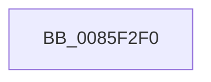

# CmpComputeComponentHashes

- RVA: `0x0085F2F0`–`0x0085F329` (길이 `57` bytes)
- VA: `0x000000014085F2F0`
- 실행 섹션: `PAGE`
- PDB 이름 있음: `예`; PDB Function 태그: `아니요`
- unwind 정보 RVA: `0x0006B3F0`
- 디코드: `15`개 명령, `57/57` bytes 표시
- 미해석 바이트: `0` (있으면 어셈블리에 `.byte`로 보존)

> 이 문서는 커널 이미지의 기계어와 PDB 기호를 분석해 생성했습니다. 4번과 5번은 함수 원형과 자료형을 바이너리 사용 방식에서 추정한 C 해석이며 원본 소스 복구 결과는 아닙니다.

## 1. Dependencies

- 직접 호출 지점: **0**; 고유 호출 대상: **0**
- 직접 호출자로 확인된 함수: **2**
- RIP 상대 이미지 참조: **0**

### Outgoing calls
- 직접 디코드된 call 명령이 없습니다.

### Direct callers
- [sub_00857A33](Unknown_function_00857A33.md) at `0x00857A6D`
- [CmpDoParseKey](CmpDoParseKey_function_0085F750.md) at `0x0085F967`
- [CmpDoParseKey](CmpDoParseKey_function_0085F750.md) at `0x0085FD24`

### Static image references
- 디코드된 RIP-relative 메모리 참조가 없습니다.

## 2. Other-region calls and transfers

- 다른 실행 섹션으로 향하는 call: **0**
- call이 아닌 외부 분기/꼬리 이동: **1**
  - `0x0085F323` → [sub_0085F44B](Unknown_function_0085F44B.md) (`tail-transfer`)

## 3. Assembly (complete function range)

```asm
0085F2F0  48 8B C4                        mov rax, rsp
0085F2F3  4C 89 40 18                     mov qword ptr [rax + 0x18], r8
0085F2F7  48 89 50 10                     mov qword ptr [rax + 0x10], rdx
0085F2FB  56                              push rsi
0085F2FC  41 56                           push r14
0085F2FE  48 83 EC 78                     sub rsp, 0x78
0085F302  0F 29 70 B8                     movaps xmmword ptr [rax - 0x48], xmm6
0085F306  0F 10 31                        movups xmm6, xmmword ptr [rcx]
0085F309  32 C9                           xor cl, cl
0085F30B  88 8C 24 90 00 00 00            mov byte ptr [rsp + 0x90], cl
0085F312  66 41 0F 7E F6                  movd r14d, xmm6
0085F317  0F 29 70 A8                     movaps xmmword ptr [rax - 0x58], xmm6
0085F31B  0F 29 70 98                     movaps xmmword ptr [rax - 0x68], xmm6
0085F31F  66 45 85 F6                     test r14w, r14w
0085F323  0F 84 22 01 00 00               je 0x14085f44b
```

## 4. C-style interpretation (structured pseudocode)

```c
__int64 __fastcall CmpComputeComponentHashes(__int64 a1, __int64 a2, __int64 a3)
{
    __int64 v_rsp;
    unsigned __int8 v_stack_p8;

    *(unsigned __int64 *)(v_rsp + 24) = a3;
    *(unsigned __int64 *)(v_rsp + 16) = a2;
    v_rsp = (v_rsp) - (120);
    *(unsigned __int64 *)(v_rsp - 72) = v_xmm6;
    a1 = 0;
    v_stack_p8 = 0;
    *(unsigned __int64 *)(v_rsp - 88) = v_xmm6;
    *(unsigned __int64 *)(v_rsp - 104) = v_xmm6;
}
```

## 5. (Beta) C Style

```c
int64_t CmpComputeComponentHashes(void *Arg1, int64_t Arg2, int64_t Arg3)
{
    uint8_t *arg1 = (uint8_t *)Arg1;

    int64_t local_rsp;
    uint8_t v_stack_p8;

    *(uint64_t *)(local_rsp + 0x18) = Arg3;
    *(uint64_t *)(local_rsp + 0x10) = Arg2;
    local_rsp = (local_rsp) - (120);
    *(uint64_t *)(local_rsp - 0x48) = v_xmm6;
    Arg1 = 0;
    v_stack_p8 = 0;
    *(uint64_t *)(local_rsp - 0x58) = v_xmm6;
    *(uint64_t *)(local_rsp - 0x68) = v_xmm6;
}
```

### 관측된 메모리 오프셋

구조체 형식이 확인되지 않은 접근은 인자 기준의 오프셋으로만 기록했습니다.

| 기준 인자 | 오프셋 표현 | 폭 (bit) | 접근 |
|---|---:|---:|---|
| `Arg1` | `+ 0x0` | `128` | `R` |

## 6. Execution-region graph

[열기: 2D/3D 그래프와 함수 탐색 컨트롤 패널](../../../control-panel.html?section=page&rva=0x0085F2F0&view=graph)

- 2D 그래프는 위에서 아래로 흐르고, 3D 그래프는 빈 공간을 드래그해 회전합니다. Shift+드래그는 이동, 휠은 확대·축소, 함수 노드 선택은 대상 보고서 이동입니다.

### Static fallback


