# CmpConstructNameWithStatus

- RVA: `0x008562A0`–`0x00856476` (길이 `470` bytes)
- VA: `0x00000001408562A0`
- 실행 섹션: `PAGE`
- PDB 이름 있음: `예`; PDB Function 태그: `아니요`
- unwind 정보 RVA: `0x0006A3F4`
- 디코드: `118`개 명령, `470/470` bytes 표시
- 미해석 바이트: `0` (있으면 어셈블리에 `.byte`로 보존)

> 이 문서는 커널 이미지의 기계어와 PDB 기호를 분석해 생성했습니다. 4번과 5번은 함수 원형과 자료형을 바이너리 사용 방식에서 추정한 C 해석이며 원본 소스 복구 결과는 아닙니다.

## 1. Dependencies

- 직접 호출 지점: **6**; 고유 호출 대상: **6**
- 직접 호출자로 확인된 함수: **7**
- RIP 상대 이미지 참조: **0**

### Outgoing calls
- `0x008562D8` → [CmpAcquireShutdownRundown](../../pagecmrc/BC/CmpAcquireShutdownRundown_function_00BC9400.md) (function, `0x00BC9400`)
- `0x0085637B` → [CmpConstructNameFromKeyNodes](CmpConstructNameFromKeyNodes_function_00855960.md) (function, `0x00855960`)
- `0x0085639D` → [CmSiFreeMemory](../../text/47/CmSiFreeMemory_function_00475D80.md) (function, `0x00475D80`)
- `0x008563A7` → [CmpReleaseShutdownRundown](../../pagecmrc/BC/CmpReleaseShutdownRundown_function_00BC9880.md) (function, `0x00BC9880`)
- `0x008563D2` → [CmpConstructNameFromKcbNameBlocks](../84/CmpConstructNameFromKcbNameBlocks_function_0084D510.md) (function, `0x0084D510`)
- `0x0085643A` → [CmpAllocatePool](../../text/3C/CmpAllocatePool_function_003CD504.md) (function, `0x003CD504`)

### Direct callers
- [CmQueryLayeredKey](../../text/46/CmQueryLayeredKey_function_0046A930.md) at `0x0046AA2A`
- [CmpLoadHiveVolatile](../7D/CmpLoadHiveVolatile_function_007DE5F0.md) at `0x007DE873`
- [CmpTraceSecurityChanging](../94/CmpTraceSecurityChanging_function_00949EEC.md) at `0x00949F2E`
- [sub_0094AD50](../94/Unknown_function_0094AD50.md) at `0x0094ADAE`
- [sub_0094AFBA](../94/Unknown_function_0094AFBA.md) at `0x0094AFDD`
- [sub_009DC539](../9D/Unknown_function_009DC539.md) at `0x009DC540`
- [CmpConstructAndCacheName](../9F/CmpConstructAndCacheName_function_009FE6F0.md) at `0x009FE74F`

### Static image references
- 디코드된 RIP-relative 메모리 참조가 없습니다.

## 2. Other-region calls and transfers

- 다른 실행 섹션으로 향하는 call: **4**
  - `0x008562D8` → [CmpAcquireShutdownRundown](../../pagecmrc/BC/CmpAcquireShutdownRundown_function_00BC9400.md) (`PAGE` → `PAGECMRC`)
  - `0x0085639D` → [CmSiFreeMemory](../../text/47/CmSiFreeMemory_function_00475D80.md) (`PAGE` → `.text`)
  - `0x008563A7` → [CmpReleaseShutdownRundown](../../pagecmrc/BC/CmpReleaseShutdownRundown_function_00BC9880.md) (`PAGE` → `PAGECMRC`)
  - `0x0085643A` → [CmpAllocatePool](../../text/3C/CmpAllocatePool_function_003CD504.md) (`PAGE` → `.text`)
- 별도 외부 분기/꼬리 이동을 확인하지 못했습니다.

## 3. Assembly (complete function range)

```asm
008562A0  48 89 5C 24 10                  mov qword ptr [rsp + 0x10], rbx
008562A5  48 89 6C 24 18                  mov qword ptr [rsp + 0x18], rbp
008562AA  56                              push rsi
008562AB  57                              push rdi
008562AC  41 56                           push r14
008562AE  48 83 EC 40                     sub rsp, 0x40
008562B2  0F 57 C0                        xorps xmm0, xmm0
008562B5  48 C7 44 24 60 00 00 00 00      mov qword ptr [rsp + 0x60], 0
008562BE  B8 FF FF FF FF                  mov eax, 0xffffffff
008562C3  4C 8B F2                        mov r14, rdx
008562C6  0F 11 44 24 20                  movups xmmword ptr [rsp + 0x20], xmm0
008562CB  66 89 44 24 22                  mov word ptr [rsp + 0x22], ax
008562D0  48 8B F1                        mov rsi, rcx
008562D3  0F 11 44 24 30                  movups xmmword ptr [rsp + 0x30], xmm0
008562D8  E8 23 31 37 00                  call 0x140bc9400
008562DD  0F BF 7E 42                     movsx edi, word ptr [rsi + 0x42]
008562E1  33 DB                           xor ebx, ebx
008562E3  0F B6 E8                        movzx ebp, al
008562E6  83 FF 02                        cmp edi, 2
008562E9  7C 0B                           jl 0x1408562f6
008562EB  8B CF                           mov ecx, edi
008562ED  83 E9 01                        sub ecx, 1
008562F0  0F 85 33 01 00 00               jne 0x140856429
008562F6  48 0F BF 46 42                  movsx rax, word ptr [rsi + 0x42]
008562FB  66 89 7C 24 20                  mov word ptr [rsp + 0x20], di
00856300  48 89 5C 24 38                  mov qword ptr [rsp + 0x38], rbx
00856305  66 89 44 24 22                  mov word ptr [rsp + 0x22], ax
0085630A  66 85 C0                        test ax, ax
0085630D  0F 85 D6 00 00 00               jne 0x1408563e9
00856313  48 89 74 C4 28                  mov qword ptr [rsp + rax*8 + 0x28], rsi
00856318  48 8B 5C 24 38                  mov rbx, qword ptr [rsp + 0x38]
0085631D  40 84 ED                        test bpl, bpl
00856320  0F 84 A4 00 00 00               je 0x1408563ca
00856326  F7 46 08 00 00 02 00            test dword ptr [rsi + 8], 0x20000
0085632D  0F 85 97 00 00 00               jne 0x1408563ca
00856333  0F B7 44 24 22                  movzx eax, word ptr [rsp + 0x22]
00856338  66 85 C0                        test ax, ax
0085633B  0F 88 89 00 00 00               js 0x1408563ca
00856341  48 0F BF C8                     movsx rcx, ax
00856345  66 83 F8 02                     cmp ax, 2
00856349  0F 8D 90 00 00 00               jge 0x1408563df
0085634F  48 8B 4C CC 28                  mov rcx, qword ptr [rsp + rcx*8 + 0x28]
00856354  66 83 79 42 00                  cmp word ptr [rcx + 0x42], 0
00856359  74 06                           je 0x140856361
0085635B  80 79 41 01                     cmp byte ptr [rcx + 0x41], 1
0085635F  74 69                           je 0x1408563ca
00856361  83 79 28 FF                     cmp dword ptr [rcx + 0x28], -1
00856365  74 5B                           je 0x1408563c2
00856367  83 7E 28 FF                     cmp dword ptr [rsi + 0x28], -1
0085636B  0F 84 E9 00 00 00               je 0x14085645a
00856371  48 8D 54 24 60                  lea rdx, [rsp + 0x60]
00856376  48 8D 4C 24 20                  lea rcx, [rsp + 0x20]
0085637B  E8 E0 F5 FF FF                  call 0x140855960
00856380  48 8B 5C 24 38                  mov rbx, qword ptr [rsp + 0x38]
00856385  8B F8                           mov edi, eax
00856387  85 C0                           test eax, eax
00856389  78 0A                           js 0x140856395
0085638B  48 8B 44 24 60                  mov rax, qword ptr [rsp + 0x60]
00856390  33 FF                           xor edi, edi
00856392  49 89 06                        mov qword ptr [r14], rax
00856395  48 85 DB                        test rbx, rbx
00856398  74 08                           je 0x1408563a2
0085639A  48 8B CB                        mov rcx, rbx
0085639D  E8 DE F9 C1 FF                  call 0x140475d80
008563A2  40 84 ED                        test bpl, bpl
008563A5  74 05                           je 0x1408563ac
008563A7  E8 D4 34 37 00                  call 0x140bc9880
008563AC  48 8B 5C 24 68                  mov rbx, qword ptr [rsp + 0x68]
008563B1  8B C7                           mov eax, edi
008563B3  48 8B 6C 24 70                  mov rbp, qword ptr [rsp + 0x70]
008563B8  48 83 C4 40                     add rsp, 0x40
008563BC  41 5E                           pop r14
008563BE  5F                              pop rdi
008563BF  5E                              pop rsi
008563C0  C3                              ret
008563C1  CC                              int3
008563C2  66 FF C8                        dec ax
008563C5  E9 6E FF FF FF                  jmp 0x140856338
008563CA  48 8D 54 24 60                  lea rdx, [rsp + 0x60]
008563CF  48 8B CE                        mov rcx, rsi
008563D2  E8 39 71 FF FF                  call 0x14084d510
008563D7  8B F8                           mov edi, eax
008563D9  85 C0                           test eax, eax
008563DB  78 B8                           js 0x140856395
008563DD  EB AC                           jmp 0x14085638b
008563DF  48 8B 4C CB F0                  mov rcx, qword ptr [rbx + rcx*8 - 0x10]
008563E4  E9 6B FF FF FF                  jmp 0x140856354
008563E9  48 8B 8E C0 00 00 00            mov rcx, qword ptr [rsi + 0xc0]
008563F0  48 85 C9                        test rcx, rcx
008563F3  0F 84 24 FF FF FF               je 0x14085631d
008563F9  0F 1F 80 00 00 00 00            nop dword ptr [rax]
00856400  48 8B 51 10                     mov rdx, qword ptr [rcx + 0x10]
00856404  4C 0F BF C0                     movsx r8, ax
00856408  66 83 F8 02                     cmp ax, 2
0085640C  7D 61                           jge 0x14085646f
0085640E  4A 89 54 C4 28                  mov qword ptr [rsp + r8*8 + 0x28], rdx
00856413  48 8B 5C 24 38                  mov rbx, qword ptr [rsp + 0x38]
00856418  48 8B 49 18                     mov rcx, qword ptr [rcx + 0x18]
0085641C  66 FF C8                        dec ax
0085641F  48 85 C9                        test rcx, rcx
00856422  75 DC                           jne 0x140856400
00856424  E9 F4 FE FF FF                  jmp 0x14085631d
00856429  8B D1                           mov edx, ecx
0085642B  41 B8 43 4D 36 35               mov r8d, 0x35364d43
00856431  48 C1 E2 03                     shl rdx, 3
00856435  B9 00 01 00 00                  mov ecx, 0x100
0085643A  E8 C5 70 B7 FF                  call 0x1403cd504
0085643F  48 8B D8                        mov rbx, rax
00856442  48 85 C0                        test rax, rax
00856445  0F 85 AB FE FF FF               jne 0x1408562f6
0085644B  48 8B 5C 24 38                  mov rbx, qword ptr [rsp + 0x38]
00856450  BF 9A 00 00 C0                  mov edi, 0xc000009a
00856455  E9 3B FF FF FF                  jmp 0x140856395
0085645A  F7 86 B8 00 00 00 00 00 04 00   test dword ptr [rsi + 0xb8], 0x40000
00856464  0F 84 07 FF FF FF               je 0x140856371
0085646A  E9 5B FF FF FF                  jmp 0x1408563ca
0085646F  4A 89 54 C3 F0                  mov qword ptr [rbx + r8*8 - 0x10], rdx
00856474  EB A2                           jmp 0x140856418
```

## 4. C-style interpretation (structured pseudocode)

```c
__int64 __fastcall CmpConstructNameWithStatus(__int64 a1, __int64 a2)
{
    __int64 result;
    __int64 v_rbx;
    __int64 v_rdi;
    __int64 v_rsp;
    unsigned __int64 v_stack_m20;
    unsigned __int64 v_stack_m28;
    unsigned __int16 v_stack_m36;
    unsigned __int64 v_stack_m38;
    unsigned __int64 v_stack_p10;
    unsigned __int64 v_stack_p18;
    unsigned __int64 v_stack_p38;
    unsigned __int64 v_stack_p60;
    unsigned __int64 v_stack_p8;

    v_stack_p10 = v_rbx;
    v_stack_p18 = v_rbp;
    v_rsp = (v_rsp) - (64);
    v_stack_p8 = 0;
    v_stack_m38 = v_xmm0;
    v_stack_m36 = (unsigned __int16)((unsigned int)(0xFFFFFFFFULL));
    v_stack_m28 = v_xmm0;
    result = CmpAcquireShutdownRundown(a1, a2, a3, a4);
    v_rbx = 0;
    if (((unsigned int)((__int16)(*(unsigned __int16 *)(a1 + 66)))) < 2) goto loc_008562F6;
    a1 = (unsigned int)(((unsigned int)((unsigned int)((__int16)(*(unsigned __int16 *)(a1 + 66))))) - (1));
    if (condition_is_not_equal) goto loc_00856429;
loc_008562F6:
    v_stack_m38 = (unsigned __int16)((__int16)(*(unsigned __int16 *)(a1 + 66)));
    v_stack_m20 = 0;
    v_stack_m36 = (unsigned __int16)((__int16)(*(unsigned __int16 *)(a1 + 66)));
    if ((unsigned __int16)((__int16)(*(unsigned __int16 *)(a1 + 66))) != 0) goto loc_008563E9;
    *(unsigned __int64 *)(v_rsp + (__int16)(*(unsigned __int16 *)(a1 + 66)) * 8 + 40) = a1;
loc_0085631D:
    if ((unsigned __int8)((unsigned __int8)(result)) == 0) goto loc_008563CA;
    if (((*(unsigned int *)(a1 + 8)) & (0x20000ULL)) != 0) goto loc_008563CA;
loc_00856338:
    if (sign_flag) goto loc_008563CA;
    if (((unsigned __int16)(v_stack_m36)) >= 2) goto loc_008563DF;
loc_00856354:
    if ((*(unsigned __int16 *)(*(unsigned __int64 *)(v_rsp + (__int16)((unsigned __int16)(v_stack_m36)) * 8 + 40) + 66)) == 0) goto loc_00856361;
    if ((*(unsigned __int8 *)(*(unsigned __int64 *)(v_rsp + (__int16)((unsigned __int16)(v_stack_m36)) * 8 + 40) + 65)) == 1) goto loc_008563CA;
loc_00856361:
    if ((*(unsigned int *)(*(unsigned __int64 *)(v_rsp + (__int16)((unsigned __int16)(v_stack_m36)) * 8 + 40) + 40)) == -1) goto loc_008563C2;
    if ((*(unsigned int *)(a1 + 40)) == -1) goto loc_0085645A;
loc_00856371:
    result = CmpConstructNameFromKeyNodes(v_stack_m38, v_stack_p8, a3, a4);
    v_rdi = (unsigned int)((unsigned int)(result));
    if (!(sign_flag)) {
        result = v_stack_p8;
        v_rdi = 0;
        *(unsigned __int64 *)(a2) = result;
    }
    if (v_stack_m20 != 0) {
        a1 = v_stack_m20;
        result = CmSiFreeMemory(a1, v_stack_p8, a3, a4);
    }
    if ((unsigned __int8)((unsigned __int8)(result)) != 0) {
        result = CmpReleaseShutdownRundown(a1, v_stack_p8, a3, a4);
    }
    v_rsp = (v_rsp) + (64);
    return 0;
loc_008563C2:
    result = (unsigned __int16)((0) - 1);
    goto loc_00856338;
loc_008563CA:
    result = CmpConstructNameFromKcbNameBlocks(a1, v_stack_p60, a3, a4);
    if (sign_flag) goto loc_00856395;
    goto loc_0085638B;
loc_008563DF:
    goto loc_00856354;
loc_008563E9:
    if (*(unsigned __int64 *)(a1 + 192) == 0) goto loc_0085631D;
loc_00856400:
    if (((unsigned __int16)(result)) >= 2) goto loc_0085646F;
    *(unsigned __int64 *)(v_rsp + (__int16)((unsigned __int16)(result)) * 8 + 40) = *(unsigned __int64 *)(*(unsigned __int64 *)(a1 + 192) + 16);
loc_00856418:
    result = (unsigned __int16)((result) - 1);
    if (*(unsigned __int64 *)(*(unsigned __int64 *)(a1 + 192) + 24) != 0) goto loc_00856400;
    goto loc_0085631D;
loc_00856429:
    a2 = ((unsigned int)((unsigned int)(*(unsigned __int64 *)(*(unsigned __int64 *)(a1 + 192) + 24)))) << (3);
    result = CmpAllocatePool(256, a2, (unsigned int)(0x35364D43ULL), a4);
    if (result != 0) goto loc_008562F6;
    goto loc_00856395;
loc_0085645A:
    if (((*(unsigned int *)(a1 + 184)) & (0x40000ULL)) == 0) goto loc_00856371;
    goto loc_008563CA;
loc_0085646F:
    *(unsigned __int64 *)(v_stack_p38 + (unsigned int)(0x35364D43ULL) * 8 - 16) = a2;
    goto loc_00856418;
}
```

## 5. (Beta) C Style

```c
int64_t CmpConstructNameWithStatus(void *Arg1, void *Arg2)
{
    uint8_t *arg1 = (uint8_t *)Arg1;
    uint8_t *arg2 = (uint8_t *)Arg2;

    int64_t result;
    int64_t local_rbx;
    int64_t local_rdi;
    int64_t local_rsp;
    uint64_t v_stack_m20;
    uint64_t v_stack_m28;
    uint16_t v_stack_m36;
    uint64_t v_stack_m38;
    uint64_t v_stack_p10;
    uint64_t v_stack_p18;
    uint64_t v_stack_p38;
    uint64_t v_stack_p60;
    uint64_t v_stack_p8;

    v_stack_p10 = local_rbx;
    v_stack_p18 = local_rbp;
    local_rsp = (local_rsp) - (64);
    v_stack_p8 = 0;
    v_stack_m38 = v_xmm0;
    v_stack_m36 = (uint16_t)((uint32_t)(0xFFFFFFFFULL));
    v_stack_m28 = v_xmm0;
    result = CmpAcquireShutdownRundown(Arg1, Arg2, a3, a4);
    local_rbx = 0;
    if (((uint32_t)((int16_t)(*(uint16_t *)(arg1 + 0x42)))) < 2) goto loc_008562F6;
    Arg1 = (uint32_t)(((uint32_t)((uint32_t)((int16_t)(*(uint16_t *)(arg1 + 0x42))))) - (1));
    if (condition_is_not_equal) goto loc_00856429;
loc_008562F6:
    v_stack_m38 = (uint16_t)((int16_t)(*(uint16_t *)(arg1 + 0x42)));
    v_stack_m20 = 0;
    v_stack_m36 = (uint16_t)((int16_t)(*(uint16_t *)(arg1 + 0x42)));
    if ((uint16_t)((int16_t)(*(uint16_t *)(arg1 + 0x42))) != 0) goto loc_008563E9;
    *(void **)(local_rsp + (int16_t)(*(uint16_t *)(arg1 + 0x42)) * 8 + 0x28) = Arg1;
loc_0085631D:
    if ((uint8_t)((uint8_t)(result)) == 0) goto loc_008563CA;
    if (((*(uint32_t *)(arg1 + 0x8)) & (0x20000ULL)) != 0) goto loc_008563CA;
loc_00856338:
    if (sign_flag) goto loc_008563CA;
    if (((uint16_t)(v_stack_m36)) >= 2) goto loc_008563DF;
loc_00856354:
    if ((*(uint16_t *)(*(uint64_t *)(local_rsp + (int16_t)((uint16_t)(v_stack_m36)) * 8 + 0x28) + 0x42)) == 0) goto loc_00856361;
    if ((*(uint8_t *)(*(uint64_t *)(local_rsp + (int16_t)((uint16_t)(v_stack_m36)) * 8 + 0x28) + 0x41)) == 1) goto loc_008563CA;
loc_00856361:
    if ((*(uint32_t *)(*(uint64_t *)(local_rsp + (int16_t)((uint16_t)(v_stack_m36)) * 8 + 0x28) + 0x28)) == -1) goto loc_008563C2;
    if ((*(uint32_t *)(arg1 + 0x28)) == -1) goto loc_0085645A;
loc_00856371:
    result = CmpConstructNameFromKeyNodes(v_stack_m38, v_stack_p8, a3, a4);
    local_rdi = (uint32_t)((uint32_t)(result));
    if (!(sign_flag)) {
        result = v_stack_p8;
        local_rdi = 0;
        *(uint64_t *)(arg2) = result;
    }
    if (v_stack_m20 != 0) {
        Arg1 = v_stack_m20;
        result = CmSiFreeMemory(Arg1, v_stack_p8, a3, a4);
    }
    if ((uint8_t)((uint8_t)(result)) != 0) {
        result = CmpReleaseShutdownRundown(Arg1, v_stack_p8, a3, a4);
    }
    local_rsp = (local_rsp) + (64);
    return 0;
loc_008563C2:
    result = (uint16_t)((0) - 1);
    goto loc_00856338;
loc_008563CA:
    result = CmpConstructNameFromKcbNameBlocks(Arg1, v_stack_p60, a3, a4);
    if (sign_flag) goto loc_00856395;
    goto loc_0085638B;
loc_008563DF:
    goto loc_00856354;
loc_008563E9:
    if (*(uint64_t *)(arg1 + 0xC0) == 0) goto loc_0085631D;
loc_00856400:
    if (((uint16_t)(result)) >= 2) goto loc_0085646F;
    *(uint64_t *)(local_rsp + (int16_t)((uint16_t)(result)) * 8 + 0x28) = *(uint64_t *)(*(uint64_t *)(arg1 + 0xC0) + 0x10);
loc_00856418:
    result = (uint16_t)((result) - 1);
    if (*(uint64_t *)(*(uint64_t *)(arg1 + 0xC0) + 0x18) != 0) goto loc_00856400;
    goto loc_0085631D;
loc_00856429:
    Arg2 = ((uint32_t)((uint32_t)(*(uint64_t *)(*(uint64_t *)(arg1 + 0xC0) + 0x18)))) << (3);
    result = CmpAllocatePool(256, Arg2, (uint32_t)(0x35364D43ULL), a4);
    if (result != 0) goto loc_008562F6;
    goto loc_00856395;
loc_0085645A:
    if (((*(uint32_t *)(arg1 + 0xB8)) & (0x40000ULL)) == 0) goto loc_00856371;
    goto loc_008563CA;
loc_0085646F:
    *(void **)(v_stack_p38 + (uint32_t)(0x35364D43ULL) * 8 - 0x10) = Arg2;
    goto loc_00856418;
}
```

### 관측된 메모리 오프셋

구조체 형식이 확인되지 않은 접근은 인자 기준의 오프셋으로만 기록했습니다.

| 기준 인자 | 오프셋 표현 | 폭 (bit) | 접근 |
|---|---:|---:|---|
| `Arg1` | `+ 0x8` | `32` | `R` |
| `Arg1` | `+ 0x28` | `32` | `R` |
| `Arg1` | `+ 0x42` | `16` | `R` |
| `Arg1` | `+ 0xB8` | `32` | `R` |
| `Arg1` | `+ 0xC0` | `64` | `R` |
| `Arg2` | `+ 0x0` | `64` | `W` |

## 6. Execution-region graph

[열기: 2D/3D 그래프와 함수 탐색 컨트롤 패널](../../../control-panel.html?section=page&rva=0x008562A0&view=graph)

- 2D 그래프는 위에서 아래로 흐르고, 3D 그래프는 빈 공간을 드래그해 회전합니다. Shift+드래그는 이동, 휠은 확대·축소, 함수 노드 선택은 대상 보고서 이동입니다.

### Static fallback

```mermaid
flowchart TD
  bb_008562A0[BB_008562A0]
  bb_008562EB[BB_008562EB]
  bb_008562F6[BB_008562F6]
  bb_00856313[BB_00856313]
  bb_0085631D[BB_0085631D]
  bb_00856326[BB_00856326]
  bb_00856333[BB_00856333]
  bb_00856338[BB_00856338]
  bb_00856341[BB_00856341]
  bb_0085634F[BB_0085634F]
  bb_00856354[BB_00856354]
  bb_0085635B[BB_0085635B]
  bb_00856361[BB_00856361]
  bb_00856367[BB_00856367]
  bb_00856371[BB_00856371]
  bb_0085638B[BB_0085638B]
  bb_00856395[BB_00856395]
  bb_0085639A[BB_0085639A]
  bb_008563A2[BB_008563A2]
  bb_008563A7[BB_008563A7]
  bb_008563AC[BB_008563AC]
  bb_008563C1[BB_008563C1]
  bb_008563C2[BB_008563C2]
  bb_008563CA[BB_008563CA]
  bb_008563DD[BB_008563DD]
  bb_008563DF[BB_008563DF]
  bb_008563E9[BB_008563E9]
  bb_008563F9[BB_008563F9]
  bb_00856400[BB_00856400]
  bb_0085640E[BB_0085640E]
  bb_00856418[BB_00856418]
  bb_00856424[BB_00856424]
  bb_00856429[BB_00856429]
  bb_0085644B[BB_0085644B]
  bb_0085645A[BB_0085645A]
  bb_0085646A[BB_0085646A]
  bb_0085646F[BB_0085646F]
  bb_008562A0 -->|branch| bb_008562F6
  bb_008562A0 -->|fallthrough| bb_008562EB
  bb_008562EB -->|branch| bb_00856429
  bb_008562EB -->|fallthrough| bb_008562F6
  bb_008562F6 -->|branch| bb_008563E9
  bb_008562F6 -->|fallthrough| bb_00856313
  bb_00856313 -->|flow| bb_0085631D
  bb_0085631D -->|branch| bb_008563CA
  bb_0085631D -->|fallthrough| bb_00856326
  bb_00856326 -->|branch| bb_008563CA
  bb_00856326 -->|fallthrough| bb_00856333
  bb_00856333 -->|flow| bb_00856338
  bb_00856338 -->|branch| bb_008563CA
  bb_00856338 -->|fallthrough| bb_00856341
  bb_00856341 -->|branch| bb_008563DF
  bb_00856341 -->|fallthrough| bb_0085634F
  bb_0085634F -->|flow| bb_00856354
  bb_00856354 -->|branch| bb_00856361
  bb_00856354 -->|fallthrough| bb_0085635B
  bb_0085635B -->|branch| bb_008563CA
  bb_0085635B -->|fallthrough| bb_00856361
  bb_00856361 -->|branch| bb_008563C2
  bb_00856361 -->|fallthrough| bb_00856367
  bb_00856367 -->|branch| bb_0085645A
  bb_00856367 -->|fallthrough| bb_00856371
  bb_00856371 -->|branch| bb_00856395
  bb_00856371 -->|fallthrough| bb_0085638B
  bb_0085638B -->|flow| bb_00856395
  bb_00856395 -->|branch| bb_008563A2
  bb_00856395 -->|fallthrough| bb_0085639A
  bb_0085639A -->|flow| bb_008563A2
  bb_008563A2 -->|branch| bb_008563AC
  bb_008563A2 -->|fallthrough| bb_008563A7
  bb_008563A7 -->|flow| bb_008563AC
  bb_008563C1 -->|flow| bb_008563C2
  bb_008563C2 -->|branch| bb_00856338
  bb_008563CA -->|branch| bb_00856395
  bb_008563CA -->|fallthrough| bb_008563DD
  bb_008563DD -->|branch| bb_0085638B
  bb_008563DF -->|branch| bb_00856354
  bb_008563E9 -->|branch| bb_0085631D
  bb_008563E9 -->|fallthrough| bb_008563F9
  bb_008563F9 -->|flow| bb_00856400
  bb_00856400 -->|branch| bb_0085646F
  bb_00856400 -->|fallthrough| bb_0085640E
  bb_0085640E -->|flow| bb_00856418
  bb_00856418 -->|branch| bb_00856400
  bb_00856418 -->|fallthrough| bb_00856424
  bb_00856424 -->|branch| bb_0085631D
  bb_00856429 -->|branch| bb_008562F6
  bb_00856429 -->|fallthrough| bb_0085644B
  bb_0085644B -->|branch| bb_00856395
  bb_0085645A -->|branch| bb_00856371
  bb_0085645A -->|fallthrough| bb_0085646A
  bb_0085646A -->|branch| bb_008563CA
  bb_0085646F -->|branch| bb_00856418
```


