# CmpConstructName

- RVA: `0x00856BE0`–`0x00856DA1` (길이 `449` bytes)
- VA: `0x0000000140856BE0`
- 실행 섹션: `PAGE`
- PDB 이름 있음: `예`; PDB Function 태그: `아니요`
- unwind 정보 RVA: `0x0006A4F4`
- 디코드: `113`개 명령, `449/449` bytes 표시
- 미해석 바이트: `0` (있으면 어셈블리에 `.byte`로 보존)

> 이 문서는 커널 이미지의 기계어와 PDB 기호를 분석해 생성했습니다. 4번과 5번은 함수 원형과 자료형을 바이너리 사용 방식에서 추정한 C 해석이며 원본 소스 복구 결과는 아닙니다.

## 1. Dependencies

- 직접 호출 지점: **6**; 고유 호출 대상: **6**
- 직접 호출자로 확인된 함수: **18**
- RIP 상대 이미지 참조: **0**

### Outgoing calls
- `0x00856C13` → [CmpAcquireShutdownRundown](../../pagecmrc/BC/CmpAcquireShutdownRundown_function_00BC9400.md) (function, `0x00BC9400`)
- `0x00856CB6` → [CmpConstructNameFromKeyNodes](CmpConstructNameFromKeyNodes_function_00855960.md) (function, `0x00855960`)
- `0x00856CD1` → [CmSiFreeMemory](../../text/47/CmSiFreeMemory_function_00475D80.md) (function, `0x00475D80`)
- `0x00856CDB` → [CmpReleaseShutdownRundown](../../pagecmrc/BC/CmpReleaseShutdownRundown_function_00BC9880.md) (function, `0x00BC9880`)
- `0x00856D07` → [CmpConstructNameFromKcbNameBlocks](../84/CmpConstructNameFromKcbNameBlocks_function_0084D510.md) (function, `0x0084D510`)
- `0x00856D6A` → [CmpAllocatePool](../../text/3C/CmpAllocatePool_function_003CD504.md) (function, `0x003CD504`)

### Direct callers
- [CmpDoQueryKeyName](../../text/45/CmpDoQueryKeyName_function_00456664.md) at `0x00456852`
- [CmpIsHiveAlreadyLoaded](../7E/CmpIsHiveAlreadyLoaded_function_007EA594.md) at `0x007EA68C`
- [CmpDumpKeyBodyList](../7E/CmpDumpKeyBodyList_function_007EAB20.md) at `0x007EAB87`
- [CmpReportAuditVirtualizationEvent](../7E/CmpReportAuditVirtualizationEvent_function_007ED758.md) at `0x007ED84A`
- [CmpReportAuditVirtualizationEvent](../7E/CmpReportAuditVirtualizationEvent_function_007ED758.md) at `0x007ED882`
- [CmAddLogForAction](../84/CmAddLogForAction_function_008445AC.md) at `0x0084462A`
- [sub_008515D5](Unknown_function_008515D5.md) at `0x0085163E`
- [CmpCreateKeyControlBlock](CmpCreateKeyControlBlock_function_00851DB0.md) at `0x00852371`
- [CmQueryKey](CmQueryKey_function_00858240.md) at `0x00858A9E`
- [sub_00861F68](../86/Unknown_function_00861F68.md) at `0x00861F94`
- [sub_00862CD4](../86/Unknown_function_00862CD4.md) at `0x00862D08`
- [CmLoadAppKey](../87/CmLoadAppKey_function_00876FFC.md) at `0x00877A3C`
- [CmpLinkHiveToMaster](../87/CmpLinkHiveToMaster_function_00877D6C.md) at `0x00877F68`
- [sub_00878374](../87/Unknown_function_00878374.md) at `0x00878380`
- [CmRealKCBToVirtualPath](../99/CmRealKCBToVirtualPath_function_00990130.md) at `0x00990179`
- [CmVirtualKCBToRealPath](../A7/CmVirtualKCBToRealPath_function_00A76BE8.md) at `0x00A76C19`
- [CmEtwRunDown](../A8/CmEtwRunDown_function_00A85AC0.md) at `0x00A85C12`
- [CmpTraceHiveSaveStart](../AD/CmpTraceHiveSaveStart_function_00AD8A5C.md) at `0x00AD8AA8`
- [sub_00B16F66](../B1/Unknown_function_00B16F66.md) at `0x00B17150`
- [sub_00B16F66](../B1/Unknown_function_00B16F66.md) at `0x00B17236`
- [sub_00B16F66](../B1/Unknown_function_00B16F66.md) at `0x00B1747E`

### Static image references
- 디코드된 RIP-relative 메모리 참조가 없습니다.

## 2. Other-region calls and transfers

- 다른 실행 섹션으로 향하는 call: **4**
  - `0x00856C13` → [CmpAcquireShutdownRundown](../../pagecmrc/BC/CmpAcquireShutdownRundown_function_00BC9400.md) (`PAGE` → `PAGECMRC`)
  - `0x00856CD1` → [CmSiFreeMemory](../../text/47/CmSiFreeMemory_function_00475D80.md) (`PAGE` → `.text`)
  - `0x00856CDB` → [CmpReleaseShutdownRundown](../../pagecmrc/BC/CmpReleaseShutdownRundown_function_00BC9880.md) (`PAGE` → `PAGECMRC`)
  - `0x00856D6A` → [CmpAllocatePool](../../text/3C/CmpAllocatePool_function_003CD504.md) (`PAGE` → `.text`)
- 별도 외부 분기/꼬리 이동을 확인하지 못했습니다.

## 3. Assembly (complete function range)

```asm
00856BE0  48 89 5C 24 10                  mov qword ptr [rsp + 0x10], rbx
00856BE5  48 89 6C 24 18                  mov qword ptr [rsp + 0x18], rbp
00856BEA  56                              push rsi
00856BEB  57                              push rdi
00856BEC  41 56                           push r14
00856BEE  48 83 EC 40                     sub rsp, 0x40
00856BF2  0F 57 C0                        xorps xmm0, xmm0
00856BF5  B8 FF FF FF FF                  mov eax, 0xffffffff
00856BFA  0F 11 44 24 20                  movups xmmword ptr [rsp + 0x20], xmm0
00856BFF  33 ED                           xor ebp, ebp
00856C01  66 89 44 24 22                  mov word ptr [rsp + 0x22], ax
00856C06  48 8B F1                        mov rsi, rcx
00856C09  48 89 6C 24 60                  mov qword ptr [rsp + 0x60], rbp
00856C0E  0F 11 44 24 30                  movups xmmword ptr [rsp + 0x30], xmm0
00856C13  E8 E8 27 37 00                  call 0x140bc9400
00856C18  0F BF 7E 42                     movsx edi, word ptr [rsi + 0x42]
00856C1C  44 0F B6 F0                     movzx r14d, al
00856C20  8B DD                           mov ebx, ebp
00856C22  83 FF 02                        cmp edi, 2
00856C25  7C 0B                           jl 0x140856c32
00856C27  8B C7                           mov eax, edi
00856C29  83 E8 01                        sub eax, 1
00856C2C  0F 85 27 01 00 00               jne 0x140856d59
00856C32  48 0F BF 46 42                  movsx rax, word ptr [rsi + 0x42]
00856C37  66 89 7C 24 20                  mov word ptr [rsp + 0x20], di
00856C3C  48 89 5C 24 38                  mov qword ptr [rsp + 0x38], rbx
00856C41  66 89 44 24 22                  mov word ptr [rsp + 0x22], ax
00856C46  66 85 C0                        test ax, ax
00856C49  0F 85 CD 00 00 00               jne 0x140856d1c
00856C4F  48 89 74 C4 28                  mov qword ptr [rsp + rax*8 + 0x28], rsi
00856C54  48 8B 5C 24 38                  mov rbx, qword ptr [rsp + 0x38]
00856C59  45 84 F6                        test r14b, r14b
00856C5C  0F 84 9D 00 00 00               je 0x140856cff
00856C62  F7 46 08 00 00 02 00            test dword ptr [rsi + 8], 0x20000
00856C69  0F 85 90 00 00 00               jne 0x140856cff
00856C6F  0F B7 44 24 22                  movzx eax, word ptr [rsp + 0x22]
00856C74  66 85 C0                        test ax, ax
00856C77  0F 88 82 00 00 00               js 0x140856cff
00856C7D  48 0F BF C8                     movsx rcx, ax
00856C81  66 83 F8 02                     cmp ax, 2
00856C85  0F 8D 87 00 00 00               jge 0x140856d12
00856C8B  48 8B 4C CC 28                  mov rcx, qword ptr [rsp + rcx*8 + 0x28]
00856C90  66 39 69 42                     cmp word ptr [rcx + 0x42], bp
00856C94  74 06                           je 0x140856c9c
00856C96  80 79 41 01                     cmp byte ptr [rcx + 0x41], 1
00856C9A  74 63                           je 0x140856cff
00856C9C  83 79 28 FF                     cmp dword ptr [rcx + 0x28], -1
00856CA0  74 55                           je 0x140856cf7
00856CA2  83 7E 28 FF                     cmp dword ptr [rsi + 0x28], -1
00856CA6  0F 84 D9 00 00 00               je 0x140856d85
00856CAC  48 8D 54 24 60                  lea rdx, [rsp + 0x60]
00856CB1  48 8D 4C 24 20                  lea rcx, [rsp + 0x20]
00856CB6  E8 A5 EC FF FF                  call 0x140855960
00856CBB  48 8B 5C 24 38                  mov rbx, qword ptr [rsp + 0x38]
00856CC0  85 C0                           test eax, eax
00856CC2  78 05                           js 0x140856cc9
00856CC4  48 8B 6C 24 60                  mov rbp, qword ptr [rsp + 0x60]
00856CC9  48 85 DB                        test rbx, rbx
00856CCC  74 08                           je 0x140856cd6
00856CCE  48 8B CB                        mov rcx, rbx
00856CD1  E8 AA F0 C1 FF                  call 0x140475d80
00856CD6  45 84 F6                        test r14b, r14b
00856CD9  74 05                           je 0x140856ce0
00856CDB  E8 A0 2B 37 00                  call 0x140bc9880
00856CE0  48 8B 5C 24 68                  mov rbx, qword ptr [rsp + 0x68]
00856CE5  48 8B C5                        mov rax, rbp
00856CE8  48 8B 6C 24 70                  mov rbp, qword ptr [rsp + 0x70]
00856CED  48 83 C4 40                     add rsp, 0x40
00856CF1  41 5E                           pop r14
00856CF3  5F                              pop rdi
00856CF4  5E                              pop rsi
00856CF5  C3                              ret
00856CF6  CC                              int3
00856CF7  66 FF C8                        dec ax
00856CFA  E9 75 FF FF FF                  jmp 0x140856c74
00856CFF  48 8D 54 24 60                  lea rdx, [rsp + 0x60]
00856D04  48 8B CE                        mov rcx, rsi
00856D07  E8 04 68 FF FF                  call 0x14084d510
00856D0C  85 C0                           test eax, eax
00856D0E  78 B9                           js 0x140856cc9
00856D10  EB B2                           jmp 0x140856cc4
00856D12  48 8B 4C CB F0                  mov rcx, qword ptr [rbx + rcx*8 - 0x10]
00856D17  E9 74 FF FF FF                  jmp 0x140856c90
00856D1C  48 8B 8E C0 00 00 00            mov rcx, qword ptr [rsi + 0xc0]
00856D23  48 85 C9                        test rcx, rcx
00856D26  0F 84 2D FF FF FF               je 0x140856c59
00856D2C  0F 1F 40 00                     nop dword ptr [rax]
00856D30  48 8B 51 10                     mov rdx, qword ptr [rcx + 0x10]
00856D34  4C 0F BF C0                     movsx r8, ax
00856D38  66 83 F8 02                     cmp ax, 2
00856D3C  7D 5C                           jge 0x140856d9a
00856D3E  4A 89 54 C4 28                  mov qword ptr [rsp + r8*8 + 0x28], rdx
00856D43  48 8B 5C 24 38                  mov rbx, qword ptr [rsp + 0x38]
00856D48  48 8B 49 18                     mov rcx, qword ptr [rcx + 0x18]
00856D4C  66 FF C8                        dec ax
00856D4F  48 85 C9                        test rcx, rcx
00856D52  75 DC                           jne 0x140856d30
00856D54  E9 00 FF FF FF                  jmp 0x140856c59
00856D59  8B D0                           mov edx, eax
00856D5B  B9 00 01 00 00                  mov ecx, 0x100
00856D60  48 C1 E2 03                     shl rdx, 3
00856D64  41 B8 43 4D 36 35               mov r8d, 0x35364d43
00856D6A  E8 95 67 B7 FF                  call 0x1403cd504
00856D6F  48 8B D8                        mov rbx, rax
00856D72  48 85 C0                        test rax, rax
00856D75  0F 85 B7 FE FF FF               jne 0x140856c32
00856D7B  48 8B 5C 24 38                  mov rbx, qword ptr [rsp + 0x38]
00856D80  E9 44 FF FF FF                  jmp 0x140856cc9
00856D85  F7 86 B8 00 00 00 00 00 04 00   test dword ptr [rsi + 0xb8], 0x40000
00856D8F  0F 84 17 FF FF FF               je 0x140856cac
00856D95  E9 65 FF FF FF                  jmp 0x140856cff
00856D9A  4A 89 54 C3 F0                  mov qword ptr [rbx + r8*8 - 0x10], rdx
00856D9F  EB A7                           jmp 0x140856d48
```

## 4. C-style interpretation (structured pseudocode)

```c
__int64 __fastcall CmpConstructName(__int64 a1)
{
    __int64 result;
    __int64 v_rbp;
    __int64 v_rsp;
    unsigned __int64 v_stack_m20;
    unsigned __int64 v_stack_m28;
    unsigned __int16 v_stack_m36;
    unsigned __int64 v_stack_m38;
    unsigned __int64 v_stack_p10;
    unsigned __int64 v_stack_p18;
    unsigned __int64 v_stack_p38;
    unsigned __int64 v_stack_p60;
    unsigned __int64 v_stack_p8;

    v_stack_p10 = v_rbx;
    v_stack_p18 = v_rbp;
    v_rsp = (v_rsp) - (64);
    v_stack_m38 = v_xmm0;
    v_rbp = 0;
    v_stack_m36 = (unsigned __int16)((unsigned int)(0xFFFFFFFFULL));
    v_stack_p8 = 0;
    v_stack_m28 = v_xmm0;
    result = CmpAcquireShutdownRundown(a1, a2, a3, a4);
    if (((unsigned int)((__int16)(*(unsigned __int16 *)(a1 + 66)))) < 2) goto loc_00856C32;
    result = (unsigned int)(((unsigned int)((unsigned int)((__int16)(*(unsigned __int16 *)(a1 + 66))))) - (1));
    if (condition_is_not_equal) goto loc_00856D59;
loc_00856C32:
    v_stack_m38 = (unsigned __int16)((__int16)(*(unsigned __int16 *)(a1 + 66)));
    v_stack_m20 = 0;
    v_stack_m36 = (unsigned __int16)((__int16)(*(unsigned __int16 *)(a1 + 66)));
    if ((unsigned __int16)((__int16)(*(unsigned __int16 *)(a1 + 66))) != 0) goto loc_00856D1C;
    *(unsigned __int64 *)(v_rsp + (__int16)(*(unsigned __int16 *)(a1 + 66)) * 8 + 40) = a1;
loc_00856C59:
    if ((unsigned __int8)((unsigned __int8)(result)) == 0) goto loc_00856CFF;
    if (((*(unsigned int *)(a1 + 8)) & (0x20000ULL)) != 0) goto loc_00856CFF;
loc_00856C74:
    if (sign_flag) goto loc_00856CFF;
    if (((unsigned __int16)(v_stack_m36)) >= 2) goto loc_00856D12;
loc_00856C90:
    if ((*(unsigned __int16 *)(*(unsigned __int64 *)(v_rsp + (__int16)((unsigned __int16)(v_stack_m36)) * 8 + 40) + 66)) == 0) goto loc_00856C9C;
    if ((*(unsigned __int8 *)(*(unsigned __int64 *)(v_rsp + (__int16)((unsigned __int16)(v_stack_m36)) * 8 + 40) + 65)) == 1) goto loc_00856CFF;
loc_00856C9C:
    if ((*(unsigned int *)(*(unsigned __int64 *)(v_rsp + (__int16)((unsigned __int16)(v_stack_m36)) * 8 + 40) + 40)) == -1) goto loc_00856CF7;
    if ((*(unsigned int *)(a1 + 40)) == -1) goto loc_00856D85;
loc_00856CAC:
    result = CmpConstructNameFromKeyNodes(v_stack_m38, v_stack_p8, a3, a4);
    if (!(sign_flag)) {
        v_rbp = v_stack_p8;
    }
    if (v_stack_m20 != 0) {
        a1 = v_stack_m20;
        result = CmSiFreeMemory(a1, v_stack_p8, a3, a4);
    }
    if ((unsigned __int8)((unsigned __int8)(result)) != 0) {
        result = CmpReleaseShutdownRundown(a1, v_stack_p8, a3, a4);
    }
    v_rsp = (v_rsp) + (64);
    return v_rbp;
loc_00856CF7:
    result = (unsigned __int16)((v_rbp) - 1);
    goto loc_00856C74;
loc_00856CFF:
    result = CmpConstructNameFromKcbNameBlocks(a1, v_stack_p60, a3, a4);
    if (sign_flag) goto loc_00856CC9;
    goto loc_00856CC4;
loc_00856D12:
    goto loc_00856C90;
loc_00856D1C:
    if (*(unsigned __int64 *)(a1 + 192) == 0) goto loc_00856C59;
loc_00856D30:
    if (((unsigned __int16)(result)) >= 2) goto loc_00856D9A;
    *(unsigned __int64 *)(v_rsp + (__int16)((unsigned __int16)(result)) * 8 + 40) = *(unsigned __int64 *)(*(unsigned __int64 *)(a1 + 192) + 16);
loc_00856D48:
    result = (unsigned __int16)((result) - 1);
    if (*(unsigned __int64 *)(*(unsigned __int64 *)(a1 + 192) + 24) != 0) goto loc_00856D30;
    goto loc_00856C59;
loc_00856D59:
    a2 = ((unsigned int)((unsigned int)(result))) << (3);
    result = CmpAllocatePool(256, a2, (unsigned int)(0x35364D43ULL), a4);
    if (result != 0) goto loc_00856C32;
    goto loc_00856CC9;
loc_00856D85:
    if (((*(unsigned int *)(a1 + 184)) & (0x40000ULL)) == 0) goto loc_00856CAC;
    goto loc_00856CFF;
loc_00856D9A:
    *(unsigned __int64 *)(v_stack_p38 + (unsigned int)(0x35364D43ULL) * 8 - 16) = a2;
    goto loc_00856D48;
}
```

## 5. (Beta) C Style

```c
int64_t CmpConstructName(void *Arg1)
{
    uint8_t *arg1 = (uint8_t *)Arg1;

    int64_t result;
    int64_t local_rbp;
    int64_t local_rsp;
    uint64_t v_stack_m20;
    uint64_t v_stack_m28;
    uint16_t v_stack_m36;
    uint64_t v_stack_m38;
    uint64_t v_stack_p10;
    uint64_t v_stack_p18;
    uint64_t v_stack_p38;
    uint64_t v_stack_p60;
    uint64_t v_stack_p8;

    v_stack_p10 = local_rbx;
    v_stack_p18 = local_rbp;
    local_rsp = (local_rsp) - (64);
    v_stack_m38 = v_xmm0;
    local_rbp = 0;
    v_stack_m36 = (uint16_t)((uint32_t)(0xFFFFFFFFULL));
    v_stack_p8 = 0;
    v_stack_m28 = v_xmm0;
    result = CmpAcquireShutdownRundown(Arg1, a2, a3, a4);
    if (((uint32_t)((int16_t)(*(uint16_t *)(arg1 + 0x42)))) < 2) goto loc_00856C32;
    result = (uint32_t)(((uint32_t)((uint32_t)((int16_t)(*(uint16_t *)(arg1 + 0x42))))) - (1));
    if (condition_is_not_equal) goto loc_00856D59;
loc_00856C32:
    v_stack_m38 = (uint16_t)((int16_t)(*(uint16_t *)(arg1 + 0x42)));
    v_stack_m20 = 0;
    v_stack_m36 = (uint16_t)((int16_t)(*(uint16_t *)(arg1 + 0x42)));
    if ((uint16_t)((int16_t)(*(uint16_t *)(arg1 + 0x42))) != 0) goto loc_00856D1C;
    *(void **)(local_rsp + (int16_t)(*(uint16_t *)(arg1 + 0x42)) * 8 + 0x28) = Arg1;
loc_00856C59:
    if ((uint8_t)((uint8_t)(result)) == 0) goto loc_00856CFF;
    if (((*(uint32_t *)(arg1 + 0x8)) & (0x20000ULL)) != 0) goto loc_00856CFF;
loc_00856C74:
    if (sign_flag) goto loc_00856CFF;
    if (((uint16_t)(v_stack_m36)) >= 2) goto loc_00856D12;
loc_00856C90:
    if ((*(uint16_t *)(*(uint64_t *)(local_rsp + (int16_t)((uint16_t)(v_stack_m36)) * 8 + 0x28) + 0x42)) == 0) goto loc_00856C9C;
    if ((*(uint8_t *)(*(uint64_t *)(local_rsp + (int16_t)((uint16_t)(v_stack_m36)) * 8 + 0x28) + 0x41)) == 1) goto loc_00856CFF;
loc_00856C9C:
    if ((*(uint32_t *)(*(uint64_t *)(local_rsp + (int16_t)((uint16_t)(v_stack_m36)) * 8 + 0x28) + 0x28)) == -1) goto loc_00856CF7;
    if ((*(uint32_t *)(arg1 + 0x28)) == -1) goto loc_00856D85;
loc_00856CAC:
    result = CmpConstructNameFromKeyNodes(v_stack_m38, v_stack_p8, a3, a4);
    if (!(sign_flag)) {
        local_rbp = v_stack_p8;
    }
    if (v_stack_m20 != 0) {
        Arg1 = v_stack_m20;
        result = CmSiFreeMemory(Arg1, v_stack_p8, a3, a4);
    }
    if ((uint8_t)((uint8_t)(result)) != 0) {
        result = CmpReleaseShutdownRundown(Arg1, v_stack_p8, a3, a4);
    }
    local_rsp = (local_rsp) + (64);
    return local_rbp;
loc_00856CF7:
    result = (uint16_t)((local_rbp) - 1);
    goto loc_00856C74;
loc_00856CFF:
    result = CmpConstructNameFromKcbNameBlocks(Arg1, v_stack_p60, a3, a4);
    if (sign_flag) goto loc_00856CC9;
    goto loc_00856CC4;
loc_00856D12:
    goto loc_00856C90;
loc_00856D1C:
    if (*(uint64_t *)(arg1 + 0xC0) == 0) goto loc_00856C59;
loc_00856D30:
    if (((uint16_t)(result)) >= 2) goto loc_00856D9A;
    *(uint64_t *)(local_rsp + (int16_t)((uint16_t)(result)) * 8 + 0x28) = *(uint64_t *)(*(uint64_t *)(arg1 + 0xC0) + 0x10);
loc_00856D48:
    result = (uint16_t)((result) - 1);
    if (*(uint64_t *)(*(uint64_t *)(arg1 + 0xC0) + 0x18) != 0) goto loc_00856D30;
    goto loc_00856C59;
loc_00856D59:
    a2 = ((uint32_t)((uint32_t)(result))) << (3);
    result = CmpAllocatePool(256, a2, (uint32_t)(0x35364D43ULL), a4);
    if (result != 0) goto loc_00856C32;
    goto loc_00856CC9;
loc_00856D85:
    if (((*(uint32_t *)(arg1 + 0xB8)) & (0x40000ULL)) == 0) goto loc_00856CAC;
    goto loc_00856CFF;
loc_00856D9A:
    *(uint64_t *)(v_stack_p38 + (uint32_t)(0x35364D43ULL) * 8 - 0x10) = a2;
    goto loc_00856D48;
}
```

### 관측된 메모리 오프셋

구조체 형식이 확인되지 않은 접근은 인자 기준의 오프셋으로만 기록했습니다.

| 기준 인자 | 오프셋 표현 | 폭 (bit) | 접근 |
|---|---:|---:|---|
| `Arg1` | `+ 0x8` | `32` | `R` |
| `Arg1` | `+ 0x28` | `32` | `R` |
| `Arg1` | `+ 0x42` | `16` | `R` |
| `Arg1` | `+ 0xB8` | `32` | `R` |
| `Arg1` | `+ 0xC0` | `64` | `R` |

## 6. Execution-region graph

[열기: 2D/3D 그래프와 함수 탐색 컨트롤 패널](../../../control-panel.html?section=page&rva=0x00856BE0&view=graph)

- 2D 그래프는 위에서 아래로 흐르고, 3D 그래프는 빈 공간을 드래그해 회전합니다. Shift+드래그는 이동, 휠은 확대·축소, 함수 노드 선택은 대상 보고서 이동입니다.

### Static fallback

```mermaid
flowchart TD
  bb_00856BE0[BB_00856BE0]
  bb_00856C27[BB_00856C27]
  bb_00856C32[BB_00856C32]
  bb_00856C4F[BB_00856C4F]
  bb_00856C59[BB_00856C59]
  bb_00856C62[BB_00856C62]
  bb_00856C6F[BB_00856C6F]
  bb_00856C74[BB_00856C74]
  bb_00856C7D[BB_00856C7D]
  bb_00856C8B[BB_00856C8B]
  bb_00856C90[BB_00856C90]
  bb_00856C96[BB_00856C96]
  bb_00856C9C[BB_00856C9C]
  bb_00856CA2[BB_00856CA2]
  bb_00856CAC[BB_00856CAC]
  bb_00856CC4[BB_00856CC4]
  bb_00856CC9[BB_00856CC9]
  bb_00856CCE[BB_00856CCE]
  bb_00856CD6[BB_00856CD6]
  bb_00856CDB[BB_00856CDB]
  bb_00856CE0[BB_00856CE0]
  bb_00856CF6[BB_00856CF6]
  bb_00856CF7[BB_00856CF7]
  bb_00856CFF[BB_00856CFF]
  bb_00856D10[BB_00856D10]
  bb_00856D12[BB_00856D12]
  bb_00856D1C[BB_00856D1C]
  bb_00856D2C[BB_00856D2C]
  bb_00856D30[BB_00856D30]
  bb_00856D3E[BB_00856D3E]
  bb_00856D48[BB_00856D48]
  bb_00856D54[BB_00856D54]
  bb_00856D59[BB_00856D59]
  bb_00856D7B[BB_00856D7B]
  bb_00856D85[BB_00856D85]
  bb_00856D95[BB_00856D95]
  bb_00856D9A[BB_00856D9A]
  bb_00856BE0 -->|branch| bb_00856C32
  bb_00856BE0 -->|fallthrough| bb_00856C27
  bb_00856C27 -->|branch| bb_00856D59
  bb_00856C27 -->|fallthrough| bb_00856C32
  bb_00856C32 -->|branch| bb_00856D1C
  bb_00856C32 -->|fallthrough| bb_00856C4F
  bb_00856C4F -->|flow| bb_00856C59
  bb_00856C59 -->|branch| bb_00856CFF
  bb_00856C59 -->|fallthrough| bb_00856C62
  bb_00856C62 -->|branch| bb_00856CFF
  bb_00856C62 -->|fallthrough| bb_00856C6F
  bb_00856C6F -->|flow| bb_00856C74
  bb_00856C74 -->|branch| bb_00856CFF
  bb_00856C74 -->|fallthrough| bb_00856C7D
  bb_00856C7D -->|branch| bb_00856D12
  bb_00856C7D -->|fallthrough| bb_00856C8B
  bb_00856C8B -->|flow| bb_00856C90
  bb_00856C90 -->|branch| bb_00856C9C
  bb_00856C90 -->|fallthrough| bb_00856C96
  bb_00856C96 -->|branch| bb_00856CFF
  bb_00856C96 -->|fallthrough| bb_00856C9C
  bb_00856C9C -->|branch| bb_00856CF7
  bb_00856C9C -->|fallthrough| bb_00856CA2
  bb_00856CA2 -->|branch| bb_00856D85
  bb_00856CA2 -->|fallthrough| bb_00856CAC
  bb_00856CAC -->|branch| bb_00856CC9
  bb_00856CAC -->|fallthrough| bb_00856CC4
  bb_00856CC4 -->|flow| bb_00856CC9
  bb_00856CC9 -->|branch| bb_00856CD6
  bb_00856CC9 -->|fallthrough| bb_00856CCE
  bb_00856CCE -->|flow| bb_00856CD6
  bb_00856CD6 -->|branch| bb_00856CE0
  bb_00856CD6 -->|fallthrough| bb_00856CDB
  bb_00856CDB -->|flow| bb_00856CE0
  bb_00856CF6 -->|flow| bb_00856CF7
  bb_00856CF7 -->|branch| bb_00856C74
  bb_00856CFF -->|branch| bb_00856CC9
  bb_00856CFF -->|fallthrough| bb_00856D10
  bb_00856D10 -->|branch| bb_00856CC4
  bb_00856D12 -->|branch| bb_00856C90
  bb_00856D1C -->|branch| bb_00856C59
  bb_00856D1C -->|fallthrough| bb_00856D2C
  bb_00856D2C -->|flow| bb_00856D30
  bb_00856D30 -->|branch| bb_00856D9A
  bb_00856D30 -->|fallthrough| bb_00856D3E
  bb_00856D3E -->|flow| bb_00856D48
  bb_00856D48 -->|branch| bb_00856D30
  bb_00856D48 -->|fallthrough| bb_00856D54
  bb_00856D54 -->|branch| bb_00856C59
  bb_00856D59 -->|branch| bb_00856C32
  bb_00856D59 -->|fallthrough| bb_00856D7B
  bb_00856D7B -->|branch| bb_00856CC9
  bb_00856D85 -->|branch| bb_00856CAC
  bb_00856D85 -->|fallthrough| bb_00856D95
  bb_00856D95 -->|branch| bb_00856CFF
  bb_00856D9A -->|branch| bb_00856D48
```


