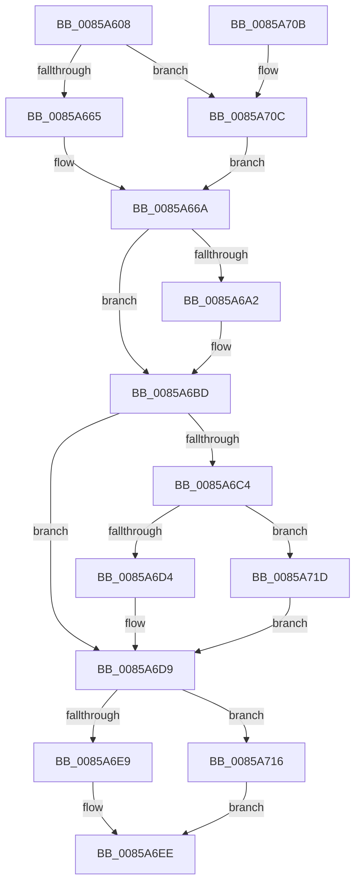

# CmpCopyCell

- RVA: `0x0085A608`–`0x0085A724` (길이 `284` bytes)
- VA: `0x000000014085A608`
- 실행 섹션: `PAGE`
- PDB 이름 있음: `예`; PDB Function 태그: `아니요`
- unwind 정보 RVA: `0x0006ACBC`
- 디코드: `76`개 명령, `284/284` bytes 표시
- 미해석 바이트: `0` (있으면 어셈블리에 `.byte`로 보존)

> 이 문서는 커널 이미지의 기계어와 PDB 기호를 분석해 생성했습니다. 4번과 5번은 함수 원형과 자료형을 바이너리 사용 방식에서 추정한 C 해석이며 원본 소스 복구 결과는 아닙니다.

## 1. Dependencies

- 직접 호출 지점: **10**; 고유 호출 대상: **7**
- 직접 호출자로 확인된 함수: **6**
- RIP 상대 이미지 참조: **0**

### Outgoing calls
- `0x0085A63E` → [HvpGetCellContextInitialize](HvpGetCellContextInitialize_function_00855F10.md) (function, `0x00855F10`)
- `0x0085A64C` → [HvpGetCellContextInitialize](HvpGetCellContextInitialize_function_00855F10.md) (function, `0x00855F10`)
- `0x0085A665` → [HvpGetCellFlat](HvpGetCellFlat_function_00854C60.md) (function, `0x00854C60`)
- `0x0085A696` → [HvAllocateCell](HvAllocateCell_function_00859C94.md) (function, `0x00859C94`)
- `0x0085A6AC` → [memcpy](../../text/6C/memcpy_function_006C6840.md) (function, `0x006C6840`)
- `0x0085A6D4` → [HvpReleaseCellPaged](HvpReleaseCellPaged_function_00855F40.md) (function, `0x00855F40`)
- `0x0085A6E9` → [HvpReleaseCellPaged](HvpReleaseCellPaged_function_00855F40.md) (function, `0x00855F40`)
- `0x0085A70C` → [HvpGetCellPaged](HvpGetCellPaged_function_00854CB0.md) (function, `0x00854CB0`)
- `0x0085A716` → [HvpReleaseCellFlat](HvpReleaseCellFlat_function_0085CC20.md) (function, `0x0085CC20`)
- `0x0085A71D` → [HvpReleaseCellFlat](HvpReleaseCellFlat_function_0085CC20.md) (function, `0x0085CC20`)

### Direct callers
- [CmpSyncKeyValues](../7F/CmpSyncKeyValues_function_007F2DF4.md) at `0x007F2E7E`
- [CmpCopyKeyPartial](CmpCopyKeyPartial_function_0085AFF4.md) at `0x0085B0B8`
- [CmpCopyKeyPartial](CmpCopyKeyPartial_function_0085AFF4.md) at `0x0085B3CC`
- [CmpCopyValue](CmpCopyValue_function_0085B798.md) at `0x0085B837`
- [CmpCopyValue](CmpCopyValue_function_0085B798.md) at `0x0085B8AA`
- [CmpFullPromoteSingleKeyFromKeyNodeStacks](../8B/CmpFullPromoteSingleKeyFromKeyNodeStacks_function_008B1A40.md) at `0x008B1E8C`
- [CmpCopyMergeOfLayeredKeyNode](../94/CmpCopyMergeOfLayeredKeyNode_function_00945A78.md) at `0x00945D5D`
- [CmpLightWeightCreateSetValueData](../A0/CmpLightWeightCreateSetValueData_function_00A0F7EC.md) at `0x00A0F89A`

### Static image references
- 디코드된 RIP-relative 메모리 참조가 없습니다.

## 2. Other-region calls and transfers

- 다른 실행 섹션으로 향하는 call: **1**
  - `0x0085A6AC` → [memcpy](../../text/6C/memcpy_function_006C6840.md) (`PAGE` → `.text`)
- 별도 외부 분기/꼬리 이동을 확인하지 못했습니다.

## 3. Assembly (complete function range)

```asm
0085A608  48 89 5C 24 10                  mov qword ptr [rsp + 0x10], rbx
0085A60D  48 89 74 24 18                  mov qword ptr [rsp + 0x18], rsi
0085A612  48 89 7C 24 20                  mov qword ptr [rsp + 0x20], rdi
0085A617  55                              push rbp
0085A618  41 54                           push r12
0085A61A  41 56                           push r14
0085A61C  48 8B EC                        mov rbp, rsp
0085A61F  48 83 EC 50                     sub rsp, 0x50
0085A623  48 83 65 E0 00                  and qword ptr [rbp - 0x20], 0
0085A628  48 8B D9                        mov rbx, rcx
0085A62B  48 83 65 E8 00                  and qword ptr [rbp - 0x18], 0
0085A630  48 8D 4D E0                     lea rcx, [rbp - 0x20]
0085A634  83 4D 20 FF                     or dword ptr [rbp + 0x20], 0xffffffff
0085A638  45 8B F1                        mov r14d, r9d
0085A63B  49 8B F8                        mov rdi, r8
0085A63E  E8 CD B8 FF FF                  call 0x140855f10
0085A643  48 83 65 F0 00                  and qword ptr [rbp - 0x10], 0
0085A648  48 8D 4D E8                     lea rcx, [rbp - 0x18]
0085A64C  E8 BF B8 FF FF                  call 0x140855f10
0085A651  F6 83 8C 00 00 00 01            test byte ptr [rbx + 0x8c], 1
0085A658  4C 8D 45 E0                     lea r8, [rbp - 0x20]
0085A65C  48 8B CB                        mov rcx, rbx
0085A65F  0F 84 A7 00 00 00               je 0x14085a70c
0085A665  E8 F6 A5 FF FF                  call 0x140854c60
0085A66A  48 8B F0                        mov rsi, rax
0085A66D  4C 8D 4D 20                     lea r9, [rbp + 0x20]
0085A671  41 BC FC FF FF FF               mov r12d, 0xfffffffc
0085A677  45 8B C6                        mov r8d, r14d
0085A67A  44 2B 60 FC                     sub r12d, dword ptr [rax - 4]
0085A67E  48 8B CF                        mov rcx, rdi
0085A681  48 8D 45 E8                     lea rax, [rbp - 0x18]
0085A685  41 8B D4                        mov edx, r12d
0085A688  48 89 44 24 28                  mov qword ptr [rsp + 0x28], rax
0085A68D  48 8D 45 F0                     lea rax, [rbp - 0x10]
0085A691  48 89 44 24 20                  mov qword ptr [rsp + 0x20], rax
0085A696  E8 F9 F5 FF FF                  call 0x140859c94
0085A69B  44 8B F0                        mov r14d, eax
0085A69E  85 C0                           test eax, eax
0085A6A0  78 1B                           js 0x14085a6bd
0085A6A2  48 8B 4D F0                     mov rcx, qword ptr [rbp - 0x10]
0085A6A6  48 8B D6                        mov rdx, rsi
0085A6A9  45 8B C4                        mov r8d, r12d
0085A6AC  E8 8F C1 E6 FF                  call 0x1406c6840
0085A6B1  48 8B 4D 40                     mov rcx, qword ptr [rbp + 0x40]
0085A6B5  45 33 F6                        xor r14d, r14d
0085A6B8  8B 45 20                        mov eax, dword ptr [rbp + 0x20]
0085A6BB  89 01                           mov dword ptr [rcx], eax
0085A6BD  48 83 7D F0 00                  cmp qword ptr [rbp - 0x10], 0
0085A6C2  74 15                           je 0x14085a6d9
0085A6C4  F6 87 8C 00 00 00 01            test byte ptr [rdi + 0x8c], 1
0085A6CB  48 8D 55 E8                     lea rdx, [rbp - 0x18]
0085A6CF  48 8B CF                        mov rcx, rdi
0085A6D2  75 49                           jne 0x14085a71d
0085A6D4  E8 67 B8 FF FF                  call 0x140855f40
0085A6D9  F6 83 8C 00 00 00 01            test byte ptr [rbx + 0x8c], 1
0085A6E0  48 8D 55 E0                     lea rdx, [rbp - 0x20]
0085A6E4  48 8B CB                        mov rcx, rbx
0085A6E7  75 2D                           jne 0x14085a716
0085A6E9  E8 52 B8 FF FF                  call 0x140855f40
0085A6EE  4C 8D 5C 24 50                  lea r11, [rsp + 0x50]
0085A6F3  41 8B C6                        mov eax, r14d
0085A6F6  49 8B 5B 28                     mov rbx, qword ptr [r11 + 0x28]
0085A6FA  49 8B 73 30                     mov rsi, qword ptr [r11 + 0x30]
0085A6FE  49 8B 7B 38                     mov rdi, qword ptr [r11 + 0x38]
0085A702  49 8B E3                        mov rsp, r11
0085A705  41 5E                           pop r14
0085A707  41 5C                           pop r12
0085A709  5D                              pop rbp
0085A70A  C3                              ret
0085A70B  CC                              int3
0085A70C  E8 9F A5 FF FF                  call 0x140854cb0
0085A711  E9 54 FF FF FF                  jmp 0x14085a66a
0085A716  E8 05 25 00 00                  call 0x14085cc20
0085A71B  EB D1                           jmp 0x14085a6ee
0085A71D  E8 FE 24 00 00                  call 0x14085cc20
0085A722  EB B5                           jmp 0x14085a6d9
```

## 4. C-style interpretation (structured pseudocode)

```c
__int64 __fastcall CmpCopyCell(__int64 a1, __int64 a2, __int64 a3, int a4, __int64 a5)
{
    __int64 result;
    __int64 v_r12;
    __int64 v_r14;
    __int64 v_rsp;
    unsigned __int64 v_stack_m18;
    unsigned __int64 v_stack_m28;
    unsigned __int64 v_stack_m30;
    unsigned __int64 v_stack_m38;
    unsigned __int64 v_stack_m40;
    unsigned __int64 v_stack_m48;
    unsigned __int64 v_stack_p10;
    unsigned __int64 v_stack_p18;
    unsigned __int64 v_stack_p20;
    unsigned int v_stack_p8;

    v_stack_p10 = v_rbx;
    v_stack_p18 = v_rsi;
    v_stack_p20 = v_rdi;
    v_rsp = (v_rsp) - (80);
    result = HvpGetCellContextInitialize(v_stack_m38, a2, a3, a4);
    result = HvpGetCellContextInitialize(v_stack_m30, a2, a3, a4);
    if (((*(unsigned __int8 *)(a1 + 140)) & (1)) == 0) goto loc_0085A70C;
    result = HvpGetCellFlat(a1, a2, v_stack_m38, a4);
loc_0085A66A:
    v_r12 = (unsigned int)(((unsigned int)(0xFFFFFFFCULL)) - (*(unsigned int *)(result - 4)));
    v_stack_m40 = v_stack_m30;
    v_stack_m48 = v_stack_m28;
    result = HvAllocateCell(a3, (unsigned int)((unsigned int)(v_r12)), (unsigned int)((unsigned int)((unsigned int)(a4))), v_stack_p8);
    v_r14 = (unsigned int)((unsigned int)(result));
    if (!(sign_flag)) {
        a1 = v_stack_m28;
        a2 = result;
        a3 = (unsigned int)(v_r12);
        result = memcpy(a1, a2, a3, v_stack_p8);
        a1 = a5;
        v_r14 = 0;
        result = v_stack_p8;
        *(unsigned int *)(a1) = (unsigned int)(result);
    }
    if (v_stack_m28 == 0) goto loc_0085A6D9;
    if (((*(unsigned __int8 *)(a3 + 140)) & (1)) != 0) goto loc_0085A71D;
    result = HvpReleaseCellPaged(a3, v_stack_m30, a3, v_stack_p8);
loc_0085A6D9:
    if (((*(unsigned __int8 *)(a1 + 140)) & (1)) != 0) goto loc_0085A716;
    result = HvpReleaseCellPaged(a1, v_stack_m38, a3, v_stack_p8);
loc_0085A6EE:
    return 0;
loc_0085A70C:
    result = HvpGetCellPaged(a1, v_stack_m38, a3, v_stack_p8);
    goto loc_0085A66A;
loc_0085A716:
    result = HvpReleaseCellFlat(a1, v_stack_m38, a3, v_stack_p8);
    goto loc_0085A6EE;
loc_0085A71D:
    result = HvpReleaseCellFlat(a1, v_stack_m38, a3, v_stack_p8);
    goto loc_0085A6D9;
}
```

## 5. (Beta) C Style

```c
int64_t CmpCopyCell(void *Arg1, int64_t Arg2, void *Arg3, int32_t Arg4, void *Arg5)
{
    uint8_t *arg1 = (uint8_t *)Arg1;
    uint8_t *arg3 = (uint8_t *)Arg3;
    uint8_t *arg5 = (uint8_t *)Arg5;

    int64_t result;
    int64_t local_r12;
    int64_t local_r14;
    int64_t local_rsp;
    uint64_t v_stack_m18;
    uint64_t v_stack_m28;
    uint64_t v_stack_m30;
    uint64_t v_stack_m38;
    uint64_t v_stack_m40;
    uint64_t v_stack_m48;
    uint64_t v_stack_p10;
    uint64_t v_stack_p18;
    uint64_t v_stack_p20;
    uint32_t v_stack_p8;

    v_stack_p10 = local_rbx;
    v_stack_p18 = local_rsi;
    v_stack_p20 = local_rdi;
    local_rsp = (local_rsp) - (80);
    result = HvpGetCellContextInitialize(v_stack_m38, Arg2, Arg3, Arg4);
    result = HvpGetCellContextInitialize(v_stack_m30, Arg2, Arg3, Arg4);
    if (((*(uint8_t *)(arg1 + 0x8C)) & (1)) == 0) goto loc_0085A70C;
    result = HvpGetCellFlat(Arg1, Arg2, v_stack_m38, Arg4);
loc_0085A66A:
    local_r12 = (uint32_t)(((uint32_t)(0xFFFFFFFCULL)) - (*(uint32_t *)(result - 0x4)));
    v_stack_m40 = v_stack_m30;
    v_stack_m48 = v_stack_m28;
    result = HvAllocateCell(Arg3, (uint32_t)((uint32_t)(local_r12)), (uint32_t)((uint32_t)((uint32_t)(Arg4))), v_stack_p8);
    local_r14 = (uint32_t)((uint32_t)(result));
    if (!(sign_flag)) {
        Arg1 = v_stack_m28;
        Arg2 = result;
        Arg3 = (uint32_t)(local_r12);
        result = memcpy(Arg1, Arg2, Arg3, v_stack_p8);
        Arg1 = Arg5;
        local_r14 = 0;
        result = v_stack_p8;
        *(uint32_t *)(arg1) = (uint32_t)(result);
    }
    if (v_stack_m28 == 0) goto loc_0085A6D9;
    if (((*(uint8_t *)(arg3 + 0x8C)) & (1)) != 0) goto loc_0085A71D;
    result = HvpReleaseCellPaged(Arg3, v_stack_m30, Arg3, v_stack_p8);
loc_0085A6D9:
    if (((*(uint8_t *)(arg1 + 0x8C)) & (1)) != 0) goto loc_0085A716;
    result = HvpReleaseCellPaged(Arg1, v_stack_m38, Arg3, v_stack_p8);
loc_0085A6EE:
    return 0;
loc_0085A70C:
    result = HvpGetCellPaged(Arg1, v_stack_m38, Arg3, v_stack_p8);
    goto loc_0085A66A;
loc_0085A716:
    result = HvpReleaseCellFlat(Arg1, v_stack_m38, Arg3, v_stack_p8);
    goto loc_0085A6EE;
loc_0085A71D:
    result = HvpReleaseCellFlat(Arg1, v_stack_m38, Arg3, v_stack_p8);
    goto loc_0085A6D9;
}
```

### 관측된 메모리 오프셋

구조체 형식이 확인되지 않은 접근은 인자 기준의 오프셋으로만 기록했습니다.

| 기준 인자 | 오프셋 표현 | 폭 (bit) | 접근 |
|---|---:|---:|---|
| `Arg1` | `+ 0x8C` | `8` | `R` |
| `Arg3` | `+ 0x8C` | `8` | `R` |
| `Arg5` | `+ 0x0` | `32` | `W` |

## 6. Execution-region graph

[열기: 2D/3D 그래프와 함수 탐색 컨트롤 패널](../../../control-panel.html?section=page&rva=0x0085A608&view=graph)

- 2D 그래프는 위에서 아래로 흐르고, 3D 그래프는 빈 공간을 드래그해 회전합니다. Shift+드래그는 이동, 휠은 확대·축소, 함수 노드 선택은 대상 보고서 이동입니다.

### Static fallback


