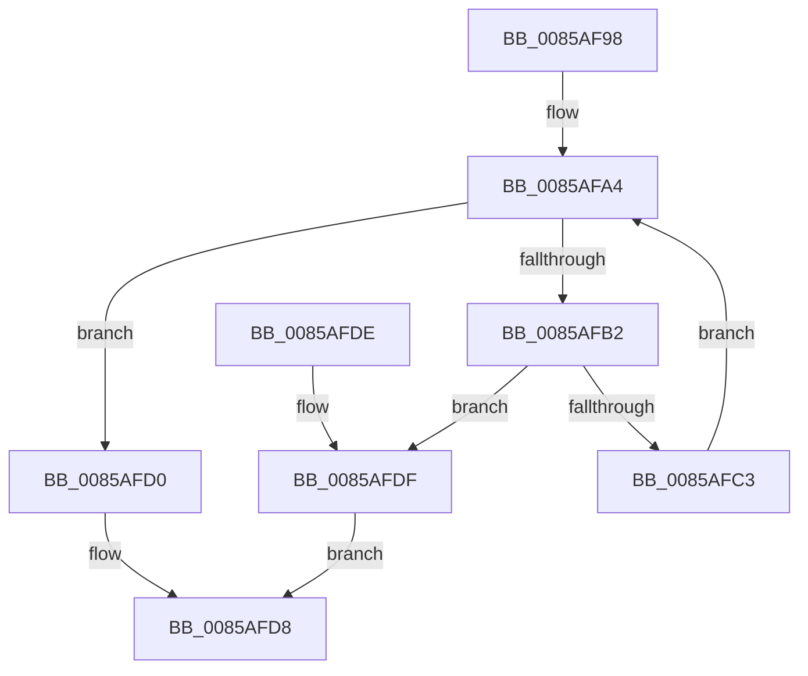

# CmpCopyName

- RVA: `0x0085AF98`–`0x0085AFEC` (길이 `84` bytes)
- VA: `0x000000014085AF98`
- 실행 섹션: `PAGE`
- PDB 이름 있음: `예`; PDB Function 태그: `아니요`
- unwind 정보 RVA: `0x0006AD84`
- 디코드: `27`개 명령, `84/84` bytes 표시
- 미해석 바이트: `0` (있으면 어셈블리에 `.byte`로 보존)

> 이 문서는 커널 이미지의 기계어와 PDB 기호를 분석해 생성했습니다. 4번과 5번은 함수 원형과 자료형을 바이너리 사용 방식에서 추정한 C 해석이며 원본 소스 복구 결과는 아닙니다.

## 1. Dependencies

- 직접 호출 지점: **1**; 고유 호출 대상: **1**
- 직접 호출자로 확인된 함수: **6**
- RIP 상대 이미지 참조: **0**

### Outgoing calls
- `0x0085AFE2` → [memcpy](../../text/6C/memcpy_function_006C6840.md) (function, `0x006C6840`)

### Direct callers
- [CmRenameKey](../7E/CmRenameKey_function_007E8F48.md) at `0x007E9B75`
- [CmpAddValueKeyTombstone](../7E/CmpAddValueKeyTombstone_function_007EA488.md) at `0x007EA530`
- [CmpAddValueKeyNew](CmpAddValueKeyNew_function_0085AA58.md) at `0x0085AAE6`
- [CmpCreateChild](../94/CmpCreateChild_function_0094817C.md) at `0x0094853F`
- [CmpCreateChild](../94/CmpCreateChild_function_0094817C.md) at `0x00948D59`
- [CmpCreateHiveRootCell](../AB/CmpCreateHiveRootCell_function_00ABF568.md) at `0x00ABF65C`
- [CmpCreateRootNode](../../init/C5/CmpCreateRootNode_function_00C57A6C.md) at `0x00C57B69`

### Static image references
- 디코드된 RIP-relative 메모리 참조가 없습니다.

## 2. Other-region calls and transfers

- 다른 실행 섹션으로 향하는 call: **1**
  - `0x0085AFE2` → [memcpy](../../text/6C/memcpy_function_006C6840.md) (`PAGE` → `.text`)
- 별도 외부 분기/꼬리 이동을 확인하지 못했습니다.

## 3. Assembly (complete function range)

```asm
0085AF98  40 53                           push rbx
0085AF9A  48 83 EC 20                     sub rsp, 0x20
0085AF9E  48 8B DA                        mov rbx, rdx
0085AFA1  45 33 C9                        xor r9d, r9d
0085AFA4  44 0F B7 02                     movzx r8d, word ptr [rdx]
0085AFA8  41 8B C0                        mov eax, r8d
0085AFAB  D1 E8                           shr eax, 1
0085AFAD  44 3B C8                        cmp r9d, eax
0085AFB0  73 1E                           jae 0x14085afd0
0085AFB2  48 8B 42 08                     mov rax, qword ptr [rdx + 8]
0085AFB6  41 BA FF 00 00 00               mov r10d, 0xff
0085AFBC  66 46 39 14 48                  cmp word ptr [rax + r9*2], r10w
0085AFC1  77 1C                           ja 0x14085afdf
0085AFC3  42 8A 04 48                     mov al, byte ptr [rax + r9*2]
0085AFC7  41 88 04 09                     mov byte ptr [r9 + rcx], al
0085AFCB  41 FF C1                        inc r9d
0085AFCE  EB D4                           jmp 0x14085afa4
0085AFD0  66 41 D1 E8                     shr r8w, 1
0085AFD4  41 0F B7 C0                     movzx eax, r8w
0085AFD8  48 83 C4 20                     add rsp, 0x20
0085AFDC  5B                              pop rbx
0085AFDD  C3                              ret
0085AFDE  CC                              int3
0085AFDF  48 8B D0                        mov rdx, rax
0085AFE2  E8 59 B8 E6 FF                  call 0x1406c6840
0085AFE7  0F B7 03                        movzx eax, word ptr [rbx]
0085AFEA  EB EC                           jmp 0x14085afd8
```

## 4. C-style interpretation (structured pseudocode)

```c
__int64 __fastcall CmpCopyName(__int64 a1, __int64 a2, __int64 a3, int a4)
{
    __int64 result;
    __int64 v_rsp;

    v_rsp = (v_rsp) - (32);
    a4 = 0;
loc_0085AFA4:
    result = (unsigned int)(((unsigned int)((unsigned int)(*(unsigned __int16 *)(a2)))) >> (1));
    if (0 >= ((unsigned int)(result))) goto loc_0085AFD0;
    if ((*(unsigned __int16 *)(*(unsigned __int64 *)(a2 + 8) + a4 * 2)) > 255) goto loc_0085AFDF;
    *(unsigned __int8 *)(a4 + a1 * 1) = (unsigned __int8)(*(unsigned __int8 *)(*(unsigned __int64 *)(a2 + 8) + a4 * 2));
    a4 = (unsigned int)((a4) + 1);
    goto loc_0085AFA4;
loc_0085AFD0:
    a3 = (unsigned __int16)((*(unsigned __int16 *)(a2)) >> (1));
loc_0085AFD8:
    v_rsp = (v_rsp) + (32);
    return (unsigned __int16)(a3);
loc_0085AFDF:
    result = memcpy(a1, (unsigned __int16)(a3), a3, a4);
    goto loc_0085AFD8;
}
```

## 5. (Beta) C Style

```c
int64_t CmpCopyName(int64_t Arg1, void *Arg2, int64_t Arg3, int32_t Arg4)
{
    uint8_t *arg2 = (uint8_t *)Arg2;

    int64_t result;
    int64_t local_rsp;

    local_rsp = (local_rsp) - (32);
    Arg4 = 0;
loc_0085AFA4:
    result = (uint32_t)(((uint32_t)((uint32_t)(*(uint16_t *)(arg2)))) >> (1));
    if (0 >= ((uint32_t)(result))) goto loc_0085AFD0;
    if ((*(uint16_t *)(*(uint64_t *)(arg2 + 0x8) + Arg4 * 2)) > 255) goto loc_0085AFDF;
    *(uint8_t *)(Arg4 + Arg1 * 1) = (uint8_t)(*(uint8_t *)(*(uint64_t *)(arg2 + 0x8) + Arg4 * 2));
    Arg4 = (uint32_t)((Arg4) + 1);
    goto loc_0085AFA4;
loc_0085AFD0:
    Arg3 = (uint16_t)((*(uint16_t *)(arg2)) >> (1));
loc_0085AFD8:
    local_rsp = (local_rsp) + (32);
    return (uint16_t)(Arg3);
loc_0085AFDF:
    result = memcpy(Arg1, (uint16_t)(Arg3), Arg3, Arg4);
    goto loc_0085AFD8;
}
```

### 관측된 메모리 오프셋

구조체 형식이 확인되지 않은 접근은 인자 기준의 오프셋으로만 기록했습니다.

| 기준 인자 | 오프셋 표현 | 폭 (bit) | 접근 |
|---|---:|---:|---|
| `Arg2` | `+ 0x0` | `16` | `R` |
| `Arg2` | `+ 0x8` | `64` | `R` |

## 6. Execution-region graph

[열기: 2D/3D 그래프와 함수 탐색 컨트롤 패널](../../../control-panel.html?section=page&rva=0x0085AF98&view=graph)

- 2D 그래프는 위에서 아래로 흐르고, 3D 그래프는 빈 공간을 드래그해 회전합니다. Shift+드래그는 이동, 휠은 확대·축소, 함수 노드 선택은 대상 보고서 이동입니다.

### Static fallback


