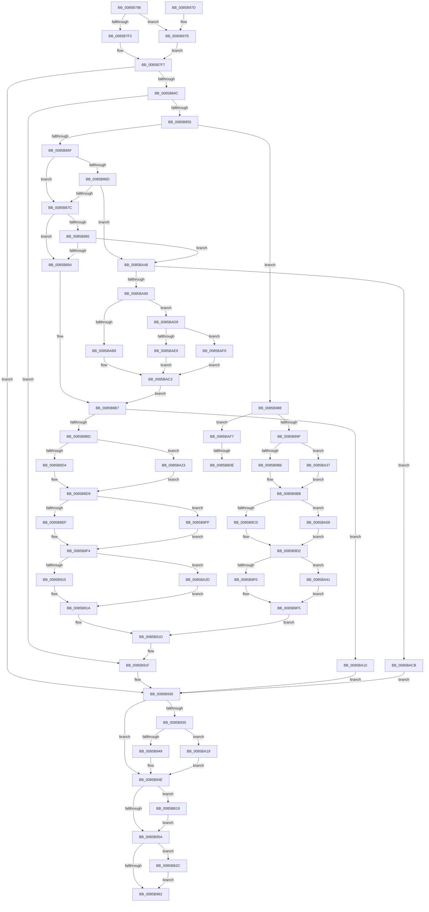

# CmpCopyValue

- RVA: `0x0085B798`–`0x0085BB3B` (길이 `931` bytes)
- VA: `0x000000014085B798`
- 실행 섹션: `PAGE`
- PDB 이름 있음: `예`; PDB Function 태그: `예`
- unwind 정보 RVA: `0x0006AE1C`
- 디코드: `242`개 명령, `931/931` bytes 표시
- 미해석 바이트: `0` (있으면 어셈블리에 `.byte`로 보존)

> 이 문서는 커널 이미지의 기계어와 PDB 기호를 분석해 생성했습니다. 4번과 5번은 함수 원형과 자료형을 바이너리 사용 방식에서 추정한 C 해석이며 원본 소스 복구 결과는 아닙니다.

## 1. Dependencies

- 직접 호출 지점: **27**; 고유 호출 대상: **11**
- 직접 호출자로 확인된 함수: **4**
- RIP 상대 이미지 참조: **0**

### Outgoing calls
- `0x0085B7D9` → [HvpGetCellContextInitialize](HvpGetCellContextInitialize_function_00855F10.md) (function, `0x00855F10`)
- `0x0085B7F2` → [HvpGetCellFlat](HvpGetCellFlat_function_00854C60.md) (function, `0x00854C60`)
- `0x0085B837` → [CmpCopyCell](CmpCopyCell_function_0085A608.md) (function, `0x0085A608`)
- `0x0085B8AA` → [CmpCopyCell](CmpCopyCell_function_0085A608.md) (function, `0x0085A608`)
- `0x0085B8D4` → [HvpReleaseCellPaged](HvpReleaseCellPaged_function_00855F40.md) (function, `0x00855F40`)
- `0x0085B8EF` → [HvpGetCellFlat](HvpGetCellFlat_function_00854C60.md) (function, `0x00854C60`)
- `0x0085B915` → [HvpReleaseCellPaged](HvpReleaseCellPaged_function_00855F40.md) (function, `0x00855F40`)
- `0x0085B949` → [HvpReleaseCellPaged](HvpReleaseCellPaged_function_00855F40.md) (function, `0x00855F40`)
- `0x0085B97E` → [HvpGetCellPaged](HvpGetCellPaged_function_00854CB0.md) (function, `0x00854CB0`)
- `0x0085B9B6` → [HvpReleaseCellPaged](HvpReleaseCellPaged_function_00855F40.md) (function, `0x00855F40`)
- `0x0085B9CD` → [HvpGetCellFlat](HvpGetCellFlat_function_00854C60.md) (function, `0x00854C60`)
- `0x0085B9F0` → [HvpReleaseCellPaged](HvpReleaseCellPaged_function_00855F40.md) (function, `0x00855F40`)
- `0x0085B9FF` → [HvpGetCellPaged](HvpGetCellPaged_function_00854CB0.md) (function, `0x00854CB0`)
- `0x0085BA09` → [HvpGetCellPaged](HvpGetCellPaged_function_00854CB0.md) (function, `0x00854CB0`)
- `0x0085BA19` → [HvpReleaseCellFlat](HvpReleaseCellFlat_function_0085CC20.md) (function, `0x0085CC20`)
- `0x0085BA23` → [HvpReleaseCellFlat](HvpReleaseCellFlat_function_0085CC20.md) (function, `0x0085CC20`)
- `0x0085BA2D` → [HvpReleaseCellFlat](HvpReleaseCellFlat_function_0085CC20.md) (function, `0x0085CC20`)
- `0x0085BA37` → [HvpReleaseCellFlat](HvpReleaseCellFlat_function_0085CC20.md) (function, `0x0085CC20`)
- `0x0085BA41` → [HvpReleaseCellFlat](HvpReleaseCellFlat_function_0085CC20.md) (function, `0x0085CC20`)
- `0x0085BA83` → [CmpGetValueData](CmpGetValueData_function_00856DB0.md) (function, `0x00856DB0`)
- `0x0085BAA7` → [CmpSetValueDataNew](../A2/CmpSetValueDataNew_function_00A26550.md) (function, `0x00A26550`)
- `0x0085BABE` → [ExFreePoolWithTag](../../poolcode/B8/ExFreePoolWithTag_function_00B82870.md) (function, `0x00B82870`)
- `0x0085BAE9` → [HvpReleaseCellPaged](HvpReleaseCellPaged_function_00855F40.md) (function, `0x00855F40`)
- `0x0085BAF0` → [HvpReleaseCellFlat](HvpReleaseCellFlat_function_0085CC20.md) (function, `0x0085CC20`)
- `0x0085BB0E` → [HvpReleaseCellFlat](HvpReleaseCellFlat_function_0085CC20.md) (function, `0x0085CC20`)
- `0x0085BB22` → [CmpFreeValueData](../84/CmpFreeValueData_function_0084B040.md) (function, `0x0084B040`)
- `0x0085BB31` → [HvFreeCell](HvFreeCell_function_0085A72C.md) (function, `0x0085A72C`)

### Direct callers
- [CmpMergeKeyValues](../7F/CmpMergeKeyValues_function_007F2304.md) at `0x007F2491`
- [CmpSyncKeyValues](../7F/CmpSyncKeyValues_function_007F2DF4.md) at `0x007F2F76`
- [CmpCopyKeyPartial](CmpCopyKeyPartial_function_0085AFF4.md) at `0x0085B260`
- [CmpFullPromoteSingleKeyFromKeyNodeStacks](../8B/CmpFullPromoteSingleKeyFromKeyNodeStacks_function_008B1A40.md) at `0x008B1BB5`

### Static image references
- 디코드된 RIP-relative 메모리 참조가 없습니다.

## 2. Other-region calls and transfers

- 다른 실행 섹션으로 향하는 call: **1**
  - `0x0085BABE` → [ExFreePoolWithTag](../../poolcode/B8/ExFreePoolWithTag_function_00B82870.md) (`PAGE` → `POOLCODE`)
- call이 아닌 외부 분기/꼬리 이동: **2**
  - `0x0085BB08` → [sub_00B16DC4](../B1/Unknown_function_00B16DC4.md) (`tail-transfer`)
  - `0x0085BB14` → [sub_00B16DC4 + 0x5](../B1/Unknown_function_00B16DC4.md) (`tail-transfer`)

## 3. Assembly (complete function range)

```asm
0085B798  48 89 5C 24 18                  mov qword ptr [rsp + 0x18], rbx
0085B79D  44 89 4C 24 20                  mov dword ptr [rsp + 0x20], r9d
0085B7A2  89 54 24 10                     mov dword ptr [rsp + 0x10], edx
0085B7A6  55                              push rbp
0085B7A7  56                              push rsi
0085B7A8  57                              push rdi
0085B7A9  41 54                           push r12
0085B7AB  41 55                           push r13
0085B7AD  41 56                           push r14
0085B7AF  41 57                           push r15
0085B7B1  48 8B EC                        mov rbp, rsp
0085B7B4  48 83 EC 70                     sub rsp, 0x70
0085B7B8  33 C0                           xor eax, eax
0085B7BA  48 8B D9                        mov rbx, rcx
0085B7BD  48 89 45 E8                     mov qword ptr [rbp - 0x18], rax
0085B7C1  48 8D 4D E8                     lea rcx, [rbp - 0x18]
0085B7C5  83 C8 FF                        or eax, 0xffffffff
0085B7C8  45 8B F9                        mov r15d, r9d
0085B7CB  89 45 D4                        mov dword ptr [rbp - 0x2c], eax
0085B7CE  44 8B E0                        mov r12d, eax
0085B7D1  89 45 D0                        mov dword ptr [rbp - 0x30], eax
0085B7D4  49 8B F8                        mov rdi, r8
0085B7D7  8B F2                           mov esi, edx
0085B7D9  E8 32 A7 FF FF                  call 0x140855f10
0085B7DE  F6 83 8C 00 00 00 01            test byte ptr [rbx + 0x8c], 1
0085B7E5  4C 8D 45 E8                     lea r8, [rbp - 0x18]
0085B7E9  48 8B CB                        mov rcx, rbx
0085B7EC  0F 84 8C 01 00 00               je 0x14085b97e
0085B7F2  E8 69 94 FF FF                  call 0x140854c60
0085B7F7  4C 8B E8                        mov r13, rax
0085B7FA  B9 00 00 00 80                  mov ecx, 0x80000000
0085B7FF  8B 40 04                        mov eax, dword ptr [rax + 4]
0085B802  45 8B CF                        mov r9d, r15d
0085B805  3B C1                           cmp eax, ecx
0085B807  89 45 E0                        mov dword ptr [rbp - 0x20], eax
0085B80A  48 8D 4D D4                     lea rcx, [rbp - 0x2c]
0085B80E  4C 8B C7                        mov r8, rdi
0085B811  48 89 4C 24 20                  mov qword ptr [rsp + 0x20], rcx
0085B816  8B D6                           mov edx, esi
0085B818  44 8D B0 00 00 00 80            lea r14d, [rax - 0x80000000]
0085B81F  48 8B CB                        mov rcx, rbx
0085B822  44 0F 42 F0                     cmovb r14d, eax
0085B826  49 8D 45 08                     lea rax, [r13 + 8]
0085B82A  48 89 45 F0                     mov qword ptr [rbp - 0x10], rax
0085B82E  8B 00                           mov eax, dword ptr [rax]
0085B830  89 45 40                        mov dword ptr [rbp + 0x40], eax
0085B833  44 89 75 D8                     mov dword ptr [rbp - 0x28], r14d
0085B837  E8 CC ED FF FF                  call 0x14085a608
0085B83C  8B 75 D4                        mov esi, dword ptr [rbp - 0x2c]
0085B83F  33 C9                           xor ecx, ecx
0085B841  44 8B F8                        mov r15d, eax
0085B844  85 C0                           test eax, eax
0085B846  0F 88 E4 00 00 00               js 0x14085b930
0085B84C  45 85 F6                        test r14d, r14d
0085B84F  0F 84 CA 00 00 00               je 0x14085b91f
0085B855  41 83 FE 04                     cmp r14d, 4
0085B859  0F 86 29 01 00 00               jbe 0x14085b988
0085B85F  83 BB DC 00 00 00 04            cmp dword ptr [rbx + 0xdc], 4
0085B866  B9 26 C0 FF 7F                  mov ecx, 0x7fffc026
0085B86B  72 0F                           jb 0x14085b87c
0085B86D  41 8D 86 27 C0 FF FF            lea eax, [r14 - 0x3fd9]
0085B874  3B C1                           cmp eax, ecx
0085B876  0F 86 CC 01 00 00               jbe 0x14085ba48
0085B87C  83 BF DC 00 00 00 04            cmp dword ptr [rdi + 0xdc], 4
0085B883  72 0F                           jb 0x14085b894
0085B885  41 8D 86 27 C0 FF FF            lea eax, [r14 - 0x3fd9]
0085B88C  3B C1                           cmp eax, ecx
0085B88E  0F 86 B4 01 00 00               jbe 0x14085ba48
0085B894  44 8B 4D 58                     mov r9d, dword ptr [rbp + 0x58]
0085B898  48 8D 45 D0                     lea rax, [rbp - 0x30]
0085B89C  8B 55 40                        mov edx, dword ptr [rbp + 0x40]
0085B89F  4C 8B C7                        mov r8, rdi
0085B8A2  48 8B CB                        mov rcx, rbx
0085B8A5  48 89 44 24 20                  mov qword ptr [rsp + 0x20], rax
0085B8AA  E8 59 ED FF FF                  call 0x14085a608
0085B8AF  45 33 E4                        xor r12d, r12d
0085B8B2  44 8B F8                        mov r15d, eax
0085B8B5  85 C0                           test eax, eax
0085B8B7  0F 88 53 01 00 00               js 0x14085ba10
0085B8BD  41 B7 01                        mov r15b, 1
0085B8C0  48 8D 55 E8                     lea rdx, [rbp - 0x18]
0085B8C4  48 8B CB                        mov rcx, rbx
0085B8C7  44 84 BB 8C 00 00 00            test byte ptr [rbx + 0x8c], r15b
0085B8CE  0F 85 4F 01 00 00               jne 0x14085ba23
0085B8D4  E8 67 A6 FF FF                  call 0x140855f40
0085B8D9  4C 8D 45 E8                     lea r8, [rbp - 0x18]
0085B8DD  8B D6                           mov edx, esi
0085B8DF  48 8B CF                        mov rcx, rdi
0085B8E2  44 84 BF 8C 00 00 00            test byte ptr [rdi + 0x8c], r15b
0085B8E9  0F 84 10 01 00 00               je 0x14085b9ff
0085B8EF  E8 6C 93 FF FF                  call 0x140854c60
0085B8F4  48 8B C8                        mov rcx, rax
0085B8F7  48 8D 55 E8                     lea rdx, [rbp - 0x18]
0085B8FB  8B 45 D0                        mov eax, dword ptr [rbp - 0x30]
0085B8FE  89 41 08                        mov dword ptr [rcx + 8], eax
0085B901  44 89 71 04                     mov dword ptr [rcx + 4], r14d
0085B905  48 8B CF                        mov rcx, rdi
0085B908  44 84 BF 8C 00 00 00            test byte ptr [rdi + 0x8c], r15b
0085B90F  0F 85 18 01 00 00               jne 0x14085ba2d
0085B915  E8 26 A6 FF FF                  call 0x140855f40
0085B91A  4D 8B EC                        mov r13, r12
0085B91D  33 C9                           xor ecx, ecx
0085B91F  48 8B 45 60                     mov rax, qword ptr [rbp + 0x60]
0085B923  44 8B F9                        mov r15d, ecx
0085B926  89 30                           mov dword ptr [rax], esi
0085B928  83 C8 FF                        or eax, 0xffffffff
0085B92B  8B F0                           mov esi, eax
0085B92D  44 8B E0                        mov r12d, eax
0085B930  4D 85 ED                        test r13, r13
0085B933  74 19                           je 0x14085b94e
0085B935  F6 83 8C 00 00 00 01            test byte ptr [rbx + 0x8c], 1
0085B93C  48 8D 55 E8                     lea rdx, [rbp - 0x18]
0085B940  48 8B CB                        mov rcx, rbx
0085B943  0F 85 D0 00 00 00               jne 0x14085ba19
0085B949  E8 F2 A5 FF FF                  call 0x140855f40
0085B94E  83 CB FF                        or ebx, 0xffffffff
0085B951  44 3B E3                        cmp r12d, ebx
0085B954  0F 85 BF 01 00 00               jne 0x14085bb19
0085B95A  3B F3                           cmp esi, ebx
0085B95C  0F 85 CA 01 00 00               jne 0x14085bb2c
0085B962  48 8B 9C 24 C0 00 00 00         mov rbx, qword ptr [rsp + 0xc0]
0085B96A  41 8B C7                        mov eax, r15d
0085B96D  48 83 C4 70                     add rsp, 0x70
0085B971  41 5F                           pop r15
0085B973  41 5E                           pop r14
0085B975  41 5D                           pop r13
0085B977  41 5C                           pop r12
0085B979  5F                              pop rdi
0085B97A  5E                              pop rsi
0085B97B  5D                              pop rbp
0085B97C  C3                              ret
0085B97D  CC                              int3
0085B97E  E8 2D 93 FF FF                  call 0x140854cb0
0085B983  E9 6F FE FF FF                  jmp 0x14085b7f7
0085B988  48 8B 45 F0                     mov rax, qword ptr [rbp - 0x10]
0085B98C  41 BD 00 00 00 80               mov r13d, 0x80000000
0085B992  41 B4 01                        mov r12b, 1
0085B995  44 39 6D E0                     cmp dword ptr [rbp - 0x20], r13d
0085B999  0F 82 58 01 00 00               jb 0x14085baf7
0085B99F  48 8D 55 E8                     lea rdx, [rbp - 0x18]
0085B9A3  44 8B 38                        mov r15d, dword ptr [rax]
0085B9A6  48 8B CB                        mov rcx, rbx
0085B9A9  44 84 A3 8C 00 00 00            test byte ptr [rbx + 0x8c], r12b
0085B9B0  0F 85 81 00 00 00               jne 0x14085ba37
0085B9B6  E8 85 A5 FF FF                  call 0x140855f40
0085B9BB  4C 8D 45 E8                     lea r8, [rbp - 0x18]
0085B9BF  8B D6                           mov edx, esi
0085B9C1  48 8B CF                        mov rcx, rdi
0085B9C4  44 84 A7 8C 00 00 00            test byte ptr [rdi + 0x8c], r12b
0085B9CB  74 3C                           je 0x14085ba09
0085B9CD  E8 8E 92 FF FF                  call 0x140854c60
0085B9D2  48 8B C8                        mov rcx, rax
0085B9D5  44 89 78 08                     mov dword ptr [rax + 8], r15d
0085B9D9  43 8D 04 2E                     lea eax, [r14 + r13]
0085B9DD  48 8D 55 E8                     lea rdx, [rbp - 0x18]
0085B9E1  89 41 04                        mov dword ptr [rcx + 4], eax
0085B9E4  48 8B CF                        mov rcx, rdi
0085B9E7  44 84 A7 8C 00 00 00            test byte ptr [rdi + 0x8c], r12b
0085B9EE  75 51                           jne 0x14085ba41
0085B9F0  E8 4B A5 FF FF                  call 0x140855f40
0085B9F5  33 C0                           xor eax, eax
0085B9F7  44 8B E8                        mov r13d, eax
0085B9FA  E9 1E FF FF FF                  jmp 0x14085b91d
0085B9FF  E8 AC 92 FF FF                  call 0x140854cb0
0085BA04  E9 EB FE FF FF                  jmp 0x14085b8f4
0085BA09  E8 A2 92 FF FF                  call 0x140854cb0
0085BA0E  EB C2                           jmp 0x14085b9d2
0085BA10  44 8B 65 D0                     mov r12d, dword ptr [rbp - 0x30]
0085BA14  E9 17 FF FF FF                  jmp 0x14085b930
0085BA19  E8 02 12 00 00                  call 0x14085cc20
0085BA1E  E9 2B FF FF FF                  jmp 0x14085b94e
0085BA23  E8 F8 11 00 00                  call 0x14085cc20
0085BA28  E9 AC FE FF FF                  jmp 0x14085b8d9
0085BA2D  E8 EE 11 00 00                  call 0x14085cc20
0085BA32  E9 E3 FE FF FF                  jmp 0x14085b91a
0085BA37  E8 E4 11 00 00                  call 0x14085cc20
0085BA3C  E9 7A FF FF FF                  jmp 0x14085b9bb
0085BA41  E8 DA 11 00 00                  call 0x14085cc20
0085BA46  EB AD                           jmp 0x14085b9f5
0085BA48  8B 55 48                        mov edx, dword ptr [rbp + 0x48]
0085BA4B  48 8D 45 E0                     lea rax, [rbp - 0x20]
0085BA4F  83 4D E0 FF                     or dword ptr [rbp - 0x20], 0xffffffff
0085BA53  4C 8D 4D D8                     lea r9, [rbp - 0x28]
0085BA57  48 89 44 24 30                  mov qword ptr [rsp + 0x30], rax
0085BA5C  45 33 F6                        xor r14d, r14d
0085BA5F  48 8D 45 40                     lea rax, [rbp + 0x40]
0085BA63  4C 89 75 F0                     mov qword ptr [rbp - 0x10], r14
0085BA67  48 89 44 24 28                  mov qword ptr [rsp + 0x28], rax
0085BA6C  4D 8B C5                        mov r8, r13
0085BA6F  48 8D 45 F0                     lea rax, [rbp - 0x10]
0085BA73  44 88 75 40                     mov byte ptr [rbp + 0x40], r14b
0085BA77  48 8B CB                        mov rcx, rbx
0085BA7A  48 89 44 24 20                  mov qword ptr [rsp + 0x20], rax
0085BA7F  44 89 75 E4                     mov dword ptr [rbp - 0x1c], r14d
0085BA83  E8 28 B3 FF FF                  call 0x140856db0
0085BA88  44 8B 75 D8                     mov r14d, dword ptr [rbp - 0x28]
0085BA8C  84 C0                           test al, al
0085BA8E  74 3B                           je 0x14085bacb
0085BA90  44 8B 4D 58                     mov r9d, dword ptr [rbp + 0x58]
0085BA94  48 8D 45 D0                     lea rax, [rbp - 0x30]
0085BA98  48 8B 55 F0                     mov rdx, qword ptr [rbp - 0x10]
0085BA9C  45 8B C6                        mov r8d, r14d
0085BA9F  48 8B CF                        mov rcx, rdi
0085BAA2  48 89 44 24 20                  mov qword ptr [rsp + 0x20], rax
0085BAA7  E8 A4 AA 1C 00                  call 0x140a26550
0085BAAC  45 33 E4                        xor r12d, r12d
0085BAAF  44 8B F8                        mov r15d, eax
0085BAB2  44 38 65 40                     cmp byte ptr [rbp + 0x40], r12b
0085BAB6  74 21                           je 0x14085bad9
0085BAB8  48 8B 4D F0                     mov rcx, qword ptr [rbp - 0x10]
0085BABC  33 D2                           xor edx, edx
0085BABE  E8 AD 6D 32 00                  call 0x140b82870
0085BAC3  45 85 FF                        test r15d, r15d
0085BAC6  E9 EC FD FF FF                  jmp 0x14085b8b7
0085BACB  8B 75 D4                        mov esi, dword ptr [rbp - 0x2c]
0085BACE  41 BF 9A 00 00 C0               mov r15d, 0xc000009a
0085BAD4  E9 57 FE FF FF                  jmp 0x14085b930
0085BAD9  F6 83 8C 00 00 00 01            test byte ptr [rbx + 0x8c], 1
0085BAE0  48 8D 55 E0                     lea rdx, [rbp - 0x20]
0085BAE4  48 8B CB                        mov rcx, rbx
0085BAE7  75 07                           jne 0x14085baf0
0085BAE9  E8 52 A4 FF FF                  call 0x140855f40
0085BAEE  EB D3                           jmp 0x14085bac3
0085BAF0  E8 2B 11 00 00                  call 0x14085cc20
0085BAF5  EB CC                           jmp 0x14085bac3
0085BAF7  48 8D 55 E8                     lea rdx, [rbp - 0x18]
0085BAFB  44 8B 38                        mov r15d, dword ptr [rax]
0085BAFE  48 8B CB                        mov rcx, rbx
0085BB01  44 84 A3 8C 00 00 00            test byte ptr [rbx + 0x8c], r12b
0085BB08  0F 84 B6 B2 2B 00               je 0x140b16dc4
0085BB0E  E8 0D 11 00 00                  call 0x14085cc20
0085BB13  90                              nop
0085BB14  E9 B0 B2 2B 00                  jmp 0x140b16dc9
0085BB19  45 8B C6                        mov r8d, r14d
0085BB1C  41 8B D4                        mov edx, r12d
0085BB1F  48 8B CF                        mov rcx, rdi
0085BB22  E8 19 F5 FE FF                  call 0x14084b040
0085BB27  E9 2E FE FF FF                  jmp 0x14085b95a
0085BB2C  8B D6                           mov edx, esi
0085BB2E  48 8B CF                        mov rcx, rdi
0085BB31  E8 F6 EB FF FF                  call 0x14085a72c
0085BB36  E9 27 FE FF FF                  jmp 0x14085b962
```

## 4. C-style interpretation (structured pseudocode)

```c
__int64 __fastcall CmpCopyValue(__int64 a1, int a2, __int64 a3, int a4, __int64 a5)
{
    __int64 result;
    __int64 v_r12;
    __int64 v_r14;
    __int64 v_rbx;
    __int64 v_rsp;
    unsigned __int64 v_stack_m48;
    unsigned __int64 v_stack_m50;
    unsigned int v_stack_m54;
    unsigned int v_stack_m58;
    unsigned int v_stack_m60;
    unsigned int v_stack_m64;
    unsigned int v_stack_m68;
    unsigned __int64 v_stack_m88;
    unsigned int v_stack_p10;
    unsigned __int64 v_stack_p18;
    unsigned int v_stack_p20;
    unsigned __int64 v_stack_p28;
    unsigned __int64 v_stack_p30;
    unsigned int v_stack_p8;

    v_stack_p18 = v_rbx;
    v_stack_p20 = a4;
    v_stack_p10 = a2;
    v_rsp = (v_rsp) - (112);
    result = 0;
    v_stack_m50 = 0;
    result = (unsigned int)((result) | (0xFFFFFFFFULL));
    v_stack_m64 = (unsigned int)(result);
    v_stack_m68 = (unsigned int)(result);
    result = HvpGetCellContextInitialize(v_stack_m50, a2, a3, a4);
    if (((*(unsigned __int8 *)(a1 + 140)) & (1)) == 0) goto loc_0085B97E;
    result = HvpGetCellFlat(a1, a2, v_stack_m50, a4);
loc_0085B7F7:
    v_stack_m58 = (unsigned int)((unsigned int)(*(unsigned int *)(result + 4)));
    v_stack_m88 = v_stack_m64;
    v_r14 = (unsigned int)(*(unsigned int *)(result + 4)) - 2147483648;
    if (((unsigned int)((unsigned int)(*(unsigned int *)(result + 4)))) < ((unsigned int)((unsigned int)(0x80000000ULL)))) { v_r14 = (unsigned int)((unsigned int)(*(unsigned int *)(result + 4))); }
    v_stack_m48 = result + 8;
    v_stack_p8 = (unsigned int)((unsigned int)(*(unsigned int *)(result + 8)));
    v_stack_m60 = (unsigned int)(v_r14);
    result = CmpCopyCell(a1, (unsigned int)((unsigned int)((unsigned int)(a2))), a3, (unsigned int)((unsigned int)((unsigned int)(a4))));
    a1 = 0;
    if (sign_flag) goto loc_0085B930;
    if ((unsigned int)(v_r14) == 0) goto loc_0085B91F;
    if (((unsigned int)(v_r14)) <= 4) goto loc_0085B988;
    if ((*(unsigned int *)(a1 + 220)) < 4) goto loc_0085B87C;
    if (((unsigned int)(v_r14 - 16345)) <= ((unsigned int)((unsigned int)(0x7FFFC026ULL)))) goto loc_0085BA48;
loc_0085B87C:
    if ((*(unsigned int *)(a3 + 220)) < 4) goto loc_0085B894;
    if (((unsigned int)(v_r14 - 16345)) <= ((unsigned int)((unsigned int)(0x7FFFC026ULL)))) goto loc_0085BA48;
loc_0085B894:
    v_stack_m88 = v_stack_m68;
    result = CmpCopyCell(0, (unsigned int)(v_stack_p8), a3, (unsigned int)(v_stack_p20));
    v_r12 = 0;
loc_0085B8B7:
    if (sign_flag) goto loc_0085BA10;
    if (((*(unsigned __int8 *)(a1 + 140)) & (1)) != 0) goto loc_0085BA23;
    result = HvpReleaseCellPaged(0, v_stack_m50, a3, (unsigned int)(v_stack_p20));
loc_0085B8D9:
    if (((*(unsigned __int8 *)(a3 + 140)) & (1)) == 0) goto loc_0085B9FF;
    result = HvpGetCellFlat(a3, (unsigned int)((unsigned int)((unsigned int)(v_stack_m64))), v_stack_m50, (unsigned int)(v_stack_p20));
loc_0085B8F4:
    *(unsigned int *)(result + 8) = (unsigned int)((unsigned int)(v_stack_m68));
    *(unsigned int *)(result + 4) = (unsigned int)(v_r14);
    if (((*(unsigned __int8 *)(a3 + 140)) & (1)) != 0) goto loc_0085BA2D;
    result = HvpReleaseCellPaged(a3, v_stack_m50, v_stack_m50, (unsigned int)(v_stack_p20));
loc_0085B91A:
loc_0085B91D:
    a1 = 0;
loc_0085B91F:
    *(unsigned int *)(a5) = (unsigned int)((unsigned int)(v_stack_m64));
    result = (unsigned int)((a5) | (0xFFFFFFFFULL));
loc_0085B930:
    if (0 == 0) goto loc_0085B94E;
    if (((*(unsigned __int8 *)(a1 + 140)) & (1)) != 0) goto loc_0085BA19;
    result = HvpReleaseCellPaged(0, v_stack_m50, v_stack_m50, (unsigned int)(v_stack_p20));
loc_0085B94E:
    v_rbx = (unsigned int)((a1) | (0xFFFFFFFFULL));
    if (((unsigned int)((unsigned int)((unsigned int)(result)))) != ((unsigned int)(v_rbx))) goto loc_0085BB19;
loc_0085B95A:
    if (((unsigned int)((unsigned int)((unsigned int)(result)))) != ((unsigned int)(v_rbx))) goto loc_0085BB2C;
loc_0085B962:
    v_rsp = (v_rsp) + (112);
    return 0;
loc_0085B97E:
    result = HvpGetCellPaged(0, v_stack_m50, v_stack_m50, (unsigned int)(v_stack_p20));
    goto loc_0085B7F7;
loc_0085B988:
    if (v_stack_m58 < ((unsigned int)((unsigned int)(0x80000000ULL)))) goto loc_0085BAF7;
    if (((*(unsigned __int8 *)(v_stack_p18 + 140)) & (1)) != 0) goto loc_0085BA37;
    result = HvpReleaseCellPaged(v_stack_p18, v_stack_m50, v_stack_m50, (unsigned int)(v_stack_p20));
loc_0085B9BB:
    if (((*(unsigned __int8 *)(a3 + 140)) & (1)) == 0) goto loc_0085BA09;
    result = HvpGetCellFlat(a3, (unsigned int)((unsigned int)((unsigned int)((unsigned int)(result)))), v_stack_m50, (unsigned int)(v_stack_p20));
loc_0085B9D2:
    *(unsigned int *)(result + 8) = (unsigned int)((unsigned int)(*(unsigned int *)(v_stack_m48)));
    *(unsigned int *)(result + 4) = (unsigned int)(v_r14 + (unsigned int)(0x80000000ULL) * 1);
    if (((*(unsigned __int8 *)(a3 + 140)) & (1)) != 0) goto loc_0085BA41;
    result = HvpReleaseCellPaged(a3, v_stack_m50, v_stack_m50, (unsigned int)(v_stack_p20));
loc_0085B9F5:
    result = 0;
    goto loc_0085B91D;
loc_0085B9FF:
    result = HvpGetCellPaged(a3, v_stack_m50, v_stack_m50, (unsigned int)(v_stack_p20));
    goto loc_0085B8F4;
loc_0085BA09:
    result = HvpGetCellPaged(a3, v_stack_m50, v_stack_m50, (unsigned int)(v_stack_p20));
    goto loc_0085B9D2;
loc_0085BA10:
    goto loc_0085B930;
loc_0085BA19:
    result = HvpReleaseCellFlat(a3, v_stack_m50, v_stack_m50, (unsigned int)(v_stack_p20));
    goto loc_0085B94E;
loc_0085BA23:
    result = HvpReleaseCellFlat(a3, v_stack_m50, v_stack_m50, (unsigned int)(v_stack_p20));
    goto loc_0085B8D9;
loc_0085BA2D:
    result = HvpReleaseCellFlat(a3, v_stack_m50, v_stack_m50, (unsigned int)(v_stack_p20));
    goto loc_0085B91A;
loc_0085BA37:
    result = HvpReleaseCellFlat(a3, v_stack_m50, v_stack_m50, (unsigned int)(v_stack_p20));
    goto loc_0085B9BB;
loc_0085BA41:
    result = HvpReleaseCellFlat(a3, v_stack_m50, v_stack_m50, (unsigned int)(v_stack_p20));
    goto loc_0085B9F5;
loc_0085BA48:
    v_stack_p30 = v_stack_m58;
    v_r14 = 0;
    v_stack_m48 = 0;
    v_stack_p28 = v_stack_p8;
    v_stack_p8 = 0;
    v_stack_p20 = v_stack_m48;
    v_stack_m54 = 0;
    result = CmpGetValueData(v_stack_p18, (unsigned int)(v_stack_p10), 0, v_stack_m60);
    if ((unsigned __int8)(result) == 0) goto loc_0085BACB;
    v_stack_p20 = v_stack_m68;
    result = CmpSetValueDataNew(a3, v_stack_m48, (unsigned int)((unsigned int)((unsigned int)(v_stack_m60))), (unsigned int)(v_stack_p20));
    v_r12 = 0;
    if (v_stack_p8 == 0) goto loc_0085BAD9;
    a2 = 0;
    result = ExFreePoolWithTag(v_stack_m48, a2, (unsigned int)((unsigned int)((unsigned int)(v_stack_m60))), (unsigned int)(v_stack_p20));
loc_0085BAC3:
    goto loc_0085B8B7;
loc_0085BACB:
    goto loc_0085B930;
loc_0085BAD9:
    if (((*(unsigned __int8 *)(v_stack_p18 + 140)) & (1)) != 0) goto loc_0085BAF0;
    result = HvpReleaseCellPaged(v_stack_p18, v_stack_m58, (unsigned int)((unsigned int)((unsigned int)(v_stack_m60))), (unsigned int)(v_stack_p20));
    goto loc_0085BAC3;
loc_0085BAF0:
    result = HvpReleaseCellFlat(v_stack_p18, v_stack_m58, (unsigned int)((unsigned int)((unsigned int)(v_stack_m60))), (unsigned int)(v_stack_p20));
    goto loc_0085BAC3;
loc_0085BAF7:
    result = HvpReleaseCellFlat(v_stack_p18, v_stack_m50, (unsigned int)((unsigned int)((unsigned int)(v_stack_m60))), (unsigned int)(v_stack_p20));
loc_0085BB19:
    result = CmpFreeValueData(a3, 0, (unsigned int)((unsigned int)((unsigned int)(v_stack_m60))), (unsigned int)(v_stack_p20));
    goto loc_0085B95A;
loc_0085BB2C:
    result = HvFreeCell(a3, (unsigned int)((unsigned int)((unsigned int)(v_stack_m64))), (unsigned int)((unsigned int)((unsigned int)(v_stack_m60))), (unsigned int)(v_stack_p20));
    goto loc_0085B962;
}
```

## 5. (Beta) C Style

```c
int64_t CmpCopyValue(void *Arg1, int32_t Arg2, void *Arg3, int32_t Arg4, void *Arg5)
{
    uint8_t *arg1 = (uint8_t *)Arg1;
    uint8_t *arg3 = (uint8_t *)Arg3;
    uint8_t *arg5 = (uint8_t *)Arg5;

    int64_t result;
    int64_t local_r12;
    int64_t local_r14;
    int64_t local_rbx;
    int64_t local_rsp;
    uint64_t v_stack_m48;
    uint64_t v_stack_m50;
    uint32_t v_stack_m54;
    uint32_t v_stack_m58;
    uint32_t v_stack_m60;
    uint32_t v_stack_m64;
    uint32_t v_stack_m68;
    uint64_t v_stack_m88;
    uint32_t v_stack_p10;
    uint64_t v_stack_p18;
    uint32_t v_stack_p20;
    uint64_t v_stack_p28;
    uint64_t v_stack_p30;
    uint32_t v_stack_p8;

    v_stack_p18 = local_rbx;
    v_stack_p20 = Arg4;
    v_stack_p10 = Arg2;
    local_rsp = (local_rsp) - (112);
    result = 0;
    v_stack_m50 = 0;
    result = (uint32_t)((result) | (0xFFFFFFFFULL));
    v_stack_m64 = (uint32_t)(result);
    v_stack_m68 = (uint32_t)(result);
    result = HvpGetCellContextInitialize(v_stack_m50, Arg2, Arg3, Arg4);
    if (((*(uint8_t *)(arg1 + 0x8C)) & (1)) == 0) goto loc_0085B97E;
    result = HvpGetCellFlat(Arg1, Arg2, v_stack_m50, Arg4);
loc_0085B7F7:
    v_stack_m58 = (uint32_t)((uint32_t)(*(uint32_t *)(result + 0x4)));
    v_stack_m88 = v_stack_m64;
    local_r14 = (uint32_t)(*(uint32_t *)(result + 0x4)) - 2147483648;
    if (((uint32_t)((uint32_t)(*(uint32_t *)(result + 0x4)))) < ((uint32_t)((uint32_t)(0x80000000ULL)))) { local_r14 = (uint32_t)((uint32_t)(*(uint32_t *)(result + 0x4))); }
    v_stack_m48 = result + 8;
    v_stack_p8 = (uint32_t)((uint32_t)(*(uint32_t *)(result + 0x8)));
    v_stack_m60 = (uint32_t)(local_r14);
    result = CmpCopyCell(Arg1, (uint32_t)((uint32_t)((uint32_t)(Arg2))), Arg3, (uint32_t)((uint32_t)((uint32_t)(Arg4))));
    Arg1 = 0;
    if (sign_flag) goto loc_0085B930;
    if ((uint32_t)(local_r14) == 0) goto loc_0085B91F;
    if (((uint32_t)(local_r14)) <= 4) goto loc_0085B988;
    if ((*(uint32_t *)(arg1 + 0xDC)) < 4) goto loc_0085B87C;
    if (((uint32_t)(local_r14 - 16345)) <= ((uint32_t)((uint32_t)(0x7FFFC026ULL)))) goto loc_0085BA48;
loc_0085B87C:
    if ((*(uint32_t *)(arg3 + 0xDC)) < 4) goto loc_0085B894;
    if (((uint32_t)(local_r14 - 16345)) <= ((uint32_t)((uint32_t)(0x7FFFC026ULL)))) goto loc_0085BA48;
loc_0085B894:
    v_stack_m88 = v_stack_m68;
    result = CmpCopyCell(0, (uint32_t)(v_stack_p8), Arg3, (uint32_t)(v_stack_p20));
    local_r12 = 0;
loc_0085B8B7:
    if (sign_flag) goto loc_0085BA10;
    if (((*(uint8_t *)(arg1 + 0x8C)) & (1)) != 0) goto loc_0085BA23;
    result = HvpReleaseCellPaged(0, v_stack_m50, Arg3, (uint32_t)(v_stack_p20));
loc_0085B8D9:
    if (((*(uint8_t *)(arg3 + 0x8C)) & (1)) == 0) goto loc_0085B9FF;
    result = HvpGetCellFlat(Arg3, (uint32_t)((uint32_t)((uint32_t)(v_stack_m64))), v_stack_m50, (uint32_t)(v_stack_p20));
loc_0085B8F4:
    *(uint32_t *)(result + 0x8) = (uint32_t)((uint32_t)(v_stack_m68));
    *(uint32_t *)(result + 0x4) = (uint32_t)(local_r14);
    if (((*(uint8_t *)(arg3 + 0x8C)) & (1)) != 0) goto loc_0085BA2D;
    result = HvpReleaseCellPaged(Arg3, v_stack_m50, v_stack_m50, (uint32_t)(v_stack_p20));
loc_0085B91A:
loc_0085B91D:
    Arg1 = 0;
loc_0085B91F:
    *(uint32_t *)(arg5) = (uint32_t)((uint32_t)(v_stack_m64));
    result = (uint32_t)((Arg5) | (0xFFFFFFFFULL));
loc_0085B930:
    if (0 == 0) goto loc_0085B94E;
    if (((*(uint8_t *)(arg1 + 0x8C)) & (1)) != 0) goto loc_0085BA19;
    result = HvpReleaseCellPaged(0, v_stack_m50, v_stack_m50, (uint32_t)(v_stack_p20));
loc_0085B94E:
    local_rbx = (uint32_t)((Arg1) | (0xFFFFFFFFULL));
    if (((uint32_t)((uint32_t)((uint32_t)(result)))) != ((uint32_t)(local_rbx))) goto loc_0085BB19;
loc_0085B95A:
    if (((uint32_t)((uint32_t)((uint32_t)(result)))) != ((uint32_t)(local_rbx))) goto loc_0085BB2C;
loc_0085B962:
    local_rsp = (local_rsp) + (112);
    return 0;
loc_0085B97E:
    result = HvpGetCellPaged(0, v_stack_m50, v_stack_m50, (uint32_t)(v_stack_p20));
    goto loc_0085B7F7;
loc_0085B988:
    if (v_stack_m58 < ((uint32_t)((uint32_t)(0x80000000ULL)))) goto loc_0085BAF7;
    if (((*(uint8_t *)(v_stack_p18 + 0x8C)) & (1)) != 0) goto loc_0085BA37;
    result = HvpReleaseCellPaged(v_stack_p18, v_stack_m50, v_stack_m50, (uint32_t)(v_stack_p20));
loc_0085B9BB:
    if (((*(uint8_t *)(arg3 + 0x8C)) & (1)) == 0) goto loc_0085BA09;
    result = HvpGetCellFlat(Arg3, (uint32_t)((uint32_t)((uint32_t)((uint32_t)(result)))), v_stack_m50, (uint32_t)(v_stack_p20));
loc_0085B9D2:
    *(uint32_t *)(result + 0x8) = (uint32_t)((uint32_t)(*(uint32_t *)(v_stack_m48)));
    *(uint32_t *)(result + 0x4) = (uint32_t)(local_r14 + (uint32_t)(0x80000000ULL) * 1);
    if (((*(uint8_t *)(arg3 + 0x8C)) & (1)) != 0) goto loc_0085BA41;
    result = HvpReleaseCellPaged(Arg3, v_stack_m50, v_stack_m50, (uint32_t)(v_stack_p20));
loc_0085B9F5:
    result = 0;
    goto loc_0085B91D;
loc_0085B9FF:
    result = HvpGetCellPaged(Arg3, v_stack_m50, v_stack_m50, (uint32_t)(v_stack_p20));
    goto loc_0085B8F4;
loc_0085BA09:
    result = HvpGetCellPaged(Arg3, v_stack_m50, v_stack_m50, (uint32_t)(v_stack_p20));
    goto loc_0085B9D2;
loc_0085BA10:
    goto loc_0085B930;
loc_0085BA19:
    result = HvpReleaseCellFlat(Arg3, v_stack_m50, v_stack_m50, (uint32_t)(v_stack_p20));
    goto loc_0085B94E;
loc_0085BA23:
    result = HvpReleaseCellFlat(Arg3, v_stack_m50, v_stack_m50, (uint32_t)(v_stack_p20));
    goto loc_0085B8D9;
loc_0085BA2D:
    result = HvpReleaseCellFlat(Arg3, v_stack_m50, v_stack_m50, (uint32_t)(v_stack_p20));
    goto loc_0085B91A;
loc_0085BA37:
    result = HvpReleaseCellFlat(Arg3, v_stack_m50, v_stack_m50, (uint32_t)(v_stack_p20));
    goto loc_0085B9BB;
loc_0085BA41:
    result = HvpReleaseCellFlat(Arg3, v_stack_m50, v_stack_m50, (uint32_t)(v_stack_p20));
    goto loc_0085B9F5;
loc_0085BA48:
    v_stack_p30 = v_stack_m58;
    local_r14 = 0;
    v_stack_m48 = 0;
    v_stack_p28 = v_stack_p8;
    v_stack_p8 = 0;
    v_stack_p20 = v_stack_m48;
    v_stack_m54 = 0;
    result = CmpGetValueData(v_stack_p18, (uint32_t)(v_stack_p10), 0, v_stack_m60);
    if ((uint8_t)(result) == 0) goto loc_0085BACB;
    v_stack_p20 = v_stack_m68;
    result = CmpSetValueDataNew(Arg3, v_stack_m48, (uint32_t)((uint32_t)((uint32_t)(v_stack_m60))), (uint32_t)(v_stack_p20));
    local_r12 = 0;
    if (v_stack_p8 == 0) goto loc_0085BAD9;
    Arg2 = 0;
    result = ExFreePoolWithTag(v_stack_m48, Arg2, (uint32_t)((uint32_t)((uint32_t)(v_stack_m60))), (uint32_t)(v_stack_p20));
loc_0085BAC3:
    goto loc_0085B8B7;
loc_0085BACB:
    goto loc_0085B930;
loc_0085BAD9:
    if (((*(uint8_t *)(v_stack_p18 + 0x8C)) & (1)) != 0) goto loc_0085BAF0;
    result = HvpReleaseCellPaged(v_stack_p18, v_stack_m58, (uint32_t)((uint32_t)((uint32_t)(v_stack_m60))), (uint32_t)(v_stack_p20));
    goto loc_0085BAC3;
loc_0085BAF0:
    result = HvpReleaseCellFlat(v_stack_p18, v_stack_m58, (uint32_t)((uint32_t)((uint32_t)(v_stack_m60))), (uint32_t)(v_stack_p20));
    goto loc_0085BAC3;
loc_0085BAF7:
    result = HvpReleaseCellFlat(v_stack_p18, v_stack_m50, (uint32_t)((uint32_t)((uint32_t)(v_stack_m60))), (uint32_t)(v_stack_p20));
loc_0085BB19:
    result = CmpFreeValueData(Arg3, 0, (uint32_t)((uint32_t)((uint32_t)(v_stack_m60))), (uint32_t)(v_stack_p20));
    goto loc_0085B95A;
loc_0085BB2C:
    result = HvFreeCell(Arg3, (uint32_t)((uint32_t)((uint32_t)(v_stack_m64))), (uint32_t)((uint32_t)((uint32_t)(v_stack_m60))), (uint32_t)(v_stack_p20));
    goto loc_0085B962;
}
```

### 관측된 메모리 오프셋

구조체 형식이 확인되지 않은 접근은 인자 기준의 오프셋으로만 기록했습니다.

| 기준 인자 | 오프셋 표현 | 폭 (bit) | 접근 |
|---|---:|---:|---|
| `Arg1` | `+ 0x8C` | `8` | `R` |
| `Arg1` | `+ 0xDC` | `32` | `R` |
| `Arg3` | `+ 0x8C` | `8` | `R` |
| `Arg3` | `+ 0xDC` | `32` | `R` |
| `Arg5` | `+ 0x0` | `32` | `W` |

## 6. Execution-region graph

[열기: 2D/3D 그래프와 함수 탐색 컨트롤 패널](../../../control-panel.html?section=page&rva=0x0085B798&view=graph)

- 2D 그래프는 위에서 아래로 흐르고, 3D 그래프는 빈 공간을 드래그해 회전합니다. Shift+드래그는 이동, 휠은 확대·축소, 함수 노드 선택은 대상 보고서 이동입니다.

### Static fallback


