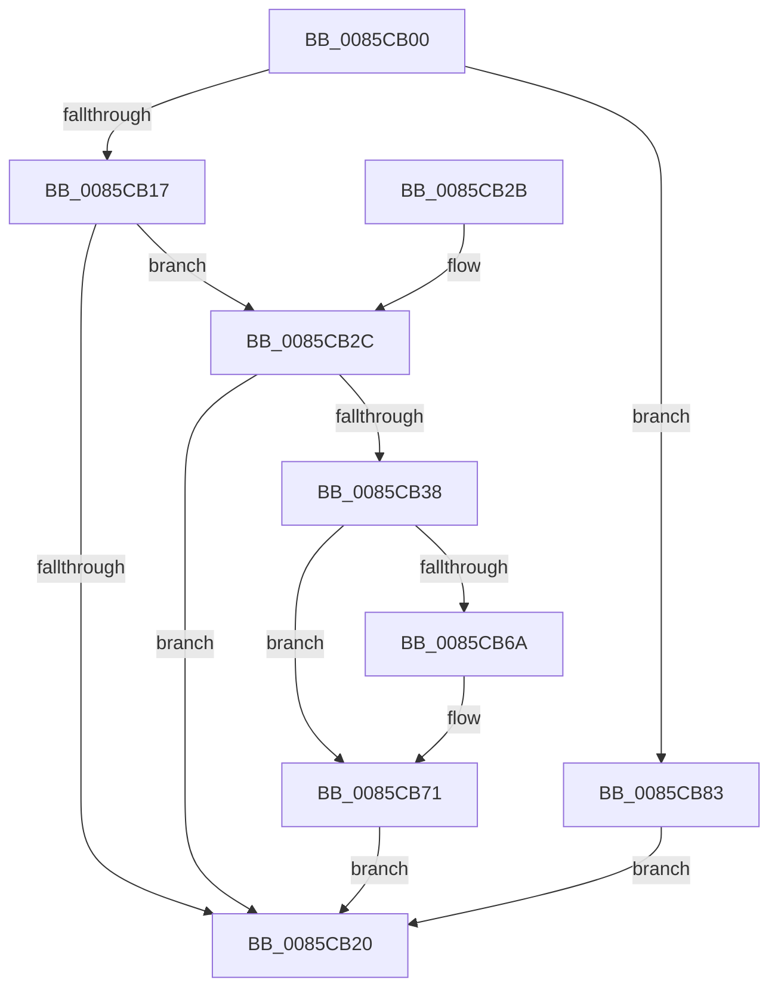

# CmpCreateLayerLink

- RVA: `0x0085CB00`–`0x0085CB8A` (길이 `138` bytes)
- VA: `0x000000014085CB00`
- 실행 섹션: `PAGE`
- PDB 이름 있음: `예`; PDB Function 태그: `아니요`
- unwind 정보 RVA: `0x0006AF6C`
- 디코드: `41`개 명령, `138/138` bytes 표시
- 미해석 바이트: `0` (있으면 어셈블리에 `.byte`로 보존)

> 이 문서는 커널 이미지의 기계어와 PDB 기호를 분석해 생성했습니다. 4번과 5번은 함수 원형과 자료형을 바이너리 사용 방식에서 추정한 C 해석이며 원본 소스 복구 결과는 아닙니다.

## 1. Dependencies

- 직접 호출 지점: **3**; 고유 호출 대상: **2**
- 직접 호출자로 확인된 함수: **1**
- RIP 상대 이미지 참조: **0**

### Outgoing calls
- `0x0085CB17` → [CmpAllocateLayerInfoForKcb](CmpAllocateLayerInfoForKcb_function_0085CB90.md) (function, `0x0085CB90`)
- `0x0085CB2F` → [CmpAllocateLayerInfoForKcb](CmpAllocateLayerInfoForKcb_function_0085CB90.md) (function, `0x0085CB90`)
- `0x0085CB3B` → [CmpReferenceKeyControlBlock](CmpReferenceKeyControlBlock_function_0085D370.md) (function, `0x0085D370`)

### Direct callers
- [CmRenameKey](../7E/CmRenameKey_function_007E8F48.md) at `0x007E9E6C`

### Static image references
- 디코드된 RIP-relative 메모리 참조가 없습니다.

## 2. Other-region calls and transfers

- 다른 실행 섹션으로 향하는 call: **0**
- 별도 외부 분기/꼬리 이동을 확인하지 못했습니다.

## 3. Assembly (complete function range)

```asm
0085CB00  48 89 5C 24 08                  mov qword ptr [rsp + 8], rbx
0085CB05  57                              push rdi
0085CB06  48 83 EC 20                     sub rsp, 0x20
0085CB0A  66 83 79 42 7F                  cmp word ptr [rcx + 0x42], 0x7f
0085CB0F  48 8B FA                        mov rdi, rdx
0085CB12  48 8B D9                        mov rbx, rcx
0085CB15  7D 6C                           jge 0x14085cb83
0085CB17  E8 74 00 00 00                  call 0x14085cb90
0085CB1C  85 C0                           test eax, eax
0085CB1E  79 0C                           jns 0x14085cb2c
0085CB20  48 8B 5C 24 30                  mov rbx, qword ptr [rsp + 0x30]
0085CB25  48 83 C4 20                     add rsp, 0x20
0085CB29  5F                              pop rdi
0085CB2A  C3                              ret
0085CB2B  CC                              int3
0085CB2C  48 8B CF                        mov rcx, rdi
0085CB2F  E8 5C 00 00 00                  call 0x14085cb90
0085CB34  85 C0                           test eax, eax
0085CB36  78 E8                           js 0x14085cb20
0085CB38  48 8B CB                        mov rcx, rbx
0085CB3B  E8 30 08 00 00                  call 0x14085d370
0085CB40  0F B7 43 42                     movzx eax, word ptr [rbx + 0x42]
0085CB44  48 8B 8F C0 00 00 00            mov rcx, qword ptr [rdi + 0xc0]
0085CB4B  66 FF C0                        inc ax
0085CB4E  66 89 47 42                     mov word ptr [rdi + 0x42], ax
0085CB52  48 8B 83 C0 00 00 00            mov rax, qword ptr [rbx + 0xc0]
0085CB59  48 89 41 18                     mov qword ptr [rcx + 0x18], rax
0085CB5D  48 83 C0 20                     add rax, 0x20
0085CB61  48 8B 50 08                     mov rdx, qword ptr [rax + 8]
0085CB65  48 39 02                        cmp qword ptr [rdx], rax
0085CB68  74 07                           je 0x14085cb71
0085CB6A  B9 03 00 00 00                  mov ecx, 3
0085CB6F  CD 29                           int 0x29
0085CB71  48 89 01                        mov qword ptr [rcx], rax
0085CB74  48 89 51 08                     mov qword ptr [rcx + 8], rdx
0085CB78  48 89 0A                        mov qword ptr [rdx], rcx
0085CB7B  48 89 48 08                     mov qword ptr [rax + 8], rcx
0085CB7F  33 C0                           xor eax, eax
0085CB81  EB 9D                           jmp 0x14085cb20
0085CB83  B8 0D 00 00 C0                  mov eax, 0xc000000d
0085CB88  EB 96                           jmp 0x14085cb20
```

## 4. C-style interpretation (structured pseudocode)

```c
__int64 __fastcall CmpCreateLayerLink(__int64 a1, __int64 a2)
{
    __int64 result;
    __int64 v_rsp;
    unsigned __int64 v_stack_p8;

    v_stack_p8 = v_rbx;
    v_rsp = (v_rsp) - (32);
    if ((*(unsigned __int16 *)(a1 + 66)) >= 127) goto loc_0085CB83;
    result = CmpAllocateLayerInfoForKcb(a1, a2, a3, a4);
    if (!sign_flag) goto loc_0085CB2C;
loc_0085CB20:
    v_rsp = (v_rsp) + (32);
    return result;
loc_0085CB2C:
    result = CmpAllocateLayerInfoForKcb(a2, a2, a3, a4);
    if (sign_flag) goto loc_0085CB20;
    result = CmpReferenceKeyControlBlock(v_stack_p8, a2, a3, a4);
    result = (unsigned __int16)((*(unsigned __int16 *)(v_stack_p8 + 66)) + 1);
    *(unsigned __int16 *)(a2 + 66) = (unsigned __int16)(result);
    *(unsigned __int64 *)(*(unsigned __int64 *)(a2 + 192) + 24) = *(unsigned __int64 *)(v_stack_p8 + 192);
    result = (*(unsigned __int64 *)(v_stack_p8 + 192)) + (32);
    if ((*(unsigned __int64 *)(*(unsigned __int64 *)(result + 8))) != result) {
        a1 = 3;
    }
    *(unsigned __int64 *)(a1) = result;
    *(unsigned __int64 *)(a1 + 8) = *(unsigned __int64 *)(result + 8);
    *(unsigned __int64 *)(*(unsigned __int64 *)(result + 8)) = a1;
    *(unsigned __int64 *)(result + 8) = a1;
    result = 0;
    goto loc_0085CB20;
loc_0085CB83:
    goto loc_0085CB20;
}
```

## 5. (Beta) C Style

```c
int64_t CmpCreateLayerLink(void *Arg1, void *Arg2)
{
    uint8_t *arg1 = (uint8_t *)Arg1;
    uint8_t *arg2 = (uint8_t *)Arg2;

    int64_t result;
    int64_t local_rsp;
    uint64_t v_stack_p8;

    v_stack_p8 = local_rbx;
    local_rsp = (local_rsp) - (32);
    if ((*(uint16_t *)(arg1 + 0x42)) >= 127) goto loc_0085CB83;
    result = CmpAllocateLayerInfoForKcb(Arg1, Arg2, a3, a4);
    if (!sign_flag) goto loc_0085CB2C;
loc_0085CB20:
    local_rsp = (local_rsp) + (32);
    return result;
loc_0085CB2C:
    result = CmpAllocateLayerInfoForKcb(Arg2, Arg2, a3, a4);
    if (sign_flag) goto loc_0085CB20;
    result = CmpReferenceKeyControlBlock(v_stack_p8, Arg2, a3, a4);
    result = (uint16_t)((*(uint16_t *)(v_stack_p8 + 0x42)) + 1);
    *(uint16_t *)(arg2 + 0x42) = (uint16_t)(result);
    *(uint64_t *)(*(uint64_t *)(arg2 + 0xC0) + 0x18) = *(uint64_t *)(v_stack_p8 + 0xC0);
    result = (*(uint64_t *)(v_stack_p8 + 0xC0)) + (32);
    if ((*(uint64_t *)(*(uint64_t *)(result + 0x8))) != result) {
        Arg1 = 3;
    }
    *(uint64_t *)(arg1) = result;
    *(uint64_t *)(arg1 + 0x8) = *(uint64_t *)(result + 0x8);
    *(void **)(*(uint64_t *)(result + 0x8)) = Arg1;
    *(void **)(result + 0x8) = Arg1;
    result = 0;
    goto loc_0085CB20;
loc_0085CB83:
    goto loc_0085CB20;
}
```

### 관측된 메모리 오프셋

구조체 형식이 확인되지 않은 접근은 인자 기준의 오프셋으로만 기록했습니다.

| 기준 인자 | 오프셋 표현 | 폭 (bit) | 접근 |
|---|---:|---:|---|
| `Arg1` | `+ 0x42` | `16` | `R` |
| `Arg1` | `+ 0xC0` | `64` | `R` |
| `Arg2` | `+ 0x42` | `16` | `W` |
| `Arg2` | `+ 0xC0` | `64` | `R` |

## 6. Execution-region graph

[열기: 2D/3D 그래프와 함수 탐색 컨트롤 패널](../../../control-panel.html?section=page&rva=0x0085CB00&view=graph)

- 2D 그래프는 위에서 아래로 흐르고, 3D 그래프는 빈 공간을 드래그해 회전합니다. Shift+드래그는 이동, 휠은 확대·축소, 함수 노드 선택은 대상 보고서 이동입니다.

### Static fallback


