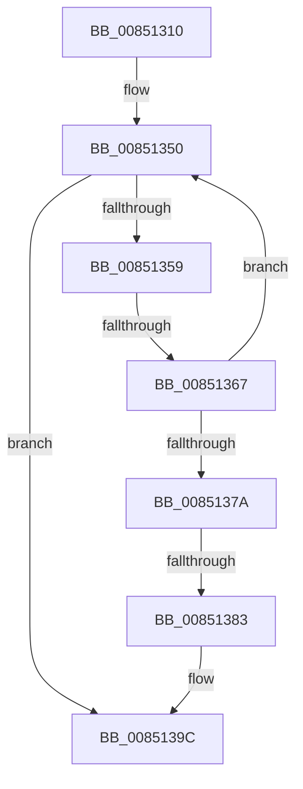

# CmpDereferenceKeyControlBlock

- RVA: `0x00851310`–`0x008513AF` (길이 `159` bytes)
- VA: `0x0000000140851310`
- 실행 섹션: `PAGE`
- PDB 이름 있음: `예`; PDB Function 태그: `아니요`
- unwind 정보 RVA: `0x00069D98`
- 디코드: `43`개 명령, `159/159` bytes 표시
- 미해석 바이트: `0` (있으면 어셈블리에 `.byte`로 보존)

> 이 문서는 커널 이미지의 기계어와 PDB 기호를 분석해 생성했습니다. 4번과 5번은 함수 원형과 자료형을 바이너리 사용 방식에서 추정한 C 해석이며 원본 소스 복구 결과는 아닙니다.

## 1. Dependencies

- 직접 호출 지점: **2**; 고유 호출 대상: **2**
- 직접 호출자로 확인된 함수: **19**
- RIP 상대 이미지 참조: **1**

### Outgoing calls
- `0x0085133C` → [CmpInitializeDelayDerefContext](../../text/42/CmpInitializeDelayDerefContext_function_0042A7F0.md) (function, `0x0042A7F0`)
- `0x00851396` → [KeBugCheckEx](../../text/4F/KeBugCheckEx_function_004FD660.md) (function, `0x004FD660`)

### Direct callers
- [CmpDoBuildVirtualStack](../7E/CmpDoBuildVirtualStack_function_007EB4C4.md) at `0x007EB79E`
- [CmpReplicateKeyToVirtual](../7E/CmpReplicateKeyToVirtual_function_007EBAEC.md) at `0x007EBC88`
- [CmpReplicateKeyToVirtual](../7E/CmpReplicateKeyToVirtual_function_007EBAEC.md) at `0x007EBC9E`
- [CmpFreeSiloKeyLockEntry](../7E/CmpFreeSiloKeyLockEntry_function_007EDD38.md) at `0x007EDD5B`
- [CmpGlobalUnlockKeyForWrite](../7E/CmpGlobalUnlockKeyForWrite_function_007EDD80.md) at `0x007EDE0C`
- [sub_0084E786](../84/Unknown_function_0084E786.md) at `0x0084E789`
- [CmpWalkOneLevel](CmpWalkOneLevel_function_00852BA0.md) at `0x00853226`
- [sub_00857E06](Unknown_function_00857E06.md) at `0x00857E1F`
- [CmpDoParseKey](CmpDoParseKey_function_0085F750.md) at `0x0085FC20`
- [CmpDoParseKey](CmpDoParseKey_function_0085F750.md) at `0x008604B0`
- [CmpDoParseKey](CmpDoParseKey_function_0085F750.md) at `0x008604BD`
- [CmpDoParseKey](CmpDoParseKey_function_0085F750.md) at `0x0086063B`
- [CmpDoParseKey](CmpDoParseKey_function_0085F750.md) at `0x008606D3`
- [sub_0086560A](../86/Unknown_function_0086560A.md) at `0x008659F8`
- [sub_0086560A](../86/Unknown_function_0086560A.md) at `0x00865A5D`
- [CmLoadDifferencingKey](../87/CmLoadDifferencingKey_function_00875670.md) at `0x00876219`
- [CmOpenKey](../87/CmOpenKey_function_00876350.md) at `0x0087674A`
- [sub_008769B9](../87/Unknown_function_008769B9.md) at `0x008769C6`
- [sub_008769B9](../87/Unknown_function_008769B9.md) at `0x008769D9`
- [CmReleaseLoadKeyContext](../87/CmReleaseLoadKeyContext_function_00877C88.md) at `0x00877C9D`
- [CmReleaseLoadKeyContext](../87/CmReleaseLoadKeyContext_function_00877C88.md) at `0x00877CCC`
- [sub_008B4CB2](../8B/Unknown_function_008B4CB2.md) at `0x008B4CBB`
- [CmpEnumerateLayeredKey](../94/CmpEnumerateLayeredKey_function_00945E58.md) at `0x00946235`
- [CmpLateUnloadHiveWorker](../9B/CmpLateUnloadHiveWorker_function_009B20D0.md) at `0x009B21F6`
- [CmpKeyEnumStackFreeResumeContext](../A6/CmpKeyEnumStackFreeResumeContext_function_00A6DDD8.md) at `0x00A6DE26`
- [sub_00B16C20](../B1/Unknown_function_00B16C20.md) at `0x00B16C25`
- [sub_00B17CD8](../B1/Unknown_function_00B17CD8.md) at `0x00B17CD8`

### Static image references
- `0x0085131A` → RVA `0x00E0A740` (`.data`; read)

## 2. Other-region calls and transfers

- 다른 실행 섹션으로 향하는 call: **2**
  - `0x0085133C` → [CmpInitializeDelayDerefContext](../../text/42/CmpInitializeDelayDerefContext_function_0042A7F0.md) (`PAGE` → `.text`)
  - `0x00851396` → [KeBugCheckEx](../../text/4F/KeBugCheckEx_function_004FD660.md) (`PAGE` → `.text`)
- call이 아닌 외부 분기/꼬리 이동: **2**
  - `0x00851361` → [sub_008515B0](Unknown_function_008515B0.md) (`tail-transfer`)
  - `0x0085137D` → [sub_00851966](Unknown_function_00851966.md) (`tail-transfer`)

## 3. Assembly (complete function range)

```asm
00851310  40 53                           push rbx
00851312  57                              push rdi
00851313  48 81 EC C8 00 00 00            sub rsp, 0xc8
0085131A  48 8B 05 1F 94 5B 00            mov rax, qword ptr [rip + 0x5b941f]
00851321  48 33 C4                        xor rax, rsp
00851324  48 89 84 24 A8 00 00 00         mov qword ptr [rsp + 0xa8], rax
0085132C  48 8B D9                        mov rbx, rcx
0085132F  0F 57 C0                        xorps xmm0, xmm0
00851332  48 8D 4C 24 40                  lea rcx, [rsp + 0x40]
00851337  0F 11 44 24 40                  movups xmmword ptr [rsp + 0x40], xmm0
0085133C  E8 AF 94 BD FF                  call 0x14042a7f0
00851341  48 8B 7B 20                     mov rdi, qword ptr [rbx + 0x20]
00851345  48 8B 0B                        mov rcx, qword ptr [rbx]
00851348  48 89 B4 24 F0 00 00 00         mov qword ptr [rsp + 0xf0], rsi
00851350  48 8B D1                        mov rdx, rcx
00851353  48 83 F9 01                     cmp rcx, 1
00851357  76 43                           jbe 0x14085139c
00851359  4C 8D 41 FF                     lea r8, [rcx - 1]
0085135D  49 83 F8 02                     cmp r8, 2
00851361  0F 84 49 02 00 00               je 0x1408515b0
00851367  45 32 C9                        xor r9b, r9b
0085136A  48 8B C1                        mov rax, rcx
0085136D  F0 4C 0F B1 03                  lock cmpxchg qword ptr [rbx], r8
00851372  48 8B C8                        mov rcx, rax
00851375  48 3B C2                        cmp rax, rdx
00851378  75 D6                           jne 0x140851350
0085137A  49 3B C0                        cmp rax, r8
0085137D  0F 83 E3 05 00 00               jae 0x140851966
00851383  33 FF                           xor edi, edi
00851385  45 33 C9                        xor r9d, r9d
00851388  4C 8B C3                        mov r8, rbx
0085138B  48 89 7C 24 20                  mov qword ptr [rsp + 0x20], rdi
00851390  8D 57 25                        lea edx, [rdi + 0x25]
00851393  8D 4F 51                        lea ecx, [rdi + 0x51]
00851396  E8 C5 C2 CA FF                  call 0x1404fd660
0085139B  CC                              int3
0085139C  8B 43 10                        mov eax, dword ptr [rbx + 0x10]
0085139F  45 33 C0                        xor r8d, r8d
008513A2  48 8B 73 20                     mov rsi, qword ptr [rbx + 0x20]
008513A6  8B C8                           mov ecx, eax
008513A8  C1 E9 09                        shr ecx, 9
008513AB  33 D2                           xor edx, edx
008513AD  33 C8                           xor ecx, eax
```

## 4. C-style interpretation (structured pseudocode)

```c
__int64 __fastcall CmpDereferenceKeyControlBlock(__int64 a1, __int64 a2, __int64 a3, unsigned __int8 a4)
{
    __int64 result;
    __int64 v_rdi;
    __int64 v_rsp;
    unsigned __int64 v_stack_m30;
    unsigned __int64 v_stack_m98;
    unsigned __int64 v_stack_mB8;
    unsigned __int64 v_stack_p18;

    v_rsp = (v_rsp) - (200);
    result = (*(unsigned __int64 *)(v_rip + 6001695)) ^ (v_rsp);
    v_stack_m30 = result;
    v_stack_m98 = v_xmm0;
    result = CmpInitializeDelayDerefContext(v_stack_m98, a2, a3, a4);
    v_stack_p18 = v_rsi;
loc_00851350:
    if ((*(unsigned __int64 *)(a1)) <= 1) goto loc_0085139C;
    a4 = 0;
    if ((*(unsigned __int64 *)(a1)) != (*(unsigned __int64 *)(a1))) goto loc_00851350;
    v_rdi = 0;
    a4 = 0;
    v_stack_mB8 = 0;
    result = KeBugCheckEx(v_rdi + 81, v_rdi + 37, a1, a4);
loc_0085139C:
    a3 = 0;
    a1 = (unsigned int)(((unsigned int)((unsigned int)((unsigned int)(*(unsigned int *)(a1 + 16))))) >> (9));
    a2 = 0;
    a1 = (unsigned int)((a1) ^ ((unsigned int)((unsigned int)(*(unsigned int *)(a1 + 16)))));
    return (unsigned int)(*(unsigned int *)(a1 + 16));
}
```

## 5. (Beta) C Style

```c
int64_t CmpDereferenceKeyControlBlock(void *Arg1, int64_t Arg2, int64_t Arg3, uint8_t Arg4)
{
    uint8_t *arg1 = (uint8_t *)Arg1;

    int64_t result;
    int64_t local_rdi;
    int64_t local_rsp;
    uint64_t v_stack_m30;
    uint64_t v_stack_m98;
    uint64_t v_stack_mB8;
    uint64_t v_stack_p18;

    local_rsp = (local_rsp) - (200);
    result = (*(uint64_t *)(v_rip + 0x5B941F)) ^ (local_rsp);
    v_stack_m30 = result;
    v_stack_m98 = v_xmm0;
    result = CmpInitializeDelayDerefContext(v_stack_m98, Arg2, Arg3, Arg4);
    v_stack_p18 = local_rsi;
loc_00851350:
    if ((*(uint64_t *)(arg1)) <= 1) goto loc_0085139C;
    Arg4 = 0;
    if ((*(uint64_t *)(arg1)) != (*(uint64_t *)(arg1))) goto loc_00851350;
    local_rdi = 0;
    Arg4 = 0;
    v_stack_mB8 = 0;
    result = KeBugCheckEx(local_rdi + 81, local_rdi + 37, Arg1, Arg4);
loc_0085139C:
    Arg3 = 0;
    Arg1 = (uint32_t)(((uint32_t)((uint32_t)((uint32_t)(*(uint32_t *)(arg1 + 0x10))))) >> (9));
    Arg2 = 0;
    Arg1 = (uint32_t)((Arg1) ^ ((uint32_t)((uint32_t)(*(uint32_t *)(arg1 + 0x10)))));
    return (uint32_t)(*(uint32_t *)(arg1 + 0x10));
}
```

### 관측된 메모리 오프셋

구조체 형식이 확인되지 않은 접근은 인자 기준의 오프셋으로만 기록했습니다.

| 기준 인자 | 오프셋 표현 | 폭 (bit) | 접근 |
|---|---:|---:|---|
| `Arg1` | `+ 0x0` | `64` | `R` |
| `Arg1` | `+ 0x10` | `32` | `R` |
| `Arg1` | `+ 0x20` | `64` | `R` |

## 6. Execution-region graph

[열기: 2D/3D 그래프와 함수 탐색 컨트롤 패널](../../../control-panel.html?section=page&rva=0x00851310&view=graph)

- 2D 그래프는 위에서 아래로 흐르고, 3D 그래프는 빈 공간을 드래그해 회전합니다. Shift+드래그는 이동, 휠은 확대·축소, 함수 노드 선택은 대상 보고서 이동입니다.

### Static fallback


