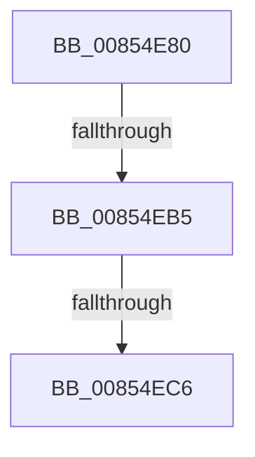

# CmpDoCompareKeyName

- RVA: `0x00854E80`–`0x00854ECA` (길이 `74` bytes)
- VA: `0x0000000140854E80`
- 실행 섹션: `PAGE`
- PDB 이름 있음: `예`; PDB Function 태그: `아니요`
- unwind 정보 RVA: `0x00069FD8`
- 디코드: `19`개 명령, `74/74` bytes 표시
- 미해석 바이트: `0` (있으면 어셈블리에 `.byte`로 보존)

> 이 문서는 커널 이미지의 기계어와 PDB 기호를 분석해 생성했습니다. 4번과 5번은 함수 원형과 자료형을 바이너리 사용 방식에서 추정한 C 해석이며 원본 소스 복구 결과는 아닙니다.

## 1. Dependencies

- 직접 호출 지점: **1**; 고유 호출 대상: **1**
- 직접 호출자로 확인된 함수: **3**
- RIP 상대 이미지 참조: **0**

### Outgoing calls
- `0x00854EB5` → [HvpGetCellFlat](HvpGetCellFlat_function_00854C60.md) (function, `0x00854C60`)

### Direct callers
- [CmpSelectLeaf](../84/CmpSelectLeaf_function_0084BFB4.md) at `0x0084C099`
- [sub_0085416A](Unknown_function_0085416A.md) at `0x008542AA`
- [CmpFindSubKeyInRoot](CmpFindSubKeyInRoot_function_0085D890.md) at `0x0085DE8A`
- [CmpFindSubKeyInRoot](CmpFindSubKeyInRoot_function_0085D890.md) at `0x0085DF1C`

### Static image references
- 디코드된 RIP-relative 메모리 참조가 없습니다.

## 2. Other-region calls and transfers

- 다른 실행 섹션으로 향하는 call: **0**
- call이 아닌 외부 분기/꼬리 이동: **2**
  - `0x00854EAF` → [sub_00854F9C + 0x15](Unknown_function_00854F9C.md) (`tail-transfer`)
  - `0x00854EC0` → [sub_00854F9C + 0x31](Unknown_function_00854F9C.md) (`tail-transfer`)

## 3. Assembly (complete function range)

```asm
00854E80  40 53                           push rbx
00854E82  57                              push rdi
00854E83  41 56                           push r14
00854E85  48 83 EC 50                     sub rsp, 0x50
00854E89  33 C0                           xor eax, eax
00854E8B  C7 44 24 70 FF FF FF FF         mov dword ptr [rsp + 0x70], 0xffffffff
00854E93  F6 81 8C 00 00 00 01            test byte ptr [rcx + 0x8c], 1
00854E9A  49 8B D8                        mov rbx, r8
00854E9D  48 8B FA                        mov rdi, rdx
00854EA0  89 44 24 74                     mov dword ptr [rsp + 0x74], eax
00854EA4  4C 8B F1                        mov r14, rcx
00854EA7  4C 8D 44 24 70                  lea r8, [rsp + 0x70]
00854EAC  41 8B D1                        mov edx, r9d
00854EAF  0F 84 FC 00 00 00               je 0x140854fb1
00854EB5  E8 A6 FD FF FF                  call 0x140854c60
00854EBA  48 8B C8                        mov rcx, rax
00854EBD  48 85 C0                        test rax, rax
00854EC0  0F 84 07 01 00 00               je 0x140854fcd
00854EC6  F6 40 02 20                     test byte ptr [rax + 2], 0x20
```

## 4. C-style interpretation (structured pseudocode)

```c
__int64 __fastcall CmpDoCompareKeyName(__int64 a1, __int64 a2, __int64 a3, int a4)
{
    __int64 result;
    __int64 v_rsp;
    unsigned int v_stack_p8;
    unsigned int v_stack_pC;

    v_rsp = (v_rsp) - (80);
    result = 0;
    v_stack_p8 = 0xFFFFFFFFULL;
    v_stack_pC = 0;
    result = HvpGetCellFlat(a1, (unsigned int)(a4), v_stack_p8, a4);
    return result;
}
```

## 5. (Beta) C Style

```c
int64_t CmpDoCompareKeyName(void *Arg1, int64_t Arg2, int64_t Arg3, int32_t Arg4)
{
    uint8_t *arg1 = (uint8_t *)Arg1;

    int64_t result;
    int64_t local_rsp;
    uint32_t v_stack_p8;
    uint32_t v_stack_pC;

    local_rsp = (local_rsp) - (80);
    result = 0;
    v_stack_p8 = 0xFFFFFFFFULL;
    v_stack_pC = 0;
    result = HvpGetCellFlat(Arg1, (uint32_t)(Arg4), v_stack_p8, Arg4);
    return result;
}
```

### 관측된 메모리 오프셋

구조체 형식이 확인되지 않은 접근은 인자 기준의 오프셋으로만 기록했습니다.

| 기준 인자 | 오프셋 표현 | 폭 (bit) | 접근 |
|---|---:|---:|---|
| `Arg1` | `+ 0x8C` | `8` | `R` |

## 6. Execution-region graph

[열기: 2D/3D 그래프와 함수 탐색 컨트롤 패널](../../../control-panel.html?section=page&rva=0x00854E80&view=graph)

- 2D 그래프는 위에서 아래로 흐르고, 3D 그래프는 빈 공간을 드래그해 회전합니다. Shift+드래그는 이동, 휠은 확대·축소, 함수 노드 선택은 대상 보고서 이동입니다.

### Static fallback


