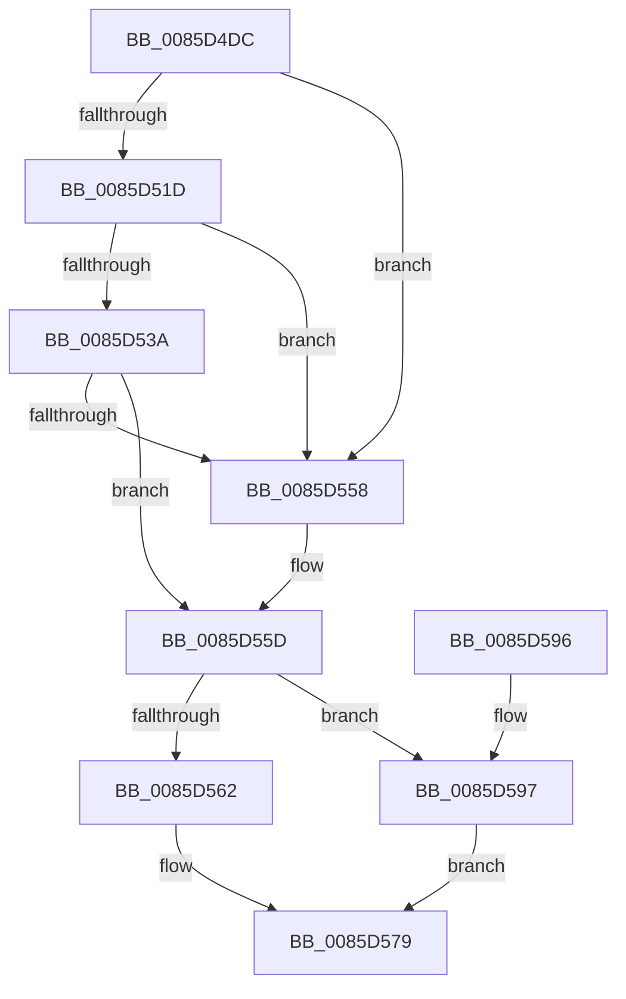

# CmpExpandPathInfo

- RVA: `0x0085D4DC`–`0x0085D59E` (길이 `194` bytes)
- VA: `0x000000014085D4DC`
- 실행 섹션: `PAGE`
- PDB 이름 있음: `예`; PDB Function 태그: `아니요`
- unwind 정보 RVA: `0x0006B020`
- 디코드: `54`개 명령, `194/194` bytes 표시
- 미해석 바이트: `0` (있으면 어셈블리에 `.byte`로 보존)

> 이 문서는 커널 이미지의 기계어와 PDB 기호를 분석해 생성했습니다. 4번과 5번은 함수 원형과 자료형을 바이너리 사용 방식에서 추정한 C 해석이며 원본 소스 복구 결과는 아닙니다.

## 1. Dependencies

- 직접 호출 지점: **4**; 고유 호출 대상: **3**
- 직접 호출자로 확인된 함수: **1**
- RIP 상대 이미지 참조: **0**

### Outgoing calls
- `0x0085D50E` → [ExpInterlockedPopEntrySList](../../text/6B/ExpInterlockedPopEntrySList_function_006BA570.md) (function, `0x006BA570`)
- `0x0085D52D` → [ExpInterlockedPopEntrySList](../../text/6B/ExpInterlockedPopEntrySList_function_006BA570.md) (function, `0x006BA570`)
- `0x0085D54B` → [guard_dispatch_icall](../../text/6B/guard_dispatch_icall_function_006BAAD0.md) (function, `0x006BAAD0`)
- `0x0085D56D` → [memset](../../text/6C/memset_function_006C6C40.md) (function, `0x006C6C40`)

### Direct callers
- [sub_0085F45E](Unknown_function_0085F45E.md) at `0x0085F469`

### Static image references
- 디코드된 RIP-relative 메모리 참조가 없습니다.

## 2. Other-region calls and transfers

- 다른 실행 섹션으로 향하는 call: **4**
  - `0x0085D50E` → [ExpInterlockedPopEntrySList](../../text/6B/ExpInterlockedPopEntrySList_function_006BA570.md) (`PAGE` → `.text`)
  - `0x0085D52D` → [ExpInterlockedPopEntrySList](../../text/6B/ExpInterlockedPopEntrySList_function_006BA570.md) (`PAGE` → `.text`)
  - `0x0085D54B` → [guard_dispatch_icall](../../text/6B/guard_dispatch_icall_function_006BAAD0.md) (`PAGE` → `.text`)
  - `0x0085D56D` → [memset](../../text/6C/memset_function_006C6C40.md) (`PAGE` → `.text`)
- 별도 외부 분기/꼬리 이동을 확인하지 못했습니다.

## 3. Assembly (complete function range)

```asm
0085D4DC  48 8B C4                        mov rax, rsp
0085D4DF  48 89 58 08                     mov qword ptr [rax + 8], rbx
0085D4E3  48 89 68 10                     mov qword ptr [rax + 0x10], rbp
0085D4E7  48 89 70 18                     mov qword ptr [rax + 0x18], rsi
0085D4EB  48 89 78 20                     mov qword ptr [rax + 0x20], rdi
0085D4EF  41 56                           push r14
0085D4F1  48 83 EC 20                     sub rsp, 0x20
0085D4F5  65 48 8B 2C 25 20 00 00 00      mov rbp, qword ptr gs:[0x20]
0085D4FE  4C 8B F1                        mov r14, rcx
0085D501  48 8B B5 80 08 00 00            mov rsi, qword ptr [rbp + 0x880]
0085D508  48 8B CE                        mov rcx, rsi
0085D50B  FF 46 14                        inc dword ptr [rsi + 0x14]
0085D50E  E8 5D D0 E5 FF                  call 0x1406ba570
0085D513  33 FF                           xor edi, edi
0085D515  48 8B D8                        mov rbx, rax
0085D518  48 85 C0                        test rax, rax
0085D51B  75 3B                           jne 0x14085d558
0085D51D  FF 46 18                        inc dword ptr [rsi + 0x18]
0085D520  48 8B B5 88 08 00 00            mov rsi, qword ptr [rbp + 0x888]
0085D527  48 8B CE                        mov rcx, rsi
0085D52A  FF 46 14                        inc dword ptr [rsi + 0x14]
0085D52D  E8 3E D0 E5 FF                  call 0x1406ba570
0085D532  48 8B D8                        mov rbx, rax
0085D535  48 85 C0                        test rax, rax
0085D538  75 1E                           jne 0x14085d558
0085D53A  8B 56 2C                        mov edx, dword ptr [rsi + 0x2c]
0085D53D  48 8B 46 30                     mov rax, qword ptr [rsi + 0x30]
0085D541  44 8B 46 28                     mov r8d, dword ptr [rsi + 0x28]
0085D545  8B 4E 24                        mov ecx, dword ptr [rsi + 0x24]
0085D548  FF 46 18                        inc dword ptr [rsi + 0x18]
0085D54B  E8 80 D5 E5 FF                  call 0x1406baad0
0085D550  48 8B D8                        mov rbx, rax
0085D553  48 85 C0                        test rax, rax
0085D556  74 05                           je 0x14085d55d
0085D558  8B 45 24                        mov eax, dword ptr [rbp + 0x24]
0085D55B  89 03                           mov dword ptr [rbx], eax
0085D55D  48 85 DB                        test rbx, rbx
0085D560  74 35                           je 0x14085d597
0085D562  33 D2                           xor edx, edx
0085D564  41 B8 E0 01 00 00               mov r8d, 0x1e0
0085D56A  48 8B CB                        mov rcx, rbx
0085D56D  E8 CE 96 E6 FF                  call 0x1406c6c40
0085D572  49 89 9E A0 00 00 00            mov qword ptr [r14 + 0xa0], rbx
0085D579  48 8B 5C 24 30                  mov rbx, qword ptr [rsp + 0x30]
0085D57E  8B C7                           mov eax, edi
0085D580  48 8B 7C 24 48                  mov rdi, qword ptr [rsp + 0x48]
0085D585  48 8B 6C 24 38                  mov rbp, qword ptr [rsp + 0x38]
0085D58A  48 8B 74 24 40                  mov rsi, qword ptr [rsp + 0x40]
0085D58F  48 83 C4 20                     add rsp, 0x20
0085D593  41 5E                           pop r14
0085D595  C3                              ret
0085D596  CC                              int3
0085D597  BF 9A 00 00 C0                  mov edi, 0xc000009a
0085D59C  EB DB                           jmp 0x14085d579
```

## 4. C-style interpretation (structured pseudocode)

```c
__int64 __fastcall CmpExpandPathInfo(__int64 a1)
{
    __int64 result;
    __int64 v_rdi;
    __int64 v_rsp;
    unsigned __int64 v_stack_p10;
    unsigned __int64 v_stack_p18;
    unsigned __int64 v_stack_p20;
    unsigned __int64 v_stack_p8;

    *(unsigned __int64 *)(v_rsp + 8) = v_rbx;
    *(unsigned __int64 *)(v_rsp + 16) = v_rbp;
    *(unsigned __int64 *)(v_rsp + 24) = v_rsi;
    *(unsigned __int64 *)(v_rsp + 32) = v_rdi;
    v_rsp = (v_rsp) - (32);
    result = ExpInterlockedPopEntrySList(*(unsigned __int64 *)(*(unsigned __int64 *)(gs_base + (0 + 32)) + 2176), a2, a3, a4);
    v_rdi = 0;
    if (result != 0) goto loc_0085D558;
    result = ExpInterlockedPopEntrySList(*(unsigned __int64 *)(*(unsigned __int64 *)(gs_base + (0 + 32)) + 2184), a2, a3, a4);
    if (result != 0) goto loc_0085D558;
    result = guard_dispatch_icall((unsigned int)(*(unsigned int *)(*(unsigned __int64 *)(*(unsigned __int64 *)(gs_base + (0 + 32)) + 2184) + 36)), (unsigned int)(*(unsigned int *)(*(unsigned __int64 *)(*(unsigned __int64 *)(gs_base + (0 + 32)) + 2184) + 44)), (unsigned int)(*(unsigned int *)(*(unsigned __int64 *)(*(unsigned __int64 *)(gs_base + (0 + 32)) + 2184) + 40)), a4);
    if (result != 0) {
        result = *(unsigned int *)(*(unsigned __int64 *)(gs_base + (0 + 32)) + 36);
        *(unsigned int *)(result) = (unsigned int)(result);
    }
    if (result == 0) goto loc_0085D597;
    a2 = 0;
    result = memset(result, a2, 480, a4);
    *(unsigned __int64 *)(a1 + 160) = result;
loc_0085D579:
    v_rsp = (v_rsp) + (32);
    return 0;
loc_0085D597:
    goto loc_0085D579;
}
```

## 5. (Beta) C Style

```c
int64_t CmpExpandPathInfo(void *Arg1)
{
    uint8_t *arg1 = (uint8_t *)Arg1;

    int64_t result;
    int64_t local_rdi;
    int64_t local_rsp;
    uint64_t v_stack_p10;
    uint64_t v_stack_p18;
    uint64_t v_stack_p20;
    uint64_t v_stack_p8;

    *(uint64_t *)(local_rsp + 0x8) = local_rbx;
    *(uint64_t *)(local_rsp + 0x10) = local_rbp;
    *(uint64_t *)(local_rsp + 0x18) = local_rsi;
    *(uint64_t *)(local_rsp + 0x20) = local_rdi;
    local_rsp = (local_rsp) - (32);
    result = ExpInterlockedPopEntrySList(*(uint64_t *)(*(uint64_t *)(gs_base + (0 + 0x20)) + 0x880), a2, a3, a4);
    local_rdi = 0;
    if (result != 0) goto loc_0085D558;
    result = ExpInterlockedPopEntrySList(*(uint64_t *)(*(uint64_t *)(gs_base + (0 + 0x20)) + 0x888), a2, a3, a4);
    if (result != 0) goto loc_0085D558;
    result = guard_dispatch_icall((uint32_t)(*(uint32_t *)(*(uint64_t *)(*(uint64_t *)(gs_base + (0 + 0x20)) + 0x888) + 0x24)), (uint32_t)(*(uint32_t *)(*(uint64_t *)(*(uint64_t *)(gs_base + (0 + 0x20)) + 0x888) + 0x2C)), (uint32_t)(*(uint32_t *)(*(uint64_t *)(*(uint64_t *)(gs_base + (0 + 0x20)) + 0x888) + 0x28)), a4);
    if (result != 0) {
        result = *(uint32_t *)(*(uint64_t *)(gs_base + (0 + 0x20)) + 0x24);
        *(uint32_t *)(result) = (uint32_t)(result);
    }
    if (result == 0) goto loc_0085D597;
    a2 = 0;
    result = memset(result, a2, 480, a4);
    *(uint64_t *)(arg1 + 0xA0) = result;
loc_0085D579:
    local_rsp = (local_rsp) + (32);
    return 0;
loc_0085D597:
    goto loc_0085D579;
}
```

### 관측된 메모리 오프셋

구조체 형식이 확인되지 않은 접근은 인자 기준의 오프셋으로만 기록했습니다.

| 기준 인자 | 오프셋 표현 | 폭 (bit) | 접근 |
|---|---:|---:|---|
| `Arg1` | `+ 0xA0` | `64` | `W` |

## 6. Execution-region graph

[열기: 2D/3D 그래프와 함수 탐색 컨트롤 패널](../../../control-panel.html?section=page&rva=0x0085D4DC&view=graph)

- 2D 그래프는 위에서 아래로 흐르고, 3D 그래프는 빈 공간을 드래그해 회전합니다. Shift+드래그는 이동, 휠은 확대·축소, 함수 노드 선택은 대상 보고서 이동입니다.

### Static fallback


