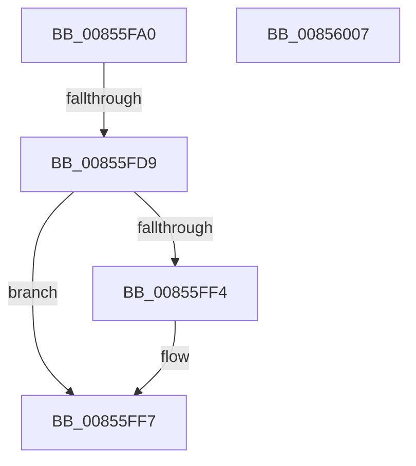

# CmpFindNameInListCellWithStatus

- RVA: `0x00855FA0`–`0x00856008` (길이 `104` bytes)
- VA: `0x0000000140855FA0`
- 실행 섹션: `PAGE`
- PDB 이름 있음: `예`; PDB Function 태그: `아니요`
- unwind 정보 RVA: `0x0006A3A0`
- 디코드: `31`개 명령, `104/104` bytes 표시
- 미해석 바이트: `0` (있으면 어셈블리에 `.byte`로 보존)

> 이 문서는 커널 이미지의 기계어와 PDB 기호를 분석해 생성했습니다. 4번과 5번은 함수 원형과 자료형을 바이너리 사용 방식에서 추정한 C 해석이며 원본 소스 복구 결과는 아닙니다.

## 1. Dependencies

- 직접 호출 지점: **1**; 고유 호출 대상: **1**
- 직접 호출자로 확인된 함수: **1**
- RIP 상대 이미지 참조: **0**

### Outgoing calls
- `0x00855FCF` → [HvpGetCellContextInitialize](HvpGetCellContextInitialize_function_00855F10.md) (function, `0x00855F10`)

### Direct callers
- [CmpValueEnumStackMatchingValueInUpperLayer](../8B/CmpValueEnumStackMatchingValueInUpperLayer_function_008B26E0.md) at `0x008B2798`

### Static image references
- 디코드된 RIP-relative 메모리 참조가 없습니다.

## 2. Other-region calls and transfers

- 다른 실행 섹션으로 향하는 call: **0**
- call이 아닌 외부 분기/꼬리 이동: **1**
  - `0x00855FD7` → [sub_00856008](Unknown_function_00856008.md) (`tail-transfer`)

## 3. Assembly (complete function range)

```asm
00855FA0  4C 89 4C 24 20                  mov qword ptr [rsp + 0x20], r9
00855FA5  44 89 44 24 18                  mov dword ptr [rsp + 0x18], r8d
00855FAA  48 89 54 24 10                  mov qword ptr [rsp + 0x10], rdx
00855FAF  53                              push rbx
00855FB0  56                              push rsi
00855FB1  41 54                           push r12
00855FB3  41 57                           push r15
00855FB5  48 83 EC 58                     sub rsp, 0x58
00855FB9  4C 8B F9                        mov r15, rcx
00855FBC  45 33 E4                        xor r12d, r12d
00855FBF  48 8D 4C 24 30                  lea rcx, [rsp + 0x30]
00855FC4  4C 89 64 24 30                  mov qword ptr [rsp + 0x30], r12
00855FC9  49 8B D9                        mov rbx, r9
00855FCC  48 8B F2                        mov rsi, rdx
00855FCF  E8 3C FF FF FF                  call 0x140855f10
00855FD4  45 85 C0                        test r8d, r8d
00855FD7  75 2F                           jne 0x140856008
00855FD9  48 8B 84 24 B0 00 00 00         mov rax, qword ptr [rsp + 0xb0]
00855FE1  C7 00 FF FF FF FF               mov dword ptr [rax], 0xffffffff
00855FE7  48 8B 84 24 A8 00 00 00         mov rax, qword ptr [rsp + 0xa8]
00855FEF  48 85 C0                        test rax, rax
00855FF2  74 03                           je 0x140855ff7
00855FF4  44 89 20                        mov dword ptr [rax], r12d
00855FF7  B8 34 00 00 C0                  mov eax, 0xc0000034
00855FFC  48 83 C4 58                     add rsp, 0x58
00856000  41 5F                           pop r15
00856002  41 5C                           pop r12
00856004  5E                              pop rsi
00856005  5B                              pop rbx
00856006  C3                              ret
00856007  CC                              int3
```

## 4. C-style interpretation (structured pseudocode)

```c
__int64 __fastcall CmpFindNameInListCellWithStatus(__int64 a1, __int64 a2, int a3, __int64 a4, __int64 a5, __int64 a6, __int64 a7)
{
    __int64 result;
    __int64 v_r12;
    __int64 v_rsp;
    unsigned __int64 v_stack_m48;
    unsigned __int64 v_stack_p10;
    unsigned int v_stack_p18;
    unsigned __int64 v_stack_p20;

    v_stack_p20 = a4;
    v_stack_p18 = a3;
    v_stack_p10 = a2;
    v_rsp = (v_rsp) - (88);
    v_r12 = 0;
    v_stack_m48 = 0;
    result = HvpGetCellContextInitialize(v_stack_m48, a2, a3, a4);
    *(unsigned int *)(a7) = 0xFFFFFFFFULL;
    if (a6 != 0) {
        *(unsigned int *)(a6) = 0;
    }
    v_rsp = (v_rsp) + (88);
    return (unsigned int)(0xC0000034ULL);
}
```

## 5. (Beta) C Style

```c
int64_t CmpFindNameInListCellWithStatus(int64_t Arg1, int64_t Arg2, int32_t Arg3, int64_t Arg4, uint64_t Arg5, int64_t Arg6, void *Arg7)
{
    uint8_t *arg7 = (uint8_t *)Arg7;

    int64_t result;
    int64_t local_r12;
    int64_t local_rsp;
    uint64_t v_stack_m48;
    uint64_t v_stack_p10;
    uint32_t v_stack_p18;
    uint64_t v_stack_p20;

    v_stack_p20 = Arg4;
    v_stack_p18 = Arg3;
    v_stack_p10 = Arg2;
    local_rsp = (local_rsp) - (88);
    local_r12 = 0;
    v_stack_m48 = 0;
    result = HvpGetCellContextInitialize(v_stack_m48, Arg2, Arg3, Arg4);
    *(uint32_t *)(arg7) = 0xFFFFFFFFULL;
    if (Arg6 != 0) {
        *(uint32_t *)(Arg6) = 0;
    }
    local_rsp = (local_rsp) + (88);
    return (uint32_t)(0xC0000034ULL);
}
```

### 관측된 메모리 오프셋

구조체 형식이 확인되지 않은 접근은 인자 기준의 오프셋으로만 기록했습니다.

| 기준 인자 | 오프셋 표현 | 폭 (bit) | 접근 |
|---|---:|---:|---|
| `Arg7` | `+ 0x0` | `32` | `W` |

## 6. Execution-region graph

[열기: 2D/3D 그래프와 함수 탐색 컨트롤 패널](../../../control-panel.html?section=page&rva=0x00855FA0&view=graph)

- 2D 그래프는 위에서 아래로 흐르고, 3D 그래프는 빈 공간을 드래그해 회전합니다. Shift+드래그는 이동, 휠은 확대·축소, 함수 노드 선택은 대상 보고서 이동입니다.

### Static fallback


