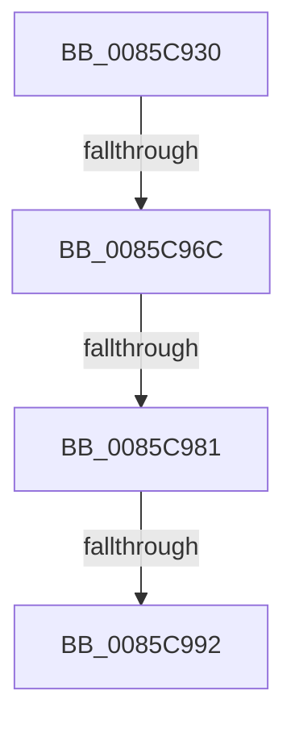

# CmpFindSubKeyByNumber

- RVA: `0x0085C930`–`0x0085C997` (길이 `103` bytes)
- VA: `0x000000014085C930`
- 실행 섹션: `PAGE`
- PDB 이름 있음: `예`; PDB Function 태그: `아니요`
- unwind 정보 RVA: `0x0006AEC4`
- 디코드: `27`개 명령, `103/103` bytes 표시
- 미해석 바이트: `0` (있으면 어셈블리에 `.byte`로 보존)

> 이 문서는 커널 이미지의 기계어와 PDB 기호를 분석해 생성했습니다. 4번과 5번은 함수 원형과 자료형을 바이너리 사용 방식에서 추정한 C 해석이며 원본 소스 복구 결과는 아닙니다.

## 1. Dependencies

- 직접 호출 지점: **1**; 고유 호출 대상: **1**
- 직접 호출자로 확인된 함수: **12**
- RIP 상대 이미지 참조: **0**

### Outgoing calls
- `0x0085C981` → [HvpGetCellFlat](HvpGetCellFlat_function_00854C60.md) (function, `0x00854C60`)

### Direct callers
- [CmDeleteLayeredKey](../../text/41/CmDeleteLayeredKey_function_0041B598.md) at `0x0041B73A`
- [CmDeleteLayeredKey](../../text/41/CmDeleteLayeredKey_function_0041B598.md) at `0x0041B889`
- [CmpPreserveSystemHiveData](../7F/CmpPreserveSystemHiveData_function_007F2518.md) at `0x007F2AA7`
- [CmpMarkAllChildrenDirty](../7F/CmpMarkAllChildrenDirty_function_007F3120.md) at `0x007F3182`
- [CmpUpdateParentForEachSon](../7F/CmpUpdateParentForEachSon_function_007F35B8.md) at `0x007F362E`
- [CmpDeleteTree](../7F/CmpDeleteTree_function_007F3E44.md) at `0x007F3EB9`
- [CmpCopySyncTree2](CmpCopySyncTree2_function_0085BF78.md) at `0x0085C098`
- [CmpClearKeyAccessBits](../87/CmpClearKeyAccessBits_function_0087BB5C.md) at `0x0087BC42`
- [CmpEnumerateLayeredKey](../94/CmpEnumerateLayeredKey_function_00945E58.md) at `0x009462D0`
- [CmpSyncSubKeysAfterDelete](../AC/CmpSyncSubKeysAfterDelete_function_00AC5980.md) at `0x00AC59D4`
- [CmpDoAccessCheckOnSubtree](../../pagecmrc/BC/CmpDoAccessCheckOnSubtree_function_00BC9CD0.md) at `0x00BC9DEE`
- [CmSelectQualifiedInstallLanguage](../../init/C5/CmSelectQualifiedInstallLanguage_function_00C58F58.md) at `0x00C5921B`
- [CmpFindDrivers](../../init/C5/CmpFindDrivers_function_00C5BFBC.md) at `0x00C5C0EB`
- [CmpFindDrivers](../../init/C5/CmpFindDrivers_function_00C5BFBC.md) at `0x00C5C18D`

### Static image references
- 디코드된 RIP-relative 메모리 참조가 없습니다.

## 2. Other-region calls and transfers

- 다른 실행 섹션으로 향하는 call: **0**
- call이 아닌 외부 분기/꼬리 이동: **3**
  - `0x0085C966` → [sub_0085CA9E](Unknown_function_0085CA9E.md) (`tail-transfer`)
  - `0x0085C97B` → [sub_0085C9E8 + 0x1B](Unknown_function_0085C9E8.md) (`tail-transfer`)
  - `0x0085C98C` → [sub_0085CAEF](Unknown_function_0085CAEF.md) (`tail-transfer`)

## 3. Assembly (complete function range)

```asm
0085C930  48 89 5C 24 18                  mov qword ptr [rsp + 0x18], rbx
0085C935  55                              push rbp
0085C936  57                              push rdi
0085C937  41 54                           push r12
0085C939  41 56                           push r14
0085C93B  41 57                           push r15
0085C93D  48 83 EC 20                     sub rsp, 0x20
0085C941  8B 42 14                        mov eax, dword ptr [rdx + 0x14]
0085C944  45 33 E4                        xor r12d, r12d
0085C947  44 89 64 24 6C                  mov dword ptr [rsp + 0x6c], r12d
0085C94C  41 BE FF FF FF FF               mov r14d, 0xffffffff
0085C952  44 89 74 24 68                  mov dword ptr [rsp + 0x68], r14d
0085C957  4D 8B F9                        mov r15, r9
0085C95A  45 89 31                        mov dword ptr [r9], r14d
0085C95D  41 8B E8                        mov ebp, r8d
0085C960  48 8B F9                        mov rdi, rcx
0085C963  44 3B C0                        cmp r8d, eax
0085C966  0F 83 32 01 00 00               jae 0x14085ca9e
0085C96C  8B 52 1C                        mov edx, dword ptr [rdx + 0x1c]
0085C96F  F6 81 8C 00 00 00 01            test byte ptr [rcx + 0x8c], 1
0085C976  4C 8D 44 24 68                  lea r8, [rsp + 0x68]
0085C97B  0F 84 82 00 00 00               je 0x14085ca03
0085C981  E8 DA 82 FF FF                  call 0x140854c60
0085C986  48 8B D8                        mov rbx, rax
0085C989  48 85 C0                        test rax, rax
0085C98C  0F 84 5D 01 00 00               je 0x14085caef
0085C992  B8 72 69 00 00                  mov eax, 0x6972
```

## 4. C-style interpretation (structured pseudocode)

```c
__int64 __fastcall CmpFindSubKeyByNumber(__int64 a1, __int64 a2, int a3, __int64 a4)
{
    __int64 result;
    __int64 v_r12;
    __int64 v_rsp;
    unsigned __int64 v_stack_p18;
    unsigned int v_stack_p20;
    unsigned int v_stack_p24;

    v_stack_p18 = v_rbx;
    v_rsp = (v_rsp) - (32);
    v_r12 = 0;
    v_stack_p24 = 0;
    v_stack_p20 = (unsigned int)((unsigned int)(0xFFFFFFFFULL));
    *(unsigned int *)(a4) = (unsigned int)((unsigned int)(0xFFFFFFFFULL));
    result = HvpGetCellFlat(a1, (unsigned int)(*(unsigned int *)(a2 + 28)), v_stack_p20, a4);
    return (unsigned int)(0x6972ULL);
}
```

## 5. (Beta) C Style

```c
int64_t CmpFindSubKeyByNumber(void *Arg1, void *Arg2, int32_t Arg3, void *Arg4)
{
    uint8_t *arg1 = (uint8_t *)Arg1;
    uint8_t *arg2 = (uint8_t *)Arg2;
    uint8_t *arg4 = (uint8_t *)Arg4;

    int64_t result;
    int64_t local_r12;
    int64_t local_rsp;
    uint64_t v_stack_p18;
    uint32_t v_stack_p20;
    uint32_t v_stack_p24;

    v_stack_p18 = local_rbx;
    local_rsp = (local_rsp) - (32);
    local_r12 = 0;
    v_stack_p24 = 0;
    v_stack_p20 = (uint32_t)((uint32_t)(0xFFFFFFFFULL));
    *(uint32_t *)(arg4) = (uint32_t)((uint32_t)(0xFFFFFFFFULL));
    result = HvpGetCellFlat(Arg1, (uint32_t)(*(uint32_t *)(arg2 + 0x1C)), v_stack_p20, Arg4);
    return (uint32_t)(0x6972ULL);
}
```

### 관측된 메모리 오프셋

구조체 형식이 확인되지 않은 접근은 인자 기준의 오프셋으로만 기록했습니다.

| 기준 인자 | 오프셋 표현 | 폭 (bit) | 접근 |
|---|---:|---:|---|
| `Arg1` | `+ 0x8C` | `8` | `R` |
| `Arg2` | `+ 0x14` | `32` | `R` |
| `Arg2` | `+ 0x1C` | `32` | `R` |
| `Arg4` | `+ 0x0` | `32` | `W` |

## 6. Execution-region graph

[열기: 2D/3D 그래프와 함수 탐색 컨트롤 패널](../../../control-panel.html?section=page&rva=0x0085C930&view=graph)

- 2D 그래프는 위에서 아래로 흐르고, 3D 그래프는 빈 공간을 드래그해 회전합니다. Shift+드래그는 이동, 휠은 확대·축소, 함수 노드 선택은 대상 보고서 이동입니다.

### Static fallback


