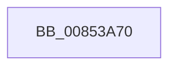

# CmpFindSubKeyInLeafWithStatus

- RVA: `0x00853A70`–`0x00853ABC` (길이 `76` bytes)
- VA: `0x0000000140853A70`
- 실행 섹션: `PAGE`
- PDB 이름 있음: `예`; PDB Function 태그: `아니요`
- unwind 정보 RVA: `0x00069EDC`
- 디코드: `24`개 명령, `76/76` bytes 표시
- 미해석 바이트: `0` (있으면 어셈블리에 `.byte`로 보존)

> 이 문서는 커널 이미지의 기계어와 PDB 기호를 분석해 생성했습니다. 4번과 5번은 함수 원형과 자료형을 바이너리 사용 방식에서 추정한 C 해석이며 원본 소스 복구 결과는 아닙니다.

## 1. Dependencies

- 직접 호출 지점: **0**; 고유 호출 대상: **0**
- 직접 호출자로 확인된 함수: **5**
- RIP 상대 이미지 참조: **0**

### Outgoing calls
- 직접 디코드된 call 명령이 없습니다.

### Direct callers
- [CmpRemoveSubKeyFromList](../84/CmpRemoveSubKeyFromList_function_0084A030.md) at `0x0084A159`
- [CmpFindSubKeyByNameWithStatus](CmpFindSubKeyByNameWithStatus_function_00852770.md) at `0x008528C3`
- [CmpWalkOneLevel](CmpWalkOneLevel_function_00852BA0.md) at `0x00853451`
- [CmpAddToLeaf](CmpAddToLeaf_function_0085BC2C.md) at `0x0085BD16`
- [CmpMarkIndexDirtyInStorageType](../A3/CmpMarkIndexDirtyInStorageType_function_00A325B0.md) at `0x00A3267D`

### Static image references
- 디코드된 RIP-relative 메모리 참조가 없습니다.

## 2. Other-region calls and transfers

- 다른 실행 섹션으로 향하는 call: **0**
- call이 아닌 외부 분기/꼬리 이동: **1**
  - `0x00853AB6` → [sub_00854145 + 0x1](Unknown_function_00854145.md) (`tail-transfer`)

## 3. Assembly (complete function range)

```asm
00853A70  4C 8B DC                        mov r11, rsp
00853A73  4D 89 4B 20                     mov qword ptr [r11 + 0x20], r9
00853A77  4D 89 43 18                     mov qword ptr [r11 + 0x18], r8
00853A7B  49 89 53 10                     mov qword ptr [r11 + 0x10], rdx
00853A7F  49 89 4B 08                     mov qword ptr [r11 + 8], rcx
00853A83  55                              push rbp
00853A84  53                              push rbx
00853A85  41 54                           push r12
00853A87  41 55                           push r13
00853A89  41 57                           push r15
00853A8B  48 8B EC                        mov rbp, rsp
00853A8E  48 83 EC 70                     sub rsp, 0x70
00853A92  0F B7 42 02                     movzx eax, word ptr [rdx + 2]
00853A96  45 33 D2                        xor r10d, r10d
00853A99  4D 8B F8                        mov r15, r8
00853A9C  44 89 55 C0                     mov dword ptr [rbp - 0x40], r10d
00853AA0  4C 8B E2                        mov r12, rdx
00853AA3  4C 8B E9                        mov r13, rcx
00853AA6  44 8D 40 FF                     lea r8d, [rax - 1]
00853AAA  41 8B D8                        mov ebx, r8d
00853AAD  44 89 45 C4                     mov dword ptr [rbp - 0x3c], r8d
00853AB1  D1 EB                           shr ebx, 1
00853AB3  66 85 C0                        test ax, ax
00853AB6  0F 84 8A 06 00 00               je 0x140854146
```

## 4. C-style interpretation (structured pseudocode)

```c
__int64 __fastcall CmpFindSubKeyInLeafWithStatus(__int64 a1, __int64 a2, __int64 a3, __int64 a4)
{
    __int64 v_r10;
    __int64 v_rbx;
    __int64 v_rsp;
    unsigned int v_stack_m64;
    unsigned int v_stack_m68;

    *(unsigned __int64 *)(v_rsp + 32) = a4;
    *(unsigned __int64 *)(v_rsp + 24) = a3;
    *(unsigned __int64 *)(v_rsp + 16) = a2;
    *(unsigned __int64 *)(v_rsp + 8) = a1;
    v_rsp = (v_rsp) - (112);
    v_r10 = 0;
    v_stack_m68 = 0;
    v_stack_m64 = (unsigned int)(*(unsigned __int16 *)(a2 + 2) - 1);
    v_rbx = (unsigned int)(((unsigned int)((unsigned int)(*(unsigned __int16 *)(a2 + 2) - 1))) >> (1));
}
```

## 5. (Beta) C Style

```c
int64_t CmpFindSubKeyInLeafWithStatus(int64_t Arg1, void *Arg2, int64_t Arg3, int64_t Arg4)
{
    uint8_t *arg2 = (uint8_t *)Arg2;

    int64_t local_r10;
    int64_t local_rbx;
    int64_t local_rsp;
    uint32_t v_stack_m64;
    uint32_t v_stack_m68;

    *(uint64_t *)(local_rsp + 0x20) = Arg4;
    *(uint64_t *)(local_rsp + 0x18) = Arg3;
    *(void **)(local_rsp + 0x10) = Arg2;
    *(uint64_t *)(local_rsp + 0x8) = Arg1;
    local_rsp = (local_rsp) - (112);
    local_r10 = 0;
    v_stack_m68 = 0;
    v_stack_m64 = (uint32_t)(*(uint16_t *)(arg2 + 0x2) - 1);
    local_rbx = (uint32_t)(((uint32_t)((uint32_t)(*(uint16_t *)(arg2 + 0x2) - 1))) >> (1));
}
```

### 관측된 메모리 오프셋

구조체 형식이 확인되지 않은 접근은 인자 기준의 오프셋으로만 기록했습니다.

| 기준 인자 | 오프셋 표현 | 폭 (bit) | 접근 |
|---|---:|---:|---|
| `Arg2` | `+ 0x2` | `16` | `R` |

## 6. Execution-region graph

[열기: 2D/3D 그래프와 함수 탐색 컨트롤 패널](../../../control-panel.html?section=page&rva=0x00853A70&view=graph)

- 2D 그래프는 위에서 아래로 흐르고, 3D 그래프는 빈 공간을 드래그해 회전합니다. Shift+드래그는 이동, 휠은 확대·축소, 함수 노드 선택은 대상 보고서 이동입니다.

### Static fallback


