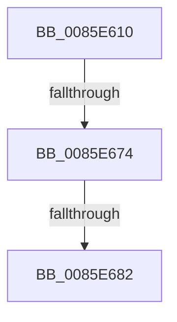

# CmpFindSubkeyInHashByChildCell

- RVA: `0x0085E610`–`0x0085E68A` (길이 `122` bytes)
- VA: `0x000000014085E610`
- 실행 섹션: `PAGE`
- PDB 이름 있음: `예`; PDB Function 태그: `예`
- unwind 정보 RVA: `0x0006B0CC`
- 디코드: `31`개 명령, `122/122` bytes 표시
- 미해석 바이트: `0` (있으면 어셈블리에 `.byte`로 보존)

> 이 문서는 커널 이미지의 기계어와 PDB 기호를 분석해 생성했습니다. 4번과 5번은 함수 원형과 자료형을 바이너리 사용 방식에서 추정한 C 해석이며 원본 소스 복구 결과는 아닙니다.

## 1. Dependencies

- 직접 호출 지점: **1**; 고유 호출 대상: **1**
- 직접 호출자로 확인된 함수: **1**
- RIP 상대 이미지 참조: **0**

### Outgoing calls
- `0x0085E674` → [HvpGetCellFlat](HvpGetCellFlat_function_00854C60.md) (function, `0x00854C60`)

### Direct callers
- [CmpFindSubKeyByNumberEx](../84/CmpFindSubKeyByNumberEx_function_0084F1A0.md) at `0x0084F3AD`
- [CmpFindSubKeyByNumberEx](../84/CmpFindSubKeyByNumberEx_function_0084F1A0.md) at `0x0084F689`

### Static image references
- 디코드된 RIP-relative 메모리 참조가 없습니다.

## 2. Other-region calls and transfers

- 다른 실행 섹션으로 향하는 call: **0**
- call이 아닌 외부 분기/꼬리 이동: **2**
  - `0x0085E66E` → [sub_0085E6FF](Unknown_function_0085E6FF.md) (`tail-transfer`)
  - `0x0085E67C` → [sub_0085EA3A](Unknown_function_0085EA3A.md) (`tail-transfer`)

## 3. Assembly (complete function range)

```asm
0085E610  4C 8B DC                        mov r11, rsp
0085E613  56                              push rsi
0085E614  57                              push rdi
0085E615  41 54                           push r12
0085E617  41 55                           push r13
0085E619  41 56                           push r14
0085E61B  41 57                           push r15
0085E61D  48 83 EC 58                     sub rsp, 0x58
0085E621  49 8B 80 70 06 00 00            mov rax, qword ptr [r8 + 0x670]
0085E628  33 F6                           xor esi, esi
0085E62A  8B 79 10                        mov edi, dword ptr [rcx + 0x10]
0085E62D  4C 8B F9                        mov r15, rcx
0085E630  41 F6 80 8C 00 00 00 01         test byte ptr [r8 + 0x8c], 1
0085E638  4D 8B F0                        mov r14, r8
0085E63B  48 89 84 24 90 00 00 00         mov qword ptr [rsp + 0x90], rax
0085E643  4C 8B EA                        mov r13, rdx
0085E646  48 8B 84 24 B0 00 00 00         mov rax, qword ptr [rsp + 0xb0]
0085E64E  49 8B C8                        mov rcx, r8
0085E651  45 8B E1                        mov r12d, r9d
0085E654  41 C7 43 18 FF FF FF FF         mov dword ptr [r11 + 0x18], 0xffffffff
0085E65C  41 89 73 1C                     mov dword ptr [r11 + 0x1c], esi
0085E660  4D 8D 43 18                     lea r8, [r11 + 0x18]
0085E664  89 74 24 3C                     mov dword ptr [rsp + 0x3c], esi
0085E668  41 8B D1                        mov edx, r9d
0085E66B  48 89 30                        mov qword ptr [rax], rsi
0085E66E  0F 84 8B 00 00 00               je 0x14085e6ff
0085E674  E8 E7 65 FF FF                  call 0x140854c60
0085E679  48 85 C0                        test rax, rax
0085E67C  0F 84 B8 03 00 00               je 0x14085ea3a
0085E682  F6 40 02 20                     test byte ptr [rax + 2], 0x20
0085E686  0F B7 48 48                     movzx ecx, word ptr [rax + 0x48]
```

## 4. C-style interpretation (structured pseudocode)

```c
__int64 __fastcall CmpFindSubkeyInHashByChildCell(__int64 a1, __int64 a2, __int64 a3, int a4, __int64 a5)
{
    __int64 result;
    __int64 v_rsi;
    __int64 v_rsp;
    unsigned int v_stack_m4C;
    unsigned __int64 v_stack_p8;

    v_rsp = (v_rsp) - (88);
    v_rsi = 0;
    v_stack_p8 = *(unsigned __int64 *)(a3 + 1648);
    *(unsigned int *)(v_rsp + 24) = 0xFFFFFFFFULL;
    *(unsigned int *)(v_rsp + 28) = 0;
    v_stack_m4C = 0;
    *(unsigned __int64 *)(a5) = 0;
    result = HvpGetCellFlat(a3, (unsigned int)(a4), v_rsp + 24, a4);
    return result;
}
```

## 5. (Beta) C Style

```c
int64_t CmpFindSubkeyInHashByChildCell(void *Arg1, int64_t Arg2, void *Arg3, int32_t Arg4, void *Arg5)
{
    uint8_t *arg1 = (uint8_t *)Arg1;
    uint8_t *arg3 = (uint8_t *)Arg3;
    uint8_t *arg5 = (uint8_t *)Arg5;

    int64_t result;
    int64_t local_rsi;
    int64_t local_rsp;
    uint32_t v_stack_m4C;
    uint64_t v_stack_p8;

    local_rsp = (local_rsp) - (88);
    local_rsi = 0;
    v_stack_p8 = *(uint64_t *)(arg3 + 0x670);
    *(uint32_t *)(local_rsp + 0x18) = 0xFFFFFFFFULL;
    *(uint32_t *)(local_rsp + 0x1C) = 0;
    v_stack_m4C = 0;
    *(uint64_t *)(arg5) = 0;
    result = HvpGetCellFlat(Arg3, (uint32_t)(Arg4), local_rsp + 24, Arg4);
    return result;
}
```

### 관측된 메모리 오프셋

구조체 형식이 확인되지 않은 접근은 인자 기준의 오프셋으로만 기록했습니다.

| 기준 인자 | 오프셋 표현 | 폭 (bit) | 접근 |
|---|---:|---:|---|
| `Arg1` | `+ 0x10` | `32` | `R` |
| `Arg3` | `+ 0x8C` | `8` | `R` |
| `Arg3` | `+ 0x670` | `64` | `R` |
| `Arg5` | `+ 0x0` | `64` | `W` |

## 6. Execution-region graph

[열기: 2D/3D 그래프와 함수 탐색 컨트롤 패널](../../../control-panel.html?section=page&rva=0x0085E610&view=graph)

- 2D 그래프는 위에서 아래로 흐르고, 3D 그래프는 빈 공간을 드래그해 회전합니다. Shift+드래그는 이동, 휠은 확대·축소, 함수 노드 선택은 대상 보고서 이동입니다.

### Static fallback


