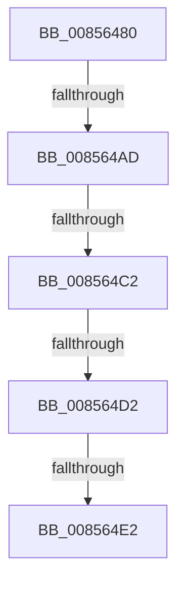

# CmpGetKeyNodeForKcb

- RVA: `0x00856480`–`0x008564EC` (길이 `108` bytes)
- VA: `0x0000000140856480`
- 실행 섹션: `PAGE`
- PDB 이름 있음: `예`; PDB Function 태그: `아니요`
- unwind 정보 RVA: `0x0006A40C`
- 디코드: `25`개 명령, `108/108` bytes 표시
- 미해석 바이트: `0` (있으면 어셈블리에 `.byte`로 보존)

> 이 문서는 커널 이미지의 기계어와 PDB 기호를 분석해 생성했습니다. 4번과 5번은 함수 원형과 자료형을 바이너리 사용 방식에서 추정한 C 해석이며 원본 소스 복구 결과는 아닙니다.

## 1. Dependencies

- 직접 호출 지점: **1**; 고유 호출 대상: **1**
- 직접 호출자로 확인된 함수: **11**
- RIP 상대 이미지 참조: **1**

### Outgoing calls
- `0x008564AD` → [HvpGetCellFlat](HvpGetCellFlat_function_00854C60.md) (function, `0x00854C60`)

### Direct callers
- [CmRenameKey](../7E/CmRenameKey_function_007E8F48.md) at `0x007E9448`
- [CmRenameKey](../7E/CmRenameKey_function_007E8F48.md) at `0x007E981B`
- [CmRenameKey](../7E/CmRenameKey_function_007E8F48.md) at `0x007E9962`
- [CmRenameKey](../7E/CmRenameKey_function_007E8F48.md) at `0x007E9A5C`
- [CmRenameKey](../7E/CmRenameKey_function_007E8F48.md) at `0x007E9D9B`
- [CmpAssignKeySecurity](../7E/CmpAssignKeySecurity_function_007EC8B0.md) at `0x007EC963`
- [CmSetLastWriteTimeKey](../84/CmSetLastWriteTimeKey_function_00843368.md) at `0x008435AB`
- [CmDeleteKey](../84/CmDeleteKey_function_00848E5C.md) at `0x00849159`
- [CmDeleteKey](../84/CmDeleteKey_function_00848E5C.md) at `0x00849275`
- [CmpDoParseKey](CmpDoParseKey_function_0085F750.md) at `0x00861719`
- [CmEnumerateValueFromLayeredKey](../8B/CmEnumerateValueFromLayeredKey_function_008B31FC.md) at `0x008B3360`
- [CmpEnumerateLayeredKey](../94/CmpEnumerateLayeredKey_function_00945E58.md) at `0x009462B9`
- [CmpSetKeySecurity](../94/CmpSetKeySecurity_function_0094A124.md) at `0x0094A6BB`
- [CmSetKeyFlags](../9A/CmSetKeyFlags_function_009AEEA4.md) at `0x009AF082`
- [CmQueryMultipleValueForLayeredKey](../A8/CmQueryMultipleValueForLayeredKey_function_00A8DE80.md) at `0x00A8E1E6`
- [sub_00B16440](../B1/Unknown_function_00B16440.md) at `0x00B1656B`

### Static image references
- `0x008564D6` → RVA `0x00E0EC94` (`.data`; reference)

## 2. Other-region calls and transfers

- 다른 실행 섹션으로 향하는 call: **0**
- call이 아닌 외부 분기/꼬리 이동: **4**
  - `0x008564A7` → [sub_00856589 + 0x23](Unknown_function_00856589.md) (`tail-transfer`)
  - `0x008564BC` → [sub_008565DE](Unknown_function_008565DE.md) (`tail-transfer`)
  - `0x008564CC` → [sub_008565DE + 0x18](Unknown_function_008565DE.md) (`tail-transfer`)
  - `0x008564DC` → [sub_008565DE + 0x18](Unknown_function_008565DE.md) (`tail-transfer`)

## 3. Assembly (complete function range)

```asm
00856480  48 89 5C 24 18                  mov qword ptr [rsp + 0x18], rbx
00856485  55                              push rbp
00856486  56                              push rsi
00856487  57                              push rdi
00856488  48 83 EC 20                     sub rsp, 0x20
0085648C  48 8B EA                        mov rbp, rdx
0085648F  48 8B D9                        mov rbx, rcx
00856492  8B 51 28                        mov edx, dword ptr [rcx + 0x28]
00856495  41 0F B6 F8                     movzx edi, r8b
00856499  48 8B 49 20                     mov rcx, qword ptr [rcx + 0x20]
0085649D  4C 8B C5                        mov r8, rbp
008564A0  F6 81 8C 00 00 00 01            test byte ptr [rcx + 0x8c], 1
008564A7  0F 84 FF 00 00 00               je 0x1408565ac
008564AD  E8 AE E7 FF FF                  call 0x140854c60
008564B2  48 8B 4B 20                     mov rcx, qword ptr [rbx + 0x20]
008564B6  48 8B F0                        mov rsi, rax
008564B9  40 84 FF                        test dil, dil
008564BC  0F 85 1C 01 00 00               jne 0x1408565de
008564C2  F7 81 A0 00 00 00 01 80 00 00   test dword ptr [rcx + 0xa0], 0x8001
008564CC  0F 85 24 01 00 00               jne 0x1408565f6
008564D2  0F B6 40 0C                     movzx eax, byte ptr [rax + 0xc]
008564D6  84 05 B8 87 5B 00               test byte ptr [rip + 0x5b87b8], al
008564DC  0F 85 14 01 00 00               jne 0x1408565f6
008564E2  F6 81 8C 00 00 00 01            test byte ptr [rcx + 0x8c], 1
008564E9  48 8B D5                        mov rdx, rbp
```

## 4. C-style interpretation (structured pseudocode)

```c
__int64 __fastcall CmpGetKeyNodeForKcb(__int64 a1, __int64 a2, unsigned __int8 a3)
{
    __int64 result;
    __int64 v_rsp;
    unsigned __int64 v_stack_p18;

    v_stack_p18 = v_rbx;
    v_rsp = (v_rsp) - (32);
    result = HvpGetCellFlat(*(unsigned __int64 *)(a1 + 32), (unsigned int)(*(unsigned int *)(a1 + 40)), a2, a4);
    return *(unsigned __int8 *)(result + 12);
}
```

## 5. (Beta) C Style

```c
int64_t CmpGetKeyNodeForKcb(void *Arg1, int64_t Arg2, uint8_t Arg3)
{
    uint8_t *arg1 = (uint8_t *)Arg1;

    int64_t result;
    int64_t local_rsp;
    uint64_t v_stack_p18;

    v_stack_p18 = local_rbx;
    local_rsp = (local_rsp) - (32);
    result = HvpGetCellFlat(*(uint64_t *)(arg1 + 0x20), (uint32_t)(*(uint32_t *)(arg1 + 0x28)), Arg2, a4);
    return *(uint8_t *)(result + 0xC);
}
```

### 관측된 메모리 오프셋

구조체 형식이 확인되지 않은 접근은 인자 기준의 오프셋으로만 기록했습니다.

| 기준 인자 | 오프셋 표현 | 폭 (bit) | 접근 |
|---|---:|---:|---|
| `Arg1` | `+ 0x20` | `64` | `R` |
| `Arg1` | `+ 0x28` | `32` | `R` |

## 6. Execution-region graph

[열기: 2D/3D 그래프와 함수 탐색 컨트롤 패널](../../../control-panel.html?section=page&rva=0x00856480&view=graph)

- 2D 그래프는 위에서 아래로 흐르고, 3D 그래프는 빈 공간을 드래그해 회전합니다. Shift+드래그는 이동, 휠은 확대·축소, 함수 노드 선택은 대상 보고서 이동입니다.

### Static fallback


