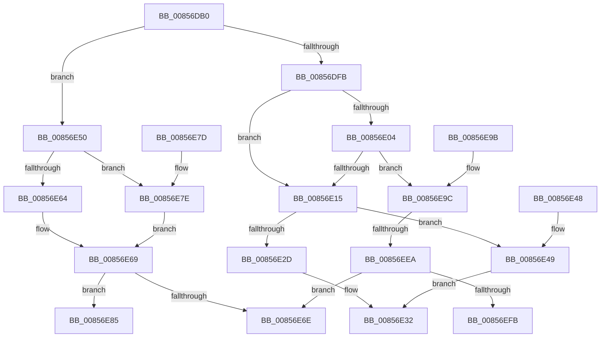

# CmpGetValueData

- RVA: `0x00856DB0`–`0x00856F10` (길이 `352` bytes)
- VA: `0x0000000140856DB0`
- 실행 섹션: `PAGE`
- PDB 이름 있음: `예`; PDB Function 태그: `아니요`
- unwind 정보 RVA: `0x0006A50C`
- 디코드: `97`개 명령, `352/352` bytes 표시
- 미해석 바이트: `0` (있으면 어셈블리에 `.byte`로 보존)

> 이 문서는 커널 이미지의 기계어와 PDB 기호를 분석해 생성했습니다. 4번과 5번은 함수 원형과 자료형을 바이너리 사용 방식에서 추정한 C 해석이며 원본 소스 복구 결과는 아닙니다.

## 1. Dependencies

- 직접 호출 지점: **5**; 고유 호출 대상: **2**
- 직접 호출자로 확인된 함수: **13**
- RIP 상대 이미지 참조: **0**

### Outgoing calls
- `0x00856E2D` → [HvpGetCellFlat](HvpGetCellFlat_function_00854C60.md) (function, `0x00854C60`)
- `0x00856E49` → [HvpGetCellPaged](HvpGetCellPaged_function_00854CB0.md) (function, `0x00854CB0`)
- `0x00856E64` → [HvpGetCellFlat](HvpGetCellFlat_function_00854C60.md) (function, `0x00854C60`)
- `0x00856E7E` → [HvpGetCellPaged](HvpGetCellPaged_function_00854CB0.md) (function, `0x00854CB0`)
- `0x00856EEA` → [HvpGetCellFlat](HvpGetCellFlat_function_00854C60.md) (function, `0x00854C60`)

### Direct callers
- [CmpPreserveSystemHiveData](../7F/CmpPreserveSystemHiveData_function_007F2518.md) at `0x007F2A60`
- [CmpGetValueForAudit](../7F/CmpGetValueForAudit_function_007F37C0.md) at `0x007F386F`
- [CmpValueToData](../7F/CmpValueToData_function_007F3934.md) at `0x007F396C`
- [CmAddLogForAction](../84/CmAddLogForAction_function_008445AC.md) at `0x00844855`
- [CmpCompareNewValueDataAgainstKCBCache](../84/CmpCompareNewValueDataAgainstKCBCache_function_00846920.md) at `0x00846A85`
- [CmQueryMultipleValueKey](../84/CmQueryMultipleValueKey_function_00846EC0.md) at `0x008471D1`
- [CmpQueryKeyValueData](CmpQueryKeyValueData_function_00856650.md) at `0x00856766`
- [CmpQueryKeyValueData](CmpQueryKeyValueData_function_00856650.md) at `0x00856961`
- [CmpQueryKeyValueData](CmpQueryKeyValueData_function_00856650.md) at `0x00856B55`
- [CmpGetSymbolicLinkTarget](CmpGetSymbolicLinkTarget_function_008570A0.md) at `0x008577CF`
- [sub_00857A33](Unknown_function_00857A33.md) at `0x00857C2E`
- [CmpCopyValue](CmpCopyValue_function_0085B798.md) at `0x0085BA83`
- [CmpLightWeightPrepareSetValueKeyUoW](../A0/CmpLightWeightPrepareSetValueKeyUoW_function_00A0EF28.md) at `0x00A0F0B6`
- [CmQueryMultipleValueForLayeredKey](../A8/CmQueryMultipleValueForLayeredKey_function_00A8DE80.md) at `0x00A8E0C0`
- [CmpFindTagIndex](../../init/C5/CmpFindTagIndex_function_00C5C628.md) at `0x00C5C79D`

### Static image references
- 디코드된 RIP-relative 메모리 참조가 없습니다.

## 2. Other-region calls and transfers

- 다른 실행 섹션으로 향하는 call: **0**
- call이 아닌 외부 분기/꼬리 이동: **1**
  - `0x00856EE4` → [sub_0085701C + 0x21](Unknown_function_0085701C.md) (`tail-transfer`)

## 3. Assembly (complete function range)

```asm
00856DB0  40 53                           push rbx
00856DB2  55                              push rbp
00856DB3  56                              push rsi
00856DB4  57                              push rdi
00856DB5  41 56                           push r14
00856DB7  41 57                           push r15
00856DB9  48 83 EC 28                     sub rsp, 0x28
00856DBD  4C 8B B4 24 88 00 00 00         mov r14, qword ptr [rsp + 0x88]
00856DC5  33 ED                           xor ebp, ebp
00856DC7  48 8B B4 24 80 00 00 00         mov rsi, qword ptr [rsp + 0x80]
00856DCF  48 8B D9                        mov rbx, rcx
00856DD2  49 8B F8                        mov rdi, r8
00856DD5  41 C6 06 00                     mov byte ptr [r14], 0
00856DD9  48 89 2E                        mov qword ptr [rsi], rbp
00856DDC  41 8B 40 04                     mov eax, dword ptr [r8 + 4]
00856DE0  3D 00 00 00 80                  cmp eax, 0x80000000
00856DE5  8D 88 00 00 00 80               lea ecx, [rax - 0x80000000]
00856DEB  0F 42 C8                        cmovb ecx, eax
00856DEE  41 89 09                        mov dword ptr [r9], ecx
00856DF1  41 81 78 04 00 00 00 80         cmp dword ptr [r8 + 4], 0x80000000
00856DF9  73 55                           jae 0x140856e50
00856DFB  83 BB DC 00 00 00 04            cmp dword ptr [rbx + 0xdc], 4
00856E02  72 11                           jb 0x140856e15
00856E04  8D 81 27 C0 FF FF               lea eax, [rcx - 0x3fd9]
00856E0A  3D 26 C0 FF 7F                  cmp eax, 0x7fffc026
00856E0F  0F 86 87 00 00 00               jbe 0x140856e9c
00856E15  F6 83 8C 00 00 00 01            test byte ptr [rbx + 0x8c], 1
00856E1C  48 8B CB                        mov rcx, rbx
00856E1F  41 8B 50 08                     mov edx, dword ptr [r8 + 8]
00856E23  4C 8B 84 24 90 00 00 00         mov r8, qword ptr [rsp + 0x90]
00856E2B  74 1C                           je 0x140856e49
00856E2D  E8 2E DE FF FF                  call 0x140854c60
00856E32  48 85 C0                        test rax, rax
00856E35  48 89 06                        mov qword ptr [rsi], rax
00856E38  0F 95 C0                        setne al
00856E3B  48 83 C4 28                     add rsp, 0x28
00856E3F  41 5F                           pop r15
00856E41  41 5E                           pop r14
00856E43  5F                              pop rdi
00856E44  5E                              pop rsi
00856E45  5D                              pop rbp
00856E46  5B                              pop rbx
00856E47  C3                              ret
00856E48  CC                              int3
00856E49  E8 62 DE FF FF                  call 0x140854cb0
00856E4E  EB E2                           jmp 0x140856e32
00856E50  F6 83 8C 00 00 00 01            test byte ptr [rbx + 0x8c], 1
00856E57  48 8B CB                        mov rcx, rbx
00856E5A  4C 8B 84 24 90 00 00 00         mov r8, qword ptr [rsp + 0x90]
00856E62  74 1A                           je 0x140856e7e
00856E64  E8 F7 DD FF FF                  call 0x140854c60
00856E69  48 85 C0                        test rax, rax
00856E6C  75 17                           jne 0x140856e85
00856E6E  32 C0                           xor al, al
00856E70  48 83 C4 28                     add rsp, 0x28
00856E74  41 5F                           pop r15
00856E76  41 5E                           pop r14
00856E78  5F                              pop rdi
00856E79  5E                              pop rsi
00856E7A  5D                              pop rbp
00856E7B  5B                              pop rbx
00856E7C  C3                              ret
00856E7D  CC                              int3
00856E7E  E8 2D DE FF FF                  call 0x140854cb0
00856E83  EB E4                           jmp 0x140856e69
00856E85  48 8D 47 08                     lea rax, [rdi + 8]
00856E89  48 89 06                        mov qword ptr [rsi], rax
00856E8C  B0 01                           mov al, 1
00856E8E  48 83 C4 28                     add rsp, 0x28
00856E92  41 5F                           pop r15
00856E94  41 5E                           pop r14
00856E96  5F                              pop rdi
00856E97  5E                              pop rsi
00856E98  5D                              pop rbp
00856E99  5B                              pop rbx
00856E9A  C3                              ret
00856E9B  CC                              int3
00856E9C  F6 83 8C 00 00 00 01            test byte ptr [rbx + 0x8c], 1
00856EA3  48 8B CB                        mov rcx, rbx
00856EA6  41 8B 50 08                     mov edx, dword ptr [r8 + 8]
00856EAA  4C 8D 44 24 70                  lea r8, [rsp + 0x70]
00856EAF  C7 44 24 70 FF FF FF FF         mov dword ptr [rsp + 0x70], 0xffffffff
00856EB7  89 6C 24 74                     mov dword ptr [rsp + 0x74], ebp
00856EBB  48 89 6C 24 78                  mov qword ptr [rsp + 0x78], rbp
00856EC0  C7 84 24 88 00 00 00 FF FF FF FF  mov dword ptr [rsp + 0x88], 0xffffffff
00856ECB  89 AC 24 8C 00 00 00            mov dword ptr [rsp + 0x8c], ebp
00856ED2  C7 84 24 80 00 00 00 FF FF FF FF  mov dword ptr [rsp + 0x80], 0xffffffff
00856EDD  89 AC 24 84 00 00 00            mov dword ptr [rsp + 0x84], ebp
00856EE4  0F 84 53 01 00 00               je 0x14085703d
00856EEA  E8 71 DD FF FF                  call 0x140854c60
00856EEF  4C 8B F8                        mov r15, rax
00856EF2  48 85 C0                        test rax, rax
00856EF5  0F 84 73 FF FF FF               je 0x140856e6e
00856EFB  F6 83 8C 00 00 00 01            test byte ptr [rbx + 0x8c], 1
00856F02  4C 8D 84 24 80 00 00 00         lea r8, [rsp + 0x80]
00856F0A  8B 50 04                        mov edx, dword ptr [rax + 4]
00856F0D  48 8B CB                        mov rcx, rbx
```

## 4. C-style interpretation (structured pseudocode)

```c
__int64 __fastcall CmpGetValueData(__int64 a1, __int64 a2, __int64 a3, __int64 a4, __int64 a5, __int64 a6, __int64 a7)
{
    __int64 result;
    __int64 v_rbp;
    __int64 v_rsp;
    unsigned __int64 v_stack_p120;
    unsigned int v_stack_p124;
    unsigned __int64 v_stack_p128;
    unsigned int v_stack_p130;
    unsigned int v_stack_p134;
    unsigned int v_stack_p138;
    unsigned int v_stack_p13C;

    v_rsp = (v_rsp) - (40);
    v_rbp = 0;
    *(unsigned __int8 *)(a6) = 0;
    *(unsigned __int64 *)(a5) = 0;
    a1 = (unsigned int)(*(unsigned int *)(a3 + 4)) - 2147483648;
    if (((unsigned int)((unsigned int)(*(unsigned int *)(a3 + 4)))) < 0x80000000ULL) { a1 = (unsigned int)((unsigned int)(*(unsigned int *)(a3 + 4))); }
    *(unsigned int *)(a4) = (unsigned int)(a1);
    if ((*(unsigned int *)(a3 + 4)) >= 0x80000000ULL) goto loc_00856E50;
    if ((*(unsigned int *)(a1 + 220)) < 4) goto loc_00856E15;
    if (((unsigned int)(a1 - 16345)) <= 0x7FFFC026ULL) goto loc_00856E9C;
loc_00856E15:
    if (((*(unsigned __int8 *)(a1 + 140)) & (1)) == 0) goto loc_00856E49;
    result = HvpGetCellFlat(a1, (unsigned int)(*(unsigned int *)(a3 + 8)), a7, a4);
loc_00856E32:
    *(unsigned __int64 *)(a5) = result;
    result = (result != 0) ? 1 : 0;
    v_rsp = (v_rsp) + (40);
    return result;
loc_00856E49:
    result = HvpGetCellPaged(a1, (unsigned int)(*(unsigned int *)(a3 + 8)), a7, a4);
    goto loc_00856E32;
loc_00856E50:
    if (((*(unsigned __int8 *)(a1 + 140)) & (1)) == 0) goto loc_00856E7E;
    result = HvpGetCellFlat(a1, (unsigned int)(*(unsigned int *)(a3 + 8)), a7, a4);
loc_00856E69:
    if (result != 0) goto loc_00856E85;
loc_00856E6E:
    result = 0;
    v_rsp = (v_rsp) + (40);
    return result;
loc_00856E7E:
    result = HvpGetCellPaged(a1, (unsigned int)(*(unsigned int *)(a3 + 8)), a7, a4);
    goto loc_00856E69;
loc_00856E85:
    *(unsigned __int64 *)(a5) = a3 + 8;
    v_rsp = (v_rsp) + (40);
    return 1;
loc_00856E9C:
    v_stack_p120 = 0xFFFFFFFFULL;
    v_stack_p124 = 0;
    v_stack_p128 = 0;
    v_stack_p138 = 0xFFFFFFFFULL;
    v_stack_p13C = 0;
    v_stack_p130 = 0xFFFFFFFFULL;
    v_stack_p134 = 0;
    result = HvpGetCellFlat(a1, (unsigned int)(*(unsigned int *)(a7 + 8)), v_stack_p120, a4);
    if (result == 0) goto loc_00856E6E;
    return result;
}
```

## 5. (Beta) C Style

```c
int64_t CmpGetValueData(void *Arg1, int64_t Arg2, void *Arg3, void *Arg4, void *Arg5, void *Arg6, int64_t Arg7)
{
    uint8_t *arg1 = (uint8_t *)Arg1;
    uint8_t *arg3 = (uint8_t *)Arg3;
    uint8_t *arg4 = (uint8_t *)Arg4;
    uint8_t *arg5 = (uint8_t *)Arg5;
    uint8_t *arg6 = (uint8_t *)Arg6;

    int64_t result;
    int64_t local_rbp;
    int64_t local_rsp;
    uint64_t v_stack_p120;
    uint32_t v_stack_p124;
    uint64_t v_stack_p128;
    uint32_t v_stack_p130;
    uint32_t v_stack_p134;
    uint32_t v_stack_p138;
    uint32_t v_stack_p13C;

    local_rsp = (local_rsp) - (40);
    local_rbp = 0;
    *(uint8_t *)(arg6) = 0;
    *(uint64_t *)(arg5) = 0;
    Arg1 = (uint32_t)(*(uint32_t *)(arg3 + 0x4)) - 2147483648;
    if (((uint32_t)((uint32_t)(*(uint32_t *)(arg3 + 0x4)))) < 0x80000000ULL) { Arg1 = (uint32_t)((uint32_t)(*(uint32_t *)(arg3 + 0x4))); }
    *(uint32_t *)(arg4) = (uint32_t)(Arg1);
    if ((*(uint32_t *)(arg3 + 0x4)) >= 0x80000000ULL) goto loc_00856E50;
    if ((*(uint32_t *)(arg1 + 0xDC)) < 4) goto loc_00856E15;
    if (((uint32_t)(Arg1 - 16345)) <= 0x7FFFC026ULL) goto loc_00856E9C;
loc_00856E15:
    if (((*(uint8_t *)(arg1 + 0x8C)) & (1)) == 0) goto loc_00856E49;
    result = HvpGetCellFlat(Arg1, (uint32_t)(*(uint32_t *)(arg3 + 0x8)), Arg7, Arg4);
loc_00856E32:
    *(uint64_t *)(arg5) = result;
    result = (result != 0) ? 1 : 0;
    local_rsp = (local_rsp) + (40);
    return result;
loc_00856E49:
    result = HvpGetCellPaged(Arg1, (uint32_t)(*(uint32_t *)(arg3 + 0x8)), Arg7, Arg4);
    goto loc_00856E32;
loc_00856E50:
    if (((*(uint8_t *)(arg1 + 0x8C)) & (1)) == 0) goto loc_00856E7E;
    result = HvpGetCellFlat(Arg1, (uint32_t)(*(uint32_t *)(arg3 + 0x8)), Arg7, Arg4);
loc_00856E69:
    if (result != 0) goto loc_00856E85;
loc_00856E6E:
    result = 0;
    local_rsp = (local_rsp) + (40);
    return result;
loc_00856E7E:
    result = HvpGetCellPaged(Arg1, (uint32_t)(*(uint32_t *)(arg3 + 0x8)), Arg7, Arg4);
    goto loc_00856E69;
loc_00856E85:
    *(void **)(arg5) = Arg3 + 8;
    local_rsp = (local_rsp) + (40);
    return 1;
loc_00856E9C:
    v_stack_p120 = 0xFFFFFFFFULL;
    v_stack_p124 = 0;
    v_stack_p128 = 0;
    v_stack_p138 = 0xFFFFFFFFULL;
    v_stack_p13C = 0;
    v_stack_p130 = 0xFFFFFFFFULL;
    v_stack_p134 = 0;
    result = HvpGetCellFlat(Arg1, (uint32_t)(*(uint32_t *)(Arg7 + 0x8)), v_stack_p120, Arg4);
    if (result == 0) goto loc_00856E6E;
    return result;
}
```

### 관측된 메모리 오프셋

구조체 형식이 확인되지 않은 접근은 인자 기준의 오프셋으로만 기록했습니다.

| 기준 인자 | 오프셋 표현 | 폭 (bit) | 접근 |
|---|---:|---:|---|
| `Arg1` | `+ 0x8C` | `8` | `R` |
| `Arg1` | `+ 0xDC` | `32` | `R` |
| `Arg3` | `+ 0x4` | `32` | `R` |
| `Arg3` | `+ 0x8` | `32` | `R` |
| `Arg3` | `+ 0x8` | `64` | `R` |
| `Arg4` | `+ 0x0` | `32` | `W` |
| `Arg5` | `+ 0x0` | `64` | `W` |
| `Arg6` | `+ 0x0` | `8` | `W` |

## 6. Execution-region graph

[열기: 2D/3D 그래프와 함수 탐색 컨트롤 패널](../../../control-panel.html?section=page&rva=0x00856DB0&view=graph)

- 2D 그래프는 위에서 아래로 흐르고, 3D 그래프는 빈 공간을 드래그해 회전합니다. Shift+드래그는 이동, 휠은 확대·축소, 함수 노드 선택은 대상 보고서 이동입니다.

### Static fallback


