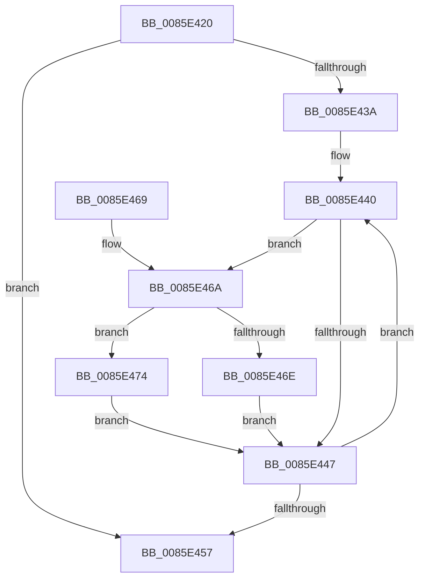

# CmpHashCompressedComponent

- RVA: `0x0085E420`–`0x0085E47E` (길이 `94` bytes)
- VA: `0x000000014085E420`
- 실행 섹션: `PAGE`
- PDB 이름 있음: `예`; PDB Function 태그: `아니요`
- unwind 정보 RVA: `0x0006B090`
- 디코드: `33`개 명령, `94/94` bytes 표시
- 미해석 바이트: `0` (있으면 어셈블리에 `.byte`로 보존)

> 이 문서는 커널 이미지의 기계어와 PDB 기호를 분석해 생성했습니다. 4번과 5번은 함수 원형과 자료형을 바이너리 사용 방식에서 추정한 C 해석이며 원본 소스 복구 결과는 아닙니다.

## 1. Dependencies

- 직접 호출 지점: **1**; 고유 호출 대상: **1**
- 직접 호출자로 확인된 함수: **4**
- RIP 상대 이미지 참조: **0**

### Outgoing calls
- `0x0085E477` → [RtlUpcaseUnicodeChar](RtlUpcaseUnicodeChar_function_0085F0F0.md) (function, `0x0085F0F0`)

### Direct callers
- [sub_006ED542](../../text/6E/Unknown_function_006ED542.md) at `0x006ED67A`
- [CmpPartialPromoteSubkeys](../7F/CmpPartialPromoteSubkeys_function_007F4070.md) at `0x007F418D`
- [CmpCheckLeaf](../96/CmpCheckLeaf_function_0096E5BC.md) at `0x0096E6E0`
- [sub_00B255E8](../B2/Unknown_function_00B255E8.md) at `0x00B2562A`

### Static image references
- 디코드된 RIP-relative 메모리 참조가 없습니다.

## 2. Other-region calls and transfers

- 다른 실행 섹션으로 향하는 call: **0**
- 별도 외부 분기/꼬리 이동을 확인하지 못했습니다.

## 3. Assembly (complete function range)

```asm
0085E420  48 89 5C 24 08                  mov qword ptr [rsp + 8], rbx
0085E425  48 89 74 24 10                  mov qword ptr [rsp + 0x10], rsi
0085E42A  57                              push rdi
0085E42B  48 83 EC 20                     sub rsp, 0x20
0085E42F  33 DB                           xor ebx, ebx
0085E431  8B F2                           mov esi, edx
0085E433  48 8B F9                        mov rdi, rcx
0085E436  85 D2                           test edx, edx
0085E438  74 1D                           je 0x14085e457
0085E43A  66 0F 1F 44 00 00               nop word ptr [rax + rax]
0085E440  0F B6 07                        movzx eax, byte ptr [rdi]
0085E443  3C 61                           cmp al, 0x61
0085E445  73 23                           jae 0x14085e46a
0085E447  6B DB 25                        imul ebx, ebx, 0x25
0085E44A  48 FF C7                        inc rdi
0085E44D  0F B7 C8                        movzx ecx, ax
0085E450  03 D9                           add ebx, ecx
0085E452  83 C6 FF                        add esi, -1
0085E455  75 E9                           jne 0x14085e440
0085E457  48 8B 74 24 38                  mov rsi, qword ptr [rsp + 0x38]
0085E45C  8B C3                           mov eax, ebx
0085E45E  48 8B 5C 24 30                  mov rbx, qword ptr [rsp + 0x30]
0085E463  48 83 C4 20                     add rsp, 0x20
0085E467  5F                              pop rdi
0085E468  C3                              ret
0085E469  CC                              int3
0085E46A  3C 7A                           cmp al, 0x7a
0085E46C  77 06                           ja 0x14085e474
0085E46E  66 83 E8 20                     sub ax, 0x20
0085E472  EB D3                           jmp 0x14085e447
0085E474  0F B7 C8                        movzx ecx, ax
0085E477  E8 74 0C 00 00                  call 0x14085f0f0
0085E47C  EB C9                           jmp 0x14085e447
```

## 4. C-style interpretation (structured pseudocode)

```c
__int64 __fastcall CmpHashCompressedComponent(__int64 a1, int a2)
{
    __int64 result;
    __int64 v_rbx;
    __int64 v_rdi;
    __int64 v_rsi;
    __int64 v_rsp;
    unsigned __int64 v_stack_p10;
    unsigned __int64 v_stack_p8;

    v_stack_p8 = v_rbx;
    v_stack_p10 = v_rsi;
    v_rsp = (v_rsp) - (32);
    v_rbx = 0;
    if (a2 == 0) goto loc_0085E457;
loc_0085E440:
    if (((unsigned __int8)(*(unsigned __int8 *)(a1))) >= 97) goto loc_0085E46A;
loc_0085E447:
    v_rbx = (unsigned int)((v_rbx) * (0));
    v_rdi = (a1) + 1;
    v_rbx = (unsigned int)((v_rbx) + ((unsigned int)((unsigned __int16)(*(unsigned __int8 *)(a1)))));
    v_rsi = (unsigned int)(((unsigned int)(a2)) + (-1));
    if (condition_is_not_equal) goto loc_0085E440;
loc_0085E457:
    v_rsp = (v_rsp) + (32);
    return (unsigned int)((unsigned int)(v_rbx));
loc_0085E46A:
    if (((unsigned __int8)((unsigned int)((unsigned int)(v_rbx)))) > 122) goto loc_0085E474;
    result = (unsigned __int16)(((unsigned int)((unsigned int)(v_rbx))) - (32));
    goto loc_0085E447;
loc_0085E474:
    result = RtlUpcaseUnicodeChar((unsigned __int16)(result), a2, a3, a4);
    goto loc_0085E447;
}
```

## 5. (Beta) C Style

```c
int64_t CmpHashCompressedComponent(int64_t Arg1, int32_t Arg2)
{
    int64_t result;
    int64_t local_rbx;
    int64_t local_rdi;
    int64_t local_rsi;
    int64_t local_rsp;
    uint64_t v_stack_p10;
    uint64_t v_stack_p8;

    v_stack_p8 = local_rbx;
    v_stack_p10 = local_rsi;
    local_rsp = (local_rsp) - (32);
    local_rbx = 0;
    if (Arg2 == 0) goto loc_0085E457;
loc_0085E440:
    if (((uint8_t)(*(uint8_t *)(Arg1))) >= 97) goto loc_0085E46A;
loc_0085E447:
    local_rbx = (uint32_t)((local_rbx) * (0));
    local_rdi = (Arg1) + 1;
    local_rbx = (uint32_t)((local_rbx) + ((uint32_t)((uint16_t)(*(uint8_t *)(Arg1)))));
    local_rsi = (uint32_t)(((uint32_t)(Arg2)) + (-1));
    if (condition_is_not_equal) goto loc_0085E440;
loc_0085E457:
    local_rsp = (local_rsp) + (32);
    return (uint32_t)((uint32_t)(local_rbx));
loc_0085E46A:
    if (((uint8_t)((uint32_t)((uint32_t)(local_rbx)))) > 122) goto loc_0085E474;
    result = (uint16_t)(((uint32_t)((uint32_t)(local_rbx))) - (32));
    goto loc_0085E447;
loc_0085E474:
    result = RtlUpcaseUnicodeChar((uint16_t)(result), Arg2, a3, a4);
    goto loc_0085E447;
}
```

## 6. Execution-region graph

[열기: 2D/3D 그래프와 함수 탐색 컨트롤 패널](../../../control-panel.html?section=page&rva=0x0085E420&view=graph)

- 2D 그래프는 위에서 아래로 흐르고, 3D 그래프는 빈 공간을 드래그해 회전합니다. Shift+드래그는 이동, 휠은 확대·축소, 함수 노드 선택은 대상 보고서 이동입니다.

### Static fallback


