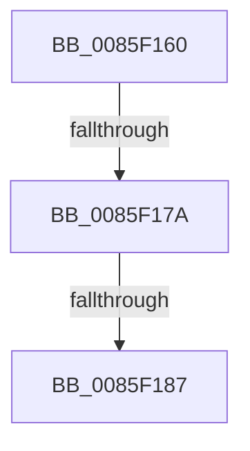

# CmpIsKcbInvolvedInVirtualization

- RVA: `0x0085F160`–`0x0085F18A` (길이 `42` bytes)
- VA: `0x000000014085F160`
- 실행 섹션: `PAGE`
- PDB 이름 있음: `예`; PDB Function 태그: `아니요`
- unwind 정보 RVA: `0x0006B384`
- 디코드: `9`개 명령, `42/42` bytes 표시
- 미해석 바이트: `0` (있으면 어셈블리에 `.byte`로 보존)

> 이 문서는 커널 이미지의 기계어와 PDB 기호를 분석해 생성했습니다. 4번과 5번은 함수 원형과 자료형을 바이너리 사용 방식에서 추정한 C 해석이며 원본 소스 복구 결과는 아닙니다.

## 1. Dependencies

- 직접 호출 지점: **0**; 고유 호출 대상: **0**
- 직접 호출자로 확인된 함수: **1**
- RIP 상대 이미지 참조: **1**

### Outgoing calls
- 직접 디코드된 call 명령이 없습니다.

### Direct callers
- [CmpDoParseKey](CmpDoParseKey_function_0085F750.md) at `0x0085FB1F`

### Static image references
- `0x0085F166` → RVA `0x00FD9A90` (`PAGEDATA`; read)

## 2. Other-region calls and transfers

- 다른 실행 섹션으로 향하는 call: **0**
- call이 아닌 외부 분기/꼬리 이동: **2**
  - `0x0085F174` → [sub_0085F24F + 0x9](Unknown_function_0085F24F.md) (`tail-transfer`)
  - `0x0085F181` → [sub_0085F24F](Unknown_function_0085F24F.md) (`tail-transfer`)

## 3. Assembly (complete function range)

```asm
0085F160  40 53                           push rbx
0085F162  48 83 EC 40                     sub rsp, 0x40
0085F166  48 8B 05 23 A9 77 00            mov rax, qword ptr [rip + 0x77a923]
0085F16D  48 8B D9                        mov rbx, rcx
0085F170  48 39 41 20                     cmp qword ptr [rcx + 0x20], rax
0085F174  0F 84 DE 00 00 00               je 0x14085f258
0085F17A  F7 41 08 00 00 02 00            test dword ptr [rcx + 8], 0x20000
0085F181  0F 85 C8 00 00 00               jne 0x14085f24f
0085F187  0F 57 C0                        xorps xmm0, xmm0
```

## 4. C-style interpretation (structured pseudocode)

```c
__int64 __fastcall CmpIsKcbInvolvedInVirtualization(__int64 a1)
{
    __int64 v_rsp;

    v_rsp = (v_rsp) - (64);
    return *(unsigned __int64 *)(v_rip + 7842083);
}
```

## 5. (Beta) C Style

```c
int64_t CmpIsKcbInvolvedInVirtualization(void *Arg1)
{
    uint8_t *arg1 = (uint8_t *)Arg1;

    int64_t local_rsp;

    local_rsp = (local_rsp) - (64);
    return *(uint64_t *)(v_rip + 0x77A923);
}
```

### 관측된 메모리 오프셋

구조체 형식이 확인되지 않은 접근은 인자 기준의 오프셋으로만 기록했습니다.

| 기준 인자 | 오프셋 표현 | 폭 (bit) | 접근 |
|---|---:|---:|---|
| `Arg1` | `+ 0x8` | `32` | `R` |
| `Arg1` | `+ 0x20` | `64` | `R` |

## 6. Execution-region graph

[열기: 2D/3D 그래프와 함수 탐색 컨트롤 패널](../../../control-panel.html?section=page&rva=0x0085F160&view=graph)

- 2D 그래프는 위에서 아래로 흐르고, 3D 그래프는 빈 공간을 드래그해 회전합니다. Shift+드래그는 이동, 휠은 확대·축소, 함수 노드 선택은 대상 보고서 이동입니다.

### Static fallback


