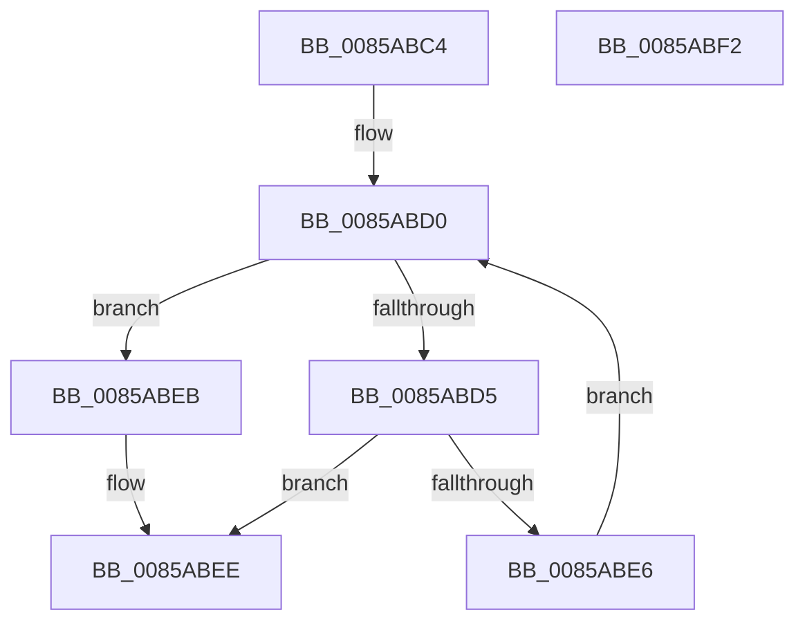

# CmpNameSize

- RVA: `0x0085ABC4`–`0x0085ABF3` (길이 `47` bytes)
- VA: `0x000000014085ABC4`
- 실행 섹션: `PAGE`
- PDB 이름 있음: `예`; PDB Function 태그: `아니요`
- unwind 정보 RVA: `0x000DB714`
- 디코드: `16`개 명령, `47/47` bytes 표시
- 미해석 바이트: `0` (있으면 어셈블리에 `.byte`로 보존)

> 이 문서는 커널 이미지의 기계어와 PDB 기호를 분석해 생성했습니다. 4번과 5번은 함수 원형과 자료형을 바이너리 사용 방식에서 추정한 C 해석이며 원본 소스 복구 결과는 아닙니다.

## 1. Dependencies

- 직접 호출 지점: **0**; 고유 호출 대상: **0**
- 직접 호출자로 확인된 함수: **6**
- RIP 상대 이미지 참조: **0**

### Outgoing calls
- 직접 디코드된 call 명령이 없습니다.

### Direct callers
- [CmRenameKey](../7E/CmRenameKey_function_007E8F48.md) at `0x007E9A10`
- [CmpAddValueKeyTombstone](../7E/CmpAddValueKeyTombstone_function_007EA488.md) at `0x007EA4C6`
- [CmpAddValueKeyNew](CmpAddValueKeyNew_function_0085AA58.md) at `0x0085AA9E`
- [CmpCreateChild](../94/CmpCreateChild_function_0094817C.md) at `0x0094842E`
- [CmpCreateChild](../94/CmpCreateChild_function_0094817C.md) at `0x00948C79`
- [CmpCreateHiveRootCell](../AB/CmpCreateHiveRootCell_function_00ABF568.md) at `0x00ABF5BA`
- [CmpCreateRootNode](../../init/C5/CmpCreateRootNode_function_00C57A6C.md) at `0x00C57AC8`

### Static image references
- 디코드된 RIP-relative 메모리 참조가 없습니다.

## 2. Other-region calls and transfers

- 다른 실행 섹션으로 향하는 call: **0**
- 별도 외부 분기/꼬리 이동을 확인하지 못했습니다.

## 3. Assembly (complete function range)

```asm
0085ABC4  0F B7 11                        movzx edx, word ptr [rcx]
0085ABC7  45 33 C0                        xor r8d, r8d
0085ABCA  44 8B CA                        mov r9d, edx
0085ABCD  41 D1 E9                        shr r9d, 1
0085ABD0  45 3B C1                        cmp r8d, r9d
0085ABD3  73 16                           jae 0x14085abeb
0085ABD5  48 8B 41 08                     mov rax, qword ptr [rcx + 8]
0085ABD9  41 BB FF 00 00 00               mov r11d, 0xff
0085ABDF  66 46 39 1C 40                  cmp word ptr [rax + r8*2], r11w
0085ABE4  77 08                           ja 0x14085abee
0085ABE6  41 FF C0                        inc r8d
0085ABE9  EB E5                           jmp 0x14085abd0
0085ABEB  66 D1 EA                        shr dx, 1
0085ABEE  0F B7 C2                        movzx eax, dx
0085ABF1  C3                              ret
0085ABF2  CC                              int3
```

## 4. C-style interpretation (structured pseudocode)

```c
__int64 __fastcall CmpNameSize(__int64 a1, __int64 a2, int a3)
{
    a3 = 0;
    a4 = (unsigned int)(((unsigned int)((unsigned int)(*(unsigned __int16 *)(a1)))) >> (1));
loc_0085ABD0:
    if (0 >= ((unsigned int)(a4))) goto loc_0085ABEB;
    if ((*(unsigned __int16 *)(*(unsigned __int64 *)(a1 + 8) + a3 * 2)) > 255) goto loc_0085ABEE;
    a3 = (unsigned int)((a3) + 1);
    goto loc_0085ABD0;
loc_0085ABEB:
    a2 = (unsigned __int16)((*(unsigned __int16 *)(a1)) >> (1));
loc_0085ABEE:
    return (unsigned __int16)(a2);
}
```

## 5. (Beta) C Style

```c
int64_t CmpNameSize(void *Arg1, int64_t Arg2, int32_t Arg3)
{
    uint8_t *arg1 = (uint8_t *)Arg1;

    Arg3 = 0;
    a4 = (uint32_t)(((uint32_t)((uint32_t)(*(uint16_t *)(arg1)))) >> (1));
loc_0085ABD0:
    if (0 >= ((uint32_t)(a4))) goto loc_0085ABEB;
    if ((*(uint16_t *)(*(uint64_t *)(arg1 + 0x8) + Arg3 * 2)) > 255) goto loc_0085ABEE;
    Arg3 = (uint32_t)((Arg3) + 1);
    goto loc_0085ABD0;
loc_0085ABEB:
    Arg2 = (uint16_t)((*(uint16_t *)(arg1)) >> (1));
loc_0085ABEE:
    return (uint16_t)(Arg2);
}
```

### 관측된 메모리 오프셋

구조체 형식이 확인되지 않은 접근은 인자 기준의 오프셋으로만 기록했습니다.

| 기준 인자 | 오프셋 표현 | 폭 (bit) | 접근 |
|---|---:|---:|---|
| `Arg1` | `+ 0x0` | `16` | `R` |
| `Arg1` | `+ 0x8` | `64` | `R` |

## 6. Execution-region graph

[열기: 2D/3D 그래프와 함수 탐색 컨트롤 패널](../../../control-panel.html?section=page&rva=0x0085ABC4&view=graph)

- 2D 그래프는 위에서 아래로 흐르고, 3D 그래프는 빈 공간을 드래그해 회전합니다. Shift+드래그는 이동, 휠은 확대·축소, 함수 노드 선택은 대상 보고서 이동입니다.

### Static fallback


