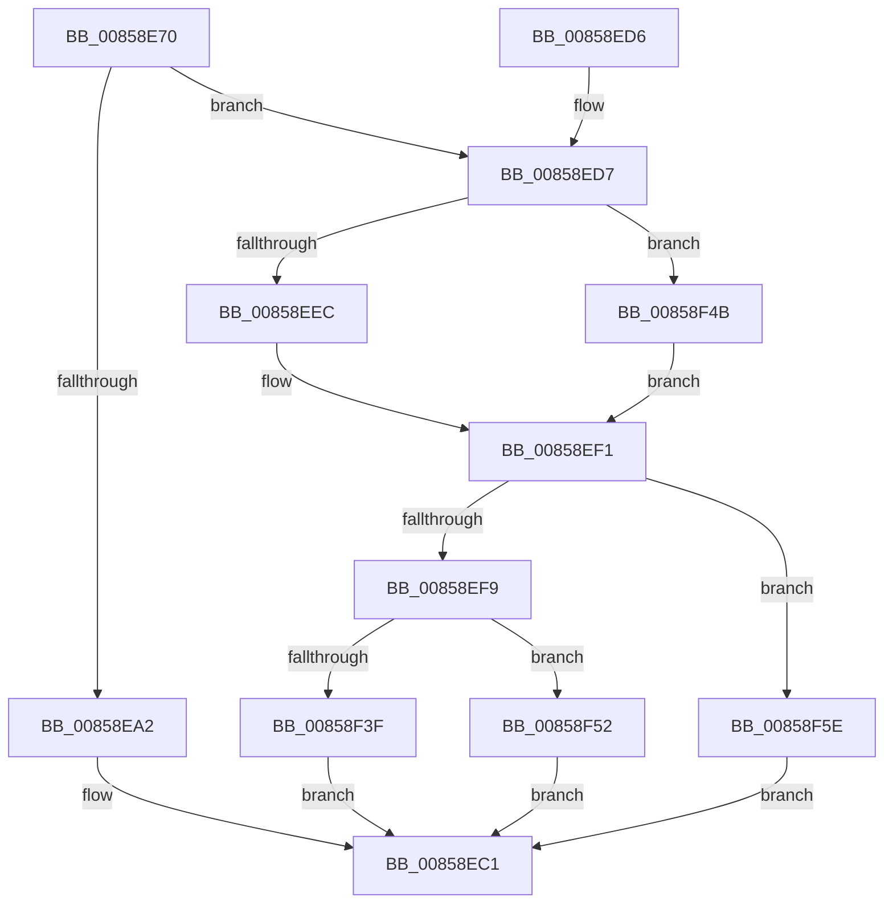

# CmpQueryKeyData

- RVA: `0x00858E70`–`0x00858F68` (길이 `248` bytes)
- VA: `0x0000000140858E70`
- 실행 섹션: `PAGE`
- PDB 이름 있음: `예`; PDB Function 태그: `아니요`
- unwind 정보 RVA: `0x0006A92C`
- 디코드: `60`개 명령, `248/248` bytes 표시
- 미해석 바이트: `0` (있으면 어셈블리에 `.byte`로 보존)

> 이 문서는 커널 이미지의 기계어와 PDB 기호를 분석해 생성했습니다. 4번과 5번은 함수 원형과 자료형을 바이너리 사용 방식에서 추정한 C 해석이며 원본 소스 복구 결과는 아닙니다.

## 1. Dependencies

- 직접 호출 지점: **6**; 고유 호출 대상: **6**
- 직접 호출자로 확인된 함수: **1**
- RIP 상대 이미지 참조: **0**

### Outgoing calls
- `0x00858EBC` → [CmpQueryKeyDataFromCache](CmpQueryKeyDataFromCache_function_00858F70.md) (function, `0x00858F70`)
- `0x00858EEC` → [HvpGetCellFlat](HvpGetCellFlat_function_00854C60.md) (function, `0x00854C60`)
- `0x00858F26` → [CmpQueryKeyDataFromNode](../84/CmpQueryKeyDataFromNode_function_0084EAE0.md) (function, `0x0084EAE0`)
- `0x00858F3F` → [HvpReleaseCellPaged](HvpReleaseCellPaged_function_00855F40.md) (function, `0x00855F40`)
- `0x00858F4B` → [HvpGetCellPaged](HvpGetCellPaged_function_00854CB0.md) (function, `0x00854CB0`)
- `0x00858F52` → [HvpReleaseCellFlat](HvpReleaseCellFlat_function_0085CC20.md) (function, `0x0085CC20`)

### Direct callers
- [CmQueryKey](CmQueryKey_function_00858240.md) at `0x00858993`

### Static image references
- 디코드된 RIP-relative 메모리 참조가 없습니다.

## 2. Other-region calls and transfers

- 다른 실행 섹션으로 향하는 call: **0**
- 별도 외부 분기/꼬리 이동을 확인하지 못했습니다.

## 3. Assembly (complete function range)

```asm
00858E70  48 89 5C 24 08                  mov qword ptr [rsp + 8], rbx
00858E75  48 89 6C 24 10                  mov qword ptr [rsp + 0x10], rbp
00858E7A  48 89 74 24 18                  mov qword ptr [rsp + 0x18], rsi
00858E7F  57                              push rdi
00858E80  48 83 EC 50                     sub rsp, 0x50
00858E84  33 C0                           xor eax, eax
00858E86  C7 44 24 40 FF FF FF FF         mov dword ptr [rsp + 0x40], 0xffffffff
00858E8E  89 44 24 44                     mov dword ptr [rsp + 0x44], eax
00858E92  41 8B F1                        mov esi, r9d
00858E95  49 8B E8                        mov rbp, r8
00858E98  8B DA                           mov ebx, edx
00858E9A  48 8B F9                        mov rdi, rcx
00858E9D  83 FA 04                        cmp edx, 4
00858EA0  75 35                           jne 0x140858ed7
00858EA2  48 8B 84 24 88 00 00 00         mov rax, qword ptr [rsp + 0x88]
00858EAA  48 89 44 24 28                  mov qword ptr [rsp + 0x28], rax
00858EAF  48 8B 84 24 80 00 00 00         mov rax, qword ptr [rsp + 0x80]
00858EB7  48 89 44 24 20                  mov qword ptr [rsp + 0x20], rax
00858EBC  E8 AF 00 00 00                  call 0x140858f70
00858EC1  48 8B 5C 24 60                  mov rbx, qword ptr [rsp + 0x60]
00858EC6  48 8B 6C 24 68                  mov rbp, qword ptr [rsp + 0x68]
00858ECB  48 8B 74 24 70                  mov rsi, qword ptr [rsp + 0x70]
00858ED0  48 83 C4 50                     add rsp, 0x50
00858ED4  5F                              pop rdi
00858ED5  C3                              ret
00858ED6  CC                              int3
00858ED7  8B 51 28                        mov edx, dword ptr [rcx + 0x28]
00858EDA  4C 8D 44 24 40                  lea r8, [rsp + 0x40]
00858EDF  48 8B 49 20                     mov rcx, qword ptr [rcx + 0x20]
00858EE3  F6 81 8C 00 00 00 01            test byte ptr [rcx + 0x8c], 1
00858EEA  74 5F                           je 0x140858f4b
00858EEC  E8 6F BD FF FF                  call 0x140854c60
00858EF1  48 8B D0                        mov rdx, rax
00858EF4  48 85 C0                        test rax, rax
00858EF7  74 65                           je 0x140858f5e
00858EF9  48 8B 84 24 88 00 00 00         mov rax, qword ptr [rsp + 0x88]
00858F01  4C 8B CD                        mov r9, rbp
00858F04  48 8B 4F 20                     mov rcx, qword ptr [rdi + 0x20]
00858F08  44 8B C3                        mov r8d, ebx
00858F0B  48 89 44 24 38                  mov qword ptr [rsp + 0x38], rax
00858F10  48 8B 84 24 80 00 00 00         mov rax, qword ptr [rsp + 0x80]
00858F18  48 89 7C 24 30                  mov qword ptr [rsp + 0x30], rdi
00858F1D  48 89 44 24 28                  mov qword ptr [rsp + 0x28], rax
00858F22  89 74 24 20                     mov dword ptr [rsp + 0x20], esi
00858F26  E8 B5 5B FF FF                  call 0x14084eae0
00858F2B  48 8B 4F 20                     mov rcx, qword ptr [rdi + 0x20]
00858F2F  48 8D 54 24 40                  lea rdx, [rsp + 0x40]
00858F34  8B D8                           mov ebx, eax
00858F36  F6 81 8C 00 00 00 01            test byte ptr [rcx + 0x8c], 1
00858F3D  75 13                           jne 0x140858f52
00858F3F  E8 FC CF FF FF                  call 0x140855f40
00858F44  8B C3                           mov eax, ebx
00858F46  E9 76 FF FF FF                  jmp 0x140858ec1
00858F4B  E8 60 BD FF FF                  call 0x140854cb0
00858F50  EB 9F                           jmp 0x140858ef1
00858F52  E8 C9 3C 00 00                  call 0x14085cc20
00858F57  8B C3                           mov eax, ebx
00858F59  E9 63 FF FF FF                  jmp 0x140858ec1
00858F5E  B8 9A 00 00 C0                  mov eax, 0xc000009a
00858F63  E9 59 FF FF FF                  jmp 0x140858ec1
```

## 4. C-style interpretation (structured pseudocode)

```c
__int64 __fastcall CmpQueryKeyData(__int64 a1, int a2, __int64 a3, int a4, __int64 a5, __int64 a6)
{
    __int64 result;
    __int64 v_rsp;
    unsigned int v_stack_m14;
    unsigned int v_stack_m18;
    unsigned __int64 v_stack_m30;
    unsigned __int64 v_stack_m38;
    unsigned __int64 v_stack_p10;
    unsigned __int64 v_stack_p18;
    unsigned int v_stack_p20;
    unsigned __int64 v_stack_p28;
    unsigned __int64 v_stack_p30;
    unsigned __int64 v_stack_p38;
    unsigned __int64 v_stack_p40;
    unsigned __int64 v_stack_p8;

    v_stack_p8 = v_rbx;
    v_stack_p10 = v_rbp;
    v_stack_p18 = v_rsi;
    v_rsp = (v_rsp) - (80);
    result = 0;
    v_stack_m18 = 0xFFFFFFFFULL;
    v_stack_m14 = 0;
    if (a2 != 4) goto loc_00858ED7;
    v_stack_m30 = a6;
    v_stack_m38 = a5;
    result = CmpQueryKeyDataFromCache(a1, a2, a3, a4);
loc_00858EC1:
    v_rsp = (v_rsp) + (80);
    return result;
loc_00858ED7:
    if (((*(unsigned __int8 *)(*(unsigned __int64 *)(a1 + 32) + 140)) & (1)) == 0) goto loc_00858F4B;
    result = HvpGetCellFlat(*(unsigned __int64 *)(a1 + 32), (unsigned int)(*(unsigned int *)(a1 + 40)), v_stack_p40, a4);
loc_00858EF1:
    if (result == 0) goto loc_00858F5E;
    v_stack_p38 = a6;
    v_stack_p30 = a1;
    v_stack_p28 = a5;
    v_stack_p20 = (unsigned int)(v_stack_p18);
    result = CmpQueryKeyDataFromNode(*(unsigned __int64 *)(a1 + 32), result, (unsigned int)((unsigned int)(v_stack_p8)), v_stack_p10);
    if (((*(unsigned __int8 *)(*(unsigned __int64 *)(a1 + 32) + 140)) & (1)) != 0) goto loc_00858F52;
    result = HvpReleaseCellPaged(*(unsigned __int64 *)(a1 + 32), v_stack_p40, (unsigned int)((unsigned int)(v_stack_p8)), v_stack_p10);
    goto loc_00858EC1;
loc_00858F4B:
    result = HvpGetCellPaged(*(unsigned __int64 *)(a1 + 32), v_stack_p40, (unsigned int)((unsigned int)(v_stack_p8)), v_stack_p10);
    goto loc_00858EF1;
loc_00858F52:
    result = HvpReleaseCellFlat(*(unsigned __int64 *)(a1 + 32), v_stack_p40, (unsigned int)((unsigned int)(v_stack_p8)), v_stack_p10);
    goto loc_00858EC1;
loc_00858F5E:
    goto loc_00858EC1;
}
```

## 5. (Beta) C Style

```c
int64_t CmpQueryKeyData(void *Arg1, int32_t Arg2, int64_t Arg3, int32_t Arg4, int64_t Arg5, int64_t Arg6)
{
    uint8_t *arg1 = (uint8_t *)Arg1;

    int64_t result;
    int64_t local_rsp;
    uint32_t v_stack_m14;
    uint32_t v_stack_m18;
    uint64_t v_stack_m30;
    uint64_t v_stack_m38;
    uint64_t v_stack_p10;
    uint64_t v_stack_p18;
    uint32_t v_stack_p20;
    uint64_t v_stack_p28;
    uint64_t v_stack_p30;
    uint64_t v_stack_p38;
    uint64_t v_stack_p40;
    uint64_t v_stack_p8;

    v_stack_p8 = local_rbx;
    v_stack_p10 = local_rbp;
    v_stack_p18 = local_rsi;
    local_rsp = (local_rsp) - (80);
    result = 0;
    v_stack_m18 = 0xFFFFFFFFULL;
    v_stack_m14 = 0;
    if (Arg2 != 4) goto loc_00858ED7;
    v_stack_m30 = Arg6;
    v_stack_m38 = Arg5;
    result = CmpQueryKeyDataFromCache(Arg1, Arg2, Arg3, Arg4);
loc_00858EC1:
    local_rsp = (local_rsp) + (80);
    return result;
loc_00858ED7:
    if (((*(uint8_t *)(*(uint64_t *)(arg1 + 0x20) + 0x8C)) & (1)) == 0) goto loc_00858F4B;
    result = HvpGetCellFlat(*(uint64_t *)(arg1 + 0x20), (uint32_t)(*(uint32_t *)(arg1 + 0x28)), v_stack_p40, Arg4);
loc_00858EF1:
    if (result == 0) goto loc_00858F5E;
    v_stack_p38 = Arg6;
    v_stack_p30 = Arg1;
    v_stack_p28 = Arg5;
    v_stack_p20 = (uint32_t)(v_stack_p18);
    result = CmpQueryKeyDataFromNode(*(uint64_t *)(arg1 + 0x20), result, (uint32_t)((uint32_t)(v_stack_p8)), v_stack_p10);
    if (((*(uint8_t *)(*(uint64_t *)(arg1 + 0x20) + 0x8C)) & (1)) != 0) goto loc_00858F52;
    result = HvpReleaseCellPaged(*(uint64_t *)(arg1 + 0x20), v_stack_p40, (uint32_t)((uint32_t)(v_stack_p8)), v_stack_p10);
    goto loc_00858EC1;
loc_00858F4B:
    result = HvpGetCellPaged(*(uint64_t *)(arg1 + 0x20), v_stack_p40, (uint32_t)((uint32_t)(v_stack_p8)), v_stack_p10);
    goto loc_00858EF1;
loc_00858F52:
    result = HvpReleaseCellFlat(*(uint64_t *)(arg1 + 0x20), v_stack_p40, (uint32_t)((uint32_t)(v_stack_p8)), v_stack_p10);
    goto loc_00858EC1;
loc_00858F5E:
    goto loc_00858EC1;
}
```

### 관측된 메모리 오프셋

구조체 형식이 확인되지 않은 접근은 인자 기준의 오프셋으로만 기록했습니다.

| 기준 인자 | 오프셋 표현 | 폭 (bit) | 접근 |
|---|---:|---:|---|
| `Arg1` | `+ 0x20` | `64` | `R` |
| `Arg1` | `+ 0x28` | `32` | `R` |

## 6. Execution-region graph

[열기: 2D/3D 그래프와 함수 탐색 컨트롤 패널](../../../control-panel.html?section=page&rva=0x00858E70&view=graph)

- 2D 그래프는 위에서 아래로 흐르고, 3D 그래프는 빈 공간을 드래그해 회전합니다. Shift+드래그는 이동, 휠은 확대·축소, 함수 노드 선택은 대상 보고서 이동입니다.

### Static fallback


