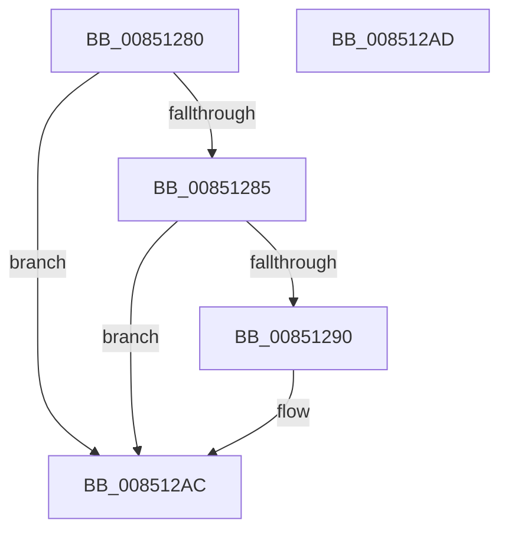

# CmpRecordParseFailure

- RVA: `0x00851280`–`0x008512AE` (길이 `46` bytes)
- VA: `0x0000000140851280`
- 실행 섹션: `PAGE`
- PDB 이름 있음: `예`; PDB Function 태그: `아니요`
- unwind 정보 RVA: `0x000DB714`
- 디코드: `11`개 명령, `46/46` bytes 표시
- 미해석 바이트: `0` (있으면 어셈블리에 `.byte`로 보존)

> 이 문서는 커널 이미지의 기계어와 PDB 기호를 분석해 생성했습니다. 4번과 5번은 함수 원형과 자료형을 바이너리 사용 방식에서 추정한 C 해석이며 원본 소스 복구 결과는 아닙니다.

## 1. Dependencies

- 직접 호출 지점: **0**; 고유 호출 대상: **0**
- 직접 호출자로 확인된 함수: **12**
- RIP 상대 이미지 참조: **0**

### Outgoing calls
- 직접 디코드된 call 명령이 없습니다.

### Direct callers
- [CmpPerformCompleteKcbCacheLookup](../84/CmpPerformCompleteKcbCacheLookup_function_0084FD20.md) at `0x00850C4E`
- [CmpWalkOneLevel](CmpWalkOneLevel_function_00852BA0.md) at `0x008532D0`
- [CmpWalkOneLevel](CmpWalkOneLevel_function_00852BA0.md) at `0x00853A17`
- [CmpDoParseKey](CmpDoParseKey_function_0085F750.md) at `0x008600D3`
- [CmpDoParseKey](CmpDoParseKey_function_0085F750.md) at `0x00860153`
- [CmpDoParseKey](CmpDoParseKey_function_0085F750.md) at `0x00860A1A`
- [CmpDoParseKey](CmpDoParseKey_function_0085F750.md) at `0x00860AC1`
- [CmpDoParseKey](CmpDoParseKey_function_0085F750.md) at `0x00860D8C`
- [CmpDoParseKey](CmpDoParseKey_function_0085F750.md) at `0x00860F58`
- [CmpDoParseKey](CmpDoParseKey_function_0085F750.md) at `0x00860FF6`
- [CmpDoParseKey](CmpDoParseKey_function_0085F750.md) at `0x008610A0`
- [CmpDoParseKey](CmpDoParseKey_function_0085F750.md) at `0x008610D8`
- [CmpDoParseKey](CmpDoParseKey_function_0085F750.md) at `0x00861192`
- [CmpDoParseKey](CmpDoParseKey_function_0085F750.md) at `0x008617C6`
- [CmpDoParseKey](CmpDoParseKey_function_0085F750.md) at `0x00861860`
- [CmpDoParseKey](CmpDoParseKey_function_0085F750.md) at `0x008618AD`
- [CmpDoParseKey](CmpDoParseKey_function_0085F750.md) at `0x008618D0`
- [CmpDoParseKey](CmpDoParseKey_function_0085F750.md) at `0x00861901`
- [CmpDoParseKey](CmpDoParseKey_function_0085F750.md) at `0x0086192E`
- [CmpDoParseKey](CmpDoParseKey_function_0085F750.md) at `0x00861940`
- [CmpDoParseKey](CmpDoParseKey_function_0085F750.md) at `0x008619FE`
- [CmpDoParseKey](CmpDoParseKey_function_0085F750.md) at `0x00861B36`
- [CmpDoParseKey](CmpDoParseKey_function_0085F750.md) at `0x00861B59`
- [CmpDoParseKey](CmpDoParseKey_function_0085F750.md) at `0x00861C25`
- [CmpDoParseKey](CmpDoParseKey_function_0085F750.md) at `0x00861C4C`
- [CmpDoParseKey](CmpDoParseKey_function_0085F750.md) at `0x00861C76`
- [CmpDoParseKey](CmpDoParseKey_function_0085F750.md) at `0x00861C92`
- [CmpDoParseKey](CmpDoParseKey_function_0085F750.md) at `0x00861CAE`
- [CmpDoParseKey](CmpDoParseKey_function_0085F750.md) at `0x00861CCA`
- [CmpDoParseKey](CmpDoParseKey_function_0085F750.md) at `0x00861CF1`
- [CmpDoParseKey](CmpDoParseKey_function_0085F750.md) at `0x00861D3D`
- [CmpDoParseKey](CmpDoParseKey_function_0085F750.md) at `0x00861D7E`
- [sub_008C3F6B](../8C/Unknown_function_008C3F6B.md) at `0x008C4011`
- [sub_008C405D](../8C/Unknown_function_008C405D.md) at `0x008C4183`
- [sub_008C405D](../8C/Unknown_function_008C405D.md) at `0x008C419E`
- [CmpCreateChild](../94/CmpCreateChild_function_0094817C.md) at `0x009487CD`
- [CmpCreateChild](../94/CmpCreateChild_function_0094817C.md) at `0x009488DC`
- [CmpCreateChild](../94/CmpCreateChild_function_0094817C.md) at `0x00948AC2`
- [CmpCreateChild](../94/CmpCreateChild_function_0094817C.md) at `0x00948BF4`
- [CmpCreateChild](../94/CmpCreateChild_function_0094817C.md) at `0x00948E74`
- [sub_0094AEFE](../94/Unknown_function_0094AEFE.md) at `0x0094AF09`
- [sub_0094AF2A](../94/Unknown_function_0094AF2A.md) at `0x0094AFB0`
- [sub_0094AFBA](../94/Unknown_function_0094AFBA.md) at `0x0094AFCB`
- [sub_0094AFBA](../94/Unknown_function_0094AFBA.md) at `0x0094AFF7`
- [sub_0094AFBA](../94/Unknown_function_0094AFBA.md) at `0x0094B015`
- [CmpCreateHiveRootCell](../AB/CmpCreateHiveRootCell_function_00ABF568.md) at `0x00ABF5FC`
- [CmpCreateHiveRootCell](../AB/CmpCreateHiveRootCell_function_00ABF568.md) at `0x00ABF6A2`
- [CmpCreateHiveRootCell](../AB/CmpCreateHiveRootCell_function_00ABF568.md) at `0x00ABF73B`
- [sub_00B16F66](../B1/Unknown_function_00B16F66.md) at `0x00B171CF`
- [sub_00B16F66](../B1/Unknown_function_00B16F66.md) at `0x00B17251`
- [sub_00B16F66](../B1/Unknown_function_00B16F66.md) at `0x00B172F1`
- [sub_00B16F66](../B1/Unknown_function_00B16F66.md) at `0x00B17333`
- [sub_00B16F66](../B1/Unknown_function_00B16F66.md) at `0x00B17368`
- [sub_00B16F66](../B1/Unknown_function_00B16F66.md) at `0x00B17396`
- [sub_00B16F66](../B1/Unknown_function_00B16F66.md) at `0x00B173E1`
- [sub_00B16F66](../B1/Unknown_function_00B16F66.md) at `0x00B1742A`
- [sub_00B16F66](../B1/Unknown_function_00B16F66.md) at `0x00B17465`
- [sub_00B16F66](../B1/Unknown_function_00B16F66.md) at `0x00B17497`
- [sub_00B258D8](../B2/Unknown_function_00B258D8.md) at `0x00B25945`

### Static image references
- 디코드된 RIP-relative 메모리 참조가 없습니다.

## 2. Other-region calls and transfers

- 다른 실행 섹션으로 향하는 call: **0**
- 별도 외부 분기/꼬리 이동을 확인하지 못했습니다.

## 3. Assembly (complete function range)

```asm
00851280  48 85 C9                        test rcx, rcx
00851283  74 27                           je 0x1408512ac
00851285  0F B6 81 AA 01 00 00            movzx eax, byte ptr [rcx + 0x1aa]
0085128C  3C 04                           cmp al, 4
0085128E  73 1C                           jae 0x1408512ac
00851290  44 89 84 C1 AC 01 00 00         mov dword ptr [rcx + rax*8 + 0x1ac], r8d
00851298  0F B6 81 AA 01 00 00            movzx eax, byte ptr [rcx + 0x1aa]
0085129F  89 94 C1 B0 01 00 00            mov dword ptr [rcx + rax*8 + 0x1b0], edx
008512A6  FE 81 AA 01 00 00               inc byte ptr [rcx + 0x1aa]
008512AC  C3                              ret
008512AD  CC                              int3
```

## 4. C-style interpretation (structured pseudocode)

```c
__int64 __fastcall CmpRecordParseFailure(__int64 a1, int a2, int a3)
{
    __int64 result;

    if (a1 == 0) goto loc_008512AC;
    result = *(unsigned __int8 *)(a1 + 426);
    if (((unsigned __int8)(*(unsigned __int8 *)(a1 + 426))) < 4) {
        *(unsigned int *)(a1 + *(unsigned __int8 *)(a1 + 426) * 8 + 428) = a3;
        result = *(unsigned __int8 *)(a1 + 426);
        *(unsigned int *)(a1 + result * 8 + 432) = a2;
    }
    return result;
}
```

## 5. (Beta) C Style

```c
int64_t CmpRecordParseFailure(int64_t Arg1, int32_t Arg2, int32_t Arg3)
{
    int64_t result;

    if (Arg1 == 0) goto loc_008512AC;
    result = *(uint8_t *)(Arg1 + 0x1AA);
    if (((uint8_t)(*(uint8_t *)(Arg1 + 0x1AA))) < 4) {
        *(uint32_t *)(Arg1 + *(uint8_t *)(Arg1 + 0x1AA) * 8 + 0x1AC) = Arg3;
        result = *(uint8_t *)(Arg1 + 0x1AA);
        *(uint32_t *)(Arg1 + result * 8 + 0x1B0) = Arg2;
    }
    return result;
}
```

## 6. Execution-region graph

[열기: 2D/3D 그래프와 함수 탐색 컨트롤 패널](../../../control-panel.html?section=page&rva=0x00851280&view=graph)

- 2D 그래프는 위에서 아래로 흐르고, 3D 그래프는 빈 공간을 드래그해 회전합니다. Shift+드래그는 이동, 휠은 확대·축소, 함수 노드 선택은 대상 보고서 이동입니다.

### Static fallback


