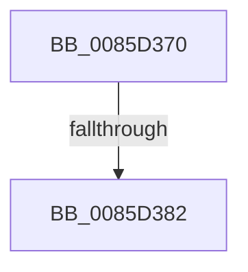

# CmpReferenceKeyControlBlock

- RVA: `0x0085D370`–`0x0085D39E` (길이 `46` bytes)
- VA: `0x000000014085D370`
- 실행 섹션: `PAGE`
- PDB 이름 있음: `예`; PDB Function 태그: `아니요`
- unwind 정보 RVA: `0x0006AF98`
- 디코드: `12`개 명령, `46/46` bytes 표시
- 미해석 바이트: `0` (있으면 어셈블리에 `.byte`로 보존)

> 이 문서는 커널 이미지의 기계어와 PDB 기호를 분석해 생성했습니다. 4번과 5번은 함수 원형과 자료형을 바이너리 사용 방식에서 추정한 C 해석이며 원본 소스 복구 결과는 아닙니다.

## 1. Dependencies

- 직접 호출 지점: **1**; 고유 호출 대상: **1**
- 직접 호출자로 확인된 함수: **11**
- RIP 상대 이미지 참조: **0**

### Outgoing calls
- `0x0085D398` → [KeBugCheckEx](../../text/4F/KeBugCheckEx_function_004FD660.md) (function, `0x004FD660`)

### Direct callers
- [CmpTransEnlistUowInKcb](../../text/48/CmpTransEnlistUowInKcb_function_0048F094.md) at `0x0048F0D0`
- [CmRenameKey](../7E/CmRenameKey_function_007E8F48.md) at `0x007E92B5`
- [CmRenameKey](../7E/CmRenameKey_function_007E8F48.md) at `0x007E97EB`
- [CmpGetVirtualStoreRoot](../7E/CmpGetVirtualStoreRoot_function_007EB974.md) at `0x007EB9EB`
- [CmpPrepareDiscardReplacePost](../7F/CmpPrepareDiscardReplacePost_function_007F16B0.md) at `0x007F16D2`
- [CmpFindSubKeyByNumberEx](../84/CmpFindSubKeyByNumberEx_function_0084F1A0.md) at `0x0084F93A`
- [CmpCreateKeyControlBlock](CmpCreateKeyControlBlock_function_00851DB0.md) at `0x00852587`
- [CmpCreateLayerLink](CmpCreateLayerLink_function_0085CB00.md) at `0x0085CB3B`
- [sub_0085E7B7](Unknown_function_0085E7B7.md) at `0x0085E885`
- [CmpCommitDiscardAndReplaceKcbAndUnbackedHigherLayers](../A5/CmpCommitDiscardAndReplaceKcbAndUnbackedHigherLayers_function_00A55070.md) at `0x00A550F0`
- [CmpCommitDiscardAndReplaceKcbAndUnbackedHigherLayers](../A5/CmpCommitDiscardAndReplaceKcbAndUnbackedHigherLayers_function_00A55070.md) at `0x00A5516B`
- [CmpEnumerateAllHigherLayerKcbs](../A5/CmpEnumerateAllHigherLayerKcbs_function_00A55234.md) at `0x00A552DE`
- [CmpEnumerateAllHigherLayerKcbs](../A5/CmpEnumerateAllHigherLayerKcbs_function_00A55234.md) at `0x00A5536F`
- [sub_00B49062](../B4/Unknown_function_00B49062.md) at `0x00B49107`

### Static image references
- 디코드된 RIP-relative 메모리 참조가 없습니다.

## 2. Other-region calls and transfers

- 다른 실행 섹션으로 향하는 call: **1**
  - `0x0085D398` → [KeBugCheckEx](../../text/4F/KeBugCheckEx_function_004FD660.md) (`PAGE` → `.text`)
- call이 아닌 외부 분기/꼬리 이동: **1**
  - `0x0085D380` → [sub_0085D39E](Unknown_function_0085D39E.md) (`tail-transfer`)

## 3. Assembly (complete function range)

```asm
0085D370  40 53                           push rbx
0085D372  48 83 EC 30                     sub rsp, 0x30
0085D376  F7 41 08 00 00 08 00            test dword ptr [rcx + 8], 0x80000
0085D37D  48 8B D9                        mov rbx, rcx
0085D380  74 1C                           je 0x14085d39e
0085D382  45 33 C9                        xor r9d, r9d
0085D385  48 C7 44 24 20 00 00 00 00      mov qword ptr [rsp + 0x20], 0
0085D38E  4C 8B C1                        mov r8, rcx
0085D391  41 8D 51 20                     lea edx, [r9 + 0x20]
0085D395  8D 4A 31                        lea ecx, [rdx + 0x31]
0085D398  E8 C3 02 CA FF                  call 0x1404fd660
0085D39D  CC                              int3
```

## 4. C-style interpretation (structured pseudocode)

```c
__int64 __fastcall CmpReferenceKeyControlBlock(__int64 a1, __int64 a2, __int64 a3, int a4)
{
    __int64 result;
    __int64 v_rsp;
    unsigned __int64 v_stack_m18;

    v_rsp = (v_rsp) - (48);
    a4 = 0;
    v_stack_m18 = 0;
    result = KeBugCheckEx(a4 + 32 + 49, a4 + 32, a1, a4);
    return result;
}
```

## 5. (Beta) C Style

```c
int64_t CmpReferenceKeyControlBlock(void *Arg1, int64_t Arg2, int64_t Arg3, int32_t Arg4)
{
    uint8_t *arg1 = (uint8_t *)Arg1;

    int64_t result;
    int64_t local_rsp;
    uint64_t v_stack_m18;

    local_rsp = (local_rsp) - (48);
    Arg4 = 0;
    v_stack_m18 = 0;
    result = KeBugCheckEx(Arg4 + 32 + 49, Arg4 + 32, Arg1, Arg4);
    return result;
}
```

### 관측된 메모리 오프셋

구조체 형식이 확인되지 않은 접근은 인자 기준의 오프셋으로만 기록했습니다.

| 기준 인자 | 오프셋 표현 | 폭 (bit) | 접근 |
|---|---:|---:|---|
| `Arg1` | `+ 0x8` | `32` | `R` |

## 6. Execution-region graph

[열기: 2D/3D 그래프와 함수 탐색 컨트롤 패널](../../../control-panel.html?section=page&rva=0x0085D370&view=graph)

- 2D 그래프는 위에서 아래로 흐르고, 3D 그래프는 빈 공간을 드래그해 회전합니다. Shift+드래그는 이동, 휠은 확대·축소, 함수 노드 선택은 대상 보고서 이동입니다.

### Static fallback


