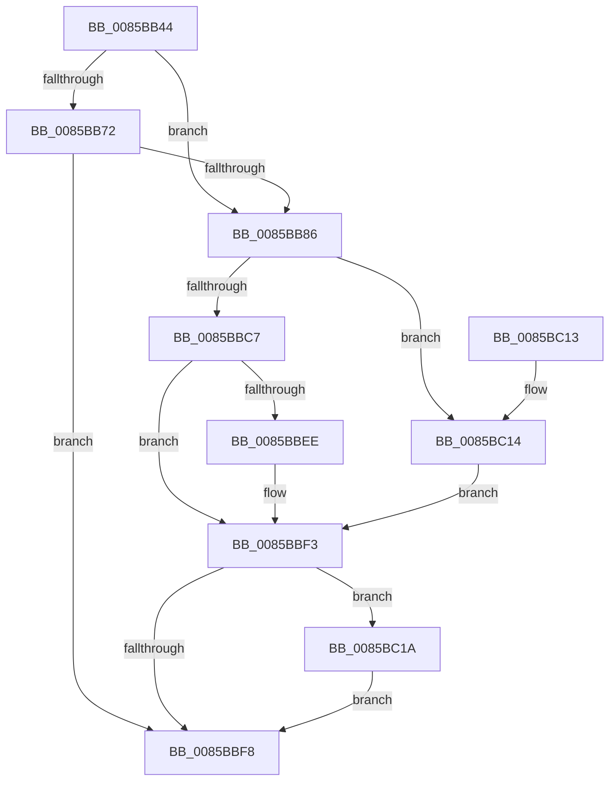

# CmpSetValueKeyNew

- RVA: `0x0085BB44`–`0x0085BC26` (길이 `226` bytes)
- VA: `0x000000014085BB44`
- 실행 섹션: `PAGE`
- PDB 이름 있음: `예`; PDB Function 태그: `아니요`
- unwind 정보 RVA: `0x0006AE48`
- 디코드: `67`개 명령, `226/226` bytes 표시
- 미해석 바이트: `0` (있으면 어셈블리에 `.byte`로 보존)

> 이 문서는 커널 이미지의 기계어와 PDB 기호를 분석해 생성했습니다. 4번과 5번은 함수 원형과 자료형을 바이너리 사용 방식에서 추정한 C 해석이며 원본 소스 복구 결과는 아닙니다.

## 1. Dependencies

- 직접 호출 지점: **4**; 고유 호출 대상: **4**
- 직접 호출자로 확인된 함수: **1**
- RIP 상대 이미지 참조: **0**

### Outgoing calls
- `0x0085BB7B` → [HvpMarkCellDirty](HvpMarkCellDirty_function_00858080.md) (function, `0x00858080`)
- `0x0085BBBC` → [CmpAddValueKeyNew](CmpAddValueKeyNew_function_0085AA58.md) (function, `0x0085AA58`)
- `0x0085BBE3` → [CmpAddValueToListEx](CmpAddValueToListEx_function_0085B460.md) (function, `0x0085B460`)
- `0x0085BC1F` → [CmpFreeValue](../84/CmpFreeValue_function_0084AF98.md) (function, `0x0084AF98`)

### Direct callers
- [CmSetValueKey](../84/CmSetValueKey_function_008457C0.md) at `0x008461D9`

### Static image references
- 디코드된 RIP-relative 메모리 참조가 없습니다.

## 2. Other-region calls and transfers

- 다른 실행 섹션으로 향하는 call: **0**
- 별도 외부 분기/꼬리 이동을 확인하지 못했습니다.

## 3. Assembly (complete function range)

```asm
0085BB44  48 8B C4                        mov rax, rsp
0085BB47  48 89 58 08                     mov qword ptr [rax + 8], rbx
0085BB4B  48 89 68 18                     mov qword ptr [rax + 0x18], rbp
0085BB4F  48 89 70 20                     mov qword ptr [rax + 0x20], rsi
0085BB53  57                              push rdi
0085BB54  41 56                           push r14
0085BB56  41 57                           push r15
0085BB58  48 83 EC 40                     sub rsp, 0x40
0085BB5C  83 48 10 FF                     or dword ptr [rax + 0x10], 0xffffffff
0085BB60  48 8D 5A 24                     lea rbx, [rdx + 0x24]
0085BB64  83 3B 00                        cmp dword ptr [rbx], 0
0085BB67  45 8B F1                        mov r14d, r9d
0085BB6A  4D 8B F8                        mov r15, r8
0085BB6D  48 8B F1                        mov rsi, rcx
0085BB70  74 14                           je 0x14085bb86
0085BB72  8B 52 28                        mov edx, dword ptr [rdx + 0x28]
0085BB75  45 33 C9                        xor r9d, r9d
0085BB78  45 33 C0                        xor r8d, r8d
0085BB7B  E8 00 C5 FF FF                  call 0x140858080
0085BB80  8B F8                           mov edi, eax
0085BB82  85 C0                           test eax, eax
0085BB84  78 72                           js 0x14085bbf8
0085BB86  8B AC 24 98 00 00 00            mov ebp, dword ptr [rsp + 0x98]
0085BB8D  48 8D 44 24 68                  lea rax, [rsp + 0x68]
0085BB92  4C 8B 8C 24 88 00 00 00         mov r9, qword ptr [rsp + 0x88]
0085BB9A  49 8B D7                        mov rdx, r15
0085BB9D  44 8B 84 24 80 00 00 00         mov r8d, dword ptr [rsp + 0x80]
0085BBA5  48 8B CE                        mov rcx, rsi
0085BBA8  48 89 44 24 30                  mov qword ptr [rsp + 0x30], rax
0085BBAD  8B 84 24 90 00 00 00            mov eax, dword ptr [rsp + 0x90]
0085BBB4  89 6C 24 28                     mov dword ptr [rsp + 0x28], ebp
0085BBB8  89 44 24 20                     mov dword ptr [rsp + 0x20], eax
0085BBBC  E8 97 EE FF FF                  call 0x14085aa58
0085BBC1  8B F8                           mov edi, eax
0085BBC3  85 C0                           test eax, eax
0085BBC5  78 4D                           js 0x14085bc14
0085BBC7  C7 44 24 28 01 00 00 00         mov dword ptr [rsp + 0x28], 1
0085BBCF  44 8B CD                        mov r9d, ebp
0085BBD2  48 89 5C 24 20                  mov qword ptr [rsp + 0x20], rbx
0085BBD7  45 8B C6                        mov r8d, r14d
0085BBDA  8B 5C 24 68                     mov ebx, dword ptr [rsp + 0x68]
0085BBDE  48 8B CE                        mov rcx, rsi
0085BBE1  8B D3                           mov edx, ebx
0085BBE3  E8 78 F8 FF FF                  call 0x14085b460
0085BBE8  8B F8                           mov edi, eax
0085BBEA  85 C0                           test eax, eax
0085BBEC  78 05                           js 0x14085bbf3
0085BBEE  83 CB FF                        or ebx, 0xffffffff
0085BBF1  33 FF                           xor edi, edi
0085BBF3  83 FB FF                        cmp ebx, -1
0085BBF6  75 22                           jne 0x14085bc1a
0085BBF8  48 8B 5C 24 60                  mov rbx, qword ptr [rsp + 0x60]
0085BBFD  8B C7                           mov eax, edi
0085BBFF  48 8B 6C 24 70                  mov rbp, qword ptr [rsp + 0x70]
0085BC04  48 8B 74 24 78                  mov rsi, qword ptr [rsp + 0x78]
0085BC09  48 83 C4 40                     add rsp, 0x40
0085BC0D  41 5F                           pop r15
0085BC0F  41 5E                           pop r14
0085BC11  5F                              pop rdi
0085BC12  C3                              ret
0085BC13  CC                              int3
0085BC14  8B 5C 24 68                     mov ebx, dword ptr [rsp + 0x68]
0085BC18  EB D9                           jmp 0x14085bbf3
0085BC1A  8B D3                           mov edx, ebx
0085BC1C  48 8B CE                        mov rcx, rsi
0085BC1F  E8 74 F3 FE FF                  call 0x14084af98
0085BC24  EB D2                           jmp 0x14085bbf8
```

## 4. C-style interpretation (structured pseudocode)

```c
__int64 __fastcall CmpSetValueKeyNew(__int64 a1, __int64 a2, __int64 a3, int a4, unsigned int a5, __int64 a6, unsigned int a7, unsigned int a8)
{
    __int64 result;
    __int64 v_rbx;
    __int64 v_rdi;
    __int64 v_rsp;
    unsigned __int64 v_stack_m28;
    unsigned int v_stack_m30;
    unsigned int v_stack_m38;
    unsigned __int64 v_stack_p10;
    unsigned __int64 v_stack_p18;
    unsigned __int64 v_stack_p20;
    unsigned int v_stack_p68;
    unsigned __int64 v_stack_p8;

    *(unsigned __int64 *)(v_rsp + 8) = v_rbx;
    *(unsigned __int64 *)(v_rsp + 24) = v_rbp;
    *(unsigned __int64 *)(v_rsp + 32) = v_rsi;
    v_rsp = (v_rsp) - (64);
    if ((*(unsigned int *)(a2 + 36)) == 0) goto loc_0085BB86;
    a4 = 0;
    a3 = 0;
    result = HvpMarkCellDirty(a1, (unsigned int)(*(unsigned int *)(a2 + 40)), a3, a4);
    if (sign_flag) goto loc_0085BBF8;
loc_0085BB86:
    v_stack_m28 = v_stack_p10;
    v_stack_m30 = (unsigned int)((unsigned int)(a8));
    v_stack_m38 = (unsigned int)((unsigned int)(a7));
    result = CmpAddValueKeyNew(a1, 0, (unsigned int)(a5), a6);
    if (sign_flag) goto loc_0085BC14;
    v_stack_m30 = 1;
    v_stack_m38 = a2 + 36;
    result = CmpAddValueToListEx(a1, (unsigned int)((unsigned int)((unsigned int)(v_stack_p10))), (unsigned int)((unsigned int)((unsigned int)(a4))), (unsigned int)((unsigned int)((unsigned int)(a8))));
    v_rbx = (unsigned int)(v_stack_p10);
    v_rdi = (unsigned int)((unsigned int)(result));
    if (!(sign_flag)) {
        v_rbx = (unsigned int)(((unsigned int)(v_stack_p10)) | (0xFFFFFFFFULL));
        v_rdi = 0;
    }
    if (((unsigned int)(v_rbx)) != -1) goto loc_0085BC1A;
loc_0085BBF8:
    v_rsp = (v_rsp) + (64);
    return 0;
loc_0085BC14:
    goto loc_0085BBF3;
loc_0085BC1A:
    result = CmpFreeValue(v_stack_p20, (unsigned int)((unsigned int)((unsigned int)(v_stack_p68))), (unsigned int)((unsigned int)((unsigned int)(a4))), (unsigned int)((unsigned int)((unsigned int)(a8))));
    goto loc_0085BBF8;
}
```

## 5. (Beta) C Style

```c
int64_t CmpSetValueKeyNew(int64_t Arg1, void *Arg2, int64_t Arg3, int32_t Arg4, uint32_t Arg5, int64_t Arg6, uint32_t Arg7, uint32_t Arg8)
{
    uint8_t *arg2 = (uint8_t *)Arg2;

    int64_t result;
    int64_t local_rbx;
    int64_t local_rdi;
    int64_t local_rsp;
    uint64_t v_stack_m28;
    uint32_t v_stack_m30;
    uint32_t v_stack_m38;
    uint64_t v_stack_p10;
    uint64_t v_stack_p18;
    uint64_t v_stack_p20;
    uint32_t v_stack_p68;
    uint64_t v_stack_p8;

    *(uint64_t *)(local_rsp + 0x8) = local_rbx;
    *(uint64_t *)(local_rsp + 0x18) = local_rbp;
    *(uint64_t *)(local_rsp + 0x20) = local_rsi;
    local_rsp = (local_rsp) - (64);
    if ((*(uint32_t *)(arg2 + 0x24)) == 0) goto loc_0085BB86;
    Arg4 = 0;
    Arg3 = 0;
    result = HvpMarkCellDirty(Arg1, (uint32_t)(*(uint32_t *)(arg2 + 0x28)), Arg3, Arg4);
    if (sign_flag) goto loc_0085BBF8;
loc_0085BB86:
    v_stack_m28 = v_stack_p10;
    v_stack_m30 = (uint32_t)((uint32_t)(Arg8));
    v_stack_m38 = (uint32_t)((uint32_t)(Arg7));
    result = CmpAddValueKeyNew(Arg1, 0, (uint32_t)(Arg5), Arg6);
    if (sign_flag) goto loc_0085BC14;
    v_stack_m30 = 1;
    v_stack_m38 = Arg2 + 36;
    result = CmpAddValueToListEx(Arg1, (uint32_t)((uint32_t)((uint32_t)(v_stack_p10))), (uint32_t)((uint32_t)((uint32_t)(Arg4))), (uint32_t)((uint32_t)((uint32_t)(Arg8))));
    local_rbx = (uint32_t)(v_stack_p10);
    local_rdi = (uint32_t)((uint32_t)(result));
    if (!(sign_flag)) {
        local_rbx = (uint32_t)(((uint32_t)(v_stack_p10)) | (0xFFFFFFFFULL));
        local_rdi = 0;
    }
    if (((uint32_t)(local_rbx)) != -1) goto loc_0085BC1A;
loc_0085BBF8:
    local_rsp = (local_rsp) + (64);
    return 0;
loc_0085BC14:
    goto loc_0085BBF3;
loc_0085BC1A:
    result = CmpFreeValue(v_stack_p20, (uint32_t)((uint32_t)((uint32_t)(v_stack_p68))), (uint32_t)((uint32_t)((uint32_t)(Arg4))), (uint32_t)((uint32_t)((uint32_t)(Arg8))));
    goto loc_0085BBF8;
}
```

### 관측된 메모리 오프셋

구조체 형식이 확인되지 않은 접근은 인자 기준의 오프셋으로만 기록했습니다.

| 기준 인자 | 오프셋 표현 | 폭 (bit) | 접근 |
|---|---:|---:|---|
| `Arg2` | `+ 0x0` | `32` | `R` |
| `Arg2` | `+ 0x24` | `64` | `R` |
| `Arg2` | `+ 0x28` | `32` | `R` |

## 6. Execution-region graph

[열기: 2D/3D 그래프와 함수 탐색 컨트롤 패널](../../../control-panel.html?section=page&rva=0x0085BB44&view=graph)

- 2D 그래프는 위에서 아래로 흐르고, 3D 그래프는 빈 공간을 드래그해 회전합니다. Shift+드래그는 이동, 휠은 확대·축소, 함수 노드 선택은 대상 보고서 이동입니다.

### Static fallback


