# HvAllocateCell

- RVA: `0x00859C94`–`0x00859F4F` (길이 `699` bytes)
- VA: `0x0000000140859C94`
- 실행 섹션: `PAGE`
- PDB 이름 있음: `예`; PDB Function 태그: `예`
- unwind 정보 RVA: `0x0006AA84`
- 디코드: `193`개 명령, `699/699` bytes 표시
- 미해석 바이트: `0` (있으면 어셈블리에 `.byte`로 보존)

> 이 문서는 커널 이미지의 기계어와 PDB 기호를 분석해 생성했습니다. 4번과 5번은 함수 원형과 자료형을 바이너리 사용 방식에서 추정한 C 해석이며 원본 소스 복구 결과는 아닙니다.

## 1. Dependencies

- 직접 호출 지점: **13**; 고유 호출 대상: **12**
- 직접 호출자로 확인된 함수: **20**
- RIP 상대 이미지 참조: **0**

### Outgoing calls
- `0x00859CF8` → [HvpGetCellContextInitialize](HvpGetCellContextInitialize_function_00855F10.md) (function, `0x00855F10`)
- `0x00859D10` → [HvLockHiveWriter](HvLockHiveWriter_function_00859894.md) (function, `0x00859894`)
- `0x00859D35` → [HvpFindFreeCell](HvpFindFreeCell_function_00859920.md) (function, `0x00859920`)
- `0x00859DA5` → [HvpRemoveFreeCellHint](HvpRemoveFreeCellHint_function_0085A270.md) (function, `0x0085A270`)
- `0x00859DB6` → [HvpEnlistFreeCell](HvpEnlistFreeCell_function_0085A430.md) (function, `0x0085A430`)
- `0x00859DBE` → [HvUnlockHiveWriter](HvUnlockHiveWriter_function_008598E4.md) (function, `0x008598E4`)
- `0x00859DE0` → [HvpGetCellContextMove](HvpGetCellContextMove_function_00859F58.md) (function, `0x00859F58`)
- `0x00859E4A` → [HvpDelistFreeCell](HvpDelistFreeCell_function_0085A99C.md) (function, `0x0085A99C`)
- `0x00859E94` → [HvUnlockHiveWriter](HvUnlockHiveWriter_function_008598E4.md) (function, `0x008598E4`)
- `0x00859EAA` → [HvpAddBin](../AF/HvpAddBin_function_00AF7D48.md) (function, `0x00AF7D48`)
- `0x00859ED1` → [HvpGetCellFlat](HvpGetCellFlat_function_00854C60.md) (function, `0x00854C60`)
- `0x00859EEB` → [HvpGetCellPaged](HvpGetCellPaged_function_00854CB0.md) (function, `0x00854CB0`)
- `0x00859F45` → [HvpReleaseCellFlat](HvpReleaseCellFlat_function_0085CC20.md) (function, `0x0085CC20`)

### Direct callers
- [CmpCreateTombstone](../../text/66/CmpCreateTombstone_function_0066AF50.md) at `0x0066B010`
- [CmRenameKey](../7E/CmRenameKey_function_007E8F48.md) at `0x007E9A3D`
- [CmpAddValueKeyTombstone](../7E/CmpAddValueKeyTombstone_function_007EA488.md) at `0x007EA4F5`
- [HvDuplicateCell](../84/HvDuplicateCell_function_00843238.md) at `0x008432C4`
- [CmpSetValueKeyExisting](../84/CmpSetValueKeyExisting_function_0084B53C.md) at `0x0084B78C`
- [CmpAddSubKeyEx](../84/CmpAddSubKeyEx_function_0084C940.md) at `0x0084CB0C`
- [CmpAddSubKeyEx](../84/CmpAddSubKeyEx_function_0084C940.md) at `0x0084CC4E`
- [CmpCopyCell](CmpCopyCell_function_0085A608.md) at `0x0085A696`
- [CmpAddValueKeyNew](CmpAddValueKeyNew_function_0085AA58.md) at `0x0085AAC6`
- [CmpAddValueToListEx](CmpAddValueToListEx_function_0085B460.md) at `0x0085B57F`
- [CmpConcatenateValueLists](../8B/CmpConcatenateValueLists_function_008B0ECC.md) at `0x008B0F58`
- [CmpCopyMergeOfLayeredKeyNode](../94/CmpCopyMergeOfLayeredKeyNode_function_00945A78.md) at `0x00945B58`
- [CmpCreateChild](../94/CmpCreateChild_function_0094817C.md) at `0x00948469`
- [CmpCreateChild](../94/CmpCreateChild_function_0094817C.md) at `0x00948A86`
- [CmpCreateChild](../94/CmpCreateChild_function_0094817C.md) at `0x00948FFE`
- [CmpGetSecurityDescriptorNodeEx](../94/CmpGetSecurityDescriptorNodeEx_function_00949268.md) at `0x009493D4`
- [CmpSetSecurityDescriptorInfo](../94/CmpSetSecurityDescriptorInfo_function_00949688.md) at `0x00949926`
- [CmpSetValueDataNew](../A2/CmpSetValueDataNew_function_00A26550.md) at `0x00A265BD`
- [CmpSetValueDataNew](../A2/CmpSetValueDataNew_function_00A26550.md) at `0x00A26646`
- [CmpSetValueDataNew](../A2/CmpSetValueDataNew_function_00A26550.md) at `0x00A266A5`
- [CmpSetValueDataNew](../A2/CmpSetValueDataNew_function_00A26550.md) at `0x00A26707`
- [CmpLightWeightPrepareAddKeyUoW](../A5/CmpLightWeightPrepareAddKeyUoW_function_00A547FC.md) at `0x00A54A26`
- [CmpSplitLeaf](../A7/CmpSplitLeaf_function_00A7C7E0.md) at `0x00A7C904`
- [CmpCreateHiveRootCell](../AB/CmpCreateHiveRootCell_function_00ABF568.md) at `0x00ABF5E6`
- [sub_00B41CEA](../B4/Unknown_function_00B41CEA.md) at `0x00B41D69`
- [CmpCreateRootNode](../../init/C5/CmpCreateRootNode_function_00C57A6C.md) at `0x00C57AEF`

### Static image references
- 디코드된 RIP-relative 메모리 참조가 없습니다.

## 2. Other-region calls and transfers

- 다른 실행 섹션으로 향하는 call: **0**
- call이 아닌 외부 분기/꼬리 이동: **1**
  - `0x00859F3F` → [sub_00B16D2A](../B1/Unknown_function_00B16D2A.md) (`tail-transfer`)

## 3. Assembly (complete function range)

```asm
00859C94  48 89 5C 24 08                  mov qword ptr [rsp + 8], rbx
00859C99  4C 89 4C 24 20                  mov qword ptr [rsp + 0x20], r9
00859C9E  55                              push rbp
00859C9F  56                              push rsi
00859CA0  57                              push rdi
00859CA1  41 54                           push r12
00859CA3  41 55                           push r13
00859CA5  41 56                           push r14
00859CA7  41 57                           push r15
00859CA9  48 8B EC                        mov rbp, rsp
00859CAC  48 83 EC 50                     sub rsp, 0x50
00859CB0  45 8B E8                        mov r13d, r8d
00859CB3  83 C2 0B                        add edx, 0xb
00859CB6  45 33 C0                        xor r8d, r8d
00859CB9  48 8B F9                        mov rdi, rcx
00859CBC  44 89 45 E0                     mov dword ptr [rbp - 0x20], r8d
00859CC0  83 E2 F8                        and edx, 0xfffffff8
00859CC3  41 8B C0                        mov eax, r8d
00859CC6  BB 00 40 00 00                  mov ebx, 0x4000
00859CCB  3B D3                           cmp edx, ebx
00859CCD  0F 87 3E 02 00 00               ja 0x140859f11
00859CD3  85 C0                           test eax, eax
00859CD5  0F 44 DA                        cmove ebx, edx
00859CD8  81 FB 00 00 10 00               cmp ebx, 0x100000
00859CDE  0F 87 36 02 00 00               ja 0x140859f1a
00859CE4  41 83 CE FF                     or r14d, 0xffffffff
00859CE8  4C 89 45 E8                     mov qword ptr [rbp - 0x18], r8
00859CEC  48 8D 4D E8                     lea rcx, [rbp - 0x18]
00859CF0  44 89 75 48                     mov dword ptr [rbp + 0x48], r14d
00859CF4  4C 89 45 F0                     mov qword ptr [rbp - 0x10], r8
00859CF8  E8 13 C2 FF FF                  call 0x140855f10
00859CFD  8B F3                           mov esi, ebx
00859CFF  C1 EE 03                        shr esi, 3
00859D02  FF CE                           dec esi
00859D04  83 FE 10                        cmp esi, 0x10
00859D07  0F 83 1A 01 00 00               jae 0x140859e27
00859D0D  48 8B CF                        mov rcx, rdi
00859D10  E8 7F FB FF FF                  call 0x140859894
00859D15  48 8D 45 E8                     lea rax, [rbp - 0x18]
00859D19  45 8B CD                        mov r9d, r13d
00859D1C  48 89 44 24 28                  mov qword ptr [rsp + 0x28], rax
00859D21  44 8B C3                        mov r8d, ebx
00859D24  48 8D 45 F0                     lea rax, [rbp - 0x10]
00859D28  8B D6                           mov edx, esi
00859D2A  48 8B CF                        mov rcx, rdi
00859D2D  48 89 44 24 20                  mov qword ptr [rsp + 0x20], rax
00859D32  41 B4 01                        mov r12b, 1
00859D35  E8 E6 FB FF FF                  call 0x140859920
00859D3A  44 8B F8                        mov r15d, eax
00859D3D  41 3B C6                        cmp eax, r14d
00859D40  0F 84 58 01 00 00               je 0x140859e9e
00859D46  48 8B 75 F0                     mov rsi, qword ptr [rbp - 0x10]
00859D4A  44 8B 06                        mov r8d, dword ptr [rsi]
00859D4D  45 8B F0                        mov r14d, r8d
00859D50  44 2B F3                        sub r14d, ebx
00859D53  41 83 FE 08                     cmp r14d, 8
00859D57  0F 82 E4 00 00 00               jb 0x140859e41
00859D5D  44 89 34 33                     mov dword ptr [rbx + rsi], r14d
00859D61  46 8D 24 3B                     lea r12d, [rbx + r15]
00859D65  F7 DB                           neg ebx
00859D67  89 1E                           mov dword ptr [rsi], ebx
00859D69  83 7D 48 FF                     cmp dword ptr [rbp + 0x48], -1
00859D6D  75 3B                           jne 0x140859daa
00859D6F  41 C1 E8 03                     shr r8d, 3
00859D73  33 C9                           xor ecx, ecx
00859D75  41 FF C8                        dec r8d
00859D78  41 83 F8 10                     cmp r8d, 0x10
00859D7C  0F 83 D8 00 00 00               jae 0x140859e5a
00859D82  41 8B C6                        mov eax, r14d
00859D85  C1 E8 03                        shr eax, 3
00859D88  FF C8                           dec eax
00859D8A  83 F8 10                        cmp eax, 0x10
00859D8D  0F 83 E5 00 00 00               jae 0x140859e78
00859D93  44 3B C0                        cmp r8d, eax
00859D96  74 23                           je 0x140859dbb
00859D98  89 4C 24 20                     mov dword ptr [rsp + 0x20], ecx
00859D9C  45 8B CD                        mov r9d, r13d
00859D9F  48 8B CF                        mov rcx, rdi
00859DA2  41 8B D7                        mov edx, r15d
00859DA5  E8 C6 04 00 00                  call 0x14085a270
00859DAA  45 8B CD                        mov r9d, r13d
00859DAD  45 8B C6                        mov r8d, r14d
00859DB0  41 8B D4                        mov edx, r12d
00859DB3  48 8B CF                        mov rcx, rdi
00859DB6  E8 75 06 00 00                  call 0x14085a430
00859DBB  48 8B CF                        mov rcx, rdi
00859DBE  E8 21 FB FF FF                  call 0x1408598e4
00859DC3  48 8B 4D 60                     mov rcx, qword ptr [rbp + 0x60]
00859DC7  45 32 E4                        xor r12b, r12b
00859DCA  48 85 C9                        test rcx, rcx
00859DCD  74 16                           je 0x140859de5
00859DCF  48 8D 46 04                     lea rax, [rsi + 4]
00859DD3  33 F6                           xor esi, esi
00859DD5  48 89 01                        mov qword ptr [rcx], rax
00859DD8  48 8D 55 E8                     lea rdx, [rbp - 0x18]
00859DDC  48 8B 4D 68                     mov rcx, qword ptr [rbp + 0x68]
00859DE0  E8 73 01 00 00                  call 0x140859f58
00859DE5  41 8B DF                        mov ebx, r15d
00859DE8  45 33 F6                        xor r14d, r14d
00859DEB  48 85 F6                        test rsi, rsi
00859DEE  0F 85 3D 01 00 00               jne 0x140859f31
00859DF4  45 84 E4                        test r12b, r12b
00859DF7  0F 85 94 00 00 00               jne 0x140859e91
00859DFD  45 85 F6                        test r14d, r14d
00859E00  78 09                           js 0x140859e0b
00859E02  48 8B 45 58                     mov rax, qword ptr [rbp + 0x58]
00859E06  45 33 F6                        xor r14d, r14d
00859E09  89 18                           mov dword ptr [rax], ebx
00859E0B  48 8B 9C 24 90 00 00 00         mov rbx, qword ptr [rsp + 0x90]
00859E13  41 8B C6                        mov eax, r14d
00859E16  48 83 C4 50                     add rsp, 0x50
00859E1A  41 5F                           pop r15
00859E1C  41 5E                           pop r14
00859E1E  41 5D                           pop r13
00859E20  41 5C                           pop r12
00859E22  5F                              pop rdi
00859E23  5E                              pop rsi
00859E24  5D                              pop rbp
00859E25  C3                              ret
00859E26  CC                              int3
00859E27  C1 EE 04                        shr esi, 4
00859E2A  81 FE FF 00 00 00               cmp esi, 0xff
00859E30  0F 87 BC 00 00 00               ja 0x140859ef2
00859E36  0F BD F6                        bsr esi, esi
00859E39  83 C6 10                        add esi, 0x10
00859E3C  E9 CC FE FF FF                  jmp 0x140859d0d
00859E41  45 8B C5                        mov r8d, r13d
00859E44  41 8B D7                        mov edx, r15d
00859E47  48 8B CF                        mov rcx, rdi
00859E4A  E8 4D 0B 00 00                  call 0x14085a99c
00859E4F  8B 06                           mov eax, dword ptr [rsi]
00859E51  F7 D8                           neg eax
00859E53  89 06                           mov dword ptr [rsi], eax
00859E55  E9 61 FF FF FF                  jmp 0x140859dbb
00859E5A  41 C1 E8 04                     shr r8d, 4
00859E5E  41 81 F8 FF 00 00 00            cmp r8d, 0xff
00859E65  0F 87 91 00 00 00               ja 0x140859efc
00859E6B  45 0F BD C0                     bsr r8d, r8d
00859E6F  41 83 C0 10                     add r8d, 0x10
00859E73  E9 0A FF FF FF                  jmp 0x140859d82
00859E78  C1 E8 04                        shr eax, 4
00859E7B  3D FF 00 00 00                  cmp eax, 0xff
00859E80  0F 87 81 00 00 00               ja 0x140859f07
00859E86  0F BD C0                        bsr eax, eax
00859E89  83 C0 10                        add eax, 0x10
00859E8C  E9 02 FF FF FF                  jmp 0x140859d93
00859E91  48 8B CF                        mov rcx, rdi
00859E94  E8 4B FA FF FF                  call 0x1408598e4
00859E99  E9 5F FF FF FF                  jmp 0x140859dfd
00859E9E  4C 8D 4D 48                     lea r9, [rbp + 0x48]
00859EA2  45 8B C5                        mov r8d, r13d
00859EA5  8B D3                           mov edx, ebx
00859EA7  48 8B CF                        mov rcx, rdi
00859EAA  E8 99 DE 29 00                  call 0x140af7d48
00859EAF  44 8B F0                        mov r14d, eax
00859EB2  85 C0                           test eax, eax
00859EB4  78 6F                           js 0x140859f25
00859EB6  44 8B 7D 48                     mov r15d, dword ptr [rbp + 0x48]
00859EBA  4C 8D 45 E8                     lea r8, [rbp - 0x18]
00859EBE  41 83 C7 20                     add r15d, 0x20
00859EC2  48 8B CF                        mov rcx, rdi
00859EC5  41 8B D7                        mov edx, r15d
00859EC8  44 84 A7 8C 00 00 00            test byte ptr [rdi + 0x8c], r12b
00859ECF  74 1A                           je 0x140859eeb
00859ED1  E8 8A AD FF FF                  call 0x140854c60
00859ED6  48 8B C8                        mov rcx, rax
00859ED9  48 8D 40 FC                     lea rax, [rax - 4]
00859EDD  48 F7 D9                        neg rcx
00859EE0  48 1B F6                        sbb rsi, rsi
00859EE3  48 23 F0                        and rsi, rax
00859EE6  E9 5F FE FF FF                  jmp 0x140859d4a
00859EEB  E8 C0 AD FF FF                  call 0x140854cb0
00859EF0  EB E4                           jmp 0x140859ed6
00859EF2  BE 17 00 00 00                  mov esi, 0x17
00859EF7  E9 11 FE FF FF                  jmp 0x140859d0d
00859EFC  41 B8 17 00 00 00               mov r8d, 0x17
00859F02  E9 7B FE FF FF                  jmp 0x140859d82
00859F07  B8 17 00 00 00                  mov eax, 0x17
00859F0C  E9 82 FE FF FF                  jmp 0x140859d93
00859F11  03 DB                           add ebx, ebx
00859F13  FF C0                           inc eax
00859F15  E9 B1 FD FF FF                  jmp 0x140859ccb
00859F1A  41 BE 9A 00 00 C0               mov r14d, 0xc000009a
00859F20  E9 E6 FE FF FF                  jmp 0x140859e0b
00859F25  48 8B 75 F0                     mov rsi, qword ptr [rbp - 0x10]
00859F29  8B 5D E0                        mov ebx, dword ptr [rbp - 0x20]
00859F2C  E9 BA FE FF FF                  jmp 0x140859deb
00859F31  F6 87 8C 00 00 00 01            test byte ptr [rdi + 0x8c], 1
00859F38  48 8D 55 E8                     lea rdx, [rbp - 0x18]
00859F3C  48 8B CF                        mov rcx, rdi
00859F3F  0F 84 E5 CD 2B 00               je 0x140b16d2a
00859F45  E8 D6 2C 00 00                  call 0x14085cc20
00859F4A  E9 A5 FE FF FF                  jmp 0x140859df4
```

## 4. C-style interpretation (structured pseudocode)

```c
__int64 __fastcall HvAllocateCell(__int64 a1, int a2, int a3, __int64 a4, __int64 a5, __int64 a6)
{
    __int64 result;
    __int64 v_r12;
    __int64 v_r14;
    __int64 v_r15;
    __int64 v_rbx;
    __int64 v_rsi;
    __int64 v_rsp;
    unsigned __int64 v_stack_m48;
    unsigned __int64 v_stack_m50;
    unsigned int v_stack_m58;
    unsigned __int64 v_stack_m60;
    unsigned __int64 v_stack_m68;
    unsigned int v_stack_p10;
    unsigned __int64 v_stack_p20;
    unsigned __int64 v_stack_p8;

    v_stack_p8 = v_rbx;
    v_stack_p20 = a4;
    v_rsp = (v_rsp) - (80);
    a2 = (unsigned int)((a2) + (11));
    a3 = 0;
    v_stack_m58 = 0;
    a2 = (unsigned int)((a2) & (0xFFFFFFF8ULL));
loc_00859CCB:
    if (a2 > ((unsigned int)((unsigned int)(0x4000ULL)))) goto loc_00859F11;
    v_rbx = (unsigned int)(0x4000ULL);
    if (0 == 0) { v_rbx = a2; }
    if (((unsigned int)(v_rbx)) > 0x100000ULL) goto loc_00859F1A;
    v_r14 = (unsigned int)((v_r14) | (0xFFFFFFFFULL));
    v_stack_m50 = 0;
    v_stack_p10 = (unsigned int)(v_r14);
    v_stack_m48 = 0;
    result = HvpGetCellContextInitialize(v_stack_m50, a2, a3, a4);
    v_rsi = (unsigned int)(((unsigned int)((unsigned int)(v_rbx))) >> (3));
    v_rsi = (unsigned int)((v_rsi) - 1);
    if (((unsigned int)(v_rsi)) >= 16) goto loc_00859E27;
loc_00859D0D:
    result = HvLockHiveWriter(a1, a2, a3, a4);
    v_stack_m60 = v_stack_m50;
    v_stack_m68 = v_stack_m48;
    result = HvpFindFreeCell(a1, (unsigned int)((unsigned int)(v_rsi)), (unsigned int)((unsigned int)(v_rbx)), (unsigned int)((unsigned int)((unsigned int)(a3))));
    if (((unsigned int)(result)) == ((unsigned int)(v_r14))) goto loc_00859E9E;
loc_00859D4A:
    v_r14 = (unsigned int)(((unsigned int)((unsigned int)((unsigned int)(*(unsigned int *)(v_stack_m48))))) - ((unsigned int)(v_rbx)));
    if (((unsigned int)(v_r14)) < 8) goto loc_00859E41;
    *(unsigned int *)(v_rbx + v_stack_m48 * 1) = (unsigned int)(v_r14);
    v_rbx = (unsigned int)(-(v_rbx));
    *(unsigned int *)(v_stack_m48) = (unsigned int)(v_rbx);
    if (v_stack_p10 != -1) goto loc_00859DAA;
    a3 = (unsigned int)(((unsigned int)(*(unsigned int *)(v_stack_m48))) >> (3));
    a1 = 0;
    a3 = (unsigned int)((a3) - 1);
    if (a3 >= 16) goto loc_00859E5A;
loc_00859D82:
    result = (unsigned int)(((unsigned int)((unsigned int)(v_r14))) >> (3));
    result = (unsigned int)((result) - 1);
    if (((unsigned int)(result)) >= 16) goto loc_00859E78;
loc_00859D93:
    if (a3 == ((unsigned int)(result))) goto loc_00859DBB;
    v_stack_m68 = 0;
    result = HvpRemoveFreeCellHint(0, (unsigned int)((unsigned int)((unsigned int)((unsigned int)(result)))), a3, (unsigned int)((unsigned int)((unsigned int)(a3))));
loc_00859DAA:
    result = HvpEnlistFreeCell(0, (unsigned int)((unsigned int)(v_rbx + (unsigned int)((unsigned int)(result)) * 1)), (unsigned int)((unsigned int)(v_r14)), (unsigned int)((unsigned int)((unsigned int)(a3))));
loc_00859DBB:
    result = HvUnlockHiveWriter(0, (unsigned int)((unsigned int)(v_rbx + (unsigned int)((unsigned int)(result)) * 1)), (unsigned int)((unsigned int)(v_r14)), (unsigned int)((unsigned int)((unsigned int)(a3))));
    v_r12 = 0;
    v_rsi = v_stack_m48;
    if (a5 != 0) {
        result = v_stack_m48 + 4;
        v_rsi = 0;
        *(unsigned __int64 *)(a5) = result;
        a2 = v_stack_m50;
        a1 = a6;
        result = HvpGetCellContextMove(a1, a2, (unsigned int)((unsigned int)(v_r14)), (unsigned int)((unsigned int)((unsigned int)(a3))));
    }
    v_r14 = 0;
loc_00859DEB:
    if (0 != 0) goto loc_00859F31;
loc_00859DF4:
    if (0 != 0) goto loc_00859E91;
loc_00859DFD:
    if (!(sign_flag)) {
        result = v_stack_p20;
        v_r14 = 0;
        *(unsigned int *)(result) = (unsigned int)((unsigned int)((unsigned int)((unsigned int)((unsigned int)(result)))));
    }
    v_rsp = (v_rsp) + (80);
    return 0;
loc_00859E27:
    v_rsi = (unsigned int)((v_rsi) >> (4));
    if (((unsigned int)(v_rsi)) > 255) goto loc_00859EF2;
    v_rsi = (unsigned int)((v_rsi) + (16));
    goto loc_00859D0D;
loc_00859E41:
    result = HvpDelistFreeCell(a1, (unsigned int)((unsigned int)((unsigned int)((unsigned int)(result)))), (unsigned int)((unsigned int)((unsigned int)(a3))), (unsigned int)((unsigned int)((unsigned int)(a3))));
    result = (unsigned int)(-((unsigned int)(*(unsigned int *)(v_rsi))));
    *(unsigned int *)(v_rsi) = (unsigned int)(result);
    goto loc_00859DBB;
loc_00859E5A:
    a3 = (unsigned int)(((unsigned int)((unsigned int)((unsigned int)(a3)))) >> (4));
    if (a3 > 255) goto loc_00859EFC;
    a3 = (unsigned int)((a3) + (16));
    goto loc_00859D82;
loc_00859E78:
    result = (unsigned int)((result) >> (4));
    if (((unsigned int)(result)) > 255) goto loc_00859F07;
    result = (unsigned int)((result) + (16));
    goto loc_00859D93;
loc_00859E91:
    result = HvUnlockHiveWriter(a1, (unsigned int)((unsigned int)((unsigned int)((unsigned int)(result)))), a3, (unsigned int)((unsigned int)((unsigned int)(a3))));
    goto loc_00859DFD;
loc_00859E9E:
    result = HvpAddBin(a1, (unsigned int)((unsigned int)(v_stack_p8)), (unsigned int)((unsigned int)((unsigned int)(a3))), v_stack_p10);
    if (sign_flag) goto loc_00859F25;
    v_r15 = (unsigned int)(((unsigned int)(v_stack_p10)) + (32));
    if (((*(unsigned __int8 *)(a1 + 140)) & (0)) == 0) goto loc_00859EEB;
    result = HvpGetCellFlat(a1, (unsigned int)((unsigned int)(v_r15)), v_stack_m50, v_stack_p10);
loc_00859ED6:
    a1 = -(result);
    v_rsi = (v_rsi) & (result - 4);
    goto loc_00859D4A;
loc_00859EEB:
    result = HvpGetCellPaged(a1, (unsigned int)((unsigned int)(v_r15)), v_stack_m50, v_stack_p10);
    goto loc_00859ED6;
loc_00859EF2:
    goto loc_00859D0D;
loc_00859EFC:
    goto loc_00859D82;
loc_00859F07:
    goto loc_00859D93;
loc_00859F11:
    v_rbx = (unsigned int)((v_stack_p8) + ((unsigned int)(v_stack_p8)));
    result = (unsigned int)((23) + 1);
    goto loc_00859CCB;
loc_00859F1A:
    goto loc_00859E0B;
loc_00859F25:
    goto loc_00859DEB;
loc_00859F31:
    result = HvpReleaseCellFlat(a1, v_stack_m50, 23, v_stack_p10);
    goto loc_00859DF4;
}
```

## 5. (Beta) C Style

```c
int64_t HvAllocateCell(void *Arg1, int32_t Arg2, int32_t Arg3, int64_t Arg4, int64_t Arg5, int64_t Arg6)
{
    uint8_t *arg1 = (uint8_t *)Arg1;

    int64_t result;
    int64_t local_r12;
    int64_t local_r14;
    int64_t local_r15;
    int64_t local_rbx;
    int64_t local_rsi;
    int64_t local_rsp;
    uint64_t v_stack_m48;
    uint64_t v_stack_m50;
    uint32_t v_stack_m58;
    uint64_t v_stack_m60;
    uint64_t v_stack_m68;
    uint32_t v_stack_p10;
    uint64_t v_stack_p20;
    uint64_t v_stack_p8;

    v_stack_p8 = local_rbx;
    v_stack_p20 = Arg4;
    local_rsp = (local_rsp) - (80);
    Arg2 = (uint32_t)((Arg2) + (11));
    Arg3 = 0;
    v_stack_m58 = 0;
    Arg2 = (uint32_t)((Arg2) & (0xFFFFFFF8ULL));
loc_00859CCB:
    if (Arg2 > ((uint32_t)((uint32_t)(0x4000ULL)))) goto loc_00859F11;
    local_rbx = (uint32_t)(0x4000ULL);
    if (0 == 0) { local_rbx = Arg2; }
    if (((uint32_t)(local_rbx)) > 0x100000ULL) goto loc_00859F1A;
    local_r14 = (uint32_t)((local_r14) | (0xFFFFFFFFULL));
    v_stack_m50 = 0;
    v_stack_p10 = (uint32_t)(local_r14);
    v_stack_m48 = 0;
    result = HvpGetCellContextInitialize(v_stack_m50, Arg2, Arg3, Arg4);
    local_rsi = (uint32_t)(((uint32_t)((uint32_t)(local_rbx))) >> (3));
    local_rsi = (uint32_t)((local_rsi) - 1);
    if (((uint32_t)(local_rsi)) >= 16) goto loc_00859E27;
loc_00859D0D:
    result = HvLockHiveWriter(Arg1, Arg2, Arg3, Arg4);
    v_stack_m60 = v_stack_m50;
    v_stack_m68 = v_stack_m48;
    result = HvpFindFreeCell(Arg1, (uint32_t)((uint32_t)(local_rsi)), (uint32_t)((uint32_t)(local_rbx)), (uint32_t)((uint32_t)((uint32_t)(Arg3))));
    if (((uint32_t)(result)) == ((uint32_t)(local_r14))) goto loc_00859E9E;
loc_00859D4A:
    local_r14 = (uint32_t)(((uint32_t)((uint32_t)((uint32_t)(*(uint32_t *)(v_stack_m48))))) - ((uint32_t)(local_rbx)));
    if (((uint32_t)(local_r14)) < 8) goto loc_00859E41;
    *(uint32_t *)(local_rbx + v_stack_m48 * 1) = (uint32_t)(local_r14);
    local_rbx = (uint32_t)(-(local_rbx));
    *(uint32_t *)(v_stack_m48) = (uint32_t)(local_rbx);
    if (v_stack_p10 != -1) goto loc_00859DAA;
    Arg3 = (uint32_t)(((uint32_t)(*(uint32_t *)(v_stack_m48))) >> (3));
    Arg1 = 0;
    Arg3 = (uint32_t)((Arg3) - 1);
    if (Arg3 >= 16) goto loc_00859E5A;
loc_00859D82:
    result = (uint32_t)(((uint32_t)((uint32_t)(local_r14))) >> (3));
    result = (uint32_t)((result) - 1);
    if (((uint32_t)(result)) >= 16) goto loc_00859E78;
loc_00859D93:
    if (Arg3 == ((uint32_t)(result))) goto loc_00859DBB;
    v_stack_m68 = 0;
    result = HvpRemoveFreeCellHint(0, (uint32_t)((uint32_t)((uint32_t)((uint32_t)(result)))), Arg3, (uint32_t)((uint32_t)((uint32_t)(Arg3))));
loc_00859DAA:
    result = HvpEnlistFreeCell(0, (uint32_t)((uint32_t)(local_rbx + (uint32_t)((uint32_t)(result)) * 1)), (uint32_t)((uint32_t)(local_r14)), (uint32_t)((uint32_t)((uint32_t)(Arg3))));
loc_00859DBB:
    result = HvUnlockHiveWriter(0, (uint32_t)((uint32_t)(local_rbx + (uint32_t)((uint32_t)(result)) * 1)), (uint32_t)((uint32_t)(local_r14)), (uint32_t)((uint32_t)((uint32_t)(Arg3))));
    local_r12 = 0;
    local_rsi = v_stack_m48;
    if (Arg5 != 0) {
        result = v_stack_m48 + 4;
        local_rsi = 0;
        *(uint64_t *)(Arg5) = result;
        Arg2 = v_stack_m50;
        Arg1 = Arg6;
        result = HvpGetCellContextMove(Arg1, Arg2, (uint32_t)((uint32_t)(local_r14)), (uint32_t)((uint32_t)((uint32_t)(Arg3))));
    }
    local_r14 = 0;
loc_00859DEB:
    if (0 != 0) goto loc_00859F31;
loc_00859DF4:
    if (0 != 0) goto loc_00859E91;
loc_00859DFD:
    if (!(sign_flag)) {
        result = v_stack_p20;
        local_r14 = 0;
        *(uint32_t *)(result) = (uint32_t)((uint32_t)((uint32_t)((uint32_t)((uint32_t)(result)))));
    }
    local_rsp = (local_rsp) + (80);
    return 0;
loc_00859E27:
    local_rsi = (uint32_t)((local_rsi) >> (4));
    if (((uint32_t)(local_rsi)) > 255) goto loc_00859EF2;
    local_rsi = (uint32_t)((local_rsi) + (16));
    goto loc_00859D0D;
loc_00859E41:
    result = HvpDelistFreeCell(Arg1, (uint32_t)((uint32_t)((uint32_t)((uint32_t)(result)))), (uint32_t)((uint32_t)((uint32_t)(Arg3))), (uint32_t)((uint32_t)((uint32_t)(Arg3))));
    result = (uint32_t)(-((uint32_t)(*(uint32_t *)(local_rsi))));
    *(uint32_t *)(local_rsi) = (uint32_t)(result);
    goto loc_00859DBB;
loc_00859E5A:
    Arg3 = (uint32_t)(((uint32_t)((uint32_t)((uint32_t)(Arg3)))) >> (4));
    if (Arg3 > 255) goto loc_00859EFC;
    Arg3 = (uint32_t)((Arg3) + (16));
    goto loc_00859D82;
loc_00859E78:
    result = (uint32_t)((result) >> (4));
    if (((uint32_t)(result)) > 255) goto loc_00859F07;
    result = (uint32_t)((result) + (16));
    goto loc_00859D93;
loc_00859E91:
    result = HvUnlockHiveWriter(Arg1, (uint32_t)((uint32_t)((uint32_t)((uint32_t)(result)))), Arg3, (uint32_t)((uint32_t)((uint32_t)(Arg3))));
    goto loc_00859DFD;
loc_00859E9E:
    result = HvpAddBin(Arg1, (uint32_t)((uint32_t)(v_stack_p8)), (uint32_t)((uint32_t)((uint32_t)(Arg3))), v_stack_p10);
    if (sign_flag) goto loc_00859F25;
    local_r15 = (uint32_t)(((uint32_t)(v_stack_p10)) + (32));
    if (((*(uint8_t *)(arg1 + 0x8C)) & (0)) == 0) goto loc_00859EEB;
    result = HvpGetCellFlat(Arg1, (uint32_t)((uint32_t)(local_r15)), v_stack_m50, v_stack_p10);
loc_00859ED6:
    Arg1 = -(result);
    local_rsi = (local_rsi) & (result - 4);
    goto loc_00859D4A;
loc_00859EEB:
    result = HvpGetCellPaged(Arg1, (uint32_t)((uint32_t)(local_r15)), v_stack_m50, v_stack_p10);
    goto loc_00859ED6;
loc_00859EF2:
    goto loc_00859D0D;
loc_00859EFC:
    goto loc_00859D82;
loc_00859F07:
    goto loc_00859D93;
loc_00859F11:
    local_rbx = (uint32_t)((v_stack_p8) + ((uint32_t)(v_stack_p8)));
    result = (uint32_t)((23) + 1);
    goto loc_00859CCB;
loc_00859F1A:
    goto loc_00859E0B;
loc_00859F25:
    goto loc_00859DEB;
loc_00859F31:
    result = HvpReleaseCellFlat(Arg1, v_stack_m50, 23, v_stack_p10);
    goto loc_00859DF4;
}
```

### 관측된 메모리 오프셋

구조체 형식이 확인되지 않은 접근은 인자 기준의 오프셋으로만 기록했습니다.

| 기준 인자 | 오프셋 표현 | 폭 (bit) | 접근 |
|---|---:|---:|---|
| `Arg1` | `+ 0x8C` | `8` | `R` |

## 6. Execution-region graph

[열기: 2D/3D 그래프와 함수 탐색 컨트롤 패널](../../../control-panel.html?section=page&rva=0x00859C94&view=graph)

- 2D 그래프는 위에서 아래로 흐르고, 3D 그래프는 빈 공간을 드래그해 회전합니다. Shift+드래그는 이동, 휠은 확대·축소, 함수 노드 선택은 대상 보고서 이동입니다.

### Static fallback

```mermaid
flowchart TD
  bb_00859C94[BB_00859C94]
  bb_00859CCB[BB_00859CCB]
  bb_00859CD3[BB_00859CD3]
  bb_00859CE4[BB_00859CE4]
  bb_00859D0D[BB_00859D0D]
  bb_00859D46[BB_00859D46]
  bb_00859D4A[BB_00859D4A]
  bb_00859D5D[BB_00859D5D]
  bb_00859D6F[BB_00859D6F]
  bb_00859D82[BB_00859D82]
  bb_00859D93[BB_00859D93]
  bb_00859D98[BB_00859D98]
  bb_00859DAA[BB_00859DAA]
  bb_00859DBB[BB_00859DBB]
  bb_00859DCF[BB_00859DCF]
  bb_00859DE5[BB_00859DE5]
  bb_00859DEB[BB_00859DEB]
  bb_00859DF4[BB_00859DF4]
  bb_00859DFD[BB_00859DFD]
  bb_00859E02[BB_00859E02]
  bb_00859E0B[BB_00859E0B]
  bb_00859E26[BB_00859E26]
  bb_00859E27[BB_00859E27]
  bb_00859E36[BB_00859E36]
  bb_00859E41[BB_00859E41]
  bb_00859E5A[BB_00859E5A]
  bb_00859E6B[BB_00859E6B]
  bb_00859E78[BB_00859E78]
  bb_00859E86[BB_00859E86]
  bb_00859E91[BB_00859E91]
  bb_00859E9E[BB_00859E9E]
  bb_00859EB6[BB_00859EB6]
  bb_00859ED1[BB_00859ED1]
  bb_00859ED6[BB_00859ED6]
  bb_00859EEB[BB_00859EEB]
  bb_00859EF2[BB_00859EF2]
  bb_00859EFC[BB_00859EFC]
  bb_00859F07[BB_00859F07]
  bb_00859F11[BB_00859F11]
  bb_00859F1A[BB_00859F1A]
  bb_00859F25[BB_00859F25]
  bb_00859F31[BB_00859F31]
  bb_00859F45[BB_00859F45]
  bb_00859C94 -->|flow| bb_00859CCB
  bb_00859CCB -->|branch| bb_00859F11
  bb_00859CCB -->|fallthrough| bb_00859CD3
  bb_00859CD3 -->|branch| bb_00859F1A
  bb_00859CD3 -->|fallthrough| bb_00859CE4
  bb_00859CE4 -->|branch| bb_00859E27
  bb_00859CE4 -->|fallthrough| bb_00859D0D
  bb_00859D0D -->|branch| bb_00859E9E
  bb_00859D0D -->|fallthrough| bb_00859D46
  bb_00859D46 -->|flow| bb_00859D4A
  bb_00859D4A -->|branch| bb_00859E41
  bb_00859D4A -->|fallthrough| bb_00859D5D
  bb_00859D5D -->|branch| bb_00859DAA
  bb_00859D5D -->|fallthrough| bb_00859D6F
  bb_00859D6F -->|branch| bb_00859E5A
  bb_00859D6F -->|fallthrough| bb_00859D82
  bb_00859D82 -->|branch| bb_00859E78
  bb_00859D82 -->|fallthrough| bb_00859D93
  bb_00859D93 -->|branch| bb_00859DBB
  bb_00859D93 -->|fallthrough| bb_00859D98
  bb_00859D98 -->|flow| bb_00859DAA
  bb_00859DAA -->|flow| bb_00859DBB
  bb_00859DBB -->|branch| bb_00859DE5
  bb_00859DBB -->|fallthrough| bb_00859DCF
  bb_00859DCF -->|flow| bb_00859DE5
  bb_00859DE5 -->|flow| bb_00859DEB
  bb_00859DEB -->|branch| bb_00859F31
  bb_00859DEB -->|fallthrough| bb_00859DF4
  bb_00859DF4 -->|branch| bb_00859E91
  bb_00859DF4 -->|fallthrough| bb_00859DFD
  bb_00859DFD -->|branch| bb_00859E0B
  bb_00859DFD -->|fallthrough| bb_00859E02
  bb_00859E02 -->|flow| bb_00859E0B
  bb_00859E26 -->|flow| bb_00859E27
  bb_00859E27 -->|branch| bb_00859EF2
  bb_00859E27 -->|fallthrough| bb_00859E36
  bb_00859E36 -->|branch| bb_00859D0D
  bb_00859E41 -->|branch| bb_00859DBB
  bb_00859E5A -->|branch| bb_00859EFC
  bb_00859E5A -->|fallthrough| bb_00859E6B
  bb_00859E6B -->|branch| bb_00859D82
  bb_00859E78 -->|branch| bb_00859F07
  bb_00859E78 -->|fallthrough| bb_00859E86
  bb_00859E86 -->|branch| bb_00859D93
  bb_00859E91 -->|branch| bb_00859DFD
  bb_00859E9E -->|branch| bb_00859F25
  bb_00859E9E -->|fallthrough| bb_00859EB6
  bb_00859EB6 -->|branch| bb_00859EEB
  bb_00859EB6 -->|fallthrough| bb_00859ED1
  bb_00859ED1 -->|flow| bb_00859ED6
  bb_00859ED6 -->|branch| bb_00859D4A
  bb_00859EEB -->|branch| bb_00859ED6
  bb_00859EF2 -->|branch| bb_00859D0D
  bb_00859EFC -->|branch| bb_00859D82
  bb_00859F07 -->|branch| bb_00859D93
  bb_00859F11 -->|branch| bb_00859CCB
  bb_00859F1A -->|branch| bb_00859E0B
  bb_00859F25 -->|branch| bb_00859DEB
  bb_00859F31 -->|fallthrough| bb_00859F45
  bb_00859F45 -->|branch| bb_00859DF4
```


