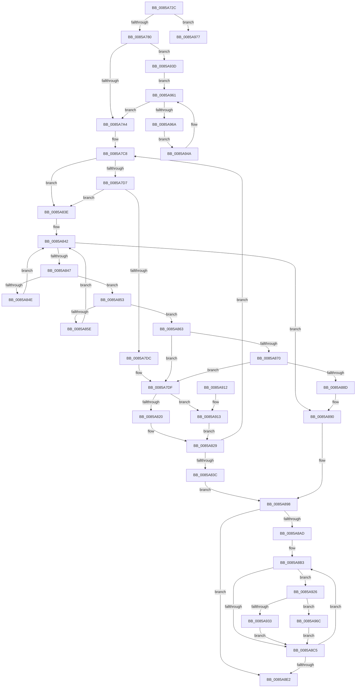

# HvFreeCell

- RVA: `0x0085A72C`–`0x0085A994` (길이 `616` bytes)
- VA: `0x000000014085A72C`
- 실행 섹션: `PAGE`
- PDB 이름 있음: `예`; PDB Function 태그: `아니요`
- unwind 정보 RVA: `0x0006ACD8`
- 디코드: `179`개 명령, `616/616` bytes 표시
- 미해석 바이트: `0` (있으면 어셈블리에 `.byte`로 보존)

> 이 문서는 커널 이미지의 기계어와 PDB 기호를 분석해 생성했습니다. 4번과 5번은 함수 원형과 자료형을 바이너리 사용 방식에서 추정한 C 해석이며 원본 소스 복구 결과는 아닙니다.

## 1. Dependencies

- 직접 호출 지점: **11**; 고유 호출 대상: **10**
- 직접 호출자로 확인된 함수: **43**
- RIP 상대 이미지 참조: **0**

### Outgoing calls
- `0x0085A75C` → [HvpGetBinContextInitialize](../../pagecmrc/BC/HvpGetBinContextInitialize_function_00BC98D0.md) (function, `0x00BC98D0`)
- `0x0085A764` → [HvLockHiveWriter](HvLockHiveWriter_function_00859894.md) (function, `0x00859894`)
- `0x0085A76F` → [HvpGetCellMap](../../pagecmrc/BC/HvpGetCellMap_function_00BC9710.md) (function, `0x00BC9710`)
- `0x0085A792` → [HvpMapEntryGetBinAddress](../../pagecmrc/BC/HvpMapEntryGetBinAddress_function_00BC9770.md) (function, `0x00BC9770`)
- `0x0085A7F6` → [HvpDelistFreeCell](HvpDelistFreeCell_function_0085A99C.md) (function, `0x0085A99C`)
- `0x0085A880` → [HvpMarkCellDirty](HvpMarkCellDirty_function_00858080.md) (function, `0x00858080`)
- `0x0085A8D3` → [HvpRemoveFreeCellHint](HvpRemoveFreeCellHint_function_0085A270.md) (function, `0x0085A270`)
- `0x0085A8ED` → [HvpEnlistFreeCell](HvpEnlistFreeCell_function_0085A430.md) (function, `0x0085A430`)
- `0x0085A8F5` → [HvUnlockHiveWriter](HvUnlockHiveWriter_function_008598E4.md) (function, `0x008598E4`)
- `0x0085A950` → [HvpGetCellMap](../../pagecmrc/BC/HvpGetCellMap_function_00BC9710.md) (function, `0x00BC9710`)
- `0x0085A98E` → [KeBugCheckEx](../../text/4F/KeBugCheckEx_function_004FD660.md) (function, `0x004FD660`)

### Direct callers
- [sub_006F98D4](../../text/6F/Unknown_function_006F98D4.md) at `0x006F98E8`
- [CmRenameKey](../7E/CmRenameKey_function_007E8F48.md) at `0x007E9D87`
- [CmRenameKey](../7E/CmRenameKey_function_007E8F48.md) at `0x007EA118`
- [CmpFreeKeyValueList](../7F/CmpFreeKeyValueList_function_007F2250.md) at `0x007F22BF`
- [CmpSyncKeyValues](../7F/CmpSyncKeyValues_function_007F2DF4.md) at `0x007F3086`
- [CmpRemoveSubKeyCellNoCellRef](../7F/CmpRemoveSubKeyCellNoCellRef_function_007F3284.md) at `0x007F3499`
- [CmpRemoveSubKeyCellNoCellRef](../7F/CmpRemoveSubKeyCellNoCellRef_function_007F3284.md) at `0x007F34CE`
- [CmpDuplicateIndex](../84/CmpDuplicateIndex_function_008420C0.md) at `0x00842279`
- [CmSetValueKey](../84/CmSetValueKey_function_008457C0.md) at `0x008467C7`
- [CmDeleteValueKey](../84/CmDeleteValueKey_function_008476E8.md) at `0x0084817A`
- [CmpFreeKeyBody](../84/CmpFreeKeyBody_function_00849ECC.md) at `0x00849F37`
- [CmpFreeKeyBody](../84/CmpFreeKeyBody_function_00849ECC.md) at `0x00849F6A`
- [CmpFreeKeyBody](../84/CmpFreeKeyBody_function_00849ECC.md) at `0x00849F74`
- [CmpRemoveSubKeyFromList](../84/CmpRemoveSubKeyFromList_function_0084A030.md) at `0x0084A2D1`
- [CmpFreeKeyByCell](../84/CmpFreeKeyByCell_function_0084AD70.md) at `0x0084AF36`
- [CmpFreeValue](../84/CmpFreeValue_function_0084AF98.md) at `0x0084AFFF`
- [CmpFreeValueData](../84/CmpFreeValueData_function_0084B040.md) at `0x0084B098`
- [CmpFreeValueData](../84/CmpFreeValueData_function_0084B040.md) at `0x0084B140`
- [CmpFreeValueData](../84/CmpFreeValueData_function_0084B040.md) at `0x0084B165`
- [CmpSetValueKeyExisting](../84/CmpSetValueKeyExisting_function_0084B53C.md) at `0x0084B8FB`
- [CmpAddSubKeyEx](../84/CmpAddSubKeyEx_function_0084C940.md) at `0x0084CCC3`
- [CmpAddValueKeyNew](CmpAddValueKeyNew_function_0085AA58.md) at `0x0085ABB5`
- [CmpCopyKeyPartial](CmpCopyKeyPartial_function_0085AFF4.md) at `0x0085B43F`
- [CmpCopyKeyPartial](CmpCopyKeyPartial_function_0085AFF4.md) at `0x0085B44F`
- [HvReallocateCell](HvReallocateCell_function_0085B5D0.md) at `0x0085B709`
- [CmpCopyValue](CmpCopyValue_function_0085B798.md) at `0x0085BB31`
- [CmpAddToLeaf](CmpAddToLeaf_function_0085BC2C.md) at `0x0085BDCB`
- [CmpAddToLeaf](CmpAddToLeaf_function_0085BC2C.md) at `0x0085BF67`
- [CmpTransMgrFreeVolatileData](../87/CmpTransMgrFreeVolatileData_function_00874BDC.md) at `0x00874D5F`
- [CmpConcatenateValueLists](../8B/CmpConcatenateValueLists_function_008B0ECC.md) at `0x008B0FF8`
- [CmpFullPromoteSingleKeyFromKeyNodeStacks](../8B/CmpFullPromoteSingleKeyFromKeyNodeStacks_function_008B1A40.md) at `0x008B1DA9`
- [CmpFullPromoteSingleKeyFromKeyNodeStacks](../8B/CmpFullPromoteSingleKeyFromKeyNodeStacks_function_008B1A40.md) at `0x008B1EC1`
- [CmpFullPromoteSingleKeyFromKeyNodeStacks](../8B/CmpFullPromoteSingleKeyFromKeyNodeStacks_function_008B1A40.md) at `0x008B1EE3`
- [CmpFullPromoteSingleKeyFromKeyNodeStacks](../8B/CmpFullPromoteSingleKeyFromKeyNodeStacks_function_008B1A40.md) at `0x008B1EF3`
- [CmpCreateChild](../94/CmpCreateChild_function_0094817C.md) at `0x00949185`
- [CmpGetSecurityDescriptorNodeEx](../94/CmpGetSecurityDescriptorNodeEx_function_00949268.md) at `0x0094948F`
- [CmpSetSecurityDescriptorInfo](../94/CmpSetSecurityDescriptorInfo_function_00949688.md) at `0x00949C5B`
- [CmpSetSecurityDescriptorInfo](../94/CmpSetSecurityDescriptorInfo_function_00949688.md) at `0x00949D62`
- [CmpSetSecurityDescriptorInfo](../94/CmpSetSecurityDescriptorInfo_function_00949688.md) at `0x00949DD4`
- [CmpUndoDeleteKeyForTrans](../94/CmpUndoDeleteKeyForTrans_function_0094A728.md) at `0x0094ABCA`
- [CmpRemoveValueFromList](../A0/CmpRemoveValueFromList_function_00A0F6D4.md) at `0x00A0F703`
- [CmpLightWeightCreateSetValueData](../A0/CmpLightWeightCreateSetValueData_function_00A0F7EC.md) at `0x00A0F928`
- [CmpSetValueDataNew](../A2/CmpSetValueDataNew_function_00A26550.md) at `0x00A267D9`
- [CmpSetValueDataNew](../A2/CmpSetValueDataNew_function_00A26550.md) at `0x00A2682E`
- [CmpLightWeightCleanupSetValueKeyUoW](../A3/CmpLightWeightCleanupSetValueKeyUoW_function_00A3A114.md) at `0x00A3A132`
- [CmpSplitLeaf](../A7/CmpSplitLeaf_function_00A7C7E0.md) at `0x00A7CB29`
- [CmpFreeKeyValues](../A8/CmpFreeKeyValues_function_00A8B3E4.md) at `0x00A8B484`
- [CmpFreeKeyValues](../A8/CmpFreeKeyValues_function_00A8B3E4.md) at `0x00A8B49C`
- [CmpFreeIndexByCell](../AA/CmpFreeIndexByCell_function_00AA6F0C.md) at `0x00AA6F68`
- [CmpCreateHiveRootCell](../AB/CmpCreateHiveRootCell_function_00ABF568.md) at `0x00ABF819`
- [sub_00B16760](../B1/Unknown_function_00B16760.md) at `0x00B1676E`
- [sub_00B16D42](../B1/Unknown_function_00B16D42.md) at `0x00B16D58`
- [sub_00B16D42](../B1/Unknown_function_00B16D42.md) at `0x00B16D8C`
- [sub_00B258D8](../B2/Unknown_function_00B258D8.md) at `0x00B25C36`
- [sub_00B25C42](../B2/Unknown_function_00B25C42.md) at `0x00B25D00`
- [sub_00B28CCC](../B2/Unknown_function_00B28CCC.md) at `0x00B28CE4`
- [sub_00B37E2A](../B3/Unknown_function_00B37E2A.md) at `0x00B37E38`
- [sub_00B41CEA](../B4/Unknown_function_00B41CEA.md) at `0x00B41D87`
- [sub_00B49EE8](../B4/Unknown_function_00B49EE8.md) at `0x00B49EEF`

### Static image references
- 디코드된 RIP-relative 메모리 참조가 없습니다.

## 2. Other-region calls and transfers

- 다른 실행 섹션으로 향하는 call: **5**
  - `0x0085A75C` → [HvpGetBinContextInitialize](../../pagecmrc/BC/HvpGetBinContextInitialize_function_00BC98D0.md) (`PAGE` → `PAGECMRC`)
  - `0x0085A76F` → [HvpGetCellMap](../../pagecmrc/BC/HvpGetCellMap_function_00BC9710.md) (`PAGE` → `PAGECMRC`)
  - `0x0085A792` → [HvpMapEntryGetBinAddress](../../pagecmrc/BC/HvpMapEntryGetBinAddress_function_00BC9770.md) (`PAGE` → `PAGECMRC`)
  - `0x0085A950` → [HvpGetCellMap](../../pagecmrc/BC/HvpGetCellMap_function_00BC9710.md) (`PAGE` → `PAGECMRC`)
  - `0x0085A98E` → [KeBugCheckEx](../../text/4F/KeBugCheckEx_function_004FD660.md) (`PAGE` → `.text`)
- 별도 외부 분기/꼬리 이동을 확인하지 못했습니다.

## 3. Assembly (complete function range)

```asm
0085A72C  48 8B C4                        mov rax, rsp
0085A72F  48 89 58 08                     mov qword ptr [rax + 8], rbx
0085A733  55                              push rbp
0085A734  56                              push rsi
0085A735  57                              push rdi
0085A736  41 54                           push r12
0085A738  41 55                           push r13
0085A73A  41 56                           push r14
0085A73C  41 57                           push r15
0085A73E  48 83 EC 40                     sub rsp, 0x40
0085A742  45 33 ED                        xor r13d, r13d
0085A745  44 8B FA                        mov r15d, edx
0085A748  48 8B E9                        mov rbp, rcx
0085A74B  66 44 89 68 18                  mov word ptr [rax + 0x18], r13w
0085A750  48 8D 48 18                     lea rcx, [rax + 0x18]
0085A754  44 89 AC 24 98 00 00 00         mov dword ptr [rsp + 0x98], r13d
0085A75C  E8 6F F1 36 00                  call 0x140bc98d0
0085A761  48 8B CD                        mov rcx, rbp
0085A764  E8 2B F1 FF FF                  call 0x140859894
0085A769  41 8B D7                        mov edx, r15d
0085A76C  48 8B CD                        mov rcx, rbp
0085A76F  E8 9C EF 36 00                  call 0x140bc9710
0085A774  4C 8B D0                        mov r10, rax
0085A777  48 85 C0                        test rax, rax
0085A77A  0F 84 F7 01 00 00               je 0x14085a977
0085A780  45 8B F7                        mov r14d, r15d
0085A783  4C 8D 84 24 90 00 00 00         lea r8, [rsp + 0x90]
0085A78B  48 8B D0                        mov rdx, rax
0085A78E  41 C1 EE 1F                     shr r14d, 0x1f
0085A792  E8 D9 EF 36 00                  call 0x140bc9770
0085A797  F6 42 08 04                     test byte ptr [rdx + 8], 4
0085A79B  48 8B F0                        mov rsi, rax
0085A79E  0F 85 99 01 00 00               jne 0x14085a93d
0085A7A4  41 8B DF                        mov ebx, r15d
0085A7A7  45 8B E6                        mov r12d, r14d
0085A7AA  81 E3 FF 0F 00 00               and ebx, 0xfff
0085A7B0  49 03 1A                        add rbx, qword ptr [r10]
0085A7B3  48 03 DE                        add rbx, rsi
0085A7B6  8B 03                           mov eax, dword ptr [rbx]
0085A7B8  F7 D8                           neg eax
0085A7BA  41 C1 E4 1F                     shl r12d, 0x1f
0085A7BE  44 89 A4 24 90 00 00 00         mov dword ptr [rsp + 0x90], r12d
0085A7C6  89 03                           mov dword ptr [rbx], eax
0085A7C8  48 63 3B                        movsxd rdi, dword ptr [rbx]
0085A7CB  48 03 FB                        add rdi, rbx
0085A7CE  8B C7                           mov eax, edi
0085A7D0  2B C6                           sub eax, esi
0085A7D2  3B 46 08                        cmp eax, dword ptr [rsi + 8]
0085A7D5  73 67                           jae 0x14085a83e
0085A7D7  44 39 2F                        cmp dword ptr [rdi], r13d
0085A7DA  7E 62                           jle 0x14085a83e
0085A7DC  4C 8B EF                        mov r13, rdi
0085A7DF  8B 56 04                        mov edx, dword ptr [rsi + 4]
0085A7E2  45 8B E6                        mov r12d, r14d
0085A7E5  2B D6                           sub edx, esi
0085A7E7  41 C1 E4 1F                     shl r12d, 0x1f
0085A7EB  41 03 D4                        add edx, r12d
0085A7EE  45 8B C6                        mov r8d, r14d
0085A7F1  03 D7                           add edx, edi
0085A7F3  48 8B CD                        mov rcx, rbp
0085A7F6  E8 A1 01 00 00                  call 0x14085a99c
0085A7FB  44 8B 84 24 98 00 00 00         mov r8d, dword ptr [rsp + 0x98]
0085A803  41 8B 55 00                     mov edx, dword ptr [r13]
0085A807  45 8B C8                        mov r9d, r8d
0085A80A  8B 0B                           mov ecx, dword ptr [rbx]
0085A80C  41 FF C0                        inc r8d
0085A80F  44 89 84 24 98 00 00 00         mov dword ptr [rsp + 0x98], r8d
0085A817  4C 3B EB                        cmp r13, rbx
0085A81A  0F 86 F3 00 00 00               jbe 0x14085a913
0085A820  8D 04 0A                        lea eax, [rdx + rcx]
0085A823  89 03                           mov dword ptr [rbx], eax
0085A825  42 8D 04 39                     lea eax, [rcx + r15]
0085A829  45 33 ED                        xor r13d, r13d
0085A82C  42 89 54 8C 30                  mov dword ptr [rsp + r9*4 + 0x30], edx
0085A831  42 89 44 8C 38                  mov dword ptr [rsp + r9*4 + 0x38], eax
0085A836  41 83 F8 02                     cmp r8d, 2
0085A83A  72 8C                           jb 0x14085a7c8
0085A83C  EB 5A                           jmp 0x14085a898
0085A83E  48 8D 7E 20                     lea rdi, [rsi + 0x20]
0085A842  48 3B FB                        cmp rdi, rbx
0085A845  73 49                           jae 0x14085a890
0085A847  48 63 07                        movsxd rax, dword ptr [rdi]
0085A84A  85 C0                           test eax, eax
0085A84C  7F 05                           jg 0x14085a853
0085A84E  48 2B F8                        sub rdi, rax
0085A851  EB EF                           jmp 0x14085a842
0085A853  48 63 0F                        movsxd rcx, dword ptr [rdi]
0085A856  48 03 CF                        add rcx, rdi
0085A859  48 3B CB                        cmp rcx, rbx
0085A85C  74 05                           je 0x14085a863
0085A85E  48 8B F9                        mov rdi, rcx
0085A861  EB DF                           jmp 0x14085a842
0085A863  4C 8B EF                        mov r13, rdi
0085A866  41 83 FE 01                     cmp r14d, 1
0085A86A  0F 84 6F FF FF FF               je 0x14085a7df
0085A870  8B 56 04                        mov edx, dword ptr [rsi + 4]
0085A873  45 33 C9                        xor r9d, r9d
0085A876  2B D6                           sub edx, esi
0085A878  41 B0 01                        mov r8b, 1
0085A87B  03 D7                           add edx, edi
0085A87D  48 8B CD                        mov rcx, rbp
0085A880  E8 FB D7 FF FF                  call 0x140858080
0085A885  85 C0                           test eax, eax
0085A887  0F 89 52 FF FF FF               jns 0x14085a7df
0085A88D  45 33 ED                        xor r13d, r13d
0085A890  44 8B A4 24 90 00 00 00         mov r12d, dword ptr [rsp + 0x90]
0085A898  8B 7E 04                        mov edi, dword ptr [rsi + 4]
0085A89B  8B 84 24 98 00 00 00            mov eax, dword ptr [rsp + 0x98]
0085A8A2  2B FE                           sub edi, esi
0085A8A4  03 FB                           add edi, ebx
0085A8A6  41 03 FC                        add edi, r12d
0085A8A9  85 C0                           test eax, eax
0085A8AB  74 35                           je 0x14085a8e2
0085A8AD  49 8B F5                        mov rsi, r13
0085A8B0  44 8B F8                        mov r15d, eax
0085A8B3  44 8B 44 34 30                  mov r8d, dword ptr [rsp + rsi + 0x30]
0085A8B8  41 C1 E8 03                     shr r8d, 3
0085A8BC  41 FF C8                        dec r8d
0085A8BF  41 83 F8 10                     cmp r8d, 0x10
0085A8C3  73 61                           jae 0x14085a926
0085A8C5  8B 54 34 38                     mov edx, dword ptr [rsp + rsi + 0x38]
0085A8C9  45 8B CE                        mov r9d, r14d
0085A8CC  48 8B CD                        mov rcx, rbp
0085A8CF  89 7C 24 20                     mov dword ptr [rsp + 0x20], edi
0085A8D3  E8 98 F9 FF FF                  call 0x14085a270
0085A8D8  48 83 C6 04                     add rsi, 4
0085A8DC  49 83 EF 01                     sub r15, 1
0085A8E0  75 D1                           jne 0x14085a8b3
0085A8E2  44 8B 03                        mov r8d, dword ptr [rbx]
0085A8E5  45 8B CE                        mov r9d, r14d
0085A8E8  8B D7                           mov edx, edi
0085A8EA  48 8B CD                        mov rcx, rbp
0085A8ED  E8 3E FB FF FF                  call 0x14085a430
0085A8F2  48 8B CD                        mov rcx, rbp
0085A8F5  E8 EA EF FF FF                  call 0x1408598e4
0085A8FA  48 8B 9C 24 80 00 00 00         mov rbx, qword ptr [rsp + 0x80]
0085A902  48 83 C4 40                     add rsp, 0x40
0085A906  41 5F                           pop r15
0085A908  41 5E                           pop r14
0085A90A  41 5D                           pop r13
0085A90C  41 5C                           pop r12
0085A90E  5F                              pop rdi
0085A90F  5E                              pop rsi
0085A910  5D                              pop rbp
0085A911  C3                              ret
0085A912  CC                              int3
0085A913  03 CA                           add ecx, edx
0085A915  41 8B C7                        mov eax, r15d
0085A918  41 89 4D 00                     mov dword ptr [r13], ecx
0085A91C  2B C2                           sub eax, edx
0085A91E  49 8B DD                        mov rbx, r13
0085A921  E9 03 FF FF FF                  jmp 0x14085a829
0085A926  41 C1 E8 04                     shr r8d, 4
0085A92A  41 81 F8 FF 00 00 00            cmp r8d, 0xff
0085A931  77 39                           ja 0x14085a96c
0085A933  45 0F BD C0                     bsr r8d, r8d
0085A937  41 83 C0 10                     add r8d, 0x10
0085A93B  EB 88                           jmp 0x14085a8c5
0085A93D  44 8B 58 08                     mov r11d, dword ptr [rax + 8]
0085A941  44 8B 40 04                     mov r8d, dword ptr [rax + 4]
0085A945  45 03 D8                        add r11d, r8d
0085A948  EB 17                           jmp 0x14085a961
0085A94A  41 8B D0                        mov edx, r8d
0085A94D  48 8B CD                        mov rcx, rbp
0085A950  E8 BB ED 36 00                  call 0x140bc9710
0085A955  48 83 60 08 FB                  and qword ptr [rax + 8], 0xfffffffffffffffb
0085A95A  41 81 C0 00 10 00 00            add r8d, 0x1000
0085A961  45 3B C3                        cmp r8d, r11d
0085A964  0F 83 3A FE FF FF               jae 0x14085a7a4
0085A96A  EB DE                           jmp 0x14085a94a
0085A96C  41 B8 17 00 00 00               mov r8d, 0x17
0085A972  E9 4E FF FF FF                  jmp 0x14085a8c5
0085A977  BA 01 00 00 00                  mov edx, 1
0085A97C  48 C7 44 24 20 BE 06 00 00      mov qword ptr [rsp + 0x20], 0x6be
0085A985  4D 8B CF                        mov r9, r15
0085A988  4C 8B C5                        mov r8, rbp
0085A98B  8D 4A 50                        lea ecx, [rdx + 0x50]
0085A98E  E8 CD 2C CA FF                  call 0x1404fd660
0085A993  CC                              int3
```

## 4. C-style interpretation (structured pseudocode)

```c
__int64 __fastcall HvFreeCell(__int64 a1, int a2)
{
    __int64 result;
    __int64 v_r11;
    __int64 v_r12;
    __int64 v_r13;
    __int64 v_r14;
    __int64 v_r15;
    __int64 v_rbx;
    __int64 v_rdi;
    __int64 v_rsi;
    __int64 v_rsp;
    unsigned int v_stack_m58;
    unsigned __int64 v_stack_p18;
    unsigned int v_stack_p20;
    unsigned __int64 v_stack_p8;

    *(unsigned __int64 *)(v_rsp + 8) = v_rbx;
    v_rsp = (v_rsp) - (64);
    v_r13 = 0;
    *(unsigned __int16 *)(v_rsp + 24) = 0;
    v_stack_p20 = 0;
    result = HvpGetBinContextInitialize(v_rsp + 24, a2, a3, a4);
    result = HvLockHiveWriter(a1, a2, a3, a4);
    result = HvpGetCellMap(a1, (unsigned int)((unsigned int)((unsigned int)(a2))), a3, a4);
    if (result == 0) goto loc_0085A977;
    v_r14 = (unsigned int)(((unsigned int)((unsigned int)((unsigned int)(a2)))) >> (31));
    result = HvpMapEntryGetBinAddress(a1, result, v_stack_p18, a4);
    if (((*(unsigned __int8 *)(result + 8)) & (4)) != 0) goto loc_0085A93D;
loc_0085A7A4:
    v_rbx = (unsigned int)(((unsigned int)((unsigned int)((unsigned int)(a2)))) & (0xFFFULL));
    v_rbx = (v_rbx) + (*(unsigned __int64 *)(result));
    v_rbx = (v_rbx) + (result);
    result = (unsigned int)(-((unsigned int)(*(unsigned int *)(v_rbx))));
    v_r12 = (unsigned int)(((unsigned int)((unsigned int)(v_r14))) << (31));
    v_stack_p18 = (unsigned int)(v_r12);
    *(unsigned int *)(v_rbx) = (unsigned int)(result);
loc_0085A7C8:
    v_rdi = ((int)(*(unsigned int *)(v_rbx))) + (v_rbx);
    result = (unsigned int)(((unsigned int)((unsigned int)(v_rdi))) - ((unsigned int)(result)));
    if (((unsigned int)(result)) >= (*(unsigned int *)(result + 8))) goto loc_0085A83E;
    if ((*(unsigned int *)(v_rdi)) <= 0) goto loc_0085A83E;
loc_0085A7DF:
    a2 = (unsigned int)(((unsigned int)(*(unsigned int *)(result + 4))) - ((unsigned int)(result)));
    v_r12 = (unsigned int)(((unsigned int)((unsigned int)(v_r14))) << (31));
    a2 = (unsigned int)((a2) + ((unsigned int)(v_r12)));
    a2 = (unsigned int)((a2) + ((unsigned int)(v_rdi)));
    result = HvpDelistFreeCell(a1, a2, (unsigned int)((unsigned int)(v_r14)), a4);
    a3 = (unsigned int)(((unsigned int)(v_stack_p20)) + 1);
    v_stack_p20 = (unsigned int)(a3);
    if (v_rdi <= v_rbx) goto loc_0085A913;
    *(unsigned int *)(v_rbx) = (unsigned int)((unsigned int)(*(unsigned int *)(v_rdi)) + (unsigned int)(*(unsigned int *)(v_rbx)) * 1);
loc_0085A829:
    v_r13 = 0;
    *(unsigned int *)(v_rsp + (unsigned int)((unsigned int)((unsigned int)(v_stack_p20))) * 4 + 48) = (unsigned int)((unsigned int)(*(unsigned int *)(v_rdi)));
    *(unsigned int *)(v_rsp + (unsigned int)((unsigned int)((unsigned int)(v_stack_p20))) * 4 + 56) = (unsigned int)((unsigned int)(*(unsigned int *)(v_rbx)) + (unsigned int)(a2) * 1);
    if (((unsigned int)(a3)) < 2) goto loc_0085A7C8;
    goto loc_0085A898;
loc_0085A83E:
loc_0085A842:
    if ((result + 32) >= v_rbx) goto loc_0085A890;
    if (condition_is_greater) goto loc_0085A853;
    v_rdi = (result + 32) - ((int)(*(unsigned int *)(result + 32)));
    goto loc_0085A842;
loc_0085A853:
    a1 = ((int)(*(unsigned int *)(v_rdi))) + (v_rdi);
    if (a1 == v_rbx) goto loc_0085A863;
    goto loc_0085A842;
loc_0085A863:
    if (((unsigned int)(v_r14)) == 1) goto loc_0085A7DF;
    a4 = 0;
    a2 = (unsigned int)(((unsigned int)(*(unsigned int *)(result + 4))) - ((unsigned int)(result)));
    a2 = (unsigned int)((a2) + ((unsigned int)(a1)));
    result = HvpMarkCellDirty(a1, a2, 1, a4);
    if (!sign_flag) goto loc_0085A7DF;
    v_r13 = 0;
loc_0085A890:
loc_0085A898:
    v_rdi = (unsigned int)(((unsigned int)(*(unsigned int *)(result + 4))) - ((unsigned int)(result)));
    v_rdi = (unsigned int)((v_rdi) + ((unsigned int)(v_rbx)));
    v_rdi = (unsigned int)((v_rdi) + ((unsigned int)((unsigned int)(v_stack_p18))));
    if ((unsigned int)((unsigned int)(v_stack_p20)) == 0) goto loc_0085A8E2;
loc_0085A8B3:
    a3 = (unsigned int)(((unsigned int)(*(unsigned int *)(v_rsp + 0 * 1 + 48))) >> (3));
    a3 = (unsigned int)((a3) - 1);
    if (((unsigned int)(a3)) >= 16) goto loc_0085A926;
loc_0085A8C5:
    v_stack_m58 = (unsigned int)(v_rdi);
    result = HvpRemoveFreeCellHint(a1, (unsigned int)(*(unsigned int *)(v_rsp + 0 * 1 + 56)), a3, (unsigned int)((unsigned int)(v_r14)));
    v_rsi = (0) + (4);
    v_r15 = ((unsigned int)((unsigned int)((unsigned int)(v_stack_p20)))) - (1);
    if (condition_is_not_equal) goto loc_0085A8B3;
loc_0085A8E2:
    result = HvpEnlistFreeCell(a1, (unsigned int)((unsigned int)(v_rdi)), (unsigned int)(*(unsigned int *)(v_rbx)), (unsigned int)((unsigned int)(v_r14)));
    result = HvUnlockHiveWriter(a1, (unsigned int)((unsigned int)(v_rdi)), (unsigned int)(*(unsigned int *)(v_rbx)), (unsigned int)((unsigned int)(v_r14)));
    v_rsp = (v_rsp) + (64);
    return result;
loc_0085A913:
    a1 = (unsigned int)((a1) + ((unsigned int)((unsigned int)((unsigned int)(v_rdi)))));
    *(unsigned int *)(v_r13) = (unsigned int)(a1);
    result = (unsigned int)(((unsigned int)((unsigned int)(v_r15))) - ((unsigned int)((unsigned int)((unsigned int)(v_rdi)))));
    goto loc_0085A829;
loc_0085A926:
    a3 = (unsigned int)(((unsigned int)(*(unsigned int *)(v_rbx))) >> (4));
    if (((unsigned int)(a3)) > 255) goto loc_0085A96C;
    a3 = (unsigned int)((a3) + (16));
    goto loc_0085A8C5;
loc_0085A93D:
    v_r11 = (unsigned int)(((unsigned int)(*(unsigned int *)(result + 8))) + ((unsigned int)((unsigned int)(*(unsigned int *)(result + 4)))));
    goto loc_0085A961;
loc_0085A94A:
    result = HvpGetCellMap(a1, (unsigned int)((unsigned int)((unsigned int)(*(unsigned int *)(result + 4)))), (unsigned int)(*(unsigned int *)(result + 4)), (unsigned int)((unsigned int)(v_r14)));
    a3 = (unsigned int)(((unsigned int)(*(unsigned int *)(result + 4))) + (0x1000ULL));
loc_0085A961:
    if (((unsigned int)(a3)) >= ((unsigned int)(v_r11))) goto loc_0085A7A4;
    goto loc_0085A94A;
loc_0085A96C:
    goto loc_0085A8C5;
loc_0085A977:
    v_stack_p20 = 0x6BEULL;
    result = KeBugCheckEx(1 + 80, 1, a1, v_r15);
    return result;
}
```

## 5. (Beta) C Style

```c
int64_t HvFreeCell(int64_t Arg1, void *Arg2)
{
    uint8_t *arg2 = (uint8_t *)Arg2;

    int64_t result;
    int64_t local_r11;
    int64_t local_r12;
    int64_t local_r13;
    int64_t local_r14;
    int64_t local_r15;
    int64_t local_rbx;
    int64_t local_rdi;
    int64_t local_rsi;
    int64_t local_rsp;
    uint32_t v_stack_m58;
    uint64_t v_stack_p18;
    uint32_t v_stack_p20;
    uint64_t v_stack_p8;

    *(uint64_t *)(local_rsp + 0x8) = local_rbx;
    local_rsp = (local_rsp) - (64);
    local_r13 = 0;
    *(uint16_t *)(local_rsp + 0x18) = 0;
    v_stack_p20 = 0;
    result = HvpGetBinContextInitialize(local_rsp + 24, Arg2, a3, a4);
    result = HvLockHiveWriter(Arg1, Arg2, a3, a4);
    result = HvpGetCellMap(Arg1, (uint32_t)((uint32_t)((uint32_t)(Arg2))), a3, a4);
    if (result == 0) goto loc_0085A977;
    local_r14 = (uint32_t)(((uint32_t)((uint32_t)((uint32_t)(Arg2)))) >> (31));
    result = HvpMapEntryGetBinAddress(Arg1, result, v_stack_p18, a4);
    if (((*(uint8_t *)(result + 0x8)) & (4)) != 0) goto loc_0085A93D;
loc_0085A7A4:
    local_rbx = (uint32_t)(((uint32_t)((uint32_t)((uint32_t)(Arg2)))) & (0xFFFULL));
    local_rbx = (local_rbx) + (*(uint64_t *)(result));
    local_rbx = (local_rbx) + (result);
    result = (uint32_t)(-((uint32_t)(*(uint32_t *)(local_rbx))));
    local_r12 = (uint32_t)(((uint32_t)((uint32_t)(local_r14))) << (31));
    v_stack_p18 = (uint32_t)(local_r12);
    *(uint32_t *)(local_rbx) = (uint32_t)(result);
loc_0085A7C8:
    local_rdi = ((int32_t)(*(uint32_t *)(local_rbx))) + (local_rbx);
    result = (uint32_t)(((uint32_t)((uint32_t)(local_rdi))) - ((uint32_t)(result)));
    if (((uint32_t)(result)) >= (*(uint32_t *)(result + 0x8))) goto loc_0085A83E;
    if ((*(uint32_t *)(local_rdi)) <= 0) goto loc_0085A83E;
loc_0085A7DF:
    Arg2 = (uint32_t)(((uint32_t)(*(uint32_t *)(result + 0x4))) - ((uint32_t)(result)));
    local_r12 = (uint32_t)(((uint32_t)((uint32_t)(local_r14))) << (31));
    Arg2 = (uint32_t)((Arg2) + ((uint32_t)(local_r12)));
    Arg2 = (uint32_t)((Arg2) + ((uint32_t)(local_rdi)));
    result = HvpDelistFreeCell(Arg1, Arg2, (uint32_t)((uint32_t)(local_r14)), a4);
    a3 = (uint32_t)(((uint32_t)(v_stack_p20)) + 1);
    v_stack_p20 = (uint32_t)(a3);
    if (local_rdi <= local_rbx) goto loc_0085A913;
    *(uint32_t *)(local_rbx) = (uint32_t)((uint32_t)(*(uint32_t *)(local_rdi)) + (uint32_t)(*(uint32_t *)(local_rbx)) * 1);
loc_0085A829:
    local_r13 = 0;
    *(uint32_t *)(local_rsp + (uint32_t)((uint32_t)((uint32_t)(v_stack_p20))) * 4 + 0x30) = (uint32_t)((uint32_t)(*(uint32_t *)(local_rdi)));
    *(uint32_t *)(local_rsp + (uint32_t)((uint32_t)((uint32_t)(v_stack_p20))) * 4 + 0x38) = (uint32_t)((uint32_t)(*(uint32_t *)(local_rbx)) + (uint32_t)(Arg2) * 1);
    if (((uint32_t)(a3)) < 2) goto loc_0085A7C8;
    goto loc_0085A898;
loc_0085A83E:
loc_0085A842:
    if ((result + 32) >= local_rbx) goto loc_0085A890;
    if (condition_is_greater) goto loc_0085A853;
    local_rdi = (result + 32) - ((int32_t)(*(uint32_t *)(result + 0x20)));
    goto loc_0085A842;
loc_0085A853:
    Arg1 = ((int32_t)(*(uint32_t *)(local_rdi))) + (local_rdi);
    if (Arg1 == local_rbx) goto loc_0085A863;
    goto loc_0085A842;
loc_0085A863:
    if (((uint32_t)(local_r14)) == 1) goto loc_0085A7DF;
    a4 = 0;
    Arg2 = (uint32_t)(((uint32_t)(*(uint32_t *)(result + 0x4))) - ((uint32_t)(result)));
    Arg2 = (uint32_t)((Arg2) + ((uint32_t)(Arg1)));
    result = HvpMarkCellDirty(Arg1, Arg2, 1, a4);
    if (!sign_flag) goto loc_0085A7DF;
    local_r13 = 0;
loc_0085A890:
loc_0085A898:
    local_rdi = (uint32_t)(((uint32_t)(*(uint32_t *)(result + 0x4))) - ((uint32_t)(result)));
    local_rdi = (uint32_t)((local_rdi) + ((uint32_t)(local_rbx)));
    local_rdi = (uint32_t)((local_rdi) + ((uint32_t)((uint32_t)(v_stack_p18))));
    if ((uint32_t)((uint32_t)(v_stack_p20)) == 0) goto loc_0085A8E2;
loc_0085A8B3:
    a3 = (uint32_t)(((uint32_t)(*(uint32_t *)(local_rsp + 0x0 * 1 + 0x30))) >> (3));
    a3 = (uint32_t)((a3) - 1);
    if (((uint32_t)(a3)) >= 16) goto loc_0085A926;
loc_0085A8C5:
    v_stack_m58 = (uint32_t)(local_rdi);
    result = HvpRemoveFreeCellHint(Arg1, (uint32_t)(*(uint32_t *)(local_rsp + 0x0 * 1 + 0x38)), a3, (uint32_t)((uint32_t)(local_r14)));
    local_rsi = (0) + (4);
    local_r15 = ((uint32_t)((uint32_t)((uint32_t)(v_stack_p20)))) - (1);
    if (condition_is_not_equal) goto loc_0085A8B3;
loc_0085A8E2:
    result = HvpEnlistFreeCell(Arg1, (uint32_t)((uint32_t)(local_rdi)), (uint32_t)(*(uint32_t *)(local_rbx)), (uint32_t)((uint32_t)(local_r14)));
    result = HvUnlockHiveWriter(Arg1, (uint32_t)((uint32_t)(local_rdi)), (uint32_t)(*(uint32_t *)(local_rbx)), (uint32_t)((uint32_t)(local_r14)));
    local_rsp = (local_rsp) + (64);
    return result;
loc_0085A913:
    Arg1 = (uint32_t)((Arg1) + ((uint32_t)((uint32_t)((uint32_t)(local_rdi)))));
    *(uint32_t *)(local_r13) = (uint32_t)(Arg1);
    result = (uint32_t)(((uint32_t)((uint32_t)(local_r15))) - ((uint32_t)((uint32_t)((uint32_t)(local_rdi)))));
    goto loc_0085A829;
loc_0085A926:
    a3 = (uint32_t)(((uint32_t)(*(uint32_t *)(local_rbx))) >> (4));
    if (((uint32_t)(a3)) > 255) goto loc_0085A96C;
    a3 = (uint32_t)((a3) + (16));
    goto loc_0085A8C5;
loc_0085A93D:
    local_r11 = (uint32_t)(((uint32_t)(*(uint32_t *)(result + 0x8))) + ((uint32_t)((uint32_t)(*(uint32_t *)(result + 0x4)))));
    goto loc_0085A961;
loc_0085A94A:
    result = HvpGetCellMap(Arg1, (uint32_t)((uint32_t)((uint32_t)(*(uint32_t *)(result + 0x4)))), (uint32_t)(*(uint32_t *)(result + 0x4)), (uint32_t)((uint32_t)(local_r14)));
    a3 = (uint32_t)(((uint32_t)(*(uint32_t *)(result + 0x4))) + (0x1000ULL));
loc_0085A961:
    if (((uint32_t)(a3)) >= ((uint32_t)(local_r11))) goto loc_0085A7A4;
    goto loc_0085A94A;
loc_0085A96C:
    goto loc_0085A8C5;
loc_0085A977:
    v_stack_p20 = 0x6BEULL;
    result = KeBugCheckEx(1 + 80, 1, Arg1, local_r15);
    return result;
}
```

### 관측된 메모리 오프셋

구조체 형식이 확인되지 않은 접근은 인자 기준의 오프셋으로만 기록했습니다.

| 기준 인자 | 오프셋 표현 | 폭 (bit) | 접근 |
|---|---:|---:|---|
| `Arg2` | `+ 0x0` | `32` | `R` |
| `Arg2` | `+ 0x0` | `32` | `W` |

## 6. Execution-region graph

[열기: 2D/3D 그래프와 함수 탐색 컨트롤 패널](../../../control-panel.html?section=page&rva=0x0085A72C&view=graph)

- 2D 그래프는 위에서 아래로 흐르고, 3D 그래프는 빈 공간을 드래그해 회전합니다. Shift+드래그는 이동, 휠은 확대·축소, 함수 노드 선택은 대상 보고서 이동입니다.

### Static fallback


