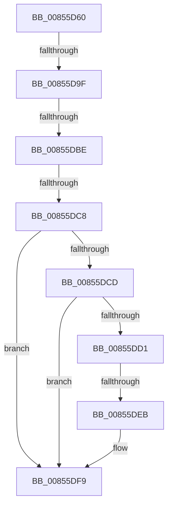

# HvIsCellAllocated

- RVA: `0x00855D60`–`0x00855DFB` (길이 `155` bytes)
- VA: `0x0000000140855D60`
- 실행 섹션: `PAGE`
- PDB 이름 있음: `예`; PDB Function 태그: `아니요`
- unwind 정보 RVA: `0x0006A308`
- 디코드: `40`개 명령, `155/155` bytes 표시
- 미해석 바이트: `0` (있으면 어셈블리에 `.byte`로 보존)

> 이 문서는 커널 이미지의 기계어와 PDB 기호를 분석해 생성했습니다. 4번과 5번은 함수 원형과 자료형을 바이너리 사용 방식에서 추정한 C 해석이며 원본 소스 복구 결과는 아닙니다.

## 1. Dependencies

- 직접 호출 지점: **3**; 고유 호출 대상: **3**
- 직접 호출자로 확인된 함수: **5**
- RIP 상대 이미지 참조: **0**

### Outgoing calls
- `0x00855D83` → [HvpGetCellContextInitialize](HvpGetCellContextInitialize_function_00855F10.md) (function, `0x00855F10`)
- `0x00855D8D` → [HvpGetBinContextInitialize](../../pagecmrc/BC/HvpGetBinContextInitialize_function_00BC98D0.md) (function, `0x00BC98D0`)
- `0x00855DF4` → [RtlClearBits](../../text/3E/RtlClearBits_function_003E1A90.md) (function, `0x003E1A90`)

### Direct callers
- [CmpValidateHiveSecurityDescriptors](../96/CmpValidateHiveSecurityDescriptors_function_0096DAFC.md) at `0x0096DB58`
- [CmpValidateHiveSecurityDescriptors](../96/CmpValidateHiveSecurityDescriptors_function_0096DAFC.md) at `0x0096DBB9`
- [CmpCheckLeaf](../96/CmpCheckLeaf_function_0096E5BC.md) at `0x0096E63E`
- [CmpCheckKey](../96/CmpCheckKey_function_0096EE2C.md) at `0x0096EEC5`
- [CmpCheckKey](../96/CmpCheckKey_function_0096EE2C.md) at `0x0096F1C3`
- [CmpCheckKey](../96/CmpCheckKey_function_0096EE2C.md) at `0x0096F495`
- [CmpCheckKey](../96/CmpCheckKey_function_0096EE2C.md) at `0x0097036C`
- [CmpCheckKey](../96/CmpCheckKey_function_0096EE2C.md) at `0x00970468`
- [CmpCheckValueList](../97/CmpCheckValueList_function_00970F6C.md) at `0x00971048`
- [CmpCheckValueList](../97/CmpCheckValueList_function_00970F6C.md) at `0x00971200`
- [CmpCheckValueList](../97/CmpCheckValueList_function_00970F6C.md) at `0x00971690`
- [CmpCheckValueList](../97/CmpCheckValueList_function_00970F6C.md) at `0x00971739`
- [sub_00B28A98](../B2/Unknown_function_00B28A98.md) at `0x00B28B31`

### Static image references
- 디코드된 RIP-relative 메모리 참조가 없습니다.

## 2. Other-region calls and transfers

- 다른 실행 섹션으로 향하는 call: **2**
  - `0x00855D8D` → [HvpGetBinContextInitialize](../../pagecmrc/BC/HvpGetBinContextInitialize_function_00BC98D0.md) (`PAGE` → `PAGECMRC`)
  - `0x00855DF4` → [RtlClearBits](../../text/3E/RtlClearBits_function_003E1A90.md) (`PAGE` → `.text`)
- call이 아닌 외부 분기/꼬리 이동: **4**
  - `0x00855D99` → [sub_00855EF7 + 0x1](Unknown_function_00855EF7.md) (`tail-transfer`)
  - `0x00855DB8` → [sub_00855EF7 + 0x5](Unknown_function_00855EF7.md) (`tail-transfer`)
  - `0x00855DC2` → [sub_00855EF7 + 0x5](Unknown_function_00855EF7.md) (`tail-transfer`)
  - `0x00855DE5` → [sub_00855EF7 + 0x5](Unknown_function_00855EF7.md) (`tail-transfer`)

## 3. Assembly (complete function range)

```asm
00855D60  48 89 5C 24 18                  mov qword ptr [rsp + 0x18], rbx
00855D65  57                              push rdi
00855D66  48 83 EC 20                     sub rsp, 0x20
00855D6A  33 C0                           xor eax, eax
00855D6C  48 8B D9                        mov rbx, rcx
00855D6F  48 8D 4C 24 48                  lea rcx, [rsp + 0x48]
00855D74  48 89 44 24 48                  mov qword ptr [rsp + 0x48], rax
00855D79  66 89 44 24 30                  mov word ptr [rsp + 0x30], ax
00855D7E  4D 8B C8                        mov r9, r8
00855D81  8B FA                           mov edi, edx
00855D83  E8 88 01 00 00                  call 0x140855f10
00855D88  48 8D 4C 24 30                  lea rcx, [rsp + 0x30]
00855D8D  E8 3E 3B 37 00                  call 0x140bc98d0
00855D92  F6 83 8C 00 00 00 01            test byte ptr [rbx + 0x8c], 1
00855D99  0F 85 59 01 00 00               jne 0x140855ef8
00855D9F  C1 EA 1F                        shr edx, 0x1f
00855DA2  8B C2                           mov eax, edx
00855DA4  48 69 C8 78 02 00 00            imul rcx, rax, 0x278
00855DAB  8B C7                           mov eax, edi
00855DAD  0F BA F0 1F                     btr eax, 0x1f
00855DB1  3B 84 19 18 01 00 00            cmp eax, dword ptr [rcx + rbx + 0x118]
00855DB8  0F 83 3E 01 00 00               jae 0x140855efc
00855DBE  40 F6 C7 07                     test dil, 7
00855DC2  0F 85 34 01 00 00               jne 0x140855efc
00855DC8  4D 85 C0                        test r8, r8
00855DCB  74 2C                           je 0x140855df9
00855DCD  85 D2                           test edx, edx
00855DCF  75 28                           jne 0x140855df9
00855DD1  49 8B 40 08                     mov rax, qword ptr [r8 + 8]
00855DD5  8B D7                           mov edx, edi
00855DD7  C1 EA 03                        shr edx, 3
00855DDA  8B CA                           mov ecx, edx
00855DDC  48 0F A3 08                     bt qword ptr [rax], rcx
00855DE0  0F 92 C0                        setb al
00855DE3  84 C0                           test al, al
00855DE5  0F 84 11 01 00 00               je 0x140855efc
00855DEB  41 B8 01 00 00 00               mov r8d, 1
00855DF1  49 8B C9                        mov rcx, r9
00855DF4  E8 97 BC B8 FF                  call 0x1403e1a90
00855DF9  8B D7                           mov edx, edi
```

## 4. C-style interpretation (structured pseudocode)

```c
__int64 __fastcall HvIsCellAllocated(__int64 a1, int a2, __int64 a3)
{
    __int64 result;
    __int64 v_rsp;
    unsigned __int64 v_stack_p18;
    unsigned __int64 v_stack_p20;
    unsigned __int16 v_stack_p8;

    v_stack_p18 = v_rbx;
    v_rsp = (v_rsp) - (32);
    result = 0;
    v_stack_p20 = 0;
    v_stack_p8 = 0;
    result = HvpGetCellContextInitialize(v_stack_p20, a2, a3, a3);
    result = HvpGetBinContextInitialize(v_stack_p8, a2, a3, a3);
    a2 = (unsigned int)((a2) >> (31));
    a1 = (v_stack_p8) * ((unsigned int)(a2));
    if (a3 == 0) goto loc_00855DF9;
    if (a2 != 0) goto loc_00855DF9;
    a2 = (unsigned int)(((unsigned int)((unsigned int)((unsigned int)(a2)))) >> (3));
    result = (condition_is_below) ? 1 : 0;
    result = RtlClearBits(a3, a2, 1, a3);
loc_00855DF9:
    return result;
}
```

## 5. (Beta) C Style

```c
int64_t HvIsCellAllocated(void *Arg1, int32_t Arg2, int64_t Arg3)
{
    uint8_t *arg1 = (uint8_t *)Arg1;

    int64_t result;
    int64_t local_rsp;
    uint64_t v_stack_p18;
    uint64_t v_stack_p20;
    uint16_t v_stack_p8;

    v_stack_p18 = local_rbx;
    local_rsp = (local_rsp) - (32);
    result = 0;
    v_stack_p20 = 0;
    v_stack_p8 = 0;
    result = HvpGetCellContextInitialize(v_stack_p20, Arg2, Arg3, Arg3);
    result = HvpGetBinContextInitialize(v_stack_p8, Arg2, Arg3, Arg3);
    Arg2 = (uint32_t)((Arg2) >> (31));
    Arg1 = (v_stack_p8) * ((uint32_t)(Arg2));
    if (Arg3 == 0) goto loc_00855DF9;
    if (Arg2 != 0) goto loc_00855DF9;
    Arg2 = (uint32_t)(((uint32_t)((uint32_t)((uint32_t)(Arg2)))) >> (3));
    result = (condition_is_below) ? 1 : 0;
    result = RtlClearBits(Arg3, Arg2, 1, Arg3);
loc_00855DF9:
    return result;
}
```

### 관측된 메모리 오프셋

구조체 형식이 확인되지 않은 접근은 인자 기준의 오프셋으로만 기록했습니다.

| 기준 인자 | 오프셋 표현 | 폭 (bit) | 접근 |
|---|---:|---:|---|
| `Arg1` | `+ 0x8C` | `8` | `R` |

## 6. Execution-region graph

[열기: 2D/3D 그래프와 함수 탐색 컨트롤 패널](../../../control-panel.html?section=page&rva=0x00855D60&view=graph)

- 2D 그래프는 위에서 아래로 흐르고, 3D 그래프는 빈 공간을 드래그해 회전합니다. Shift+드래그는 이동, 휠은 확대·축소, 함수 노드 선택은 대상 보고서 이동입니다.

### Static fallback


