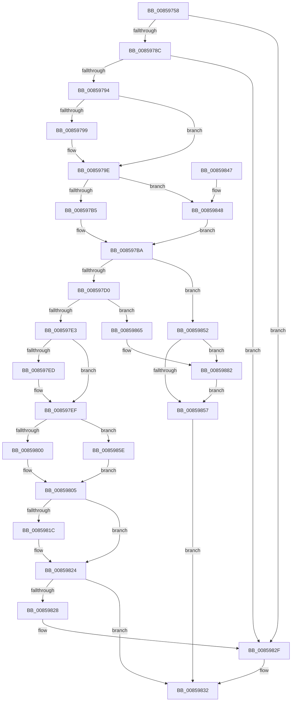

# HvMarkCellDirty

- RVA: `0x00859758`–`0x0085988C` (길이 `308` bytes)
- VA: `0x0000000140859758`
- 실행 섹션: `PAGE`
- PDB 이름 있음: `예`; PDB Function 태그: `아니요`
- unwind 정보 RVA: `0x0006AA50`
- 디코드: `89`개 명령, `308/308` bytes 표시
- 미해석 바이트: `0` (있으면 어셈블리에 `.byte`로 보존)

> 이 문서는 커널 이미지의 기계어와 PDB 기호를 분석해 생성했습니다. 4번과 5번은 함수 원형과 자료형을 바이너리 사용 방식에서 추정한 C 해석이며 원본 소스 복구 결과는 아닙니다.

## 1. Dependencies

- 직접 호출 지점: **10**; 고유 호출 대상: **9**
- 직접 호출자로 확인된 함수: **2**
- RIP 상대 이미지 참조: **0**

### Outgoing calls
- `0x00859799` → [HvLockHiveWriter](HvLockHiveWriter_function_00859894.md) (function, `0x00859894`)
- `0x008597B5` → [HvpGetCellFlat](HvpGetCellFlat_function_00854C60.md) (function, `0x00854C60`)
- `0x008597D5` → [HvpGetCellMap](../../pagecmrc/BC/HvpGetCellMap_function_00BC9710.md) (function, `0x00BC9710`)
- `0x00859800` → [HvpReleaseCellPaged](HvpReleaseCellPaged_function_00855F40.md) (function, `0x00855F40`)
- `0x00859810` → [HvpMarkDirty](HvpMarkDirty_function_008593C0.md) (function, `0x008593C0`)
- `0x0085981F` → [HvUnlockHiveWriter](HvUnlockHiveWriter_function_008598E4.md) (function, `0x008598E4`)
- `0x00859848` → [HvpGetCellPaged](HvpGetCellPaged_function_00854CB0.md) (function, `0x00854CB0`)
- `0x0085985E` → [HvpReleaseCellFlat](HvpReleaseCellFlat_function_0085CC20.md) (function, `0x0085CC20`)
- `0x0085987C` → [KeBugCheckEx](../../text/4F/KeBugCheckEx_function_004FD660.md) (function, `0x004FD660`)
- `0x00859885` → [HvUnlockHiveWriter](HvUnlockHiveWriter_function_008598E4.md) (function, `0x008598E4`)

### Direct callers
- [CmpKeySecurityMarkDirtyForReferenceCountDecrement](../../text/4D/CmpKeySecurityMarkDirtyForReferenceCountDecrement_function_004D6608.md) at `0x004D6623`
- [CmpKeySecurityMarkDirtyForReferenceCountDecrement](../../text/4D/CmpKeySecurityMarkDirtyForReferenceCountDecrement_function_004D6608.md) at `0x004D663B`
- [CmpKeySecurityMarkDirtyForReferenceCountDecrement](../../text/4D/CmpKeySecurityMarkDirtyForReferenceCountDecrement_function_004D6608.md) at `0x004D664D`
- [CmpCreateTombstone](../../text/66/CmpCreateTombstone_function_0066AF50.md) at `0x0066B0FC`

### Static image references
- 디코드된 RIP-relative 메모리 참조가 없습니다.

## 2. Other-region calls and transfers

- 다른 실행 섹션으로 향하는 call: **2**
  - `0x008597D5` → [HvpGetCellMap](../../pagecmrc/BC/HvpGetCellMap_function_00BC9710.md) (`PAGE` → `PAGECMRC`)
  - `0x0085987C` → [KeBugCheckEx](../../text/4F/KeBugCheckEx_function_004FD660.md) (`PAGE` → `.text`)
- 별도 외부 분기/꼬리 이동을 확인하지 못했습니다.

## 3. Assembly (complete function range)

```asm
00859758  48 8B C4                        mov rax, rsp
0085975B  48 89 58 10                     mov qword ptr [rax + 0x10], rbx
0085975F  48 89 68 18                     mov qword ptr [rax + 0x18], rbp
00859763  56                              push rsi
00859764  57                              push rdi
00859765  41 56                           push r14
00859767  48 83 EC 30                     sub rsp, 0x30
0085976B  83 48 08 FF                     or dword ptr [rax + 8], 0xffffffff
0085976F  45 33 F6                        xor r14d, r14d
00859772  44 89 70 0C                     mov dword ptr [rax + 0xc], r14d
00859776  41 8A F0                        mov sil, r8b
00859779  8B 81 A0 00 00 00               mov eax, dword ptr [rcx + 0xa0]
0085977F  48 8B D9                        mov rbx, rcx
00859782  8B FA                           mov edi, edx
00859784  A8 01                           test al, 1
00859786  0F 85 A3 00 00 00               jne 0x14085982f
0085978C  85 FF                           test edi, edi
0085978E  0F 88 9B 00 00 00               js 0x14085982f
00859794  45 84 C0                        test r8b, r8b
00859797  75 05                           jne 0x14085979e
00859799  E8 F6 00 00 00                  call 0x140859894
0085979E  F6 83 8C 00 00 00 01            test byte ptr [rbx + 0x8c], 1
008597A5  4C 8D 44 24 50                  lea r8, [rsp + 0x50]
008597AA  8B D7                           mov edx, edi
008597AC  48 8B CB                        mov rcx, rbx
008597AF  0F 84 93 00 00 00               je 0x140859848
008597B5  E8 A6 B4 FF FF                  call 0x140854c60
008597BA  48 8B C8                        mov rcx, rax
008597BD  48 8D 40 FC                     lea rax, [rax - 4]
008597C1  48 F7 D9                        neg rcx
008597C4  4D 1B C0                        sbb r8, r8
008597C7  4C 23 C0                        and r8, rax
008597CA  0F 84 82 00 00 00               je 0x140859852
008597D0  8B D7                           mov edx, edi
008597D2  48 8B CB                        mov rcx, rbx
008597D5  E8 36 FF 36 00                  call 0x140bc9710
008597DA  48 85 C0                        test rax, rax
008597DD  0F 84 82 00 00 00               je 0x140859865
008597E3  8D 6F FC                        lea ebp, [rdi - 4]
008597E6  41 8B 38                        mov edi, dword ptr [r8]
008597E9  85 FF                           test edi, edi
008597EB  79 02                           jns 0x1408597ef
008597ED  F7 DF                           neg edi
008597EF  F6 83 8C 00 00 00 01            test byte ptr [rbx + 0x8c], 1
008597F6  48 8D 54 24 50                  lea rdx, [rsp + 0x50]
008597FB  48 8B CB                        mov rcx, rbx
008597FE  75 5E                           jne 0x14085985e
00859800  E8 3B C7 FF FF                  call 0x140855f40
00859805  45 33 C9                        xor r9d, r9d
00859808  44 8B C7                        mov r8d, edi
0085980B  8B D5                           mov edx, ebp
0085980D  48 8B CB                        mov rcx, rbx
00859810  E8 AB FB FF FF                  call 0x1408593c0
00859815  8B F8                           mov edi, eax
00859817  40 84 F6                        test sil, sil
0085981A  75 08                           jne 0x140859824
0085981C  48 8B CB                        mov rcx, rbx
0085981F  E8 C0 00 00 00                  call 0x1408598e4
00859824  85 FF                           test edi, edi
00859826  78 0A                           js 0x140859832
00859828  C6 83 8D 00 00 00 01            mov byte ptr [rbx + 0x8d], 1
0085982F  41 8B FE                        mov edi, r14d
00859832  48 8B 5C 24 58                  mov rbx, qword ptr [rsp + 0x58]
00859837  8B C7                           mov eax, edi
00859839  48 8B 6C 24 60                  mov rbp, qword ptr [rsp + 0x60]
0085983E  48 83 C4 30                     add rsp, 0x30
00859842  41 5E                           pop r14
00859844  5F                              pop rdi
00859845  5E                              pop rsi
00859846  C3                              ret
00859847  CC                              int3
00859848  E8 63 B4 FF FF                  call 0x140854cb0
0085984D  E9 68 FF FF FF                  jmp 0x1408597ba
00859852  40 84 F6                        test sil, sil
00859855  74 2B                           je 0x140859882
00859857  BF 9A 00 00 C0                  mov edi, 0xc000009a
0085985C  EB D4                           jmp 0x140859832
0085985E  E8 BD 33 00 00                  call 0x14085cc20
00859863  EB A0                           jmp 0x140859805
00859865  BA 01 00 00 00                  mov edx, 1
0085986A  48 C7 44 24 20 A7 02 00 00      mov qword ptr [rsp + 0x20], 0x2a7
00859873  4C 8B CF                        mov r9, rdi
00859876  4C 8B C3                        mov r8, rbx
00859879  8D 4A 50                        lea ecx, [rdx + 0x50]
0085987C  E8 DF 3D CA FF                  call 0x1404fd660
00859881  CC                              int3
00859882  48 8B CB                        mov rcx, rbx
00859885  E8 5A 00 00 00                  call 0x1408598e4
0085988A  EB CB                           jmp 0x140859857
```

## 4. C-style interpretation (structured pseudocode)

```c
__int64 __fastcall HvMarkCellDirty(__int64 a1, int a2, unsigned __int8 a3, int a4)
{
    __int64 result;
    __int64 v_r14;
    __int64 v_rdi;
    __int64 v_rsp;
    unsigned __int64 v_stack_p10;
    unsigned __int64 v_stack_p18;
    unsigned __int64 v_stack_p20;
    unsigned __int64 v_stack_p8;

    *(unsigned __int64 *)(v_rsp + 16) = v_rbx;
    *(unsigned __int64 *)(v_rsp + 24) = v_rbp;
    v_rsp = (v_rsp) - (48);
    v_r14 = 0;
    *(unsigned int *)(v_rsp + 12) = 0;
    if ((((unsigned __int8)((unsigned int)(*(unsigned int *)(a1 + 160)))) & (1)) != 0) goto loc_0085982F;
    if (sign_flag) goto loc_0085982F;
    result = (unsigned int)(*(unsigned int *)(a1 + 160));
    if (a3 == 0) {
        result = HvLockHiveWriter(a1, a2, a3, a4);
    }
    if (((*(unsigned __int8 *)(a1 + 140)) & (1)) == 0) goto loc_00859848;
    result = HvpGetCellFlat(a1, (unsigned int)((unsigned int)((unsigned int)(a2))), v_stack_p8, a4);
loc_008597BA:
    a1 = -(result);
    a3 = (v_stack_p8) & (result - 4);
    if (condition_is_equal) goto loc_00859852;
    result = HvpGetCellMap(a1, (unsigned int)((unsigned int)((unsigned int)(a2))), a3, a4);
    if (result == 0) goto loc_00859865;
    v_rdi = (unsigned int)(*(unsigned int *)(a3));
    if (sign_flag) {
        v_rdi = (unsigned int)(-((unsigned int)(*(unsigned int *)(a3))));
    }
    if (((*(unsigned __int8 *)(a1 + 140)) & (1)) != 0) goto loc_0085985E;
    result = HvpReleaseCellPaged(a1, v_stack_p8, a3, a4);
loc_00859805:
    a4 = 0;
    result = HvpMarkDirty(a1, (unsigned int)((unsigned int)((unsigned int)(a2) - 4)), (unsigned int)((unsigned int)(v_rdi)), a4);
    if (a3 == 0) {
        a1 = a1;
        result = HvUnlockHiveWriter(a1, (unsigned int)((unsigned int)((unsigned int)(a2) - 4)), (unsigned int)((unsigned int)(v_rdi)), a4);
    }
    if (sign_flag) goto loc_00859832;
    *(unsigned __int8 *)(a1 + 141) = 1;
loc_0085982F:
loc_00859832:
    v_rsp = (v_rsp) + (48);
    return 0;
loc_00859848:
    result = HvpGetCellPaged(a1, (unsigned int)((unsigned int)((unsigned int)(a2) - 4)), (unsigned int)((unsigned int)(v_rdi)), a4);
    goto loc_008597BA;
loc_00859852:
    if (a3 == 0) goto loc_00859882;
loc_00859857:
    goto loc_00859832;
loc_0085985E:
    result = HvpReleaseCellFlat(a1, (unsigned int)((unsigned int)((unsigned int)(a2) - 4)), (unsigned int)((unsigned int)(v_rdi)), a4);
    goto loc_00859805;
loc_00859865:
    v_stack_p20 = 679;
    result = KeBugCheckEx(1 + 80, 1, v_stack_p10, (unsigned int)(0xC000009AULL));
loc_00859882:
    result = HvUnlockHiveWriter(v_stack_p10, 1, v_stack_p10, (unsigned int)(0xC000009AULL));
    goto loc_00859857;
}
```

## 5. (Beta) C Style

```c
int64_t HvMarkCellDirty(void *Arg1, int32_t Arg2, uint8_t Arg3, int32_t Arg4)
{
    uint8_t *arg1 = (uint8_t *)Arg1;

    int64_t result;
    int64_t local_r14;
    int64_t local_rdi;
    int64_t local_rsp;
    uint64_t v_stack_p10;
    uint64_t v_stack_p18;
    uint64_t v_stack_p20;
    uint64_t v_stack_p8;

    *(uint64_t *)(local_rsp + 0x10) = local_rbx;
    *(uint64_t *)(local_rsp + 0x18) = local_rbp;
    local_rsp = (local_rsp) - (48);
    local_r14 = 0;
    *(uint32_t *)(local_rsp + 0xC) = 0;
    if ((((uint8_t)((uint32_t)(*(uint32_t *)(arg1 + 0xA0)))) & (1)) != 0) goto loc_0085982F;
    if (sign_flag) goto loc_0085982F;
    result = (uint32_t)(*(uint32_t *)(arg1 + 0xA0));
    if (Arg3 == 0) {
        result = HvLockHiveWriter(Arg1, Arg2, Arg3, Arg4);
    }
    if (((*(uint8_t *)(arg1 + 0x8C)) & (1)) == 0) goto loc_00859848;
    result = HvpGetCellFlat(Arg1, (uint32_t)((uint32_t)((uint32_t)(Arg2))), v_stack_p8, Arg4);
loc_008597BA:
    Arg1 = -(result);
    Arg3 = (v_stack_p8) & (result - 4);
    if (condition_is_equal) goto loc_00859852;
    result = HvpGetCellMap(Arg1, (uint32_t)((uint32_t)((uint32_t)(Arg2))), Arg3, Arg4);
    if (result == 0) goto loc_00859865;
    local_rdi = (uint32_t)(*(uint32_t *)(Arg3));
    if (sign_flag) {
        local_rdi = (uint32_t)(-((uint32_t)(*(uint32_t *)(Arg3))));
    }
    if (((*(uint8_t *)(arg1 + 0x8C)) & (1)) != 0) goto loc_0085985E;
    result = HvpReleaseCellPaged(Arg1, v_stack_p8, Arg3, Arg4);
loc_00859805:
    Arg4 = 0;
    result = HvpMarkDirty(Arg1, (uint32_t)((uint32_t)((uint32_t)(Arg2) - 4)), (uint32_t)((uint32_t)(local_rdi)), Arg4);
    if (Arg3 == 0) {
        Arg1 = Arg1;
        result = HvUnlockHiveWriter(Arg1, (uint32_t)((uint32_t)((uint32_t)(Arg2) - 4)), (uint32_t)((uint32_t)(local_rdi)), Arg4);
    }
    if (sign_flag) goto loc_00859832;
    *(uint8_t *)(arg1 + 0x8D) = 1;
loc_0085982F:
loc_00859832:
    local_rsp = (local_rsp) + (48);
    return 0;
loc_00859848:
    result = HvpGetCellPaged(Arg1, (uint32_t)((uint32_t)((uint32_t)(Arg2) - 4)), (uint32_t)((uint32_t)(local_rdi)), Arg4);
    goto loc_008597BA;
loc_00859852:
    if (Arg3 == 0) goto loc_00859882;
loc_00859857:
    goto loc_00859832;
loc_0085985E:
    result = HvpReleaseCellFlat(Arg1, (uint32_t)((uint32_t)((uint32_t)(Arg2) - 4)), (uint32_t)((uint32_t)(local_rdi)), Arg4);
    goto loc_00859805;
loc_00859865:
    v_stack_p20 = 679;
    result = KeBugCheckEx(1 + 80, 1, v_stack_p10, (uint32_t)(0xC000009AULL));
loc_00859882:
    result = HvUnlockHiveWriter(v_stack_p10, 1, v_stack_p10, (uint32_t)(0xC000009AULL));
    goto loc_00859857;
}
```

### 관측된 메모리 오프셋

구조체 형식이 확인되지 않은 접근은 인자 기준의 오프셋으로만 기록했습니다.

| 기준 인자 | 오프셋 표현 | 폭 (bit) | 접근 |
|---|---:|---:|---|
| `Arg1` | `+ 0x8C` | `8` | `R` |
| `Arg1` | `+ 0x8D` | `8` | `W` |
| `Arg1` | `+ 0xA0` | `32` | `R` |

## 6. Execution-region graph

[열기: 2D/3D 그래프와 함수 탐색 컨트롤 패널](../../../control-panel.html?section=page&rva=0x00859758&view=graph)

- 2D 그래프는 위에서 아래로 흐르고, 3D 그래프는 빈 공간을 드래그해 회전합니다. Shift+드래그는 이동, 휠은 확대·축소, 함수 노드 선택은 대상 보고서 이동입니다.

### Static fallback


