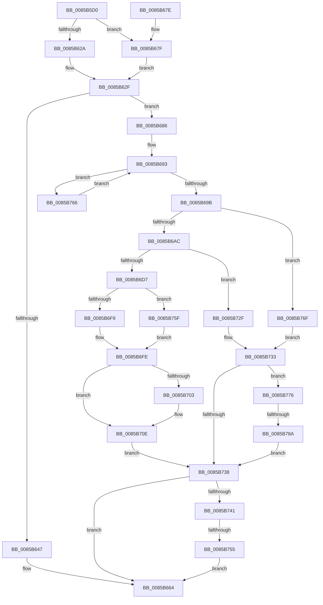

# HvReallocateCell

- RVA: `0x0085B5D0`–`0x0085B791` (길이 `449` bytes)
- VA: `0x000000014085B5D0`
- 실행 섹션: `PAGE`
- PDB 이름 있음: `예`; PDB Function 태그: `예`
- unwind 정보 RVA: `0x0006ADF0`
- 디코드: `128`개 명령, `449/449` bytes 표시
- 미해석 바이트: `0` (있으면 어셈블리에 `.byte`로 보존)

> 이 문서는 커널 이미지의 기계어와 PDB 기호를 분석해 생성했습니다. 4번과 5번은 함수 원형과 자료형을 바이너리 사용 방식에서 추정한 C 해석이며 원본 소스 복구 결과는 아닙니다.

## 1. Dependencies

- 직접 호출 지점: **13**; 고유 호출 대상: **9**
- 직접 호출자로 확인된 함수: **7**
- RIP 상대 이미지 참조: **0**

### Outgoing calls
- `0x0085B605` → [HvpGetCellContextInitialize](HvpGetCellContextInitialize_function_00855F10.md) (function, `0x00855F10`)
- `0x0085B615` → [HvpGetCellContextInitialize](HvpGetCellContextInitialize_function_00855F10.md) (function, `0x00855F10`)
- `0x0085B62A` → [HvpGetCellFlat](HvpGetCellFlat_function_00854C60.md) (function, `0x00854C60`)
- `0x0085B65D` → [HvpGetCellContextMove](HvpGetCellContextMove_function_00859F58.md) (function, `0x00859F58`)
- `0x0085B67F` → [HvpGetCellPaged](HvpGetCellPaged_function_00854CB0.md) (function, `0x00854CB0`)
- `0x0085B6CC` → [HvpDoAllocateCell](HvpDoAllocateCell_function_00859FB0.md) (function, `0x00859FB0`)
- `0x0085B6E4` → [memcpy](../../text/6C/memcpy_function_006C6840.md) (function, `0x006C6840`)
- `0x0085B6F9` → [HvpReleaseCellPaged](HvpReleaseCellPaged_function_00855F40.md) (function, `0x00855F40`)
- `0x0085B709` → [HvFreeCell](HvFreeCell_function_0085A72C.md) (function, `0x0085A72C`)
- `0x0085B726` → [HvpGetCellContextMove](HvpGetCellContextMove_function_00859F58.md) (function, `0x00859F58`)
- `0x0085B755` → [HvpReleaseCellFlat](HvpReleaseCellFlat_function_0085CC20.md) (function, `0x0085CC20`)
- `0x0085B75F` → [HvpReleaseCellFlat](HvpReleaseCellFlat_function_0085CC20.md) (function, `0x0085CC20`)
- `0x0085B78A` → [HvpReleaseCellFlat](HvpReleaseCellFlat_function_0085CC20.md) (function, `0x0085CC20`)

### Direct callers
- [CmRestoreKey](../7D/CmRestoreKey_function_007DCF04.md) at `0x007DD205`
- [CmpSetValueKeyExisting](../84/CmpSetValueKeyExisting_function_0084B53C.md) at `0x0084B7EF`
- [CmpAddValueToListEx](CmpAddValueToListEx_function_0085B460.md) at `0x0085B4EA`
- [CmpAddToLeaf](CmpAddToLeaf_function_0085BC2C.md) at `0x0085BEE9`
- [CmpRemoveValueFromList](../A0/CmpRemoveValueFromList_function_00A0F6D4.md) at `0x00A0F7A6`
- [CmpSplitLeaf](../A7/CmpSplitLeaf_function_00A7C7E0.md) at `0x00A7CA92`
- [sub_00B41CEA](../B4/Unknown_function_00B41CEA.md) at `0x00B41D20`
- [sub_00B41CEA](../B4/Unknown_function_00B41CEA.md) at `0x00B41DE5`

### Static image references
- 디코드된 RIP-relative 메모리 참조가 없습니다.

## 2. Other-region calls and transfers

- 다른 실행 섹션으로 향하는 call: **1**
  - `0x0085B6E4` → [memcpy](../../text/6C/memcpy_function_006C6840.md) (`PAGE` → `.text`)
- call이 아닌 외부 분기/꼬리 이동: **2**
  - `0x0085B74F` → [sub_00B16DAE + 0xB](../B1/Unknown_function_00B16DAE.md) (`tail-transfer`)
  - `0x0085B784` → [sub_00B16DAE](../B1/Unknown_function_00B16DAE.md) (`tail-transfer`)

## 3. Assembly (complete function range)

```asm
0085B5D0  48 89 5C 24 10                  mov qword ptr [rsp + 0x10], rbx
0085B5D5  55                              push rbp
0085B5D6  56                              push rsi
0085B5D7  57                              push rdi
0085B5D8  41 54                           push r12
0085B5DA  41 55                           push r13
0085B5DC  41 56                           push r14
0085B5DE  41 57                           push r15
0085B5E0  48 8B EC                        mov rbp, rsp
0085B5E3  48 83 EC 40                     sub rsp, 0x40
0085B5E7  48 83 65 40 00                  and qword ptr [rbp + 0x40], 0
0085B5EC  48 8B D9                        mov rbx, rcx
0085B5EF  48 83 65 F0 00                  and qword ptr [rbp - 0x10], 0
0085B5F4  48 8D 4D 40                     lea rcx, [rbp + 0x40]
0085B5F8  83 4D 50 FF                     or dword ptr [rbp + 0x50], 0xffffffff
0085B5FC  45 8A E9                        mov r13b, r9b
0085B5FF  41 8B F8                        mov edi, r8d
0085B602  44 8B F2                        mov r14d, edx
0085B605  E8 06 A9 FF FF                  call 0x140855f10
0085B60A  45 33 E4                        xor r12d, r12d
0085B60D  48 8D 4D F0                     lea rcx, [rbp - 0x10]
0085B611  4C 89 65 F8                     mov qword ptr [rbp - 8], r12
0085B615  E8 F6 A8 FF FF                  call 0x140855f10
0085B61A  F6 83 8C 00 00 00 01            test byte ptr [rbx + 0x8c], 1
0085B621  4C 8D 45 40                     lea r8, [rbp + 0x40]
0085B625  48 8B CB                        mov rcx, rbx
0085B628  74 55                           je 0x14085b67f
0085B62A  E8 31 96 FF FF                  call 0x140854c60
0085B62F  41 BF FC FF FF FF               mov r15d, 0xfffffffc
0085B635  48 8B F0                        mov rsi, rax
0085B638  44 2B 78 FC                     sub r15d, dword ptr [rax - 4]
0085B63C  83 C7 04                        add edi, 4
0085B63F  41 8D 47 04                     lea eax, [r15 + 4]
0085B643  3B F8                           cmp edi, eax
0085B645  77 3F                           ja 0x14085b686
0085B647  48 8B 45 60                     mov rax, qword ptr [rbp + 0x60]
0085B64B  48 8D 55 40                     lea rdx, [rbp + 0x40]
0085B64F  48 8B 4D 70                     mov rcx, qword ptr [rbp + 0x70]
0085B653  44 89 30                        mov dword ptr [rax], r14d
0085B656  48 8B 45 68                     mov rax, qword ptr [rbp + 0x68]
0085B65A  48 89 30                        mov qword ptr [rax], rsi
0085B65D  E8 F6 E8 FF FF                  call 0x140859f58
0085B662  33 FF                           xor edi, edi
0085B664  48 8B 9C 24 88 00 00 00         mov rbx, qword ptr [rsp + 0x88]
0085B66C  8B C7                           mov eax, edi
0085B66E  48 83 C4 40                     add rsp, 0x40
0085B672  41 5F                           pop r15
0085B674  41 5E                           pop r14
0085B676  41 5D                           pop r13
0085B678  41 5C                           pop r12
0085B67A  5F                              pop rdi
0085B67B  5E                              pop rsi
0085B67C  5D                              pop rbp
0085B67D  C3                              ret
0085B67E  CC                              int3
0085B67F  E8 2C 96 FF FF                  call 0x140854cb0
0085B684  EB A9                           jmp 0x14085b62f
0085B686  83 C7 07                        add edi, 7
0085B689  BA 00 40 00 00                  mov edx, 0x4000
0085B68E  83 E7 F8                        and edi, 0xfffffff8
0085B691  33 C0                           xor eax, eax
0085B693  3B FA                           cmp edi, edx
0085B695  0F 87 CB 00 00 00               ja 0x14085b766
0085B69B  85 C0                           test eax, eax
0085B69D  0F 44 D7                        cmove edx, edi
0085B6A0  81 FA 00 00 10 00               cmp edx, 0x100000
0085B6A6  0F 87 C3 00 00 00               ja 0x14085b76f
0085B6AC  48 8D 45 F0                     lea rax, [rbp - 0x10]
0085B6B0  45 8B C6                        mov r8d, r14d
0085B6B3  48 89 44 24 28                  mov qword ptr [rsp + 0x28], rax
0085B6B8  4C 8D 4D 50                     lea r9, [rbp + 0x50]
0085B6BC  48 8D 45 F8                     lea rax, [rbp - 8]
0085B6C0  41 C1 E8 1F                     shr r8d, 0x1f
0085B6C4  48 8B CB                        mov rcx, rbx
0085B6C7  48 89 44 24 20                  mov qword ptr [rsp + 0x20], rax
0085B6CC  E8 DF E8 FF FF                  call 0x140859fb0
0085B6D1  8B F8                           mov edi, eax
0085B6D3  85 C0                           test eax, eax
0085B6D5  78 58                           js 0x14085b72f
0085B6D7  48 8B 7D F8                     mov rdi, qword ptr [rbp - 8]
0085B6DB  48 8B D6                        mov rdx, rsi
0085B6DE  48 8B CF                        mov rcx, rdi
0085B6E1  45 8B C7                        mov r8d, r15d
0085B6E4  E8 57 B1 E6 FF                  call 0x1406c6840
0085B6E9  F6 83 8C 00 00 00 01            test byte ptr [rbx + 0x8c], 1
0085B6F0  48 8D 55 40                     lea rdx, [rbp + 0x40]
0085B6F4  48 8B CB                        mov rcx, rbx
0085B6F7  75 66                           jne 0x14085b75f
0085B6F9  E8 42 A8 FF FF                  call 0x140855f40
0085B6FE  45 84 ED                        test r13b, r13b
0085B701  74 0B                           je 0x14085b70e
0085B703  41 8B D6                        mov edx, r14d
0085B706  48 8B CB                        mov rcx, rbx
0085B709  E8 1E F0 FF FF                  call 0x14085a72c
0085B70E  48 8B 4D 60                     mov rcx, qword ptr [rbp + 0x60]
0085B712  48 8D 55 F0                     lea rdx, [rbp - 0x10]
0085B716  8B 45 50                        mov eax, dword ptr [rbp + 0x50]
0085B719  89 01                           mov dword ptr [rcx], eax
0085B71B  48 8B 45 68                     mov rax, qword ptr [rbp + 0x68]
0085B71F  48 8B 4D 70                     mov rcx, qword ptr [rbp + 0x70]
0085B723  48 89 38                        mov qword ptr [rax], rdi
0085B726  E8 2D E8 FF FF                  call 0x140859f58
0085B72B  33 FF                           xor edi, edi
0085B72D  EB 09                           jmp 0x14085b738
0085B72F  4C 8B 65 F8                     mov r12, qword ptr [rbp - 8]
0085B733  48 85 F6                        test rsi, rsi
0085B736  75 3E                           jne 0x14085b776
0085B738  4D 85 E4                        test r12, r12
0085B73B  0F 84 23 FF FF FF               je 0x14085b664
0085B741  F6 83 8C 00 00 00 01            test byte ptr [rbx + 0x8c], 1
0085B748  48 8D 55 F0                     lea rdx, [rbp - 0x10]
0085B74C  48 8B CB                        mov rcx, rbx
0085B74F  0F 84 64 B6 2B 00               je 0x140b16db9
0085B755  E8 C6 14 00 00                  call 0x14085cc20
0085B75A  E9 05 FF FF FF                  jmp 0x14085b664
0085B75F  E8 BC 14 00 00                  call 0x14085cc20
0085B764  EB 98                           jmp 0x14085b6fe
0085B766  03 D2                           add edx, edx
0085B768  FF C0                           inc eax
0085B76A  E9 24 FF FF FF                  jmp 0x14085b693
0085B76F  BF 9A 00 00 C0                  mov edi, 0xc000009a
0085B774  EB BD                           jmp 0x14085b733
0085B776  F6 83 8C 00 00 00 01            test byte ptr [rbx + 0x8c], 1
0085B77D  48 8D 55 40                     lea rdx, [rbp + 0x40]
0085B781  48 8B CB                        mov rcx, rbx
0085B784  0F 84 24 B6 2B 00               je 0x140b16dae
0085B78A  E8 91 14 00 00                  call 0x14085cc20
0085B78F  EB A7                           jmp 0x14085b738
```

## 4. C-style interpretation (structured pseudocode)

```c
__int64 __fastcall HvReallocateCell(__int64 a1, int a2, int a3, unsigned __int8 a4, __int64 a5, __int64 a6, __int64 a7)
{
    __int64 result;
    __int64 v_r12;
    __int64 v_r15;
    __int64 v_rdi;
    __int64 v_rsp;
    unsigned __int64 v_stack_m40;
    unsigned __int64 v_stack_m48;
    unsigned __int64 v_stack_p10;
    unsigned int v_stack_p18;
    unsigned __int64 v_stack_p20;
    unsigned __int64 v_stack_p28;
    unsigned __int64 v_stack_p8;

    v_stack_p10 = v_rbx;
    v_rsp = (v_rsp) - (64);
    result = HvpGetCellContextInitialize(v_stack_p8, a2, a3, a4);
    v_r12 = 0;
    v_stack_m40 = 0;
    result = HvpGetCellContextInitialize(v_stack_m48, a2, a3, a4);
    if (((*(unsigned __int8 *)(a1 + 140)) & (1)) == 0) goto loc_0085B67F;
    result = HvpGetCellFlat(a1, a2, v_stack_p8, a4);
loc_0085B62F:
    v_r15 = (unsigned int)(((unsigned int)(0xFFFFFFFCULL)) - (*(unsigned int *)(result - 4)));
    v_rdi = (unsigned int)(((unsigned int)(a3)) + (4));
    if (((unsigned int)(v_rdi)) > ((unsigned int)(v_r15 + 4))) goto loc_0085B686;
    *(unsigned int *)(a5) = (unsigned int)((unsigned int)(a2));
    *(unsigned __int64 *)(a6) = result;
    result = HvpGetCellContextMove(a7, v_stack_p8, v_stack_p8, a4);
    v_rdi = 0;
loc_0085B664:
    v_rsp = (v_rsp) + (64);
    return 0;
loc_0085B67F:
    result = HvpGetCellPaged(a7, v_stack_p8, v_stack_p8, a4);
    goto loc_0085B62F;
loc_0085B686:
    v_rdi = (unsigned int)((v_rdi) + (7));
    v_rdi = (unsigned int)((v_rdi) & (0xFFFFFFF8ULL));
    result = 0;
loc_0085B693:
    if (((unsigned int)(v_rdi)) > ((unsigned int)((unsigned int)(0x4000ULL)))) goto loc_0085B766;
    a2 = (unsigned int)(0x4000ULL);
    if (0 == 0) { a2 = (unsigned int)(v_rdi); }
    if (a2 > 0x100000ULL) goto loc_0085B76F;
    v_stack_p28 = v_stack_m48;
    a3 = (unsigned int)(((unsigned int)((unsigned int)((unsigned int)(a2)))) >> (31));
    v_stack_p20 = v_stack_m40;
    result = HvpDoAllocateCell(v_stack_p10, a2, a3, v_stack_p18);
    if (sign_flag) goto loc_0085B72F;
    result = memcpy(v_stack_m40, result, (unsigned int)((unsigned int)(v_r15)), v_stack_p18);
    if (((*(unsigned __int8 *)(v_stack_p10 + 140)) & (1)) != 0) goto loc_0085B75F;
    result = HvpReleaseCellPaged(v_stack_p10, v_stack_p8, (unsigned int)((unsigned int)(v_r15)), v_stack_p18);
loc_0085B6FE:
    if (a4 != 0) {
        a2 = (unsigned int)((unsigned int)(a2));
        a1 = v_stack_p10;
        result = HvFreeCell(a1, a2, (unsigned int)((unsigned int)(v_r15)), v_stack_p18);
    }
    *(unsigned int *)(a5) = (unsigned int)((unsigned int)(v_stack_p18));
    *(unsigned __int64 *)(a6) = v_stack_m40;
    result = HvpGetCellContextMove(a7, v_stack_m48, (unsigned int)((unsigned int)(v_r15)), v_stack_p18);
    v_rdi = 0;
    goto loc_0085B738;
loc_0085B72F:
loc_0085B733:
    if (result != 0) goto loc_0085B776;
loc_0085B738:
    if (v_stack_m40 == 0) goto loc_0085B664;
    result = HvpReleaseCellFlat(v_stack_p10, v_stack_m48, (unsigned int)((unsigned int)(v_r15)), v_stack_p18);
    goto loc_0085B664;
loc_0085B75F:
    result = HvpReleaseCellFlat(v_stack_p10, v_stack_m48, (unsigned int)((unsigned int)(v_r15)), v_stack_p18);
    goto loc_0085B6FE;
loc_0085B766:
    a2 = (unsigned int)((v_stack_m48) + ((unsigned int)(v_stack_m48)));
    result = (unsigned int)((result) + 1);
    goto loc_0085B693;
loc_0085B76F:
    goto loc_0085B733;
loc_0085B776:
    result = HvpReleaseCellFlat(v_stack_p10, v_stack_p8, (unsigned int)((unsigned int)(v_r15)), v_stack_p18);
    goto loc_0085B738;
}
```

## 5. (Beta) C Style

```c
int64_t HvReallocateCell(void *Arg1, int32_t Arg2, int32_t Arg3, uint8_t Arg4, void *Arg5, void *Arg6, int64_t Arg7)
{
    uint8_t *arg1 = (uint8_t *)Arg1;
    uint8_t *arg5 = (uint8_t *)Arg5;
    uint8_t *arg6 = (uint8_t *)Arg6;

    int64_t result;
    int64_t local_r12;
    int64_t local_r15;
    int64_t local_rdi;
    int64_t local_rsp;
    uint64_t v_stack_m40;
    uint64_t v_stack_m48;
    uint64_t v_stack_p10;
    uint32_t v_stack_p18;
    uint64_t v_stack_p20;
    uint64_t v_stack_p28;
    uint64_t v_stack_p8;

    v_stack_p10 = local_rbx;
    local_rsp = (local_rsp) - (64);
    result = HvpGetCellContextInitialize(v_stack_p8, Arg2, Arg3, Arg4);
    local_r12 = 0;
    v_stack_m40 = 0;
    result = HvpGetCellContextInitialize(v_stack_m48, Arg2, Arg3, Arg4);
    if (((*(uint8_t *)(arg1 + 0x8C)) & (1)) == 0) goto loc_0085B67F;
    result = HvpGetCellFlat(Arg1, Arg2, v_stack_p8, Arg4);
loc_0085B62F:
    local_r15 = (uint32_t)(((uint32_t)(0xFFFFFFFCULL)) - (*(uint32_t *)(result - 0x4)));
    local_rdi = (uint32_t)(((uint32_t)(Arg3)) + (4));
    if (((uint32_t)(local_rdi)) > ((uint32_t)(local_r15 + 4))) goto loc_0085B686;
    *(uint32_t *)(arg5) = (uint32_t)((uint32_t)(Arg2));
    *(uint64_t *)(arg6) = result;
    result = HvpGetCellContextMove(Arg7, v_stack_p8, v_stack_p8, Arg4);
    local_rdi = 0;
loc_0085B664:
    local_rsp = (local_rsp) + (64);
    return 0;
loc_0085B67F:
    result = HvpGetCellPaged(Arg7, v_stack_p8, v_stack_p8, Arg4);
    goto loc_0085B62F;
loc_0085B686:
    local_rdi = (uint32_t)((local_rdi) + (7));
    local_rdi = (uint32_t)((local_rdi) & (0xFFFFFFF8ULL));
    result = 0;
loc_0085B693:
    if (((uint32_t)(local_rdi)) > ((uint32_t)((uint32_t)(0x4000ULL)))) goto loc_0085B766;
    Arg2 = (uint32_t)(0x4000ULL);
    if (0 == 0) { Arg2 = (uint32_t)(local_rdi); }
    if (Arg2 > 0x100000ULL) goto loc_0085B76F;
    v_stack_p28 = v_stack_m48;
    Arg3 = (uint32_t)(((uint32_t)((uint32_t)((uint32_t)(Arg2)))) >> (31));
    v_stack_p20 = v_stack_m40;
    result = HvpDoAllocateCell(v_stack_p10, Arg2, Arg3, v_stack_p18);
    if (sign_flag) goto loc_0085B72F;
    result = memcpy(v_stack_m40, result, (uint32_t)((uint32_t)(local_r15)), v_stack_p18);
    if (((*(uint8_t *)(v_stack_p10 + 0x8C)) & (1)) != 0) goto loc_0085B75F;
    result = HvpReleaseCellPaged(v_stack_p10, v_stack_p8, (uint32_t)((uint32_t)(local_r15)), v_stack_p18);
loc_0085B6FE:
    if (Arg4 != 0) {
        Arg2 = (uint32_t)((uint32_t)(Arg2));
        Arg1 = v_stack_p10;
        result = HvFreeCell(Arg1, Arg2, (uint32_t)((uint32_t)(local_r15)), v_stack_p18);
    }
    *(uint32_t *)(arg5) = (uint32_t)((uint32_t)(v_stack_p18));
    *(uint64_t *)(arg6) = v_stack_m40;
    result = HvpGetCellContextMove(Arg7, v_stack_m48, (uint32_t)((uint32_t)(local_r15)), v_stack_p18);
    local_rdi = 0;
    goto loc_0085B738;
loc_0085B72F:
loc_0085B733:
    if (result != 0) goto loc_0085B776;
loc_0085B738:
    if (v_stack_m40 == 0) goto loc_0085B664;
    result = HvpReleaseCellFlat(v_stack_p10, v_stack_m48, (uint32_t)((uint32_t)(local_r15)), v_stack_p18);
    goto loc_0085B664;
loc_0085B75F:
    result = HvpReleaseCellFlat(v_stack_p10, v_stack_m48, (uint32_t)((uint32_t)(local_r15)), v_stack_p18);
    goto loc_0085B6FE;
loc_0085B766:
    Arg2 = (uint32_t)((v_stack_m48) + ((uint32_t)(v_stack_m48)));
    result = (uint32_t)((result) + 1);
    goto loc_0085B693;
loc_0085B76F:
    goto loc_0085B733;
loc_0085B776:
    result = HvpReleaseCellFlat(v_stack_p10, v_stack_p8, (uint32_t)((uint32_t)(local_r15)), v_stack_p18);
    goto loc_0085B738;
}
```

### 관측된 메모리 오프셋

구조체 형식이 확인되지 않은 접근은 인자 기준의 오프셋으로만 기록했습니다.

| 기준 인자 | 오프셋 표현 | 폭 (bit) | 접근 |
|---|---:|---:|---|
| `Arg1` | `+ 0x8C` | `8` | `R` |
| `Arg5` | `+ 0x0` | `32` | `W` |
| `Arg6` | `+ 0x0` | `64` | `W` |

## 6. Execution-region graph

[열기: 2D/3D 그래프와 함수 탐색 컨트롤 패널](../../../control-panel.html?section=page&rva=0x0085B5D0&view=graph)

- 2D 그래프는 위에서 아래로 흐르고, 3D 그래프는 빈 공간을 드래그해 회전합니다. Shift+드래그는 이동, 휠은 확대·축소, 함수 노드 선택은 대상 보고서 이동입니다.

### Static fallback


