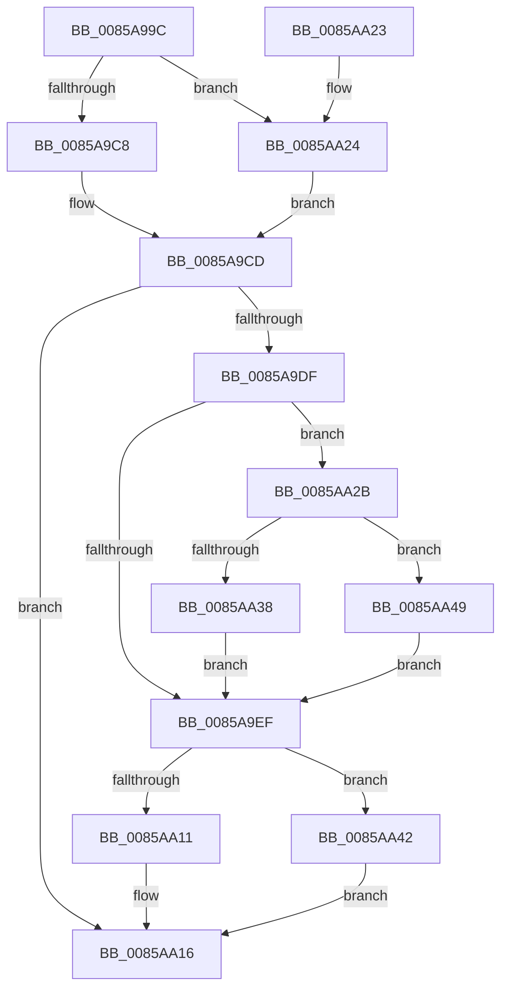

# HvpDelistFreeCell

- RVA: `0x0085A99C`–`0x0085AA51` (길이 `181` bytes)
- VA: `0x000000014085A99C`
- 실행 섹션: `PAGE`
- PDB 이름 있음: `예`; PDB Function 태그: `아니요`
- unwind 정보 RVA: `0x0006ACF4`
- 디코드: `56`개 명령, `181/181` bytes 표시
- 미해석 바이트: `0` (있으면 어셈블리에 `.byte`로 보존)

> 이 문서는 커널 이미지의 기계어와 PDB 기호를 분석해 생성했습니다. 4번과 5번은 함수 원형과 자료형을 바이너리 사용 방식에서 추정한 C 해석이며 원본 소스 복구 결과는 아닙니다.

## 1. Dependencies

- 직접 호출 지점: **5**; 고유 호출 대상: **5**
- 직접 호출자로 확인된 함수: **3**
- RIP 상대 이미지 참조: **0**

### Outgoing calls
- `0x0085A9C8` → [HvpGetCellFlat](HvpGetCellFlat_function_00854C60.md) (function, `0x00854C60`)
- `0x0085A9FB` → [HvpRemoveFreeCellHint](HvpRemoveFreeCellHint_function_0085A270.md) (function, `0x0085A270`)
- `0x0085AA11` → [HvpReleaseCellPaged](HvpReleaseCellPaged_function_00855F40.md) (function, `0x00855F40`)
- `0x0085AA24` → [HvpGetCellPaged](HvpGetCellPaged_function_00854CB0.md) (function, `0x00854CB0`)
- `0x0085AA42` → [HvpReleaseCellFlat](HvpReleaseCellFlat_function_0085CC20.md) (function, `0x0085CC20`)

### Direct callers
- [HvAllocateCell](HvAllocateCell_function_00859C94.md) at `0x00859E4A`
- [sub_0085A164](Unknown_function_0085A164.md) at `0x0085A16D`
- [HvFreeCell](HvFreeCell_function_0085A72C.md) at `0x0085A7F6`

### Static image references
- 디코드된 RIP-relative 메모리 참조가 없습니다.

## 2. Other-region calls and transfers

- 다른 실행 섹션으로 향하는 call: **0**
- 별도 외부 분기/꼬리 이동을 확인하지 못했습니다.

## 3. Assembly (complete function range)

```asm
0085A99C  48 8B C4                        mov rax, rsp
0085A99F  48 89 58 10                     mov qword ptr [rax + 0x10], rbx
0085A9A3  55                              push rbp
0085A9A4  56                              push rsi
0085A9A5  57                              push rdi
0085A9A6  48 83 EC 30                     sub rsp, 0x30
0085A9AA  83 48 20 FF                     or dword ptr [rax + 0x20], 0xffffffff
0085A9AE  33 ED                           xor ebp, ebp
0085A9B0  F6 81 8C 00 00 00 01            test byte ptr [rcx + 0x8c], 1
0085A9B7  41 8B F0                        mov esi, r8d
0085A9BA  8B FA                           mov edi, edx
0085A9BC  89 68 24                        mov dword ptr [rax + 0x24], ebp
0085A9BF  48 8B D9                        mov rbx, rcx
0085A9C2  4C 8D 40 20                     lea r8, [rax + 0x20]
0085A9C6  74 5C                           je 0x14085aa24
0085A9C8  E8 93 A2 FF FF                  call 0x140854c60
0085A9CD  48 8B C8                        mov rcx, rax
0085A9D0  48 8D 40 FC                     lea rax, [rax - 4]
0085A9D4  48 F7 D9                        neg rcx
0085A9D7  4D 1B C0                        sbb r8, r8
0085A9DA  4C 23 C0                        and r8, rax
0085A9DD  74 37                           je 0x14085aa16
0085A9DF  45 8B 00                        mov r8d, dword ptr [r8]
0085A9E2  41 C1 E8 03                     shr r8d, 3
0085A9E6  41 FF C8                        dec r8d
0085A9E9  41 83 F8 10                     cmp r8d, 0x10
0085A9ED  73 3C                           jae 0x14085aa2b
0085A9EF  44 8B CE                        mov r9d, esi
0085A9F2  89 6C 24 20                     mov dword ptr [rsp + 0x20], ebp
0085A9F6  8B D7                           mov edx, edi
0085A9F8  48 8B CB                        mov rcx, rbx
0085A9FB  E8 70 F8 FF FF                  call 0x14085a270
0085AA00  F6 83 8C 00 00 00 01            test byte ptr [rbx + 0x8c], 1
0085AA07  48 8D 54 24 68                  lea rdx, [rsp + 0x68]
0085AA0C  48 8B CB                        mov rcx, rbx
0085AA0F  75 31                           jne 0x14085aa42
0085AA11  E8 2A B5 FF FF                  call 0x140855f40
0085AA16  48 8B 5C 24 58                  mov rbx, qword ptr [rsp + 0x58]
0085AA1B  48 83 C4 30                     add rsp, 0x30
0085AA1F  5F                              pop rdi
0085AA20  5E                              pop rsi
0085AA21  5D                              pop rbp
0085AA22  C3                              ret
0085AA23  CC                              int3
0085AA24  E8 87 A2 FF FF                  call 0x140854cb0
0085AA29  EB A2                           jmp 0x14085a9cd
0085AA2B  41 C1 E8 04                     shr r8d, 4
0085AA2F  41 81 F8 FF 00 00 00            cmp r8d, 0xff
0085AA36  77 11                           ja 0x14085aa49
0085AA38  45 0F BD C0                     bsr r8d, r8d
0085AA3C  41 83 C0 10                     add r8d, 0x10
0085AA40  EB AD                           jmp 0x14085a9ef
0085AA42  E8 D9 21 00 00                  call 0x14085cc20
0085AA47  EB CD                           jmp 0x14085aa16
0085AA49  41 B8 17 00 00 00               mov r8d, 0x17
0085AA4F  EB 9E                           jmp 0x14085a9ef
```

## 4. C-style interpretation (structured pseudocode)

```c
__int64 __fastcall HvpDelistFreeCell(__int64 a1, int a2, int a3)
{
    __int64 result;
    __int64 v_rbp;
    __int64 v_rsp;
    unsigned int v_stack_m28;
    unsigned __int64 v_stack_p10;
    unsigned __int64 v_stack_p20;

    *(unsigned __int64 *)(v_rsp + 16) = v_rbx;
    v_rsp = (v_rsp) - (48);
    v_rbp = 0;
    *(unsigned int *)(v_rsp + 36) = 0;
    if (((*(unsigned __int8 *)(a1 + 140)) & (1)) == 0) goto loc_0085AA24;
    result = HvpGetCellFlat(a1, a2, v_rsp + 32, a4);
loc_0085A9CD:
    a1 = -(result);
    a3 = (v_rsp + 32) & (result - 4);
    if (condition_is_equal) goto loc_0085AA16;
    a3 = (unsigned int)(((unsigned int)(*(unsigned int *)(a3))) >> (3));
    a3 = (unsigned int)((a3) - 1);
    if (a3 >= 16) goto loc_0085AA2B;
loc_0085A9EF:
    v_stack_m28 = 0;
    result = HvpRemoveFreeCellHint(a1, (unsigned int)((unsigned int)((unsigned int)(a2))), a3, (unsigned int)((unsigned int)((unsigned int)(a3))));
    if (((*(unsigned __int8 *)(a1 + 140)) & (1)) != 0) goto loc_0085AA42;
    result = HvpReleaseCellPaged(a1, v_stack_p20, a3, (unsigned int)((unsigned int)((unsigned int)(a3))));
loc_0085AA16:
    v_rsp = (v_rsp) + (48);
    return result;
loc_0085AA24:
    result = HvpGetCellPaged(a1, v_stack_p20, a3, (unsigned int)((unsigned int)((unsigned int)(a3))));
    goto loc_0085A9CD;
loc_0085AA2B:
    a3 = (unsigned int)((a3) >> (4));
    if (a3 > 255) goto loc_0085AA49;
    a3 = (unsigned int)((a3) + (16));
    goto loc_0085A9EF;
loc_0085AA42:
    result = HvpReleaseCellFlat(a1, v_stack_p20, a3, (unsigned int)((unsigned int)((unsigned int)(a3))));
    goto loc_0085AA16;
loc_0085AA49:
    goto loc_0085A9EF;
}
```

## 5. (Beta) C Style

```c
int64_t HvpDelistFreeCell(void *Arg1, int32_t Arg2, int32_t Arg3)
{
    uint8_t *arg1 = (uint8_t *)Arg1;

    int64_t result;
    int64_t local_rbp;
    int64_t local_rsp;
    uint32_t v_stack_m28;
    uint64_t v_stack_p10;
    uint64_t v_stack_p20;

    *(uint64_t *)(local_rsp + 0x10) = local_rbx;
    local_rsp = (local_rsp) - (48);
    local_rbp = 0;
    *(uint32_t *)(local_rsp + 0x24) = 0;
    if (((*(uint8_t *)(arg1 + 0x8C)) & (1)) == 0) goto loc_0085AA24;
    result = HvpGetCellFlat(Arg1, Arg2, local_rsp + 32, a4);
loc_0085A9CD:
    Arg1 = -(result);
    Arg3 = (local_rsp + 32) & (result - 4);
    if (condition_is_equal) goto loc_0085AA16;
    Arg3 = (uint32_t)(((uint32_t)(*(uint32_t *)(Arg3))) >> (3));
    Arg3 = (uint32_t)((Arg3) - 1);
    if (Arg3 >= 16) goto loc_0085AA2B;
loc_0085A9EF:
    v_stack_m28 = 0;
    result = HvpRemoveFreeCellHint(Arg1, (uint32_t)((uint32_t)((uint32_t)(Arg2))), Arg3, (uint32_t)((uint32_t)((uint32_t)(Arg3))));
    if (((*(uint8_t *)(arg1 + 0x8C)) & (1)) != 0) goto loc_0085AA42;
    result = HvpReleaseCellPaged(Arg1, v_stack_p20, Arg3, (uint32_t)((uint32_t)((uint32_t)(Arg3))));
loc_0085AA16:
    local_rsp = (local_rsp) + (48);
    return result;
loc_0085AA24:
    result = HvpGetCellPaged(Arg1, v_stack_p20, Arg3, (uint32_t)((uint32_t)((uint32_t)(Arg3))));
    goto loc_0085A9CD;
loc_0085AA2B:
    Arg3 = (uint32_t)((Arg3) >> (4));
    if (Arg3 > 255) goto loc_0085AA49;
    Arg3 = (uint32_t)((Arg3) + (16));
    goto loc_0085A9EF;
loc_0085AA42:
    result = HvpReleaseCellFlat(Arg1, v_stack_p20, Arg3, (uint32_t)((uint32_t)((uint32_t)(Arg3))));
    goto loc_0085AA16;
loc_0085AA49:
    goto loc_0085A9EF;
}
```

### 관측된 메모리 오프셋

구조체 형식이 확인되지 않은 접근은 인자 기준의 오프셋으로만 기록했습니다.

| 기준 인자 | 오프셋 표현 | 폭 (bit) | 접근 |
|---|---:|---:|---|
| `Arg1` | `+ 0x8C` | `8` | `R` |

## 6. Execution-region graph

[열기: 2D/3D 그래프와 함수 탐색 컨트롤 패널](../../../control-panel.html?section=page&rva=0x0085A99C&view=graph)

- 2D 그래프는 위에서 아래로 흐르고, 3D 그래프는 빈 공간을 드래그해 회전합니다. Shift+드래그는 이동, 휠은 확대·축소, 함수 노드 선택은 대상 보고서 이동입니다.

### Static fallback


