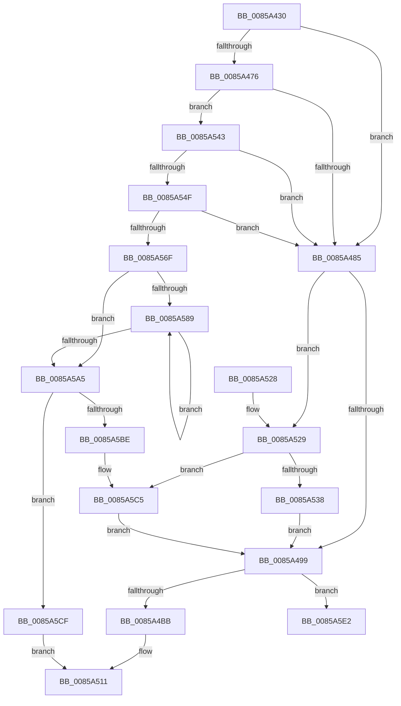

# HvpEnlistFreeCell

- RVA: `0x0085A430`–`0x0085A5FF` (길이 `463` bytes)
- VA: `0x000000014085A430`
- 실행 섹션: `PAGE`
- PDB 이름 있음: `예`; PDB Function 태그: `아니요`
- unwind 정보 RVA: `0x0006ACA0`
- 디코드: `127`개 명령, `463/463` bytes 표시
- 미해석 바이트: `0` (있으면 어셈블리에 `.byte`로 보존)

> 이 문서는 커널 이미지의 기계어와 PDB 기호를 분석해 생성했습니다. 4번과 5번은 함수 원형과 자료형을 바이너리 사용 방식에서 추정한 C 해석이며 원본 소스 복구 결과는 아닙니다.

## 1. Dependencies

- 직접 호출 지점: **9**; 고유 호출 대상: **6**
- 직접 호출자로 확인된 함수: **3**
- RIP 상대 이미지 참조: **0**

### Outgoing calls
- `0x0085A451` → [HvpGetCellMap](../../pagecmrc/BC/HvpGetCellMap_function_00BC9710.md) (function, `0x00BC9710`)
- `0x0085A465` → [HvpGetCellMap](../../pagecmrc/BC/HvpGetCellMap_function_00BC9710.md) (function, `0x00BC9710`)
- `0x0085A4A3` → [HvpGetBinContextInitialize](../../pagecmrc/BC/HvpGetBinContextInitialize_function_00BC98D0.md) (function, `0x00BC98D0`)
- `0x0085A4AD` → [HvpGetCellMap](../../pagecmrc/BC/HvpGetCellMap_function_00BC9710.md) (function, `0x00BC9710`)
- `0x0085A4C3` → [HvpMapEntryGetBinAddress](../../pagecmrc/BC/HvpMapEntryGetBinAddress_function_00BC9770.md) (function, `0x00BC9770`)
- `0x0085A4F3` → [RtlSetBits](../../text/3E/RtlSetBits_function_003E1610.md) (function, `0x003E1610`)
- `0x0085A55E` → [guard_dispatch_icall](../../text/6B/guard_dispatch_icall_function_006BAAD0.md) (function, `0x006BAAD0`)
- `0x0085A58E` → [HvpGetCellMap](../../pagecmrc/BC/HvpGetCellMap_function_00BC9710.md) (function, `0x00BC9710`)
- `0x0085A5F9` → [KeBugCheckEx](../../text/4F/KeBugCheckEx_function_004FD660.md) (function, `0x004FD660`)

### Direct callers
- [HvAllocateCell](HvAllocateCell_function_00859C94.md) at `0x00859DB6`
- [sub_00859FB9](Unknown_function_00859FB9.md) at `0x0085A0C8`
- [HvFreeCell](HvFreeCell_function_0085A72C.md) at `0x0085A8ED`

### Static image references
- 디코드된 RIP-relative 메모리 참조가 없습니다.

## 2. Other-region calls and transfers

- 다른 실행 섹션으로 향하는 call: **9**
  - `0x0085A451` → [HvpGetCellMap](../../pagecmrc/BC/HvpGetCellMap_function_00BC9710.md) (`PAGE` → `PAGECMRC`)
  - `0x0085A465` → [HvpGetCellMap](../../pagecmrc/BC/HvpGetCellMap_function_00BC9710.md) (`PAGE` → `PAGECMRC`)
  - `0x0085A4A3` → [HvpGetBinContextInitialize](../../pagecmrc/BC/HvpGetBinContextInitialize_function_00BC98D0.md) (`PAGE` → `PAGECMRC`)
  - `0x0085A4AD` → [HvpGetCellMap](../../pagecmrc/BC/HvpGetCellMap_function_00BC9710.md) (`PAGE` → `PAGECMRC`)
  - `0x0085A4C3` → [HvpMapEntryGetBinAddress](../../pagecmrc/BC/HvpMapEntryGetBinAddress_function_00BC9770.md) (`PAGE` → `PAGECMRC`)
  - `0x0085A4F3` → [RtlSetBits](../../text/3E/RtlSetBits_function_003E1610.md) (`PAGE` → `.text`)
  - `0x0085A55E` → [guard_dispatch_icall](../../text/6B/guard_dispatch_icall_function_006BAAD0.md) (`PAGE` → `.text`)
  - `0x0085A58E` → [HvpGetCellMap](../../pagecmrc/BC/HvpGetCellMap_function_00BC9710.md) (`PAGE` → `PAGECMRC`)
  - `0x0085A5F9` → [KeBugCheckEx](../../text/4F/KeBugCheckEx_function_004FD660.md) (`PAGE` → `.text`)
- 별도 외부 분기/꼬리 이동을 확인하지 못했습니다.

## 3. Assembly (complete function range)

```asm
0085A430  48 89 5C 24 08                  mov qword ptr [rsp + 8], rbx
0085A435  48 89 6C 24 18                  mov qword ptr [rsp + 0x18], rbp
0085A43A  56                              push rsi
0085A43B  57                              push rdi
0085A43C  41 54                           push r12
0085A43E  41 56                           push r14
0085A440  41 57                           push r15
0085A442  48 83 EC 30                     sub rsp, 0x30
0085A446  4D 63 E1                        movsxd r12, r9d
0085A449  41 8B D8                        mov ebx, r8d
0085A44C  8B F2                           mov esi, edx
0085A44E  4C 8B F1                        mov r14, rcx
0085A451  E8 BA F2 36 00                  call 0x140bc9710
0085A456  8B FE                           mov edi, esi
0085A458  49 8B CE                        mov rcx, r14
0085A45B  81 E7 00 F0 FF FF               and edi, 0xfffff000
0085A461  2B 38                           sub edi, dword ptr [rax]
0085A463  8B D7                           mov edx, edi
0085A465  E8 A6 F2 36 00                  call 0x140bc9710
0085A46A  44 8B 78 10                     mov r15d, dword ptr [rax + 0x10]
0085A46E  41 8D 2C 3F                     lea ebp, [r15 + rdi]
0085A472  85 FF                           test edi, edi
0085A474  74 0F                           je 0x14085a485
0085A476  8B CF                           mov ecx, edi
0085A478  48 83 C1 20                     add rcx, 0x20
0085A47C  48 3B F1                        cmp rsi, rcx
0085A47F  0F 84 BE 00 00 00               je 0x14085a543
0085A485  C1 EB 03                        shr ebx, 3
0085A488  33 C9                           xor ecx, ecx
0085A48A  FF CB                           dec ebx
0085A48C  89 4C 24 68                     mov dword ptr [rsp + 0x68], ecx
0085A490  83 FB 10                        cmp ebx, 0x10
0085A493  0F 83 90 00 00 00               jae 0x14085a529
0085A499  66 89 4C 24 68                  mov word ptr [rsp + 0x68], cx
0085A49E  48 8D 4C 24 68                  lea rcx, [rsp + 0x68]
0085A4A3  E8 28 F4 36 00                  call 0x140bc98d0
0085A4A8  8B D6                           mov edx, esi
0085A4AA  49 8B CE                        mov rcx, r14
0085A4AD  E8 5E F2 36 00                  call 0x140bc9710
0085A4B2  48 85 C0                        test rax, rax
0085A4B5  0F 84 27 01 00 00               je 0x14085a5e2
0085A4BB  4C 8D 44 24 68                  lea r8, [rsp + 0x68]
0085A4C0  48 8B D0                        mov rdx, rax
0085A4C3  E8 A8 F2 36 00                  call 0x140bc9770
0085A4C8  8B CB                           mov ecx, ebx
0085A4CA  49 69 F4 78 02 00 00            imul rsi, r12, 0x278
0085A4D1  8B 68 04                        mov ebp, dword ptr [rax + 4]
0085A4D4  48 8D 14 49                     lea rdx, [rcx + rcx*2]
0085A4D8  44 8B 40 08                     mov r8d, dword ptr [rax + 8]
0085A4DC  49 8D 8E 40 01 00 00            lea rcx, [r14 + 0x140]
0085A4E3  C1 ED 0C                        shr ebp, 0xc
0085A4E6  41 C1 E8 0C                     shr r8d, 0xc
0085A4EA  48 8D 3C D6                     lea rdi, [rsi + rdx*8]
0085A4EE  8B D5                           mov edx, ebp
0085A4F0  48 03 CF                        add rcx, rdi
0085A4F3  E8 18 71 B8 FF                  call 0x1403e1610
0085A4F8  8B CB                           mov ecx, ebx
0085A4FA  42 89 AC 37 3C 01 00 00         mov dword ptr [rdi + r14 + 0x13c], ebp
0085A502  B8 01 00 00 00                  mov eax, 1
0085A507  D3 E0                           shl eax, cl
0085A509  42 09 84 36 88 03 00 00         or dword ptr [rsi + r14 + 0x388], eax
0085A511  48 8B 5C 24 60                  mov rbx, qword ptr [rsp + 0x60]
0085A516  48 8B 6C 24 70                  mov rbp, qword ptr [rsp + 0x70]
0085A51B  48 83 C4 30                     add rsp, 0x30
0085A51F  41 5F                           pop r15
0085A521  41 5E                           pop r14
0085A523  41 5C                           pop r12
0085A525  5F                              pop rdi
0085A526  5E                              pop rsi
0085A527  C3                              ret
0085A528  CC                              int3
0085A529  C1 EB 04                        shr ebx, 4
0085A52C  81 FB FF 00 00 00               cmp ebx, 0xff
0085A532  0F 87 8D 00 00 00               ja 0x14085a5c5
0085A538  0F BD DB                        bsr ebx, ebx
0085A53B  83 C3 10                        add ebx, 0x10
0085A53E  E9 56 FF FF FF                  jmp 0x14085a499
0085A543  42 8D 04 06                     lea eax, [rsi + r8]
0085A547  3B C5                           cmp eax, ebp
0085A549  0F 85 36 FF FF FF               jne 0x14085a485
0085A54F  49 8B 46 18                     mov rax, qword ptr [r14 + 0x18]
0085A553  33 D2                           xor edx, edx
0085A555  41 B8 43 4D 37 20               mov r8d, 0x20374d43
0085A55B  8D 4A 18                        lea ecx, [rdx + 0x18]
0085A55E  E8 6D 05 E6 FF                  call 0x1406baad0
0085A563  4C 8B C0                        mov r8, rax
0085A566  48 85 C0                        test rax, rax
0085A569  0F 84 16 FF FF FF               je 0x14085a485
0085A56F  33 C9                           xor ecx, ecx
0085A571  48 89 08                        mov qword ptr [rax], rcx
0085A574  48 89 48 08                     mov qword ptr [rax + 8], rcx
0085A578  8B CF                           mov ecx, edi
0085A57A  0F BA F1 1F                     btr ecx, 0x1f
0085A57E  44 89 78 10                     mov dword ptr [rax + 0x10], r15d
0085A582  89 48 14                        mov dword ptr [rax + 0x14], ecx
0085A585  3B FD                           cmp edi, ebp
0085A587  73 1C                           jae 0x14085a5a5
0085A589  8B D7                           mov edx, edi
0085A58B  49 8B CE                        mov rcx, r14
0085A58E  E8 7D F1 36 00                  call 0x140bc9710
0085A593  81 C7 00 10 00 00               add edi, 0x1000
0085A599  48 83 48 08 02                  or qword ptr [rax + 8], 2
0085A59E  4C 89 00                        mov qword ptr [rax], r8
0085A5A1  3B FD                           cmp edi, ebp
0085A5A3  72 E4                           jb 0x14085a589
0085A5A5  49 69 C4 78 02 00 00            imul rax, r12, 0x278
0085A5AC  48 05 78 03 00 00               add rax, 0x378
0085A5B2  49 03 C6                        add rax, r14
0085A5B5  48 8B 08                        mov rcx, qword ptr [rax]
0085A5B8  48 39 41 08                     cmp qword ptr [rcx + 8], rax
0085A5BC  74 11                           je 0x14085a5cf
0085A5BE  B9 03 00 00 00                  mov ecx, 3
0085A5C3  CD 29                           int 0x29
0085A5C5  BB 17 00 00 00                  mov ebx, 0x17
0085A5CA  E9 CA FE FF FF                  jmp 0x14085a499
0085A5CF  49 89 08                        mov qword ptr [r8], rcx
0085A5D2  49 89 40 08                     mov qword ptr [r8 + 8], rax
0085A5D6  4C 89 41 08                     mov qword ptr [rcx + 8], r8
0085A5DA  4C 89 00                        mov qword ptr [rax], r8
0085A5DD  E9 2F FF FF FF                  jmp 0x14085a511
0085A5E2  BA 01 00 00 00                  mov edx, 1
0085A5E7  48 C7 44 24 20 B9 02 00 00      mov qword ptr [rsp + 0x20], 0x2b9
0085A5F0  4C 8B CE                        mov r9, rsi
0085A5F3  4D 8B C6                        mov r8, r14
0085A5F6  8D 4A 50                        lea ecx, [rdx + 0x50]
0085A5F9  E8 62 30 CA FF                  call 0x1404fd660
0085A5FE  CC                              int3
```

## 4. C-style interpretation (structured pseudocode)

```c
__int64 __fastcall HvpEnlistFreeCell(__int64 a1, int a2, int a3, int a4)
{
    __int64 result;
    __int64 v_rbp;
    __int64 v_rbx;
    __int64 v_rdi;
    __int64 v_rsi;
    __int64 v_rsp;
    unsigned int v_stack_p10;
    unsigned __int64 v_stack_p18;
    unsigned __int64 v_stack_p20;
    unsigned __int64 v_stack_p8;

    v_stack_p8 = v_rbx;
    v_stack_p18 = v_rbp;
    v_rsp = (v_rsp) - (48);
    result = HvpGetCellMap(a1, a2, a3, a4);
    v_rdi = (unsigned int)(((unsigned int)((unsigned int)((unsigned int)(a2)))) & (0xFFFFF000ULL));
    v_rdi = (unsigned int)((v_rdi) - (*(unsigned int *)(result)));
    result = HvpGetCellMap(a1, (unsigned int)((unsigned int)(v_rdi)), a3, a4);
    if ((unsigned int)(v_rdi) == 0) goto loc_0085A485;
    a1 = ((unsigned int)((unsigned int)(v_rdi))) + (32);
    if (((unsigned int)(a2)) == a1) goto loc_0085A543;
loc_0085A485:
    v_rbx = (unsigned int)(((unsigned int)(a3)) >> (3));
    a1 = 0;
    v_rbx = (unsigned int)((v_rbx) - 1);
    v_stack_p10 = 0;
    if (((unsigned int)(v_rbx)) >= 16) goto loc_0085A529;
loc_0085A499:
    v_stack_p10 = 0;
    result = HvpGetBinContextInitialize(v_stack_p10, (unsigned int)((unsigned int)(v_rdi)), a3, a4);
    result = HvpGetCellMap(0, (unsigned int)((unsigned int)((unsigned int)(a2))), a3, a4);
    if (result == 0) goto loc_0085A5E2;
    result = HvpMapEntryGetBinAddress(0, result, v_stack_p10, a4);
    v_rsi = ((unsigned int)(a2)) * ((int)(a4));
    v_rbp = (unsigned int)(((unsigned int)(*(unsigned int *)(result + 4))) >> (12));
    a3 = (unsigned int)(((unsigned int)(*(unsigned int *)(result + 8))) >> (12));
    a1 = (a1 + 320) + (v_rsi + (unsigned int)((unsigned int)(v_rbx)) + (unsigned int)((unsigned int)(v_rbx)) * 2 * 8);
    result = RtlSetBits(a1, (unsigned int)((unsigned int)(v_rbp)), a3, a4);
    *(unsigned int *)(v_rsi + (unsigned int)((unsigned int)(v_rbx)) + (unsigned int)((unsigned int)(v_rbx)) * 2 * 8 + a1 * 1 + 316) = (unsigned int)(v_rbp);
    result = (unsigned int)((1) << ((unsigned __int8)((unsigned int)((unsigned int)(v_rbx)))));
loc_0085A511:
    v_rsp = (v_rsp) + (48);
    return result;
loc_0085A529:
    v_rbx = (unsigned int)((v_stack_p8) >> (4));
    if (((unsigned int)(v_rbx)) > 255) goto loc_0085A5C5;
    v_rbx = (unsigned int)((v_rbx) + (16));
    goto loc_0085A499;
loc_0085A543:
    if (((unsigned int)(v_rsi + a3 * 1)) != ((unsigned int)(v_stack_p18))) goto loc_0085A485;
    a2 = 0;
    result = guard_dispatch_icall(a2 + 24, a2, (unsigned int)(0x20374D43ULL), a4);
    if (result == 0) goto loc_0085A485;
    a1 = 0;
    *(unsigned __int64 *)(result) = 0;
    *(unsigned __int64 *)(result + 8) = 0;
    *(unsigned int *)(result + 16) = (unsigned int)((unsigned int)(*(unsigned int *)(result + 16)));
    *(unsigned int *)(result + 20) = (unsigned int)((unsigned int)((unsigned int)(v_rsi + (unsigned int)((unsigned int)(v_rbx)) + (unsigned int)((unsigned int)(v_rbx)) * 2 * 8)));
    if (((unsigned int)(v_rsi + (unsigned int)((unsigned int)(v_rbx)) + (unsigned int)((unsigned int)(v_rbx)) * 2 * 8)) >= ((unsigned int)(v_stack_p18))) goto loc_0085A5A5;
loc_0085A589:
    result = HvpGetCellMap(0, (unsigned int)((unsigned int)(v_rsi + (unsigned int)((unsigned int)(v_rbx)) + (unsigned int)((unsigned int)(v_rbx)) * 2 * 8)), result, a4);
    v_rdi = (unsigned int)((v_rsi + (unsigned int)((unsigned int)(v_rbx)) + (unsigned int)((unsigned int)(v_rbx)) * 2 * 8) + (0x1000ULL));
    *(unsigned __int64 *)(result) = result;
    if (((unsigned int)(v_rdi)) < ((unsigned int)(v_stack_p18))) goto loc_0085A589;
loc_0085A5A5:
    result = (result) * ((int)(a4));
    result = (result) + (888);
    result = (result) + (0);
    if ((*(unsigned __int64 *)(*(unsigned __int64 *)(result) + 8)) == result) goto loc_0085A5CF;
loc_0085A5C5:
    goto loc_0085A499;
loc_0085A5CF:
    *(unsigned __int64 *)(result) = 3;
    *(unsigned __int64 *)(result + 8) = result;
    *(unsigned __int64 *)(3 + 8) = result;
    *(unsigned __int64 *)(result) = result;
    goto loc_0085A511;
loc_0085A5E2:
    v_stack_p20 = 697;
    result = KeBugCheckEx(1 + 80, 1, 0, v_rsi);
    return result;
}
```

## 5. (Beta) C Style

```c
int64_t HvpEnlistFreeCell(void *Arg1, int32_t Arg2, int32_t Arg3, int32_t Arg4)
{
    uint8_t *arg1 = (uint8_t *)Arg1;

    int64_t result;
    int64_t local_rbp;
    int64_t local_rbx;
    int64_t local_rdi;
    int64_t local_rsi;
    int64_t local_rsp;
    uint32_t v_stack_p10;
    uint64_t v_stack_p18;
    uint64_t v_stack_p20;
    uint64_t v_stack_p8;

    v_stack_p8 = local_rbx;
    v_stack_p18 = local_rbp;
    local_rsp = (local_rsp) - (48);
    result = HvpGetCellMap(Arg1, Arg2, Arg3, Arg4);
    local_rdi = (uint32_t)(((uint32_t)((uint32_t)((uint32_t)(Arg2)))) & (0xFFFFF000ULL));
    local_rdi = (uint32_t)((local_rdi) - (*(uint32_t *)(result)));
    result = HvpGetCellMap(Arg1, (uint32_t)((uint32_t)(local_rdi)), Arg3, Arg4);
    if ((uint32_t)(local_rdi) == 0) goto loc_0085A485;
    Arg1 = ((uint32_t)((uint32_t)(local_rdi))) + (32);
    if (((uint32_t)(Arg2)) == Arg1) goto loc_0085A543;
loc_0085A485:
    local_rbx = (uint32_t)(((uint32_t)(Arg3)) >> (3));
    Arg1 = 0;
    local_rbx = (uint32_t)((local_rbx) - 1);
    v_stack_p10 = 0;
    if (((uint32_t)(local_rbx)) >= 16) goto loc_0085A529;
loc_0085A499:
    v_stack_p10 = 0;
    result = HvpGetBinContextInitialize(v_stack_p10, (uint32_t)((uint32_t)(local_rdi)), Arg3, Arg4);
    result = HvpGetCellMap(0, (uint32_t)((uint32_t)((uint32_t)(Arg2))), Arg3, Arg4);
    if (result == 0) goto loc_0085A5E2;
    result = HvpMapEntryGetBinAddress(0, result, v_stack_p10, Arg4);
    local_rsi = ((uint32_t)(Arg2)) * ((int32_t)(Arg4));
    local_rbp = (uint32_t)(((uint32_t)(*(uint32_t *)(result + 0x4))) >> (12));
    Arg3 = (uint32_t)(((uint32_t)(*(uint32_t *)(result + 0x8))) >> (12));
    Arg1 = (Arg1 + 320) + (local_rsi + (uint32_t)((uint32_t)(local_rbx)) + (uint32_t)((uint32_t)(local_rbx)) * 2 * 8);
    result = RtlSetBits(Arg1, (uint32_t)((uint32_t)(local_rbp)), Arg3, Arg4);
    *(uint32_t *)(local_rsi + (uint32_t)((uint32_t)(local_rbx)) + (uint32_t)((uint32_t)(local_rbx)) * 2 * 8 + arg1 * 1 + 0x13C) = (uint32_t)(local_rbp);
    result = (uint32_t)((1) << ((uint8_t)((uint32_t)((uint32_t)(local_rbx)))));
loc_0085A511:
    local_rsp = (local_rsp) + (48);
    return result;
loc_0085A529:
    local_rbx = (uint32_t)((v_stack_p8) >> (4));
    if (((uint32_t)(local_rbx)) > 255) goto loc_0085A5C5;
    local_rbx = (uint32_t)((local_rbx) + (16));
    goto loc_0085A499;
loc_0085A543:
    if (((uint32_t)(local_rsi + Arg3 * 1)) != ((uint32_t)(v_stack_p18))) goto loc_0085A485;
    Arg2 = 0;
    result = guard_dispatch_icall(Arg2 + 24, Arg2, (uint32_t)(0x20374D43ULL), Arg4);
    if (result == 0) goto loc_0085A485;
    Arg1 = 0;
    *(uint64_t *)(result) = 0;
    *(uint64_t *)(result + 0x8) = 0;
    *(uint32_t *)(result + 0x10) = (uint32_t)((uint32_t)(*(uint32_t *)(result + 0x10)));
    *(uint32_t *)(result + 0x14) = (uint32_t)((uint32_t)((uint32_t)(local_rsi + (uint32_t)((uint32_t)(local_rbx)) + (uint32_t)((uint32_t)(local_rbx)) * 2 * 8)));
    if (((uint32_t)(local_rsi + (uint32_t)((uint32_t)(local_rbx)) + (uint32_t)((uint32_t)(local_rbx)) * 2 * 8)) >= ((uint32_t)(v_stack_p18))) goto loc_0085A5A5;
loc_0085A589:
    result = HvpGetCellMap(0, (uint32_t)((uint32_t)(local_rsi + (uint32_t)((uint32_t)(local_rbx)) + (uint32_t)((uint32_t)(local_rbx)) * 2 * 8)), result, Arg4);
    local_rdi = (uint32_t)((local_rsi + (uint32_t)((uint32_t)(local_rbx)) + (uint32_t)((uint32_t)(local_rbx)) * 2 * 8) + (0x1000ULL));
    *(uint64_t *)(result) = result;
    if (((uint32_t)(local_rdi)) < ((uint32_t)(v_stack_p18))) goto loc_0085A589;
loc_0085A5A5:
    result = (result) * ((int32_t)(Arg4));
    result = (result) + (888);
    result = (result) + (0);
    if ((*(uint64_t *)(*(uint64_t *)(result) + 0x8)) == result) goto loc_0085A5CF;
loc_0085A5C5:
    goto loc_0085A499;
loc_0085A5CF:
    *(uint64_t *)(result) = 3;
    *(uint64_t *)(result + 0x8) = result;
    *(uint64_t *)(3 + 0x8) = result;
    *(uint64_t *)(result) = result;
    goto loc_0085A511;
loc_0085A5E2:
    v_stack_p20 = 697;
    result = KeBugCheckEx(1 + 80, 1, 0, local_rsi);
    return result;
}
```

### 관측된 메모리 오프셋

구조체 형식이 확인되지 않은 접근은 인자 기준의 오프셋으로만 기록했습니다.

| 기준 인자 | 오프셋 표현 | 폭 (bit) | 접근 |
|---|---:|---:|---|
| `Arg1` | `+ 0x18` | `64` | `R` |
| `Arg1` | `+ 0x140` | `64` | `R` |

## 6. Execution-region graph

[열기: 2D/3D 그래프와 함수 탐색 컨트롤 패널](../../../control-panel.html?section=page&rva=0x0085A430&view=graph)

- 2D 그래프는 위에서 아래로 흐르고, 3D 그래프는 빈 공간을 드래그해 회전합니다. Shift+드래그는 이동, 휠은 확대·축소, 함수 노드 선택은 대상 보고서 이동입니다.

### Static fallback


