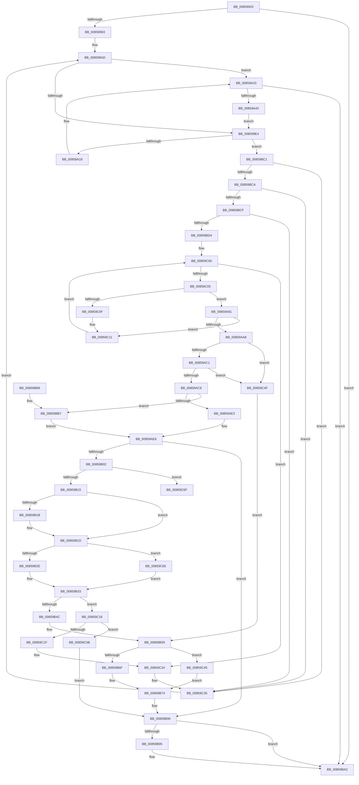

# HvpFindFreeCell

- RVA: `0x00859920`–`0x00859C8C` (길이 `876` bytes)
- VA: `0x0000000140859920`
- 실행 섹션: `PAGE`
- PDB 이름 있음: `예`; PDB Function 태그: `아니요`
- unwind 정보 RVA: `0x0006AA68`
- 디코드: `223`개 명령, `876/876` bytes 표시
- 미해석 바이트: `0` (있으면 어셈블리에 `.byte`로 보존)

> 이 문서는 커널 이미지의 기계어와 PDB 기호를 분석해 생성했습니다. 4번과 5번은 함수 원형과 자료형을 바이너리 사용 방식에서 추정한 C 해석이며 원본 소스 복구 결과는 아닙니다.

## 1. Dependencies

- 직접 호출 지점: **17**; 고유 호출 대상: **11**
- 직접 호출자로 확인된 함수: **2**
- RIP 상대 이미지 참조: **0**

### Outgoing calls
- `0x0085994C` → [HvpGetBinContextInitialize](../../pagecmrc/BC/HvpGetBinContextInitialize_function_00BC98D0.md) (function, `0x00BC98D0`)
- `0x008599C9` → [RtlFindSetBits](../../text/3F/RtlFindSetBits_function_003F0610.md) (function, `0x003F0610`)
- `0x00859A0A` → [HvpGetCellMap](../../pagecmrc/BC/HvpGetCellMap_function_00BC9710.md) (function, `0x00BC9710`)
- `0x00859A2D` → [KeBugCheckEx](../../text/4F/KeBugCheckEx_function_004FD660.md) (function, `0x004FD660`)
- `0x00859A73` → [RtlFindSetBits](../../text/3F/RtlFindSetBits_function_003F0610.md) (function, `0x003F0610`)
- `0x00859AE3` → [HvpGetCellFlat](HvpGetCellFlat_function_00854C60.md) (function, `0x00854C60`)
- `0x00859B07` → [HvpGetCellMap](../../pagecmrc/BC/HvpGetCellMap_function_00BC9710.md) (function, `0x00BC9710`)
- `0x00859B2E` → [HvpReleaseCellPaged](HvpReleaseCellPaged_function_00855F40.md) (function, `0x00855F40`)
- `0x00859B3F` → [HvpMarkDirty](HvpMarkDirty_function_008593C0.md) (function, `0x008593C0`)
- `0x00859B6F` → [HvpGetCellFlat](HvpGetCellFlat_function_00854C60.md) (function, `0x00854C60`)
- `0x00859B9D` → [HvpMapEntryReleaseBinAddress](../../pagecmrc/BC/HvpMapEntryReleaseBinAddress_function_00BC9790.md) (function, `0x00BC9790`)
- `0x00859BB7` → [HvpGetCellPaged](HvpGetCellPaged_function_00854CB0.md) (function, `0x00854CB0`)
- `0x00859BDF` → [HvpMapEntryGetBinAddress](../../pagecmrc/BC/HvpMapEntryGetBinAddress_function_00BC9770.md) (function, `0x00BC9770`)
- `0x00859C2C` → [HvpMapEntryReleaseBinAddress](../../pagecmrc/BC/HvpMapEntryReleaseBinAddress_function_00BC9790.md) (function, `0x00BC9790`)
- `0x00859C45` → [HvpGetCellPaged](HvpGetCellPaged_function_00854CB0.md) (function, `0x00854CB0`)
- `0x00859C65` → [HvpReleaseCellFlat](HvpReleaseCellFlat_function_0085CC20.md) (function, `0x0085CC20`)
- `0x00859C86` → [KeBugCheckEx](../../text/4F/KeBugCheckEx_function_004FD660.md) (function, `0x004FD660`)

### Direct callers
- [HvAllocateCell](HvAllocateCell_function_00859C94.md) at `0x00859D35`
- [sub_00859FB9](Unknown_function_00859FB9.md) at `0x0085A038`

### Static image references
- 디코드된 RIP-relative 메모리 참조가 없습니다.

## 2. Other-region calls and transfers

- 다른 실행 섹션으로 향하는 call: **10**
  - `0x0085994C` → [HvpGetBinContextInitialize](../../pagecmrc/BC/HvpGetBinContextInitialize_function_00BC98D0.md) (`PAGE` → `PAGECMRC`)
  - `0x008599C9` → [RtlFindSetBits](../../text/3F/RtlFindSetBits_function_003F0610.md) (`PAGE` → `.text`)
  - `0x00859A0A` → [HvpGetCellMap](../../pagecmrc/BC/HvpGetCellMap_function_00BC9710.md) (`PAGE` → `PAGECMRC`)
  - `0x00859A2D` → [KeBugCheckEx](../../text/4F/KeBugCheckEx_function_004FD660.md) (`PAGE` → `.text`)
  - `0x00859A73` → [RtlFindSetBits](../../text/3F/RtlFindSetBits_function_003F0610.md) (`PAGE` → `.text`)
  - `0x00859B07` → [HvpGetCellMap](../../pagecmrc/BC/HvpGetCellMap_function_00BC9710.md) (`PAGE` → `PAGECMRC`)
  - `0x00859B9D` → [HvpMapEntryReleaseBinAddress](../../pagecmrc/BC/HvpMapEntryReleaseBinAddress_function_00BC9790.md) (`PAGE` → `PAGECMRC`)
  - `0x00859BDF` → [HvpMapEntryGetBinAddress](../../pagecmrc/BC/HvpMapEntryGetBinAddress_function_00BC9770.md) (`PAGE` → `PAGECMRC`)
  - `0x00859C2C` → [HvpMapEntryReleaseBinAddress](../../pagecmrc/BC/HvpMapEntryReleaseBinAddress_function_00BC9790.md) (`PAGE` → `PAGECMRC`)
  - `0x00859C86` → [KeBugCheckEx](../../text/4F/KeBugCheckEx_function_004FD660.md) (`PAGE` → `.text`)
- 별도 외부 분기/꼬리 이동을 확인하지 못했습니다.

## 3. Assembly (complete function range)

```asm
00859920  48 8B C4                        mov rax, rsp
00859923  44 89 48 20                     mov dword ptr [rax + 0x20], r9d
00859927  44 89 40 18                     mov dword ptr [rax + 0x18], r8d
0085992B  53                              push rbx
0085992C  55                              push rbp
0085992D  56                              push rsi
0085992E  57                              push rdi
0085992F  41 54                           push r12
00859931  41 55                           push r13
00859933  41 56                           push r14
00859935  41 57                           push r15
00859937  48 83 EC 58                     sub rsp, 0x58
0085993B  4C 8B F1                        mov r14, rcx
0085993E  45 33 E4                        xor r12d, r12d
00859941  48 8D 48 08                     lea rcx, [rax + 8]
00859945  66 44 89 60 08                  mov word ptr [rax + 8], r12w
0085994A  8B FA                           mov edi, edx
0085994C  E8 7F FF 36 00                  call 0x140bc98d0
00859951  4D 63 D1                        movsxd r10, r9d
00859954  8B CA                           mov ecx, edx
00859956  49 69 F2 78 02 00 00            imul rsi, r10, 0x278
0085995D  B8 FF FF FF FF                  mov eax, 0xffffffff
00859962  41 BF FF FF FF FF               mov r15d, 0xffffffff
00859968  D3 E0                           shl eax, cl
0085996A  48 89 74 24 48                  mov qword ptr [rsp + 0x48], rsi
0085996F  42 8B AC 36 88 03 00 00         mov ebp, dword ptr [rsi + r14 + 0x388]
00859977  23 E8                           and ebp, eax
00859979  89 6C 24 30                     mov dword ptr [rsp + 0x30], ebp
0085997D  0F 84 1F 02 00 00               je 0x140859ba2
00859983  0F BC C5                        bsf eax, ebp
00859986  44 89 A4 24 A8 00 00 00         mov dword ptr [rsp + 0xa8], r12d
0085998E  45 8B EF                        mov r13d, r15d
00859991  3B C2                           cmp eax, edx
00859993  0F 45 F8                        cmovne edi, eax
00859996  89 BC 24 A8 00 00 00            mov dword ptr [rsp + 0xa8], edi
0085999D  48 8D 0C 7F                     lea rcx, [rdi + rdi*2]
008599A1  48 8D 04 CE                     lea rax, [rsi + rcx*8]
008599A5  42 8B 94 30 3C 01 00 00         mov edx, dword ptr [rax + r14 + 0x13c]
008599AD  8B C7                           mov eax, edi
008599AF  44 8B C2                        mov r8d, edx
008599B2  BA 01 00 00 00                  mov edx, 1
008599B7  48 8D 0C 40                     lea rcx, [rax + rax*2]
008599BB  48 8D 1C CE                     lea rbx, [rsi + rcx*8]
008599BF  49 8D 8E 40 01 00 00            lea rcx, [r14 + 0x140]
008599C6  48 03 CB                        add rcx, rbx
008599C9  E8 42 6C B9 FF                  call 0x1403f0610
008599CE  44 8B C0                        mov r8d, eax
008599D1  42 89 84 33 3C 01 00 00         mov dword ptr [rbx + r14 + 0x13c], eax
008599D9  FF C0                           inc eax
008599DB  89 44 24 34                     mov dword ptr [rsp + 0x34], eax
008599DF  45 3B E8                        cmp r13d, r8d
008599E2  74 4F                           je 0x140859a33
008599E4  44 8B 94 24 B8 00 00 00         mov r10d, dword ptr [rsp + 0xb8]
008599EC  41 8B C0                        mov eax, r8d
008599EF  45 3B EF                        cmp r13d, r15d
008599F2  49 8B CE                        mov rcx, r14
008599F5  41 0F 45 C5                     cmovne eax, r13d
008599F9  41 C1 E2 1F                     shl r10d, 0x1f
008599FD  41 C1 E0 0C                     shl r8d, 0xc
00859A01  44 8B E8                        mov r13d, eax
00859A04  45 03 C2                        add r8d, r10d
00859A07  41 8B D0                        mov edx, r8d
00859A0A  E8 01 FD 36 00                  call 0x140bc9710
00859A0F  48 85 C0                        test rax, rax
00859A12  0F 85 A9 01 00 00               jne 0x140859bc1
00859A18  45 8B C8                        mov r9d, r8d
00859A1B  8D 50 01                        lea edx, [rax + 1]
00859A1E  4D 8B C6                        mov r8, r14
00859A21  48 C7 44 24 20 8A 04 00 00      mov qword ptr [rsp + 0x20], 0x48a
00859A2A  8D 48 51                        lea ecx, [rax + 0x51]
00859A2D  E8 2E 3C CA FF                  call 0x1404fd660
00859A32  CC                              int3
00859A33  8D 45 FF                        lea eax, [rbp - 1]
00859A36  23 E8                           and ebp, eax
00859A38  89 6C 24 30                     mov dword ptr [rsp + 0x30], ebp
00859A3C  0F 84 60 01 00 00               je 0x140859ba2
00859A42  0F BC C5                        bsf eax, ebp
00859A45  44 89 A4 24 A8 00 00 00         mov dword ptr [rsp + 0xa8], r12d
00859A4D  BA 01 00 00 00                  mov edx, 1
00859A52  89 84 24 A8 00 00 00            mov dword ptr [rsp + 0xa8], eax
00859A59  48 8D 0C 40                     lea rcx, [rax + rax*2]
00859A5D  48 8D 1C CE                     lea rbx, [rsi + rcx*8]
00859A61  46 8B 84 33 3C 01 00 00         mov r8d, dword ptr [rbx + r14 + 0x13c]
00859A69  49 8D 8E 40 01 00 00            lea rcx, [r14 + 0x140]
00859A70  48 03 CB                        add rcx, rbx
00859A73  E8 98 6B B9 FF                  call 0x1403f0610
00859A78  44 8B C0                        mov r8d, eax
00859A7B  42 89 84 33 3C 01 00 00         mov dword ptr [rbx + r14 + 0x13c], eax
00859A83  FF C0                           inc eax
00859A85  45 8B E8                        mov r13d, r8d
00859A88  89 44 24 34                     mov dword ptr [rsp + 0x34], eax
00859A8C  E9 53 FF FF FF                  jmp 0x1408599e4
00859A91  41 8B DA                        mov ebx, r10d
00859A94  2B DD                           sub ebx, ebp
00859A96  41 03 D9                        add ebx, r9d
00859A99  03 DA                           add ebx, edx
00859A9B  39 84 24 B0 00 00 00            cmp dword ptr [rsp + 0xb0], eax
00859AA2  0F 87 69 01 00 00               ja 0x140859c11
00859AA8  41 8B 86 A0 00 00 00            mov eax, dword ptr [r14 + 0xa0]
00859AAF  44 89 7C 24 38                  mov dword ptr [rsp + 0x38], r15d
00859AB4  44 89 64 24 3C                  mov dword ptr [rsp + 0x3c], r12d
00859AB9  A8 01                           test al, 1
00859ABB  0F 85 8E 01 00 00               jne 0x140859c4f
00859AC1  85 DB                           test ebx, ebx
00859AC3  0F 88 86 01 00 00               js 0x140859c4f
00859AC9  49 8D B6 8C 00 00 00            lea rsi, [r14 + 0x8c]
00859AD0  8B D3                           mov edx, ebx
00859AD2  F6 06 01                        test byte ptr [rsi], 1
00859AD5  4C 8D 44 24 38                  lea r8, [rsp + 0x38]
00859ADA  49 8B CE                        mov rcx, r14
00859ADD  0F 84 D4 00 00 00               je 0x140859bb7
00859AE3  E8 78 B1 FF FF                  call 0x140854c60
00859AE8  48 8B C8                        mov rcx, rax
00859AEB  49 8B FC                        mov rdi, r12
00859AEE  48 85 C9                        test rcx, rcx
00859AF1  48 8D 40 FC                     lea rax, [rax - 4]
00859AF5  48 0F 45 F8                     cmovne rdi, rax
00859AF9  48 85 FF                        test rdi, rdi
00859AFC  0F 84 8E 00 00 00               je 0x140859b90
00859B02  8B D3                           mov edx, ebx
00859B04  49 8B CE                        mov rcx, r14
00859B07  E8 04 FC 36 00                  call 0x140bc9710
00859B0C  48 85 C0                        test rax, rax
00859B0F  0F 84 5A 01 00 00               je 0x140859c6f
00859B15  8B 3F                           mov edi, dword ptr [rdi]
00859B17  85 FF                           test edi, edi
00859B19  79 02                           jns 0x140859b1d
00859B1B  F7 DF                           neg edi
00859B1D  F6 06 01                        test byte ptr [rsi], 1
00859B20  48 8D 54 24 38                  lea rdx, [rsp + 0x38]
00859B25  49 8B CE                        mov rcx, r14
00859B28  0F 85 37 01 00 00               jne 0x140859c65
00859B2E  E8 0D C4 FF FF                  call 0x140855f40
00859B33  45 33 C9                        xor r9d, r9d
00859B36  8D 53 FC                        lea edx, [rbx - 4]
00859B39  44 8B C7                        mov r8d, edi
00859B3C  49 8B CE                        mov rcx, r14
00859B3F  E8 7C F8 FF FF                  call 0x1408593c0
00859B44  85 C0                           test eax, eax
00859B46  0F 88 CC 00 00 00               js 0x140859c18
00859B4C  48 8B 6C 24 40                  mov rbp, qword ptr [rsp + 0x40]
00859B51  41 C6 86 8D 00 00 00 01         mov byte ptr [r14 + 0x8d], 1
00859B59  F6 06 01                        test byte ptr [rsi], 1
00859B5C  8B D3                           mov edx, ebx
00859B5E  4C 8B 84 24 C8 00 00 00         mov r8, qword ptr [rsp + 0xc8]
00859B66  49 8B CE                        mov rcx, r14
00859B69  0F 84 D6 00 00 00               je 0x140859c45
00859B6F  E8 EC B0 FF FF                  call 0x140854c60
00859B74  48 8B C8                        mov rcx, rax
00859B77  44 8B FB                        mov r15d, ebx
00859B7A  48 8D 40 FC                     lea rax, [rax - 4]
00859B7E  48 85 C9                        test rcx, rcx
00859B81  4C 0F 45 E0                     cmovne r12, rax
00859B85  48 8B 84 24 C0 00 00 00         mov rax, qword ptr [rsp + 0xc0]
00859B8D  4C 89 20                        mov qword ptr [rax], r12
00859B90  48 85 ED                        test rbp, rbp
00859B93  74 0D                           je 0x140859ba2
00859B95  4C 8D 84 24 A0 00 00 00         lea r8, [rsp + 0xa0]
00859B9D  E8 EE FB 36 00                  call 0x140bc9790
00859BA2  41 8B C7                        mov eax, r15d
00859BA5  48 83 C4 58                     add rsp, 0x58
00859BA9  41 5F                           pop r15
00859BAB  41 5E                           pop r14
00859BAD  41 5D                           pop r13
00859BAF  41 5C                           pop r12
00859BB1  5F                              pop rdi
00859BB2  5E                              pop rsi
00859BB3  5D                              pop rbp
00859BB4  5B                              pop rbx
00859BB5  C3                              ret
00859BB6  CC                              int3
00859BB7  E8 F4 B0 FF FF                  call 0x140854cb0
00859BBC  E9 27 FF FF FF                  jmp 0x140859ae8
00859BC1  48 8B 48 08                     mov rcx, qword ptr [rax + 8]
00859BC5  F6 C1 02                        test cl, 2
00859BC8  75 6B                           jne 0x140859c35
00859BCA  F6 C1 04                        test cl, 4
00859BCD  75 66                           jne 0x140859c35
00859BCF  F6 C1 01                        test cl, 1
00859BD2  74 61                           je 0x140859c35
00859BD4  4C 8D 84 24 A0 00 00 00         lea r8, [rsp + 0xa0]
00859BDC  48 8B D0                        mov rdx, rax
00859BDF  E8 8C FB 36 00                  call 0x140bc9770
00859BE4  48 8B E8                        mov rbp, rax
00859BE7  48 89 44 24 40                  mov qword ptr [rsp + 0x40], rax
00859BEC  44 8B 40 08                     mov r8d, dword ptr [rax + 8]
00859BF0  48 8D 50 20                     lea rdx, [rax + 0x20]
00859BF4  44 8B 48 04                     mov r9d, dword ptr [rax + 4]
00859BF8  4C 03 C0                        add r8, rax
00859BFB  0F 1F 44 00 00                  nop dword ptr [rax + rax]
00859C00  49 3B D0                        cmp rdx, r8
00859C03  73 1F                           jae 0x140859c24
00859C05  8B 02                           mov eax, dword ptr [rdx]
00859C07  85 C0                           test eax, eax
00859C09  0F 89 82 FE FF FF               jns 0x140859a91
00859C0F  F7 D8                           neg eax
00859C11  8B C8                           mov ecx, eax
00859C13  48 03 D1                        add rdx, rcx
00859C16  EB E8                           jmp 0x140859c00
00859C18  3D 25 02 00 C0                  cmp eax, 0xc0000225
00859C1D  75 3C                           jne 0x140859c5b
00859C1F  48 8B 74 24 48                  mov rsi, qword ptr [rsp + 0x48]
00859C24  4C 8D 84 24 A0 00 00 00         lea r8, [rsp + 0xa0]
00859C2C  E8 5F FB 36 00                  call 0x140bc9790
00859C31  8B 6C 24 30                     mov ebp, dword ptr [rsp + 0x30]
00859C35  8B BC 24 A8 00 00 00            mov edi, dword ptr [rsp + 0xa8]
00859C3C  8B 54 24 34                     mov edx, dword ptr [rsp + 0x34]
00859C40  E9 68 FD FF FF                  jmp 0x1408599ad
00859C45  E8 66 B0 FF FF                  call 0x140854cb0
00859C4A  E9 25 FF FF FF                  jmp 0x140859b74
00859C4F  49 8D B6 8C 00 00 00            lea rsi, [r14 + 0x8c]
00859C56  E9 FE FE FF FF                  jmp 0x140859b59
00859C5B  48 8B 6C 24 40                  mov rbp, qword ptr [rsp + 0x40]
00859C60  E9 2B FF FF FF                  jmp 0x140859b90
00859C65  E8 B6 2F 00 00                  call 0x14085cc20
00859C6A  E9 C4 FE FF FF                  jmp 0x140859b33
00859C6F  BA 01 00 00 00                  mov edx, 1
00859C74  44 8B CB                        mov r9d, ebx
00859C77  4D 8B C6                        mov r8, r14
00859C7A  48 C7 44 24 20 A7 02 00 00      mov qword ptr [rsp + 0x20], 0x2a7
00859C83  8D 4A 50                        lea ecx, [rdx + 0x50]
00859C86  E8 D5 39 CA FF                  call 0x1404fd660
00859C8B  CC                              int3
```

## 4. C-style interpretation (structured pseudocode)

```c
__int64 __fastcall HvpFindFreeCell(__int64 a1, int a2, int a3, int a4, __int64 a5, __int64 a6)
{
    __int64 result;
    __int64 v_r10;
    __int64 v_r12;
    __int64 v_rbp;
    __int64 v_rbx;
    __int64 v_rdi;
    __int64 v_rsi;
    __int64 v_rsp;
    unsigned __int64 v_stack_m50;
    unsigned __int64 v_stack_m58;
    unsigned int v_stack_m5C;
    unsigned int v_stack_m60;
    unsigned int v_stack_m64;
    unsigned int v_stack_m68;
    unsigned __int64 v_stack_m78;
    unsigned int v_stack_p10;
    unsigned int v_stack_p18;
    unsigned int v_stack_p20;
    unsigned int v_stack_p30;
    unsigned int v_stack_p34;
    unsigned __int64 v_stack_p40;
    unsigned __int64 v_stack_p48;
    unsigned __int64 v_stack_p8;
    unsigned __int64 v_stack_pA0;
    unsigned int v_stack_pA8;

    *(unsigned int *)(v_rsp + 32) = a4;
    *(unsigned int *)(v_rsp + 24) = a3;
    v_rsp = (v_rsp) - (88);
    v_r12 = 0;
    *(unsigned __int16 *)(v_rsp + 8) = 0;
    result = HvpGetBinContextInitialize(v_rsp + 8, a2, a3, a4);
    v_rsi = (v_rsi) * ((int)(a4));
    result = (unsigned int)(((unsigned int)(0xFFFFFFFFULL)) << ((unsigned __int8)((unsigned int)(a2))));
    v_stack_m50 = v_rsi;
    v_rbp = (unsigned int)(((unsigned int)(*(unsigned int *)(v_rsi + a1 * 1 + 904))) & ((unsigned int)(result)));
    v_stack_m68 = (unsigned int)(v_rbp);
    if (condition_is_equal) goto loc_00859BA2;
    v_stack_p10 = 0;
    v_rdi = (unsigned int)(a2);
    if (((unsigned int)(result)) != a2) { v_rdi = (unsigned int)(result); }
    v_stack_p10 = (unsigned int)(v_rdi);
loc_008599AD:
    a1 = (a1 + 320) + (v_rsi + (unsigned int)((unsigned int)(v_rdi)) + (unsigned int)((unsigned int)(v_rdi)) * 2 * 8);
    result = RtlFindSetBits(a1, 1, (unsigned int)((unsigned int)((unsigned int)(*(unsigned int *)(v_rsi + v_rdi + v_rdi * 2 * 8 + a1 * 1 + 316)))), a4);
    *(unsigned int *)(v_rsi + (unsigned int)((unsigned int)(v_rdi)) + (unsigned int)((unsigned int)(v_rdi)) * 2 * 8 + a1 * 1 + 316) = (unsigned int)(result);
    result = (unsigned int)((result) + 1);
    v_stack_m64 = (unsigned int)(result);
    if (((unsigned int)((unsigned int)((unsigned int)((unsigned int)(0xFFFFFFFFULL))))) == ((unsigned int)((unsigned int)((unsigned int)(result))))) goto loc_00859A33;
loc_008599E4:
    result = (unsigned int)((unsigned int)((unsigned int)((unsigned int)(result))));
    if (((unsigned int)((unsigned int)((unsigned int)((unsigned int)(0xFFFFFFFFULL))))) != ((unsigned int)((unsigned int)(0xFFFFFFFFULL)))) { result = (unsigned int)((unsigned int)((unsigned int)((unsigned int)(0xFFFFFFFFULL)))); }
    v_r10 = (unsigned int)(((unsigned int)(v_stack_p20)) << (31));
    a3 = (unsigned int)(((unsigned int)((unsigned int)(result))) << (12));
    a3 = (unsigned int)((a3) + ((unsigned int)(v_r10)));
    result = HvpGetCellMap(a1, (unsigned int)(a3), a3, a4);
    if (result != 0) goto loc_00859BC1;
    v_stack_m78 = 0x48AULL;
    result = KeBugCheckEx(result + 81, result + 1, a1, (unsigned int)(a3));
loc_00859A33:
    v_rbp = (unsigned int)((v_rbp) & ((unsigned int)(v_rbp - 1)));
    v_stack_m68 = (unsigned int)(v_rbp);
    if (condition_is_equal) goto loc_00859BA2;
    v_stack_p10 = 0;
    v_stack_p10 = (unsigned int)(v_rbp - 1);
    a1 = (a1 + 320) + (v_rsi + v_rbp - 1 + v_rbp - 1 * 2 * 8);
    result = RtlFindSetBits(a1, 1, (unsigned int)(*(unsigned int *)(v_rsi + v_rbp - 1 + v_rbp - 1 * 2 * 8 + a1 * 1 + 316)), (unsigned int)(a3));
    *(unsigned int *)(v_rsi + v_rbp - 1 + v_rbp - 1 * 2 * 8 + a1 * 1 + 316) = (unsigned int)(result);
    result = (unsigned int)((result) + 1);
    v_stack_m64 = (unsigned int)(result);
    goto loc_008599E4;
loc_00859A91:
    v_rbx = (unsigned int)(((unsigned int)((unsigned int)(v_r10))) - ((unsigned int)(v_rbp)));
    v_rbx = (unsigned int)((v_rbx) + ((unsigned int)((unsigned int)(a3))));
    v_rbx = (unsigned int)((v_rbx) + (1));
    if (v_stack_p18 > ((unsigned int)(result))) goto loc_00859C11;
    v_stack_m60 = (unsigned int)((unsigned int)(0xFFFFFFFFULL));
    v_stack_m5C = 0;
    if ((((unsigned __int8)((unsigned int)(*(unsigned int *)(a1 + 160)))) & (1)) != 0) goto loc_00859C4F;
    if (sign_flag) goto loc_00859C4F;
    if (((*(unsigned __int8 *)(a1 + 140)) & (1)) == 0) goto loc_00859BB7;
    result = HvpGetCellFlat(a1, (unsigned int)((unsigned int)(v_rbx)), v_stack_m60, (unsigned int)(a3));
loc_00859AE8:
    v_rdi = 0;
    if (result != 0) { v_rdi = result - 4; }
    if (v_rdi == 0) goto loc_00859B90;
    result = HvpGetCellMap(a1, (unsigned int)((unsigned int)(v_rbx)), v_stack_m60, (unsigned int)(a3));
    if (result == 0) goto loc_00859C6F;
    v_rdi = (unsigned int)(*(unsigned int *)(v_rdi));
    if (sign_flag) {
        v_rdi = (unsigned int)(-((unsigned int)(*(unsigned int *)(v_rdi))));
    }
    if (((*(unsigned __int8 *)(a1 + 140)) & (1)) != 0) goto loc_00859C65;
    result = HvpReleaseCellPaged(a1, v_stack_m60, v_stack_m60, (unsigned int)(a3));
loc_00859B33:
    a4 = 0;
    result = HvpMarkDirty(a1, v_rbx - 4, (unsigned int)((unsigned int)(v_rdi)), a4);
    if (sign_flag) goto loc_00859C18;
    *(unsigned __int8 *)(a1 + 141) = 1;
loc_00859B59:
    if (((*(unsigned __int8 *)(a1 + 140)) & (1)) == 0) goto loc_00859C45;
    result = HvpGetCellFlat(a1, (unsigned int)((unsigned int)(v_rbx)), a6, a4);
loc_00859B74:
    if (result != 0) { v_r12 = result - 4; }
    *(unsigned __int64 *)(a5) = v_r12;
loc_00859B90:
    result = a5;
    if (v_stack_m58 != 0) {
        a3 = v_stack_p8;
        result = HvpMapEntryReleaseBinAddress(result, (unsigned int)((unsigned int)(v_rbx)), a3, a4);
    }
    v_rsp = (v_rsp) + (88);
    return (unsigned int)((unsigned int)((unsigned int)((unsigned int)(v_rbx))));
loc_00859BB7:
    result = HvpGetCellPaged(result, (unsigned int)((unsigned int)(v_rbx)), a3, a4);
    goto loc_00859AE8;
loc_00859BC1:
    if ((((unsigned __int8)(*(unsigned __int64 *)(result + 8))) & (2)) != 0) goto loc_00859C35;
    if ((((unsigned __int8)(*(unsigned __int64 *)(result + 8))) & (4)) != 0) goto loc_00859C35;
    if ((((unsigned __int8)(*(unsigned __int64 *)(result + 8))) & (1)) == 0) goto loc_00859C35;
    result = HvpMapEntryGetBinAddress(*(unsigned __int64 *)(result + 8), result, v_stack_pA0, a4);
    v_stack_p40 = result;
    a3 = ((unsigned int)(*(unsigned int *)(result + 8))) + (result);
loc_00859C00:
    if ((result + 32) >= a3) goto loc_00859C24;
    if (!sign_flag) goto loc_00859A91;
    result = (unsigned int)(-((unsigned int)(*(unsigned int *)(result + 32))));
loc_00859C11:
    a2 = (result + 32) + ((unsigned int)((unsigned int)(result)));
    goto loc_00859C00;
loc_00859C18:
    if (((unsigned int)(result)) != 0xC0000225ULL) goto loc_00859C5B;
loc_00859C24:
    result = HvpMapEntryReleaseBinAddress((unsigned int)((unsigned int)(result)), a2, v_stack_pA0, (unsigned int)(*(unsigned int *)(result + 4)));
loc_00859C35:
    goto loc_008599AD;
loc_00859C45:
    result = HvpGetCellPaged((unsigned int)((unsigned int)(result)), (unsigned int)(v_stack_p34), v_stack_pA0, (unsigned int)(*(unsigned int *)(result + 4)));
    goto loc_00859B74;
loc_00859C4F:
    goto loc_00859B59;
loc_00859C5B:
    goto loc_00859B90;
loc_00859C65:
    result = HvpReleaseCellFlat((unsigned int)((unsigned int)(result)), (unsigned int)(v_stack_p34), v_stack_pA0, (unsigned int)(*(unsigned int *)(result + 4)));
    goto loc_00859B33;
loc_00859C6F:
    v_stack_p20 = 679;
    result = KeBugCheckEx(1 + 80, 1, a1, (unsigned int)((unsigned int)(v_rbx)));
    return result;
}
```

## 5. (Beta) C Style

```c
int64_t HvpFindFreeCell(void *Arg1, int32_t Arg2, int32_t Arg3, int32_t Arg4, void *Arg5, int64_t Arg6)
{
    uint8_t *arg1 = (uint8_t *)Arg1;
    uint8_t *arg5 = (uint8_t *)Arg5;

    int64_t result;
    int64_t local_r10;
    int64_t local_r12;
    int64_t local_rbp;
    int64_t local_rbx;
    int64_t local_rdi;
    int64_t local_rsi;
    int64_t local_rsp;
    uint64_t v_stack_m50;
    uint64_t v_stack_m58;
    uint32_t v_stack_m5C;
    uint32_t v_stack_m60;
    uint32_t v_stack_m64;
    uint32_t v_stack_m68;
    uint64_t v_stack_m78;
    uint32_t v_stack_p10;
    uint32_t v_stack_p18;
    uint32_t v_stack_p20;
    uint32_t v_stack_p30;
    uint32_t v_stack_p34;
    uint64_t v_stack_p40;
    uint64_t v_stack_p48;
    uint64_t v_stack_p8;
    uint64_t v_stack_pA0;
    uint32_t v_stack_pA8;

    *(uint32_t *)(local_rsp + 0x20) = Arg4;
    *(uint32_t *)(local_rsp + 0x18) = Arg3;
    local_rsp = (local_rsp) - (88);
    local_r12 = 0;
    *(uint16_t *)(local_rsp + 0x8) = 0;
    result = HvpGetBinContextInitialize(local_rsp + 8, Arg2, Arg3, Arg4);
    local_rsi = (local_rsi) * ((int32_t)(Arg4));
    result = (uint32_t)(((uint32_t)(0xFFFFFFFFULL)) << ((uint8_t)((uint32_t)(Arg2))));
    v_stack_m50 = local_rsi;
    local_rbp = (uint32_t)(((uint32_t)(*(uint32_t *)(local_rsi + arg1 * 1 + 0x388))) & ((uint32_t)(result)));
    v_stack_m68 = (uint32_t)(local_rbp);
    if (condition_is_equal) goto loc_00859BA2;
    v_stack_p10 = 0;
    local_rdi = (uint32_t)(Arg2);
    if (((uint32_t)(result)) != Arg2) { local_rdi = (uint32_t)(result); }
    v_stack_p10 = (uint32_t)(local_rdi);
loc_008599AD:
    Arg1 = (Arg1 + 320) + (local_rsi + (uint32_t)((uint32_t)(local_rdi)) + (uint32_t)((uint32_t)(local_rdi)) * 2 * 8);
    result = RtlFindSetBits(Arg1, 1, (uint32_t)((uint32_t)((uint32_t)(*(uint32_t *)(local_rsi + local_rdi + local_rdi * 2 * 8 + arg1 * 1 + 0x13C)))), Arg4);
    *(uint32_t *)(local_rsi + (uint32_t)((uint32_t)(local_rdi)) + (uint32_t)((uint32_t)(local_rdi)) * 2 * 8 + arg1 * 1 + 0x13C) = (uint32_t)(result);
    result = (uint32_t)((result) + 1);
    v_stack_m64 = (uint32_t)(result);
    if (((uint32_t)((uint32_t)((uint32_t)((uint32_t)(0xFFFFFFFFULL))))) == ((uint32_t)((uint32_t)((uint32_t)(result))))) goto loc_00859A33;
loc_008599E4:
    result = (uint32_t)((uint32_t)((uint32_t)((uint32_t)(result))));
    if (((uint32_t)((uint32_t)((uint32_t)((uint32_t)(0xFFFFFFFFULL))))) != ((uint32_t)((uint32_t)(0xFFFFFFFFULL)))) { result = (uint32_t)((uint32_t)((uint32_t)((uint32_t)(0xFFFFFFFFULL)))); }
    local_r10 = (uint32_t)(((uint32_t)(v_stack_p20)) << (31));
    Arg3 = (uint32_t)(((uint32_t)((uint32_t)(result))) << (12));
    Arg3 = (uint32_t)((Arg3) + ((uint32_t)(local_r10)));
    result = HvpGetCellMap(Arg1, (uint32_t)(Arg3), Arg3, Arg4);
    if (result != 0) goto loc_00859BC1;
    v_stack_m78 = 0x48AULL;
    result = KeBugCheckEx(result + 81, result + 1, Arg1, (uint32_t)(Arg3));
loc_00859A33:
    local_rbp = (uint32_t)((local_rbp) & ((uint32_t)(local_rbp - 1)));
    v_stack_m68 = (uint32_t)(local_rbp);
    if (condition_is_equal) goto loc_00859BA2;
    v_stack_p10 = 0;
    v_stack_p10 = (uint32_t)(local_rbp - 1);
    Arg1 = (Arg1 + 320) + (local_rsi + local_rbp - 1 + local_rbp - 1 * 2 * 8);
    result = RtlFindSetBits(Arg1, 1, (uint32_t)(*(uint32_t *)(local_rsi + local_rbp - 0x1 + local_rbp - 0x1 * 2 * 8 + arg1 * 1 + 0x13C)), (uint32_t)(Arg3));
    *(uint32_t *)(local_rsi + local_rbp - 0x1 + local_rbp - 0x1 * 2 * 8 + arg1 * 1 + 0x13C) = (uint32_t)(result);
    result = (uint32_t)((result) + 1);
    v_stack_m64 = (uint32_t)(result);
    goto loc_008599E4;
loc_00859A91:
    local_rbx = (uint32_t)(((uint32_t)((uint32_t)(local_r10))) - ((uint32_t)(local_rbp)));
    local_rbx = (uint32_t)((local_rbx) + ((uint32_t)((uint32_t)(Arg3))));
    local_rbx = (uint32_t)((local_rbx) + (1));
    if (v_stack_p18 > ((uint32_t)(result))) goto loc_00859C11;
    v_stack_m60 = (uint32_t)((uint32_t)(0xFFFFFFFFULL));
    v_stack_m5C = 0;
    if ((((uint8_t)((uint32_t)(*(uint32_t *)(arg1 + 0xA0)))) & (1)) != 0) goto loc_00859C4F;
    if (sign_flag) goto loc_00859C4F;
    if (((*(uint8_t *)(arg1 + 0x8C)) & (1)) == 0) goto loc_00859BB7;
    result = HvpGetCellFlat(Arg1, (uint32_t)((uint32_t)(local_rbx)), v_stack_m60, (uint32_t)(Arg3));
loc_00859AE8:
    local_rdi = 0;
    if (result != 0) { local_rdi = result - 4; }
    if (local_rdi == 0) goto loc_00859B90;
    result = HvpGetCellMap(Arg1, (uint32_t)((uint32_t)(local_rbx)), v_stack_m60, (uint32_t)(Arg3));
    if (result == 0) goto loc_00859C6F;
    local_rdi = (uint32_t)(*(uint32_t *)(local_rdi));
    if (sign_flag) {
        local_rdi = (uint32_t)(-((uint32_t)(*(uint32_t *)(local_rdi))));
    }
    if (((*(uint8_t *)(arg1 + 0x8C)) & (1)) != 0) goto loc_00859C65;
    result = HvpReleaseCellPaged(Arg1, v_stack_m60, v_stack_m60, (uint32_t)(Arg3));
loc_00859B33:
    Arg4 = 0;
    result = HvpMarkDirty(Arg1, local_rbx - 4, (uint32_t)((uint32_t)(local_rdi)), Arg4);
    if (sign_flag) goto loc_00859C18;
    *(uint8_t *)(arg1 + 0x8D) = 1;
loc_00859B59:
    if (((*(uint8_t *)(arg1 + 0x8C)) & (1)) == 0) goto loc_00859C45;
    result = HvpGetCellFlat(Arg1, (uint32_t)((uint32_t)(local_rbx)), Arg6, Arg4);
loc_00859B74:
    if (result != 0) { local_r12 = result - 4; }
    *(uint64_t *)(arg5) = local_r12;
loc_00859B90:
    result = Arg5;
    if (v_stack_m58 != 0) {
        Arg3 = v_stack_p8;
        result = HvpMapEntryReleaseBinAddress(result, (uint32_t)((uint32_t)(local_rbx)), Arg3, Arg4);
    }
    local_rsp = (local_rsp) + (88);
    return (uint32_t)((uint32_t)((uint32_t)((uint32_t)(local_rbx))));
loc_00859BB7:
    result = HvpGetCellPaged(result, (uint32_t)((uint32_t)(local_rbx)), Arg3, Arg4);
    goto loc_00859AE8;
loc_00859BC1:
    if ((((uint8_t)(*(uint64_t *)(result + 0x8))) & (2)) != 0) goto loc_00859C35;
    if ((((uint8_t)(*(uint64_t *)(result + 0x8))) & (4)) != 0) goto loc_00859C35;
    if ((((uint8_t)(*(uint64_t *)(result + 0x8))) & (1)) == 0) goto loc_00859C35;
    result = HvpMapEntryGetBinAddress(*(uint64_t *)(result + 0x8), result, v_stack_pA0, Arg4);
    v_stack_p40 = result;
    Arg3 = ((uint32_t)(*(uint32_t *)(result + 0x8))) + (result);
loc_00859C00:
    if ((result + 32) >= Arg3) goto loc_00859C24;
    if (!sign_flag) goto loc_00859A91;
    result = (uint32_t)(-((uint32_t)(*(uint32_t *)(result + 0x20))));
loc_00859C11:
    Arg2 = (result + 32) + ((uint32_t)((uint32_t)(result)));
    goto loc_00859C00;
loc_00859C18:
    if (((uint32_t)(result)) != 0xC0000225ULL) goto loc_00859C5B;
loc_00859C24:
    result = HvpMapEntryReleaseBinAddress((uint32_t)((uint32_t)(result)), Arg2, v_stack_pA0, (uint32_t)(*(uint32_t *)(result + 0x4)));
loc_00859C35:
    goto loc_008599AD;
loc_00859C45:
    result = HvpGetCellPaged((uint32_t)((uint32_t)(result)), (uint32_t)(v_stack_p34), v_stack_pA0, (uint32_t)(*(uint32_t *)(result + 0x4)));
    goto loc_00859B74;
loc_00859C4F:
    goto loc_00859B59;
loc_00859C5B:
    goto loc_00859B90;
loc_00859C65:
    result = HvpReleaseCellFlat((uint32_t)((uint32_t)(result)), (uint32_t)(v_stack_p34), v_stack_pA0, (uint32_t)(*(uint32_t *)(result + 0x4)));
    goto loc_00859B33;
loc_00859C6F:
    v_stack_p20 = 679;
    result = KeBugCheckEx(1 + 80, 1, Arg1, (uint32_t)((uint32_t)(local_rbx)));
    return result;
}
```

### 관측된 메모리 오프셋

구조체 형식이 확인되지 않은 접근은 인자 기준의 오프셋으로만 기록했습니다.

| 기준 인자 | 오프셋 표현 | 폭 (bit) | 접근 |
|---|---:|---:|---|
| `Arg1` | `+ 0x0` | `8` | `R` |
| `Arg1` | `+ 0x8C` | `64` | `R` |
| `Arg1` | `+ 0x8D` | `8` | `W` |
| `Arg1` | `+ 0xA0` | `32` | `R` |
| `Arg1` | `+ 0x140` | `64` | `R` |
| `Arg5` | `+ 0x0` | `64` | `W` |

## 6. Execution-region graph

[열기: 2D/3D 그래프와 함수 탐색 컨트롤 패널](../../../control-panel.html?section=page&rva=0x00859920&view=graph)

- 2D 그래프는 위에서 아래로 흐르고, 3D 그래프는 빈 공간을 드래그해 회전합니다. Shift+드래그는 이동, 휠은 확대·축소, 함수 노드 선택은 대상 보고서 이동입니다.

### Static fallback


