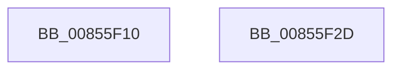

# HvpGetCellContextInitialize

- RVA: `0x00855F10`–`0x00855F2E` (길이 `30` bytes)
- VA: `0x0000000140855F10`
- 실행 섹션: `PAGE`
- PDB 이름 있음: `예`; PDB Function 태그: `아니요`
- unwind 정보 RVA: `0x0005C788`
- 디코드: `9`개 명령, `30/30` bytes 표시
- 미해석 바이트: `0` (있으면 어셈블리에 `.byte`로 보존)

> 이 문서는 커널 이미지의 기계어와 PDB 기호를 분석해 생성했습니다. 4번과 5번은 함수 원형과 자료형을 바이너리 사용 방식에서 추정한 C 해석이며 원본 소스 복구 결과는 아닙니다.

## 1. Dependencies

- 직접 호출 지점: **1**; 고유 호출 대상: **1**
- 직접 호출자로 확인된 함수: **75**
- RIP 상대 이미지 참조: **0**

### Outgoing calls
- `0x00855F23` → [HvpGetBinContextInitialize](../../pagecmrc/BC/HvpGetBinContextInitialize_function_00BC98D0.md) (function, `0x00BC98D0`)

### Direct callers
- [CmDeleteLayeredKey](../../text/41/CmDeleteLayeredKey_function_0041B598.md) at `0x0041B60A`
- [CmDeleteLayeredKey](../../text/41/CmDeleteLayeredKey_function_0041B598.md) at `0x0041B613`
- [CmpQueryKeyDataFromKeyNodeStack](../../text/46/CmpQueryKeyDataFromKeyNodeStack_function_0046AC40.md) at `0x0046AC9A`
- [CmpValueEnumStackEntryInitialize](../../text/49/CmpValueEnumStackEntryInitialize_function_0049D4C4.md) at `0x0049D4D6`
- [CmpDereferenceSecurityNode](../../text/4A/CmpDereferenceSecurityNode_function_004A672C.md) at `0x004A674A`
- [CmpCreateTombstone](../../text/66/CmpCreateTombstone_function_0066AF50.md) at `0x0066AF86`
- [CmpCreateTombstone](../../text/66/CmpCreateTombstone_function_0066AF50.md) at `0x0066AF8F`
- [CmpLoadHiveVolatile](../7D/CmpLoadHiveVolatile_function_007DE5F0.md) at `0x007DE67E`
- [CmpRefreshHive](../7D/CmpRefreshHive_function_007DEAD0.md) at `0x007DEB19`
- [CmpRefreshHive](../7D/CmpRefreshHive_function_007DEAD0.md) at `0x007DEB22`
- [CmRenameKey](../7E/CmRenameKey_function_007E8F48.md) at `0x007E9011`
- [CmRenameKey](../7E/CmRenameKey_function_007E8F48.md) at `0x007E901A`
- [CmRenameKey](../7E/CmRenameKey_function_007E8F48.md) at `0x007E902F`
- [CmRenameKey](../7E/CmRenameKey_function_007E8F48.md) at `0x007E9038`
- [CmRenameKey](../7E/CmRenameKey_function_007E8F48.md) at `0x007E9049`
- [CmpAddValueKeyTombstone](../7E/CmpAddValueKeyTombstone_function_007EA488.md) at `0x007EA4BE`
- [CmpDoBuildVirtualStack](../7E/CmpDoBuildVirtualStack_function_007EB4C4.md) at `0x007EB560`
- [CmpDoBuildVirtualStack](../7E/CmpDoBuildVirtualStack_function_007EB4C4.md) at `0x007EB56A`
- [CmpAssignKeySecurity](../7E/CmpAssignKeySecurity_function_007EC8B0.md) at `0x007EC8D9`
- [CmpReferenceSecurityNode](../7E/CmpReferenceSecurityNode_function_007ED6A0.md) at `0x007ED6BE`
- [CmpFreeKeyValueList](../7F/CmpFreeKeyValueList_function_007F2250.md) at `0x007F2274`
- [CmpSyncKeyValues](../7F/CmpSyncKeyValues_function_007F2DF4.md) at `0x007F2E4B`
- [CmpMarkAllChildrenDirty](../7F/CmpMarkAllChildrenDirty_function_007F3120.md) at `0x007F3143`
- [CmpGetValueForAudit](../7F/CmpGetValueForAudit_function_007F37C0.md) at `0x007F3800`
- [CmpGetValueForAudit](../7F/CmpGetValueForAudit_function_007F37C0.md) at `0x007F380C`
- [HvDuplicateCell](../84/HvDuplicateCell_function_00843238.md) at `0x0084326C`
- [HvDuplicateCell](../84/HvDuplicateCell_function_00843238.md) at `0x0084327A`
- [CmSetLastWriteTimeKey](../84/CmSetLastWriteTimeKey_function_00843368.md) at `0x008433BB`
- [CmpCloneKCBValueListForTrans](../84/CmpCloneKCBValueListForTrans_function_00844D30.md) at `0x00844D55`
- [CmSetValueKey](../84/CmSetValueKey_function_008457C0.md) at `0x0084587C`
- [CmSetValueKey](../84/CmSetValueKey_function_008457C0.md) at `0x00845885`
- [CmpFindNameInListWithStatus](../84/CmpFindNameInListWithStatus_function_00846B80.md) at `0x00846BBF`
- [CmpFindNameInListWithStatus](../84/CmpFindNameInListWithStatus_function_00846B80.md) at `0x00846BF5`
- [CmDeleteValueKey](../84/CmDeleteValueKey_function_008476E8.md) at `0x00847794`
- [CmDeleteValueKey](../84/CmDeleteValueKey_function_008476E8.md) at `0x0084779D`
- [CmDeleteValueKey](../84/CmDeleteValueKey_function_008476E8.md) at `0x008477AC`
- [CmDeleteKey](../84/CmDeleteKey_function_00848E5C.md) at `0x00848F28`
- [CmDeleteKey](../84/CmDeleteKey_function_00848E5C.md) at `0x00848F32`
- [CmpMarkIndexDirty](../84/CmpMarkIndexDirty_function_0084C30C.md) at `0x0084C33D`
- [CmpMarkIndexDirty](../84/CmpMarkIndexDirty_function_0084C30C.md) at `0x0084C346`
- [CmpAddSubKeyEx](../84/CmpAddSubKeyEx_function_0084C940.md) at `0x0084C983`
- [CmpAddSubKeyEx](../84/CmpAddSubKeyEx_function_0084C940.md) at `0x0084C990`
- [CmpVEExecuteRealStoreParseLogic](../84/CmpVEExecuteRealStoreParseLogic_function_0084CCD4.md) at `0x0084CD1D`
- [CmpAddSubKeyToList](../84/CmpAddSubKeyToList_function_0084D644.md) at `0x0084D67F`
- [CmpAddSubKeyToList](../84/CmpAddSubKeyToList_function_0084D644.md) at `0x0084D688`
- [sub_0084E4B5](../84/Unknown_function_0084E4B5.md) at `0x0084E511`
- [CmpQueryKeyDataFromNode](../84/CmpQueryKeyDataFromNode_function_0084EAE0.md) at `0x0084EB1A`
- [CmpCreateKeyControlBlock](CmpCreateKeyControlBlock_function_00851DB0.md) at `0x00851E15`
- [CmpWalkOneLevel](CmpWalkOneLevel_function_00852BA0.md) at `0x00852BE3`
- [sub_00854D98](Unknown_function_00854D98.md) at `0x00854DDF`
- [sub_00855118](Unknown_function_00855118.md) at `0x0085517B`
- [sub_00855118](Unknown_function_00855118.md) at `0x00855184`
- [sub_00855472](Unknown_function_00855472.md) at `0x00855509`
- [sub_00855472](Unknown_function_00855472.md) at `0x00855513`
- [sub_00855972](Unknown_function_00855972.md) at `0x008559A0`
- [HvpGetCellContextReinitialize](HvpGetCellContextReinitialize_function_00855D40.md) at `0x00855D44`
- [HvIsCellAllocated](HvIsCellAllocated_function_00855D60.md) at `0x00855D83`
- [CmpFindNameInListCellWithStatus](CmpFindNameInListCellWithStatus_function_00855FA0.md) at `0x00855FCF`
- [CmpGetSymbolicLinkTarget](CmpGetSymbolicLinkTarget_function_008570A0.md) at `0x0085716D`
- [CmpGetSymbolicLinkTarget](CmpGetSymbolicLinkTarget_function_008570A0.md) at `0x00857187`
- [CmpGetSymbolicLinkTarget](CmpGetSymbolicLinkTarget_function_008570A0.md) at `0x0085719D`
- [HvAllocateCell](HvAllocateCell_function_00859C94.md) at `0x00859CF8`
- [sub_00859FB9](Unknown_function_00859FB9.md) at `0x00859FF1`
- [CmpCopyCell](CmpCopyCell_function_0085A608.md) at `0x0085A63E`
- [CmpCopyCell](CmpCopyCell_function_0085A608.md) at `0x0085A64C`
- [CmpAddValueKeyNew](CmpAddValueKeyNew_function_0085AA58.md) at `0x0085AA96`
- [CmpAddValueToListEx](CmpAddValueToListEx_function_0085B460.md) at `0x0085B4A0`
- [HvReallocateCell](HvReallocateCell_function_0085B5D0.md) at `0x0085B605`
- [HvReallocateCell](HvReallocateCell_function_0085B5D0.md) at `0x0085B615`
- [CmpCopyValue](CmpCopyValue_function_0085B798.md) at `0x0085B7D9`
- [CmpAddToLeaf](CmpAddToLeaf_function_0085BC2C.md) at `0x0085BC68`
- [CmpDoParseKey](CmpDoParseKey_function_0085F750.md) at `0x0085F82C`
- [CmpConcatenateValueLists](../8B/CmpConcatenateValueLists_function_008B0ECC.md) at `0x008B0F0C`
- [CmpConcatenateValueLists](../8B/CmpConcatenateValueLists_function_008B0ECC.md) at `0x008B0F15`
- [CmpFullPromoteSingleKeyFromKeyNodeStacks](../8B/CmpFullPromoteSingleKeyFromKeyNodeStacks_function_008B1A40.md) at `0x008B1A9C`
- [CmpValueEnumStackAdvance](../8B/CmpValueEnumStackAdvance_function_008B256C.md) at `0x008B258B`
- [CmEnumerateValueFromLayeredKey](../8B/CmEnumerateValueFromLayeredKey_function_008B31FC.md) at `0x008B3299`
- [CmEnumerateValueFromLayeredKey](../8B/CmEnumerateValueFromLayeredKey_function_008B31FC.md) at `0x008B32A9`
- [CmEnumerateValueFromLayeredKey](../8B/CmEnumerateValueFromLayeredKey_function_008B31FC.md) at `0x008B32B3`
- [NtEnumerateValueKey](../8B/NtEnumerateValueKey_function_008B3B50.md) at `0x008B3F11`
- [NtEnumerateValueKey](../8B/NtEnumerateValueKey_function_008B3B50.md) at `0x008B3F1E`
- [CmpCheckKeyNodeStackAccess](../94/CmpCheckKeyNodeStackAccess_function_009459AC.md) at `0x009459E5`
- [CmpCopyMergeOfLayeredKeyNode](../94/CmpCopyMergeOfLayeredKeyNode_function_00945A78.md) at `0x00945ABE`
- [CmpCopyMergeOfLayeredKeyNode](../94/CmpCopyMergeOfLayeredKeyNode_function_00945A78.md) at `0x00945AC7`
- [CmpEnumerateLayeredKey](../94/CmpEnumerateLayeredKey_function_00945E58.md) at `0x00945F07`
- [CmpEnumerateLayeredKey](../94/CmpEnumerateLayeredKey_function_00945E58.md) at `0x00945F15`
- [CmpKeyNodeStackEntryInitialize](../94/CmpKeyNodeStackEntryInitialize_function_00946840.md) at `0x00946856`
- [CmpKeyEnumStackEntryInitialize](../94/CmpKeyEnumStackEntryInitialize_function_00946D88.md) at `0x00946DA2`
- [CmpKeyEnumStackEntryInitialize](../94/CmpKeyEnumStackEntryInitialize_function_00946D88.md) at `0x00946DB9`
- [CmpKeyEnumStackEntryInitialize](../94/CmpKeyEnumStackEntryInitialize_function_00946D88.md) at `0x00946DC1`
- [CmpCheckSecurityCellAccess](../94/CmpCheckSecurityCellAccess_function_009470C0.md) at `0x009470E2`
- [CmpCreateChild](../94/CmpCreateChild_function_0094817C.md) at `0x009481E5`
- [CmpCreateChild](../94/CmpCreateChild_function_0094817C.md) at `0x009481FB`
- [CmpCreateChild](../94/CmpCreateChild_function_0094817C.md) at `0x00948210`
- [CmpGetSecurityDescriptorNodeEx](../94/CmpGetSecurityDescriptorNodeEx_function_00949268.md) at `0x009492A5`
- [CmpSetKeySecurity](../94/CmpSetKeySecurity_function_0094A124.md) at `0x0094A1BE`
- [CmpValidateHiveSecurityDescriptors](../96/CmpValidateHiveSecurityDescriptors_function_0096DAFC.md) at `0x0096DB31`
- [CmpValidateHiveSecurityDescriptors](../96/CmpValidateHiveSecurityDescriptors_function_0096DAFC.md) at `0x0096DB3D`
- [CmpCheckLeaf](../96/CmpCheckLeaf_function_0096E5BC.md) at `0x0096E5F7`
- [CmpCheckAndFixSecurityCellsRefcount](../96/CmpCheckAndFixSecurityCellsRefcount_function_0096E7FC.md) at `0x0096E820`
- [CmpCheckRegistry2](../96/CmpCheckRegistry2_function_0096E990.md) at `0x0096E9BD`
- [CmSetKeyFlags](../9A/CmSetKeyFlags_function_009AEEA4.md) at `0x009AEF0B`
- [CmpSortedValueEnumStackEntryStart](../A3/CmpSortedValueEnumStackEntryStart_function_00A31110.md) at `0x00A31139`
- [CmpSortedValueEnumStackEntryStart](../A3/CmpSortedValueEnumStackEntryStart_function_00A31110.md) at `0x00A311E2`
- [CmpMarkIndexDirtyInStorageType](../A3/CmpMarkIndexDirtyInStorageType_function_00A325B0.md) at `0x00A325ED`
- [CmpMarkIndexDirtyInStorageType](../A3/CmpMarkIndexDirtyInStorageType_function_00A325B0.md) at `0x00A325F6`
- [CmpLightWeightDuplicateParentLists](../A5/CmpLightWeightDuplicateParentLists_function_00A54BB4.md) at `0x00A54BDA`
- [CmpUpdateHiveRootCellFlags](../A6/CmpUpdateHiveRootCellFlags_function_00A6B124.md) at `0x00A6B142`
- [CmQueryMultipleValueForLayeredKey](../A8/CmQueryMultipleValueForLayeredKey_function_00A8DE80.md) at `0x00A8DED8`
- [CmQueryMultipleValueForLayeredKey](../A8/CmQueryMultipleValueForLayeredKey_function_00A8DE80.md) at `0x00A8DEE2`
- [CmQueryMultipleValueForLayeredKey](../A8/CmQueryMultipleValueForLayeredKey_function_00A8DE80.md) at `0x00A8DF03`
- [CmpMarkEntireIndexDirty](../AA/CmpMarkEntireIndexDirty_function_00AA24B4.md) at `0x00AA24D7`
- [CmpCreateHiveRootCell](../AB/CmpCreateHiveRootCell_function_00ABF568.md) at `0x00ABF5A6`
- [CmpCreateRootNode](../../init/C5/CmpCreateRootNode_function_00C57A6C.md) at `0x00C57AAF`

### Static image references
- 디코드된 RIP-relative 메모리 참조가 없습니다.

## 2. Other-region calls and transfers

- 다른 실행 섹션으로 향하는 call: **1**
  - `0x00855F23` → [HvpGetBinContextInitialize](../../pagecmrc/BC/HvpGetBinContextInitialize_function_00BC98D0.md) (`PAGE` → `PAGECMRC`)
- 별도 외부 분기/꼬리 이동을 확인하지 못했습니다.

## 3. Assembly (complete function range)

```asm
00855F10  48 83 EC 28                     sub rsp, 0x28
00855F14  33 C0                           xor eax, eax
00855F16  48 89 01                        mov qword ptr [rcx], rax
00855F19  C7 01 FF FF FF FF               mov dword ptr [rcx], 0xffffffff
00855F1F  48 83 C1 04                     add rcx, 4
00855F23  E8 A8 39 37 00                  call 0x140bc98d0
00855F28  48 83 C4 28                     add rsp, 0x28
00855F2C  C3                              ret
00855F2D  CC                              int3
```

## 4. C-style interpretation (structured pseudocode)

```c
__int64 __fastcall HvpGetCellContextInitialize(__int64 a1)
{
    __int64 result;
    __int64 v_rsp;

    v_rsp = (v_rsp) - (40);
    result = 0;
    *(unsigned __int64 *)(a1) = 0;
    *(unsigned int *)(a1) = 0xFFFFFFFFULL;
    a1 = (a1) + (4);
    result = HvpGetBinContextInitialize(a1, a2, a3, a4);
    v_rsp = (v_rsp) + (40);
    return result;
}
```

## 5. (Beta) C Style

```c
int64_t HvpGetCellContextInitialize(void *Arg1)
{
    uint8_t *arg1 = (uint8_t *)Arg1;

    int64_t result;
    int64_t local_rsp;

    local_rsp = (local_rsp) - (40);
    result = 0;
    *(uint64_t *)(arg1) = 0;
    *(uint32_t *)(arg1) = 0xFFFFFFFFULL;
    Arg1 = (Arg1) + (4);
    result = HvpGetBinContextInitialize(Arg1, a2, a3, a4);
    local_rsp = (local_rsp) + (40);
    return result;
}
```

### 관측된 메모리 오프셋

구조체 형식이 확인되지 않은 접근은 인자 기준의 오프셋으로만 기록했습니다.

| 기준 인자 | 오프셋 표현 | 폭 (bit) | 접근 |
|---|---:|---:|---|
| `Arg1` | `+ 0x0` | `32` | `W` |
| `Arg1` | `+ 0x0` | `64` | `W` |

## 6. Execution-region graph

[열기: 2D/3D 그래프와 함수 탐색 컨트롤 패널](../../../control-panel.html?section=page&rva=0x00855F10&view=graph)

- 2D 그래프는 위에서 아래로 흐르고, 3D 그래프는 빈 공간을 드래그해 회전합니다. Shift+드래그는 이동, 휠은 확대·축소, 함수 노드 선택은 대상 보고서 이동입니다.

### Static fallback


