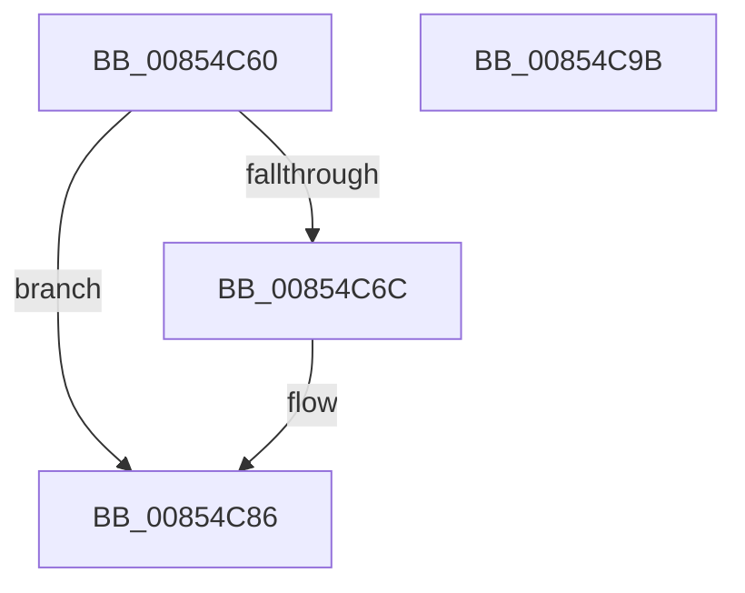

# HvpGetCellFlat

- RVA: `0x00854C60`–`0x00854C9C` (길이 `60` bytes)
- VA: `0x0000000140854C60`
- 실행 섹션: `PAGE`
- PDB 이름 있음: `예`; PDB Function 태그: `아니요`
- unwind 정보 RVA: `0x0005D2F4`
- 디코드: `18`개 명령, `60/60` bytes 표시
- 미해석 바이트: `0` (있으면 어셈블리에 `.byte`로 보존)

> 이 문서는 커널 이미지의 기계어와 PDB 기호를 분석해 생성했습니다. 4번과 5번은 함수 원형과 자료형을 바이너리 사용 방식에서 추정한 C 해석이며 원본 소스 복구 결과는 아닙니다.

## 1. Dependencies

- 직접 호출 지점: **1**; 고유 호출 대상: **1**
- 직접 호출자로 확인된 함수: **190**
- RIP 상대 이미지 참조: **0**

### Outgoing calls
- `0x00854C80` → [KeBugCheckEx](../../text/4F/KeBugCheckEx_function_004FD660.md) (function, `0x004FD660`)

### Direct callers
- [CmDeleteLayeredKey](../../text/41/CmDeleteLayeredKey_function_0041B598.md) at `0x0041B6F4`
- [CmDeleteLayeredKey](../../text/41/CmDeleteLayeredKey_function_0041B598.md) at `0x0041B979`
- [CmpQueryKeyDataFromKeyNodeStack](../../text/46/CmpQueryKeyDataFromKeyNodeStack_function_0046AC40.md) at `0x0046B0E6`
- [CmpValueEnumStackEntryStart](../../text/46/CmpValueEnumStackEntryStart_function_0046B3DC.md) at `0x0046B415`
- [CmpSwapValueInList](../../text/4A/CmpSwapValueInList_function_004A266C.md) at `0x004A26A2`
- [CmpDereferenceSecurityNode](../../text/4A/CmpDereferenceSecurityNode_function_004A672C.md) at `0x004A6760`
- [CmpRemoveSecurityCellList](../../text/4B/CmpRemoveSecurityCellList_function_004BC1FC.md) at `0x004BC246`
- [CmpRemoveSecurityCellList](../../text/4B/CmpRemoveSecurityCellList_function_004BC1FC.md) at `0x004BC26E`
- [CmpRemoveSecurityCellList](../../text/4B/CmpRemoveSecurityCellList_function_004BC1FC.md) at `0x004BC296`
- [CmpCreateTombstone](../../text/66/CmpCreateTombstone_function_0066AF50.md) at `0x0066B156`
- [CmpMarkCurrentProfileDirty](../7D/CmpMarkCurrentProfileDirty_function_007DBBAC.md) at `0x007DBC91`
- [CmpMarkCurrentValueDirty](../7D/CmpMarkCurrentValueDirty_function_007DBD1C.md) at `0x007DBD47`
- [CmpMarkCurrentValueDirty](../7D/CmpMarkCurrentValueDirty_function_007DBD1C.md) at `0x007DBDA9`
- [CmRestoreKey](../7D/CmRestoreKey_function_007DCF04.md) at `0x007DD164`
- [CmRestoreKey](../7D/CmRestoreKey_function_007DCF04.md) at `0x007DD5A7`
- [CmRestoreKey](../7D/CmRestoreKey_function_007DCF04.md) at `0x007DD5EB`
- [CmRestoreKey](../7D/CmRestoreKey_function_007DCF04.md) at `0x007DD642`
- [CmRestoreKey](../7D/CmRestoreKey_function_007DCF04.md) at `0x007DD6B4`
- [CmRestoreKey](../7D/CmRestoreKey_function_007DCF04.md) at `0x007DD704`
- [CmRestoreKey](../7D/CmRestoreKey_function_007DCF04.md) at `0x007DD768`
- [CmRestoreKey](../7D/CmRestoreKey_function_007DCF04.md) at `0x007DD890`
- [CmRestoreKey](../7D/CmRestoreKey_function_007DCF04.md) at `0x007DD8B2`
- [CmRestoreKey](../7D/CmRestoreKey_function_007DCF04.md) at `0x007DD938`
- [CmSaveKey](../7D/CmSaveKey_function_007DDBDC.md) at `0x007DDF17`
- [CmSaveMergedKeys](../7D/CmSaveMergedKeys_function_007DE040.md) at `0x007DE2D6`
- [CmSaveMergedKeys](../7D/CmSaveMergedKeys_function_007DE040.md) at `0x007DE307`
- [CmpLoadHiveVolatile](../7D/CmpLoadHiveVolatile_function_007DE5F0.md) at `0x007DE85D`
- [CmpRefreshHive](../7D/CmpRefreshHive_function_007DEAD0.md) at `0x007DEE11`
- [CmpRefreshHive](../7D/CmpRefreshHive_function_007DEAD0.md) at `0x007DEE37`
- [CmpCloneHwProfile](../7E/CmpCloneHwProfile_function_007E303C.md) at `0x007E370B`
- [CmpCloneHwProfile](../7E/CmpCloneHwProfile_function_007E303C.md) at `0x007E373B`
- [CmRenameKey](../7E/CmRenameKey_function_007E8F48.md) at `0x007E951B`
- [CmpDoBuildVirtualStack](../7E/CmpDoBuildVirtualStack_function_007EB4C4.md) at `0x007EB81D`
- [CmpDoBuildVirtualStack](../7E/CmpDoBuildVirtualStack_function_007EB4C4.md) at `0x007EB850`
- [CmpVirtualPathPresent](../7E/CmpVirtualPathPresent_function_007EBDB4.md) at `0x007EBE53`
- [CmpCopySaclToVirtualKey](../7E/CmpCopySaclToVirtualKey_function_007ECA6C.md) at `0x007ECAF7`
- [CmpCopySaclToVirtualKey](../7E/CmpCopySaclToVirtualKey_function_007ECA6C.md) at `0x007ECB46`
- [CmpReferenceSecurityNode](../7E/CmpReferenceSecurityNode_function_007ED6A0.md) at `0x007ED6D4`
- [CmpSubtreeEnumeratorBeginForKeyNodeStack](../7F/CmpSubtreeEnumeratorBeginForKeyNodeStack_function_007F192C.md) at `0x007F198D`
- [CmpFindControlSet](../7F/CmpFindControlSet_function_007F1A34.md) at `0x007F1AC2`
- [CmpFindControlSet](../7F/CmpFindControlSet_function_007F1A34.md) at `0x007F1B41`
- [CmpFindControlSet](../7F/CmpFindControlSet_function_007F1A34.md) at `0x007F1BB9`
- [CmpFindControlSet](../7F/CmpFindControlSet_function_007F1A34.md) at `0x007F1C48`
- [CmpFindControlSet](../7F/CmpFindControlSet_function_007F1A34.md) at `0x007F1CA9`
- [CmpFindControlSet](../7F/CmpFindControlSet_function_007F1A34.md) at `0x007F1D9A`
- [CmpFindControlSet](../7F/CmpFindControlSet_function_007F1A34.md) at `0x007F1E1D`
- [CmpFindControlSet](../7F/CmpFindControlSet_function_007F1A34.md) at `0x007F1E91`
- [CmpFreeKeyValueList](../7F/CmpFreeKeyValueList_function_007F2250.md) at `0x007F2292`
- [CmpMergeKeyValues](../7F/CmpMergeKeyValues_function_007F2304.md) at `0x007F23E0`
- [CmpMergeKeyValues](../7F/CmpMergeKeyValues_function_007F2304.md) at `0x007F240E`
- [CmpPreserveSystemHiveData](../7F/CmpPreserveSystemHiveData_function_007F2518.md) at `0x007F2653`
- [CmpPreserveSystemHiveData](../7F/CmpPreserveSystemHiveData_function_007F2518.md) at `0x007F267B`
- [CmpPreserveSystemHiveData](../7F/CmpPreserveSystemHiveData_function_007F2518.md) at `0x007F2786`
- [CmpPreserveSystemHiveData](../7F/CmpPreserveSystemHiveData_function_007F2518.md) at `0x007F27F0`
- [CmpPreserveSystemHiveData](../7F/CmpPreserveSystemHiveData_function_007F2518.md) at `0x007F2826`
- [CmpPreserveSystemHiveData](../7F/CmpPreserveSystemHiveData_function_007F2518.md) at `0x007F29B2`
- [CmpPreserveSystemHiveData](../7F/CmpPreserveSystemHiveData_function_007F2518.md) at `0x007F2A11`
- [CmpPreserveSystemHiveData](../7F/CmpPreserveSystemHiveData_function_007F2518.md) at `0x007F2AC5`
- [CmpPreserveSystemHiveData](../7F/CmpPreserveSystemHiveData_function_007F2518.md) at `0x007F2BF3`
- [CmpPreserveSystemHiveData](../7F/CmpPreserveSystemHiveData_function_007F2518.md) at `0x007F2C66`
- [CmpSyncKeyValues](../7F/CmpSyncKeyValues_function_007F2DF4.md) at `0x007F2F44`
- [CmpMarkAllChildrenDirty](../7F/CmpMarkAllChildrenDirty_function_007F3120.md) at `0x007F3159`
- [CmpRemoveSubKeyCellNoCellRef](../7F/CmpRemoveSubKeyCellNoCellRef_function_007F3284.md) at `0x007F32DB`
- [CmpRemoveSubKeyCellNoCellRef](../7F/CmpRemoveSubKeyCellNoCellRef_function_007F3284.md) at `0x007F331B`
- [CmpRemoveSubKeyCellNoCellRef](../7F/CmpRemoveSubKeyCellNoCellRef_function_007F3284.md) at `0x007F3388`
- [CmpUpdateParentForEachSon](../7F/CmpUpdateParentForEachSon_function_007F35B8.md) at `0x007F3602`
- [CmpUpdateParentForEachSon](../7F/CmpUpdateParentForEachSon_function_007F35B8.md) at `0x007F364C`
- [CmpWalkUnicodeStringPath](../7F/CmpWalkUnicodeStringPath_function_007F3704.md) at `0x007F375A`
- [CmpGetValueForAudit](../7F/CmpGetValueForAudit_function_007F37C0.md) at `0x007F3821`
- [CmpDeleteTree](../7F/CmpDeleteTree_function_007F3E44.md) at `0x007F3E88`
- [CmpDeleteTree](../7F/CmpDeleteTree_function_007F3E44.md) at `0x007F3EFA`
- [CmpDuplicateIndex](../84/CmpDuplicateIndex_function_008420C0.md) at `0x00842117`
- [CmpDuplicateIndex](../84/CmpDuplicateIndex_function_008420C0.md) at `0x0084216E`
- [CmpDuplicateIndex](../84/CmpDuplicateIndex_function_008420C0.md) at `0x00842251`
- [HvDuplicateCell](../84/HvDuplicateCell_function_00843238.md) at `0x00843293`
- [CmAddLogForAction](../84/CmAddLogForAction_function_008445AC.md) at `0x0084468C`
- [CmAddLogForAction](../84/CmAddLogForAction_function_008445AC.md) at `0x008446DA`
- [CmpCloneKCBValueListForTrans](../84/CmpCloneKCBValueListForTrans_function_00844D30.md) at `0x00844D7D`
- [CmSetValueKey](../84/CmSetValueKey_function_008457C0.md) at `0x00845D1F`
- [CmSetValueKey](../84/CmSetValueKey_function_008457C0.md) at `0x0084633F`
- [CmSetValueKey](../84/CmSetValueKey_function_008457C0.md) at `0x00846702`
- [CmpCompareNewValueDataAgainstKCBCache](../84/CmpCompareNewValueDataAgainstKCBCache_function_00846920.md) at `0x008469AC`
- [CmpFindNameInListWithStatus](../84/CmpFindNameInListWithStatus_function_00846B80.md) at `0x00846BDC`
- [CmpFindNameInListWithStatus](../84/CmpFindNameInListWithStatus_function_00846B80.md) at `0x00846C7D`
- [CmQueryMultipleValueKey](../84/CmQueryMultipleValueKey_function_00846EC0.md) at `0x00846FF4`
- [CmQueryMultipleValueKey](../84/CmQueryMultipleValueKey_function_00846EC0.md) at `0x00847111`
- [CmQueryMultipleValueKey](../84/CmQueryMultipleValueKey_function_00846EC0.md) at `0x00847528`
- [CmDeleteValueKey](../84/CmDeleteValueKey_function_008476E8.md) at `0x00847902`
- [CmDeleteValueKey](../84/CmDeleteValueKey_function_008476E8.md) at `0x008479AA`
- [CmDeleteValueKey](../84/CmDeleteValueKey_function_008476E8.md) at `0x00847A47`
- [CmDeleteValueKey](../84/CmDeleteValueKey_function_008476E8.md) at `0x00847AF6`
- [CmDeleteValueKey](../84/CmDeleteValueKey_function_008476E8.md) at `0x008481C8`
- [CmpFreeSecurityDescriptor](../84/CmpFreeSecurityDescriptor_function_00849E44.md) at `0x00849E6D`
- [CmpFreeKeyBody](../84/CmpFreeKeyBody_function_00849ECC.md) at `0x00849EFB`
- [CmpRemoveSubKey](../84/CmpRemoveSubKey_function_00849F84.md) at `0x00849FB5`
- [CmpRemoveSubKeyFromList](../84/CmpRemoveSubKeyFromList_function_0084A030.md) at `0x0084A09F`
- [CmpRemoveSubKeyFromList](../84/CmpRemoveSubKeyFromList_function_0084A030.md) at `0x0084A104`
- [CmpRemoveSubKeyFromList](../84/CmpRemoveSubKeyFromList_function_0084A030.md) at `0x0084A298`
- [CmpVirtualBranchIsReplicated](../84/CmpVirtualBranchIsReplicated_function_0084A3E0.md) at `0x0084A4C9`
- [CmpFreeKeyByCell](../84/CmpFreeKeyByCell_function_0084AD70.md) at `0x0084ADDF`
- [CmpFreeKeyByCell](../84/CmpFreeKeyByCell_function_0084AD70.md) at `0x0084AE23`
- [CmpFreeKeyByCell](../84/CmpFreeKeyByCell_function_0084AD70.md) at `0x0084AEF4`
- [CmpFreeValue](../84/CmpFreeValue_function_0084AF98.md) at `0x0084AFC3`
- [CmpFreeValueData](../84/CmpFreeValueData_function_0084B040.md) at `0x0084B0D7`
- [CmpFreeValueData](../84/CmpFreeValueData_function_0084B040.md) at `0x0084B11E`
- [CmpMarkKeyDirty](../84/CmpMarkKeyDirty_function_0084B1FC.md) at `0x0084B25E`
- [CmpMarkKeyDirty](../84/CmpMarkKeyDirty_function_0084B1FC.md) at `0x0084B2D2`
- [CmpMarkKeyDirty](../84/CmpMarkKeyDirty_function_0084B1FC.md) at `0x0084B373`
- [CmpMarkKeyDirty](../84/CmpMarkKeyDirty_function_0084B1FC.md) at `0x0084B3B8`
- [CmpSetValueKeyExisting](../84/CmpSetValueKeyExisting_function_0084B53C.md) at `0x0084B661`
- [CmpMarkValueDataDirty](../84/CmpMarkValueDataDirty_function_0084B910.md) at `0x0084B9AD`
- [CmpMarkValueDataDirty](../84/CmpMarkValueDataDirty_function_0084B910.md) at `0x0084B9D4`
- [CmpFindPathByNameEx](../84/CmpFindPathByNameEx_function_0084BAAC.md) at `0x0084BBA0`
- [CmpFindPathByNameEx](../84/CmpFindPathByNameEx_function_0084BAAC.md) at `0x0084BCBF`
- [CmpSelectLeaf](../84/CmpSelectLeaf_function_0084BFB4.md) at `0x0084C027`
- [CmpSelectLeaf](../84/CmpSelectLeaf_function_0084BFB4.md) at `0x0084C083`
- [CmpSelectLeaf](../84/CmpSelectLeaf_function_0084BFB4.md) at `0x0084C0E3`
- [CmpSelectLeaf](../84/CmpSelectLeaf_function_0084BFB4.md) at `0x0084C163`
- [CmpSelectLeaf](../84/CmpSelectLeaf_function_0084BFB4.md) at `0x0084C198`
- [CmpSelectLeaf](../84/CmpSelectLeaf_function_0084BFB4.md) at `0x0084C2AC`
- [CmpMarkIndexDirty](../84/CmpMarkIndexDirty_function_0084C30C.md) at `0x0084C362`
- [CmpMarkIndexDirty](../84/CmpMarkIndexDirty_function_0084C30C.md) at `0x0084C3DA`
- [CmpCleanUpSubKeyInfo](../84/CmpCleanUpSubKeyInfo_function_0084C6F4.md) at `0x0084C748`
- [CmpAddSubKeyEx](../84/CmpAddSubKeyEx_function_0084C940.md) at `0x0084C9AC`
- [CmpAddSubKeyEx](../84/CmpAddSubKeyEx_function_0084C940.md) at `0x0084C9EF`
- [CmpVEExecuteRealStoreParseLogic](../84/CmpVEExecuteRealStoreParseLogic_function_0084CCD4.md) at `0x0084CDFE`
- [CmpAddSubKeyToList](../84/CmpAddSubKeyToList_function_0084D644.md) at `0x0084D6A4`
- [CmpAddSubKeyToList](../84/CmpAddSubKeyToList_function_0084D644.md) at `0x0084D752`
- [sub_0084E4B5](../84/Unknown_function_0084E4B5.md) at `0x0084E647`
- [sub_0084E4B5](../84/Unknown_function_0084E4B5.md) at `0x0084E6A9`
- [CmpQueryKeyDataFromNode](../84/CmpQueryKeyDataFromNode_function_0084EAE0.md) at `0x0084EE0C`
- [CmpQueryKeyDataFromNode](../84/CmpQueryKeyDataFromNode_function_0084EAE0.md) at `0x0084EFE2`
- [CmpQueryKeyDataFromNode](../84/CmpQueryKeyDataFromNode_function_0084EAE0.md) at `0x0084F142`
- [CmpFindSubKeyByNumberEx](../84/CmpFindSubKeyByNumberEx_function_0084F1A0.md) at `0x0084F1F1`
- [CmpFindSubKeyByNumberEx](../84/CmpFindSubKeyByNumberEx_function_0084F1A0.md) at `0x0084F25D`
- [CmpFindSubKeyByNumberEx](../84/CmpFindSubKeyByNumberEx_function_0084F1A0.md) at `0x0084F436`
- [CmpFindSubKeyByNumberEx](../84/CmpFindSubKeyByNumberEx_function_0084F1A0.md) at `0x0084F515`
- [CmpFindSubKeyByNumberEx](../84/CmpFindSubKeyByNumberEx_function_0084F1A0.md) at `0x0084F62F`
- [CmpFindSubKeyByNumberEx](../84/CmpFindSubKeyByNumberEx_function_0084F1A0.md) at `0x0084F857`
- [CmpCreateKeyControlBlock](CmpCreateKeyControlBlock_function_00851DB0.md) at `0x00852085`
- [CmpCreateKeyControlBlock](CmpCreateKeyControlBlock_function_00851DB0.md) at `0x00852121`
- [CmpFindSubKeyByNameWithStatus](CmpFindSubKeyByNameWithStatus_function_00852770.md) at `0x00852804`
- [CmpFindSubKeyByNameWithStatus](CmpFindSubKeyByNameWithStatus_function_00852770.md) at `0x00852940`
- [CmpFindSubKeyByNameWithStatus](CmpFindSubKeyByNameWithStatus_function_00852770.md) at `0x00852B06`
- [CmpWalkOneLevel](CmpWalkOneLevel_function_00852BA0.md) at `0x00852E35`
- [CmpWalkOneLevel](CmpWalkOneLevel_function_00852BA0.md) at `0x00852ED5`
- [CmpWalkOneLevel](CmpWalkOneLevel_function_00852BA0.md) at `0x00852F93`
- [CmpWalkOneLevel](CmpWalkOneLevel_function_00852BA0.md) at `0x008534CE`
- [CmpWalkOneLevel](CmpWalkOneLevel_function_00852BA0.md) at `0x00853722`
- [sub_00853ABC](Unknown_function_00853ABC.md) at `0x00853C85`
- [sub_00853ABC](Unknown_function_00853ABC.md) at `0x00853DA3`
- [sub_0085416A](Unknown_function_0085416A.md) at `0x00854192`
- [sub_0085416A](Unknown_function_0085416A.md) at `0x0085430C`
- [sub_0085416A](Unknown_function_0085416A.md) at `0x0085442A`
- [CmpDoCompareKeyName](CmpDoCompareKeyName_function_00854E80.md) at `0x00854EB5`
- [sub_008551B7](Unknown_function_008551B7.md) at `0x00855356`
- [sub_00855472](Unknown_function_00855472.md) at `0x0085553E`
- [sub_00855472](Unknown_function_00855472.md) at `0x0085557F`
- [sub_00855A5C](Unknown_function_00855A5C.md) at `0x00855B16`
- [sub_00855DFB](Unknown_function_00855DFB.md) at `0x00855E35`
- [sub_00856008](Unknown_function_00856008.md) at `0x00856047`
- [CmpGetKeyNodeForKcb](CmpGetKeyNodeForKcb_function_00856480.md) at `0x008564AD`
- [sub_008564EC](Unknown_function_008564EC.md) at `0x0085654F`
- [CmpGetValueData](CmpGetValueData_function_00856DB0.md) at `0x00856E2D`
- [CmpGetValueData](CmpGetValueData_function_00856DB0.md) at `0x00856E64`
- [CmpGetValueData](CmpGetValueData_function_00856DB0.md) at `0x00856EEA`
- [sub_00856F10](Unknown_function_00856F10.md) at `0x00856F1B`
- [sub_00856F2C](Unknown_function_00856F2C.md) at `0x00856F80`
- [CmpGetSymbolicLinkTarget](CmpGetSymbolicLinkTarget_function_008570A0.md) at `0x0085770A`
- [CmpGetSymbolicLinkTarget](CmpGetSymbolicLinkTarget_function_008570A0.md) at `0x00857786`
- [sub_00857A33](Unknown_function_00857A33.md) at `0x00857B7A`
- [sub_00857A33](Unknown_function_00857A33.md) at `0x00857BF2`
- [sub_008580BF](Unknown_function_008580BF.md) at `0x00858118`
- [CmQueryKey](CmQueryKey_function_00858240.md) at `0x008584D9`
- [CmpQueryKeyData](CmpQueryKeyData_function_00858E70.md) at `0x00858EEC`
- [CmpQueryKeyDataFromCache](CmpQueryKeyDataFromCache_function_00858F70.md) at `0x008590C2`
- [CmpQueryKeyDataFromCache](CmpQueryKeyDataFromCache_function_00858F70.md) at `0x008592B5`
- [CmpQueryKeyDataFromCache](CmpQueryKeyDataFromCache_function_00858F70.md) at `0x0085935C`
- [HvMarkCellDirty](HvMarkCellDirty_function_00859758.md) at `0x008597B5`
- [HvpFindFreeCell](HvpFindFreeCell_function_00859920.md) at `0x00859AE3`
- [HvpFindFreeCell](HvpFindFreeCell_function_00859920.md) at `0x00859B6F`
- [HvAllocateCell](HvAllocateCell_function_00859C94.md) at `0x00859ED1`
- [sub_0085A1C1](Unknown_function_0085A1C1.md) at `0x0085A1F6`
- [CmpCopyCell](CmpCopyCell_function_0085A608.md) at `0x0085A665`
- [HvpDelistFreeCell](HvpDelistFreeCell_function_0085A99C.md) at `0x0085A9C8`
- [CmpCopyKeyPartial](CmpCopyKeyPartial_function_0085AFF4.md) at `0x0085B095`
- [CmpCopyKeyPartial](CmpCopyKeyPartial_function_0085AFF4.md) at `0x0085B101`
- [CmpCopyKeyPartial](CmpCopyKeyPartial_function_0085AFF4.md) at `0x0085B239`
- [CmpCopyKeyPartial](CmpCopyKeyPartial_function_0085AFF4.md) at `0x0085B42E`
- [HvReallocateCell](HvReallocateCell_function_0085B5D0.md) at `0x0085B62A`
- [CmpCopyValue](CmpCopyValue_function_0085B798.md) at `0x0085B7F2`
- [CmpCopyValue](CmpCopyValue_function_0085B798.md) at `0x0085B8EF`
- [CmpCopyValue](CmpCopyValue_function_0085B798.md) at `0x0085B9CD`
- [CmpAddToLeaf](CmpAddToLeaf_function_0085BC2C.md) at `0x0085BCA4`
- [CmpCopySyncTree2](CmpCopySyncTree2_function_0085BF78.md) at `0x0085C07D`
- [CmpCopySyncTree2](CmpCopySyncTree2_function_0085BF78.md) at `0x0085C0F2`
- [CmpCopySyncTree2](CmpCopySyncTree2_function_0085BF78.md) at `0x0085C1E5`
- [CmpCopySyncTree2](CmpCopySyncTree2_function_0085BF78.md) at `0x0085C204`
- [CmpCopySyncTree2](CmpCopySyncTree2_function_0085BF78.md) at `0x0085C45C`
- [CmpCopySyncTree2](CmpCopySyncTree2_function_0085BF78.md) at `0x0085C48D`
- [CmpCopySyncTree2](CmpCopySyncTree2_function_0085BF78.md) at `0x0085C60D`
- [CmpCopySyncTree2](CmpCopySyncTree2_function_0085BF78.md) at `0x0085C6F6`
- [CmpFindSubKeyByNumber](CmpFindSubKeyByNumber_function_0085C930.md) at `0x0085C981`
- [sub_0085CA0D](Unknown_function_0085CA0D.md) at `0x0085CA2F`
- [CmpCompareInIndex](CmpCompareInIndex_function_0085CC40.md) at `0x0085CE12`
- [CmpCompareInIndex](CmpCompareInIndex_function_0085CC40.md) at `0x0085CF34`
- [CmpFindSubKeyInRoot](CmpFindSubKeyInRoot_function_0085D890.md) at `0x0085D90A`
- [CmpFindSubKeyInRoot](CmpFindSubKeyInRoot_function_0085D890.md) at `0x0085DBBE`
- [CmpFindSubKeyInRoot](CmpFindSubKeyInRoot_function_0085D890.md) at `0x0085DCCA`
- [CmpFindSubKeyInRoot](CmpFindSubKeyInRoot_function_0085D890.md) at `0x0085DDF1`
- [CmpFindSubKeyInRoot](CmpFindSubKeyInRoot_function_0085D890.md) at `0x0085E003`
- [CmpFindSubkeyInHashByChildCell](CmpFindSubkeyInHashByChildCell_function_0085E610.md) at `0x0085E674`
- [CmpRebuildKcbCache](../87/CmpRebuildKcbCache_function_00874DF8.md) at `0x00874E4D`
- [CmpClearKeyAccessBits](../87/CmpClearKeyAccessBits_function_0087BB5C.md) at `0x0087BBE8`
- [CmpConcatenateValueLists](../8B/CmpConcatenateValueLists_function_008B0ECC.md) at `0x008B0F93`
- [CmpConcatenateValueLists](../8B/CmpConcatenateValueLists_function_008B0ECC.md) at `0x008B1063`
- [CmpFullPromoteSingleKeyFromKeyNodeStacks](../8B/CmpFullPromoteSingleKeyFromKeyNodeStacks_function_008B1A40.md) at `0x008B1BDD`
- [CmpValueEnumStackAdvance](../8B/CmpValueEnumStackAdvance_function_008B256C.md) at `0x008B25F8`
- [CmEnumerateValueFromLayeredKey](../8B/CmEnumerateValueFromLayeredKey_function_008B31FC.md) at `0x008B3394`
- [CmEnumerateValueFromLayeredKey](../8B/CmEnumerateValueFromLayeredKey_function_008B31FC.md) at `0x008B33EE`
- [NtEnumerateValueKey](../8B/NtEnumerateValueKey_function_008B3B50.md) at `0x008B3FC9`
- [NtEnumerateValueKey](../8B/NtEnumerateValueKey_function_008B3B50.md) at `0x008B3FEC`
- [CmpPromoteSingleKeyFromKcbStacks](../94/CmpPromoteSingleKeyFromKcbStacks_function_009446E8.md) at `0x00944827`
- [CmpKeyEnumStackEntryNotifyPromotion](../94/CmpKeyEnumStackEntryNotifyPromotion_function_00944B74.md) at `0x00944C2B`
- [CmpKeyEnumStackEntryNotifyPromotion](../94/CmpKeyEnumStackEntryNotifyPromotion_function_00944B74.md) at `0x00944C60`
- [CmpKeyEnumStackNotifyPromotion](../94/CmpKeyEnumStackNotifyPromotion_function_00944CE8.md) at `0x00944D4E`
- [CmpKeyEnumStackStartFromKcbStack](../94/CmpKeyEnumStackStartFromKcbStack_function_00944F18.md) at `0x00945007`
- [CmpPopulateKeyNodeStackFromKcbStack](../94/CmpPopulateKeyNodeStackFromKcbStack_function_009453CC.md) at `0x00945453`
- [CmpPartialPromoteSingleKeyFromKeyNodeStacks](../94/CmpPartialPromoteSingleKeyFromKeyNodeStacks_function_00945808.md) at `0x0094595F`
- [CmpCheckKeyNodeStackAccess](../94/CmpCheckKeyNodeStackAccess_function_009459AC.md) at `0x00945A11`
- [CmpCopyMergeOfLayeredKeyNode](../94/CmpCopyMergeOfLayeredKeyNode_function_00945A78.md) at `0x00945BF1`
- [CmpEnumerateLayeredKey](../94/CmpEnumerateLayeredKey_function_00945E58.md) at `0x00946308`
- [CmpKeyEnumStackAdvanceInternal](../94/CmpKeyEnumStackAdvanceInternal_function_009468D4.md) at `0x00946A01`
- [CmpKeyEnumStackEntryAdvance](../94/CmpKeyEnumStackEntryAdvance_function_00946BD8.md) at `0x00946CD1`
- [CmpKeyEnumStackEntryBegin](../94/CmpKeyEnumStackEntryBegin_function_00946DE4.md) at `0x00946E1F`
- [CmpKeyEnumStackEntryBegin](../94/CmpKeyEnumStackEntryBegin_function_00946DE4.md) at `0x00946EDA`
- [CmpKeyEnumStackEntryBegin](../94/CmpKeyEnumStackEntryBegin_function_00946DE4.md) at `0x00946F05`
- [CmpDoFindSubKeyByNumber](../94/CmpDoFindSubKeyByNumber_function_00946F60.md) at `0x00946FED`
- [CmpCheckSecurityCellAccess](../94/CmpCheckSecurityCellAccess_function_009470C0.md) at `0x009470F8`
- [CmpCreateChild](../94/CmpCreateChild_function_0094817C.md) at `0x00948702`
- [CmpCreateChild](../94/CmpCreateChild_function_0094817C.md) at `0x00948C64`
- [CmpCreateChild](../94/CmpCreateChild_function_0094817C.md) at `0x00948DC4`
- [CmpGetSecurityDescriptorNodeEx](../94/CmpGetSecurityDescriptorNodeEx_function_00949268.md) at `0x00949322`
- [CmpSetSecurityDescriptorInfo](../94/CmpSetSecurityDescriptorInfo_function_00949688.md) at `0x00949727`
- [CmpSetSecurityDescriptorInfo](../94/CmpSetSecurityDescriptorInfo_function_00949688.md) at `0x0094976D`
- [CmpSetSecurityDescriptorInfo](../94/CmpSetSecurityDescriptorInfo_function_00949688.md) at `0x00949A2D`
- [CmpSetSecurityDescriptorInfo](../94/CmpSetSecurityDescriptorInfo_function_00949688.md) at `0x00949BB0`
- [CmpUndoDeleteKeyForTrans](../94/CmpUndoDeleteKeyForTrans_function_0094A728.md) at `0x0094A84D`
- [CmpUndoDeleteKeyForTrans](../94/CmpUndoDeleteKeyForTrans_function_0094A728.md) at `0x0094A9BB`
- [CmpUndoDeleteKeyForTrans](../94/CmpUndoDeleteKeyForTrans_function_0094A728.md) at `0x0094AB10`
- [CmpLightWeightPrepareSetSecDescUoW](../94/CmpLightWeightPrepareSetSecDescUoW_function_0094B098.md) at `0x0094B119`
- [CmpLightWeightPrepareSetSecDescUoW](../94/CmpLightWeightPrepareSetSecDescUoW_function_0094B098.md) at `0x0094B160`
- [CmpLightWeightPrepareSetSecDescUoW](../94/CmpLightWeightPrepareSetSecDescUoW_function_0094B098.md) at `0x0094B18B`
- [CmpLightWeightPrepareSetSecDescUoW](../94/CmpLightWeightPrepareSetSecDescUoW_function_0094B098.md) at `0x0094B25B`
- [CmpLightWeightCommitSetSecDescUoW](../94/CmpLightWeightCommitSetSecDescUoW_function_0094B4AC.md) at `0x0094B4F7`
- [CmpValidateHiveSecurityDescriptors](../96/CmpValidateHiveSecurityDescriptors_function_0096DAFC.md) at `0x0096DB80`
- [CmpValidateHiveSecurityDescriptors](../96/CmpValidateHiveSecurityDescriptors_function_0096DAFC.md) at `0x0096DBE6`
- [CmpValidateHiveSecurityDescriptors](../96/CmpValidateHiveSecurityDescriptors_function_0096DAFC.md) at `0x0096DCBA`
- [CmpInsertSecurityCellList](../96/CmpInsertSecurityCellList_function_0096DF40.md) at `0x0096DFAE`
- [CmpInsertSecurityCellList](../96/CmpInsertSecurityCellList_function_0096DF40.md) at `0x0096E099`
- [CmpInsertSecurityCellList](../96/CmpInsertSecurityCellList_function_0096DF40.md) at `0x0096E0CF`
- [CmpInsertSecurityCellList](../96/CmpInsertSecurityCellList_function_0096DF40.md) at `0x0096E0EE`
- [CmpInsertSecurityCellList](../96/CmpInsertSecurityCellList_function_0096DF40.md) at `0x0096E17A`
- [CmpAddSecurityCellToCache](../96/CmpAddSecurityCellToCache_function_0096E228.md) at `0x0096E298`
- [CmpCheckLeaf](../96/CmpCheckLeaf_function_0096E5BC.md) at `0x0096E660`
- [CmpCheckAndFixSecurityCellsRefcount](../96/CmpCheckAndFixSecurityCellsRefcount_function_0096E7FC.md) at `0x0096E861`
- [sub_0096E9E9](../96/Unknown_function_0096E9E9.md) at `0x0096EAD3`
- [sub_0096E9E9](../96/Unknown_function_0096E9E9.md) at `0x0096EB14`
- [sub_0096E9E9](../96/Unknown_function_0096E9E9.md) at `0x0096EC34`
- [CmpCheckKey](../96/CmpCheckKey_function_0096EE2C.md) at `0x0096EEEC`
- [CmpCheckKey](../96/CmpCheckKey_function_0096EE2C.md) at `0x0096F004`
- [CmpCheckKey](../96/CmpCheckKey_function_0096EE2C.md) at `0x0096F0FF`
- [CmpCheckKey](../96/CmpCheckKey_function_0096EE2C.md) at `0x0096F1F3`
- [CmpCheckKey](../96/CmpCheckKey_function_0096EE2C.md) at `0x0096F345`
- [CmpCheckKey](../96/CmpCheckKey_function_0096EE2C.md) at `0x0096F4BC`
- [CmpCheckKey](../96/CmpCheckKey_function_0096EE2C.md) at `0x0096FF5F`
- [CmpCheckKey](../96/CmpCheckKey_function_0096EE2C.md) at `0x0096FF87`
- [CmpCheckKey](../96/CmpCheckKey_function_0096EE2C.md) at `0x0097038F`
- [CmpCheckKey](../96/CmpCheckKey_function_0096EE2C.md) at `0x009704FC`
- [sub_00970B9C](../97/Unknown_function_00970B9C.md) at `0x00970BD4`
- [sub_00970B9C](../97/Unknown_function_00970B9C.md) at `0x00970BF4`
- [CmpCheckValueList](../97/CmpCheckValueList_function_00970F6C.md) at `0x00971070`
- [CmpCheckValueList](../97/CmpCheckValueList_function_00970F6C.md) at `0x00971228`
- [CmpCheckValueList](../97/CmpCheckValueList_function_00970F6C.md) at `0x009713B7`
- [CmpCheckValueList](../97/CmpCheckValueList_function_00970F6C.md) at `0x009716BB`
- [CmpCheckValueList](../97/CmpCheckValueList_function_00970F6C.md) at `0x00971768`
- [CmGetVisibleMaxValueNameLenAndDataLen](../9E/CmGetVisibleMaxValueNameLenAndDataLen_function_009EB750.md) at `0x009EB80B`
- [CmGetVisibleMaxValueNameLenAndDataLen](../9E/CmGetVisibleMaxValueNameLenAndDataLen_function_009EB750.md) at `0x009EB84C`
- [CmpLightWeightPrepareSetValueKeyUoW](../A0/CmpLightWeightPrepareSetValueKeyUoW_function_00A0EF28.md) at `0x00A0EFE2`
- [CmpLightWeightPrepareSetValueKeyUoW](../A0/CmpLightWeightPrepareSetValueKeyUoW_function_00A0EF28.md) at `0x00A0F232`
- [CmpLightWeightPrepareSetValueKeyUoW](../A0/CmpLightWeightPrepareSetValueKeyUoW_function_00A0EF28.md) at `0x00A0F2A7`
- [CmpLightWeightPrepareDeleteValueKeyUoW](../A0/CmpLightWeightPrepareDeleteValueKeyUoW_function_00A0F3D8.md) at `0x00A0F472`
- [CmpLightWeightPrepareDeleteValueKeyUoW](../A0/CmpLightWeightPrepareDeleteValueKeyUoW_function_00A0F3D8.md) at `0x00A0F508`
- [CmpRemoveValueFromList](../A0/CmpRemoveValueFromList_function_00A0F6D4.md) at `0x00A0F73E`
- [CmpLightWeightCreateSetValueData](../A0/CmpLightWeightCreateSetValueData_function_00A0F7EC.md) at `0x00A0F85F`
- [CmpSortedValueEnumStackEntryStart](../A3/CmpSortedValueEnumStackEntryStart_function_00A31110.md) at `0x00A311C5`
- [CmpSortedValueEnumStackEntryStart](../A3/CmpSortedValueEnumStackEntryStart_function_00A31110.md) at `0x00A311FA`
- [CmpMarkIndexDirtyInStorageType](../A3/CmpMarkIndexDirtyInStorageType_function_00A325B0.md) at `0x00A32626`
- [CmpMarkIndexDirtyInStorageType](../A3/CmpMarkIndexDirtyInStorageType_function_00A325B0.md) at `0x00A3274C`
- [CmpLightWeightCommitDeleteValueKeyUoW](../A3/CmpLightWeightCommitDeleteValueKeyUoW_function_00A39E54.md) at `0x00A39EA3`
- [CmpLightWeightCommitSetValueKeyUoW](../A3/CmpLightWeightCommitSetValueKeyUoW_function_00A39FA0.md) at `0x00A39FEF`
- [CmpLightWeightCommitRecreateKeyUoW](../A5/CmpLightWeightCommitRecreateKeyUoW_function_00A543CC.md) at `0x00A54412`
- [CmpLightWeightPrepareDeleteKeyUoW](../A5/CmpLightWeightPrepareDeleteKeyUoW_function_00A54494.md) at `0x00A544FE`
- [CmpLightWeightCommitDeleteKeyUoW](../A5/CmpLightWeightCommitDeleteKeyUoW_function_00A54610.md) at `0x00A546AF`
- [CmpLightWeightPrepareAddKeyUoW](../A5/CmpLightWeightPrepareAddKeyUoW_function_00A547FC.md) at `0x00A5489D`
- [CmpLightWeightDuplicateParentLists](../A5/CmpLightWeightDuplicateParentLists_function_00A54BB4.md) at `0x00A54BF0`
- [CmpLightWeightCommitAddKeyUoW](../A5/CmpLightWeightCommitAddKeyUoW_function_00A54CA8.md) at `0x00A54CFA`
- [CmpLightWeightCommitAddKeyUoW](../A5/CmpLightWeightCommitAddKeyUoW_function_00A54CA8.md) at `0x00A54D96`
- [CmpLightWeightSwapParentSubKeyList](../A5/CmpLightWeightSwapParentSubKeyList_function_00A54F3C.md) at `0x00A54F68`
- [CmpLightWeightPrepareSetKeyUserFlags](../A5/CmpLightWeightPrepareSetKeyUserFlags_function_00A553FC.md) at `0x00A55433`
- [CmpLightWeightCommitSetUserFlagsUoW](../A5/CmpLightWeightCommitSetUserFlagsUoW_function_00A5FB7C.md) at `0x00A5FBB8`
- [CmpUpdateHiveRootCellFlags](../A6/CmpUpdateHiveRootCellFlags_function_00A6B124.md) at `0x00A6B162`
- [CmpCheckKeyAccess](../A6/CmpCheckKeyAccess_function_00A6DE7C.md) at `0x00A6DEBD`
- [CmpMarkKeyParentDirty](../A7/CmpMarkKeyParentDirty_function_00A749E8.md) at `0x00A74A17`
- [CmpSetValueDataExisting](../A7/CmpSetValueDataExisting_function_00A79260.md) at `0x00A792BB`
- [CmpSetValueDataExisting](../A7/CmpSetValueDataExisting_function_00A79260.md) at `0x00A792E3`
- [CmpSetValueDataExisting](../A7/CmpSetValueDataExisting_function_00A79260.md) at `0x00A79341`
- [CmpSplitLeaf](../A7/CmpSplitLeaf_function_00A7C7E0.md) at `0x00A7C84A`
- [CmpSplitLeaf](../A7/CmpSplitLeaf_function_00A7C7E0.md) at `0x00A7C87D`
- [CmEnumerateValueKeyFromMergedView](../A7/CmEnumerateValueKeyFromMergedView_function_00A7D650.md) at `0x00A7D798`
- [CmEnumerateValueKeyFromMergedView](../A7/CmEnumerateValueKeyFromMergedView_function_00A7D650.md) at `0x00A7D80A`
- [CmEnumerateValueKeyFromMergedView](../A7/CmEnumerateValueKeyFromMergedView_function_00A7D650.md) at `0x00A7D8FE`
- [CmEnumerateValueKeyFromMergedView](../A7/CmEnumerateValueKeyFromMergedView_function_00A7D650.md) at `0x00A7DA00`
- [CmpFreeKeyValues](../A8/CmpFreeKeyValues_function_00A8B3E4.md) at `0x00A8B436`
- [CmpMarkKeyValuesDirty](../A8/CmpMarkKeyValuesDirty_function_00A8B4C8.md) at `0x00A8B56A`
- [CmpMarkKeyValuesDirty](../A8/CmpMarkKeyValuesDirty_function_00A8B4C8.md) at `0x00A8B655`
- [CmQueryMultipleValueForLayeredKey](../A8/CmQueryMultipleValueForLayeredKey_function_00A8DE80.md) at `0x00A8E020`
- [CmpMarkEntireIndexDirty](../AA/CmpMarkEntireIndexDirty_function_00AA24B4.md) at `0x00AA24ED`
- [CmpFreeIndexByCell](../AA/CmpFreeIndexByCell_function_00AA6F0C.md) at `0x00AA6F3B`
- [CmpFindSubKeyByNumberFromMergedView](../AB/CmpFindSubKeyByNumberFromMergedView_function_00AB8284.md) at `0x00AB84F5`
- [CmpFindSubKeyByNumberFromMergedView](../AB/CmpFindSubKeyByNumberFromMergedView_function_00AB8284.md) at `0x00AB8536`
- [CmpSyncSubKeysAfterDelete](../AC/CmpSyncSubKeysAfterDelete_function_00AC5980.md) at `0x00AC5A0B`
- [sub_00B169F2](../B1/Unknown_function_00B169F2.md) at `0x00B16B48`
- [sub_00B16C30](../B1/Unknown_function_00B16C30.md) at `0x00B16C55`
- [sub_00B16DC4](../B1/Unknown_function_00B16DC4.md) at `0x00B16DDC`
- [sub_00B16DFE](../B1/Unknown_function_00B16DFE.md) at `0x00B16E45`
- [sub_00B28A98](../B2/Unknown_function_00B28A98.md) at `0x00B28B5B`
- [sub_00B428B8](../B4/Unknown_function_00B428B8.md) at `0x00B42939`
- [sub_00B428B8](../B4/Unknown_function_00B428B8.md) at `0x00B42977`
- [sub_00B46094](../B4/Unknown_function_00B46094.md) at `0x00B460F8`
- [CmpDoAccessCheckOnSubtree](../../pagecmrc/BC/CmpDoAccessCheckOnSubtree_function_00BC9CD0.md) at `0x00BC9DA6`
- [CmSelectQualifiedInstallLanguage](../../init/C5/CmSelectQualifiedInstallLanguage_function_00C58F58.md) at `0x00C590A3`
- [CmSelectQualifiedInstallLanguage](../../init/C5/CmSelectQualifiedInstallLanguage_function_00C58F58.md) at `0x00C590F7`
- [CmSelectQualifiedInstallLanguage](../../init/C5/CmSelectQualifiedInstallLanguage_function_00C58F58.md) at `0x00C591DD`
- [CmSelectQualifiedInstallLanguage](../../init/C5/CmSelectQualifiedInstallLanguage_function_00C58F58.md) at `0x00C59249`
- [CmSelectQualifiedInstallLanguage](../../init/C5/CmSelectQualifiedInstallLanguage_function_00C58F58.md) at `0x00C592A2`
- [CmpGetSystemControlValues](../../init/C5/CmpGetSystemControlValues_function_00C5959C.md) at `0x00C596F6`
- [CmpGetSystemControlValues](../../init/C5/CmpGetSystemControlValues_function_00C5959C.md) at `0x00C597AF`
- [CmpGetSystemControlValues](../../init/C5/CmpGetSystemControlValues_function_00C5959C.md) at `0x00C5985B`
- [CmpGetSystemControlValues](../../init/C5/CmpGetSystemControlValues_function_00C5959C.md) at `0x00C598DD`
- [CmpAddDriverToList](../../init/C5/CmpAddDriverToList_function_00C5B758.md) at `0x00C5B7E4`
- [CmpAddDriverToList](../../init/C5/CmpAddDriverToList_function_00C5B758.md) at `0x00C5B9ED`
- [CmpAddDriverToList](../../init/C5/CmpAddDriverToList_function_00C5B758.md) at `0x00C5BBF8`
- [CmpAddDriverToList](../../init/C5/CmpAddDriverToList_function_00C5B758.md) at `0x00C5BCAB`
- [CmpAddDriverToList](../../init/C5/CmpAddDriverToList_function_00C5B758.md) at `0x00C5BD72`
- [CmpFindGroupOrderList](../../init/C5/CmpFindGroupOrderList_function_00C5C2B0.md) at `0x00C5C2D9`
- [CmpFindGroupOrderList](../../init/C5/CmpFindGroupOrderList_function_00C5C2B0.md) at `0x00C5C337`
- [CmpFindHiveSubKey](../../init/C5/CmpFindHiveSubKey_function_00C5C398.md) at `0x00C5C443`
- [CmpFindStateSepKeysRedirectionMapNode](../../init/C5/CmpFindStateSepKeysRedirectionMapNode_function_00C5C554.md) at `0x00C5C5EA`
- [CmpFindTagIndex](../../init/C5/CmpFindTagIndex_function_00C5C628.md) at `0x00C5C694`
- [CmpFindTagIndex](../../init/C5/CmpFindTagIndex_function_00C5C628.md) at `0x00C5C700`
- [CmpFindTagIndex](../../init/C5/CmpFindTagIndex_function_00C5C628.md) at `0x00C5C765`
- [CmpGetStateSepKeysRedirectionPathValue](../../init/C5/CmpGetStateSepKeysRedirectionPathValue_function_00C5CA3C.md) at `0x00C5CAE9`
- [CmpGetStateSepKeysRedirectionPathValue](../../init/C5/CmpGetStateSepKeysRedirectionPathValue_function_00C5CA3C.md) at `0x00C5CB49`
- [CmpIsLoadType](../../init/C5/CmpIsLoadType_function_00C5CBF8.md) at `0x00C5CC7C`
- [CmpIsLoadType](../../init/C5/CmpIsLoadType_function_00C5CBF8.md) at `0x00C5CCFD`
- [CmpIsLoadType](../../init/C5/CmpIsLoadType_function_00C5CBF8.md) at `0x00C5CD95`
- [CmpIsLoadType](../../init/C5/CmpIsLoadType_function_00C5CBF8.md) at `0x00C5CE46`
- [CmpIsLoadType](../../init/C5/CmpIsLoadType_function_00C5CBF8.md) at `0x00C5CEC8`
- [CmpLoadManufacturingModeNode](../../init/C5/CmpLoadManufacturingModeNode_function_00C5CF94.md) at `0x00C5CFD8`
- [CmpLoadManufacturingModeNode](../../init/C5/CmpLoadManufacturingModeNode_function_00C5CF94.md) at `0x00C5D038`
- [CmpLoadManufacturingModeNode](../../init/C5/CmpLoadManufacturingModeNode_function_00C5CF94.md) at `0x00C5D08F`
- [CmpLoadManufacturingProfileNode](../../init/C5/CmpLoadManufacturingProfileNode_function_00C5D0C8.md) at `0x00C5D196`
- [CmpLoadManufacturingProfileServicesNode](../../init/C5/CmpLoadManufacturingProfileServicesNode_function_00C5D1B4.md) at `0x00C5D23D`
- [CmpLoadServicesNode](../../init/C5/CmpLoadServicesNode_function_00C5D274.md) at `0x00C5D2A6`
- [CmpLoadServicesNode](../../init/C5/CmpLoadServicesNode_function_00C5D274.md) at `0x00C5D2FE`
- [CmpSortDriverList](../../init/C5/CmpSortDriverList_function_00C5D3D0.md) at `0x00C5D420`
- [CmpSortDriverList](../../init/C5/CmpSortDriverList_function_00C5D3D0.md) at `0x00C5D480`
- [CmpSortDriverList](../../init/C5/CmpSortDriverList_function_00C5D3D0.md) at `0x00C5D4E0`
- [CmpSortDriverList](../../init/C5/CmpSortDriverList_function_00C5D3D0.md) at `0x00C5D538`
- [CmpGetBootValueData](../../init/C5/CmpGetBootValueData_function_00C5D610.md) at `0x00C5D6C5`
- [CmpGetBootValueData](../../init/C5/CmpGetBootValueData_function_00C5D610.md) at `0x00C5D6F5`
- [CmpGetBootValueData](../../init/C5/CmpGetBootValueData_function_00C5D610.md) at `0x00C5D742`
- [CmpGetBootValueData](../../init/C5/CmpGetBootValueData_function_00C5D610.md) at `0x00C5D801`

### Static image references
- 디코드된 RIP-relative 메모리 참조가 없습니다.

## 2. Other-region calls and transfers

- 다른 실행 섹션으로 향하는 call: **1**
  - `0x00854C80` → [KeBugCheckEx](../../text/4F/KeBugCheckEx_function_004FD660.md) (`PAGE` → `.text`)
- 별도 외부 분기/꼬리 이동을 확인하지 못했습니다.

## 3. Assembly (complete function range)

```asm
00854C60  48 83 EC 38                     sub rsp, 0x38
00854C64  44 8B CA                        mov r9d, edx
00854C67  83 FA FF                        cmp edx, -1
00854C6A  75 1A                           jne 0x140854c86
00854C6C  BA 32 00 00 00                  mov edx, 0x32
00854C71  4C 89 4C 24 20                  mov qword ptr [rsp + 0x20], r9
00854C76  4C 8B C9                        mov r9, rcx
00854C79  8D 4A 1F                        lea ecx, [rdx + 0x1f]
00854C7C  44 8D 42 CF                     lea r8d, [rdx - 0x31]
00854C80  E8 DB 89 CA FF                  call 0x1404fd660
00854C85  CC                              int3
00854C86  48 8B 41 40                     mov rax, qword ptr [rcx + 0x40]
00854C8A  48 05 04 10 00 00               add rax, 0x1004
00854C90  41 89 10                        mov dword ptr [r8], edx
00854C93  49 03 C1                        add rax, r9
00854C96  48 83 C4 38                     add rsp, 0x38
00854C9A  C3                              ret
00854C9B  CC                              int3
```

## 4. C-style interpretation (structured pseudocode)

```c
__int64 __fastcall HvpGetCellFlat(__int64 a1, int a2)
{
    __int64 result;
    __int64 v_rsp;
    unsigned __int64 v_stack_m18;

    v_rsp = (v_rsp) - (56);
    if (a2 == -1) {
        a2 = 50;
        v_stack_m18 = (unsigned int)(a2);
        a4 = a1;
        a1 = a2 + 31;
        a3 = a2 - 49;
        result = KeBugCheckEx(a1, a2, a3, a4);
    }
    result = (*(unsigned __int64 *)(a1 + 64)) + (0x1004ULL);
    *(unsigned int *)(a3) = a2;
    result = (result) + (a4);
    v_rsp = (v_rsp) + (56);
    return result;
}
```

## 5. (Beta) C Style

```c
int64_t HvpGetCellFlat(int64_t Arg1, int32_t Arg2)
{
    int64_t result;
    int64_t local_rsp;
    uint64_t v_stack_m18;

    local_rsp = (local_rsp) - (56);
    if (Arg2 == -1) {
        Arg2 = 50;
        v_stack_m18 = (uint32_t)(Arg2);
        a4 = Arg1;
        Arg1 = Arg2 + 31;
        a3 = Arg2 - 49;
        result = KeBugCheckEx(Arg1, Arg2, a3, a4);
    }
    result = (*(uint64_t *)(Arg1 + 0x40)) + (0x1004ULL);
    *(uint32_t *)(a3) = Arg2;
    result = (result) + (a4);
    local_rsp = (local_rsp) + (56);
    return result;
}
```

## 6. Execution-region graph

[열기: 2D/3D 그래프와 함수 탐색 컨트롤 패널](../../../control-panel.html?section=page&rva=0x00854C60&view=graph)

- 2D 그래프는 위에서 아래로 흐르고, 3D 그래프는 빈 공간을 드래그해 회전합니다. Shift+드래그는 이동, 휠은 확대·축소, 함수 노드 선택은 대상 보고서 이동입니다.

### Static fallback


