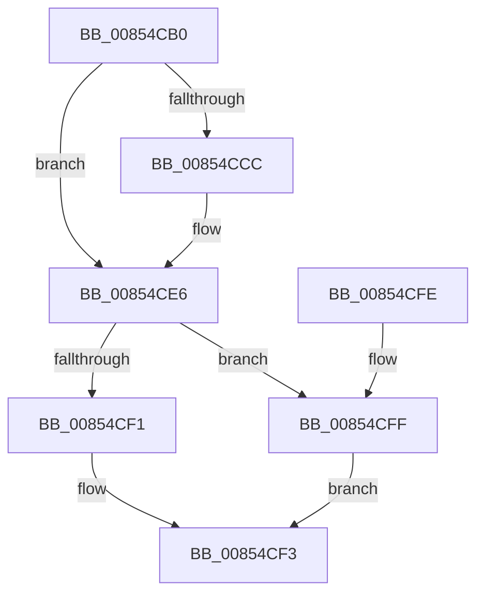

# HvpGetCellPaged

- RVA: `0x00854CB0`–`0x00854D60` (길이 `176` bytes)
- VA: `0x0000000140854CB0`
- 실행 섹션: `PAGE`
- PDB 이름 있음: `예`; PDB Function 태그: `아니요`
- unwind 정보 RVA: `0x00069F3C`
- 디코드: `48`개 명령, `176/176` bytes 표시
- 미해석 바이트: `0` (있으면 어셈블리에 `.byte`로 보존)

> 이 문서는 커널 이미지의 기계어와 PDB 기호를 분석해 생성했습니다. 4번과 5번은 함수 원형과 자료형을 바이너리 사용 방식에서 추정한 C 해석이며 원본 소스 복구 결과는 아닙니다.

## 1. Dependencies

- 직접 호출 지점: **2**; 고유 호출 대상: **2**
- 직접 호출자로 확인된 함수: **198**
- RIP 상대 이미지 참조: **1**

### Outgoing calls
- `0x00854CE0` → [KeBugCheckEx](../../text/4F/KeBugCheckEx_function_004FD660.md) (function, `0x004FD660`)
- `0x00854D4A` → [HvpMapEntryGetBlockAddress](HvpMapEntryGetBlockAddress_function_00854D70.md) (function, `0x00854D70`)

### Direct callers
- [CmDeleteLayeredKey](../../text/41/CmDeleteLayeredKey_function_0041B598.md) at `0x0041B875`
- [CmpValueEnumStackEntryStart](../../text/46/CmpValueEnumStackEntryStart_function_0046B3DC.md) at `0x0046B425`
- [CmpSwapValueInList](../../text/4A/CmpSwapValueInList_function_004A266C.md) at `0x004A26E0`
- [CmpDereferenceSecurityNode](../../text/4A/CmpDereferenceSecurityNode_function_004A672C.md) at `0x004A67A6`
- [CmpRemoveSecurityCellList](../../text/4B/CmpRemoveSecurityCellList_function_004BC1FC.md) at `0x004BC31A`
- [CmpRemoveSecurityCellList](../../text/4B/CmpRemoveSecurityCellList_function_004BC1FC.md) at `0x004BC324`
- [CmpRemoveSecurityCellList](../../text/4B/CmpRemoveSecurityCellList_function_004BC1FC.md) at `0x004BC32E`
- [CmpCreateTombstone](../../text/66/CmpCreateTombstone_function_0066AF50.md) at `0x0066B15D`
- [sub_006ED542](../../text/6E/Unknown_function_006ED542.md) at `0x006ED667`
- [sub_006F30FE](../../text/6F/Unknown_function_006F30FE.md) at `0x006F30FE`
- [CmpMarkCurrentProfileDirty](../7D/CmpMarkCurrentProfileDirty_function_007DBBAC.md) at `0x007DBC98`
- [CmpMarkCurrentValueDirty](../7D/CmpMarkCurrentValueDirty_function_007DBD1C.md) at `0x007DBD4E`
- [CmpMarkCurrentValueDirty](../7D/CmpMarkCurrentValueDirty_function_007DBD1C.md) at `0x007DBDB0`
- [CmRestoreKey](../7D/CmRestoreKey_function_007DCF04.md) at `0x007DD16B`
- [CmRestoreKey](../7D/CmRestoreKey_function_007DCF04.md) at `0x007DD5AE`
- [CmRestoreKey](../7D/CmRestoreKey_function_007DCF04.md) at `0x007DD5F2`
- [CmRestoreKey](../7D/CmRestoreKey_function_007DCF04.md) at `0x007DD649`
- [CmRestoreKey](../7D/CmRestoreKey_function_007DCF04.md) at `0x007DD6BB`
- [CmRestoreKey](../7D/CmRestoreKey_function_007DCF04.md) at `0x007DD70B`
- [CmRestoreKey](../7D/CmRestoreKey_function_007DCF04.md) at `0x007DD76F`
- [CmRestoreKey](../7D/CmRestoreKey_function_007DCF04.md) at `0x007DD897`
- [CmRestoreKey](../7D/CmRestoreKey_function_007DCF04.md) at `0x007DD8B9`
- [CmRestoreKey](../7D/CmRestoreKey_function_007DCF04.md) at `0x007DD93F`
- [CmSaveKey](../7D/CmSaveKey_function_007DDBDC.md) at `0x007DDF1E`
- [CmSaveMergedKeys](../7D/CmSaveMergedKeys_function_007DE040.md) at `0x007DE2DD`
- [CmSaveMergedKeys](../7D/CmSaveMergedKeys_function_007DE040.md) at `0x007DE30E`
- [CmpLoadHiveVolatile](../7D/CmpLoadHiveVolatile_function_007DE5F0.md) at `0x007DE864`
- [CmpRefreshHive](../7D/CmpRefreshHive_function_007DEAD0.md) at `0x007DEE18`
- [CmpRefreshHive](../7D/CmpRefreshHive_function_007DEAD0.md) at `0x007DEE3E`
- [CmpCloneHwProfile](../7E/CmpCloneHwProfile_function_007E303C.md) at `0x007E3712`
- [CmpCloneHwProfile](../7E/CmpCloneHwProfile_function_007E303C.md) at `0x007E3742`
- [CmRenameKey](../7E/CmRenameKey_function_007E8F48.md) at `0x007E9522`
- [CmpDoBuildVirtualStack](../7E/CmpDoBuildVirtualStack_function_007EB4C4.md) at `0x007EB824`
- [CmpDoBuildVirtualStack](../7E/CmpDoBuildVirtualStack_function_007EB4C4.md) at `0x007EB857`
- [CmpVirtualPathPresent](../7E/CmpVirtualPathPresent_function_007EBDB4.md) at `0x007EBE5A`
- [CmpCopySaclToVirtualKey](../7E/CmpCopySaclToVirtualKey_function_007ECA6C.md) at `0x007ECAFE`
- [CmpCopySaclToVirtualKey](../7E/CmpCopySaclToVirtualKey_function_007ECA6C.md) at `0x007ECB4D`
- [CmpReferenceSecurityNode](../7E/CmpReferenceSecurityNode_function_007ED6A0.md) at `0x007ED6DB`
- [CmpSubtreeEnumeratorBeginForKeyNodeStack](../7F/CmpSubtreeEnumeratorBeginForKeyNodeStack_function_007F192C.md) at `0x007F1994`
- [CmpFindControlSet](../7F/CmpFindControlSet_function_007F1A34.md) at `0x007F1AC9`
- [CmpFindControlSet](../7F/CmpFindControlSet_function_007F1A34.md) at `0x007F1B48`
- [CmpFindControlSet](../7F/CmpFindControlSet_function_007F1A34.md) at `0x007F1BC0`
- [CmpFindControlSet](../7F/CmpFindControlSet_function_007F1A34.md) at `0x007F1C4F`
- [CmpFindControlSet](../7F/CmpFindControlSet_function_007F1A34.md) at `0x007F1CB0`
- [CmpFindControlSet](../7F/CmpFindControlSet_function_007F1A34.md) at `0x007F1DA1`
- [CmpFindControlSet](../7F/CmpFindControlSet_function_007F1A34.md) at `0x007F1E24`
- [CmpFindControlSet](../7F/CmpFindControlSet_function_007F1A34.md) at `0x007F1E98`
- [CmpFreeKeyValueList](../7F/CmpFreeKeyValueList_function_007F2250.md) at `0x007F2299`
- [CmpMergeKeyValues](../7F/CmpMergeKeyValues_function_007F2304.md) at `0x007F23E7`
- [CmpMergeKeyValues](../7F/CmpMergeKeyValues_function_007F2304.md) at `0x007F2415`
- [CmpPreserveSystemHiveData](../7F/CmpPreserveSystemHiveData_function_007F2518.md) at `0x007F265A`
- [CmpPreserveSystemHiveData](../7F/CmpPreserveSystemHiveData_function_007F2518.md) at `0x007F2682`
- [CmpPreserveSystemHiveData](../7F/CmpPreserveSystemHiveData_function_007F2518.md) at `0x007F278D`
- [CmpPreserveSystemHiveData](../7F/CmpPreserveSystemHiveData_function_007F2518.md) at `0x007F27F7`
- [CmpPreserveSystemHiveData](../7F/CmpPreserveSystemHiveData_function_007F2518.md) at `0x007F282D`
- [CmpPreserveSystemHiveData](../7F/CmpPreserveSystemHiveData_function_007F2518.md) at `0x007F29B9`
- [CmpPreserveSystemHiveData](../7F/CmpPreserveSystemHiveData_function_007F2518.md) at `0x007F2A18`
- [CmpPreserveSystemHiveData](../7F/CmpPreserveSystemHiveData_function_007F2518.md) at `0x007F2ACC`
- [CmpPreserveSystemHiveData](../7F/CmpPreserveSystemHiveData_function_007F2518.md) at `0x007F2BFA`
- [CmpPreserveSystemHiveData](../7F/CmpPreserveSystemHiveData_function_007F2518.md) at `0x007F2C6D`
- [CmpSyncKeyValues](../7F/CmpSyncKeyValues_function_007F2DF4.md) at `0x007F2F4B`
- [CmpMarkAllChildrenDirty](../7F/CmpMarkAllChildrenDirty_function_007F3120.md) at `0x007F3160`
- [CmpRemoveSubKeyCellNoCellRef](../7F/CmpRemoveSubKeyCellNoCellRef_function_007F3284.md) at `0x007F32E2`
- [CmpRemoveSubKeyCellNoCellRef](../7F/CmpRemoveSubKeyCellNoCellRef_function_007F3284.md) at `0x007F3322`
- [CmpRemoveSubKeyCellNoCellRef](../7F/CmpRemoveSubKeyCellNoCellRef_function_007F3284.md) at `0x007F338F`
- [CmpUpdateParentForEachSon](../7F/CmpUpdateParentForEachSon_function_007F35B8.md) at `0x007F3609`
- [CmpUpdateParentForEachSon](../7F/CmpUpdateParentForEachSon_function_007F35B8.md) at `0x007F3653`
- [CmpWalkUnicodeStringPath](../7F/CmpWalkUnicodeStringPath_function_007F3704.md) at `0x007F3761`
- [CmpGetValueForAudit](../7F/CmpGetValueForAudit_function_007F37C0.md) at `0x007F3828`
- [CmpDeleteTree](../7F/CmpDeleteTree_function_007F3E44.md) at `0x007F3E8F`
- [CmpDeleteTree](../7F/CmpDeleteTree_function_007F3E44.md) at `0x007F3F01`
- [CmpDuplicateIndex](../84/CmpDuplicateIndex_function_008420C0.md) at `0x0084211E`
- [CmpDuplicateIndex](../84/CmpDuplicateIndex_function_008420C0.md) at `0x00842175`
- [CmpDuplicateIndex](../84/CmpDuplicateIndex_function_008420C0.md) at `0x00842258`
- [HvDuplicateCell](../84/HvDuplicateCell_function_00843238.md) at `0x0084331E`
- [CmAddLogForAction](../84/CmAddLogForAction_function_008445AC.md) at `0x008449F9`
- [CmAddLogForAction](../84/CmAddLogForAction_function_008445AC.md) at `0x00844A28`
- [CmpCloneKCBValueListForTrans](../84/CmpCloneKCBValueListForTrans_function_00844D30.md) at `0x00844DF4`
- [CmSetValueKey](../84/CmSetValueKey_function_008457C0.md) at `0x00846199`
- [CmSetValueKey](../84/CmSetValueKey_function_008457C0.md) at `0x0084640F`
- [CmpCompareNewValueDataAgainstKCBCache](../84/CmpCompareNewValueDataAgainstKCBCache_function_00846920.md) at `0x00846A9B`
- [CmpFindNameInListWithStatus](../84/CmpFindNameInListWithStatus_function_00846B80.md) at `0x00846C4F`
- [CmpFindNameInListWithStatus](../84/CmpFindNameInListWithStatus_function_00846B80.md) at `0x00846D70`
- [CmQueryMultipleValueKey](../84/CmQueryMultipleValueKey_function_00846EC0.md) at `0x008472EE`
- [CmQueryMultipleValueKey](../84/CmQueryMultipleValueKey_function_00846EC0.md) at `0x00847394`
- [CmDeleteValueKey](../84/CmDeleteValueKey_function_008476E8.md) at `0x00847DA3`
- [CmDeleteValueKey](../84/CmDeleteValueKey_function_008476E8.md) at `0x00847DAD`
- [CmDeleteValueKey](../84/CmDeleteValueKey_function_008476E8.md) at `0x00847DB7`
- [CmDeleteValueKey](../84/CmDeleteValueKey_function_008476E8.md) at `0x00847DC1`
- [CmDeleteValueKey](../84/CmDeleteValueKey_function_008476E8.md) at `0x00848284`
- [CmpFreeSecurityDescriptor](../84/CmpFreeSecurityDescriptor_function_00849E44.md) at `0x00849EB5`
- [CmpFreeKeyBody](../84/CmpFreeKeyBody_function_00849ECC.md) at `0x00849F54`
- [CmpRemoveSubKey](../84/CmpRemoveSubKey_function_00849F84.md) at `0x0084A017`
- [CmpRemoveSubKeyFromList](../84/CmpRemoveSubKeyFromList_function_0084A030.md) at `0x0084A221`
- [CmpRemoveSubKeyFromList](../84/CmpRemoveSubKeyFromList_function_0084A030.md) at `0x0084A22B`
- [CmpRemoveSubKeyFromList](../84/CmpRemoveSubKeyFromList_function_0084A030.md) at `0x0084A312`
- [CmpVirtualBranchIsReplicated](../84/CmpVirtualBranchIsReplicated_function_0084A3E0.md) at `0x0084A55F`
- [CmpFreeKeyByCell](../84/CmpFreeKeyByCell_function_0084AD70.md) at `0x0084AECD`
- [CmpFreeKeyByCell](../84/CmpFreeKeyByCell_function_0084AD70.md) at `0x0084AED7`
- [CmpFreeKeyByCell](../84/CmpFreeKeyByCell_function_0084AD70.md) at `0x0084AF40`
- [CmpFreeValue](../84/CmpFreeValue_function_0084AF98.md) at `0x0084B017`
- [CmpFreeValueData](../84/CmpFreeValueData_function_0084B040.md) at `0x0084B0E8`
- [CmpFreeValueData](../84/CmpFreeValueData_function_0084B040.md) at `0x0084B16C`
- [CmpMarkKeyDirty](../84/CmpMarkKeyDirty_function_0084B1FC.md) at `0x0084B487`
- [CmpMarkKeyDirty](../84/CmpMarkKeyDirty_function_0084B1FC.md) at `0x0084B491`
- [CmpMarkKeyDirty](../84/CmpMarkKeyDirty_function_0084B1FC.md) at `0x0084B49B`
- [CmpMarkKeyDirty](../84/CmpMarkKeyDirty_function_0084B1FC.md) at `0x0084B4A5`
- [CmpSetValueKeyExisting](../84/CmpSetValueKeyExisting_function_0084B53C.md) at `0x0084B762`
- [CmpMarkValueDataDirty](../84/CmpMarkValueDataDirty_function_0084B910.md) at `0x0084BA4F`
- [CmpMarkValueDataDirty](../84/CmpMarkValueDataDirty_function_0084B910.md) at `0x0084BA59`
- [CmpFindPathByNameEx](../84/CmpFindPathByNameEx_function_0084BAAC.md) at `0x0084BC69`
- [CmpFindPathByNameEx](../84/CmpFindPathByNameEx_function_0084BAAC.md) at `0x0084BD65`
- [CmpSelectLeaf](../84/CmpSelectLeaf_function_0084BFB4.md) at `0x0084C20C`
- [CmpSelectLeaf](../84/CmpSelectLeaf_function_0084BFB4.md) at `0x0084C21D`
- [CmpSelectLeaf](../84/CmpSelectLeaf_function_0084BFB4.md) at `0x0084C227`
- [CmpSelectLeaf](../84/CmpSelectLeaf_function_0084BFB4.md) at `0x0084C231`
- [CmpSelectLeaf](../84/CmpSelectLeaf_function_0084BFB4.md) at `0x0084C23B`
- [CmpSelectLeaf](../84/CmpSelectLeaf_function_0084BFB4.md) at `0x0084C2C5`
- [CmpMarkIndexDirty](../84/CmpMarkIndexDirty_function_0084C30C.md) at `0x0084C461`
- [CmpMarkIndexDirty](../84/CmpMarkIndexDirty_function_0084C30C.md) at `0x0084C46B`
- [CmpCleanUpSubKeyInfo](../84/CmpCleanUpSubKeyInfo_function_0084C6F4.md) at `0x0084C78C`
- [CmpAddSubKeyEx](../84/CmpAddSubKeyEx_function_0084C940.md) at `0x0084CAB7`
- [CmpAddSubKeyEx](../84/CmpAddSubKeyEx_function_0084C940.md) at `0x0084CB29`
- [CmpVEExecuteRealStoreParseLogic](../84/CmpVEExecuteRealStoreParseLogic_function_0084CCD4.md) at `0x0084CF35`
- [CmpAddSubKeyToList](../84/CmpAddSubKeyToList_function_0084D644.md) at `0x0084D807`
- [CmpAddSubKeyToList](../84/CmpAddSubKeyToList_function_0084D644.md) at `0x0084D811`
- [sub_0084E7D5](../84/Unknown_function_0084E7D5.md) at `0x0084E7DF`
- [sub_0084E7D5](../84/Unknown_function_0084E7D5.md) at `0x0084E7E9`
- [CmpQueryKeyDataFromNode](../84/CmpQueryKeyDataFromNode_function_0084EAE0.md) at `0x0084EF41`
- [CmpQueryKeyDataFromNode](../84/CmpQueryKeyDataFromNode_function_0084EAE0.md) at `0x0084F154`
- [CmpQueryKeyDataFromNode](../84/CmpQueryKeyDataFromNode_function_0084EAE0.md) at `0x0084F166`
- [CmpFindSubKeyByNumberEx](../84/CmpFindSubKeyByNumberEx_function_0084F1A0.md) at `0x0084F31A`
- [CmpFindSubKeyByNumberEx](../84/CmpFindSubKeyByNumberEx_function_0084F1A0.md) at `0x0084F471`
- [CmpFindSubKeyByNumberEx](../84/CmpFindSubKeyByNumberEx_function_0084F1A0.md) at `0x0084F478`
- [CmpFindSubKeyByNumberEx](../84/CmpFindSubKeyByNumberEx_function_0084F1A0.md) at `0x0084F74E`
- [CmpFindSubKeyByNumberEx](../84/CmpFindSubKeyByNumberEx_function_0084F1A0.md) at `0x0084F886`
- [CmpCreateKeyControlBlock](CmpCreateKeyControlBlock_function_00851DB0.md) at `0x008523F0`
- [CmpCreateKeyControlBlock](CmpCreateKeyControlBlock_function_00851DB0.md) at `0x008523FA`
- [CmpFindSubKeyByNameWithStatus](CmpFindSubKeyByNameWithStatus_function_00852770.md) at `0x0085290F`
- [CmpFindSubKeyByNameWithStatus](CmpFindSubKeyByNameWithStatus_function_00852770.md) at `0x00852A66`
- [CmpFindSubKeyByNameWithStatus](CmpFindSubKeyByNameWithStatus_function_00852770.md) at `0x00852B38`
- [CmpWalkOneLevel](CmpWalkOneLevel_function_00852BA0.md) at `0x00853052`
- [CmpWalkOneLevel](CmpWalkOneLevel_function_00852BA0.md) at `0x0085305C`
- [CmpWalkOneLevel](CmpWalkOneLevel_function_00852BA0.md) at `0x0085349C`
- [CmpWalkOneLevel](CmpWalkOneLevel_function_00852BA0.md) at `0x0085360D`
- [CmpWalkOneLevel](CmpWalkOneLevel_function_00852BA0.md) at `0x0085375A`
- [sub_00853ABC](Unknown_function_00853ABC.md) at `0x00853F36`
- [sub_00853ABC](Unknown_function_00853ABC.md) at `0x00853F40`
- [sub_0085416A](Unknown_function_0085416A.md) at `0x00854570`
- [sub_0085416A](Unknown_function_0085416A.md) at `0x00854587`
- [sub_0085416A](Unknown_function_0085416A.md) at `0x00854591`
- [sub_00854F9C](Unknown_function_00854F9C.md) at `0x00854FB1`
- [sub_00855472](Unknown_function_00855472.md) at `0x00855472`
- [sub_00855472](Unknown_function_00855472.md) at `0x008556AC`
- [sub_00855472](Unknown_function_00855472.md) at `0x00855795`
- [sub_00855BF3](Unknown_function_00855BF3.md) at `0x00855C08`
- [sub_00855ECF](Unknown_function_00855ECF.md) at `0x00855ECF`
- [sub_00856008](Unknown_function_00856008.md) at `0x00856132`
- [sub_00856589](Unknown_function_00856589.md) at `0x008565AC`
- [sub_008565B6](Unknown_function_008565B6.md) at `0x008565B6`
- [CmpGetValueData](CmpGetValueData_function_00856DB0.md) at `0x00856E49`
- [CmpGetValueData](CmpGetValueData_function_00856DB0.md) at `0x00856E7E`
- [sub_00856F2C](Unknown_function_00856F2C.md) at `0x00856FD9`
- [sub_0085701C](Unknown_function_0085701C.md) at `0x0085703D`
- [sub_00857047](Unknown_function_00857047.md) at `0x00857047`
- [sub_00857CA1](Unknown_function_00857CA1.md) at `0x00857CA1`
- [sub_00857DDE](Unknown_function_00857DDE.md) at `0x00857DF3`
- [sub_00857E06](Unknown_function_00857E06.md) at `0x00857E06`
- [sub_00857E06](Unknown_function_00857E06.md) at `0x00857E10`
- [sub_008581C7](Unknown_function_008581C7.md) at `0x008581C7`
- [CmQueryKey](CmQueryKey_function_00858240.md) at `0x00858590`
- [CmpQueryKeyData](CmpQueryKeyData_function_00858E70.md) at `0x00858F4B`
- [CmpQueryKeyDataFromCache](CmpQueryKeyDataFromCache_function_00858F70.md) at `0x008590FE`
- [CmpQueryKeyDataFromCache](CmpQueryKeyDataFromCache_function_00858F70.md) at `0x00859382`
- [CmpQueryKeyDataFromCache](CmpQueryKeyDataFromCache_function_00858F70.md) at `0x0085938C`
- [HvMarkCellDirty](HvMarkCellDirty_function_00859758.md) at `0x00859848`
- [HvpFindFreeCell](HvpFindFreeCell_function_00859920.md) at `0x00859BB7`
- [HvpFindFreeCell](HvpFindFreeCell_function_00859920.md) at `0x00859C45`
- [HvAllocateCell](HvAllocateCell_function_00859C94.md) at `0x00859EEB`
- [sub_0085A1C1](Unknown_function_0085A1C1.md) at `0x0085A210`
- [CmpCopyCell](CmpCopyCell_function_0085A608.md) at `0x0085A70C`
- [HvpDelistFreeCell](HvpDelistFreeCell_function_0085A99C.md) at `0x0085AA24`
- [CmpCopyKeyPartial](CmpCopyKeyPartial_function_0085AFF4.md) at `0x0085B360`
- [CmpCopyKeyPartial](CmpCopyKeyPartial_function_0085AFF4.md) at `0x0085B36A`
- [CmpCopyKeyPartial](CmpCopyKeyPartial_function_0085AFF4.md) at `0x0085B385`
- [HvReallocateCell](HvReallocateCell_function_0085B5D0.md) at `0x0085B67F`
- [CmpCopyValue](CmpCopyValue_function_0085B798.md) at `0x0085B97E`
- [CmpCopyValue](CmpCopyValue_function_0085B798.md) at `0x0085B9FF`
- [CmpCopyValue](CmpCopyValue_function_0085B798.md) at `0x0085BA09`
- [CmpAddToLeaf](CmpAddToLeaf_function_0085BC2C.md) at `0x0085BE11`
- [CmpCopySyncTree2](CmpCopySyncTree2_function_0085BF78.md) at `0x0085C32E`
- [CmpCopySyncTree2](CmpCopySyncTree2_function_0085BF78.md) at `0x0085C348`
- [CmpCopySyncTree2](CmpCopySyncTree2_function_0085BF78.md) at `0x0085C352`
- [CmpCopySyncTree2](CmpCopySyncTree2_function_0085BF78.md) at `0x0085C35C`
- [CmpCopySyncTree2](CmpCopySyncTree2_function_0085BF78.md) at `0x0085C677`
- [CmpCopySyncTree2](CmpCopySyncTree2_function_0085BF78.md) at `0x0085C681`
- [CmpCopySyncTree2](CmpCopySyncTree2_function_0085BF78.md) at `0x0085C6C5`
- [CmpCopySyncTree2](CmpCopySyncTree2_function_0085BF78.md) at `0x0085C74F`
- [sub_0085C9E8](Unknown_function_0085C9E8.md) at `0x0085CA03`
- [sub_0085CA0D](Unknown_function_0085CA0D.md) at `0x0085CA60`
- [CmpCompareInIndex](CmpCompareInIndex_function_0085CC40.md) at `0x0085D063`
- [CmpCompareInIndex](CmpCompareInIndex_function_0085CC40.md) at `0x0085D06D`
- [CmpFindSubKeyInRoot](CmpFindSubKeyInRoot_function_0085D890.md) at `0x0085DA89`
- [CmpFindSubKeyInRoot](CmpFindSubKeyInRoot_function_0085D890.md) at `0x0085DF5E`
- [CmpFindSubKeyInRoot](CmpFindSubKeyInRoot_function_0085D890.md) at `0x0085DF68`
- [CmpFindSubKeyInRoot](CmpFindSubKeyInRoot_function_0085D890.md) at `0x0085DF87`
- [CmpFindSubKeyInRoot](CmpFindSubKeyInRoot_function_0085D890.md) at `0x0085E05A`
- [sub_0085E6FF](Unknown_function_0085E6FF.md) at `0x0085E6FF`
- [CmpRebuildKcbCache](../87/CmpRebuildKcbCache_function_00874DF8.md) at `0x00874E99`
- [CmpClearKeyAccessBits](../87/CmpClearKeyAccessBits_function_0087BB5C.md) at `0x0087BC87`
- [CmpConcatenateValueLists](../8B/CmpConcatenateValueLists_function_008B0ECC.md) at `0x008B1020`
- [CmpFullPromoteSingleKeyFromKeyNodeStacks](../8B/CmpFullPromoteSingleKeyFromKeyNodeStacks_function_008B1A40.md) at `0x008B1E09`
- [CmpValueEnumStackAdvance](../8B/CmpValueEnumStackAdvance_function_008B256C.md) at `0x008B2663`
- [CmEnumerateValueFromLayeredKey](../8B/CmEnumerateValueFromLayeredKey_function_008B31FC.md) at `0x008B34BC`
- [CmEnumerateValueFromLayeredKey](../8B/CmEnumerateValueFromLayeredKey_function_008B31FC.md) at `0x008B34C6`
- [NtEnumerateValueKey](../8B/NtEnumerateValueKey_function_008B3B50.md) at `0x008B42D9`
- [NtEnumerateValueKey](../8B/NtEnumerateValueKey_function_008B3B50.md) at `0x008B42E3`
- [CmpPromoteSingleKeyFromKcbStacks](../94/CmpPromoteSingleKeyFromKcbStacks_function_009446E8.md) at `0x0094482E`
- [CmpKeyEnumStackEntryNotifyPromotion](../94/CmpKeyEnumStackEntryNotifyPromotion_function_00944B74.md) at `0x00944C93`
- [CmpKeyEnumStackEntryNotifyPromotion](../94/CmpKeyEnumStackEntryNotifyPromotion_function_00944B74.md) at `0x00944C9A`
- [CmpKeyEnumStackStartFromKcbStack](../94/CmpKeyEnumStackStartFromKcbStack_function_00944F18.md) at `0x0094500E`
- [CmpPopulateKeyNodeStackFromKcbStack](../94/CmpPopulateKeyNodeStackFromKcbStack_function_009453CC.md) at `0x00945478`
- [CmpPartialPromoteSingleKeyFromKeyNodeStacks](../94/CmpPartialPromoteSingleKeyFromKeyNodeStacks_function_00945808.md) at `0x00945972`
- [CmpCheckKeyNodeStackAccess](../94/CmpCheckKeyNodeStackAccess_function_009459AC.md) at `0x00945A63`
- [CmpCopyMergeOfLayeredKeyNode](../94/CmpCopyMergeOfLayeredKeyNode_function_00945A78.md) at `0x00945CBB`
- [CmpEnumerateLayeredKey](../94/CmpEnumerateLayeredKey_function_00945E58.md) at `0x009463B0`
- [CmpKeyEnumStackAdvanceInternal](../94/CmpKeyEnumStackAdvanceInternal_function_009468D4.md) at `0x00946A15`
- [CmpKeyEnumStackEntryAdvance](../94/CmpKeyEnumStackEntryAdvance_function_00946BD8.md) at `0x00946CE0`
- [CmpKeyEnumStackEntryBegin](../94/CmpKeyEnumStackEntryBegin_function_00946DE4.md) at `0x00946EB5`
- [CmpKeyEnumStackEntryBegin](../94/CmpKeyEnumStackEntryBegin_function_00946DE4.md) at `0x00946F35`
- [CmpKeyEnumStackEntryBegin](../94/CmpKeyEnumStackEntryBegin_function_00946DE4.md) at `0x00946F3C`
- [CmpDoFindSubKeyByNumber](../94/CmpDoFindSubKeyByNumber_function_00946F60.md) at `0x0094701E`
- [CmpCheckSecurityCellAccess](../94/CmpCheckSecurityCellAccess_function_009470C0.md) at `0x00947141`
- [CmpCreateChild](../94/CmpCreateChild_function_0094817C.md) at `0x009489F3`
- [CmpCreateChild](../94/CmpCreateChild_function_0094817C.md) at `0x00948E50`
- [CmpCreateChild](../94/CmpCreateChild_function_0094817C.md) at `0x00948E5A`
- [CmpGetSecurityDescriptorNodeEx](../94/CmpGetSecurityDescriptorNodeEx_function_00949268.md) at `0x00949389`
- [CmpSetSecurityDescriptorInfo](../94/CmpSetSecurityDescriptorInfo_function_00949688.md) at `0x009498EA`
- [CmpSetSecurityDescriptorInfo](../94/CmpSetSecurityDescriptorInfo_function_00949688.md) at `0x009498F4`
- [CmpSetSecurityDescriptorInfo](../94/CmpSetSecurityDescriptorInfo_function_00949688.md) at `0x00949B24`
- [CmpUndoDeleteKeyForTrans](../94/CmpUndoDeleteKeyForTrans_function_0094A728.md) at `0x0094AAE1`
- [CmpUndoDeleteKeyForTrans](../94/CmpUndoDeleteKeyForTrans_function_0094A728.md) at `0x0094AAEB`
- [CmpUndoDeleteKeyForTrans](../94/CmpUndoDeleteKeyForTrans_function_0094A728.md) at `0x0094AB41`
- [CmpLightWeightPrepareSetSecDescUoW](../94/CmpLightWeightPrepareSetSecDescUoW_function_0094B098.md) at `0x0094B2DA`
- [CmpLightWeightPrepareSetSecDescUoW](../94/CmpLightWeightPrepareSetSecDescUoW_function_0094B098.md) at `0x0094B2E4`
- [CmpLightWeightPrepareSetSecDescUoW](../94/CmpLightWeightPrepareSetSecDescUoW_function_0094B098.md) at `0x0094B2EE`
- [CmpLightWeightPrepareSetSecDescUoW](../94/CmpLightWeightPrepareSetSecDescUoW_function_0094B098.md) at `0x0094B2F8`
- [CmpLightWeightCommitSetSecDescUoW](../94/CmpLightWeightCommitSetSecDescUoW_function_0094B4AC.md) at `0x0094B4FE`
- [CmpValidateHiveSecurityDescriptors](../96/CmpValidateHiveSecurityDescriptors_function_0096DAFC.md) at `0x0096DC99`
- [CmpValidateHiveSecurityDescriptors](../96/CmpValidateHiveSecurityDescriptors_function_0096DAFC.md) at `0x0096DD3A`
- [CmpValidateHiveSecurityDescriptors](../96/CmpValidateHiveSecurityDescriptors_function_0096DAFC.md) at `0x0096DD44`
- [CmpInsertSecurityCellList](../96/CmpInsertSecurityCellList_function_0096DF40.md) at `0x0096E152`
- [CmpInsertSecurityCellList](../96/CmpInsertSecurityCellList_function_0096DF40.md) at `0x0096E187`
- [CmpInsertSecurityCellList](../96/CmpInsertSecurityCellList_function_0096DF40.md) at `0x0096E191`
- [CmpInsertSecurityCellList](../96/CmpInsertSecurityCellList_function_0096DF40.md) at `0x0096E19B`
- [CmpInsertSecurityCellList](../96/CmpInsertSecurityCellList_function_0096DF40.md) at `0x0096E1C8`
- [CmpAddSecurityCellToCache](../96/CmpAddSecurityCellToCache_function_0096E228.md) at `0x0096E321`
- [CmpCheckLeaf](../96/CmpCheckLeaf_function_0096E5BC.md) at `0x0096E6A9`
- [CmpCheckAndFixSecurityCellsRefcount](../96/CmpCheckAndFixSecurityCellsRefcount_function_0096E7FC.md) at `0x0096E8CC`
- [sub_0096E9E9](../96/Unknown_function_0096E9E9.md) at `0x0096EBEA`
- [sub_0096E9E9](../96/Unknown_function_0096E9E9.md) at `0x0096EC64`
- [sub_0096E9E9](../96/Unknown_function_0096E9E9.md) at `0x0096EC6B`
- [CmpCheckKey](../96/CmpCheckKey_function_0096EE2C.md) at `0x0096F443`
- [CmpCheckKey](../96/CmpCheckKey_function_0096EE2C.md) at `0x0096F44D`
- [CmpCheckKey](../96/CmpCheckKey_function_0096EE2C.md) at `0x0096F457`
- [CmpCheckKey](../96/CmpCheckKey_function_0096EE2C.md) at `0x0096F461`
- [CmpCheckKey](../96/CmpCheckKey_function_0096EE2C.md) at `0x0096F46B`
- [CmpCheckKey](../96/CmpCheckKey_function_0096EE2C.md) at `0x0096F710`
- [CmpCheckKey](../96/CmpCheckKey_function_0096EE2C.md) at `0x00970420`
- [CmpCheckKey](../96/CmpCheckKey_function_0096EE2C.md) at `0x0097042A`
- [CmpCheckKey](../96/CmpCheckKey_function_0096EE2C.md) at `0x00970639`
- [CmpCheckKey](../96/CmpCheckKey_function_0096EE2C.md) at `0x009706D1`
- [sub_00970CCF](../97/Unknown_function_00970CCF.md) at `0x00970CCF`
- [sub_00970CCF](../97/Unknown_function_00970CCF.md) at `0x00970CD9`
- [CmpCheckValueList](../97/CmpCheckValueList_function_00970F6C.md) at `0x00971296`
- [CmpCheckValueList](../97/CmpCheckValueList_function_00970F6C.md) at `0x009712CC`
- [CmpCheckValueList](../97/CmpCheckValueList_function_00970F6C.md) at `0x00971468`
- [CmpCheckValueList](../97/CmpCheckValueList_function_00970F6C.md) at `0x00971995`
- [CmpCheckValueList](../97/CmpCheckValueList_function_00970F6C.md) at `0x00971AFB`
- [CmGetVisibleMaxValueNameLenAndDataLen](../9E/CmGetVisibleMaxValueNameLenAndDataLen_function_009EB750.md) at `0x009EB81F`
- [CmpLightWeightPrepareSetValueKeyUoW](../A0/CmpLightWeightPrepareSetValueKeyUoW_function_00A0EF28.md) at `0x00A0F083`
- [CmpLightWeightPrepareSetValueKeyUoW](../A0/CmpLightWeightPrepareSetValueKeyUoW_function_00A0EF28.md) at `0x00A0F271`
- [CmpLightWeightPrepareSetValueKeyUoW](../A0/CmpLightWeightPrepareSetValueKeyUoW_function_00A0EF28.md) at `0x00A0F360`
- [CmpLightWeightPrepareDeleteValueKeyUoW](../A0/CmpLightWeightPrepareDeleteValueKeyUoW_function_00A0F3D8.md) at `0x00A0F5BC`
- [CmpLightWeightPrepareDeleteValueKeyUoW](../A0/CmpLightWeightPrepareDeleteValueKeyUoW_function_00A0F3D8.md) at `0x00A0F5C6`
- [CmpRemoveValueFromList](../A0/CmpRemoveValueFromList_function_00A0F6D4.md) at `0x00A0F7CB`
- [CmpLightWeightCreateSetValueData](../A0/CmpLightWeightCreateSetValueData_function_00A0F7EC.md) at `0x00A0F8FC`
- [CmpSortedValueEnumStackEntryStart](../A3/CmpSortedValueEnumStackEntryStart_function_00A31110.md) at `0x00A3125B`
- [CmpSortedValueEnumStackEntryStart](../A3/CmpSortedValueEnumStackEntryStart_function_00A31110.md) at `0x00A31262`
- [CmpMarkIndexDirtyInStorageType](../A3/CmpMarkIndexDirtyInStorageType_function_00A325B0.md) at `0x00A32701`
- [CmpMarkIndexDirtyInStorageType](../A3/CmpMarkIndexDirtyInStorageType_function_00A325B0.md) at `0x00A32767`
- [CmpLightWeightCommitDeleteValueKeyUoW](../A3/CmpLightWeightCommitDeleteValueKeyUoW_function_00A39E54.md) at `0x00A39F2F`
- [CmpLightWeightCommitSetValueKeyUoW](../A3/CmpLightWeightCommitSetValueKeyUoW_function_00A39FA0.md) at `0x00A3A0E0`
- [CmpLightWeightCommitRecreateKeyUoW](../A5/CmpLightWeightCommitRecreateKeyUoW_function_00A543CC.md) at `0x00A54419`
- [CmpLightWeightPrepareDeleteKeyUoW](../A5/CmpLightWeightPrepareDeleteKeyUoW_function_00A54494.md) at `0x00A545E0`
- [CmpLightWeightCommitDeleteKeyUoW](../A5/CmpLightWeightCommitDeleteKeyUoW_function_00A54610.md) at `0x00A54792`
- [CmpLightWeightPrepareAddKeyUoW](../A5/CmpLightWeightPrepareAddKeyUoW_function_00A547FC.md) at `0x00A549A7`
- [CmpLightWeightDuplicateParentLists](../A5/CmpLightWeightDuplicateParentLists_function_00A54BB4.md) at `0x00A54C58`
- [CmpLightWeightCommitAddKeyUoW](../A5/CmpLightWeightCommitAddKeyUoW_function_00A54CA8.md) at `0x00A54E70`
- [CmpLightWeightCommitAddKeyUoW](../A5/CmpLightWeightCommitAddKeyUoW_function_00A54CA8.md) at `0x00A54E7A`
- [CmpLightWeightSwapParentSubKeyList](../A5/CmpLightWeightSwapParentSubKeyList_function_00A54F3C.md) at `0x00A54FE3`
- [CmpLightWeightPrepareSetKeyUserFlags](../A5/CmpLightWeightPrepareSetKeyUserFlags_function_00A553FC.md) at `0x00A5547B`
- [CmpLightWeightCommitSetUserFlagsUoW](../A5/CmpLightWeightCommitSetUserFlagsUoW_function_00A5FB7C.md) at `0x00A5FC30`
- [CmpUpdateHiveRootCellFlags](../A6/CmpUpdateHiveRootCellFlags_function_00A6B124.md) at `0x00A6B1C6`
- [CmpCheckKeyAccess](../A6/CmpCheckKeyAccess_function_00A6DE7C.md) at `0x00A6DF15`
- [CmpMarkKeyParentDirty](../A7/CmpMarkKeyParentDirty_function_00A749E8.md) at `0x00A74A80`
- [CmpSetValueDataExisting](../A7/CmpSetValueDataExisting_function_00A79260.md) at `0x00A79392`
- [CmpSetValueDataExisting](../A7/CmpSetValueDataExisting_function_00A79260.md) at `0x00A793D3`
- [CmpSetValueDataExisting](../A7/CmpSetValueDataExisting_function_00A79260.md) at `0x00A793DD`
- [CmpSplitLeaf](../A7/CmpSplitLeaf_function_00A7C7E0.md) at `0x00A7CA37`
- [CmpSplitLeaf](../A7/CmpSplitLeaf_function_00A7C7E0.md) at `0x00A7CA41`
- [CmEnumerateValueKeyFromMergedView](../A7/CmEnumerateValueKeyFromMergedView_function_00A7D650.md) at `0x00A7D8D8`
- [CmEnumerateValueKeyFromMergedView](../A7/CmEnumerateValueKeyFromMergedView_function_00A7D650.md) at `0x00A7D91B`
- [CmpFreeKeyValues](../A8/CmpFreeKeyValues_function_00A8B3E4.md) at `0x00A8B43D`
- [CmpMarkKeyValuesDirty](../A8/CmpMarkKeyValuesDirty_function_00A8B4C8.md) at `0x00A8B5CA`
- [CmQueryMultipleValueForLayeredKey](../A8/CmQueryMultipleValueForLayeredKey_function_00A8DE80.md) at `0x00A8E190`
- [CmpMarkEntireIndexDirty](../AA/CmpMarkEntireIndexDirty_function_00AA24B4.md) at `0x00AA2556`
- [CmpFreeIndexByCell](../AA/CmpFreeIndexByCell_function_00AA6F0C.md) at `0x00AA6F83`
- [CmpFindSubKeyByNumberFromMergedView](../AB/CmpFindSubKeyByNumberFromMergedView_function_00AB8284.md) at `0x00AB84FC`
- [CmpFindSubKeyByNumberFromMergedView](../AB/CmpFindSubKeyByNumberFromMergedView_function_00AB8284.md) at `0x00AB853D`
- [CmpSyncSubKeysAfterDelete](../AC/CmpSyncSubKeysAfterDelete_function_00AC5980.md) at `0x00AC5A12`
- [sub_00B160F4](../B1/Unknown_function_00B160F4.md) at `0x00B16212`
- [sub_00B16338](../B1/Unknown_function_00B16338.md) at `0x00B16338`
- [sub_00B169F2](../B1/Unknown_function_00B169F2.md) at `0x00B16B4F`
- [sub_00B16C30](../B1/Unknown_function_00B16C30.md) at `0x00B16C5C`
- [sub_00B16D42](../B1/Unknown_function_00B16D42.md) at `0x00B16D42`
- [sub_00B16DC4](../B1/Unknown_function_00B16DC4.md) at `0x00B16DE7`
- [sub_00B16DFE](../B1/Unknown_function_00B16DFE.md) at `0x00B16E4C`
- [sub_00B1A6A6](../B1/Unknown_function_00B1A6A6.md) at `0x00B1A6A6`
- [sub_00B25578](../B2/Unknown_function_00B25578.md) at `0x00B25578`
- [sub_00B25C42](../B2/Unknown_function_00B25C42.md) at `0x00B25C4C`
- [sub_00B28A98](../B2/Unknown_function_00B28A98.md) at `0x00B28B62`
- [sub_00B309F4](../B3/Unknown_function_00B309F4.md) at `0x00B309F4`
- [sub_00B428B8](../B4/Unknown_function_00B428B8.md) at `0x00B428D8`
- [sub_00B428B8](../B4/Unknown_function_00B428B8.md) at `0x00B428FD`
- [sub_00B428B8](../B4/Unknown_function_00B428B8.md) at `0x00B42940`
- [sub_00B428B8](../B4/Unknown_function_00B428B8.md) at `0x00B4297E`
- [sub_00B46094](../B4/Unknown_function_00B46094.md) at `0x00B460BB`
- [sub_00B46094](../B4/Unknown_function_00B46094.md) at `0x00B460FF`
- [CmpDoAccessCheckOnSubtree](../../pagecmrc/BC/CmpDoAccessCheckOnSubtree_function_00BC9CD0.md) at `0x00BC9E20`
- [CmSelectQualifiedInstallLanguage](../../init/C5/CmSelectQualifiedInstallLanguage_function_00C58F58.md) at `0x00C590AA`
- [CmSelectQualifiedInstallLanguage](../../init/C5/CmSelectQualifiedInstallLanguage_function_00C58F58.md) at `0x00C590FE`
- [CmSelectQualifiedInstallLanguage](../../init/C5/CmSelectQualifiedInstallLanguage_function_00C58F58.md) at `0x00C591E4`
- [CmSelectQualifiedInstallLanguage](../../init/C5/CmSelectQualifiedInstallLanguage_function_00C58F58.md) at `0x00C59250`
- [CmSelectQualifiedInstallLanguage](../../init/C5/CmSelectQualifiedInstallLanguage_function_00C58F58.md) at `0x00C592A9`
- [CmpGetSystemControlValues](../../init/C5/CmpGetSystemControlValues_function_00C5959C.md) at `0x00C596FD`
- [CmpGetSystemControlValues](../../init/C5/CmpGetSystemControlValues_function_00C5959C.md) at `0x00C597B6`
- [CmpGetSystemControlValues](../../init/C5/CmpGetSystemControlValues_function_00C5959C.md) at `0x00C59862`
- [CmpGetSystemControlValues](../../init/C5/CmpGetSystemControlValues_function_00C5959C.md) at `0x00C598E4`
- [CmpAddDriverToList](../../init/C5/CmpAddDriverToList_function_00C5B758.md) at `0x00C5B7EB`
- [CmpAddDriverToList](../../init/C5/CmpAddDriverToList_function_00C5B758.md) at `0x00C5B9F4`
- [CmpAddDriverToList](../../init/C5/CmpAddDriverToList_function_00C5B758.md) at `0x00C5BBFF`
- [CmpAddDriverToList](../../init/C5/CmpAddDriverToList_function_00C5B758.md) at `0x00C5BCB2`
- [CmpAddDriverToList](../../init/C5/CmpAddDriverToList_function_00C5B758.md) at `0x00C5BD79`
- [CmpFindGroupOrderList](../../init/C5/CmpFindGroupOrderList_function_00C5C2B0.md) at `0x00C5C2E0`
- [CmpFindGroupOrderList](../../init/C5/CmpFindGroupOrderList_function_00C5C2B0.md) at `0x00C5C33E`
- [CmpFindHiveSubKey](../../init/C5/CmpFindHiveSubKey_function_00C5C398.md) at `0x00C5C44A`
- [CmpFindStateSepKeysRedirectionMapNode](../../init/C5/CmpFindStateSepKeysRedirectionMapNode_function_00C5C554.md) at `0x00C5C5F1`
- [CmpFindTagIndex](../../init/C5/CmpFindTagIndex_function_00C5C628.md) at `0x00C5C69B`
- [CmpFindTagIndex](../../init/C5/CmpFindTagIndex_function_00C5C628.md) at `0x00C5C707`
- [CmpFindTagIndex](../../init/C5/CmpFindTagIndex_function_00C5C628.md) at `0x00C5C76C`
- [CmpGetStateSepKeysRedirectionPathValue](../../init/C5/CmpGetStateSepKeysRedirectionPathValue_function_00C5CA3C.md) at `0x00C5CAF0`
- [CmpGetStateSepKeysRedirectionPathValue](../../init/C5/CmpGetStateSepKeysRedirectionPathValue_function_00C5CA3C.md) at `0x00C5CB50`
- [CmpIsLoadType](../../init/C5/CmpIsLoadType_function_00C5CBF8.md) at `0x00C5CC83`
- [CmpIsLoadType](../../init/C5/CmpIsLoadType_function_00C5CBF8.md) at `0x00C5CD04`
- [CmpIsLoadType](../../init/C5/CmpIsLoadType_function_00C5CBF8.md) at `0x00C5CD9C`
- [CmpIsLoadType](../../init/C5/CmpIsLoadType_function_00C5CBF8.md) at `0x00C5CE4D`
- [CmpIsLoadType](../../init/C5/CmpIsLoadType_function_00C5CBF8.md) at `0x00C5CECF`
- [CmpLoadManufacturingModeNode](../../init/C5/CmpLoadManufacturingModeNode_function_00C5CF94.md) at `0x00C5CFDF`
- [CmpLoadManufacturingModeNode](../../init/C5/CmpLoadManufacturingModeNode_function_00C5CF94.md) at `0x00C5D03F`
- [CmpLoadManufacturingModeNode](../../init/C5/CmpLoadManufacturingModeNode_function_00C5CF94.md) at `0x00C5D096`
- [CmpLoadManufacturingProfileNode](../../init/C5/CmpLoadManufacturingProfileNode_function_00C5D0C8.md) at `0x00C5D19D`
- [CmpLoadManufacturingProfileServicesNode](../../init/C5/CmpLoadManufacturingProfileServicesNode_function_00C5D1B4.md) at `0x00C5D244`
- [CmpLoadServicesNode](../../init/C5/CmpLoadServicesNode_function_00C5D274.md) at `0x00C5D2AD`
- [CmpLoadServicesNode](../../init/C5/CmpLoadServicesNode_function_00C5D274.md) at `0x00C5D305`
- [CmpSortDriverList](../../init/C5/CmpSortDriverList_function_00C5D3D0.md) at `0x00C5D427`
- [CmpSortDriverList](../../init/C5/CmpSortDriverList_function_00C5D3D0.md) at `0x00C5D487`
- [CmpSortDriverList](../../init/C5/CmpSortDriverList_function_00C5D3D0.md) at `0x00C5D4E7`
- [CmpSortDriverList](../../init/C5/CmpSortDriverList_function_00C5D3D0.md) at `0x00C5D53F`
- [CmpGetBootValueData](../../init/C5/CmpGetBootValueData_function_00C5D610.md) at `0x00C5D6CC`
- [CmpGetBootValueData](../../init/C5/CmpGetBootValueData_function_00C5D610.md) at `0x00C5D6FC`
- [CmpGetBootValueData](../../init/C5/CmpGetBootValueData_function_00C5D610.md) at `0x00C5D749`
- [CmpGetBootValueData](../../init/C5/CmpGetBootValueData_function_00C5D610.md) at `0x00C5D808`

### Static image references
- `0x00854CE6` → RVA `0x00FD9A67` (`PAGEDATA`; read)

## 2. Other-region calls and transfers

- 다른 실행 섹션으로 향하는 call: **1**
  - `0x00854CE0` → [KeBugCheckEx](../../text/4F/KeBugCheckEx_function_004FD660.md) (`PAGE` → `.text`)
- 별도 외부 분기/꼬리 이동을 확인하지 못했습니다.

## 3. Assembly (complete function range)

```asm
00854CB0  48 89 5C 24 08                  mov qword ptr [rsp + 8], rbx
00854CB5  57                              push rdi
00854CB6  48 83 EC 30                     sub rsp, 0x30
00854CBA  B8 FF FF FF FF                  mov eax, 0xffffffff
00854CBF  49 8B F8                        mov rdi, r8
00854CC2  44 8B CA                        mov r9d, edx
00854CC5  48 8B D9                        mov rbx, rcx
00854CC8  3B D0                           cmp edx, eax
00854CCA  75 1A                           jne 0x140854ce6
00854CCC  BA 32 00 00 00                  mov edx, 0x32
00854CD1  48 89 44 24 20                  mov qword ptr [rsp + 0x20], rax
00854CD6  4C 8B C9                        mov r9, rcx
00854CD9  8D 4A 1F                        lea ecx, [rdx + 0x1f]
00854CDC  44 8D 42 CF                     lea r8d, [rdx - 0x31]
00854CE0  E8 7B 89 CA FF                  call 0x1404fd660
00854CE5  CC                              int3
00854CE6  0F B6 05 7A 4D 78 00            movzx eax, byte ptr [rip + 0x784d7a]
00854CED  3C 01                           cmp al, 1
00854CEF  75 0E                           jne 0x140854cff
00854CF1  33 C0                           xor eax, eax
00854CF3  48 8B 5C 24 40                  mov rbx, qword ptr [rsp + 0x40]
00854CF8  48 83 C4 30                     add rsp, 0x30
00854CFC  5F                              pop rdi
00854CFD  C3                              ret
00854CFE  CC                              int3
00854CFF  41 8B C1                        mov eax, r9d
00854D02  45 8B C1                        mov r8d, r9d
00854D05  C1 E8 1F                        shr eax, 0x1f
00854D08  45 8B D1                        mov r10d, r9d
00854D0B  48 69 C8 78 02 00 00            imul rcx, rax, 0x278
00854D12  41 C1 E8 15                     shr r8d, 0x15
00854D16  45 8B D9                        mov r11d, r9d
00854D19  41 81 E0 FF 03 00 00            and r8d, 0x3ff
00854D20  41 C1 EA 0C                     shr r10d, 0xc
00854D24  41 81 E2 FF 01 00 00            and r10d, 0x1ff
00854D2B  41 81 E3 FF 0F 00 00            and r11d, 0xfff
00854D32  48 8B 94 19 20 01 00 00         mov rdx, qword ptr [rcx + rbx + 0x120]
00854D3A  4B 8D 0C 52                     lea rcx, [r10 + r10*2]
00854D3E  4A 8B 04 C2                     mov rax, qword ptr [rdx + r8*8]
00854D42  4C 8D 47 04                     lea r8, [rdi + 4]
00854D46  48 8D 14 C8                     lea rdx, [rax + rcx*8]
00854D4A  E8 21 00 00 00                  call 0x140854d70
00854D4F  41 8B CB                        mov ecx, r11d
00854D52  48 03 C8                        add rcx, rax
00854D55  8B 01                           mov eax, dword ptr [rcx]
00854D57  48 8D 41 04                     lea rax, [rcx + 4]
00854D5B  44 89 0F                        mov dword ptr [rdi], r9d
00854D5E  EB 93                           jmp 0x140854cf3
```

## 4. C-style interpretation (structured pseudocode)

```c
__int64 __fastcall HvpGetCellPaged(__int64 a1, int a2, __int64 a3)
{
    __int64 result;
    __int64 v_r10;
    __int64 v_r11;
    __int64 v_rsp;
    unsigned __int64 v_stack_m18;
    unsigned __int64 v_stack_p8;

    v_stack_p8 = v_rbx;
    v_rsp = (v_rsp) - (48);
    result = (unsigned int)(0xFFFFFFFFULL);
    if (a2 == ((unsigned int)((unsigned int)(0xFFFFFFFFULL)))) {
        a2 = 50;
        v_stack_m18 = (unsigned int)(0xFFFFFFFFULL);
        a4 = a1;
        a1 = a2 + 31;
        a3 = a2 - 49;
        result = KeBugCheckEx(a1, a2, a3, a4);
    }
    if (((unsigned __int8)(*(unsigned __int8 *)(v_rip + 7884154))) != 1) goto loc_00854CFF;
    result = 0;
loc_00854CF3:
    v_rsp = (v_rsp) + (48);
    return result;
loc_00854CFF:
    result = (unsigned int)(((unsigned int)((unsigned int)(a4))) >> (31));
    a1 = (a1) * (result);
    a3 = (unsigned int)(((unsigned int)((unsigned int)(a4))) >> (21));
    a3 = (unsigned int)((a3) & (0x3FFULL));
    v_r10 = (unsigned int)(((unsigned int)((unsigned int)(a4))) >> (12));
    v_r10 = (unsigned int)((v_r10) & (511));
    v_r11 = (unsigned int)(((unsigned int)((unsigned int)(a4))) & (0xFFFULL));
    result = HvpMapEntryGetBlockAddress(v_r10 + v_r10 * 2, *(unsigned __int64 *)(*(unsigned __int64 *)(a1 + v_stack_p8 * 1 + 288) + a3 * 8) + v_r10 + v_r10 * 2 * 8, a3 + 4, a4);
    a1 = ((unsigned int)((unsigned int)(v_r11))) + (result);
    *(unsigned int *)(a3) = (unsigned int)(a4);
    goto loc_00854CF3;
}
```

## 5. (Beta) C Style

```c
int64_t HvpGetCellPaged(int64_t Arg1, int32_t Arg2, void *Arg3)
{
    uint8_t *arg3 = (uint8_t *)Arg3;

    int64_t result;
    int64_t local_r10;
    int64_t local_r11;
    int64_t local_rsp;
    uint64_t v_stack_m18;
    uint64_t v_stack_p8;

    v_stack_p8 = local_rbx;
    local_rsp = (local_rsp) - (48);
    result = (uint32_t)(0xFFFFFFFFULL);
    if (Arg2 == ((uint32_t)((uint32_t)(0xFFFFFFFFULL)))) {
        Arg2 = 50;
        v_stack_m18 = (uint32_t)(0xFFFFFFFFULL);
        a4 = Arg1;
        Arg1 = Arg2 + 31;
        Arg3 = Arg2 - 49;
        result = KeBugCheckEx(Arg1, Arg2, Arg3, a4);
    }
    if (((uint8_t)(*(uint8_t *)(v_rip + 0x784D7A))) != 1) goto loc_00854CFF;
    result = 0;
loc_00854CF3:
    local_rsp = (local_rsp) + (48);
    return result;
loc_00854CFF:
    result = (uint32_t)(((uint32_t)((uint32_t)(a4))) >> (31));
    Arg1 = (Arg1) * (result);
    Arg3 = (uint32_t)(((uint32_t)((uint32_t)(a4))) >> (21));
    Arg3 = (uint32_t)((Arg3) & (0x3FFULL));
    local_r10 = (uint32_t)(((uint32_t)((uint32_t)(a4))) >> (12));
    local_r10 = (uint32_t)((local_r10) & (511));
    local_r11 = (uint32_t)(((uint32_t)((uint32_t)(a4))) & (0xFFFULL));
    result = HvpMapEntryGetBlockAddress(local_r10 + local_r10 * 2, *(uint64_t *)(*(uint64_t *)(Arg1 + v_stack_p8 * 1 + 0x120) + arg3 * 8) + local_r10 + local_r10 * 2 * 8, Arg3 + 4, a4);
    Arg1 = ((uint32_t)((uint32_t)(local_r11))) + (result);
    *(uint32_t *)(arg3) = (uint32_t)(a4);
    goto loc_00854CF3;
}
```

### 관측된 메모리 오프셋

구조체 형식이 확인되지 않은 접근은 인자 기준의 오프셋으로만 기록했습니다.

| 기준 인자 | 오프셋 표현 | 폭 (bit) | 접근 |
|---|---:|---:|---|
| `Arg3` | `+ 0x0` | `32` | `W` |
| `Arg3` | `+ 0x4` | `64` | `R` |

## 6. Execution-region graph

[열기: 2D/3D 그래프와 함수 탐색 컨트롤 패널](../../../control-panel.html?section=page&rva=0x00854CB0&view=graph)

- 2D 그래프는 위에서 아래로 흐르고, 3D 그래프는 빈 공간을 드래그해 회전합니다. Shift+드래그는 이동, 휠은 확대·축소, 함수 노드 선택은 대상 보고서 이동입니다.

### Static fallback


