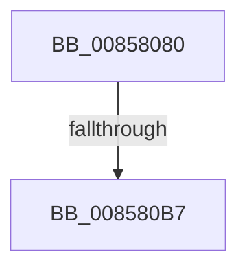

# HvpMarkCellDirty

- RVA: `0x00858080`–`0x008580BF` (길이 `63` bytes)
- VA: `0x0000000140858080`
- 실행 섹션: `PAGE`
- PDB 이름 있음: `예`; PDB Function 태그: `아니요`
- unwind 정보 RVA: `0x0006A7E8`
- 디코드: `18`개 명령, `63/63` bytes 표시
- 미해석 바이트: `0` (있으면 어셈블리에 `.byte`로 보존)

> 이 문서는 커널 이미지의 기계어와 PDB 기호를 분석해 생성했습니다. 4번과 5번은 함수 원형과 자료형을 바이너리 사용 방식에서 추정한 C 해석이며 원본 소스 복구 결과는 아닙니다.

## 1. Dependencies

- 직접 호출 지점: **0**; 고유 호출 대상: **0**
- 직접 호출자로 확인된 함수: **60**
- RIP 상대 이미지 참조: **0**

### Outgoing calls
- 직접 디코드된 call 명령이 없습니다.

### Direct callers
- [CmpMarkCurrentProfileDirty](../7D/CmpMarkCurrentProfileDirty_function_007DBBAC.md) at `0x007DBCF1`
- [CmpMarkCurrentValueDirty](../7D/CmpMarkCurrentValueDirty_function_007DBD1C.md) at `0x007DBDFA`
- [CmRestoreKey](../7D/CmRestoreKey_function_007DCF04.md) at `0x007DD582`
- [CmRestoreKey](../7D/CmRestoreKey_function_007DCF04.md) at `0x007DD692`
- [CmRestoreKey](../7D/CmRestoreKey_function_007DCF04.md) at `0x007DD790`
- [CmpRefreshHive](../7D/CmpRefreshHive_function_007DEAD0.md) at `0x007DEE57`
- [CmRenameKey](../7E/CmRenameKey_function_007E8F48.md) at `0x007E9945`
- [CmRenameKey](../7E/CmRenameKey_function_007E8F48.md) at `0x007E99B6`
- [CmRenameKey](../7E/CmRenameKey_function_007E8F48.md) at `0x007E9B0C`
- [CmpDoBuildVirtualStack](../7E/CmpDoBuildVirtualStack_function_007EB4C4.md) at `0x007EB7DE`
- [CmpDoBuildVirtualStack](../7E/CmpDoBuildVirtualStack_function_007EB4C4.md) at `0x007EB7F9`
- [CmpCopySaclToVirtualKey](../7E/CmpCopySaclToVirtualKey_function_007ECA6C.md) at `0x007ECC77`
- [CmpCopySaclToVirtualKey](../7E/CmpCopySaclToVirtualKey_function_007ECA6C.md) at `0x007ECC93`
- [CmpCopySaclToVirtualKey](../7E/CmpCopySaclToVirtualKey_function_007ECA6C.md) at `0x007ECCAF`
- [CmpMarkAllChildrenDirty](../7F/CmpMarkAllChildrenDirty_function_007F3120.md) at `0x007F319A`
- [CmpRemoveSubKeyCellNoCellRef](../7F/CmpRemoveSubKeyCellNoCellRef_function_007F3284.md) at `0x007F32F5`
- [CmpRemoveSubKeyCellNoCellRef](../7F/CmpRemoveSubKeyCellNoCellRef_function_007F3284.md) at `0x007F33CB`
- [CmpRemoveSubKeyCellNoCellRef](../7F/CmpRemoveSubKeyCellNoCellRef_function_007F3284.md) at `0x007F33ED`
- [CmpRemoveSubKeyCellNoCellRef](../7F/CmpRemoveSubKeyCellNoCellRef_function_007F3284.md) at `0x007F34FD`
- [CmSetLastWriteTimeKey](../84/CmSetLastWriteTimeKey_function_00843368.md) at `0x00843596`
- [CmSetValueKey](../84/CmSetValueKey_function_008457C0.md) at `0x00845CF3`
- [CmDeleteValueKey](../84/CmDeleteValueKey_function_008476E8.md) at `0x00847A16`
- [CmDeleteValueKey](../84/CmDeleteValueKey_function_008476E8.md) at `0x00847A8E`
- [CmDeleteValueKey](../84/CmDeleteValueKey_function_008476E8.md) at `0x00847AAD`
- [CmDeleteValueKey](../84/CmDeleteValueKey_function_008476E8.md) at `0x00847AC9`
- [CmDeleteValueKey](../84/CmDeleteValueKey_function_008476E8.md) at `0x00848044`
- [CmDeleteValueKey](../84/CmDeleteValueKey_function_008476E8.md) at `0x008481A0`
- [CmpUpdateKeyNodeAccessBits](../84/CmpUpdateKeyNodeAccessBits_function_0084864C.md) at `0x00848682`
- [CmpMarkKeyDirty](../84/CmpMarkKeyDirty_function_0084B1FC.md) at `0x0084B27C`
- [CmpMarkKeyDirty](../84/CmpMarkKeyDirty_function_0084B1FC.md) at `0x0084B2AC`
- [CmpMarkKeyDirty](../84/CmpMarkKeyDirty_function_0084B1FC.md) at `0x0084B2E6`
- [CmpMarkKeyDirty](../84/CmpMarkKeyDirty_function_0084B1FC.md) at `0x0084B302`
- [CmpMarkKeyDirty](../84/CmpMarkKeyDirty_function_0084B1FC.md) at `0x0084B34D`
- [CmpMarkKeyDirty](../84/CmpMarkKeyDirty_function_0084B1FC.md) at `0x0084B391`
- [CmpMarkKeyDirty](../84/CmpMarkKeyDirty_function_0084B1FC.md) at `0x0084B42E`
- [CmpMarkKeyDirty](../84/CmpMarkKeyDirty_function_0084B1FC.md) at `0x0084B4E1`
- [CmpSetValueKeyExisting](../84/CmpSetValueKeyExisting_function_0084B53C.md) at `0x0084B57B`
- [CmpMarkValueDataDirty](../84/CmpMarkValueDataDirty_function_0084B910.md) at `0x0084B96A`
- [CmpMarkValueDataDirty](../84/CmpMarkValueDataDirty_function_0084B910.md) at `0x0084B9FC`
- [CmpMarkValueDataDirty](../84/CmpMarkValueDataDirty_function_0084B910.md) at `0x0084BA1D`
- [CmpSelectLeaf](../84/CmpSelectLeaf_function_0084BFB4.md) at `0x0084C000`
- [CmpAddSubKeyEx](../84/CmpAddSubKeyEx_function_0084C940.md) at `0x0084CBC1`
- [sub_0084E7D5](../84/Unknown_function_0084E7D5.md) at `0x0084E834`
- [CmpCreateKeyControlBlock](CmpCreateKeyControlBlock_function_00851DB0.md) at `0x0085240A`
- [CmpWalkOneLevel](CmpWalkOneLevel_function_00852BA0.md) at `0x00853077`
- [sub_008565B6](Unknown_function_008565B6.md) at `0x008565C9`
- [sub_00856611](Unknown_function_00856611.md) at `0x0085661D`
- [HvFreeCell](HvFreeCell_function_0085A72C.md) at `0x0085A880`
- [CmpSetValueKeyNew](CmpSetValueKeyNew_function_0085BB44.md) at `0x0085BB7B`
- [CmpAddToLeaf](CmpAddToLeaf_function_0085BC2C.md) at `0x0085BC7A`
- [CmpCopySyncTree2](CmpCopySyncTree2_function_0085BF78.md) at `0x0085C832`
- [CmpCopySyncTree2](CmpCopySyncTree2_function_0085BF78.md) at `0x0085C85A`
- [CmpDoParseKey](CmpDoParseKey_function_0085F750.md) at `0x008616B0`
- [CmpTransMgrFreeVolatileData](../87/CmpTransMgrFreeVolatileData_function_00874BDC.md) at `0x00874D07`
- [CmpClearKeyAccessBits](../87/CmpClearKeyAccessBits_function_0087BB5C.md) at `0x0087BC0C`
- [CmpFullPromoteSingleKeyFromKeyNodeStacks](../8B/CmpFullPromoteSingleKeyFromKeyNodeStacks_function_008B1A40.md) at `0x008B1CC6`
- [CmpFullPromoteSingleKeyFromKeyNodeStacks](../8B/CmpFullPromoteSingleKeyFromKeyNodeStacks_function_008B1A40.md) at `0x008B1D06`
- [CmpFullPromoteSingleKeyFromKeyNodeStacks](../8B/CmpFullPromoteSingleKeyFromKeyNodeStacks_function_008B1A40.md) at `0x008B1E36`
- [CmpFullPromoteSingleKeyFromKeyNodeStacks](../8B/CmpFullPromoteSingleKeyFromKeyNodeStacks_function_008B1A40.md) at `0x008B1E5A`
- [CmpPartialPromoteSingleKeyFromKeyNodeStacks](../94/CmpPartialPromoteSingleKeyFromKeyNodeStacks_function_00945808.md) at `0x009458C2`
- [CmpCreateChild](../94/CmpCreateChild_function_0094817C.md) at `0x009485D2`
- [CmpCreateChild](../94/CmpCreateChild_function_0094817C.md) at `0x00948CB3`
- [CmpGetSecurityDescriptorNodeEx](../94/CmpGetSecurityDescriptorNodeEx_function_00949268.md) at `0x009492B3`
- [CmpGetSecurityDescriptorNodeEx](../94/CmpGetSecurityDescriptorNodeEx_function_00949268.md) at `0x00949304`
- [CmpSetSecurityDescriptorInfo](../94/CmpSetSecurityDescriptorInfo_function_00949688.md) at `0x0094985E`
- [CmpSetSecurityDescriptorInfo](../94/CmpSetSecurityDescriptorInfo_function_00949688.md) at `0x00949879`
- [CmpSetSecurityDescriptorInfo](../94/CmpSetSecurityDescriptorInfo_function_00949688.md) at `0x009499EA`
- [CmpSetSecurityDescriptorInfo](../94/CmpSetSecurityDescriptorInfo_function_00949688.md) at `0x00949B71`
- [CmpSetSecurityDescriptorInfo](../94/CmpSetSecurityDescriptorInfo_function_00949688.md) at `0x00949CC7`
- [CmpLightWeightPrepareSetSecDescUoW](../94/CmpLightWeightPrepareSetSecDescUoW_function_0094B098.md) at `0x0094B136`
- [CmpLightWeightPrepareSetSecDescUoW](../94/CmpLightWeightPrepareSetSecDescUoW_function_0094B098.md) at `0x0094B1B4`
- [CmpLightWeightPrepareSetSecDescUoW](../94/CmpLightWeightPrepareSetSecDescUoW_function_0094B098.md) at `0x0094B1CF`
- [CmpLightWeightPrepareSetSecDescUoW](../94/CmpLightWeightPrepareSetSecDescUoW_function_0094B098.md) at `0x0094B1EA`
- [CmpLightWeightPrepareSetSecDescUoW](../94/CmpLightWeightPrepareSetSecDescUoW_function_0094B098.md) at `0x0094B273`
- [CmpLightWeightPrepareSetSecDescUoW](../94/CmpLightWeightPrepareSetSecDescUoW_function_0094B098.md) at `0x0094B28E`
- [CmpInsertSecurityCellList](../96/CmpInsertSecurityCellList_function_0096DF40.md) at `0x0096E104`
- [CmpInsertSecurityCellList](../96/CmpInsertSecurityCellList_function_0096DF40.md) at `0x0096E121`
- [CmpCheckAndFixSecurityCellsRefcount](../96/CmpCheckAndFixSecurityCellsRefcount_function_0096E7FC.md) at `0x0096E8DF`
- [CmpCheckAndFixSecurityCellsRefcount](../96/CmpCheckAndFixSecurityCellsRefcount_function_0096E7FC.md) at `0x0096E8F7`
- [CmpCheckAndFixSecurityCellsRefcount](../96/CmpCheckAndFixSecurityCellsRefcount_function_0096E7FC.md) at `0x0096E90F`
- [CmpCheckAndFixSecurityCellsRefcount](../96/CmpCheckAndFixSecurityCellsRefcount_function_0096E7FC.md) at `0x0096E94D`
- [CmpCheckKey](../96/CmpCheckKey_function_0096EE2C.md) at `0x0096F62D`
- [CmpCheckKey](../96/CmpCheckKey_function_0096EE2C.md) at `0x0096F6E8`
- [CmpCheckKey](../96/CmpCheckKey_function_0096EE2C.md) at `0x0096F7AF`
- [CmpCheckKey](../96/CmpCheckKey_function_0096EE2C.md) at `0x0096F862`
- [CmpCheckKey](../96/CmpCheckKey_function_0096EE2C.md) at `0x0096F947`
- [CmpCheckKey](../96/CmpCheckKey_function_0096EE2C.md) at `0x0096FA02`
- [CmpCheckKey](../96/CmpCheckKey_function_0096EE2C.md) at `0x0096FA88`
- [CmpCheckKey](../96/CmpCheckKey_function_0096EE2C.md) at `0x0096FB79`
- [CmpCheckKey](../96/CmpCheckKey_function_0096EE2C.md) at `0x0096FBD2`
- [CmpCheckKey](../96/CmpCheckKey_function_0096EE2C.md) at `0x0096FC1B`
- [CmpCheckKey](../96/CmpCheckKey_function_0096EE2C.md) at `0x0096FC95`
- [CmpCheckKey](../96/CmpCheckKey_function_0096EE2C.md) at `0x0096FD2B`
- [CmpCheckKey](../96/CmpCheckKey_function_0096EE2C.md) at `0x0096FD90`
- [CmpCheckKey](../96/CmpCheckKey_function_0096EE2C.md) at `0x0096FE39`
- [CmpCheckKey](../96/CmpCheckKey_function_0096EE2C.md) at `0x0096FED4`
- [CmpCheckKey](../96/CmpCheckKey_function_0096EE2C.md) at `0x0096FFA5`
- [CmpCheckKey](../96/CmpCheckKey_function_0096EE2C.md) at `0x0096FFC1`
- [CmpCheckKey](../96/CmpCheckKey_function_0096EE2C.md) at `0x00970088`
- [CmpCheckKey](../96/CmpCheckKey_function_0096EE2C.md) at `0x009700FF`
- [CmpCheckKey](../96/CmpCheckKey_function_0096EE2C.md) at `0x00970170`
- [CmpCheckKey](../96/CmpCheckKey_function_0096EE2C.md) at `0x009701E2`
- [CmpCheckKey](../96/CmpCheckKey_function_0096EE2C.md) at `0x00970217`
- [CmpCheckValueList](../97/CmpCheckValueList_function_00970F6C.md) at `0x009713D4`
- [CmpCheckValueList](../97/CmpCheckValueList_function_00970F6C.md) at `0x009713F1`
- [CmpCheckValueList](../97/CmpCheckValueList_function_00970F6C.md) at `0x0097192C`
- [CmSetKeyFlags](../9A/CmSetKeyFlags_function_009AEEA4.md) at `0x009AF069`
- [CmpProcessLightWeightUOW](../9B/CmpProcessLightWeightUOW_function_009B0EAC.md) at `0x009B104F`
- [CmpLightWeightPrepareSetValueKeyUoW](../A0/CmpLightWeightPrepareSetValueKeyUoW_function_00A0EF28.md) at `0x00A0F031`
- [CmpLightWeightPrepareSetValueKeyUoW](../A0/CmpLightWeightPrepareSetValueKeyUoW_function_00A0EF28.md) at `0x00A0F210`
- [CmpLightWeightPrepareDeleteValueKeyUoW](../A0/CmpLightWeightPrepareDeleteValueKeyUoW_function_00A0F3D8.md) at `0x00A0F52D`
- [CmpLightWeightCreateSetValueData](../A0/CmpLightWeightCreateSetValueData_function_00A0F7EC.md) at `0x00A0F8B1`
- [CmpMarkIndexDirtyInStorageType](../A3/CmpMarkIndexDirtyInStorageType_function_00A325B0.md) at `0x00A3269D`
- [CmpMarkIndexDirtyInStorageType](../A3/CmpMarkIndexDirtyInStorageType_function_00A325B0.md) at `0x00A3277A`
- [CmpLightWeightPrepareDeleteKeyUoW](../A5/CmpLightWeightPrepareDeleteKeyUoW_function_00A54494.md) at `0x00A54552`
- [CmpLightWeightPrepareAddKeyUoW](../A5/CmpLightWeightPrepareAddKeyUoW_function_00A547FC.md) at `0x00A548BE`
- [CmpLightWeightPrepareAddKeyUoW](../A5/CmpLightWeightPrepareAddKeyUoW_function_00A547FC.md) at `0x00A548DD`
- [CmpLightWeightPrepareAddKeyUoW](../A5/CmpLightWeightPrepareAddKeyUoW_function_00A547FC.md) at `0x00A548FA`
- [CmpLightWeightPrepareSetKeyUserFlags](../A5/CmpLightWeightPrepareSetKeyUserFlags_function_00A553FC.md) at `0x00A55448`
- [CmpUpdateHiveRootCellFlags](../A6/CmpUpdateHiveRootCellFlags_function_00A6B124.md) at `0x00A6B183`
- [CmpMarkKeyParentDirty](../A7/CmpMarkKeyParentDirty_function_00A749E8.md) at `0x00A74A46`
- [CmpSplitLeaf](../A7/CmpSplitLeaf_function_00A7C7E0.md) at `0x00A7C8C9`
- [CmpMarkKeyValuesDirty](../A8/CmpMarkKeyValuesDirty_function_00A8B4C8.md) at `0x00A8B514`
- [CmpMarkKeyValuesDirty](../A8/CmpMarkKeyValuesDirty_function_00A8B4C8.md) at `0x00A8B546`
- [CmpMarkKeyValuesDirty](../A8/CmpMarkKeyValuesDirty_function_00A8B4C8.md) at `0x00A8B57E`
- [CmpMarkKeyValuesDirty](../A8/CmpMarkKeyValuesDirty_function_00A8B4C8.md) at `0x00A8B599`
- [CmpMarkKeyValuesDirty](../A8/CmpMarkKeyValuesDirty_function_00A8B4C8.md) at `0x00A8B5DE`
- [CmpMarkKeyValuesDirty](../A8/CmpMarkKeyValuesDirty_function_00A8B4C8.md) at `0x00A8B62B`
- [CmpMarkEntireIndexDirty](../AA/CmpMarkEntireIndexDirty_function_00AA24B4.md) at `0x00AA2508`
- [CmpSetValueKeyTombstone](../AC/CmpSetValueKeyTombstone_function_00AC5D64.md) at `0x00AC5D96`
- [sub_00B169F2](../B1/Unknown_function_00B169F2.md) at `0x00B16B70`
- [sub_00B28A98](../B2/Unknown_function_00B28A98.md) at `0x00B28BC7`
- [sub_00B28C32](../B2/Unknown_function_00B28C32.md) at `0x00B28C5A`
- [sub_00B46094](../B4/Unknown_function_00B46094.md) at `0x00B460DD`
- [sub_00B4993C](../B4/Unknown_function_00B4993C.md) at `0x00B4994B`

### Static image references
- 디코드된 RIP-relative 메모리 참조가 없습니다.

## 2. Other-region calls and transfers

- 다른 실행 섹션으로 향하는 call: **0**
- call이 아닌 외부 분기/꼬리 이동: **2**
  - `0x008580B1` → [sub_008581DD](Unknown_function_008581DD.md) (`tail-transfer`)
  - `0x008580B9` → [sub_008581DD](Unknown_function_008581DD.md) (`tail-transfer`)

## 3. Assembly (complete function range)

```asm
00858080  40 53                           push rbx
00858082  55                              push rbp
00858083  41 54                           push r12
00858085  41 56                           push r14
00858087  41 57                           push r15
00858089  48 83 EC 30                     sub rsp, 0x30
0085808D  8B 81 A0 00 00 00               mov eax, dword ptr [rcx + 0xa0]
00858093  45 33 F6                        xor r14d, r14d
00858096  8B EA                           mov ebp, edx
00858098  45 8B E1                        mov r12d, r9d
0085809B  C7 44 24 60 FF FF FF FF         mov dword ptr [rsp + 0x60], 0xffffffff
008580A3  45 0F B6 F8                     movzx r15d, r8b
008580A7  44 89 74 24 64                  mov dword ptr [rsp + 0x64], r14d
008580AC  48 8B D9                        mov rbx, rcx
008580AF  A8 01                           test al, 1
008580B1  0F 85 26 01 00 00               jne 0x1408581dd
008580B7  85 ED                           test ebp, ebp
008580B9  0F 88 1E 01 00 00               js 0x1408581dd
```

## 4. C-style interpretation (structured pseudocode)

```c
__int64 __fastcall HvpMarkCellDirty(__int64 a1, int a2, unsigned __int8 a3, int a4)
{
    __int64 v_r14;
    __int64 v_rsp;
    unsigned int v_stack_p8;
    unsigned int v_stack_pC;

    v_rsp = (v_rsp) - (48);
    v_r14 = 0;
    v_stack_p8 = 0xFFFFFFFFULL;
    v_stack_pC = 0;
}
```

## 5. (Beta) C Style

```c
int64_t HvpMarkCellDirty(void *Arg1, int32_t Arg2, uint8_t Arg3, int32_t Arg4)
{
    uint8_t *arg1 = (uint8_t *)Arg1;

    int64_t local_r14;
    int64_t local_rsp;
    uint32_t v_stack_p8;
    uint32_t v_stack_pC;

    local_rsp = (local_rsp) - (48);
    local_r14 = 0;
    v_stack_p8 = 0xFFFFFFFFULL;
    v_stack_pC = 0;
}
```

### 관측된 메모리 오프셋

구조체 형식이 확인되지 않은 접근은 인자 기준의 오프셋으로만 기록했습니다.

| 기준 인자 | 오프셋 표현 | 폭 (bit) | 접근 |
|---|---:|---:|---|
| `Arg1` | `+ 0xA0` | `32` | `R` |

## 6. Execution-region graph

[열기: 2D/3D 그래프와 함수 탐색 컨트롤 패널](../../../control-panel.html?section=page&rva=0x00858080&view=graph)

- 2D 그래프는 위에서 아래로 흐르고, 3D 그래프는 빈 공간을 드래그해 회전합니다. Shift+드래그는 이동, 휠은 확대·축소, 함수 노드 선택은 대상 보고서 이동입니다.

### Static fallback


