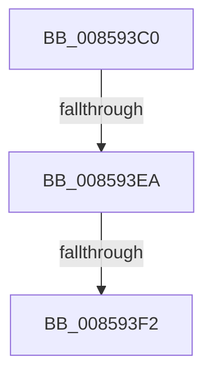

# HvpMarkDirty

- RVA: `0x008593C0`–`0x008593F9` (길이 `57` bytes)
- VA: `0x00000001408593C0`
- 실행 섹션: `PAGE`
- PDB 이름 있음: `예`; PDB Function 태그: `아니요`
- unwind 정보 RVA: `0x0006A988`
- 디코드: `16`개 명령, `57/57` bytes 표시
- 미해석 바이트: `0` (있으면 어셈블리에 `.byte`로 보존)

> 이 문서는 커널 이미지의 기계어와 PDB 기호를 분석해 생성했습니다. 4번과 5번은 함수 원형과 자료형을 바이너리 사용 방식에서 추정한 C 해석이며 원본 소스 복구 결과는 아닙니다.

## 1. Dependencies

- 직접 호출 지점: **0**; 고유 호출 대상: **0**
- 직접 호출자로 확인된 함수: **11**
- RIP 상대 이미지 참조: **0**

### Outgoing calls
- 직접 디코드된 call 명령이 없습니다.

### Direct callers
- [HvMarkDirtyForFlush](../../text/49/HvMarkDirtyForFlush_function_00494CA4.md) at `0x00494CAE`
- [sub_008580BF](Unknown_function_008580BF.md) at `0x00858178`
- [HvMarkCellDirty](HvMarkCellDirty_function_00859758.md) at `0x00859810`
- [HvpFindFreeCell](HvpFindFreeCell_function_00859920.md) at `0x00859B3F`
- [sub_0085AC29](Unknown_function_0085AC29.md) at `0x0085ACBB`
- [HvCheckAndUpdateHiveBackupTimeStamp](../87/HvCheckAndUpdateHiveBackupTimeStamp_function_0087BE90.md) at `0x0087BF1A`
- [CmpTransMgrSyncHive](../9B/CmpTransMgrSyncHive_function_009B07C4.md) at `0x009B0832`
- [CmpTransMgrPrepare](../9B/CmpTransMgrPrepare_function_009B175C.md) at `0x009B1915`
- [HvpRemapAndEnlistHiveBins](../9B/HvpRemapAndEnlistHiveBins_function_009B8E0C.md) at `0x009B8FA9`
- [HvpAddBin](../AF/HvpAddBin_function_00AF7D48.md) at `0x00AF7FAB`
- [HvpAddBin](../AF/HvpAddBin_function_00AF7D48.md) at `0x00AF8454`
- [sub_00B2E0F0](../B2/Unknown_function_00B2E0F0.md) at `0x00B2E0FF`
- [sub_00B2E0F0](../B2/Unknown_function_00B2E0F0.md) at `0x00B2E1EA`

### Static image references
- 디코드된 RIP-relative 메모리 참조가 없습니다.

## 2. Other-region calls and transfers

- 다른 실행 섹션으로 향하는 call: **0**
- call이 아닌 외부 분기/꼬리 이동: **2**
  - `0x008593E4` → [sub_008596EE](Unknown_function_008596EE.md) (`tail-transfer`)
  - `0x008593EC` → [sub_00859716](Unknown_function_00859716.md) (`tail-transfer`)

## 3. Assembly (complete function range)

```asm
008593C0  44 89 4C 24 20                  mov dword ptr [rsp + 0x20], r9d
008593C5  55                              push rbp
008593C6  41 55                           push r13
008593C8  41 56                           push r14
008593CA  41 57                           push r15
008593CC  48 83 EC 58                     sub rsp, 0x58
008593D0  8B 81 A4 00 00 00               mov eax, dword ptr [rcx + 0xa4]
008593D6  45 8B F9                        mov r15d, r9d
008593D9  45 8B E8                        mov r13d, r8d
008593DC  44 8B F2                        mov r14d, edx
008593DF  48 8B E9                        mov rbp, rcx
008593E2  A8 01                           test al, 1
008593E4  0F 85 04 03 00 00               jne 0x1408596ee
008593EA  A8 02                           test al, 2
008593EC  0F 85 24 03 00 00               jne 0x140859716
008593F2  44 8B 81 A0 00 00 00            mov r8d, dword ptr [rcx + 0xa0]
```

## 4. C-style interpretation (structured pseudocode)

```c
__int64 __fastcall HvpMarkDirty(__int64 a1, int a2, int a3, int a4)
{
    __int64 v_rsp;
    unsigned int v_stack_p20;

    v_stack_p20 = a4;
    v_rsp = (v_rsp) - (88);
    return (unsigned int)(*(unsigned int *)(a1 + 164));
}
```

## 5. (Beta) C Style

```c
int64_t HvpMarkDirty(void *Arg1, int32_t Arg2, int32_t Arg3, int32_t Arg4)
{
    uint8_t *arg1 = (uint8_t *)Arg1;

    int64_t local_rsp;
    uint32_t v_stack_p20;

    v_stack_p20 = Arg4;
    local_rsp = (local_rsp) - (88);
    return (uint32_t)(*(uint32_t *)(arg1 + 0xA4));
}
```

### 관측된 메모리 오프셋

구조체 형식이 확인되지 않은 접근은 인자 기준의 오프셋으로만 기록했습니다.

| 기준 인자 | 오프셋 표현 | 폭 (bit) | 접근 |
|---|---:|---:|---|
| `Arg1` | `+ 0xA0` | `32` | `R` |
| `Arg1` | `+ 0xA4` | `32` | `R` |

## 6. Execution-region graph

[열기: 2D/3D 그래프와 함수 탐색 컨트롤 패널](../../../control-panel.html?section=page&rva=0x008593C0&view=graph)

- 2D 그래프는 위에서 아래로 흐르고, 3D 그래프는 빈 공간을 드래그해 회전합니다. Shift+드래그는 이동, 휠은 확대·축소, 함수 노드 선택은 대상 보고서 이동입니다.

### Static fallback


