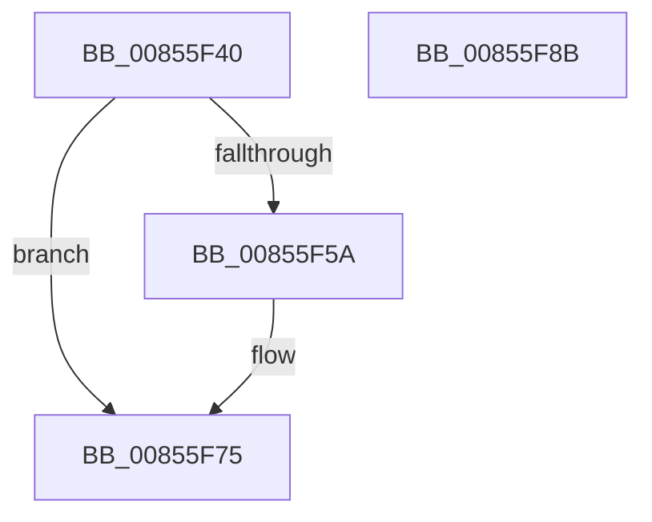

# HvpReleaseCellPaged

- RVA: `0x00855F40`–`0x00855F8C` (길이 `76` bytes)
- VA: `0x0000000140855F40`
- 실행 섹션: `PAGE`
- PDB 이름 있음: `예`; PDB Function 태그: `아니요`
- unwind 정보 RVA: `0x0005D2F4`
- 디코드: `22`개 명령, `76/76` bytes 표시
- 미해석 바이트: `0` (있으면 어셈블리에 `.byte`로 보존)

> 이 문서는 커널 이미지의 기계어와 PDB 기호를 분석해 생성했습니다. 4번과 5번은 함수 원형과 자료형을 바이너리 사용 방식에서 추정한 C 해석이며 원본 소스 복구 결과는 아닙니다.

## 1. Dependencies

- 직접 호출 지점: **4**; 고유 호출 대상: **4**
- 직접 호출자로 확인된 함수: **231**
- RIP 상대 이미지 참조: **0**

### Outgoing calls
- `0x00855F50` → [HvpGetCellMap](../../pagecmrc/BC/HvpGetCellMap_function_00BC9710.md) (function, `0x00BC9710`)
- `0x00855F6F` → [KeBugCheckEx](../../text/4F/KeBugCheckEx_function_004FD660.md) (function, `0x004FD660`)
- `0x00855F79` → [HvpMapEntryReleaseBinAddress](../../pagecmrc/BC/HvpMapEntryReleaseBinAddress_function_00BC9790.md) (function, `0x00BC9790`)
- `0x00855F81` → [HvpGetCellContextReinitialize](HvpGetCellContextReinitialize_function_00855D40.md) (function, `0x00855D40`)

### Direct callers
- [CmDeleteLayeredKey](../../text/41/CmDeleteLayeredKey_function_0041B598.md) at `0x0041B809`
- [CmpValueEnumStackEntryCleanup](../../text/49/CmpValueEnumStackEntryCleanup_function_0049C5A4.md) at `0x0049C5BF`
- [CmpSwapValueInList](../../text/4A/CmpSwapValueInList_function_004A266C.md) at `0x004A26C3`
- [CmpDereferenceSecurityNode](../../text/4A/CmpDereferenceSecurityNode_function_004A672C.md) at `0x004A6790`
- [CmpRemoveSecurityCellList](../../text/4B/CmpRemoveSecurityCellList_function_004BC1FC.md) at `0x004BC2C4`
- [CmpRemoveSecurityCellList](../../text/4B/CmpRemoveSecurityCellList_function_004BC1FC.md) at `0x004BC2D9`
- [CmpRemoveSecurityCellList](../../text/4B/CmpRemoveSecurityCellList_function_004BC1FC.md) at `0x004BC2EE`
- [CmpCreateTombstone](../../text/66/CmpCreateTombstone_function_0066AF50.md) at `0x0066B1BE`
- [CmpCreateTombstone](../../text/66/CmpCreateTombstone_function_0066AF50.md) at `0x0066B1FA`
- [sub_006ED542](../../text/6E/Unknown_function_006ED542.md) at `0x006ED6B0`
- [sub_006F30FE](../../text/6F/Unknown_function_006F30FE.md) at `0x006F310D`
- [sub_006F98D4](../../text/6F/Unknown_function_006F98D4.md) at `0x006F98D4`
- [sub_006FC686](../../text/6F/Unknown_function_006FC686.md) at `0x006FC686`
- [sub_006FC686](../../text/6F/Unknown_function_006FC686.md) at `0x006FC691`
- [sub_006FC686](../../text/6F/Unknown_function_006FC686.md) at `0x006FC69C`
- [CmpMarkCurrentProfileDirty](../7D/CmpMarkCurrentProfileDirty_function_007DBBAC.md) at `0x007DBCD7`
- [CmpMarkCurrentValueDirty](../7D/CmpMarkCurrentValueDirty_function_007DBD1C.md) at `0x007DBD8C`
- [CmpMarkCurrentValueDirty](../7D/CmpMarkCurrentValueDirty_function_007DBD1C.md) at `0x007DBDE5`
- [CmRestoreKey](../7D/CmRestoreKey_function_007DCF04.md) at `0x007DD2B7`
- [CmRestoreKey](../7D/CmRestoreKey_function_007DCF04.md) at `0x007DD2DA`
- [CmRestoreKey](../7D/CmRestoreKey_function_007DCF04.md) at `0x007DD62A`
- [CmRestoreKey](../7D/CmRestoreKey_function_007DCF04.md) at `0x007DD679`
- [CmRestoreKey](../7D/CmRestoreKey_function_007DCF04.md) at `0x007DD6ED`
- [CmRestoreKey](../7D/CmRestoreKey_function_007DCF04.md) at `0x007DD7FA`
- [CmRestoreKey](../7D/CmRestoreKey_function_007DCF04.md) at `0x007DD816`
- [CmRestoreKey](../7D/CmRestoreKey_function_007DCF04.md) at `0x007DD857`
- [CmRestoreKey](../7D/CmRestoreKey_function_007DCF04.md) at `0x007DD8E1`
- [CmRestoreKey](../7D/CmRestoreKey_function_007DCF04.md) at `0x007DD903`
- [CmRestoreKey](../7D/CmRestoreKey_function_007DCF04.md) at `0x007DDA17`
- [CmRestoreKey](../7D/CmRestoreKey_function_007DCF04.md) at `0x007DDB51`
- [CmRestoreKey](../7D/CmRestoreKey_function_007DCF04.md) at `0x007DDB72`
- [CmRestoreKey](../7D/CmRestoreKey_function_007DCF04.md) at `0x007DDB94`
- [CmSaveMergedKeys](../7D/CmSaveMergedKeys_function_007DE040.md) at `0x007DE378`
- [CmSaveMergedKeys](../7D/CmSaveMergedKeys_function_007DE040.md) at `0x007DE394`
- [CmSaveMergedKeys](../7D/CmSaveMergedKeys_function_007DE040.md) at `0x007DE401`
- [CmSaveMergedKeys](../7D/CmSaveMergedKeys_function_007DE040.md) at `0x007DE422`
- [CmpLoadHiveVolatile](../7D/CmpLoadHiveVolatile_function_007DE5F0.md) at `0x007DE98B`
- [CmpLoadHiveVolatile](../7D/CmpLoadHiveVolatile_function_007DE5F0.md) at `0x007DEA4A`
- [CmpRefreshHive](../7D/CmpRefreshHive_function_007DEAD0.md) at `0x007DEE8B`
- [CmpRefreshHive](../7D/CmpRefreshHive_function_007DEAD0.md) at `0x007DEEA8`
- [CmpRefreshHive](../7D/CmpRefreshHive_function_007DEAD0.md) at `0x007DEF22`
- [CmpRefreshHive](../7D/CmpRefreshHive_function_007DEAD0.md) at `0x007DEF4B`
- [CmpCloneHwProfile](../7E/CmpCloneHwProfile_function_007E303C.md) at `0x007E3786`
- [CmpCloneHwProfile](../7E/CmpCloneHwProfile_function_007E303C.md) at `0x007E37B2`
- [CmRenameKey](../7E/CmRenameKey_function_007E8F48.md) at `0x007E9485`
- [CmRenameKey](../7E/CmRenameKey_function_007E8F48.md) at `0x007E9557`
- [CmRenameKey](../7E/CmRenameKey_function_007E8F48.md) at `0x007E9858`
- [CmRenameKey](../7E/CmRenameKey_function_007E8F48.md) at `0x007E9B61`
- [CmRenameKey](../7E/CmRenameKey_function_007E8F48.md) at `0x007E9BF4`
- [CmRenameKey](../7E/CmRenameKey_function_007E8F48.md) at `0x007E9DFB`
- [CmRenameKey](../7E/CmRenameKey_function_007E8F48.md) at `0x007E9FD1`
- [CmRenameKey](../7E/CmRenameKey_function_007E8F48.md) at `0x007EA07E`
- [CmRenameKey](../7E/CmRenameKey_function_007E8F48.md) at `0x007EA0A5`
- [CmRenameKey](../7E/CmRenameKey_function_007E8F48.md) at `0x007EA0DD`
- [CmpAddValueKeyTombstone](../7E/CmpAddValueKeyTombstone_function_007EA488.md) at `0x007EA56A`
- [CmpDoBuildVirtualStack](../7E/CmpDoBuildVirtualStack_function_007EB4C4.md) at `0x007EB8F4`
- [CmpDoBuildVirtualStack](../7E/CmpDoBuildVirtualStack_function_007EB4C4.md) at `0x007EB918`
- [CmpVirtualPathPresent](../7E/CmpVirtualPathPresent_function_007EBDB4.md) at `0x007EBEA6`
- [CmpAssignKeySecurity](../7E/CmpAssignKeySecurity_function_007EC8B0.md) at `0x007ECA0F`
- [CmpCopySaclToVirtualKey](../7E/CmpCopySaclToVirtualKey_function_007ECA6C.md) at `0x007ECD52`
- [CmpCopySaclToVirtualKey](../7E/CmpCopySaclToVirtualKey_function_007ECA6C.md) at `0x007ECD75`
- [CmpReferenceSecurityNode](../7E/CmpReferenceSecurityNode_function_007ED6A0.md) at `0x007ED712`
- [CmpReferenceSecurityNode](../7E/CmpReferenceSecurityNode_function_007ED6A0.md) at `0x007ED738`
- [CmpFindControlSet](../7F/CmpFindControlSet_function_007F1A34.md) at `0x007F1B1C`
- [CmpFindControlSet](../7F/CmpFindControlSet_function_007F1A34.md) at `0x007F1B94`
- [CmpFindControlSet](../7F/CmpFindControlSet_function_007F1A34.md) at `0x007F1C05`
- [CmpFindControlSet](../7F/CmpFindControlSet_function_007F1A34.md) at `0x007F1C30`
- [CmpFindControlSet](../7F/CmpFindControlSet_function_007F1A34.md) at `0x007F1C88`
- [CmpFindControlSet](../7F/CmpFindControlSet_function_007F1A34.md) at `0x007F1D05`
- [CmpFindControlSet](../7F/CmpFindControlSet_function_007F1A34.md) at `0x007F1DEE`
- [CmpFindControlSet](../7F/CmpFindControlSet_function_007F1A34.md) at `0x007F1E70`
- [CmpFindControlSet](../7F/CmpFindControlSet_function_007F1A34.md) at `0x007F1F0D`
- [CmpFindControlSet](../7F/CmpFindControlSet_function_007F1A34.md) at `0x007F1F30`
- [CmpFindControlSet](../7F/CmpFindControlSet_function_007F1A34.md) at `0x007F1F4D`
- [CmpFindControlSet](../7F/CmpFindControlSet_function_007F1A34.md) at `0x007F1F6A`
- [CmpFreeKeyValueList](../7F/CmpFreeKeyValueList_function_007F2250.md) at `0x007F22E1`
- [CmpMergeKeyValues](../7F/CmpMergeKeyValues_function_007F2304.md) at `0x007F2467`
- [CmpMergeKeyValues](../7F/CmpMergeKeyValues_function_007F2304.md) at `0x007F24E7`
- [CmpPreserveSystemHiveData](../7F/CmpPreserveSystemHiveData_function_007F2518.md) at `0x007F27CD`
- [CmpPreserveSystemHiveData](../7F/CmpPreserveSystemHiveData_function_007F2518.md) at `0x007F2857`
- [CmpPreserveSystemHiveData](../7F/CmpPreserveSystemHiveData_function_007F2518.md) at `0x007F287C`
- [CmpPreserveSystemHiveData](../7F/CmpPreserveSystemHiveData_function_007F2518.md) at `0x007F28D5`
- [CmpPreserveSystemHiveData](../7F/CmpPreserveSystemHiveData_function_007F2518.md) at `0x007F2929`
- [CmpPreserveSystemHiveData](../7F/CmpPreserveSystemHiveData_function_007F2518.md) at `0x007F2955`
- [CmpPreserveSystemHiveData](../7F/CmpPreserveSystemHiveData_function_007F2518.md) at `0x007F2AFE`
- [CmpPreserveSystemHiveData](../7F/CmpPreserveSystemHiveData_function_007F2518.md) at `0x007F2B51`
- [CmpPreserveSystemHiveData](../7F/CmpPreserveSystemHiveData_function_007F2518.md) at `0x007F2C43`
- [CmpPreserveSystemHiveData](../7F/CmpPreserveSystemHiveData_function_007F2518.md) at `0x007F2CC8`
- [CmpPreserveSystemHiveData](../7F/CmpPreserveSystemHiveData_function_007F2518.md) at `0x007F2CFB`
- [CmpPreserveSystemHiveData](../7F/CmpPreserveSystemHiveData_function_007F2518.md) at `0x007F2D27`
- [CmpPreserveSystemHiveData](../7F/CmpPreserveSystemHiveData_function_007F2518.md) at `0x007F2D66`
- [CmpPreserveSystemHiveData](../7F/CmpPreserveSystemHiveData_function_007F2518.md) at `0x007F2D9E`
- [CmpPreserveSystemHiveData](../7F/CmpPreserveSystemHiveData_function_007F2518.md) at `0x007F2DC2`
- [CmpSyncKeyValues](../7F/CmpSyncKeyValues_function_007F2DF4.md) at `0x007F3053`
- [CmpMarkAllChildrenDirty](../7F/CmpMarkAllChildrenDirty_function_007F3120.md) at `0x007F31C3`
- [CmpRemoveSubKeyCellNoCellRef](../7F/CmpRemoveSubKeyCellNoCellRef_function_007F3284.md) at `0x007F3369`
- [CmpRemoveSubKeyCellNoCellRef](../7F/CmpRemoveSubKeyCellNoCellRef_function_007F3284.md) at `0x007F3487`
- [CmpRemoveSubKeyCellNoCellRef](../7F/CmpRemoveSubKeyCellNoCellRef_function_007F3284.md) at `0x007F34C0`
- [CmpRemoveSubKeyCellNoCellRef](../7F/CmpRemoveSubKeyCellNoCellRef_function_007F3284.md) at `0x007F3549`
- [CmpRemoveSubKeyCellNoCellRef](../7F/CmpRemoveSubKeyCellNoCellRef_function_007F3284.md) at `0x007F356F`
- [CmpRemoveSubKeyCellNoCellRef](../7F/CmpRemoveSubKeyCellNoCellRef_function_007F3284.md) at `0x007F3590`
- [CmpUpdateParentForEachSon](../7F/CmpUpdateParentForEachSon_function_007F35B8.md) at `0x007F3673`
- [CmpUpdateParentForEachSon](../7F/CmpUpdateParentForEachSon_function_007F35B8.md) at `0x007F3696`
- [CmpWalkUnicodeStringPath](../7F/CmpWalkUnicodeStringPath_function_007F3704.md) at `0x007F379B`
- [CmpGetValueForAudit](../7F/CmpGetValueForAudit_function_007F37C0.md) at `0x007F38EB`
- [CmpGetValueForAudit](../7F/CmpGetValueForAudit_function_007F37C0.md) at `0x007F3907`
- [CmpDeleteTree](../7F/CmpDeleteTree_function_007F3E44.md) at `0x007F3ED7`
- [CmpDeleteTree](../7F/CmpDeleteTree_function_007F3E44.md) at `0x007F3F28`
- [CmpDeleteTree](../7F/CmpDeleteTree_function_007F3E44.md) at `0x007F3F7C`
- [CmpDuplicateIndex](../84/CmpDuplicateIndex_function_008420C0.md) at `0x0084220E`
- [CmpDuplicateIndex](../84/CmpDuplicateIndex_function_008420C0.md) at `0x00842235`
- [CmpDuplicateIndex](../84/CmpDuplicateIndex_function_008420C0.md) at `0x008422A0`
- [HvDuplicateCell](../84/HvDuplicateCell_function_00843238.md) at `0x008432E3`
- [HvDuplicateCell](../84/HvDuplicateCell_function_00843238.md) at `0x008432FD`
- [CmSetLastWriteTimeKey](../84/CmSetLastWriteTimeKey_function_00843368.md) at `0x008435E2`
- [CmAddLogForAction](../84/CmAddLogForAction_function_008445AC.md) at `0x008448A0`
- [CmAddLogForAction](../84/CmAddLogForAction_function_008445AC.md) at `0x00844998`
- [CmpCloneKCBValueListForTrans](../84/CmpCloneKCBValueListForTrans_function_00844D30.md) at `0x00844DD9`
- [CmSetValueKey](../84/CmSetValueKey_function_008457C0.md) at `0x00845F06`
- [CmSetValueKey](../84/CmSetValueKey_function_008457C0.md) at `0x0084638B`
- [CmpCompareNewValueDataAgainstKCBCache](../84/CmpCompareNewValueDataAgainstKCBCache_function_00846920.md) at `0x00846A37`
- [CmpCompareNewValueDataAgainstKCBCache](../84/CmpCompareNewValueDataAgainstKCBCache_function_00846920.md) at `0x00846ABC`
- [CmpFindNameInListWithStatus](../84/CmpFindNameInListWithStatus_function_00846B80.md) at `0x00846C2F`
- [CmpFindNameInListWithStatus](../84/CmpFindNameInListWithStatus_function_00846B80.md) at `0x00846D43`
- [CmQueryMultipleValueKey](../84/CmQueryMultipleValueKey_function_00846EC0.md) at `0x00847296`
- [CmQueryMultipleValueKey](../84/CmQueryMultipleValueKey_function_00846EC0.md) at `0x008472CE`
- [CmQueryMultipleValueKey](../84/CmQueryMultipleValueKey_function_00846EC0.md) at `0x0084733E`
- [CmDeleteValueKey](../84/CmDeleteValueKey_function_008476E8.md) at `0x00847945`
- [CmDeleteValueKey](../84/CmDeleteValueKey_function_008476E8.md) at `0x008479DA`
- [CmDeleteValueKey](../84/CmDeleteValueKey_function_008476E8.md) at `0x00847B2F`
- [CmDeleteValueKey](../84/CmDeleteValueKey_function_008476E8.md) at `0x00847C4A`
- [CmDeleteValueKey](../84/CmDeleteValueKey_function_008476E8.md) at `0x00847F2F`
- [CmDeleteValueKey](../84/CmDeleteValueKey_function_008476E8.md) at `0x0084827A`
- [CmDeleteKey](../84/CmDeleteKey_function_00848E5C.md) at `0x0084919D`
- [CmDeleteKey](../84/CmDeleteKey_function_00848E5C.md) at `0x008492BD`
- [CmpFreeSecurityDescriptor](../84/CmpFreeSecurityDescriptor_function_00849E44.md) at `0x00849E9F`
- [CmpFreeKeyBody](../84/CmpFreeKeyBody_function_00849ECC.md) at `0x00849F2D`
- [CmpRemoveSubKey](../84/CmpRemoveSubKey_function_00849F84.md) at `0x00849FFB`
- [CmpRemoveSubKeyFromList](../84/CmpRemoveSubKeyFromList_function_0084A030.md) at `0x0084A0E2`
- [CmpRemoveSubKeyFromList](../84/CmpRemoveSubKeyFromList_function_0084A030.md) at `0x0084A1E2`
- [CmpRemoveSubKeyFromList](../84/CmpRemoveSubKeyFromList_function_0084A030.md) at `0x0084A200`
- [CmpRemoveSubKeyFromList](../84/CmpRemoveSubKeyFromList_function_0084A030.md) at `0x0084A2C3`
- [CmpVirtualBranchIsReplicated](../84/CmpVirtualBranchIsReplicated_function_0084A3E0.md) at `0x0084A52E`
- [CmpFreeKeyByCell](../84/CmpFreeKeyByCell_function_0084AD70.md) at `0x0084AE57`
- [CmpFreeKeyByCell](../84/CmpFreeKeyByCell_function_0084AD70.md) at `0x0084AE8C`
- [CmpFreeKeyByCell](../84/CmpFreeKeyByCell_function_0084AD70.md) at `0x0084AF2B`
- [CmpFreeValue](../84/CmpFreeValue_function_0084AF98.md) at `0x0084AFF5`
- [CmpFreeValueData](../84/CmpFreeValueData_function_0084B040.md) at `0x0084B107`
- [CmpFreeValueData](../84/CmpFreeValueData_function_0084B040.md) at `0x0084B15A`
- [CmpMarkKeyDirty](../84/CmpMarkKeyDirty_function_0084B1FC.md) at `0x0084B325`
- [CmpMarkKeyDirty](../84/CmpMarkKeyDirty_function_0084B1FC.md) at `0x0084B3E9`
- [CmpMarkKeyDirty](../84/CmpMarkKeyDirty_function_0084B1FC.md) at `0x0084B452`
- [CmpMarkKeyDirty](../84/CmpMarkKeyDirty_function_0084B1FC.md) at `0x0084B467`
- [CmpSetValueKeyExisting](../84/CmpSetValueKeyExisting_function_0084B53C.md) at `0x0084B6AE`
- [CmpSetValueKeyExisting](../84/CmpSetValueKeyExisting_function_0084B53C.md) at `0x0084B7C0`
- [CmpMarkValueDataDirty](../84/CmpMarkValueDataDirty_function_0084B910.md) at `0x0084BA3D`
- [CmpMarkValueDataDirty](../84/CmpMarkValueDataDirty_function_0084B910.md) at `0x0084BA73`
- [CmpFindPathByNameEx](../84/CmpFindPathByNameEx_function_0084BAAC.md) at `0x0084BC13`
- [CmpFindPathByNameEx](../84/CmpFindPathByNameEx_function_0084BAAC.md) at `0x0084BC8F`
- [CmpSelectLeaf](../84/CmpSelectLeaf_function_0084BFB4.md) at `0x0084C0C3`
- [CmpSelectLeaf](../84/CmpSelectLeaf_function_0084BFB4.md) at `0x0084C143`
- [CmpSelectLeaf](../84/CmpSelectLeaf_function_0084BFB4.md) at `0x0084C17F`
- [CmpSelectLeaf](../84/CmpSelectLeaf_function_0084BFB4.md) at `0x0084C1D2`
- [CmpSelectLeaf](../84/CmpSelectLeaf_function_0084BFB4.md) at `0x0084C1EC`
- [CmpSelectLeaf](../84/CmpSelectLeaf_function_0084BFB4.md) at `0x0084C28C`
- [CmpMarkIndexDirty](../84/CmpMarkIndexDirty_function_0084C30C.md) at `0x0084C426`
- [CmpMarkIndexDirty](../84/CmpMarkIndexDirty_function_0084C30C.md) at `0x0084C448`
- [CmpCleanUpSubKeyInfo](../84/CmpCleanUpSubKeyInfo_function_0084C6F4.md) at `0x0084C773`
- [CmpAddSubKeyEx](../84/CmpAddSubKeyEx_function_0084C940.md) at `0x0084CA6B`
- [CmpAddSubKeyEx](../84/CmpAddSubKeyEx_function_0084C940.md) at `0x0084CA8D`
- [CmpAddSubKeyEx](../84/CmpAddSubKeyEx_function_0084C940.md) at `0x0084CB57`
- [CmpAddSubKeyEx](../84/CmpAddSubKeyEx_function_0084C940.md) at `0x0084CC23`
- [CmpAddSubKeyEx](../84/CmpAddSubKeyEx_function_0084C940.md) at `0x0084CC80`
- [CmpVEExecuteRealStoreParseLogic](../84/CmpVEExecuteRealStoreParseLogic_function_0084CCD4.md) at `0x0084CE2D`
- [CmpVEExecuteRealStoreParseLogic](../84/CmpVEExecuteRealStoreParseLogic_function_0084CCD4.md) at `0x0084CEC1`
- [CmpAddSubKeyToList](../84/CmpAddSubKeyToList_function_0084D644.md) at `0x0084D72B`
- [CmpAddSubKeyToList](../84/CmpAddSubKeyToList_function_0084D644.md) at `0x0084D7D7`
- [CmpAddSubKeyToList](../84/CmpAddSubKeyToList_function_0084D644.md) at `0x0084D828`
- [sub_0084E4B5](../84/Unknown_function_0084E4B5.md) at `0x0084E685`
- [sub_0084E4B5](../84/Unknown_function_0084E4B5.md) at `0x0084E746`
- [CmpQueryKeyDataFromNode](../84/CmpQueryKeyDataFromNode_function_0084EAE0.md) at `0x0084EC4D`
- [CmpQueryKeyDataFromNode](../84/CmpQueryKeyDataFromNode_function_0084EAE0.md) at `0x0084F029`
- [CmpFindSubKeyByNumberEx](../84/CmpFindSubKeyByNumberEx_function_0084F1A0.md) at `0x0084F2C8`
- [CmpFindSubKeyByNumberEx](../84/CmpFindSubKeyByNumberEx_function_0084F1A0.md) at `0x0084F38D`
- [CmpFindSubKeyByNumberEx](../84/CmpFindSubKeyByNumberEx_function_0084F1A0.md) at `0x0084F3E1`
- [CmpFindSubKeyByNumberEx](../84/CmpFindSubKeyByNumberEx_function_0084F1A0.md) at `0x0084F467`
- [CmpFindSubKeyByNumberEx](../84/CmpFindSubKeyByNumberEx_function_0084F1A0.md) at `0x0084F4CF`
- [CmpFindSubKeyByNumberEx](../84/CmpFindSubKeyByNumberEx_function_0084F1A0.md) at `0x0084F5E8`
- [CmpFindSubKeyByNumberEx](../84/CmpFindSubKeyByNumberEx_function_0084F1A0.md) at `0x0084F663`
- [CmpCreateKeyControlBlock](CmpCreateKeyControlBlock_function_00851DB0.md) at `0x008520C3`
- [CmpCreateKeyControlBlock](CmpCreateKeyControlBlock_function_00851DB0.md) at `0x0085229F`
- [CmpCreateKeyControlBlock](CmpCreateKeyControlBlock_function_00851DB0.md) at `0x00852528`
- [CmpFindSubKeyByNameWithStatus](CmpFindSubKeyByNameWithStatus_function_00852770.md) at `0x008528F5`
- [CmpFindSubKeyByNameWithStatus](CmpFindSubKeyByNameWithStatus_function_00852770.md) at `0x00852A1D`
- [CmpFindSubKeyByNameWithStatus](CmpFindSubKeyByNameWithStatus_function_00852770.md) at `0x00852A8E`
- [CmpFindSubKeyByNameWithStatus](CmpFindSubKeyByNameWithStatus_function_00852770.md) at `0x00852AE4`
- [CmpWalkOneLevel](CmpWalkOneLevel_function_00852BA0.md) at `0x00852E76`
- [CmpWalkOneLevel](CmpWalkOneLevel_function_00852BA0.md) at `0x0085348F`
- [CmpWalkOneLevel](CmpWalkOneLevel_function_00852BA0.md) at `0x008535B8`
- [CmpWalkOneLevel](CmpWalkOneLevel_function_00852BA0.md) at `0x0085363A`
- [CmpWalkOneLevel](CmpWalkOneLevel_function_00852BA0.md) at `0x00853658`
- [CmpWalkOneLevel](CmpWalkOneLevel_function_00852BA0.md) at `0x008536FE`
- [sub_00853ABC](Unknown_function_00853ABC.md) at `0x00853D5E`
- [sub_00853ABC](Unknown_function_00853ABC.md) at `0x00853E89`
- [sub_0085416A](Unknown_function_0085416A.md) at `0x0085426E`
- [sub_0085416A](Unknown_function_0085416A.md) at `0x008543CD`
- [sub_0085416A](Unknown_function_0085416A.md) at `0x008544F8`
- [sub_00854F9C](Unknown_function_00854F9C.md) at `0x00854F9C`
- [sub_008551B7](Unknown_function_008551B7.md) at `0x0085531A`
- [sub_008551B7](Unknown_function_008551B7.md) at `0x008553C0`
- [sub_00855472](Unknown_function_00855472.md) at `0x0085567D`
- [sub_00855A5C](Unknown_function_00855A5C.md) at `0x00855B6E`
- [sub_00855E52](Unknown_function_00855E52.md) at `0x00855EB5`
- [sub_00856008](Unknown_function_00856008.md) at `0x008560FF`
- [sub_008564EC](Unknown_function_008564EC.md) at `0x008564F7`
- [CmpQueryKeyValueData](CmpQueryKeyValueData_function_00856650.md) at `0x008567F5`
- [sub_00856F2C](Unknown_function_00856F2C.md) at `0x00856FCF`
- [sub_00857001](Unknown_function_00857001.md) at `0x00857001`
- [sub_0085701C](Unknown_function_0085701C.md) at `0x0085701C`
- [CmpGetSymbolicLinkTarget](CmpGetSymbolicLinkTarget_function_008570A0.md) at `0x00857554`
- [CmpGetSymbolicLinkTarget](CmpGetSymbolicLinkTarget_function_008570A0.md) at `0x0085774D`
- [sub_00857864](Unknown_function_00857864.md) at `0x008578A4`
- [sub_00857864](Unknown_function_00857864.md) at `0x008578C6`
- [sub_00857A33](Unknown_function_00857A33.md) at `0x00857BC1`
- [sub_00857E6F](Unknown_function_00857E6F.md) at `0x00857E90`
- [sub_008580BF](Unknown_function_008580BF.md) at `0x00858168`
- [CmQueryKey](CmQueryKey_function_00858240.md) at `0x00858538`
- [CmpQueryKeyData](CmpQueryKeyData_function_00858E70.md) at `0x00858F3F`
- [CmpQueryKeyDataFromCache](CmpQueryKeyDataFromCache_function_00858F70.md) at `0x00859202`
- [CmpQueryKeyDataFromCache](CmpQueryKeyDataFromCache_function_00858F70.md) at `0x008592FA`
- [HvMarkCellDirty](HvMarkCellDirty_function_00859758.md) at `0x00859800`
- [HvpFindFreeCell](HvpFindFreeCell_function_00859920.md) at `0x00859B2E`
- [CmpCopyCell](CmpCopyCell_function_0085A608.md) at `0x0085A6D4`
- [CmpCopyCell](CmpCopyCell_function_0085A608.md) at `0x0085A6E9`
- [HvpDelistFreeCell](HvpDelistFreeCell_function_0085A99C.md) at `0x0085AA11`
- [CmpAddValueKeyNew](CmpAddValueKeyNew_function_0085AA58.md) at `0x0085AB6E`
- [CmpCopyKeyPartial](CmpCopyKeyPartial_function_0085AFF4.md) at `0x0085B2E0`
- [CmpCopyKeyPartial](CmpCopyKeyPartial_function_0085AFF4.md) at `0x0085B2FE`
- [CmpCopyKeyPartial](CmpCopyKeyPartial_function_0085AFF4.md) at `0x0085B31E`
- [CmpAddValueToListEx](CmpAddValueToListEx_function_0085B460.md) at `0x0085B52D`
- [HvReallocateCell](HvReallocateCell_function_0085B5D0.md) at `0x0085B6F9`
- [CmpCopyValue](CmpCopyValue_function_0085B798.md) at `0x0085B8D4`
- [CmpCopyValue](CmpCopyValue_function_0085B798.md) at `0x0085B915`
- [CmpCopyValue](CmpCopyValue_function_0085B798.md) at `0x0085B949`
- [CmpCopyValue](CmpCopyValue_function_0085B798.md) at `0x0085B9B6`
- [CmpCopyValue](CmpCopyValue_function_0085B798.md) at `0x0085B9F0`
- [CmpCopyValue](CmpCopyValue_function_0085B798.md) at `0x0085BAE9`
- [CmpAddToLeaf](CmpAddToLeaf_function_0085BC2C.md) at `0x0085BDB9`
- [CmpAddToLeaf](CmpAddToLeaf_function_0085BC2C.md) at `0x0085BEB8`
- [CmpCopySyncTree2](CmpCopySyncTree2_function_0085BF78.md) at `0x0085C05F`
- [CmpCopySyncTree2](CmpCopySyncTree2_function_0085BF78.md) at `0x0085C13C`
- [CmpCopySyncTree2](CmpCopySyncTree2_function_0085BF78.md) at `0x0085C251`
- [CmpCopySyncTree2](CmpCopySyncTree2_function_0085BF78.md) at `0x0085C26A`
- [CmpCopySyncTree2](CmpCopySyncTree2_function_0085BF78.md) at `0x0085C381`
- [CmpCopySyncTree2](CmpCopySyncTree2_function_0085BF78.md) at `0x0085C4CA`
- [CmpCopySyncTree2](CmpCopySyncTree2_function_0085BF78.md) at `0x0085C4EE`
- [CmpCopySyncTree2](CmpCopySyncTree2_function_0085BF78.md) at `0x0085C660`
- [CmpCopySyncTree2](CmpCopySyncTree2_function_0085BF78.md) at `0x0085C726`
- [CmpCopySyncTree2](CmpCopySyncTree2_function_0085BF78.md) at `0x0085C73C`
- [sub_0085C9E8](Unknown_function_0085C9E8.md) at `0x0085C9E8`
- [sub_0085CA0D](Unknown_function_0085CA0D.md) at `0x0085CA57`
- [sub_0085CA0D](Unknown_function_0085CA0D.md) at `0x0085CA94`
- [CmpCompareInIndex](CmpCompareInIndex_function_0085CC40.md) at `0x0085CEE6`
- [CmpCompareInIndex](CmpCompareInIndex_function_0085CC40.md) at `0x0085D020`
- [CmpFindSubKeyInRoot](CmpFindSubKeyInRoot_function_0085D890.md) at `0x0085DB79`
- [CmpFindSubKeyInRoot](CmpFindSubKeyInRoot_function_0085D890.md) at `0x0085DC83`
- [CmpFindSubKeyInRoot](CmpFindSubKeyInRoot_function_0085D890.md) at `0x0085DD9A`
- [CmpFindSubKeyInRoot](CmpFindSubKeyInRoot_function_0085D890.md) at `0x0085DDC9`
- [CmpFindSubKeyInRoot](CmpFindSubKeyInRoot_function_0085D890.md) at `0x0085DEC1`
- [CmpFindSubKeyInRoot](CmpFindSubKeyInRoot_function_0085D890.md) at `0x0085DFDF`
- [sub_0085E68A](Unknown_function_0085E68A.md) at `0x0085E6DC`
- [CmpDoParseKey](CmpDoParseKey_function_0085F750.md) at `0x00861751`
- [CmpRebuildKcbCache](../87/CmpRebuildKcbCache_function_00874DF8.md) at `0x00874E81`
- [CmpClearKeyAccessBits](../87/CmpClearKeyAccessBits_function_0087BB5C.md) at `0x0087BC73`
- [CmpConcatenateValueLists](../8B/CmpConcatenateValueLists_function_008B0ECC.md) at `0x008B0FBD`
- [CmpConcatenateValueLists](../8B/CmpConcatenateValueLists_function_008B0ECC.md) at `0x008B0FE9`
- [CmpFullPromoteSingleKeyFromKeyNodeStacks](../8B/CmpFullPromoteSingleKeyFromKeyNodeStacks_function_008B1A40.md) at `0x008B1C36`
- [CmpValueEnumStackAdvance](../8B/CmpValueEnumStackAdvance_function_008B256C.md) at `0x008B2633`
- [CmpValueEnumStackAdvance](../8B/CmpValueEnumStackAdvance_function_008B256C.md) at `0x008B269D`
- [CmEnumerateValueFromLayeredKey](../8B/CmEnumerateValueFromLayeredKey_function_008B31FC.md) at `0x008B33B6`
- [CmEnumerateValueFromLayeredKey](../8B/CmEnumerateValueFromLayeredKey_function_008B31FC.md) at `0x008B33D1`
- [CmEnumerateValueFromLayeredKey](../8B/CmEnumerateValueFromLayeredKey_function_008B31FC.md) at `0x008B3445`
- [CmEnumerateValueFromLayeredKey](../8B/CmEnumerateValueFromLayeredKey_function_008B31FC.md) at `0x008B3470`
- [NtEnumerateValueKey](../8B/NtEnumerateValueKey_function_008B3B50.md) at `0x008B403F`
- [NtEnumerateValueKey](../8B/NtEnumerateValueKey_function_008B3B50.md) at `0x008B4062`
- [CmpKeyEnumStackEntryNotifyPromotion](../94/CmpKeyEnumStackEntryNotifyPromotion_function_00944B74.md) at `0x00944BFD`
- [CmpCheckKeyNodeStackAccess](../94/CmpCheckKeyNodeStackAccess_function_009459AC.md) at `0x00945A42`
- [CmpCopyMergeOfLayeredKeyNode](../94/CmpCopyMergeOfLayeredKeyNode_function_00945A78.md) at `0x00945C4C`
- [CmpCopyMergeOfLayeredKeyNode](../94/CmpCopyMergeOfLayeredKeyNode_function_00945A78.md) at `0x00945C89`
- [CmpEnumerateLayeredKey](../94/CmpEnumerateLayeredKey_function_00945E58.md) at `0x009461C4`
- [CmpEnumerateLayeredKey](../94/CmpEnumerateLayeredKey_function_00945E58.md) at `0x009461E4`
- [CmpKeyNodeStackEntryCleanup](../94/CmpKeyNodeStackEntryCleanup_function_00946AEC.md) at `0x00946B07`
- [CmpKeyEnumStackEntryCleanup](../94/CmpKeyEnumStackEntryCleanup_function_00946B20.md) at `0x00946B4E`
- [CmpKeyEnumStackEntryCleanup](../94/CmpKeyEnumStackEntryCleanup_function_00946B20.md) at `0x00946B77`
- [CmpKeyEnumStackEntryCleanup](../94/CmpKeyEnumStackEntryCleanup_function_00946B20.md) at `0x00946B91`
- [CmpKeyEnumStackEntryAdvance](../94/CmpKeyEnumStackEntryAdvance_function_00946BD8.md) at `0x00946C35`
- [CmpDoFindSubKeyByNumber](../94/CmpDoFindSubKeyByNumber_function_00946F60.md) at `0x00947015`
- [CmpDoFindSubKeyByNumber](../94/CmpDoFindSubKeyByNumber_function_00946F60.md) at `0x00947051`
- [CmpCheckSecurityCellAccess](../94/CmpCheckSecurityCellAccess_function_009470C0.md) at `0x00947129`
- [CmpCreateChild](../94/CmpCreateChild_function_0094817C.md) at `0x00948841`
- [CmpCreateChild](../94/CmpCreateChild_function_0094817C.md) at `0x00948880`
- [CmpCreateChild](../94/CmpCreateChild_function_0094817C.md) at `0x00948B36`
- [CmpGetSecurityDescriptorNodeEx](../94/CmpGetSecurityDescriptorNodeEx_function_00949268.md) at `0x0094935F`
- [CmpGetSecurityDescriptorNodeEx](../94/CmpGetSecurityDescriptorNodeEx_function_00949268.md) at `0x0094941D`
- [CmpSetSecurityDescriptorInfo](../94/CmpSetSecurityDescriptorInfo_function_00949688.md) at `0x0094998B`
- [CmpSetSecurityDescriptorInfo](../94/CmpSetSecurityDescriptorInfo_function_00949688.md) at `0x009499A9`
- [CmpSetSecurityDescriptorInfo](../94/CmpSetSecurityDescriptorInfo_function_00949688.md) at `0x009499C2`
- [CmpSetSecurityDescriptorInfo](../94/CmpSetSecurityDescriptorInfo_function_00949688.md) at `0x00949A85`
- [CmpSetSecurityDescriptorInfo](../94/CmpSetSecurityDescriptorInfo_function_00949688.md) at `0x00949C39`
- [CmpUndoDeleteKeyForTrans](../94/CmpUndoDeleteKeyForTrans_function_0094A728.md) at `0x0094A907`
- [CmpUndoDeleteKeyForTrans](../94/CmpUndoDeleteKeyForTrans_function_0094A728.md) at `0x0094AA97`
- [CmpUndoDeleteKeyForTrans](../94/CmpUndoDeleteKeyForTrans_function_0094A728.md) at `0x0094AB37`
- [CmpLightWeightPrepareSetSecDescUoW](../94/CmpLightWeightPrepareSetSecDescUoW_function_0094B098.md) at `0x0094B23F`
- [CmpLightWeightPrepareSetSecDescUoW](../94/CmpLightWeightPrepareSetSecDescUoW_function_0094B098.md) at `0x0094B2B3`
- [CmpLightWeightCommitSetSecDescUoW](../94/CmpLightWeightCommitSetSecDescUoW_function_0094B4AC.md) at `0x0094B5C8`
- [CmpValidateHiveSecurityDescriptors](../96/CmpValidateHiveSecurityDescriptors_function_0096DAFC.md) at `0x0096DC82`
- [CmpValidateHiveSecurityDescriptors](../96/CmpValidateHiveSecurityDescriptors_function_0096DAFC.md) at `0x0096DD03`
- [CmpValidateHiveSecurityDescriptors](../96/CmpValidateHiveSecurityDescriptors_function_0096DAFC.md) at `0x0096DD21`
- [CmpInsertSecurityCellList](../96/CmpInsertSecurityCellList_function_0096DF40.md) at `0x0096DFFE`
- [CmpInsertSecurityCellList](../96/CmpInsertSecurityCellList_function_0096DF40.md) at `0x0096E01C`
- [CmpInsertSecurityCellList](../96/CmpInsertSecurityCellList_function_0096DF40.md) at `0x0096E043`
- [CmpInsertSecurityCellList](../96/CmpInsertSecurityCellList_function_0096DF40.md) at `0x0096E061`
- [CmpInsertSecurityCellList](../96/CmpInsertSecurityCellList_function_0096DF40.md) at `0x0096E1BE`
- [CmpAddSecurityCellToCache](../96/CmpAddSecurityCellToCache_function_0096E228.md) at `0x0096E33F`
- [CmpAddSecurityCellToCache](../96/CmpAddSecurityCellToCache_function_0096E228.md) at `0x0096E3C8`
- [CmpCheckLeaf](../96/CmpCheckLeaf_function_0096E5BC.md) at `0x0096E69A`
- [CmpCheckLeaf](../96/CmpCheckLeaf_function_0096E5BC.md) at `0x0096E700`
- [CmpCheckAndFixSecurityCellsRefcount](../96/CmpCheckAndFixSecurityCellsRefcount_function_0096E7FC.md) at `0x0096E89C`
- [sub_0096E9E9](../96/Unknown_function_0096E9E9.md) at `0x0096EB72`
- [sub_0096E9E9](../96/Unknown_function_0096E9E9.md) at `0x0096EBD5`
- [sub_0096E9E9](../96/Unknown_function_0096E9E9.md) at `0x0096EC5A`
- [sub_0096E9E9](../96/Unknown_function_0096E9E9.md) at `0x0096ECA1`
- [CmpCheckKey](../96/CmpCheckKey_function_0096EE2C.md) at `0x0096F04F`
- [CmpCheckKey](../96/CmpCheckKey_function_0096EE2C.md) at `0x0096F15B`
- [CmpCheckKey](../96/CmpCheckKey_function_0096EE2C.md) at `0x0096F28B`
- [CmpCheckKey](../96/CmpCheckKey_function_0096EE2C.md) at `0x0096F327`
- [CmpCheckKey](../96/CmpCheckKey_function_0096EE2C.md) at `0x0096F3F7`
- [CmpCheckKey](../96/CmpCheckKey_function_0096EE2C.md) at `0x0096F438`
- [CmpCheckKey](../96/CmpCheckKey_function_0096EE2C.md) at `0x0096F5C8`
- [CmpCheckKey](../96/CmpCheckKey_function_0096EE2C.md) at `0x0096F69E`
- [CmpCheckKey](../96/CmpCheckKey_function_0096EE2C.md) at `0x0096FADE`
- [CmpCheckKey](../96/CmpCheckKey_function_0096EE2C.md) at `0x0096FB0C`
- [CmpCheckKey](../96/CmpCheckKey_function_0096EE2C.md) at `0x0097001D`
- [CmpCheckKey](../96/CmpCheckKey_function_0096EE2C.md) at `0x00970036`
- [CmpCheckKey](../96/CmpCheckKey_function_0096EE2C.md) at `0x00970261`
- [CmpCheckKey](../96/CmpCheckKey_function_0096EE2C.md) at `0x009702A1`
- [CmpCheckKey](../96/CmpCheckKey_function_0096EE2C.md) at `0x009703CE`
- [CmpCheckKey](../96/CmpCheckKey_function_0096EE2C.md) at `0x0097048E`
- [CmpCheckKey](../96/CmpCheckKey_function_0096EE2C.md) at `0x009704CA`
- [CmpCheckKey](../96/CmpCheckKey_function_0096EE2C.md) at `0x009705FE`
- [CmpCheckKey](../96/CmpCheckKey_function_0096EE2C.md) at `0x00970670`
- [CmpCheckKey](../96/CmpCheckKey_function_0096EE2C.md) at `0x00970689`
- [sub_00970DEC](../97/Unknown_function_00970DEC.md) at `0x00970E0B`
- [sub_00970E1D](../97/Unknown_function_00970E1D.md) at `0x00970E2F`
- [CmpCheckValueList](../97/CmpCheckValueList_function_00970F6C.md) at `0x009711A4`
- [CmpCheckValueList](../97/CmpCheckValueList_function_00970F6C.md) at `0x00971282`
- [CmpCheckValueList](../97/CmpCheckValueList_function_00970F6C.md) at `0x00971365`
- [CmpCheckValueList](../97/CmpCheckValueList_function_00970F6C.md) at `0x00971459`
- [CmpCheckValueList](../97/CmpCheckValueList_function_00970F6C.md) at `0x00971505`
- [CmpCheckValueList](../97/CmpCheckValueList_function_00970F6C.md) at `0x009715DF`
- [CmpCheckValueList](../97/CmpCheckValueList_function_00970F6C.md) at `0x009717A0`
- [CmpCheckValueList](../97/CmpCheckValueList_function_00970F6C.md) at `0x00971A2A`
- [CmpCheckValueList](../97/CmpCheckValueList_function_00970F6C.md) at `0x00971A43`
- [CmpCheckValueList](../97/CmpCheckValueList_function_00970F6C.md) at `0x00971A5C`
- [CmpCheckValueList](../97/CmpCheckValueList_function_00970F6C.md) at `0x00971A7D`
- [CmpCheckValueList](../97/CmpCheckValueList_function_00970F6C.md) at `0x00971AD8`
- [CmpCheckValueList](../97/CmpCheckValueList_function_00970F6C.md) at `0x00971AF1`
- [CmpCheckValueList](../97/CmpCheckValueList_function_00970F6C.md) at `0x00971B86`
- [CmpLightWeightPrepareSetValueKeyUoW](../A0/CmpLightWeightPrepareSetValueKeyUoW_function_00A0EF28.md) at `0x00A0F05E`
- [CmpLightWeightPrepareSetValueKeyUoW](../A0/CmpLightWeightPrepareSetValueKeyUoW_function_00A0EF28.md) at `0x00A0F0FB`
- [CmpLightWeightPrepareSetValueKeyUoW](../A0/CmpLightWeightPrepareSetValueKeyUoW_function_00A0EF28.md) at `0x00A0F1C9`
- [CmpLightWeightPrepareSetValueKeyUoW](../A0/CmpLightWeightPrepareSetValueKeyUoW_function_00A0EF28.md) at `0x00A0F1FD`
- [CmpLightWeightPrepareDeleteValueKeyUoW](../A0/CmpLightWeightPrepareDeleteValueKeyUoW_function_00A0F3D8.md) at `0x00A0F572`
- [CmpLightWeightPrepareDeleteValueKeyUoW](../A0/CmpLightWeightPrepareDeleteValueKeyUoW_function_00A0F3D8.md) at `0x00A0F58B`
- [CmpRemoveValueFromList](../A0/CmpRemoveValueFromList_function_00A0F6D4.md) at `0x00A0F771`
- [CmpRemoveValueFromList](../A0/CmpRemoveValueFromList_function_00A0F6D4.md) at `0x00A0F7BB`
- [CmpLightWeightCreateSetValueData](../A0/CmpLightWeightCreateSetValueData_function_00A0F7EC.md) at `0x00A0F8D6`
- [CmpSetValueDataNew](../A2/CmpSetValueDataNew_function_00A26550.md) at `0x00A265EE`
- [CmpSetValueDataNew](../A2/CmpSetValueDataNew_function_00A26550.md) at `0x00A26746`
- [CmpSetValueDataNew](../A2/CmpSetValueDataNew_function_00A26550.md) at `0x00A26790`
- [CmpSetValueDataNew](../A2/CmpSetValueDataNew_function_00A26550.md) at `0x00A267CD`
- [CmpSortedValueEnumStackEntryCleanup](../A3/CmpSortedValueEnumStackEntryCleanup_function_00A310A0.md) at `0x00A310D9`
- [CmpSortedValueEnumStackEntryStart](../A3/CmpSortedValueEnumStackEntryStart_function_00A31110.md) at `0x00A3122D`
- [CmpMarkIndexDirtyInStorageType](../A3/CmpMarkIndexDirtyInStorageType_function_00A325B0.md) at `0x00A326C3`
- [CmpMarkIndexDirtyInStorageType](../A3/CmpMarkIndexDirtyInStorageType_function_00A325B0.md) at `0x00A326E1`
- [CmpLightWeightCommitDeleteValueKeyUoW](../A3/CmpLightWeightCommitDeleteValueKeyUoW_function_00A39E54.md) at `0x00A39F12`
- [CmpLightWeightCommitSetValueKeyUoW](../A3/CmpLightWeightCommitSetValueKeyUoW_function_00A39FA0.md) at `0x00A3A0C3`
- [CmpLightWeightCommitRecreateKeyUoW](../A5/CmpLightWeightCommitRecreateKeyUoW_function_00A543CC.md) at `0x00A54451`
- [CmpLightWeightPrepareDeleteKeyUoW](../A5/CmpLightWeightPrepareDeleteKeyUoW_function_00A54494.md) at `0x00A54521`
- [CmpLightWeightCommitDeleteKeyUoW](../A5/CmpLightWeightCommitDeleteKeyUoW_function_00A54610.md) at `0x00A546F0`
- [CmpLightWeightPrepareAddKeyUoW](../A5/CmpLightWeightPrepareAddKeyUoW_function_00A547FC.md) at `0x00A54972`
- [CmpLightWeightDuplicateParentLists](../A5/CmpLightWeightDuplicateParentLists_function_00A54BB4.md) at `0x00A54C72`
- [CmpLightWeightCommitAddKeyUoW](../A5/CmpLightWeightCommitAddKeyUoW_function_00A54CA8.md) at `0x00A54E28`
- [CmpLightWeightCommitAddKeyUoW](../A5/CmpLightWeightCommitAddKeyUoW_function_00A54CA8.md) at `0x00A54E3D`
- [CmpLightWeightSwapParentSubKeyList](../A5/CmpLightWeightSwapParentSubKeyList_function_00A54F3C.md) at `0x00A54FCD`
- [CmpLightWeightPrepareSetKeyUserFlags](../A5/CmpLightWeightPrepareSetKeyUserFlags_function_00A553FC.md) at `0x00A55463`
- [CmpLightWeightCommitSetUserFlagsUoW](../A5/CmpLightWeightCommitSetUserFlagsUoW_function_00A5FB7C.md) at `0x00A5FC1A`
- [CmpUpdateHiveRootCellFlags](../A6/CmpUpdateHiveRootCellFlags_function_00A6B124.md) at `0x00A6B1A6`
- [CmpCheckKeyAccess](../A6/CmpCheckKeyAccess_function_00A6DE7C.md) at `0x00A6DEDB`
- [CmpMarkKeyParentDirty](../A7/CmpMarkKeyParentDirty_function_00A749E8.md) at `0x00A74A63`
- [CmpSetValueDataExisting](../A7/CmpSetValueDataExisting_function_00A79260.md) at `0x00A79379`
- [CmpSetValueDataExisting](../A7/CmpSetValueDataExisting_function_00A79260.md) at `0x00A793B3`
- [CmpSetValueDataExisting](../A7/CmpSetValueDataExisting_function_00A79260.md) at `0x00A79407`
- [CmpSplitLeaf](../A7/CmpSplitLeaf_function_00A7C7E0.md) at `0x00A7C9D1`
- [CmpSplitLeaf](../A7/CmpSplitLeaf_function_00A7C7E0.md) at `0x00A7C9EF`
- [CmpSplitLeaf](../A7/CmpSplitLeaf_function_00A7C7E0.md) at `0x00A7CA0D`
- [CmpSplitLeaf](../A7/CmpSplitLeaf_function_00A7C7E0.md) at `0x00A7CA61`
- [CmEnumerateValueKeyFromMergedView](../A7/CmEnumerateValueKeyFromMergedView_function_00A7D650.md) at `0x00A7D8A3`
- [CmEnumerateValueKeyFromMergedView](../A7/CmEnumerateValueKeyFromMergedView_function_00A7D650.md) at `0x00A7D8C2`
- [CmpFreeKeyValues](../A8/CmpFreeKeyValues_function_00A8B3E4.md) at `0x00A8B479`
- [CmQueryMultipleValueForLayeredKey](../A8/CmQueryMultipleValueForLayeredKey_function_00A8DE80.md) at `0x00A8E14E`
- [CmQueryMultipleValueForLayeredKey](../A8/CmQueryMultipleValueForLayeredKey_function_00A8DE80.md) at `0x00A8E17B`
- [CmQueryMultipleValueForLayeredKey](../A8/CmQueryMultipleValueForLayeredKey_function_00A8DE80.md) at `0x00A8E221`
- [CmpMarkEntireIndexDirty](../AA/CmpMarkEntireIndexDirty_function_00AA24B4.md) at `0x00AA2539`
- [CmpFreeIndexByCell](../AA/CmpFreeIndexByCell_function_00AA6F0C.md) at `0x00AA6F5E`
- [CmpFindSubKeyByNumberFromMergedView](../AB/CmpFindSubKeyByNumberFromMergedView_function_00AB8284.md) at `0x00AB86F6`
- [CmpFindSubKeyByNumberFromMergedView](../AB/CmpFindSubKeyByNumberFromMergedView_function_00AB8284.md) at `0x00AB8730`
- [CmpFindSubKeyByNumberFromMergedView](../AB/CmpFindSubKeyByNumberFromMergedView_function_00AB8284.md) at `0x00AB874B`
- [CmpFindSubKeyByNumberFromMergedView](../AB/CmpFindSubKeyByNumberFromMergedView_function_00AB8284.md) at `0x00AB8771`
- [CmpCreateHiveRootCell](../AB/CmpCreateHiveRootCell_function_00ABF568.md) at `0x00ABF808`
- [CmpSyncSubKeysAfterDelete](../AC/CmpSyncSubKeysAfterDelete_function_00AC5980.md) at `0x00AC5AB2`
- [CmpSyncSubKeysAfterDelete](../AC/CmpSyncSubKeysAfterDelete_function_00AC5980.md) at `0x00AC5AC3`
- [sub_00B160F4](../B1/Unknown_function_00B160F4.md) at `0x00B16245`
- [sub_00B160F4](../B1/Unknown_function_00B160F4.md) at `0x00B1628E`
- [sub_00B16338](../B1/Unknown_function_00B16338.md) at `0x00B1636D`
- [sub_00B16338](../B1/Unknown_function_00B16338.md) at `0x00B163D2`
- [sub_00B16338](../B1/Unknown_function_00B16338.md) at `0x00B163DD`
- [sub_00B16440](../B1/Unknown_function_00B16440.md) at `0x00B165B6`
- [sub_00B16440](../B1/Unknown_function_00B16440.md) at `0x00B1663E`
- [sub_00B16760](../B1/Unknown_function_00B16760.md) at `0x00B16760`
- [sub_00B16834](../B1/Unknown_function_00B16834.md) at `0x00B16834`
- [sub_00B16840](../B1/Unknown_function_00B16840.md) at `0x00B16840`
- [sub_00B1684C](../B1/Unknown_function_00B1684C.md) at `0x00B1684C`
- [sub_00B16858](../B1/Unknown_function_00B16858.md) at `0x00B16858`
- [sub_00B1686C](../B1/Unknown_function_00B1686C.md) at `0x00B1686C`
- [sub_00B1686C](../B1/Unknown_function_00B1686C.md) at `0x00B16877`
- [sub_00B169F2](../B1/Unknown_function_00B169F2.md) at `0x00B16BAB`
- [sub_00B16C30](../B1/Unknown_function_00B16C30.md) at `0x00B16CC2`
- [sub_00B16C30](../B1/Unknown_function_00B16C30.md) at `0x00B16CF4`
- [sub_00B16C30](../B1/Unknown_function_00B16C30.md) at `0x00B16D18`
- [sub_00B16D2A](../B1/Unknown_function_00B16D2A.md) at `0x00B16D2A`
- [sub_00B16D36](../B1/Unknown_function_00B16D36.md) at `0x00B16D36`
- [sub_00B16D42](../B1/Unknown_function_00B16D42.md) at `0x00B16D81`
- [sub_00B16DAE](../B1/Unknown_function_00B16DAE.md) at `0x00B16DAE`
- [sub_00B16DAE](../B1/Unknown_function_00B16DAE.md) at `0x00B16DB9`
- [sub_00B16DC4](../B1/Unknown_function_00B16DC4.md) at `0x00B16DC4`
- [sub_00B16DF2](../B1/Unknown_function_00B16DF2.md) at `0x00B16DF2`
- [sub_00B16DFE](../B1/Unknown_function_00B16DFE.md) at `0x00B16E75`
- [sub_00B16DFE](../B1/Unknown_function_00B16DFE.md) at `0x00B16EA1`
- [sub_00B16DFE](../B1/Unknown_function_00B16DFE.md) at `0x00B16EAC`
- [sub_00B16DFE](../B1/Unknown_function_00B16DFE.md) at `0x00B16EB7`
- [sub_00B18A04](../B1/Unknown_function_00B18A04.md) at `0x00B18A04`
- [sub_00B1A6A6](../B1/Unknown_function_00B1A6A6.md) at `0x00B1A6D4`
- [sub_00B25562](../B2/Unknown_function_00B25562.md) at `0x00B25562`
- [sub_00B258D8](../B2/Unknown_function_00B258D8.md) at `0x00B259AA`
- [sub_00B258D8](../B2/Unknown_function_00B258D8.md) at `0x00B25C27`
- [sub_00B25C42](../B2/Unknown_function_00B25C42.md) at `0x00B25CDB`
- [sub_00B25C42](../B2/Unknown_function_00B25C42.md) at `0x00B25D0F`
- [sub_00B25E36](../B2/Unknown_function_00B25E36.md) at `0x00B25EF9`
- [sub_00B25F08](../B2/Unknown_function_00B25F08.md) at `0x00B25F3F`
- [sub_00B25F4A](../B2/Unknown_function_00B25F4A.md) at `0x00B25F4A`
- [sub_00B25F4A](../B2/Unknown_function_00B25F4A.md) at `0x00B25F55`
- [sub_00B28A98](../B2/Unknown_function_00B28A98.md) at `0x00B28ACC`
- [sub_00B28A98](../B2/Unknown_function_00B28A98.md) at `0x00B28ADB`
- [sub_00B28C32](../B2/Unknown_function_00B28C32.md) at `0x00B28CC0`
- [sub_00B28CCC](../B2/Unknown_function_00B28CCC.md) at `0x00B28CCC`
- [sub_00B28CCC](../B2/Unknown_function_00B28CCC.md) at `0x00B28CF0`
- [sub_00B28CFC](../B2/Unknown_function_00B28CFC.md) at `0x00B28E0C`
- [sub_00B28E18](../B2/Unknown_function_00B28E18.md) at `0x00B28E18`
- [sub_00B28E18](../B2/Unknown_function_00B28E18.md) at `0x00B28E37`
- [sub_00B28E18](../B2/Unknown_function_00B28E18.md) at `0x00B28E4A`
- [sub_00B28E18](../B2/Unknown_function_00B28E18.md) at `0x00B28E66`
- [sub_00B28E18](../B2/Unknown_function_00B28E18.md) at `0x00B28E7B`
- [sub_00B28E18](../B2/Unknown_function_00B28E18.md) at `0x00B28E97`
- [sub_00B28E18](../B2/Unknown_function_00B28E18.md) at `0x00B28EAC`
- [sub_00B28E18](../B2/Unknown_function_00B28E18.md) at `0x00B28EC8`
- [sub_00B28E18](../B2/Unknown_function_00B28E18.md) at `0x00B28F09`
- [sub_00B28F1E](../B2/Unknown_function_00B28F1E.md) at `0x00B28F91`
- [sub_00B28F1E](../B2/Unknown_function_00B28F1E.md) at `0x00B29001`
- [sub_00B28F1E](../B2/Unknown_function_00B28F1E.md) at `0x00B29021`
- [sub_00B28F1E](../B2/Unknown_function_00B28F1E.md) at `0x00B29091`
- [sub_00B28F1E](../B2/Unknown_function_00B28F1E.md) at `0x00B290AD`
- [sub_00B28F1E](../B2/Unknown_function_00B28F1E.md) at `0x00B290EC`
- [sub_00B28F1E](../B2/Unknown_function_00B28F1E.md) at `0x00B29122`
- [sub_00B2D804](../B2/Unknown_function_00B2D804.md) at `0x00B2D869`
- [sub_00B309F4](../B3/Unknown_function_00B309F4.md) at `0x00B30A4D`
- [sub_00B309F4](../B3/Unknown_function_00B309F4.md) at `0x00B30A76`
- [sub_00B309F4](../B3/Unknown_function_00B309F4.md) at `0x00B30A9A`
- [sub_00B37E2A](../B3/Unknown_function_00B37E2A.md) at `0x00B37E6E`
- [sub_00B3D6B6](../B3/Unknown_function_00B3D6B6.md) at `0x00B3D6B6`
- [sub_00B3D6B6](../B3/Unknown_function_00B3D6B6.md) at `0x00B3D6C6`
- [sub_00B41CEA](../B4/Unknown_function_00B41CEA.md) at `0x00B41CEA`
- [sub_00B41CEA](../B4/Unknown_function_00B41CEA.md) at `0x00B41DAD`
- [sub_00B428B8](../B4/Unknown_function_00B428B8.md) at `0x00B429E3`
- [sub_00B428B8](../B4/Unknown_function_00B428B8.md) at `0x00B429EE`
- [sub_00B428B8](../B4/Unknown_function_00B428B8.md) at `0x00B429F9`
- [sub_00B428B8](../B4/Unknown_function_00B428B8.md) at `0x00B42A04`
- [sub_00B428B8](../B4/Unknown_function_00B428B8.md) at `0x00B42A0F`
- [sub_00B46094](../B4/Unknown_function_00B46094.md) at `0x00B46094`
- [sub_00B46094](../B4/Unknown_function_00B46094.md) at `0x00B4612B`
- [sub_00B46094](../B4/Unknown_function_00B46094.md) at `0x00B46146`
- [sub_00B46094](../B4/Unknown_function_00B46094.md) at `0x00B4616B`
- [sub_00B46510](../B4/Unknown_function_00B46510.md) at `0x00B46564`
- [sub_00B46510](../B4/Unknown_function_00B46510.md) at `0x00B4656F`
- [CmpDoAccessCheckOnSubtree](../../pagecmrc/BC/CmpDoAccessCheckOnSubtree_function_00BC9CD0.md) at `0x00BC9DD9`
- [sub_00BCA042](../../pagecmrc/BC/Unknown_function_00BCA042.md) at `0x00BCA042`
- [CmpCreateRootNode](../../init/C5/CmpCreateRootNode_function_00C57A6C.md) at `0x00C57BAF`
- [CmSelectQualifiedInstallLanguage](../../init/C5/CmSelectQualifiedInstallLanguage_function_00C58F58.md) at `0x00C59177`
- [CmSelectQualifiedInstallLanguage](../../init/C5/CmSelectQualifiedInstallLanguage_function_00C58F58.md) at `0x00C59193`
- [CmSelectQualifiedInstallLanguage](../../init/C5/CmSelectQualifiedInstallLanguage_function_00C58F58.md) at `0x00C591AF`
- [CmSelectQualifiedInstallLanguage](../../init/C5/CmSelectQualifiedInstallLanguage_function_00C58F58.md) at `0x00C5930B`
- [CmSelectQualifiedInstallLanguage](../../init/C5/CmSelectQualifiedInstallLanguage_function_00C58F58.md) at `0x00C59330`
- [CmSelectQualifiedInstallLanguage](../../init/C5/CmSelectQualifiedInstallLanguage_function_00C58F58.md) at `0x00C593A9`
- [CmSelectQualifiedInstallLanguage](../../init/C5/CmSelectQualifiedInstallLanguage_function_00C58F58.md) at `0x00C5948B`
- [CmSelectQualifiedInstallLanguage](../../init/C5/CmSelectQualifiedInstallLanguage_function_00C58F58.md) at `0x00C594B9`
- [CmpGetSystemControlValues](../../init/C5/CmpGetSystemControlValues_function_00C5959C.md) at `0x00C59811`
- [CmpGetSystemControlValues](../../init/C5/CmpGetSystemControlValues_function_00C5959C.md) at `0x00C598A8`
- [CmpGetSystemControlValues](../../init/C5/CmpGetSystemControlValues_function_00C5959C.md) at `0x00C59955`
- [CmpGetSystemControlValues](../../init/C5/CmpGetSystemControlValues_function_00C5959C.md) at `0x00C5998A`
- [CmpAddDriverToList](../../init/C5/CmpAddDriverToList_function_00C5B758.md) at `0x00C5BA36`
- [CmpAddDriverToList](../../init/C5/CmpAddDriverToList_function_00C5B758.md) at `0x00C5BA7D`
- [CmpAddDriverToList](../../init/C5/CmpAddDriverToList_function_00C5B758.md) at `0x00C5BAB4`
- [CmpAddDriverToList](../../init/C5/CmpAddDriverToList_function_00C5B758.md) at `0x00C5BC41`
- [CmpAddDriverToList](../../init/C5/CmpAddDriverToList_function_00C5B758.md) at `0x00C5BC6E`
- [CmpAddDriverToList](../../init/C5/CmpAddDriverToList_function_00C5B758.md) at `0x00C5BCF5`
- [CmpAddDriverToList](../../init/C5/CmpAddDriverToList_function_00C5B758.md) at `0x00C5BD1B`
- [CmpAddDriverToList](../../init/C5/CmpAddDriverToList_function_00C5B758.md) at `0x00C5BDBC`
- [CmpAddDriverToList](../../init/C5/CmpAddDriverToList_function_00C5B758.md) at `0x00C5BDE2`
- [CmpAddDriverToList](../../init/C5/CmpAddDriverToList_function_00C5B758.md) at `0x00C5BE57`
- [CmpFindDrivers](../../init/C5/CmpFindDrivers_function_00C5BFBC.md) at `0x00C5C1FC`
- [CmpFindDrivers](../../init/C5/CmpFindDrivers_function_00C5BFBC.md) at `0x00C5C232`
- [CmpFindDrivers](../../init/C5/CmpFindDrivers_function_00C5BFBC.md) at `0x00C5C25E`
- [CmpFindDrivers](../../init/C5/CmpFindDrivers_function_00C5BFBC.md) at `0x00C5C27A`
- [CmpFindGroupOrderList](../../init/C5/CmpFindGroupOrderList_function_00C5C2B0.md) at `0x00C5C31A`
- [CmpFindGroupOrderList](../../init/C5/CmpFindGroupOrderList_function_00C5C2B0.md) at `0x00C5C374`
- [CmpFindRedirectedDriverServiceStateNode](../../init/C5/CmpFindRedirectedDriverServiceStateNode_function_00C5C480.md) at `0x00C5C529`
- [CmpFindStateSepKeysRedirectionMapNode](../../init/C5/CmpFindStateSepKeysRedirectionMapNode_function_00C5C554.md) at `0x00C5C5CF`
- [CmpFindTagIndex](../../init/C5/CmpFindTagIndex_function_00C5C628.md) at `0x00C5C6E3`
- [CmpFindTagIndex](../../init/C5/CmpFindTagIndex_function_00C5C628.md) at `0x00C5C742`
- [CmpFindTagIndex](../../init/C5/CmpFindTagIndex_function_00C5C628.md) at `0x00C5C7B9`
- [CmpFindTagIndex](../../init/C5/CmpFindTagIndex_function_00C5C628.md) at `0x00C5C807`
- [CmpFindTagIndex](../../init/C5/CmpFindTagIndex_function_00C5C628.md) at `0x00C5C82F`
- [CmpGetStateSepKeysRedirectionPathValue](../../init/C5/CmpGetStateSepKeysRedirectionPathValue_function_00C5CA3C.md) at `0x00C5CAC9`
- [CmpGetStateSepKeysRedirectionPathValue](../../init/C5/CmpGetStateSepKeysRedirectionPathValue_function_00C5CA3C.md) at `0x00C5CB29`
- [CmpGetStateSepKeysRedirectionPathValue](../../init/C5/CmpGetStateSepKeysRedirectionPathValue_function_00C5CA3C.md) at `0x00C5CB8F`
- [CmpIsLoadType](../../init/C5/CmpIsLoadType_function_00C5CBF8.md) at `0x00C5CD3D`
- [CmpIsLoadType](../../init/C5/CmpIsLoadType_function_00C5CBF8.md) at `0x00C5CDDF`
- [CmpIsLoadType](../../init/C5/CmpIsLoadType_function_00C5CBF8.md) at `0x00C5CE1B`
- [CmpIsLoadType](../../init/C5/CmpIsLoadType_function_00C5CBF8.md) at `0x00C5CE86`
- [CmpIsLoadType](../../init/C5/CmpIsLoadType_function_00C5CBF8.md) at `0x00C5CF12`
- [CmpIsLoadType](../../init/C5/CmpIsLoadType_function_00C5CBF8.md) at `0x00C5CF3A`
- [CmpIsLoadType](../../init/C5/CmpIsLoadType_function_00C5CBF8.md) at `0x00C5CF4E`
- [CmpIsLoadType](../../init/C5/CmpIsLoadType_function_00C5CBF8.md) at `0x00C5CF6D`
- [CmpLoadManufacturingModeNode](../../init/C5/CmpLoadManufacturingModeNode_function_00C5CF94.md) at `0x00C5D018`
- [CmpLoadManufacturingModeNode](../../init/C5/CmpLoadManufacturingModeNode_function_00C5CF94.md) at `0x00C5D074`
- [CmpLoadManufacturingProfileNode](../../init/C5/CmpLoadManufacturingProfileNode_function_00C5D0C8.md) at `0x00C5D14D`
- [CmpLoadManufacturingProfileNode](../../init/C5/CmpLoadManufacturingProfileNode_function_00C5D0C8.md) at `0x00C5D17A`
- [CmpLoadManufacturingProfileServicesNode](../../init/C5/CmpLoadManufacturingProfileServicesNode_function_00C5D1B4.md) at `0x00C5D220`
- [CmpLoadServicesNode](../../init/C5/CmpLoadServicesNode_function_00C5D274.md) at `0x00C5D2E3`
- [CmpSortDriverList](../../init/C5/CmpSortDriverList_function_00C5D3D0.md) at `0x00C5D460`
- [CmpSortDriverList](../../init/C5/CmpSortDriverList_function_00C5D3D0.md) at `0x00C5D4C0`
- [CmpSortDriverList](../../init/C5/CmpSortDriverList_function_00C5D3D0.md) at `0x00C5D51C`
- [CmpSortDriverList](../../init/C5/CmpSortDriverList_function_00C5D3D0.md) at `0x00C5D57B`
- [CmpSortDriverList](../../init/C5/CmpSortDriverList_function_00C5D3D0.md) at `0x00C5D5BA`
- [CmpSortDriverList](../../init/C5/CmpSortDriverList_function_00C5D3D0.md) at `0x00C5D5FA`
- [CmpGetBootValueData](../../init/C5/CmpGetBootValueData_function_00C5D610.md) at `0x00C5D78B`
- [CmpGetBootValueData](../../init/C5/CmpGetBootValueData_function_00C5D610.md) at `0x00C5D7C1`
- [CmpGetBootValueData](../../init/C5/CmpGetBootValueData_function_00C5D610.md) at `0x00C5D7DD`
- [CmpGetBootValueData](../../init/C5/CmpGetBootValueData_function_00C5D610.md) at `0x00C5D837`

### Static image references
- 디코드된 RIP-relative 메모리 참조가 없습니다.

## 2. Other-region calls and transfers

- 다른 실행 섹션으로 향하는 call: **3**
  - `0x00855F50` → [HvpGetCellMap](../../pagecmrc/BC/HvpGetCellMap_function_00BC9710.md) (`PAGE` → `PAGECMRC`)
  - `0x00855F6F` → [KeBugCheckEx](../../text/4F/KeBugCheckEx_function_004FD660.md) (`PAGE` → `.text`)
  - `0x00855F79` → [HvpMapEntryReleaseBinAddress](../../pagecmrc/BC/HvpMapEntryReleaseBinAddress_function_00BC9790.md) (`PAGE` → `PAGECMRC`)
- 별도 외부 분기/꼬리 이동을 확인하지 못했습니다.

## 3. Assembly (complete function range)

```asm
00855F40  48 83 EC 38                     sub rsp, 0x38
00855F44  44 8B 02                        mov r8d, dword ptr [rdx]
00855F47  4C 8B DA                        mov r11, rdx
00855F4A  41 8B D0                        mov edx, r8d
00855F4D  4C 8B D1                        mov r10, rcx
00855F50  E8 BB 37 37 00                  call 0x140bc9710
00855F55  48 85 C0                        test rax, rax
00855F58  75 1B                           jne 0x140855f75
00855F5A  45 8B C8                        mov r9d, r8d
00855F5D  48 C7 44 24 20 CD 02 00 00      mov qword ptr [rsp + 0x20], 0x2cd
00855F66  4D 8B C2                        mov r8, r10
00855F69  8D 50 01                        lea edx, [rax + 1]
00855F6C  8D 48 51                        lea ecx, [rax + 0x51]
00855F6F  E8 EC 76 CA FF                  call 0x1404fd660
00855F74  CC                              int3
00855F75  4D 8D 43 04                     lea r8, [r11 + 4]
00855F79  E8 12 38 37 00                  call 0x140bc9790
00855F7E  49 8B CB                        mov rcx, r11
00855F81  E8 BA FD FF FF                  call 0x140855d40
00855F86  48 83 C4 38                     add rsp, 0x38
00855F8A  C3                              ret
00855F8B  CC                              int3
```

## 4. C-style interpretation (structured pseudocode)

```c
__int64 __fastcall HvpReleaseCellPaged(__int64 a1, __int64 a2)
{
    __int64 result;
    __int64 v_rsp;
    unsigned __int64 v_stack_m18;

    v_rsp = (v_rsp) - (56);
    result = HvpGetCellMap(a1, (unsigned int)((unsigned int)((unsigned int)(*(unsigned int *)(a2)))), (unsigned int)(*(unsigned int *)(a2)), a4);
    if (result == 0) {
        a4 = (unsigned int)((unsigned int)(*(unsigned int *)(a2)));
        v_stack_m18 = 717;
        a3 = a1;
        a2 = result + 1;
        a1 = result + 81;
        result = KeBugCheckEx(a1, a2, a3, a4);
    }
    result = HvpMapEntryReleaseBinAddress(a1, a2, a2 + 4, a4);
    result = HvpGetCellContextReinitialize(a2, a2, a2 + 4, a4);
    v_rsp = (v_rsp) + (56);
    return result;
}
```

## 5. (Beta) C Style

```c
int64_t HvpReleaseCellPaged(int64_t Arg1, void *Arg2)
{
    uint8_t *arg2 = (uint8_t *)Arg2;

    int64_t result;
    int64_t local_rsp;
    uint64_t v_stack_m18;

    local_rsp = (local_rsp) - (56);
    result = HvpGetCellMap(Arg1, (uint32_t)((uint32_t)((uint32_t)(*(uint32_t *)(arg2)))), (uint32_t)(*(uint32_t *)(arg2)), a4);
    if (result == 0) {
        a4 = (uint32_t)((uint32_t)(*(uint32_t *)(arg2)));
        v_stack_m18 = 717;
        a3 = Arg1;
        Arg2 = result + 1;
        Arg1 = result + 81;
        result = KeBugCheckEx(Arg1, Arg2, a3, a4);
    }
    result = HvpMapEntryReleaseBinAddress(Arg1, Arg2, Arg2 + 4, a4);
    result = HvpGetCellContextReinitialize(Arg2, Arg2, Arg2 + 4, a4);
    local_rsp = (local_rsp) + (56);
    return result;
}
```

### 관측된 메모리 오프셋

구조체 형식이 확인되지 않은 접근은 인자 기준의 오프셋으로만 기록했습니다.

| 기준 인자 | 오프셋 표현 | 폭 (bit) | 접근 |
|---|---:|---:|---|
| `Arg2` | `+ 0x0` | `32` | `R` |

## 6. Execution-region graph

[열기: 2D/3D 그래프와 함수 탐색 컨트롤 패널](../../../control-panel.html?section=page&rva=0x00855F40&view=graph)

- 2D 그래프는 위에서 아래로 흐르고, 3D 그래프는 빈 공간을 드래그해 회전합니다. Shift+드래그는 이동, 휠은 확대·축소, 함수 노드 선택은 대상 보고서 이동입니다.

### Static fallback


