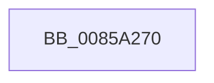

# HvpRemoveFreeCellHint

- RVA: `0x0085A270`–`0x0085A2AA` (길이 `58` bytes)
- VA: `0x000000014085A270`
- 실행 섹션: `PAGE`
- PDB 이름 있음: `예`; PDB Function 태그: `아니요`
- unwind 정보 RVA: `0x0006AC2C`
- 디코드: `18`개 명령, `58/58` bytes 표시
- 미해석 바이트: `0` (있으면 어셈블리에 `.byte`로 보존)

> 이 문서는 커널 이미지의 기계어와 PDB 기호를 분석해 생성했습니다. 4번과 5번은 함수 원형과 자료형을 바이너리 사용 방식에서 추정한 C 해석이며 원본 소스 복구 결과는 아닙니다.

## 1. Dependencies

- 직접 호출 지점: **2**; 고유 호출 대상: **2**
- 직접 호출자로 확인된 함수: **4**
- RIP 상대 이미지 참조: **0**

### Outgoing calls
- `0x0085A294` → [HvpGetBinContextInitialize](../../pagecmrc/BC/HvpGetBinContextInitialize_function_00BC98D0.md) (function, `0x00BC98D0`)
- `0x0085A29C` → [HvpGetCellMap](../../pagecmrc/BC/HvpGetCellMap_function_00BC9710.md) (function, `0x00BC9710`)

### Direct callers
- [HvAllocateCell](HvAllocateCell_function_00859C94.md) at `0x00859DA5`
- [sub_00859FB9](Unknown_function_00859FB9.md) at `0x0085A0B8`
- [HvFreeCell](HvFreeCell_function_0085A72C.md) at `0x0085A8D3`
- [HvpDelistFreeCell](HvpDelistFreeCell_function_0085A99C.md) at `0x0085A9FB`

### Static image references
- 디코드된 RIP-relative 메모리 참조가 없습니다.

## 2. Other-region calls and transfers

- 다른 실행 섹션으로 향하는 call: **2**
  - `0x0085A294` → [HvpGetBinContextInitialize](../../pagecmrc/BC/HvpGetBinContextInitialize_function_00BC98D0.md) (`PAGE` → `PAGECMRC`)
  - `0x0085A29C` → [HvpGetCellMap](../../pagecmrc/BC/HvpGetCellMap_function_00BC9710.md) (`PAGE` → `PAGECMRC`)
- call이 아닌 외부 분기/꼬리 이동: **1**
  - `0x0085A2A4` → [sub_0085A404](Unknown_function_0085A404.md) (`tail-transfer`)

## 3. Assembly (complete function range)

```asm
0085A270  40 53                           push rbx
0085A272  56                              push rsi
0085A273  57                              push rdi
0085A274  41 57                           push r15
0085A276  48 83 EC 48                     sub rsp, 0x48
0085A27A  4C 8B D9                        mov r11, rcx
0085A27D  49 63 F9                        movsxd rdi, r9d
0085A280  33 F6                           xor esi, esi
0085A282  45 8B D0                        mov r10d, r8d
0085A285  48 8D 4C 24 30                  lea rcx, [rsp + 0x30]
0085A28A  66 89 74 24 30                  mov word ptr [rsp + 0x30], si
0085A28F  8B DA                           mov ebx, edx
0085A291  45 32 FF                        xor r15b, r15b
0085A294  E8 37 F6 36 00                  call 0x140bc98d0
0085A299  49 8B CB                        mov rcx, r11
0085A29C  E8 6F F4 36 00                  call 0x140bc9710
0085A2A1  48 85 C0                        test rax, rax
0085A2A4  0F 84 5A 01 00 00               je 0x14085a404
```

## 4. C-style interpretation (structured pseudocode)

```c
__int64 __fastcall HvpRemoveFreeCellHint(__int64 a1, int a2, int a3, int a4)
{
    __int64 result;
    __int64 v_r15;
    __int64 v_rsi;
    __int64 v_rsp;
    unsigned __int64 v_stack_m38;

    v_rsp = (v_rsp) - (72);
    v_rsi = 0;
    v_stack_m38 = 0;
    v_r15 = 0;
    result = HvpGetBinContextInitialize(v_stack_m38, a2, a3, a4);
    result = HvpGetCellMap(a1, a2, a3, a4);
}
```

## 5. (Beta) C Style

```c
int64_t HvpRemoveFreeCellHint(int64_t Arg1, int32_t Arg2, int32_t Arg3, int32_t Arg4)
{
    int64_t result;
    int64_t local_r15;
    int64_t local_rsi;
    int64_t local_rsp;
    uint64_t v_stack_m38;

    local_rsp = (local_rsp) - (72);
    local_rsi = 0;
    v_stack_m38 = 0;
    local_r15 = 0;
    result = HvpGetBinContextInitialize(v_stack_m38, Arg2, Arg3, Arg4);
    result = HvpGetCellMap(Arg1, Arg2, Arg3, Arg4);
}
```

## 6. Execution-region graph

[열기: 2D/3D 그래프와 함수 탐색 컨트롤 패널](../../../control-panel.html?section=page&rva=0x0085A270&view=graph)

- 2D 그래프는 위에서 아래로 흐르고, 3D 그래프는 빈 공간을 드래그해 회전합니다. Shift+드래그는 이동, 휠은 확대·축소, 함수 노드 선택은 대상 보고서 이동입니다.

### Static fallback


