# ObpLookupDirectoryEntry

- RVA: `0x0085D5B0`–`0x0085D884` (길이 `724` bytes)
- VA: `0x000000014085D5B0`
- 실행 섹션: `PAGE`
- PDB 이름 있음: `예`; PDB Function 태그: `아니요`
- unwind 정보 RVA: `0x0006B03C`
- 디코드: `217`개 명령, `724/724` bytes 표시
- 미해석 바이트: `0` (있으면 어셈블리에 `.byte`로 보존)

> 이 문서는 커널 이미지의 기계어와 PDB 기호를 분석해 생성했습니다. 4번과 5번은 함수 원형과 자료형을 바이너리 사용 방식에서 추정한 C 해석이며 원본 소스 복구 결과는 아닙니다.

## 1. Dependencies

- 직접 호출 지점: **5**; 고유 호출 대상: **4**
- 직접 호출자로 확인된 함수: **6**
- RIP 상대 이미지 참조: **1**

### Outgoing calls
- `0x0085D6F1` → [PsGetCurrentServerSiloGlobals](../../text/2F/PsGetCurrentServerSiloGlobals_function_002FE1F0.md) (function, `0x002FE1F0`)
- `0x0085D73A` → [RtlCompareMemory](../../text/6B/RtlCompareMemory_function_006BA670.md) (function, `0x006BA670`)
- `0x0085D830` → [RtlUpcaseUnicodeChar](RtlUpcaseUnicodeChar_function_0085F0F0.md) (function, `0x0085F0F0`)
- `0x0085D83F` → [memcmp](../../text/6C/memcmp_function_006C6B10.md) (function, `0x006C6B10`)
- `0x0085D867` → [RtlUpcaseUnicodeChar](RtlUpcaseUnicodeChar_function_0085F0F0.md) (function, `0x0085F0F0`)

### Direct callers
- [ObpCreateSymbolicLinkName](../74/ObpCreateSymbolicLinkName_function_0074EB80.md) at `0x0074ECD2`
- [ObpDecrementHandleCount](../86/ObpDecrementHandleCount_function_008632E0.md) at `0x0086381B`
- [ObCloseHandleTableEntry](../86/ObCloseHandleTableEntry_function_00869E20.md) at `0x0086A787`
- [sub_0089A511](../89/Unknown_function_0089A511.md) at `0x0089A5E2`
- [ObCreateObjectTypeEx](../AB/ObCreateObjectTypeEx_function_00AB46D0.md) at `0x00AB483A`
- [ObInitSystem](../../init/C7/ObInitSystem_function_00C71C7C.md) at `0x00C722A6`

### Static image references
- `0x0085D6A5` → RVA `0x00F0FF80` (`.data`; read)

## 2. Other-region calls and transfers

- 다른 실행 섹션으로 향하는 call: **3**
  - `0x0085D6F1` → [PsGetCurrentServerSiloGlobals](../../text/2F/PsGetCurrentServerSiloGlobals_function_002FE1F0.md) (`PAGE` → `.text`)
  - `0x0085D73A` → [RtlCompareMemory](../../text/6B/RtlCompareMemory_function_006BA670.md) (`PAGE` → `.text`)
  - `0x0085D83F` → [memcmp](../../text/6C/memcmp_function_006C6B10.md) (`PAGE` → `.text`)
- 별도 외부 분기/꼬리 이동을 확인하지 못했습니다.

## 3. Assembly (complete function range)

```asm
0085D5B0  48 89 5C 24 18                  mov qword ptr [rsp + 0x18], rbx
0085D5B5  89 54 24 10                     mov dword ptr [rsp + 0x10], edx
0085D5B9  48 89 4C 24 08                  mov qword ptr [rsp + 8], rcx
0085D5BE  55                              push rbp
0085D5BF  56                              push rsi
0085D5C0  57                              push rdi
0085D5C1  41 54                           push r12
0085D5C3  41 55                           push r13
0085D5C5  41 56                           push r14
0085D5C7  41 57                           push r15
0085D5C9  48 83 EC 20                     sub rsp, 0x20
0085D5CD  0F B7 29                        movzx ebp, word ptr [rcx]
0085D5D0  49 8B F0                        mov rsi, r8
0085D5D3  4C 8B 71 08                     mov r14, qword ptr [rcx + 8]
0085D5D7  8B DA                           mov ebx, edx
0085D5D9  D1 ED                           shr ebp, 1
0085D5DB  4C 8B F9                        mov r15, rcx
0085D5DE  83 FD 04                        cmp ebp, 4
0085D5E1  0F 82 C0 01 00 00               jb 0x14085d7a7
0085D5E7  33 DB                           xor ebx, ebx
0085D5E9  49 BD 80 FF 80 FF 80 FF 80 FF   movabs r13, 0xff80ff80ff80ff80
0085D5F3  49 BC DF FF DF FF DF FF DF FF   movabs r12, 0xffdfffdfffdfffdf
0085D5FD  49 8B 3E                        mov rdi, qword ptr [r14]
0085D600  49 85 FD                        test r13, rdi
0085D603  0F 85 48 02 00 00               jne 0x14085d851
0085D609  49 23 FC                        and rdi, r12
0085D60C  48 8B C3                        mov rax, rbx
0085D60F  49 83 C6 08                     add r14, 8
0085D613  48 D1 E8                        shr rax, 1
0085D616  48 8D 1C 5B                     lea rbx, [rbx + rbx*2]
0085D61A  48 03 C7                        add rax, rdi
0085D61D  83 C5 FC                        add ebp, -4
0085D620  48 03 D8                        add rbx, rax
0085D623  83 FD 04                        cmp ebp, 4
0085D626  73 D5                           jae 0x14085d5fd
0085D628  4C 8B 7C 24 60                  mov r15, qword ptr [rsp + 0x60]
0085D62D  48 8B FB                        mov rdi, rbx
0085D630  48 C1 EF 20                     shr rdi, 0x20
0085D634  03 FB                           add edi, ebx
0085D636  8B 5C 24 68                     mov ebx, dword ptr [rsp + 0x68]
0085D63A  85 ED                           test ebp, ebp
0085D63C  74 2A                           je 0x14085d668
0085D63E  41 0F B7 16                     movzx edx, word ptr [r14]
0085D642  4D 8D 76 02                     lea r14, [r14 + 2]
0085D646  8B CF                           mov ecx, edi
0085D648  FF CD                           dec ebp
0085D64A  D1 E9                           shr ecx, 1
0085D64C  8D 3C 7F                        lea edi, [rdi + rdi*2]
0085D64F  03 F9                           add edi, ecx
0085D651  83 FA 61                        cmp edx, 0x61
0085D654  72 0C                           jb 0x14085d662
0085D656  83 FA 7A                        cmp edx, 0x7a
0085D659  0F 87 CE 01 00 00               ja 0x14085d82d
0085D65F  83 C7 E0                        add edi, -0x20
0085D662  03 FA                           add edi, edx
0085D664  85 ED                           test ebp, ebp
0085D666  75 D6                           jne 0x14085d63e
0085D668  B8 4D 91 CF BA                  mov eax, 0xbacf914d
0085D66D  89 7E 10                        mov dword ptr [rsi + 0x10], edi
0085D670  F7 E7                           mul edi
0085D672  8B C7                           mov eax, edi
0085D674  83 E3 40                        and ebx, 0x40
0085D677  2B C2                           sub eax, edx
0085D679  89 5C 24 68                     mov dword ptr [rsp + 0x68], ebx
0085D67D  D1 E8                           shr eax, 1
0085D67F  03 C2                           add eax, edx
0085D681  C1 E8 05                        shr eax, 5
0085D684  0F B6 C0                        movzx eax, al
0085D687  6B C8 25                        imul ecx, eax, 0x25
0085D68A  40 0F B6 C7                     movzx eax, dil
0085D68E  2A C1                           sub al, cl
0085D690  0F B6 C8                        movzx ecx, al
0085D693  48 8B 06                        mov rax, qword ptr [rsi]
0085D696  48 8D 3C C8                     lea rdi, [rax + rcx*8]
0085D69A  88 4E 14                        mov byte ptr [rsi + 0x14], cl
0085D69D  48 8B 1F                        mov rbx, qword ptr [rdi]
0085D6A0  48 85 DB                        test rbx, rbx
0085D6A3  74 1E                           je 0x14085d6c3
0085D6A5  48 8D 0D D4 28 6B 00            lea rcx, [rip + 0x6b28d4]
0085D6AC  0F 1F 40 00                     nop dword ptr [rax]
0085D6B0  8B 46 10                        mov eax, dword ptr [rsi + 0x10]
0085D6B3  39 43 10                        cmp dword ptr [rbx + 0x10], eax
0085D6B6  74 23                           je 0x14085d6db
0085D6B8  48 8B FB                        mov rdi, rbx
0085D6BB  48 8B 1B                        mov rbx, qword ptr [rbx]
0085D6BE  48 85 DB                        test rbx, rbx
0085D6C1  75 4D                           jne 0x14085d710
0085D6C3  33 C0                           xor eax, eax
0085D6C5  48 8B 5C 24 70                  mov rbx, qword ptr [rsp + 0x70]
0085D6CA  48 83 C4 20                     add rsp, 0x20
0085D6CE  41 5F                           pop r15
0085D6D0  41 5E                           pop r14
0085D6D2  41 5D                           pop r13
0085D6D4  41 5C                           pop r12
0085D6D6  5F                              pop rdi
0085D6D7  5E                              pop rsi
0085D6D8  5D                              pop rbp
0085D6D9  C3                              ret
0085D6DA  CC                              int3
0085D6DB  48 8B 53 08                     mov rdx, qword ptr [rbx + 8]
0085D6DF  48 83 EA 30                     sub rdx, 0x30
0085D6E3  0F B6 42 1A                     movzx eax, byte ptr [rdx + 0x1a]
0085D6E7  83 E0 03                        and eax, 3
0085D6EA  0F B6 04 08                     movzx eax, byte ptr [rax + rcx]
0085D6EE  48 2B D0                        sub rdx, rax
0085D6F1  E8 FA 0A AA FF                  call 0x1402fe1f0
0085D6F6  4C 8B A8 B0 04 00 00            mov r13, qword ptr [rax + 0x4b0]
0085D6FD  41 0F B7 07                     movzx eax, word ptr [r15]
0085D701  66 3B 42 08                     cmp ax, word ptr [rdx + 8]
0085D705  74 10                           je 0x14085d717
0085D707  48 8D 0D 72 28 6B 00            lea rcx, [rip + 0x6b2872]
0085D70E  EB A8                           jmp 0x14085d6b8
0085D710  4C 8B 7C 24 60                  mov r15, qword ptr [rsp + 0x60]
0085D715  EB 99                           jmp 0x14085d6b0
0085D717  83 7C 24 68 00                  cmp dword ptr [rsp + 0x68], 0
0085D71C  4C 8B E0                        mov r12, rax
0085D71F  4D 8B 77 08                     mov r14, qword ptr [r15 + 8]
0085D723  4C 8B C0                        mov r8, rax
0085D726  4C 8B 7A 10                     mov r15, qword ptr [rdx + 0x10]
0085D72A  49 8B CE                        mov rcx, r14
0085D72D  49 8B D7                        mov rdx, r15
0085D730  4A 8D 2C 30                     lea rbp, [rax + r14]
0085D734  0F 84 05 01 00 00               je 0x14085d83f
0085D73A  E8 31 CF E5 FF                  call 0x1406ba670
0085D73F  49 3B C4                        cmp rax, r12
0085D742  74 29                           je 0x14085d76d
0085D744  48 D1 E8                        shr rax, 1
0085D747  48 03 C0                        add rax, rax
0085D74A  4C 03 F0                        add r14, rax
0085D74D  4C 03 F8                        add r15, rax
0085D750  4C 3B F5                        cmp r14, rbp
0085D753  73 18                           jae 0x14085d76d
0085D755  45 0F B7 06                     movzx r8d, word ptr [r14]
0085D759  45 0F B7 0F                     movzx r9d, word ptr [r15]
0085D75D  66 45 3B C1                     cmp r8w, r9w
0085D761  75 17                           jne 0x14085d77a
0085D763  49 83 C6 02                     add r14, 2
0085D767  49 83 C7 02                     add r15, 2
0085D76B  EB E3                           jmp 0x14085d750
0085D76D  48 8B 43 08                     mov rax, qword ptr [rbx + 8]
0085D771  48 89 7E 08                     mov qword ptr [rsi + 8], rdi
0085D775  E9 4B FF FF FF                  jmp 0x14085d6c5
0085D77A  41 83 F8 61                     cmp r8d, 0x61
0085D77E  72 0B                           jb 0x14085d78b
0085D780  41 83 F8 7A                     cmp r8d, 0x7a
0085D784  77 28                           ja 0x14085d7ae
0085D786  66 41 83 E8 20                  sub r8w, 0x20
0085D78B  41 83 F9 61                     cmp r9d, 0x61
0085D78F  72 0B                           jb 0x14085d79c
0085D791  41 83 F9 7A                     cmp r9d, 0x7a
0085D795  77 55                           ja 0x14085d7ec
0085D797  66 41 83 E9 20                  sub r9w, 0x20
0085D79C  66 45 3B C1                     cmp r8w, r9w
0085D7A0  74 C1                           je 0x14085d763
0085D7A2  E9 60 FF FF FF                  jmp 0x14085d707
0085D7A7  33 FF                           xor edi, edi
0085D7A9  E9 8C FE FF FF                  jmp 0x14085d63a
0085D7AE  4D 85 ED                        test r13, r13
0085D7B1  74 D8                           je 0x14085d78b
0085D7B3  B8 C0 00 00 00                  mov eax, 0xc0
0085D7B8  66 44 3B C0                     cmp r8w, ax
0085D7BC  72 CD                           jb 0x14085d78b
0085D7BE  49 8B C0                        mov rax, r8
0085D7C1  41 8B D0                        mov edx, r8d
0085D7C4  48 C1 E8 08                     shr rax, 8
0085D7C8  83 E2 0F                        and edx, 0xf
0085D7CB  41 0F B7 4C 45 00               movzx ecx, word ptr [r13 + rax*2]
0085D7D1  41 8B C0                        mov eax, r8d
0085D7D4  C1 E8 04                        shr eax, 4
0085D7D7  83 E0 0F                        and eax, 0xf
0085D7DA  03 C8                           add ecx, eax
0085D7DC  41 0F B7 4C 4D 00               movzx ecx, word ptr [r13 + rcx*2]
0085D7E2  03 CA                           add ecx, edx
0085D7E4  66 45 03 44 4D 00               add r8w, word ptr [r13 + rcx*2]
0085D7EA  EB 9F                           jmp 0x14085d78b
0085D7EC  4D 85 ED                        test r13, r13
0085D7EF  74 AB                           je 0x14085d79c
0085D7F1  B8 C0 00 00 00                  mov eax, 0xc0
0085D7F6  66 44 3B C8                     cmp r9w, ax
0085D7FA  72 A0                           jb 0x14085d79c
0085D7FC  49 8B C1                        mov rax, r9
0085D7FF  41 8B D1                        mov edx, r9d
0085D802  48 C1 E8 08                     shr rax, 8
0085D806  83 E2 0F                        and edx, 0xf
0085D809  41 0F B7 4C 45 00               movzx ecx, word ptr [r13 + rax*2]
0085D80F  41 8B C1                        mov eax, r9d
0085D812  C1 E8 04                        shr eax, 4
0085D815  83 E0 0F                        and eax, 0xf
0085D818  03 C8                           add ecx, eax
0085D81A  41 0F B7 4C 4D 00               movzx ecx, word ptr [r13 + rcx*2]
0085D820  03 CA                           add ecx, edx
0085D822  66 45 03 4C 4D 00               add r9w, word ptr [r13 + rcx*2]
0085D828  E9 6F FF FF FF                  jmp 0x14085d79c
0085D82D  0F B7 CA                        movzx ecx, dx
0085D830  E8 BB 18 00 00                  call 0x14085f0f0
0085D835  0F B7 C0                        movzx eax, ax
0085D838  03 F8                           add edi, eax
0085D83A  E9 25 FE FF FF                  jmp 0x14085d664
0085D83F  E8 CC 92 E6 FF                  call 0x1406c6b10
0085D844  85 C0                           test eax, eax
0085D846  0F 84 21 FF FF FF               je 0x14085d76d
0085D84C  E9 B6 FE FF FF                  jmp 0x14085d707
0085D851  41 BF 04 00 00 00               mov r15d, 4
0085D857  0F B7 C7                        movzx eax, di
0085D85A  83 F8 61                        cmp eax, 0x61
0085D85D  72 10                           jb 0x14085d86f
0085D85F  83 F8 7A                        cmp eax, 0x7a
0085D862  76 1B                           jbe 0x14085d87f
0085D864  0F B7 C8                        movzx ecx, ax
0085D867  E8 84 18 00 00                  call 0x14085f0f0
0085D86C  0F B7 C0                        movzx eax, ax
0085D86F  48 0F AC C7 10                  shrd rdi, rax, 0x10
0085D874  49 83 EF 01                     sub r15, 1
0085D878  75 DD                           jne 0x14085d857
0085D87A  E9 8D FD FF FF                  jmp 0x14085d60c
0085D87F  83 C0 E0                        add eax, -0x20
0085D882  EB EB                           jmp 0x14085d86f
```

## 4. C-style interpretation (structured pseudocode)

```c
__int64 __fastcall ObpLookupDirectoryEntry(__int64 a1, int a2, __int64 a3)
{
    __int64 result;
    __int64 v_r14;
    __int64 v_r15;
    __int64 v_rbp;
    __int64 v_rbx;
    __int64 v_rdi;
    __int64 v_rsp;
    unsigned int v_stack_p10;
    unsigned __int64 v_stack_p18;
    unsigned __int64 v_stack_p60;
    unsigned int v_stack_p68;
    unsigned __int64 v_stack_p8;

    v_stack_p18 = v_rbx;
    v_stack_p10 = a2;
    v_stack_p8 = a1;
    v_rsp = (v_rsp) - (32);
    v_rbp = (unsigned int)((*(unsigned __int16 *)(a1)) >> (1));
    if (((unsigned int)(v_rbp)) < 4) goto loc_0085D7A7;
    v_rbx = 0;
loc_0085D5FD:
    if (((v_r13) & (*(unsigned __int64 *)(*(unsigned __int64 *)(a1 + 8)))) != 0) goto loc_0085D851;
    v_rdi = (*(unsigned __int64 *)(*(unsigned __int64 *)(a1 + 8))) & (v_r12);
loc_0085D60C:
    v_r14 = (*(unsigned __int64 *)(a1 + 8)) + (8);
    result = (0) >> (1);
    result = (result) + (v_rdi);
    v_rbp = (unsigned int)((v_rbp) + (-4));
    v_rbx = (v_rbx + v_rbx * 2) + (result);
    if (((unsigned int)(v_rbp)) >= 4) goto loc_0085D5FD;
    v_rdi = (v_rbx) >> (32);
    v_rdi = (unsigned int)((v_rdi) + ((unsigned int)(v_rbx)));
loc_0085D63A:
    if ((unsigned int)(v_rbp) == 0) goto loc_0085D668;
loc_0085D63E:
    v_rbp = (unsigned int)((v_rbp) - 1);
    a1 = (unsigned int)(((unsigned int)((unsigned int)(v_rdi))) >> (1));
    v_rdi = (unsigned int)((v_rdi + v_rdi * 2) + ((unsigned int)(a1)));
    if (((unsigned int)(*(unsigned __int16 *)(v_r14))) < 97) goto loc_0085D662;
    if (((unsigned int)(*(unsigned __int16 *)(v_r14))) > 122) goto loc_0085D82D;
    v_rdi = (unsigned int)((v_rdi) + (-32));
loc_0085D662:
    v_rdi = (unsigned int)((v_rdi) + ((unsigned int)(*(unsigned __int16 *)(v_r14))));
loc_0085D664:
    if ((unsigned int)(v_rbp) != 0) goto loc_0085D63E;
loc_0085D668:
    *(unsigned int *)(a3 + 16) = (unsigned int)(v_rdi);
    v_rbx = (unsigned int)(((unsigned int)(v_stack_p10)) & (64));
    result = (unsigned int)(((unsigned int)((unsigned int)(v_rdi))) - ((unsigned int)(*(unsigned __int16 *)(v_r14))));
    v_stack_p10 = (unsigned int)(v_rbx);
    result = (unsigned int)((result) >> (1));
    result = (unsigned int)((result) + ((unsigned int)(*(unsigned __int16 *)(v_r14))));
    result = (unsigned int)((result) >> (5));
    a1 = (unsigned int)((a1) * ((unsigned int)((unsigned __int8)(result))));
    result = (unsigned __int8)(((unsigned __int8)(v_rdi)) - ((unsigned __int8)(a1)));
    *(unsigned __int8 *)(a3 + 20) = (unsigned __int8)((unsigned __int8)(result));
    if (*(unsigned __int64 *)(*(unsigned __int64 *)(a3) + (unsigned __int8)(result) * 8) == 0) goto loc_0085D6C3;
loc_0085D6B0:
    if ((*(unsigned int *)(*(unsigned __int64 *)(*(unsigned __int64 *)(a3) + (unsigned __int8)(result) * 8) + 16)) == ((unsigned int)((unsigned int)(*(unsigned int *)(a3 + 16))))) goto loc_0085D6DB;
loc_0085D6B8:
    if (*(unsigned __int64 *)(*(unsigned __int64 *)(*(unsigned __int64 *)(a3) + (unsigned __int8)(result) * 8)) != 0) goto loc_0085D710;
loc_0085D6C3:
    result = 0;
loc_0085D6C5:
    v_rsp = (v_rsp) + (32);
    return result;
loc_0085D6DB:
    a2 = (*(unsigned __int64 *)(v_stack_p18 + 8)) - (48);
    result = (unsigned int)((*(unsigned __int8 *)(a2 + 26)) & (3));
    a2 = (a2) - (*(unsigned __int8 *)(result + v_rip + 7022804 * 1));
    result = PsGetCurrentServerSiloGlobals(v_rip + 7022804, a2, a3, a4);
    if (((unsigned __int16)(*(unsigned __int16 *)(v_stack_p8))) == (*(unsigned __int16 *)(a2 + 8))) goto loc_0085D717;
loc_0085D707:
    goto loc_0085D6B8;
loc_0085D710:
    goto loc_0085D6B0;
loc_0085D717:
    if (v_stack_p68 == 0) goto loc_0085D83F;
    result = RtlCompareMemory(*(unsigned __int64 *)(v_stack_p60 + 8), *(unsigned __int64 *)(a2 + 16), *(unsigned __int16 *)(v_stack_p8), a4);
    if (result == (*(unsigned __int16 *)(v_stack_p8))) goto loc_0085D76D;
    result = (result) >> (1);
    result = (result) + (result);
    v_r14 = (*(unsigned __int64 *)(v_stack_p60 + 8)) + (result);
    v_r15 = (*(unsigned __int64 *)(a2 + 16)) + (result);
loc_0085D750:
    if (v_r14 >= (*(unsigned __int16 *)(v_stack_p8) + *(unsigned __int64 *)(v_stack_p60 + 8) * 1)) goto loc_0085D76D;
    if (((unsigned __int16)(*(unsigned __int16 *)(v_r14))) != ((unsigned __int16)(*(unsigned __int16 *)(v_r15)))) goto loc_0085D77A;
loc_0085D763:
    v_r14 = (v_r14) + (2);
    v_r15 = (v_r15) + (2);
    goto loc_0085D750;
loc_0085D76D:
    *(unsigned __int64 *)(a3 + 8) = *(unsigned __int64 *)(*(unsigned __int64 *)(a3) + (unsigned __int8)(result) * 8);
    goto loc_0085D6C5;
loc_0085D77A:
    if (((unsigned int)(*(unsigned __int16 *)(v_r14))) < 97) goto loc_0085D78B;
    if (((unsigned int)(*(unsigned __int16 *)(v_r14))) > 122) goto loc_0085D7AE;
    a3 = (unsigned __int16)((*(unsigned __int16 *)(v_r14)) - (32));
loc_0085D78B:
    if (((unsigned int)(*(unsigned __int16 *)(v_r15))) < 97) goto loc_0085D79C;
    if (((unsigned int)(*(unsigned __int16 *)(v_r15))) > 122) goto loc_0085D7EC;
    a4 = (unsigned __int16)((*(unsigned __int16 *)(v_r15)) - (32));
loc_0085D79C:
    if (((unsigned __int16)(a3)) == ((unsigned __int16)(a4))) goto loc_0085D763;
    goto loc_0085D707;
loc_0085D7A7:
    v_rdi = 0;
    goto loc_0085D63A;
loc_0085D7AE:
    if (*(unsigned __int64 *)(result + 1200) == 0) goto loc_0085D78B;
    if (((unsigned __int16)(a3)) < 192) goto loc_0085D78B;
    result = (a3) >> (8);
    a2 = (unsigned int)(((unsigned int)((unsigned int)(a3))) & (15));
    result = (unsigned int)(((unsigned int)((unsigned int)(a3))) >> (4));
    result = (unsigned int)((result) & (15));
    a1 = (unsigned int)((*(unsigned __int16 *)(*(unsigned __int64 *)(result + 1200) + result * 2)) + ((unsigned int)(result)));
    a1 = (unsigned int)((*(unsigned __int16 *)(*(unsigned __int64 *)(result + 1200) + a1 * 2)) + (a2));
    a3 = (unsigned __int16)((a3) + (*(unsigned __int16 *)(*(unsigned __int64 *)(result + 1200) + a1 * 2)));
    goto loc_0085D78B;
loc_0085D7EC:
    if (*(unsigned __int64 *)(result + 1200) == 0) goto loc_0085D79C;
    if (((unsigned __int16)(a4)) < 192) goto loc_0085D79C;
    result = (a4) >> (8);
    a2 = (unsigned int)(((unsigned int)((unsigned int)(a4))) & (15));
    result = (unsigned int)(((unsigned int)((unsigned int)(a4))) >> (4));
    result = (unsigned int)((result) & (15));
    a1 = (unsigned int)((*(unsigned __int16 *)(*(unsigned __int64 *)(result + 1200) + result * 2)) + ((unsigned int)(result)));
    a1 = (unsigned int)((*(unsigned __int16 *)(*(unsigned __int64 *)(result + 1200) + a1 * 2)) + (a2));
    a4 = (unsigned __int16)((a4) + (*(unsigned __int16 *)(*(unsigned __int64 *)(result + 1200) + a1 * 2)));
    goto loc_0085D79C;
loc_0085D82D:
    result = RtlUpcaseUnicodeChar((unsigned __int16)(a2), a2, a3, a4);
    v_rdi = (unsigned int)((v_rdi) + ((unsigned int)((unsigned __int16)(result))));
    goto loc_0085D664;
loc_0085D83F:
    result = memcmp((unsigned __int16)(a2), a2, a3, a4);
    if ((unsigned int)(result) == 0) goto loc_0085D76D;
    goto loc_0085D707;
loc_0085D851:
loc_0085D857:
    if (((unsigned int)((unsigned __int16)(v_rdi))) < 97) goto loc_0085D86F;
    if (((unsigned int)((unsigned __int16)(v_rdi))) <= 122) goto loc_0085D87F;
    result = RtlUpcaseUnicodeChar((unsigned __int16)((unsigned __int16)(v_rdi)), a2, a3, a4);
loc_0085D86F:
    v_r15 = (4) - (1);
    if (condition_is_not_equal) goto loc_0085D857;
    goto loc_0085D60C;
loc_0085D87F:
    result = (unsigned int)(((unsigned __int16)(result)) + (-32));
    goto loc_0085D86F;
}
```

## 5. (Beta) C Style

```c
int64_t ObpLookupDirectoryEntry(void *Arg1, int32_t Arg2, void *Arg3)
{
    uint8_t *arg1 = (uint8_t *)Arg1;
    uint8_t *arg3 = (uint8_t *)Arg3;

    int64_t result;
    int64_t local_r14;
    int64_t local_r15;
    int64_t local_rbp;
    int64_t local_rbx;
    int64_t local_rdi;
    int64_t local_rsp;
    uint32_t v_stack_p10;
    uint64_t v_stack_p18;
    uint64_t v_stack_p60;
    uint32_t v_stack_p68;
    uint64_t v_stack_p8;

    v_stack_p18 = local_rbx;
    v_stack_p10 = Arg2;
    v_stack_p8 = Arg1;
    local_rsp = (local_rsp) - (32);
    local_rbp = (uint32_t)((*(uint16_t *)(arg1)) >> (1));
    if (((uint32_t)(local_rbp)) < 4) goto loc_0085D7A7;
    local_rbx = 0;
loc_0085D5FD:
    if (((local_r13) & (*(uint64_t *)(*(uint64_t *)(arg1 + 0x8)))) != 0) goto loc_0085D851;
    local_rdi = (*(uint64_t *)(*(uint64_t *)(arg1 + 0x8))) & (local_r12);
loc_0085D60C:
    local_r14 = (*(uint64_t *)(arg1 + 0x8)) + (8);
    result = (0) >> (1);
    result = (result) + (local_rdi);
    local_rbp = (uint32_t)((local_rbp) + (-4));
    local_rbx = (local_rbx + local_rbx * 2) + (result);
    if (((uint32_t)(local_rbp)) >= 4) goto loc_0085D5FD;
    local_rdi = (local_rbx) >> (32);
    local_rdi = (uint32_t)((local_rdi) + ((uint32_t)(local_rbx)));
loc_0085D63A:
    if ((uint32_t)(local_rbp) == 0) goto loc_0085D668;
loc_0085D63E:
    local_rbp = (uint32_t)((local_rbp) - 1);
    Arg1 = (uint32_t)(((uint32_t)((uint32_t)(local_rdi))) >> (1));
    local_rdi = (uint32_t)((local_rdi + local_rdi * 2) + ((uint32_t)(Arg1)));
    if (((uint32_t)(*(uint16_t *)(local_r14))) < 97) goto loc_0085D662;
    if (((uint32_t)(*(uint16_t *)(local_r14))) > 122) goto loc_0085D82D;
    local_rdi = (uint32_t)((local_rdi) + (-32));
loc_0085D662:
    local_rdi = (uint32_t)((local_rdi) + ((uint32_t)(*(uint16_t *)(local_r14))));
loc_0085D664:
    if ((uint32_t)(local_rbp) != 0) goto loc_0085D63E;
loc_0085D668:
    *(uint32_t *)(arg3 + 0x10) = (uint32_t)(local_rdi);
    local_rbx = (uint32_t)(((uint32_t)(v_stack_p10)) & (64));
    result = (uint32_t)(((uint32_t)((uint32_t)(local_rdi))) - ((uint32_t)(*(uint16_t *)(local_r14))));
    v_stack_p10 = (uint32_t)(local_rbx);
    result = (uint32_t)((result) >> (1));
    result = (uint32_t)((result) + ((uint32_t)(*(uint16_t *)(local_r14))));
    result = (uint32_t)((result) >> (5));
    Arg1 = (uint32_t)((Arg1) * ((uint32_t)((uint8_t)(result))));
    result = (uint8_t)(((uint8_t)(local_rdi)) - ((uint8_t)(Arg1)));
    *(uint8_t *)(arg3 + 0x14) = (uint8_t)((uint8_t)(result));
    if (*(uint64_t *)(*(uint64_t *)(arg3) + (uint8_t)(result) * 8) == 0) goto loc_0085D6C3;
loc_0085D6B0:
    if ((*(uint32_t *)(*(uint64_t *)(*(uint64_t *)(arg3) + (uint8_t)(result) * 8) + 0x10)) == ((uint32_t)((uint32_t)(*(uint32_t *)(arg3 + 0x10))))) goto loc_0085D6DB;
loc_0085D6B8:
    if (*(uint64_t *)(*(uint64_t *)(*(uint64_t *)(arg3) + (uint8_t)(result) * 8)) != 0) goto loc_0085D710;
loc_0085D6C3:
    result = 0;
loc_0085D6C5:
    local_rsp = (local_rsp) + (32);
    return result;
loc_0085D6DB:
    Arg2 = (*(uint64_t *)(v_stack_p18 + 0x8)) - (48);
    result = (uint32_t)((*(uint8_t *)(Arg2 + 0x1A)) & (3));
    Arg2 = (Arg2) - (*(uint8_t *)(result + v_rip + 0x6B28D4 * 1));
    result = PsGetCurrentServerSiloGlobals(v_rip + 7022804, Arg2, Arg3, a4);
    if (((uint16_t)(*(uint16_t *)(v_stack_p8))) == (*(uint16_t *)(Arg2 + 0x8))) goto loc_0085D717;
loc_0085D707:
    goto loc_0085D6B8;
loc_0085D710:
    goto loc_0085D6B0;
loc_0085D717:
    if (v_stack_p68 == 0) goto loc_0085D83F;
    result = RtlCompareMemory(*(uint64_t *)(v_stack_p60 + 0x8), *(uint64_t *)(Arg2 + 0x10), *(uint16_t *)(v_stack_p8), a4);
    if (result == (*(uint16_t *)(v_stack_p8))) goto loc_0085D76D;
    result = (result) >> (1);
    result = (result) + (result);
    local_r14 = (*(uint64_t *)(v_stack_p60 + 0x8)) + (result);
    local_r15 = (*(uint64_t *)(Arg2 + 0x10)) + (result);
loc_0085D750:
    if (local_r14 >= (*(uint16_t *)(v_stack_p8) + *(uint64_t *)(v_stack_p60 + 0x8) * 1)) goto loc_0085D76D;
    if (((uint16_t)(*(uint16_t *)(local_r14))) != ((uint16_t)(*(uint16_t *)(local_r15)))) goto loc_0085D77A;
loc_0085D763:
    local_r14 = (local_r14) + (2);
    local_r15 = (local_r15) + (2);
    goto loc_0085D750;
loc_0085D76D:
    *(uint64_t *)(arg3 + 0x8) = *(uint64_t *)(*(uint64_t *)(arg3) + (uint8_t)(result) * 8);
    goto loc_0085D6C5;
loc_0085D77A:
    if (((uint32_t)(*(uint16_t *)(local_r14))) < 97) goto loc_0085D78B;
    if (((uint32_t)(*(uint16_t *)(local_r14))) > 122) goto loc_0085D7AE;
    Arg3 = (uint16_t)((*(uint16_t *)(local_r14)) - (32));
loc_0085D78B:
    if (((uint32_t)(*(uint16_t *)(local_r15))) < 97) goto loc_0085D79C;
    if (((uint32_t)(*(uint16_t *)(local_r15))) > 122) goto loc_0085D7EC;
    a4 = (uint16_t)((*(uint16_t *)(local_r15)) - (32));
loc_0085D79C:
    if (((uint16_t)(Arg3)) == ((uint16_t)(a4))) goto loc_0085D763;
    goto loc_0085D707;
loc_0085D7A7:
    local_rdi = 0;
    goto loc_0085D63A;
loc_0085D7AE:
    if (*(uint64_t *)(result + 0x4B0) == 0) goto loc_0085D78B;
    if (((uint16_t)(Arg3)) < 192) goto loc_0085D78B;
    result = (Arg3) >> (8);
    Arg2 = (uint32_t)(((uint32_t)((uint32_t)(Arg3))) & (15));
    result = (uint32_t)(((uint32_t)((uint32_t)(Arg3))) >> (4));
    result = (uint32_t)((result) & (15));
    Arg1 = (uint32_t)((*(uint16_t *)(*(uint64_t *)(result + 0x4B0) + result * 2)) + ((uint32_t)(result)));
    Arg1 = (uint32_t)((*(uint16_t *)(*(uint64_t *)(result + 0x4B0) + arg1 * 2)) + (Arg2));
    Arg3 = (uint16_t)((Arg3) + (*(uint16_t *)(*(uint64_t *)(result + 0x4B0) + arg1 * 2)));
    goto loc_0085D78B;
loc_0085D7EC:
    if (*(uint64_t *)(result + 0x4B0) == 0) goto loc_0085D79C;
    if (((uint16_t)(a4)) < 192) goto loc_0085D79C;
    result = (a4) >> (8);
    Arg2 = (uint32_t)(((uint32_t)((uint32_t)(a4))) & (15));
    result = (uint32_t)(((uint32_t)((uint32_t)(a4))) >> (4));
    result = (uint32_t)((result) & (15));
    Arg1 = (uint32_t)((*(uint16_t *)(*(uint64_t *)(result + 0x4B0) + result * 2)) + ((uint32_t)(result)));
    Arg1 = (uint32_t)((*(uint16_t *)(*(uint64_t *)(result + 0x4B0) + arg1 * 2)) + (Arg2));
    a4 = (uint16_t)((a4) + (*(uint16_t *)(*(uint64_t *)(result + 0x4B0) + arg1 * 2)));
    goto loc_0085D79C;
loc_0085D82D:
    result = RtlUpcaseUnicodeChar((uint16_t)(Arg2), Arg2, Arg3, a4);
    local_rdi = (uint32_t)((local_rdi) + ((uint32_t)((uint16_t)(result))));
    goto loc_0085D664;
loc_0085D83F:
    result = memcmp((uint16_t)(Arg2), Arg2, Arg3, a4);
    if ((uint32_t)(result) == 0) goto loc_0085D76D;
    goto loc_0085D707;
loc_0085D851:
loc_0085D857:
    if (((uint32_t)((uint16_t)(local_rdi))) < 97) goto loc_0085D86F;
    if (((uint32_t)((uint16_t)(local_rdi))) <= 122) goto loc_0085D87F;
    result = RtlUpcaseUnicodeChar((uint16_t)((uint16_t)(local_rdi)), Arg2, Arg3, a4);
loc_0085D86F:
    local_r15 = (4) - (1);
    if (condition_is_not_equal) goto loc_0085D857;
    goto loc_0085D60C;
loc_0085D87F:
    result = (uint32_t)(((uint16_t)(result)) + (-32));
    goto loc_0085D86F;
}
```

### 관측된 메모리 오프셋

구조체 형식이 확인되지 않은 접근은 인자 기준의 오프셋으로만 기록했습니다.

| 기준 인자 | 오프셋 표현 | 폭 (bit) | 접근 |
|---|---:|---:|---|
| `Arg1` | `+ 0x0` | `16` | `R` |
| `Arg1` | `+ 0x8` | `64` | `R` |
| `Arg3` | `+ 0x0` | `64` | `R` |
| `Arg3` | `+ 0x8` | `64` | `W` |
| `Arg3` | `+ 0x10` | `32` | `R` |
| `Arg3` | `+ 0x10` | `32` | `W` |
| `Arg3` | `+ 0x14` | `8` | `W` |

## 6. Execution-region graph

[열기: 2D/3D 그래프와 함수 탐색 컨트롤 패널](../../../control-panel.html?section=page&rva=0x0085D5B0&view=graph)

- 2D 그래프는 위에서 아래로 흐르고, 3D 그래프는 빈 공간을 드래그해 회전합니다. Shift+드래그는 이동, 휠은 확대·축소, 함수 노드 선택은 대상 보고서 이동입니다.

### Static fallback

```mermaid
flowchart TD
  bb_0085D5B0[BB_0085D5B0]
  bb_0085D5E7[BB_0085D5E7]
  bb_0085D5FD[BB_0085D5FD]
  bb_0085D609[BB_0085D609]
  bb_0085D60C[BB_0085D60C]
  bb_0085D628[BB_0085D628]
  bb_0085D63A[BB_0085D63A]
  bb_0085D63E[BB_0085D63E]
  bb_0085D656[BB_0085D656]
  bb_0085D65F[BB_0085D65F]
  bb_0085D662[BB_0085D662]
  bb_0085D664[BB_0085D664]
  bb_0085D668[BB_0085D668]
  bb_0085D6A5[BB_0085D6A5]
  bb_0085D6B0[BB_0085D6B0]
  bb_0085D6B8[BB_0085D6B8]
  bb_0085D6C3[BB_0085D6C3]
  bb_0085D6C5[BB_0085D6C5]
  bb_0085D6DA[BB_0085D6DA]
  bb_0085D6DB[BB_0085D6DB]
  bb_0085D707[BB_0085D707]
  bb_0085D710[BB_0085D710]
  bb_0085D717[BB_0085D717]
  bb_0085D73A[BB_0085D73A]
  bb_0085D744[BB_0085D744]
  bb_0085D750[BB_0085D750]
  bb_0085D755[BB_0085D755]
  bb_0085D763[BB_0085D763]
  bb_0085D76D[BB_0085D76D]
  bb_0085D77A[BB_0085D77A]
  bb_0085D780[BB_0085D780]
  bb_0085D786[BB_0085D786]
  bb_0085D78B[BB_0085D78B]
  bb_0085D791[BB_0085D791]
  bb_0085D797[BB_0085D797]
  bb_0085D79C[BB_0085D79C]
  bb_0085D7A2[BB_0085D7A2]
  bb_0085D7A7[BB_0085D7A7]
  bb_0085D7AE[BB_0085D7AE]
  bb_0085D7B3[BB_0085D7B3]
  bb_0085D7BE[BB_0085D7BE]
  bb_0085D7EC[BB_0085D7EC]
  bb_0085D7F1[BB_0085D7F1]
  bb_0085D7FC[BB_0085D7FC]
  bb_0085D82D[BB_0085D82D]
  bb_0085D83F[BB_0085D83F]
  bb_0085D84C[BB_0085D84C]
  bb_0085D851[BB_0085D851]
  bb_0085D857[BB_0085D857]
  bb_0085D85F[BB_0085D85F]
  bb_0085D864[BB_0085D864]
  bb_0085D86F[BB_0085D86F]
  bb_0085D87A[BB_0085D87A]
  bb_0085D87F[BB_0085D87F]
  bb_0085D5B0 -->|branch| bb_0085D7A7
  bb_0085D5B0 -->|fallthrough| bb_0085D5E7
  bb_0085D5E7 -->|flow| bb_0085D5FD
  bb_0085D5FD -->|branch| bb_0085D851
  bb_0085D5FD -->|fallthrough| bb_0085D609
  bb_0085D609 -->|flow| bb_0085D60C
  bb_0085D60C -->|branch| bb_0085D5FD
  bb_0085D60C -->|fallthrough| bb_0085D628
  bb_0085D628 -->|flow| bb_0085D63A
  bb_0085D63A -->|branch| bb_0085D668
  bb_0085D63A -->|fallthrough| bb_0085D63E
  bb_0085D63E -->|branch| bb_0085D662
  bb_0085D63E -->|fallthrough| bb_0085D656
  bb_0085D656 -->|branch| bb_0085D82D
  bb_0085D656 -->|fallthrough| bb_0085D65F
  bb_0085D65F -->|flow| bb_0085D662
  bb_0085D662 -->|flow| bb_0085D664
  bb_0085D664 -->|branch| bb_0085D63E
  bb_0085D664 -->|fallthrough| bb_0085D668
  bb_0085D668 -->|branch| bb_0085D6C3
  bb_0085D668 -->|fallthrough| bb_0085D6A5
  bb_0085D6A5 -->|flow| bb_0085D6B0
  bb_0085D6B0 -->|branch| bb_0085D6DB
  bb_0085D6B0 -->|fallthrough| bb_0085D6B8
  bb_0085D6B8 -->|branch| bb_0085D710
  bb_0085D6B8 -->|fallthrough| bb_0085D6C3
  bb_0085D6C3 -->|flow| bb_0085D6C5
  bb_0085D6DA -->|flow| bb_0085D6DB
  bb_0085D6DB -->|branch| bb_0085D717
  bb_0085D6DB -->|fallthrough| bb_0085D707
  bb_0085D707 -->|branch| bb_0085D6B8
  bb_0085D710 -->|branch| bb_0085D6B0
  bb_0085D717 -->|branch| bb_0085D83F
  bb_0085D717 -->|fallthrough| bb_0085D73A
  bb_0085D73A -->|branch| bb_0085D76D
  bb_0085D73A -->|fallthrough| bb_0085D744
  bb_0085D744 -->|flow| bb_0085D750
  bb_0085D750 -->|branch| bb_0085D76D
  bb_0085D750 -->|fallthrough| bb_0085D755
  bb_0085D755 -->|branch| bb_0085D77A
  bb_0085D755 -->|fallthrough| bb_0085D763
  bb_0085D763 -->|branch| bb_0085D750
  bb_0085D76D -->|branch| bb_0085D6C5
  bb_0085D77A -->|branch| bb_0085D78B
  bb_0085D77A -->|fallthrough| bb_0085D780
  bb_0085D780 -->|branch| bb_0085D7AE
  bb_0085D780 -->|fallthrough| bb_0085D786
  bb_0085D786 -->|flow| bb_0085D78B
  bb_0085D78B -->|branch| bb_0085D79C
  bb_0085D78B -->|fallthrough| bb_0085D791
  bb_0085D791 -->|branch| bb_0085D7EC
  bb_0085D791 -->|fallthrough| bb_0085D797
  bb_0085D797 -->|flow| bb_0085D79C
  bb_0085D79C -->|branch| bb_0085D763
  bb_0085D79C -->|fallthrough| bb_0085D7A2
  bb_0085D7A2 -->|branch| bb_0085D707
  bb_0085D7A7 -->|branch| bb_0085D63A
  bb_0085D7AE -->|branch| bb_0085D78B
  bb_0085D7AE -->|fallthrough| bb_0085D7B3
  bb_0085D7B3 -->|branch| bb_0085D78B
  bb_0085D7B3 -->|fallthrough| bb_0085D7BE
  bb_0085D7BE -->|branch| bb_0085D78B
  bb_0085D7EC -->|branch| bb_0085D79C
  bb_0085D7EC -->|fallthrough| bb_0085D7F1
  bb_0085D7F1 -->|branch| bb_0085D79C
  bb_0085D7F1 -->|fallthrough| bb_0085D7FC
  bb_0085D7FC -->|branch| bb_0085D79C
  bb_0085D82D -->|branch| bb_0085D664
  bb_0085D83F -->|branch| bb_0085D76D
  bb_0085D83F -->|fallthrough| bb_0085D84C
  bb_0085D84C -->|branch| bb_0085D707
  bb_0085D851 -->|flow| bb_0085D857
  bb_0085D857 -->|branch| bb_0085D86F
  bb_0085D857 -->|fallthrough| bb_0085D85F
  bb_0085D85F -->|branch| bb_0085D87F
  bb_0085D85F -->|fallthrough| bb_0085D864
  bb_0085D864 -->|flow| bb_0085D86F
  bb_0085D86F -->|branch| bb_0085D857
  bb_0085D86F -->|fallthrough| bb_0085D87A
  bb_0085D87A -->|branch| bb_0085D60C
  bb_0085D87F -->|branch| bb_0085D86F
```


