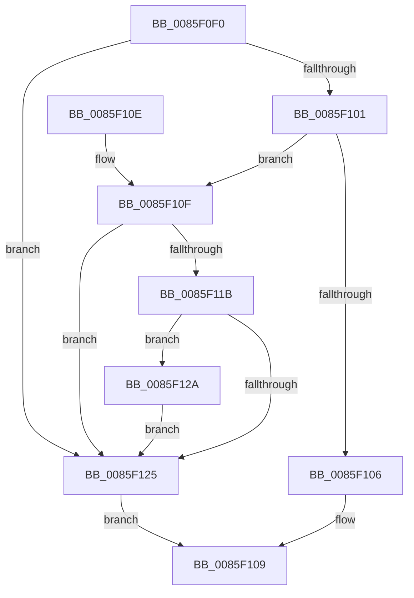

# RtlUpcaseUnicodeChar

- RVA: `0x0085F0F0`–`0x0085F156` (길이 `102` bytes)
- VA: `0x000000014085F0F0`
- 실행 섹션: `PAGE`
- PDB 이름 있음: `예`; PDB Function 태그: `아니요`
- unwind 정보 RVA: `0x0006B378`
- 디코드: `32`개 명령, `102/102` bytes 표시
- 미해석 바이트: `0` (있으면 어셈블리에 `.byte`로 보존)

> 이 문서는 커널 이미지의 기계어와 PDB 기호를 분석해 생성했습니다. 4번과 5번은 함수 원형과 자료형을 바이너리 사용 방식에서 추정한 C 해석이며 원본 소스 복구 결과는 아닙니다.

## 1. Dependencies

- 직접 호출 지점: **1**; 고유 호출 대상: **1**
- 직접 호출자로 확인된 함수: **44**
- RIP 상대 이미지 참조: **0**

### Outgoing calls
- `0x0085F0F7` → [PsGetCurrentServerSiloGlobals](../../text/2F/PsGetCurrentServerSiloGlobals_function_002FE1F0.md) (function, `0x002FE1F0`)

### Direct callers
- [AuthzBasepUnicodeStringFromOperandValue](../../text/2F/AuthzBasepUnicodeStringFromOperandValue_function_002FE4E8.md) at `0x002FE602`
- [towupper](../../text/50/towupper_function_00501910.md) at `0x00501914`
- [ObpCreateSymbolicLinkName](../74/ObpCreateSymbolicLinkName_function_0074EB80.md) at `0x0074EC0A`
- [AslEnvVarQuery](../81/AslEnvVarQuery_function_0081D410.md) at `0x0081D4E0`
- [AslEnvVarQuery](../81/AslEnvVarQuery_function_0081D410.md) at `0x0081D4EC`
- [CmpFindNameInListWithStatus](../84/CmpFindNameInListWithStatus_function_00846B80.md) at `0x00846D61`
- [CmpFindNameInListWithStatus](../84/CmpFindNameInListWithStatus_function_00846B80.md) at `0x00846E8D`
- [CmpFindNameInListWithStatus](../84/CmpFindNameInListWithStatus_function_00846B80.md) at `0x00846E9F`
- [CmpFindNameInListWithStatus](../84/CmpFindNameInListWithStatus_function_00846B80.md) at `0x00846EAF`
- [CmpCompareTwoCompressedNames](../84/CmpCompareTwoCompressedNames_function_00847610.md) at `0x008476C5`
- [CmpCompareTwoCompressedNames](../84/CmpCompareTwoCompressedNames_function_00847610.md) at `0x008476D4`
- [CmpGetMappingHiveForString](../84/CmpGetMappingHiveForString_function_0084A5C8.md) at `0x0084A6BD`
- [CmpGetMappingHiveForString](../84/CmpGetMappingHiveForString_function_0084A5C8.md) at `0x0084A72C`
- [CmpGetNameControlBlock](../84/CmpGetNameControlBlock_function_0084A750.md) at `0x0084AAE3`
- [CmpGetNameControlBlock](../84/CmpGetNameControlBlock_function_0084A750.md) at `0x0084AAF7`
- [CmpGetNameControlBlock](../84/CmpGetNameControlBlock_function_0084A750.md) at `0x0084AB18`
- [CmpGetNameControlBlock](../84/CmpGetNameControlBlock_function_0084A750.md) at `0x0084AB8E`
- [CmpGetNameControlBlock](../84/CmpGetNameControlBlock_function_0084A750.md) at `0x0084AC04`
- [CmpHashUnicodeComponent](../84/CmpHashUnicodeComponent_function_0084AC24.md) at `0x0084AC98`
- [CmpPerformCompleteKcbCacheLookup](../84/CmpPerformCompleteKcbCacheLookup_function_0084FD20.md) at `0x00850843`
- [CmpPerformCompleteKcbCacheLookup](../84/CmpPerformCompleteKcbCacheLookup_function_0084FD20.md) at `0x00851252`
- [CmpCreateKeyControlBlock](CmpCreateKeyControlBlock_function_00851DB0.md) at `0x0085260C`
- [CmpCreateKeyControlBlock](CmpCreateKeyControlBlock_function_00851DB0.md) at `0x00852713`
- [CmpFindSubKeyByNameWithStatus](CmpFindSubKeyByNameWithStatus_function_00852770.md) at `0x00852A53`
- [CmpFindSubKeyByNameWithStatus](CmpFindSubKeyByNameWithStatus_function_00852770.md) at `0x00852B24`
- [CmpFindSubKeyByNameWithStatus](CmpFindSubKeyByNameWithStatus_function_00852770.md) at `0x00852B57`
- [CmpWalkOneLevel](CmpWalkOneLevel_function_00852BA0.md) at `0x008535F3`
- [CmpWalkOneLevel](CmpWalkOneLevel_function_00852BA0.md) at `0x00853746`
- [CmpWalkOneLevel](CmpWalkOneLevel_function_00852BA0.md) at `0x008538FB`
- [sub_00853ABC](Unknown_function_00853ABC.md) at `0x00853EF5`
- [sub_00853ABC](Unknown_function_00853ABC.md) at `0x00853F13`
- [sub_00853ABC](Unknown_function_00853ABC.md) at `0x00853FC5`
- [sub_00853ABC](Unknown_function_00853ABC.md) at `0x00853FD9`
- [sub_00853ABC](Unknown_function_00853ABC.md) at `0x008540E3`
- [sub_00853ABC](Unknown_function_00853ABC.md) at `0x008540F7`
- [sub_0085416A](Unknown_function_0085416A.md) at `0x008543F1`
- [sub_0085416A](Unknown_function_0085416A.md) at `0x0085452B`
- [sub_0085416A](Unknown_function_0085416A.md) at `0x00854540`
- [sub_0085416A](Unknown_function_0085416A.md) at `0x0085476A`
- [sub_0085416A](Unknown_function_0085416A.md) at `0x0085477C`
- [sub_0085416A](Unknown_function_0085416A.md) at `0x00854849`
- [sub_0085416A](Unknown_function_0085416A.md) at `0x0085485A`
- [sub_0085416A](Unknown_function_0085416A.md) at `0x0085486B`
- [sub_0085416A](Unknown_function_0085416A.md) at `0x00854A15`
- [sub_0085416A](Unknown_function_0085416A.md) at `0x00854A2A`
- [sub_0085416A](Unknown_function_0085416A.md) at `0x00854BB3`
- [sub_0085416A](Unknown_function_0085416A.md) at `0x00854BC8`
- [sub_0085416A](Unknown_function_0085416A.md) at `0x00854BDD`
- [sub_0085416A](Unknown_function_0085416A.md) at `0x00854BEF`
- [sub_0085416A](Unknown_function_0085416A.md) at `0x00854BFF`
- [sub_0085416A](Unknown_function_0085416A.md) at `0x00854C0F`
- [sub_0085416A](Unknown_function_0085416A.md) at `0x00854C1F`
- [sub_0085416A](Unknown_function_0085416A.md) at `0x00854C2F`
- [sub_00854FDC](Unknown_function_00854FDC.md) at `0x00854FFA`
- [sub_00854FDC](Unknown_function_00854FDC.md) at `0x0085500F`
- [sub_00854FDC](Unknown_function_00854FDC.md) at `0x008550C9`
- [sub_00854FDC](Unknown_function_00854FDC.md) at `0x008550D6`
- [sub_00855472](Unknown_function_00855472.md) at `0x008556B9`
- [sub_008558BC](Unknown_function_008558BC.md) at `0x008558C0`
- [sub_00856008](Unknown_function_00856008.md) at `0x00856123`
- [sub_00856195](Unknown_function_00856195.md) at `0x00856267`
- [sub_00856195](Unknown_function_00856195.md) at `0x00856279`
- [sub_00856195](Unknown_function_00856195.md) at `0x00856289`
- [sub_00857D7A](Unknown_function_00857D7A.md) at `0x00857DAC`
- [sub_00857EF1](Unknown_function_00857EF1.md) at `0x00857EF1`
- [sub_00857EF1](Unknown_function_00857EF1.md) at `0x00857F0B`
- [CmpCompareInIndex](CmpCompareInIndex_function_0085CC40.md) at `0x0085D146`
- [CmpCompareInIndex](CmpCompareInIndex_function_0085CC40.md) at `0x0085D156`
- [CmpCompareInIndex](CmpCompareInIndex_function_0085CC40.md) at `0x0085D166`
- [CmpCompareInIndex](CmpCompareInIndex_function_0085CC40.md) at `0x0085D176`
- [CmpCompareInIndex](CmpCompareInIndex_function_0085CC40.md) at `0x0085D328`
- [CmpCompareInIndex](CmpCompareInIndex_function_0085CC40.md) at `0x0085D335`
- [CmpCompareInIndex](CmpCompareInIndex_function_0085CC40.md) at `0x0085D345`
- [CmpCompareInIndex](CmpCompareInIndex_function_0085CC40.md) at `0x0085D352`
- [ObpLookupDirectoryEntry](ObpLookupDirectoryEntry_function_0085D5B0.md) at `0x0085D830`
- [ObpLookupDirectoryEntry](ObpLookupDirectoryEntry_function_0085D5B0.md) at `0x0085D867`
- [CmpFindSubKeyInRoot](CmpFindSubKeyInRoot_function_0085D890.md) at `0x0085D9FB`
- [CmpFindSubKeyInRoot](CmpFindSubKeyInRoot_function_0085D890.md) at `0x0085DA0F`
- [CmpFindSubKeyInRoot](CmpFindSubKeyInRoot_function_0085D890.md) at `0x0085DB03`
- [CmpFindSubKeyInRoot](CmpFindSubKeyInRoot_function_0085D890.md) at `0x0085DB17`
- [CmpFindSubKeyInRoot](CmpFindSubKeyInRoot_function_0085D890.md) at `0x0085DEDD`
- [CmpFindSubKeyInRoot](CmpFindSubKeyInRoot_function_0085D890.md) at `0x0085DEFA`
- [CmpFindSubKeyInRoot](CmpFindSubKeyInRoot_function_0085D890.md) at `0x0085E15C`
- [CmpFindSubKeyInRoot](CmpFindSubKeyInRoot_function_0085D890.md) at `0x0085E16C`
- [CmpFindSubKeyInRoot](CmpFindSubKeyInRoot_function_0085D890.md) at `0x0085E2CC`
- [CmpFindSubKeyInRoot](CmpFindSubKeyInRoot_function_0085D890.md) at `0x0085E2E1`
- [CmpFindSubKeyInRoot](CmpFindSubKeyInRoot_function_0085D890.md) at `0x0085E2F3`
- [CmpFindSubKeyInRoot](CmpFindSubKeyInRoot_function_0085D890.md) at `0x0085E300`
- [VrpAllocateDiffHiveEntry](VrpAllocateDiffHiveEntry_function_0085E320.md) at `0x0085E380`
- [CmpHashCompressedComponent](CmpHashCompressedComponent_function_0085E420.md) at `0x0085E477`
- [VrpFindDiffHiveEntryForMountPointWithLock](VrpFindDiffHiveEntryForMountPointWithLock_function_0085E484.md) at `0x0085E4BB`
- [sub_0085E68A](Unknown_function_0085E68A.md) at `0x0085E6F8`
- [sub_0085EBA1](Unknown_function_0085EBA1.md) at `0x0085EC53`
- [sub_0085F45E](Unknown_function_0085F45E.md) at `0x0085F485`
- [sub_0085F45E](Unknown_function_0085F45E.md) at `0x0085F69C`
- [ObpLookupObjectName](../89/ObpLookupObjectName_function_0089BE90.md) at `0x0089C52B`
- [ObpLookupObjectName](../89/ObpLookupObjectName_function_0089BE90.md) at `0x0089C53B`
- [ObpLookupObjectName](../89/ObpLookupObjectName_function_0089BE90.md) at `0x0089D188`
- [ObpLookupObjectName](../89/ObpLookupObjectName_function_0089BE90.md) at `0x0089D2A0`
- [CmpCompareKeysByName](../94/CmpCompareKeysByName_function_00944950.md) at `0x00944A4E`
- [CmpCompareKeysByName](../94/CmpCompareKeysByName_function_00944950.md) at `0x00944A60`
- [CmpFindKcbInHashEntryByName](../94/CmpFindKcbInHashEntryByName_function_0094D7A0.md) at `0x0094D8B2`
- [CmpFindKcbInHashEntryByName](../94/CmpFindKcbInHashEntryByName_function_0094D7A0.md) at `0x0094D909`
- [CmpCompareCompressedName](../95/CmpCompareCompressedName_function_00958030.md) at `0x009580F4`
- [CmpCompareCompressedName](../95/CmpCompareCompressedName_function_00958030.md) at `0x00958106`
- [AslStringPatternMatchExW](../95/AslStringPatternMatchExW_function_0095E850.md) at `0x0095E9C4`
- [AslStringPatternMatchExW](../95/AslStringPatternMatchExW_function_0095E850.md) at `0x0095E9CF`
- [sub_00970CE3](../97/Unknown_function_00970CE3.md) at `0x00970D43`
- [sub_00970CE3](../97/Unknown_function_00970CE3.md) at `0x00970D54`
- [sub_00970E56](../97/Unknown_function_00970E56.md) at `0x00970EBF`
- [sub_00970E56](../97/Unknown_function_00970E56.md) at `0x00970ED4`
- [sub_00970E56](../97/Unknown_function_00970E56.md) at `0x00970EE6`
- [sub_00970E56](../97/Unknown_function_00970E56.md) at `0x00970EF7`
- [CmpCheckValueList](../97/CmpCheckValueList_function_00970F6C.md) at `0x009719A3`
- [CmpCheckValueList](../97/CmpCheckValueList_function_00970F6C.md) at `0x00971BF0`
- [RtlLookupAtomInAtomTable](../99/RtlLookupAtomInAtomTable_function_00992DF0.md) at `0x00993258`
- [RtlpHashStringToAtom](../99/RtlpHashStringToAtom_function_0099E760.md) at `0x0099E994`
- [CmpCompareUnicodeString](../A1/CmpCompareUnicodeString_function_00A17340.md) at `0x00A173FA`
- [CmpCompareUnicodeString](../A1/CmpCompareUnicodeString_function_00A17340.md) at `0x00A17420`
- [CmpSortedValueEnumStackValueCompareFunction](../A3/CmpSortedValueEnumStackValueCompareFunction_function_00A30F30.md) at `0x00A31045`
- [CmpSortedValueEnumStackValueCompareFunction](../A3/CmpSortedValueEnumStackValueCompareFunction_function_00A30F30.md) at `0x00A31057`
- [VfUtilPrintCheckinString](../../pagevrfy/B9/VfUtilPrintCheckinString_function_00B934D4.md) at `0x00B93566`

### Static image references
- 디코드된 RIP-relative 메모리 참조가 없습니다.

## 2. Other-region calls and transfers

- 다른 실행 섹션으로 향하는 call: **1**
  - `0x0085F0F7` → [PsGetCurrentServerSiloGlobals](../../text/2F/PsGetCurrentServerSiloGlobals_function_002FE1F0.md) (`PAGE` → `.text`)
- 별도 외부 분기/꼬리 이동을 확인하지 못했습니다.

## 3. Assembly (complete function range)

```asm
0085F0F0  48 83 EC 28                     sub rsp, 0x28
0085F0F4  0F B7 D1                        movzx edx, cx
0085F0F7  E8 F4 F0 A9 FF                  call 0x1402fe1f0
0085F0FC  83 FA 61                        cmp edx, 0x61
0085F0FF  72 24                           jb 0x14085f125
0085F101  83 FA 7A                        cmp edx, 0x7a
0085F104  77 09                           ja 0x14085f10f
0085F106  8D 42 E0                        lea eax, [rdx - 0x20]
0085F109  48 83 C4 28                     add rsp, 0x28
0085F10D  C3                              ret
0085F10E  CC                              int3
0085F10F  4C 8B 88 B0 04 00 00            mov r9, qword ptr [rax + 0x4b0]
0085F116  4D 85 C9                        test r9, r9
0085F119  74 0A                           je 0x14085f125
0085F11B  B8 C0 00 00 00                  mov eax, 0xc0
0085F120  66 3B D0                        cmp dx, ax
0085F123  73 05                           jae 0x14085f12a
0085F125  0F B7 C2                        movzx eax, dx
0085F128  EB DF                           jmp 0x14085f109
0085F12A  48 8B C2                        mov rax, rdx
0085F12D  44 8B C2                        mov r8d, edx
0085F130  48 C1 E8 08                     shr rax, 8
0085F134  41 83 E0 0F                     and r8d, 0xf
0085F138  41 0F B7 0C 41                  movzx ecx, word ptr [r9 + rax*2]
0085F13D  8B C2                           mov eax, edx
0085F13F  C1 E8 04                        shr eax, 4
0085F142  83 E0 0F                        and eax, 0xf
0085F145  03 C8                           add ecx, eax
0085F147  41 0F B7 0C 49                  movzx ecx, word ptr [r9 + rcx*2]
0085F14C  41 03 C8                        add ecx, r8d
0085F14F  66 41 03 14 49                  add dx, word ptr [r9 + rcx*2]
0085F154  EB CF                           jmp 0x14085f125
```

## 4. C-style interpretation (structured pseudocode)

```c
__int64 __fastcall RtlUpcaseUnicodeChar(unsigned __int16 a1)
{
    __int64 result;
    __int64 v_rsp;

    v_rsp = (v_rsp) - (40);
    result = PsGetCurrentServerSiloGlobals(a1, a1, a3, a4);
    if (a1 < 97) goto loc_0085F125;
    if (a1 > 122) goto loc_0085F10F;
loc_0085F109:
    v_rsp = (v_rsp) + (40);
    return a1 - 32;
loc_0085F10F:
    if (*(unsigned __int64 *)(a1 - 32 + 1200) == 0) goto loc_0085F125;
    if (a1 >= 192) goto loc_0085F12A;
loc_0085F125:
    goto loc_0085F109;
loc_0085F12A:
    result = (a1) >> (8);
    a3 = (unsigned int)(((unsigned int)(a1)) & (15));
    result = (unsigned int)(((unsigned int)(a1)) >> (4));
    result = (unsigned int)((result) & (15));
    a1 = (unsigned int)((*(unsigned __int16 *)(*(unsigned __int64 *)(a1 - 32 + 1200) + result * 2)) + ((unsigned int)(result)));
    a1 = (unsigned int)((*(unsigned __int16 *)(*(unsigned __int64 *)(a1 - 32 + 1200) + a1 * 2)) + ((unsigned int)(a3)));
    a2 = (unsigned __int16)((a1) + (*(unsigned __int16 *)(*(unsigned __int64 *)(a1 - 32 + 1200) + a1 * 2)));
    goto loc_0085F125;
}
```

## 5. (Beta) C Style

```c
int64_t RtlUpcaseUnicodeChar(uint16_t Arg1)
{
    int64_t result;
    int64_t local_rsp;

    local_rsp = (local_rsp) - (40);
    result = PsGetCurrentServerSiloGlobals(Arg1, Arg1, a3, a4);
    if (Arg1 < 97) goto loc_0085F125;
    if (Arg1 > 122) goto loc_0085F10F;
loc_0085F109:
    local_rsp = (local_rsp) + (40);
    return Arg1 - 32;
loc_0085F10F:
    if (*(uint64_t *)(Arg1 - 0x20 + 0x4B0) == 0) goto loc_0085F125;
    if (Arg1 >= 192) goto loc_0085F12A;
loc_0085F125:
    goto loc_0085F109;
loc_0085F12A:
    result = (Arg1) >> (8);
    a3 = (uint32_t)(((uint32_t)(Arg1)) & (15));
    result = (uint32_t)(((uint32_t)(Arg1)) >> (4));
    result = (uint32_t)((result) & (15));
    Arg1 = (uint32_t)((*(uint16_t *)(*(uint64_t *)(Arg1 - 0x20 + 0x4B0) + result * 2)) + ((uint32_t)(result)));
    Arg1 = (uint32_t)((*(uint16_t *)(*(uint64_t *)(Arg1 - 0x20 + 0x4B0) + Arg1 * 2)) + ((uint32_t)(a3)));
    a2 = (uint16_t)((Arg1) + (*(uint16_t *)(*(uint64_t *)(Arg1 - 0x20 + 0x4B0) + Arg1 * 2)));
    goto loc_0085F125;
}
```

## 6. Execution-region graph

[열기: 2D/3D 그래프와 함수 탐색 컨트롤 패널](../../../control-panel.html?section=page&rva=0x0085F0F0&view=graph)

- 2D 그래프는 위에서 아래로 흐르고, 3D 그래프는 빈 공간을 드래그해 회전합니다. Shift+드래그는 이동, 휠은 확대·축소, 함수 노드 선택은 대상 보고서 이동입니다.

### Static fallback


