# sub_008513AF

- RVA: `0x008513AF`–`0x008515B0` (길이 `513` bytes)
- VA: `0x00000001408513AF`
- 실행 섹션: `PAGE`
- PDB 이름 있음: `아니요`; PDB Function 태그: `아니요`
- unwind 정보 RVA: `0x00069DB0`
- 디코드: `116`개 명령, `513/513` bytes 표시
- 미해석 바이트: `0` (있으면 어셈블리에 `.byte`로 보존)

> 이 문서는 커널 이미지의 기계어와 PDB 기호를 분석해 생성했습니다. 4번과 5번은 함수 원형과 자료형을 바이너리 사용 방식에서 추정한 C 해석이며 원본 소스 복구 결과는 아닙니다.

## 1. Dependencies

- 직접 호출 지점: **7**; 고유 호출 대상: **4**
- 직접 호출자로 확인된 함수: **0**
- RIP 상대 이미지 참조: **6**

### Outgoing calls
- `0x008513F3` → [KeAbPreAcquire](../../text/21/KeAbPreAcquire_function_00210230.md) (function, `0x00210230`)
- `0x0085140C` → [ExfAcquirePushLockExclusiveEx](../../text/20/ExfAcquirePushLockExclusiveEx_function_0020FC90.md) (function, `0x0020FC90`)
- `0x0085145A` → [KeAbPreAcquire](../../text/21/KeAbPreAcquire_function_00210230.md) (function, `0x00210230`)
- `0x00851476` → [ExfAcquirePushLockExclusiveEx](../../text/20/ExfAcquirePushLockExclusiveEx_function_0020FC90.md) (function, `0x0020FC90`)
- `0x00851528` → [KeAbPreAcquire](../../text/21/KeAbPreAcquire_function_00210230.md) (function, `0x00210230`)
- `0x0085155F` → [ExpAcquireFastMutexContended](../../text/45/ExpAcquireFastMutexContended_function_00450288.md) (function, `0x00450288`)
- `0x008515AA` → [KeBugCheckEx](../../text/4F/KeBugCheckEx_function_004FD660.md) (function, `0x004FD660`)

### Direct callers
- 이 함수 시작 RVA로 연결되는 직접 call은 확인되지 않았습니다. 간접 호출은 완전히 역산할 수 없습니다.

### Static image references
- `0x00851506` → RVA `0x00E0ECC0` (`.data`; read)
- `0x0085151F` → RVA `0x00EF5880` (`.data`; read)
- `0x0085153E` → RVA `0x00FC6D20` (`ALMOSTRO`; read)
- `0x0085154A` → RVA `0x00EF5880` (`.data`; read/write)
- `0x00851577` → RVA `0x00EF5888` (`.data`; write)
- `0x00851582` → RVA `0x00EF58B0` (`.data`; write)

## 2. Other-region calls and transfers

- 다른 실행 섹션으로 향하는 call: **7**
  - `0x008513F3` → [KeAbPreAcquire](../../text/21/KeAbPreAcquire_function_00210230.md) (`PAGE` → `.text`)
  - `0x0085140C` → [ExfAcquirePushLockExclusiveEx](../../text/20/ExfAcquirePushLockExclusiveEx_function_0020FC90.md) (`PAGE` → `.text`)
  - `0x0085145A` → [KeAbPreAcquire](../../text/21/KeAbPreAcquire_function_00210230.md) (`PAGE` → `.text`)
  - `0x00851476` → [ExfAcquirePushLockExclusiveEx](../../text/20/ExfAcquirePushLockExclusiveEx_function_0020FC90.md) (`PAGE` → `.text`)
  - `0x00851528` → [KeAbPreAcquire](../../text/21/KeAbPreAcquire_function_00210230.md) (`PAGE` → `.text`)
  - `0x0085155F` → [ExpAcquireFastMutexContended](../../text/45/ExpAcquireFastMutexContended_function_00450288.md) (`PAGE` → `.text`)
  - `0x008515AA` → [KeBugCheckEx](../../text/4F/KeBugCheckEx_function_004FD660.md) (`PAGE` → `.text`)
- call이 아닌 외부 분기/꼬리 이동: **9**
  - `0x00851436` → [sub_00851B76](Unknown_function_00851B76.md) (`tail-transfer`)
  - `0x008514B0` → [sub_00851A5C](Unknown_function_00851A5C.md) (`tail-transfer`)
  - `0x008514D0` → [sub_00851B91 + 0x18D](Unknown_function_00851B91.md) (`tail-transfer`)
  - `0x008514D9` → [sub_008515D5 + 0x2DF](Unknown_function_008515D5.md) (`tail-transfer`)
  - `0x008514E9` → [sub_00851B91 + 0x126](Unknown_function_00851B91.md) (`tail-transfer`)
  - `0x0085150E` → [sub_008515D5](Unknown_function_008515D5.md) (`tail-transfer`)
  - `0x00851516` → [sub_008515D5 + 0x1B](Unknown_function_008515D5.md) (`tail-transfer`)
  - `0x00851544` → [sub_008515D5 + 0x1B3](Unknown_function_008515D5.md) (`tail-transfer`)
  - `0x00851592` → [sub_00851B91 + 0xC0](Unknown_function_00851B91.md) (`tail-transfer`)

## 3. Assembly (complete function range)

```asm
008513AF  48 89 AC 24 E8 00 00 00         mov qword ptr [rsp + 0xe8], rbp
008513B7  69 C1 A3 8A 01 00               imul eax, ecx, 0x18aa3
008513BD  4C 89 A4 24 F8 00 00 00         mov qword ptr [rsp + 0xf8], r12
008513C5  8B C8                           mov ecx, eax
008513C7  44 8B E0                        mov r12d, eax
008513CA  48 8B 86 70 06 00 00            mov rax, qword ptr [rsi + 0x670]
008513D1  49 C1 EC 09                     shr r12, 9
008513D5  4C 33 E1                        xor r12, rcx
008513D8  8B 8E 78 06 00 00               mov ecx, dword ptr [rsi + 0x678]
008513DE  FF C9                           dec ecx
008513E0  4C 89 64 24 50                  mov qword ptr [rsp + 0x50], r12
008513E5  49 23 CC                        and rcx, r12
008513E8  48 8D 0C 49                     lea rcx, [rcx + rcx*2]
008513EC  48 8D 3C C8                     lea rdi, [rax + rcx*8]
008513F0  48 8B CF                        mov rcx, rdi
008513F3  E8 38 EE 9B FF                  call 0x140210230
008513F8  F0 48 0F BA 2F 00               lock bts qword ptr [rdi], 0
008513FE  48 8B E8                        mov rbp, rax
00851401  73 0E                           jae 0x140851411
00851403  4C 8B C7                        mov r8, rdi
00851406  48 8B D0                        mov rdx, rax
00851409  48 8B CF                        mov rcx, rdi
0085140C  E8 7F E8 9B FF                  call 0x14020fc90
00851411  48 85 ED                        test rbp, rbp
00851414  74 04                           je 0x14085141a
00851416  C6 45 0A 01                     mov byte ptr [rbp + 0xa], 1
0085141A  65 48 8B 04 25 88 01 00 00      mov rax, qword ptr gs:[0x188]
00851423  48 89 47 08                     mov qword ptr [rdi + 8], rax
00851427  0F 0D 8E 88 10 00 00            prefetchw byte ptr [rsi + 0x1088]
0085142E  8B 86 88 10 00 00               mov eax, dword ptr [rsi + 0x1088]
00851434  85 C0                           test eax, eax
00851436  0F 84 3A 07 00 00               je 0x140851b76
0085143C  8D 48 01                        lea ecx, [rax + 1]
0085143F  F0 0F B1 8E 88 10 00 00         lock cmpxchg dword ptr [rsi + 0x1088], ecx
00851447  75 EB                           jne 0x140851434
00851449  45 33 C0                        xor r8d, r8d
0085144C  4C 89 BC 24 B0 00 00 00         mov qword ptr [rsp + 0xb0], r15
00851454  33 D2                           xor edx, edx
00851456  48 8D 4B 30                     lea rcx, [rbx + 0x30]
0085145A  E8 D1 ED 9B FF                  call 0x140210230
0085145F  F0 48 0F BA 6B 30 00            lock bts qword ptr [rbx + 0x30], 0
00851466  48 8B F8                        mov rdi, rax
00851469  73 10                           jae 0x14085147b
0085146B  4C 8D 43 30                     lea r8, [rbx + 0x30]
0085146F  48 8B D0                        mov rdx, rax
00851472  48 8D 4B 30                     lea rcx, [rbx + 0x30]
00851476  E8 15 E8 9B FF                  call 0x14020fc90
0085147B  48 85 FF                        test rdi, rdi
0085147E  74 04                           je 0x140851484
00851480  C6 47 0A 01                     mov byte ptr [rdi + 0xa], 1
00851484  65 48 8B 04 25 88 01 00 00      mov rax, qword ptr gs:[0x188]
0085148D  33 FF                           xor edi, edi
0085148F  48 89 43 38                     mov qword ptr [rbx + 0x38], rax
00851493  44 8B FF                        mov r15d, edi
00851496  48 8B 83 C0 00 00 00            mov rax, qword ptr [rbx + 0xc0]
0085149D  4C 89 AC 24 C0 00 00 00         mov qword ptr [rsp + 0xc0], r13
008514A5  4C 89 B4 24 B8 00 00 00         mov qword ptr [rsp + 0xb8], r14
008514AD  48 85 C0                        test rax, rax
008514B0  0F 85 A6 05 00 00               jne 0x140851a5c
008514B6  48 8B 4B 20                     mov rcx, qword ptr [rbx + 0x20]
008514BA  48 C7 C5 FF FF FF FF            mov rbp, 0xffffffffffffffff
008514C1  48 8B C5                        mov rax, rbp
008514C4  F0 48 0F C1 03                  lock xadd qword ptr [rbx], rax
008514C9  48 FF C8                        dec rax
008514CC  48 83 F8 02                     cmp rax, 2
008514D0  0F 84 48 08 00 00               je 0x140851d1e
008514D6  48 85 C0                        test rax, rax
008514D9  0F 85 D5 03 00 00               jne 0x1408518b4
008514DF  F7 83 B8 00 00 00 00 00 04 00   test dword ptr [rbx + 0xb8], 0x40000
008514E9  0F 85 C8 07 00 00               jne 0x140851cb7
008514EF  8B 43 08                        mov eax, dword ptr [rbx + 8]
008514F2  8B D7                           mov edx, edi
008514F4  8B C8                           mov ecx, eax
008514F6  C1 E8 11                        shr eax, 0x11
008514F9  F6 D0                           not al
008514FB  24 01                           and al, 1
008514FD  F6 C1 20                        test cl, 0x20
00851500  0F B6 C0                        movzx eax, al
00851503  0F 44 D0                        cmove edx, eax
00851506  8B 05 B4 D7 5B 00               mov eax, dword ptr [rip + 0x5bd7b4]
0085150C  85 C0                           test eax, eax
0085150E  0F 85 C1 00 00 00               jne 0x1408515d5
00851514  84 D2                           test dl, dl
00851516  0F 84 D4 00 00 00               je 0x1408515f0
0085151C  45 33 C0                        xor r8d, r8d
0085151F  48 8D 0D 5A 43 6A 00            lea rcx, [rip + 0x6a435a]
00851526  33 D2                           xor edx, edx
00851528  E8 03 ED 9B FF                  call 0x140210230
0085152D  4C 8B F0                        mov r14, rax
00851530  45 0F 20 C4                     mov r12, cr8
00851534  41 B9 01 00 00 00               mov r9d, 1
0085153A  45 0F 22 C1                     mov cr8, r9
0085153E  39 3D DC 57 77 00               cmp dword ptr [rip + 0x7757dc], edi
00851544  0F 85 3E 02 00 00               jne 0x140851788
0085154A  F0 0F BA 35 2D 43 6A 00 00      lock btr dword ptr [rip + 0x6a432d], 0
00851553  72 0F                           jb 0x140851564
00851555  49 8B D6                        mov rdx, r14
00851558  48 8D 0D 21 43 6A 00            lea rcx, [rip + 0x6a4321]
0085155F  E8 24 ED BF FF                  call 0x140450288
00851564  4D 85 F6                        test r14, r14
00851567  74 05                           je 0x14085156e
00851569  41 C6 46 0A 01                  mov byte ptr [r14 + 0xa], 1
0085156E  65 48 8B 04 25 88 01 00 00      mov rax, qword ptr gs:[0x188]
00851577  48 89 05 0A 43 6A 00            mov qword ptr [rip + 0x6a430a], rax
0085157E  41 0F B6 C4                     movzx eax, r12b
00851582  89 05 28 43 6A 00               mov dword ptr [rip + 0x6a4328], eax
00851588  48 8D 83 E0 00 00 00            lea rax, [rbx + 0xe0]
0085158F  48 39 00                        cmp qword ptr [rax], rax
00851592  0F 84 B9 06 00 00               je 0x140851c51
00851598  45 33 C9                        xor r9d, r9d
0085159B  48 89 7C 24 20                  mov qword ptr [rsp + 0x20], rdi
008515A0  4C 8B C3                        mov r8, rbx
008515A3  41 8D 51 34                     lea edx, [r9 + 0x34]
008515A7  8D 4A 1D                        lea ecx, [rdx + 0x1d]
008515AA  E8 B1 C0 CA FF                  call 0x1404fd660
008515AF  CC                              int3
```

## 4. C-style interpretation (structured pseudocode)

```c
__int64 __fastcall sub_008513AF(int a1)
{
    __int64 result;
    __int64 v_r12;
    __int64 v_rdi;
    unsigned __int64 v_stack_p20;
    unsigned __int64 v_stack_p50;
    unsigned __int64 v_stack_pB0;
    unsigned __int64 v_stack_pB8;
    unsigned __int64 v_stack_pC0;
    unsigned __int64 v_stack_pE8;
    unsigned __int64 v_stack_pF8;

    v_stack_pE8 = v_rbp;
    result = (unsigned int)((result) * (a1));
    v_stack_pF8 = v_r12;
    v_r12 = ((unsigned int)((unsigned int)(result))) >> (9);
    v_r12 = (v_r12) ^ ((unsigned int)((unsigned int)(result)));
    a1 = (unsigned int)(((unsigned int)(*(unsigned int *)(v_rsi + 1656))) - 1);
    v_stack_p50 = v_r12;
    a1 = (a1) & (v_r12);
    result = KeAbPreAcquire(*(unsigned __int64 *)(v_rsi + 1648) + a1 + a1 * 2 * 8, a2, a3, a4);
    if (!(condition_is_above_or_equal)) {
        a3 = *(unsigned __int64 *)(v_rsi + 1648) + a1 + a1 * 2 * 8;
        a2 = result;
        a1 = *(unsigned __int64 *)(v_rsi + 1648) + a1 + a1 * 2 * 8;
        result = ExfAcquirePushLockExclusiveEx(a1, a2, a3, a4);
    }
    if (result != 0) {
        *(unsigned __int8 *)(result + 10) = 1;
    }
    *(unsigned __int64 *)(*(unsigned __int64 *)(v_rsi + 1648) + a1 + a1 * 2 * 8 + 8) = *(unsigned __int64 *)(gs_base + (0 + 392));
loc_00851434:
    if ((unsigned int)((unsigned int)(*(unsigned int *)(v_rsi + 4232))) != 0) goto loc_00851434;
    a3 = 0;
    v_stack_pB0 = v_r15;
    a2 = 0;
    result = KeAbPreAcquire(v_rbx + 48, a2, a3, a4);
    if (!(condition_is_above_or_equal)) {
        a3 = v_rbx + 48;
        a2 = result;
        a1 = v_rbx + 48;
        result = ExfAcquirePushLockExclusiveEx(a1, a2, a3, a4);
    }
    if (result != 0) {
        *(unsigned __int8 *)(result + 10) = 1;
    }
    v_rdi = 0;
    *(unsigned __int64 *)(v_rbx + 56) = *(unsigned __int64 *)(gs_base + (0 + 392));
    v_stack_pC0 = v_r13;
    v_stack_pB8 = v_r14;
    result = (-1) - 1;
    result = (unsigned int)(((unsigned int)(*(unsigned int *)(v_rbx + 8))) >> (17));
    result = (unsigned __int8)(~(result));
    result = (unsigned __int8)((result) & (1));
    a2 = 0;
    if ((((unsigned __int8)((unsigned int)((unsigned int)((unsigned int)(*(unsigned int *)(v_rbx + 8)))))) & (32)) == 0) { a2 = (unsigned int)((unsigned __int8)(result)); }
    a3 = 0;
    a2 = 0;
    result = KeAbPreAcquire(v_rip + 6964058, a2, a3, a4);
    if ((*(unsigned int *)(v_rip + 7821276)) >= 0) {
        a2 = result;
        a1 = v_rip + 6964001;
        result = ExpAcquireFastMutexContended(a1, a2, a3, 1);
    }
    if (result != 0) {
        *(unsigned __int8 *)(result + 10) = 1;
    }
    *(unsigned __int64 *)(v_rip + 6963978) = *(unsigned __int64 *)(gs_base + (0 + 392));
    *(unsigned int *)(v_rip + 6964008) = (unsigned int)((unsigned __int8)(v_cr8));
    a4 = 0;
    v_stack_p20 = 0;
    result = KeBugCheckEx(a4 + 52 + 29, a4 + 52, v_rbx, a4);
    return result;
}
```

## 5. (Beta) C Style

```c
int64_t sub_008513AF(int32_t Arg1)
{
    int64_t result;
    int64_t local_r12;
    int64_t local_rdi;
    uint64_t v_stack_p20;
    uint64_t v_stack_p50;
    uint64_t v_stack_pB0;
    uint64_t v_stack_pB8;
    uint64_t v_stack_pC0;
    uint64_t v_stack_pE8;
    uint64_t v_stack_pF8;

    v_stack_pE8 = local_rbp;
    result = (uint32_t)((result) * (Arg1));
    v_stack_pF8 = local_r12;
    local_r12 = ((uint32_t)((uint32_t)(result))) >> (9);
    local_r12 = (local_r12) ^ ((uint32_t)((uint32_t)(result)));
    Arg1 = (uint32_t)(((uint32_t)(*(uint32_t *)(local_rsi + 0x678))) - 1);
    v_stack_p50 = local_r12;
    Arg1 = (Arg1) & (local_r12);
    result = KeAbPreAcquire(*(uint64_t *)(local_rsi + 0x670) + Arg1 + Arg1 * 2 * 8, a2, a3, a4);
    if (!(condition_is_above_or_equal)) {
        a3 = *(uint64_t *)(local_rsi + 0x670) + Arg1 + Arg1 * 2 * 8;
        a2 = result;
        Arg1 = *(uint64_t *)(local_rsi + 0x670) + Arg1 + Arg1 * 2 * 8;
        result = ExfAcquirePushLockExclusiveEx(Arg1, a2, a3, a4);
    }
    if (result != 0) {
        *(uint8_t *)(result + 0xA) = 1;
    }
    *(uint64_t *)(*(uint64_t *)(local_rsi + 0x670) + Arg1 + Arg1 * 2 * 8 + 0x8) = *(uint64_t *)(gs_base + (0 + 0x188));
loc_00851434:
    if ((uint32_t)((uint32_t)(*(uint32_t *)(local_rsi + 0x1088))) != 0) goto loc_00851434;
    a3 = 0;
    v_stack_pB0 = local_r15;
    a2 = 0;
    result = KeAbPreAcquire(local_rbx + 48, a2, a3, a4);
    if (!(condition_is_above_or_equal)) {
        a3 = local_rbx + 48;
        a2 = result;
        Arg1 = local_rbx + 48;
        result = ExfAcquirePushLockExclusiveEx(Arg1, a2, a3, a4);
    }
    if (result != 0) {
        *(uint8_t *)(result + 0xA) = 1;
    }
    local_rdi = 0;
    *(uint64_t *)(local_rbx + 0x38) = *(uint64_t *)(gs_base + (0 + 0x188));
    v_stack_pC0 = local_r13;
    v_stack_pB8 = local_r14;
    result = (-1) - 1;
    result = (uint32_t)(((uint32_t)(*(uint32_t *)(local_rbx + 0x8))) >> (17));
    result = (uint8_t)(~(result));
    result = (uint8_t)((result) & (1));
    a2 = 0;
    if ((((uint8_t)((uint32_t)((uint32_t)((uint32_t)(*(uint32_t *)(local_rbx + 0x8)))))) & (32)) == 0) { a2 = (uint32_t)((uint8_t)(result)); }
    a3 = 0;
    a2 = 0;
    result = KeAbPreAcquire(v_rip + 6964058, a2, a3, a4);
    if ((*(uint32_t *)(v_rip + 0x7757DC)) >= 0) {
        a2 = result;
        Arg1 = v_rip + 6964001;
        result = ExpAcquireFastMutexContended(Arg1, a2, a3, 1);
    }
    if (result != 0) {
        *(uint8_t *)(result + 0xA) = 1;
    }
    *(uint64_t *)(v_rip + 0x6A430A) = *(uint64_t *)(gs_base + (0 + 0x188));
    *(uint32_t *)(v_rip + 0x6A4328) = (uint32_t)((uint8_t)(v_cr8));
    a4 = 0;
    v_stack_p20 = 0;
    result = KeBugCheckEx(a4 + 52 + 29, a4 + 52, local_rbx, a4);
    return result;
}
```

## 6. Execution-region graph

[열기: 2D/3D 그래프와 함수 탐색 컨트롤 패널](../../../control-panel.html?section=page&rva=0x008513AF&view=graph)

- 2D 그래프는 위에서 아래로 흐르고, 3D 그래프는 빈 공간을 드래그해 회전합니다. Shift+드래그는 이동, 휠은 확대·축소, 함수 노드 선택은 대상 보고서 이동입니다.

### Static fallback

```mermaid
flowchart TD
  bb_008513AF[BB_008513AF]
  bb_00851403[BB_00851403]
  bb_00851411[BB_00851411]
  bb_00851416[BB_00851416]
  bb_0085141A[BB_0085141A]
  bb_00851434[BB_00851434]
  bb_0085143C[BB_0085143C]
  bb_00851449[BB_00851449]
  bb_0085146B[BB_0085146B]
  bb_0085147B[BB_0085147B]
  bb_00851480[BB_00851480]
  bb_00851484[BB_00851484]
  bb_008514B6[BB_008514B6]
  bb_008514D6[BB_008514D6]
  bb_008514DF[BB_008514DF]
  bb_008514EF[BB_008514EF]
  bb_00851514[BB_00851514]
  bb_0085151C[BB_0085151C]
  bb_0085154A[BB_0085154A]
  bb_00851555[BB_00851555]
  bb_00851564[BB_00851564]
  bb_00851569[BB_00851569]
  bb_0085156E[BB_0085156E]
  bb_00851598[BB_00851598]
  bb_008513AF -->|branch| bb_00851411
  bb_008513AF -->|fallthrough| bb_00851403
  bb_00851403 -->|flow| bb_00851411
  bb_00851411 -->|branch| bb_0085141A
  bb_00851411 -->|fallthrough| bb_00851416
  bb_00851416 -->|flow| bb_0085141A
  bb_0085141A -->|flow| bb_00851434
  bb_00851434 -->|fallthrough| bb_0085143C
  bb_0085143C -->|branch| bb_00851434
  bb_0085143C -->|fallthrough| bb_00851449
  bb_00851449 -->|branch| bb_0085147B
  bb_00851449 -->|fallthrough| bb_0085146B
  bb_0085146B -->|flow| bb_0085147B
  bb_0085147B -->|branch| bb_00851484
  bb_0085147B -->|fallthrough| bb_00851480
  bb_00851480 -->|flow| bb_00851484
  bb_00851484 -->|fallthrough| bb_008514B6
  bb_008514B6 -->|fallthrough| bb_008514D6
  bb_008514D6 -->|fallthrough| bb_008514DF
  bb_008514DF -->|fallthrough| bb_008514EF
  bb_008514EF -->|fallthrough| bb_00851514
  bb_00851514 -->|fallthrough| bb_0085151C
  bb_0085151C -->|fallthrough| bb_0085154A
  bb_0085154A -->|branch| bb_00851564
  bb_0085154A -->|fallthrough| bb_00851555
  bb_00851555 -->|flow| bb_00851564
  bb_00851564 -->|branch| bb_0085156E
  bb_00851564 -->|fallthrough| bb_00851569
  bb_00851569 -->|flow| bb_0085156E
  bb_0085156E -->|fallthrough| bb_00851598
```


