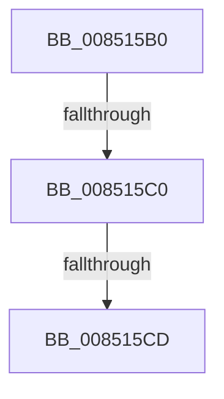

# sub_008515B0

- RVA: `0x008515B0`–`0x008515D5` (길이 `37` bytes)
- VA: `0x00000001408515B0`
- 실행 섹션: `PAGE`
- PDB 이름 있음: `아니요`; PDB Function 태그: `아니요`
- unwind 정보 RVA: `0x00069DD4`
- 디코드: `6`개 명령, `37/37` bytes 표시
- 미해석 바이트: `0` (있으면 어셈블리에 `.byte`로 보존)

> 이 문서는 커널 이미지의 기계어와 PDB 기호를 분석해 생성했습니다. 4번과 5번은 함수 원형과 자료형을 바이너리 사용 방식에서 추정한 C 해석이며 원본 소스 복구 결과는 아닙니다.

## 1. Dependencies

- 직접 호출 지점: **0**; 고유 호출 대상: **0**
- 직접 호출자로 확인된 함수: **0**
- RIP 상대 이미지 참조: **0**

### Outgoing calls
- 직접 디코드된 call 명령이 없습니다.

### Direct callers
- 이 함수 시작 RVA로 연결되는 직접 call은 확인되지 않았습니다. 간접 호출은 완전히 역산할 수 없습니다.

### Static image references
- 디코드된 RIP-relative 메모리 참조가 없습니다.

## 2. Other-region calls and transfers

- 다른 실행 섹션으로 향하는 call: **0**
- call이 아닌 외부 분기/꼬리 이동: **3**
  - `0x008515BA` → [CmpDereferenceKeyControlBlock + 0x57](CmpDereferenceKeyControlBlock_function_00851310.md) (`tail-transfer`)
  - `0x008515C7` → [CmpDereferenceKeyControlBlock + 0x57](CmpDereferenceKeyControlBlock_function_00851310.md) (`tail-transfer`)
  - `0x008515D0` → [CmpDereferenceKeyControlBlock + 0x5A](CmpDereferenceKeyControlBlock_function_00851310.md) (`tail-transfer`)

## 3. Assembly (complete function range)

```asm
008515B0  F7 83 B8 00 00 00 00 00 04 00   test dword ptr [rbx + 0xb8], 0x40000
008515BA  0F 84 A7 FD FF FF               je 0x140851367
008515C0  80 BF 80 0B 00 00 01            cmp byte ptr [rdi + 0xb80], 1
008515C7  0F 85 9A FD FF FF               jne 0x140851367
008515CD  41 B1 01                        mov r9b, 1
008515D0  E9 95 FD FF FF                  jmp 0x14085136a
```

## 4. C-style interpretation (structured pseudocode)

```c
void __fastcall sub_008515B0(void)
{
}
```

## 5. (Beta) C Style

```c
void sub_008515B0(void)
{
}
```

## 6. Execution-region graph

[열기: 2D/3D 그래프와 함수 탐색 컨트롤 패널](../../../control-panel.html?section=page&rva=0x008515B0&view=graph)

- 2D 그래프는 위에서 아래로 흐르고, 3D 그래프는 빈 공간을 드래그해 회전합니다. Shift+드래그는 이동, 휠은 확대·축소, 함수 노드 선택은 대상 보고서 이동입니다.

### Static fallback


