# sub_008515D5

- RVA: `0x008515D5`–`0x00851966` (길이 `913` bytes)
- VA: `0x00000001408515D5`
- 실행 섹션: `PAGE`
- PDB 이름 있음: `아니요`; PDB Function 태그: `아니요`
- unwind 정보 RVA: `0x00069DE4`
- 디코드: `218`개 명령, `913/913` bytes 표시
- 미해석 바이트: `0` (있으면 어셈블리에 `.byte`로 보존)

> 이 문서는 커널 이미지의 기계어와 PDB 기호를 분석해 생성했습니다. 4번과 5번은 함수 원형과 자료형을 바이너리 사용 방식에서 추정한 C 해석이며 원본 소스 복구 결과는 아닙니다.

## 1. Dependencies

- 직접 호출 지점: **18**; 고유 호출 대상: **16**
- 직접 호출자로 확인된 함수: **0**
- RIP 상대 이미지 참조: **8**

### Outgoing calls
- `0x00851636` → [CmpAttachToRegistryProcess](../../pagecmrc/BC/CmpAttachToRegistryProcess_function_00BC98E0.md) (function, `0x00BC98E0`)
- `0x0085163E` → [CmpConstructName](CmpConstructName_function_00856BE0.md) (function, `0x00856BE0`)
- `0x00851672` → [EtwpTraceRegistry](../86/EtwpTraceRegistry_function_00862980.md) (function, `0x00862980`)
- `0x0085167F` → [CmpFreePoolWithTag](../../text/44/CmpFreePoolWithTag_function_004489E0.md) (function, `0x004489E0`)
- `0x00851689` → [CmpDetachFromRegistryProcess](../../pagecmrc/BC/CmpDetachFromRegistryProcess_function_00BC9920.md) (function, `0x00BC9920`)
- `0x008516AD` → [CmpDereferenceNameControlBlockWithLock](../86/CmpDereferenceNameControlBlockWithLock_function_00862840.md) (function, `0x00862840`)
- `0x00851782` → [KeBugCheckEx](../../text/4F/KeBugCheckEx_function_004FD660.md) (function, `0x004FD660`)
- `0x00851790` → [KiRaiseIrqlProcessIrqlFlags](../../text/4F/KiRaiseIrqlProcessIrqlFlags_function_004F56FC.md) (function, `0x004F56FC`)
- `0x008517D3` → [CmpDoQueueLateUnloadWorker](../84/CmpDoQueueLateUnloadWorker_function_0084FB18.md) (function, `0x0084FB18`)
- `0x00851849` → [CmpDoQueueLateUnloadWorker](../84/CmpDoQueueLateUnloadWorker_function_0084FB18.md) (function, `0x0084FB18`)
- `0x00851860` → [CmpDecommisssionKcb](../86/CmpDecommisssionKcb_function_00862750.md) (function, `0x00862750`)
- `0x008518A5` → [ExReleaseFastMutex](../../text/25/ExReleaseFastMutex_function_002519C0.md) (function, `0x002519C0`)
- `0x008518AA` → [CmpArmDelayedCloseTimer](../../text/46/CmpArmDelayedCloseTimer_function_00462DD0.md) (function, `0x00462DD0`)
- `0x008518B7` → [CmpUnlockKcb](../../pagecmrc/BC/CmpUnlockKcb_function_00BC92C0.md) (function, `0x00BC92C0`)
- `0x008518C4` → [CmpUnlockKcb](../../pagecmrc/BC/CmpUnlockKcb_function_00BC92C0.md) (function, `0x00BC92C0`)
- `0x00851916` → [KeAbPostRelease](../../text/2E/KeAbPostRelease_function_002E1600.md) (function, `0x002E1600`)
- `0x0085192B` → [CmpDeleteHive](../86/CmpDeleteHive_function_0086450C.md) (function, `0x0086450C`)
- `0x00851937` → [CmpDrainDelayDerefContext](../../text/41/CmpDrainDelayDerefContext_function_0041B9A0.md) (function, `0x0041B9A0`)

### Direct callers
- 이 함수 시작 RVA로 연결되는 직접 call은 확인되지 않았습니다. 간접 호출은 완전히 역산할 수 없습니다.

### Static image references
- `0x008515FC` → RVA `0x00FD8008` (`PAGEDATA`; read)
- `0x0085164B` → RVA `0x00862980` (`EtwpTraceRegistry`; read)
- `0x0085186B` → RVA `0x00EF5880` (`.data`; read)
- `0x00851879` → RVA `0x00EF58E0` (`.data`; write)
- `0x00851880` → RVA `0x00EEFC30` (`.data`; read)
- `0x0085188C` → RVA `0x00FDA438` (`PAGEDATA`; read/write)
- `0x00851893` → RVA `0x00E0ECA8` (`.data`; read)
- `0x00851899` → RVA `0x00EEFC30` (`.data`; write)

## 2. Other-region calls and transfers

- 다른 실행 섹션으로 향하는 call: **11**
  - `0x00851636` → [CmpAttachToRegistryProcess](../../pagecmrc/BC/CmpAttachToRegistryProcess_function_00BC98E0.md) (`PAGE` → `PAGECMRC`)
  - `0x0085167F` → [CmpFreePoolWithTag](../../text/44/CmpFreePoolWithTag_function_004489E0.md) (`PAGE` → `.text`)
  - `0x00851689` → [CmpDetachFromRegistryProcess](../../pagecmrc/BC/CmpDetachFromRegistryProcess_function_00BC9920.md) (`PAGE` → `PAGECMRC`)
  - `0x00851782` → [KeBugCheckEx](../../text/4F/KeBugCheckEx_function_004FD660.md) (`PAGE` → `.text`)
  - `0x00851790` → [KiRaiseIrqlProcessIrqlFlags](../../text/4F/KiRaiseIrqlProcessIrqlFlags_function_004F56FC.md) (`PAGE` → `.text`)
  - `0x008518A5` → [ExReleaseFastMutex](../../text/25/ExReleaseFastMutex_function_002519C0.md) (`PAGE` → `.text`)
  - `0x008518AA` → [CmpArmDelayedCloseTimer](../../text/46/CmpArmDelayedCloseTimer_function_00462DD0.md) (`PAGE` → `.text`)
  - `0x008518B7` → [CmpUnlockKcb](../../pagecmrc/BC/CmpUnlockKcb_function_00BC92C0.md) (`PAGE` → `PAGECMRC`)
  - `0x008518C4` → [CmpUnlockKcb](../../pagecmrc/BC/CmpUnlockKcb_function_00BC92C0.md) (`PAGE` → `PAGECMRC`)
  - `0x00851916` → [KeAbPostRelease](../../text/2E/KeAbPostRelease_function_002E1600.md) (`PAGE` → `.text`)
  - `0x00851937` → [CmpDrainDelayDerefContext](../../text/41/CmpDrainDelayDerefContext_function_0041B9A0.md) (`PAGE` → `.text`)
- call이 아닌 외부 분기/꼬리 이동: **18**
  - `0x008515EA` → [sub_008513AF + 0x165](Unknown_function_008513AF.md) (`tail-transfer`)
  - `0x0085166C` → [sub_00851B91 + 0x1B4](Unknown_function_00851B91.md) (`tail-transfer`)
  - `0x008516A3` → [sub_00851A5C + 0xFA](Unknown_function_00851A5C.md) (`tail-transfer`)
  - `0x008516B7` → [sub_00851B91 + 0x1C1](Unknown_function_00851B91.md) (`tail-transfer`)
  - `0x008516C7` → [sub_00851B91 + 0x7F](Unknown_function_00851B91.md) (`tail-transfer`)
  - `0x008516DC` → [sub_00851B91 + 0xE7](Unknown_function_00851B91.md) (`tail-transfer`)
  - `0x00851767` → [sub_00851A5C + 0xC8](Unknown_function_00851A5C.md) (`tail-transfer`)
  - `0x00851795` → [sub_008513AF + 0x19B](Unknown_function_008513AF.md) (`tail-transfer`)
  - `0x008517A8` → [sub_00851B91 + 0x57](Unknown_function_00851B91.md) (`tail-transfer`)
  - `0x008517C5` → [sub_00851B91 + 0x18](Unknown_function_00851B91.md) (`tail-transfer`)
  - `0x008517F7` → [sub_00851A5C + 0xAD](Unknown_function_00851A5C.md) (`tail-transfer`)
  - `0x0085180A` → [sub_00851B91 + 0x108](Unknown_function_00851B91.md) (`tail-transfer`)
  - `0x0085181F` → [sub_00851B91 + 0x30](Unknown_function_00851B91.md) (`tail-transfer`)
  - `0x0085183B` → [sub_00851B91](Unknown_function_00851B91.md) (`tail-transfer`)
  - `0x0085189F` → [sub_00851B91 + 0xDD](Unknown_function_00851B91.md) (`tail-transfer`)
  - `0x00851902` → [sub_00851A5C + 0xA0](Unknown_function_00851A5C.md) (`tail-transfer`)
  - `0x0085190D` → [sub_00851A5C + 0xA0](Unknown_function_00851A5C.md) (`tail-transfer`)
  - `0x00851964` → [sub_00851966 + 0x78](Unknown_function_00851966.md) (`tail-transfer`)

## 3. Assembly (complete function range)

```asm
008515D5  0F B7 83 BA 00 00 00            movzx eax, word ptr [rbx + 0xba]
008515DC  A8 10                           test al, 0x10
008515DE  0F 94 C1                        sete cl
008515E1  F6 43 08 08                     test byte ptr [rbx + 8], 8
008515E5  0F 94 C0                        sete al
008515E8  84 C8                           test al, cl
008515EA  0F 84 24 FF FF FF               je 0x140851514
008515F0  4C 8B E7                        mov r12, rdi
008515F3  48 39 3B                        cmp qword ptr [rbx], rdi
008515F6  0F 85 52 02 00 00               jne 0x14085184e
008515FC  4C 8B 35 05 6A 78 00            mov r14, qword ptr [rip + 0x786a05]
00851603  4D 85 F6                        test r14, r14
00851606  0F 84 82 00 00 00               je 0x14085168e
0085160C  0F 57 C9                        xorps xmm1, xmm1
0085160F  48 8D 4C 24 78                  lea rcx, [rsp + 0x78]
00851614  0F 57 C0                        xorps xmm0, xmm0
00851617  0F 11 44 24 58                  movups xmmword ptr [rsp + 0x58], xmm0
0085161C  0F 11 44 24 68                  movups xmmword ptr [rsp + 0x68], xmm0
00851621  0F 11 4C 24 78                  movups xmmword ptr [rsp + 0x78], xmm1
00851626  0F 11 8C 24 88 00 00 00         movups xmmword ptr [rsp + 0x88], xmm1
0085162E  0F 11 8C 24 98 00 00 00         movups xmmword ptr [rsp + 0x98], xmm1
00851636  E8 A5 82 37 00                  call 0x140bc98e0
0085163B  48 8B CB                        mov rcx, rbx
0085163E  E8 9D 55 00 00                  call 0x140856be0
00851643  4C 8B E8                        mov r13, rax
00851646  48 85 C0                        test rax, rax
00851649  74 39                           je 0x140851684
0085164B  48 8D 05 2E 13 01 00            lea rax, [rip + 0x1132e]
00851652  4C 89 6C 24 28                  mov qword ptr [rsp + 0x28], r13
00851657  45 33 C9                        xor r9d, r9d
0085165A  48 89 5C 24 20                  mov qword ptr [rsp + 0x20], rbx
0085165F  45 33 C0                        xor r8d, r8d
00851662  48 8D 54 24 58                  lea rdx, [rsp + 0x58]
00851667  B1 17                           mov cl, 0x17
00851669  4C 3B F0                        cmp r14, rax
0085166C  0F 85 D3 06 00 00               jne 0x140851d45
00851672  E8 09 13 01 00                  call 0x140862980
00851677  BA 43 4D 4E 62                  mov edx, 0x624e4d43
0085167C  49 8B CD                        mov rcx, r13
0085167F  E8 5C 73 BF FF                  call 0x1404489e0
00851684  48 8D 4C 24 78                  lea rcx, [rsp + 0x78]
00851689  E8 92 82 37 00                  call 0x140bc9920
0085168E  0F B7 83 BA 00 00 00            movzx eax, word ptr [rbx + 0xba]
00851695  A8 40                           test al, 0x40
00851697  0F 94 C1                        sete cl
0085169A  F6 43 08 08                     test byte ptr [rbx + 8], 8
0085169E  0F 95 C0                        setne al
008516A1  84 C8                           test al, cl
008516A3  0F 85 AD 04 00 00               jne 0x140851b56
008516A9  48 8B 4B 50                     mov rcx, qword ptr [rbx + 0x50]
008516AD  E8 8E 11 01 00                  call 0x140862840
008516B2  8B 43 08                        mov eax, dword ptr [rbx + 8]
008516B5  A8 04                           test al, 4
008516B7  0F 85 95 06 00 00               jne 0x140851d52
008516BD  48 8B 8B C0 00 00 00            mov rcx, qword ptr [rbx + 0xc0]
008516C4  48 85 C9                        test rcx, rcx
008516C7  0F 85 43 05 00 00               jne 0x140851c10
008516CD  F7 43 08 00 00 02 00            test dword ptr [rbx + 8], 0x20000
008516D4  4C 8D 6B 10                     lea r13, [rbx + 0x10]
008516D8  4C 8B 73 48                     mov r14, qword ptr [rbx + 0x48]
008516DC  0F 85 96 05 00 00               jne 0x140851c78
008516E2  41 8B 45 00                     mov eax, dword ptr [r13]
008516E6  8B C8                           mov ecx, eax
008516E8  4C 8B 43 20                     mov r8, qword ptr [rbx + 0x20]
008516EC  C1 E9 09                        shr ecx, 9
008516EF  33 C8                           xor ecx, eax
008516F1  69 C1 A3 8A 01 00               imul eax, ecx, 0x18aa3
008516F7  8B C8                           mov ecx, eax
008516F9  8B D0                           mov edx, eax
008516FB  49 8B 80 70 06 00 00            mov rax, qword ptr [r8 + 0x670]
00851702  48 C1 EA 09                     shr rdx, 9
00851706  48 33 D1                        xor rdx, rcx
00851709  41 8B 88 78 06 00 00            mov ecx, dword ptr [r8 + 0x678]
00851710  FF C9                           dec ecx
00851712  48 23 D1                        and rdx, rcx
00851715  48 8D 14 52                     lea rdx, [rdx + rdx*2]
00851719  48 8D 52 02                     lea rdx, [rdx + 2]
0085171D  48 8D 14 D0                     lea rdx, [rax + rdx*8]
00851721  48 85 D2                        test rdx, rdx
00851724  74 14                           je 0x14085173a
00851726  48 8B 02                        mov rax, qword ptr [rdx]
00851729  48 85 C0                        test rax, rax
0085172C  74 0C                           je 0x14085173a
0085172E  49 3B C5                        cmp rax, r13
00851731  75 67                           jne 0x14085179a
00851733  48 8B 40 08                     mov rax, qword ptr [rax + 8]
00851737  48 89 02                        mov qword ptr [rdx], rax
0085173A  81 4B 08 00 00 08 00            or dword ptr [rbx + 8], 0x80000
00851741  4D 85 E4                        test r12, r12
00851744  0F 84 8E 00 00 00               je 0x1408517d8
0085174A  4D 8B 44 24 20                  mov r8, qword ptr [r12 + 0x20]
0085174F  49 8B 0C 24                     mov rcx, qword ptr [r12]
00851753  48 8B D1                        mov rdx, rcx
00851756  48 83 F9 01                     cmp rcx, 1
0085175A  77 44                           ja 0x1408517a0
0085175C  49 8D 84 24 E0 00 00 00         lea rax, [r12 + 0xe0]
00851764  48 39 00                        cmp qword ptr [rax], rax
00851767  0F 84 B7 03 00 00               je 0x140851b24
0085176D  41 B9 01 00 00 00               mov r9d, 1
00851773  48 89 7C 24 20                  mov qword ptr [rsp + 0x20], rdi
00851778  4D 8B C4                        mov r8, r12
0085177B  41 8D 51 33                     lea edx, [r9 + 0x33]
0085177F  8D 4A 1D                        lea ecx, [rdx + 0x1d]
00851782  E8 D9 BE CA FF                  call 0x1404fd660
00851787  CC                              int3
00851788  41 0F B6 D1                     movzx edx, r9b
0085178C  41 0F B6 CC                     movzx ecx, r12b
00851790  E8 67 3F CA FF                  call 0x1404f56fc
00851795  E9 B0 FD FF FF                  jmp 0x14085154a
0085179A  48 8D 50 08                     lea rdx, [rax + 8]
0085179E  EB 81                           jmp 0x140851721
008517A0  4C 8D 49 FF                     lea r9, [rcx - 1]
008517A4  49 83 F9 02                     cmp r9, 2
008517A8  0F 84 3A 04 00 00               je 0x140851be8
008517AE  45 32 D2                        xor r10b, r10b
008517B1  48 8B C1                        mov rax, rcx
008517B4  F0 4D 0F B1 0C 24               lock cmpxchg qword ptr [r12], r9
008517BA  48 8B C8                        mov rcx, rax
008517BD  48 3B C2                        cmp rax, rdx
008517C0  75 91                           jne 0x140851753
008517C2  49 3B C1                        cmp rax, r9
008517C5  0F 82 DE 03 00 00               jb 0x140851ba9
008517CB  45 84 D2                        test r10b, r10b
008517CE  74 08                           je 0x1408517d8
008517D0  49 8B C8                        mov rcx, r8
008517D3  E8 40 E3 FF FF                  call 0x14084fb18
008517D8  4D 85 F6                        test r14, r14
008517DB  74 71                           je 0x14085184e
008517DD  4D 8B 46 20                     mov r8, qword ptr [r14 + 0x20]
008517E1  49 8B 0E                        mov rcx, qword ptr [r14]
008517E4  48 8B D1                        mov rdx, rcx
008517E7  48 83 F9 01                     cmp rcx, 1
008517EB  77 2A                           ja 0x140851817
008517ED  49 8D 86 E0 00 00 00            lea rax, [r14 + 0xe0]
008517F4  48 39 00                        cmp qword ptr [rax], rax
008517F7  0F 85 0C 03 00 00               jne 0x140851b09
008517FD  48 8B 4C 24 48                  mov rcx, qword ptr [rsp + 0x48]
00851802  48 8D 54 24 40                  lea rdx, [rsp + 0x40]
00851807  48 39 11                        cmp qword ptr [rcx], rdx
0085180A  0F 84 89 04 00 00               je 0x140851c99
00851810  B9 03 00 00 00                  mov ecx, 3
00851815  CD 29                           int 0x29
00851817  4C 8D 49 FF                     lea r9, [rcx - 1]
0085181B  49 83 F9 02                     cmp r9, 2
0085181F  0F 84 9C 03 00 00               je 0x140851bc1
00851825  45 32 D2                        xor r10b, r10b
00851828  48 8B C1                        mov rax, rcx
0085182B  F0 4D 0F B1 0E                  lock cmpxchg qword ptr [r14], r9
00851830  48 8B C8                        mov rcx, rax
00851833  48 3B C2                        cmp rax, rdx
00851836  75 AC                           jne 0x1408517e4
00851838  49 3B C1                        cmp rax, r9
0085183B  0F 82 50 03 00 00               jb 0x140851b91
00851841  45 84 D2                        test r10b, r10b
00851844  74 08                           je 0x14085184e
00851846  49 8B C8                        mov rcx, r8
00851849  E8 CA E2 FF FF                  call 0x14084fb18
0085184E  65 48 8B 04 25 88 01 00 00      mov rax, qword ptr gs:[0x188]
00851857  48 39 43 38                     cmp qword ptr [rbx + 0x38], rax
0085185B  74 52                           je 0x1408518af
0085185D  48 8B CB                        mov rcx, rbx
00851860  E8 EB 0E 01 00                  call 0x140862750
00851865  EB 48                           jmp 0x1408518af
00851867  48 89 48 08                     mov qword ptr [rax + 8], rcx
0085186B  48 8D 0D 0E 40 6A 00            lea rcx, [rip + 0x6a400e]
00851872  48 89 10                        mov qword ptr [rax], rdx
00851875  48 89 42 08                     mov qword ptr [rdx + 8], rax
00851879  48 89 05 60 40 6A 00            mov qword ptr [rip + 0x6a4060], rax
00851880  8B 05 AA E3 69 00               mov eax, dword ptr [rip + 0x69e3aa]
00851886  80 4B 40 02                     or byte ptr [rbx + 0x40], 2
0085188A  FF C0                           inc eax
0085188C  48 FF 05 A5 8B 78 00            inc qword ptr [rip + 0x788ba5]
00851893  3B 05 0F D4 5B 00               cmp eax, dword ptr [rip + 0x5bd40f]
00851899  89 05 91 E3 69 00               mov dword ptr [rip + 0x69e391], eax
0085189F  0F 86 C9 03 00 00               jbe 0x140851c6e
008518A5  E8 16 01 A0 FF                  call 0x1402519c0
008518AA  E8 21 15 C1 FF                  call 0x140462dd0
008518AF  4C 8B 64 24 50                  mov r12, qword ptr [rsp + 0x50]
008518B4  48 8B CB                        mov rcx, rbx
008518B7  E8 04 7A 37 00                  call 0x140bc92c0
008518BC  4D 85 FF                        test r15, r15
008518BF  74 08                           je 0x1408518c9
008518C1  49 8B CF                        mov rcx, r15
008518C4  E8 F7 79 37 00                  call 0x140bc92c0
008518C9  8B 8E 78 06 00 00               mov ecx, dword ptr [rsi + 0x678]
008518CF  48 8B 86 70 06 00 00            mov rax, qword ptr [rsi + 0x670]
008518D6  FF C9                           dec ecx
008518D8  49 23 CC                        and rcx, r12
008518DB  48 8D 0C 49                     lea rcx, [rcx + rcx*2]
008518DF  48 8D 1C C8                     lea rbx, [rax + rcx*8]
008518E3  48 89 7B 08                     mov qword ptr [rbx + 8], rdi
008518E7  0F 0D 0B                        prefetchw byte ptr [rbx]
008518EA  48 8B 03                        mov rax, qword ptr [rbx]
008518ED  48 8B C8                        mov rcx, rax
008518F0  48 83 E1 F0                     and rcx, 0xfffffffffffffff0
008518F4  48 83 F9 10                     cmp rcx, 0x10
008518F8  48 8D 50 F0                     lea rdx, [rax - 0x10]
008518FC  48 0F 46 D7                     cmovbe rdx, rdi
00851900  A8 02                           test al, 2
00851902  0F 85 F4 01 00 00               jne 0x140851afc
00851908  F0 48 0F B1 13                  lock cmpxchg qword ptr [rbx], rdx
0085190D  0F 85 E9 01 00 00               jne 0x140851afc
00851913  48 8B CB                        mov rcx, rbx
00851916  E8 E5 FC A8 FF                  call 0x1402e1600
0085191B  F0 0F C1 AE 88 10 00 00         lock xadd dword ptr [rsi + 0x1088], ebp
00851923  83 FD 01                        cmp ebp, 1
00851926  75 08                           jne 0x140851930
00851928  48 8B CE                        mov rcx, rsi
0085192B  E8 DC 2B 01 00                  call 0x14086450c
00851930  33 D2                           xor edx, edx
00851932  48 8D 4C 24 40                  lea rcx, [rsp + 0x40]
00851937  E8 64 A0 BC FF                  call 0x14041b9a0
0085193C  4C 8B B4 24 B8 00 00 00         mov r14, qword ptr [rsp + 0xb8]
00851944  4C 8B AC 24 C0 00 00 00         mov r13, qword ptr [rsp + 0xc0]
0085194C  4C 8B BC 24 B0 00 00 00         mov r15, qword ptr [rsp + 0xb0]
00851954  48 8B AC 24 E8 00 00 00         mov rbp, qword ptr [rsp + 0xe8]
0085195C  4C 8B A4 24 F8 00 00 00         mov r12, qword ptr [rsp + 0xf8]
00851964  EB 78                           jmp 0x1408519de
```

## 4. C-style interpretation (structured pseudocode)

```c
__int64 __fastcall sub_008515D5(__int64 a1, __int64 a2, int a3, int a4, __int64 a5, __int64 a6, __int64 a7, __int64 a8, __int64 a9, __int64 a10, __int64 a11, __int64 a12, __int64 a13, __int64 a14, __int64 a15, __int64 a16, __int64 a17, __int64 a18, __int64 a19, __int64 a20, __int64 a21, __int64 a22, __int64 a23, __int64 a24, __int64 a25, __int64 a26, __int64 a27, __int64 a28, __int64 a29, __int64 a30, __int64 a31)
{
    __int64 result;
    __int64 v_r10;
    unsigned __int64 v_stack_p20;
    unsigned __int64 v_stack_p28;

    a1 = ((((unsigned __int8)(*(unsigned __int16 *)(v_rbx + 186))) & (16)) == 0) ? 1 : 0;
    result = (((*(unsigned __int8 *)(v_rbx + 8)) & (8)) == 0) ? 1 : 0;
    if ((*(unsigned __int64 *)(v_rbx)) != v_rdi) goto loc_0085184E;
    if (*(unsigned __int64 *)(v_rip + 7891461) == 0) goto loc_0085168E;
    a11 = v_xmm0;
    a13 = v_xmm0;
    a15 = v_xmm1;
    a17 = v_xmm1;
    a19 = v_xmm1;
    result = CmpAttachToRegistryProcess(a15, a2, a3, a4);
    result = CmpConstructName(v_rbx, a2, a3, a4);
    if (result == 0) goto loc_00851684;
    v_stack_p28 = result;
    a4 = 0;
    v_stack_p20 = v_rbx;
    a3 = 0;
    result = EtwpTraceRegistry(23, a11, a3, a4);
    result = CmpFreePoolWithTag(result, (unsigned int)(0x624E4D43ULL), a3, a4);
loc_00851684:
    result = CmpDetachFromRegistryProcess(a15, (unsigned int)(0x624E4D43ULL), a3, a4);
loc_0085168E:
    a1 = ((((unsigned __int8)(*(unsigned __int16 *)(v_rbx + 186))) & (64)) == 0) ? 1 : 0;
    result = (((*(unsigned __int8 *)(v_rbx + 8)) & (8)) != 0) ? 1 : 0;
    result = CmpDereferenceNameControlBlockWithLock(*(unsigned __int64 *)(v_rbx + 80), (unsigned int)(0x624E4D43ULL), a3, a4);
    a1 = (unsigned int)(((unsigned int)((unsigned int)((unsigned int)(*(unsigned int *)(v_rbx + 16))))) >> (9));
    a1 = (unsigned int)((a1) ^ ((unsigned int)((unsigned int)(*(unsigned int *)(v_rbx + 16)))));
    result = (unsigned int)(((unsigned int)(*(unsigned int *)(v_rbx + 16))) * ((unsigned int)(a1)));
    a2 = ((unsigned int)((unsigned int)(result))) >> (9);
    a2 = (a2) ^ ((unsigned int)((unsigned int)(result)));
    a1 = (unsigned int)(((unsigned int)(*(unsigned int *)(*(unsigned __int64 *)(v_rbx + 32) + 1656))) - 1);
    a2 = (a2) & (a1);
loc_00851721:
    if (*(unsigned __int64 *)(*(unsigned __int64 *)(v_rbx + 32) + 1648) + a2 + a2 * 2 + 2 * 8 == 0) goto loc_0085173A;
    if (*(unsigned __int64 *)(*(unsigned __int64 *)(*(unsigned __int64 *)(v_rbx + 32) + 1648) + a2 + a2 * 2 + 2 * 8) == 0) goto loc_0085173A;
    if ((*(unsigned __int64 *)(*(unsigned __int64 *)(*(unsigned __int64 *)(v_rbx + 32) + 1648) + a2 + a2 * 2 + 2 * 8)) != (v_rbx + 16)) goto loc_0085179A;
    *(unsigned __int64 *)(*(unsigned __int64 *)(*(unsigned __int64 *)(v_rbx + 32) + 1648) + a2 + a2 * 2 + 2 * 8) = *(unsigned __int64 *)(*(unsigned __int64 *)(*(unsigned __int64 *)(*(unsigned __int64 *)(v_rbx + 32) + 1648) + a2 + a2 * 2 + 2 * 8) + 8);
loc_0085173A:
    if (v_rdi == 0) goto loc_008517D8;
loc_00851753:
    if ((*(unsigned __int64 *)(v_rdi)) > 1) goto loc_008517A0;
    v_stack_p20 = v_rdi;
    result = KeBugCheckEx(1 + 51 + 29, 1 + 51, v_rdi, 1);
    result = KiRaiseIrqlProcessIrqlFlags((unsigned __int8)(v_rdi), 1, v_rdi, 1);
loc_0085179A:
    goto loc_00851721;
loc_008517A0:
    v_r10 = 0;
    if (((unsigned __int8)(v_rdi)) != (result + 8)) goto loc_00851753;
    result = (unsigned __int8)(v_rdi);
    if (0 != 0) {
        a1 = v_rdi;
        result = CmpDoQueueLateUnloadWorker(a1, result + 8, v_rdi, (unsigned __int8)(v_rdi) - 1);
    }
    if (*(unsigned __int64 *)(v_rbx + 72) == 0) goto loc_0085184E;
loc_008517E4:
    if ((*(unsigned __int64 *)(*(unsigned __int64 *)(v_rbx + 72))) > 1) goto loc_00851817;
loc_00851817:
    v_r10 = 0;
    if (3 != a8) goto loc_008517E4;
    result = 3;
    if (0 != 0) {
        a1 = *(unsigned __int64 *)(*(unsigned __int64 *)(v_rbx + 72) + 32);
        result = CmpDoQueueLateUnloadWorker(a1, a8, *(unsigned __int64 *)(*(unsigned __int64 *)(v_rbx + 72) + 32), 3 - 1);
    }
    if ((*(unsigned __int64 *)(v_rbx + 56)) == (*(unsigned __int64 *)(gs_base + (0 + 392)))) goto loc_008518AF;
    result = CmpDecommisssionKcb(v_rbx, a8, *(unsigned __int64 *)(*(unsigned __int64 *)(v_rbx + 72) + 32), 3 - 1);
    goto loc_008518AF;
loc_008518AF:
    result = CmpUnlockKcb(v_rbx, a8, *(unsigned __int64 *)(*(unsigned __int64 *)(v_rbx + 72) + 32), 3 - 1);
    if (v_r15 != 0) {
        a1 = v_r15;
        result = CmpUnlockKcb(a1, a8, *(unsigned __int64 *)(*(unsigned __int64 *)(v_rbx + 72) + 32), 3 - 1);
    }
    a1 = (unsigned int)(((unsigned int)(*(unsigned int *)(v_rsi + 1656))) - 1);
    a1 = (a1) & (a10);
    *(unsigned __int64 *)(*(unsigned __int64 *)(v_rsi + 1648) + a1 + a1 * 2 * 8 + 8) = v_rdi;
    a1 = (*(unsigned __int64 *)(*(unsigned __int64 *)(v_rsi + 1648) + a1 + a1 * 2 * 8)) & (-16);
    a2 = *(unsigned __int64 *)(*(unsigned __int64 *)(v_rsi + 1648) + a1 + a1 * 2 * 8) - 16;
    if (a1 <= 16) { a2 = v_rdi; }
    result = KeAbPostRelease(*(unsigned __int64 *)(v_rsi + 1648) + a1 + a1 * 2 * 8, a2, *(unsigned __int64 *)(*(unsigned __int64 *)(v_rbx + 72) + 32), 3 - 1);
    if (((unsigned int)(v_rbp)) == 1) {
        a1 = v_rsi;
        result = CmpDeleteHive(a1, a2, *(unsigned __int64 *)(*(unsigned __int64 *)(v_rbx + 72) + 32), 3 - 1);
    }
    a2 = 0;
    result = CmpDrainDelayDerefContext(a8, a2, *(unsigned __int64 *)(*(unsigned __int64 *)(v_rbx + 72) + 32), 3 - 1);
}
```

## 5. (Beta) C Style

```c
int64_t sub_008515D5(int64_t Arg1, int64_t Arg2, int32_t Arg3, int32_t Arg4, uint64_t Arg5, uint64_t Arg6, uint64_t Arg7, int64_t Arg8, void *Arg9, int64_t Arg10, int64_t Arg11, uint64_t Arg12, int64_t Arg13, uint64_t Arg14, int64_t Arg15, uint64_t Arg16, int64_t Arg17, uint64_t Arg18, int64_t Arg19, uint64_t Arg20, uint64_t Arg21, int64_t Arg22, int64_t Arg23, int64_t Arg24, uint64_t Arg25, uint64_t Arg26, uint64_t Arg27, uint64_t Arg28, int64_t Arg29, uint64_t Arg30, int64_t Arg31)
{
    uint8_t *arg9 = (uint8_t *)Arg9;

    int64_t result;
    int64_t local_r10;
    uint64_t v_stack_p20;
    uint64_t v_stack_p28;

    Arg1 = ((((uint8_t)(*(uint16_t *)(local_rbx + 0xBA))) & (16)) == 0) ? 1 : 0;
    result = (((*(uint8_t *)(local_rbx + 0x8)) & (8)) == 0) ? 1 : 0;
    if ((*(uint64_t *)(local_rbx)) != local_rdi) goto loc_0085184E;
    if (*(uint64_t *)(v_rip + 0x786A05) == 0) goto loc_0085168E;
    Arg11 = v_xmm0;
    Arg13 = v_xmm0;
    Arg15 = v_xmm1;
    Arg17 = v_xmm1;
    Arg19 = v_xmm1;
    result = CmpAttachToRegistryProcess(Arg15, Arg2, Arg3, Arg4);
    result = CmpConstructName(local_rbx, Arg2, Arg3, Arg4);
    if (result == 0) goto loc_00851684;
    v_stack_p28 = result;
    Arg4 = 0;
    v_stack_p20 = local_rbx;
    Arg3 = 0;
    result = EtwpTraceRegistry(23, Arg11, Arg3, Arg4);
    result = CmpFreePoolWithTag(result, (uint32_t)(0x624E4D43ULL), Arg3, Arg4);
loc_00851684:
    result = CmpDetachFromRegistryProcess(Arg15, (uint32_t)(0x624E4D43ULL), Arg3, Arg4);
loc_0085168E:
    Arg1 = ((((uint8_t)(*(uint16_t *)(local_rbx + 0xBA))) & (64)) == 0) ? 1 : 0;
    result = (((*(uint8_t *)(local_rbx + 0x8)) & (8)) != 0) ? 1 : 0;
    result = CmpDereferenceNameControlBlockWithLock(*(uint64_t *)(local_rbx + 0x50), (uint32_t)(0x624E4D43ULL), Arg3, Arg4);
    Arg1 = (uint32_t)(((uint32_t)((uint32_t)((uint32_t)(*(uint32_t *)(local_rbx + 0x10))))) >> (9));
    Arg1 = (uint32_t)((Arg1) ^ ((uint32_t)((uint32_t)(*(uint32_t *)(local_rbx + 0x10)))));
    result = (uint32_t)(((uint32_t)(*(uint32_t *)(local_rbx + 0x10))) * ((uint32_t)(Arg1)));
    Arg2 = ((uint32_t)((uint32_t)(result))) >> (9);
    Arg2 = (Arg2) ^ ((uint32_t)((uint32_t)(result)));
    Arg1 = (uint32_t)(((uint32_t)(*(uint32_t *)(*(uint64_t *)(local_rbx + 0x20) + 0x678))) - 1);
    Arg2 = (Arg2) & (Arg1);
loc_00851721:
    if (*(uint64_t *)(*(uint64_t *)(local_rbx + 0x20) + 0x670) + Arg2 + Arg2 * 2 + 2 * 8 == 0) goto loc_0085173A;
    if (*(uint64_t *)(*(uint64_t *)(*(uint64_t *)(local_rbx + 0x20) + 0x670) + Arg2 + Arg2 * 2 + 0x2 * 8) == 0) goto loc_0085173A;
    if ((*(uint64_t *)(*(uint64_t *)(*(uint64_t *)(local_rbx + 0x20) + 0x670) + Arg2 + Arg2 * 2 + 0x2 * 8)) != (local_rbx + 16)) goto loc_0085179A;
    *(uint64_t *)(*(uint64_t *)(*(uint64_t *)(local_rbx + 0x20) + 0x670) + Arg2 + Arg2 * 2 + 0x2 * 8) = *(uint64_t *)(*(uint64_t *)(*(uint64_t *)(*(uint64_t *)(local_rbx + 0x20) + 0x670) + Arg2 + Arg2 * 2 + 0x2 * 8) + 0x8);
loc_0085173A:
    if (local_rdi == 0) goto loc_008517D8;
loc_00851753:
    if ((*(uint64_t *)(local_rdi)) > 1) goto loc_008517A0;
    v_stack_p20 = local_rdi;
    result = KeBugCheckEx(1 + 51 + 29, 1 + 51, local_rdi, 1);
    result = KiRaiseIrqlProcessIrqlFlags((uint8_t)(local_rdi), 1, local_rdi, 1);
loc_0085179A:
    goto loc_00851721;
loc_008517A0:
    local_r10 = 0;
    if (((uint8_t)(local_rdi)) != (result + 8)) goto loc_00851753;
    result = (uint8_t)(local_rdi);
    if (0 != 0) {
        Arg1 = local_rdi;
        result = CmpDoQueueLateUnloadWorker(Arg1, result + 8, local_rdi, (uint8_t)(local_rdi) - 1);
    }
    if (*(uint64_t *)(local_rbx + 0x48) == 0) goto loc_0085184E;
loc_008517E4:
    if ((*(uint64_t *)(*(uint64_t *)(local_rbx + 0x48))) > 1) goto loc_00851817;
loc_00851817:
    local_r10 = 0;
    if (3 != Arg8) goto loc_008517E4;
    result = 3;
    if (0 != 0) {
        Arg1 = *(uint64_t *)(*(uint64_t *)(local_rbx + 0x48) + 0x20);
        result = CmpDoQueueLateUnloadWorker(Arg1, Arg8, *(uint64_t *)(*(uint64_t *)(local_rbx + 0x48) + 0x20), 3 - 1);
    }
    if ((*(uint64_t *)(local_rbx + 0x38)) == (*(uint64_t *)(gs_base + (0 + 0x188)))) goto loc_008518AF;
    result = CmpDecommisssionKcb(local_rbx, Arg8, *(uint64_t *)(*(uint64_t *)(local_rbx + 0x48) + 0x20), 3 - 1);
    goto loc_008518AF;
loc_008518AF:
    result = CmpUnlockKcb(local_rbx, Arg8, *(uint64_t *)(*(uint64_t *)(local_rbx + 0x48) + 0x20), 3 - 1);
    if (local_r15 != 0) {
        Arg1 = local_r15;
        result = CmpUnlockKcb(Arg1, Arg8, *(uint64_t *)(*(uint64_t *)(local_rbx + 0x48) + 0x20), 3 - 1);
    }
    Arg1 = (uint32_t)(((uint32_t)(*(uint32_t *)(local_rsi + 0x678))) - 1);
    Arg1 = (Arg1) & (Arg10);
    *(uint64_t *)(*(uint64_t *)(local_rsi + 0x670) + Arg1 + Arg1 * 2 * 8 + 0x8) = local_rdi;
    Arg1 = (*(uint64_t *)(*(uint64_t *)(local_rsi + 0x670) + Arg1 + Arg1 * 2 * 8)) & (-16);
    Arg2 = *(uint64_t *)(*(uint64_t *)(local_rsi + 0x670) + Arg1 + Arg1 * 2 * 8) - 16;
    if (Arg1 <= 16) { Arg2 = local_rdi; }
    result = KeAbPostRelease(*(uint64_t *)(local_rsi + 0x670) + Arg1 + Arg1 * 2 * 8, Arg2, *(uint64_t *)(*(uint64_t *)(local_rbx + 0x48) + 0x20), 3 - 1);
    if (((uint32_t)(local_rbp)) == 1) {
        Arg1 = local_rsi;
        result = CmpDeleteHive(Arg1, Arg2, *(uint64_t *)(*(uint64_t *)(local_rbx + 0x48) + 0x20), 3 - 1);
    }
    Arg2 = 0;
    result = CmpDrainDelayDerefContext(Arg8, Arg2, *(uint64_t *)(*(uint64_t *)(local_rbx + 0x48) + 0x20), 3 - 1);
}
```

### 관측된 메모리 오프셋

구조체 형식이 확인되지 않은 접근은 인자 기준의 오프셋으로만 기록했습니다.

| 기준 인자 | 오프셋 표현 | 폭 (bit) | 접근 |
|---|---:|---:|---|
| `Arg9` | `+ 0x0` | `64` | `R` |

## 6. Execution-region graph

[열기: 2D/3D 그래프와 함수 탐색 컨트롤 패널](../../../control-panel.html?section=page&rva=0x008515D5&view=graph)

- 2D 그래프는 위에서 아래로 흐르고, 3D 그래프는 빈 공간을 드래그해 회전합니다. Shift+드래그는 이동, 휠은 확대·축소, 함수 노드 선택은 대상 보고서 이동입니다.

### Static fallback

```mermaid
flowchart TD
  bb_008515D5[BB_008515D5]
  bb_008515F0[BB_008515F0]
  bb_008515FC[BB_008515FC]
  bb_0085160C[BB_0085160C]
  bb_0085164B[BB_0085164B]
  bb_00851672[BB_00851672]
  bb_00851684[BB_00851684]
  bb_0085168E[BB_0085168E]
  bb_008516A9[BB_008516A9]
  bb_008516BD[BB_008516BD]
  bb_008516CD[BB_008516CD]
  bb_008516E2[BB_008516E2]
  bb_00851721[BB_00851721]
  bb_00851726[BB_00851726]
  bb_0085172E[BB_0085172E]
  bb_00851733[BB_00851733]
  bb_0085173A[BB_0085173A]
  bb_0085174A[BB_0085174A]
  bb_00851753[BB_00851753]
  bb_0085175C[BB_0085175C]
  bb_0085176D[BB_0085176D]
  bb_0085179A[BB_0085179A]
  bb_008517A0[BB_008517A0]
  bb_008517AE[BB_008517AE]
  bb_008517C2[BB_008517C2]
  bb_008517CB[BB_008517CB]
  bb_008517D0[BB_008517D0]
  bb_008517D8[BB_008517D8]
  bb_008517DD[BB_008517DD]
  bb_008517E4[BB_008517E4]
  bb_008517ED[BB_008517ED]
  bb_008517FD[BB_008517FD]
  bb_00851810[BB_00851810]
  bb_00851817[BB_00851817]
  bb_00851825[BB_00851825]
  bb_00851838[BB_00851838]
  bb_00851841[BB_00851841]
  bb_00851846[BB_00851846]
  bb_0085184E[BB_0085184E]
  bb_0085185D[BB_0085185D]
  bb_00851867[BB_00851867]
  bb_008518A5[BB_008518A5]
  bb_008518AF[BB_008518AF]
  bb_008518C1[BB_008518C1]
  bb_008518C9[BB_008518C9]
  bb_00851908[BB_00851908]
  bb_00851913[BB_00851913]
  bb_00851928[BB_00851928]
  bb_00851930[BB_00851930]
  bb_008515D5 -->|fallthrough| bb_008515F0
  bb_008515F0 -->|branch| bb_0085184E
  bb_008515F0 -->|fallthrough| bb_008515FC
  bb_008515FC -->|branch| bb_0085168E
  bb_008515FC -->|fallthrough| bb_0085160C
  bb_0085160C -->|branch| bb_00851684
  bb_0085160C -->|fallthrough| bb_0085164B
  bb_0085164B -->|fallthrough| bb_00851672
  bb_00851672 -->|flow| bb_00851684
  bb_00851684 -->|flow| bb_0085168E
  bb_0085168E -->|fallthrough| bb_008516A9
  bb_008516A9 -->|fallthrough| bb_008516BD
  bb_008516BD -->|fallthrough| bb_008516CD
  bb_008516CD -->|fallthrough| bb_008516E2
  bb_008516E2 -->|flow| bb_00851721
  bb_00851721 -->|branch| bb_0085173A
  bb_00851721 -->|fallthrough| bb_00851726
  bb_00851726 -->|branch| bb_0085173A
  bb_00851726 -->|fallthrough| bb_0085172E
  bb_0085172E -->|branch| bb_0085179A
  bb_0085172E -->|fallthrough| bb_00851733
  bb_00851733 -->|flow| bb_0085173A
  bb_0085173A -->|branch| bb_008517D8
  bb_0085173A -->|fallthrough| bb_0085174A
  bb_0085174A -->|flow| bb_00851753
  bb_00851753 -->|branch| bb_008517A0
  bb_00851753 -->|fallthrough| bb_0085175C
  bb_0085175C -->|fallthrough| bb_0085176D
  bb_0085179A -->|branch| bb_00851721
  bb_008517A0 -->|fallthrough| bb_008517AE
  bb_008517AE -->|branch| bb_00851753
  bb_008517AE -->|fallthrough| bb_008517C2
  bb_008517C2 -->|fallthrough| bb_008517CB
  bb_008517CB -->|branch| bb_008517D8
  bb_008517CB -->|fallthrough| bb_008517D0
  bb_008517D0 -->|flow| bb_008517D8
  bb_008517D8 -->|branch| bb_0085184E
  bb_008517D8 -->|fallthrough| bb_008517DD
  bb_008517DD -->|flow| bb_008517E4
  bb_008517E4 -->|branch| bb_00851817
  bb_008517E4 -->|fallthrough| bb_008517ED
  bb_008517ED -->|fallthrough| bb_008517FD
  bb_008517FD -->|fallthrough| bb_00851810
  bb_00851810 -->|flow| bb_00851817
  bb_00851817 -->|fallthrough| bb_00851825
  bb_00851825 -->|branch| bb_008517E4
  bb_00851825 -->|fallthrough| bb_00851838
  bb_00851838 -->|fallthrough| bb_00851841
  bb_00851841 -->|branch| bb_0085184E
  bb_00851841 -->|fallthrough| bb_00851846
  bb_00851846 -->|flow| bb_0085184E
  bb_0085184E -->|branch| bb_008518AF
  bb_0085184E -->|fallthrough| bb_0085185D
  bb_0085185D -->|branch| bb_008518AF
  bb_00851867 -->|fallthrough| bb_008518A5
  bb_008518A5 -->|flow| bb_008518AF
  bb_008518AF -->|branch| bb_008518C9
  bb_008518AF -->|fallthrough| bb_008518C1
  bb_008518C1 -->|flow| bb_008518C9
  bb_008518C9 -->|fallthrough| bb_00851908
  bb_00851908 -->|fallthrough| bb_00851913
  bb_00851913 -->|branch| bb_00851930
  bb_00851913 -->|fallthrough| bb_00851928
  bb_00851928 -->|flow| bb_00851930
```


