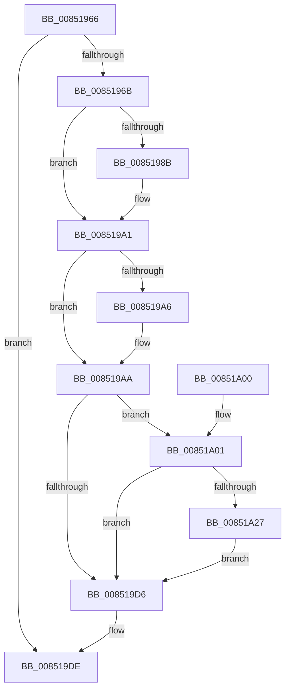

# sub_00851966

- RVA: `0x00851966`–`0x00851A5C` (길이 `246` bytes)
- VA: `0x0000000140851966`
- 실행 섹션: `PAGE`
- PDB 이름 있음: `아니요`; PDB Function 태그: `아니요`
- unwind 정보 RVA: `0x00069E08`
- 디코드: `52`개 명령, `246/246` bytes 표시
- 미해석 바이트: `0` (있으면 어셈블리에 `.byte`로 보존)

> 이 문서는 커널 이미지의 기계어와 PDB 기호를 분석해 생성했습니다. 4번과 5번은 함수 원형과 자료형을 바이너리 사용 방식에서 추정한 C 해석이며 원본 소스 복구 결과는 아닙니다.

## 1. Dependencies

- 직접 호출 지점: **6**; 고유 호출 대상: **6**
- 직접 호출자로 확인된 함수: **0**
- RIP 상대 이미지 참조: **0**

### Outgoing calls
- `0x00851977` → [KeAbPreAcquire](../../text/21/KeAbPreAcquire_function_00210230.md) (function, `0x00210230`)
- `0x0085199C` → [ExfAcquirePushLockExclusiveEx](../../text/20/ExfAcquirePushLockExclusiveEx_function_0020FC90.md) (function, `0x0020FC90`)
- `0x008519D9` → [CmUnlockHive](CmUnlockHive_function_00851D6C.md) (function, `0x00851D6C`)
- `0x008519F1` → [_security_check_cookie](../../text/6A/_security_check_cookie_function_006AC640.md) (function, `0x006AC640`)
- `0x00851A43` → [CmpReferenceHive](../84/CmpReferenceHive_function_0084FCF0.md) (function, `0x0084FCF0`)
- `0x00851A52` → [ExQueueWorkItem](../../text/2F/ExQueueWorkItem_function_002F9520.md) (function, `0x002F9520`)

### Direct callers
- 이 함수 시작 RVA로 연결되는 직접 call은 확인되지 않았습니다. 간접 호출은 완전히 역산할 수 없습니다.

### Static image references
- 디코드된 RIP-relative 메모리 참조가 없습니다.

## 2. Other-region calls and transfers

- 다른 실행 섹션으로 향하는 call: **4**
  - `0x00851977` → [KeAbPreAcquire](../../text/21/KeAbPreAcquire_function_00210230.md) (`PAGE` → `.text`)
  - `0x0085199C` → [ExfAcquirePushLockExclusiveEx](../../text/20/ExfAcquirePushLockExclusiveEx_function_0020FC90.md) (`PAGE` → `.text`)
  - `0x008519F1` → [_security_check_cookie](../../text/6A/_security_check_cookie_function_006AC640.md) (`PAGE` → `.text`)
  - `0x00851A52` → [ExQueueWorkItem](../../text/2F/ExQueueWorkItem_function_002F9520.md) (`PAGE` → `.text`)
- 별도 외부 분기/꼬리 이동을 확인하지 못했습니다.

## 3. Assembly (complete function range)

```asm
00851966  45 84 C9                        test r9b, r9b
00851969  74 73                           je 0x1408519de
0085196B  45 33 C0                        xor r8d, r8d
0085196E  48 8D 8F 90 06 00 00            lea rcx, [rdi + 0x690]
00851975  33 D2                           xor edx, edx
00851977  E8 B4 E8 9B FF                  call 0x140210230
0085197C  F0 48 0F BA AF 90 06 00 00 00   lock bts qword ptr [rdi + 0x690], 0
00851986  48 8B F0                        mov rsi, rax
00851989  73 16                           jae 0x1408519a1
0085198B  4C 8D 87 90 06 00 00            lea r8, [rdi + 0x690]
00851992  48 8B D0                        mov rdx, rax
00851995  48 8D 8F 90 06 00 00            lea rcx, [rdi + 0x690]
0085199C  E8 EF E2 9B FF                  call 0x14020fc90
008519A1  48 85 F6                        test rsi, rsi
008519A4  74 04                           je 0x1408519aa
008519A6  C6 46 0A 01                     mov byte ptr [rsi + 0xa], 1
008519AA  41 B9 01 00 00 00               mov r9d, 1
008519B0  41 8B C1                        mov eax, r9d
008519B3  F0 0F C1 87 8C 10 00 00         lock xadd dword ptr [rdi + 0x108c], eax
008519BB  83 E0 7F                        and eax, 0x7f
008519BE  C7 84 87 90 10 00 00 13 00 00 00  mov dword ptr [rdi + rax*4 + 0x1090], 0x13
008519C9  48 8B 87 78 0B 00 00            mov rax, qword ptr [rdi + 0xb78]
008519D0  48 83 38 02                     cmp qword ptr [rax], 2
008519D4  74 2B                           je 0x140851a01
008519D6  48 8B CF                        mov rcx, rdi
008519D9  E8 8E 03 00 00                  call 0x140851d6c
008519DE  48 8B B4 24 F0 00 00 00         mov rsi, qword ptr [rsp + 0xf0]
008519E6  48 8B 8C 24 A8 00 00 00         mov rcx, qword ptr [rsp + 0xa8]
008519EE  48 33 CC                        xor rcx, rsp
008519F1  E8 4A AC E5 FF                  call 0x1406ac640
008519F6  48 81 C4 C8 00 00 00            add rsp, 0xc8
008519FD  5F                              pop rdi
008519FE  5B                              pop rbx
008519FF  C3                              ret
00851A00  CC                              int3
00851A01  41 8B C1                        mov eax, r9d
00851A04  F0 0F C1 87 8C 10 00 00         lock xadd dword ptr [rdi + 0x108c], eax
00851A0C  83 E0 7F                        and eax, 0x7f
00851A0F  C7 84 87 90 10 00 00 14 00 00 00  mov dword ptr [rdi + rax*4 + 0x1090], 0x14
00851A1A  33 C0                           xor eax, eax
00851A1C  F0 44 0F B1 8F C0 12 00 00      lock cmpxchg dword ptr [rdi + 0x12c0], r9d
00851A25  75 AF                           jne 0x1408519d6
00851A27  41 8B C1                        mov eax, r9d
00851A2A  F0 0F C1 87 8C 10 00 00         lock xadd dword ptr [rdi + 0x108c], eax
00851A32  83 E0 7F                        and eax, 0x7f
00851A35  48 8B CF                        mov rcx, rdi
00851A38  C7 84 87 90 10 00 00 15 00 00 00  mov dword ptr [rdi + rax*4 + 0x1090], 0x15
00851A43  E8 A8 E2 FF FF                  call 0x14084fcf0
00851A48  48 8B 8F D0 12 00 00            mov rcx, qword ptr [rdi + 0x12d0]
00851A4F  41 8B D1                        mov edx, r9d
00851A52  E8 C9 7A AA FF                  call 0x1402f9520
00851A57  E9 7A FF FF FF                  jmp 0x1408519d6
```

## 4. C-style interpretation (structured pseudocode)

```c
__int64 __fastcall sub_00851966(__int64 a1, int a2, int a3, unsigned __int8 a4, __int64 a5, __int64 a6, __int64 a7, __int64 a8, __int64 a9, __int64 a10, __int64 a11, __int64 a12, __int64 a13, __int64 a14, __int64 a15, __int64 a16, __int64 a17, __int64 a18, __int64 a19, __int64 a20, __int64 a21, __int64 a22, __int64 a23, __int64 a24, __int64 a25, __int64 a26, __int64 a27, __int64 a28, __int64 a29, __int64 a30)
{
    __int64 result;
    __int64 v_rsp;

    if (a4 == 0) goto loc_008519DE;
    a3 = 0;
    a2 = 0;
    result = KeAbPreAcquire(v_rdi + 1680, a2, a3, a4);
    if (!(condition_is_above_or_equal)) {
        a3 = v_rdi + 1680;
        a2 = result;
        a1 = v_rdi + 1680;
        result = ExfAcquirePushLockExclusiveEx(a1, a2, a3, a4);
    }
    if (result != 0) {
        *(unsigned __int8 *)(result + 10) = 1;
    }
    result = (unsigned int)((1) & (127));
    *(unsigned int *)(v_rdi + result * 4 + 4240) = 19;
    if ((*(unsigned __int64 *)(*(unsigned __int64 *)(v_rdi + 2936))) == 2) goto loc_00851A01;
loc_008519D6:
    result = CmUnlockHive(v_rdi, a2, a3, 1);
loc_008519DE:
    a1 = (a21) ^ (v_rsp);
    result = _security_check_cookie(a1, a2, a3, 1);
    v_rsp = (v_rsp) + (200);
    return result;
loc_00851A01:
    result = (unsigned int)((1) & (127));
    *(unsigned int *)(v_rdi + result * 4 + 4240) = 20;
    result = 0;
    if (condition_is_not_equal) goto loc_008519D6;
    result = (unsigned int)((1) & (127));
    *(unsigned int *)(v_rdi + result * 4 + 4240) = 21;
    result = CmpReferenceHive(v_rdi, a2, a3, 1);
    result = ExQueueWorkItem(*(unsigned __int64 *)(v_rdi + 4816), 1, a3, 1);
    goto loc_008519D6;
}
```

## 5. (Beta) C Style

```c
int64_t sub_00851966(int64_t Arg1, int32_t Arg2, int32_t Arg3, uint8_t Arg4, uint64_t Arg5, uint64_t Arg6, uint64_t Arg7, uint64_t Arg8, uint64_t Arg9, uint64_t Arg10, uint64_t Arg11, uint64_t Arg12, uint64_t Arg13, uint64_t Arg14, uint64_t Arg15, uint64_t Arg16, uint64_t Arg17, uint64_t Arg18, uint64_t Arg19, uint64_t Arg20, int64_t Arg21, uint64_t Arg22, uint64_t Arg23, uint64_t Arg24, uint64_t Arg25, uint64_t Arg26, uint64_t Arg27, uint64_t Arg28, uint64_t Arg29, int64_t Arg30)
{
    int64_t result;
    int64_t local_rsp;

    if (Arg4 == 0) goto loc_008519DE;
    Arg3 = 0;
    Arg2 = 0;
    result = KeAbPreAcquire(local_rdi + 1680, Arg2, Arg3, Arg4);
    if (!(condition_is_above_or_equal)) {
        Arg3 = local_rdi + 1680;
        Arg2 = result;
        Arg1 = local_rdi + 1680;
        result = ExfAcquirePushLockExclusiveEx(Arg1, Arg2, Arg3, Arg4);
    }
    if (result != 0) {
        *(uint8_t *)(result + 0xA) = 1;
    }
    result = (uint32_t)((1) & (127));
    *(uint32_t *)(local_rdi + result * 4 + 0x1090) = 19;
    if ((*(uint64_t *)(*(uint64_t *)(local_rdi + 0xB78))) == 2) goto loc_00851A01;
loc_008519D6:
    result = CmUnlockHive(local_rdi, Arg2, Arg3, 1);
loc_008519DE:
    Arg1 = (Arg21) ^ (local_rsp);
    result = _security_check_cookie(Arg1, Arg2, Arg3, 1);
    local_rsp = (local_rsp) + (200);
    return result;
loc_00851A01:
    result = (uint32_t)((1) & (127));
    *(uint32_t *)(local_rdi + result * 4 + 0x1090) = 20;
    result = 0;
    if (condition_is_not_equal) goto loc_008519D6;
    result = (uint32_t)((1) & (127));
    *(uint32_t *)(local_rdi + result * 4 + 0x1090) = 21;
    result = CmpReferenceHive(local_rdi, Arg2, Arg3, 1);
    result = ExQueueWorkItem(*(uint64_t *)(local_rdi + 0x12D0), 1, Arg3, 1);
    goto loc_008519D6;
}
```

## 6. Execution-region graph

[열기: 2D/3D 그래프와 함수 탐색 컨트롤 패널](../../../control-panel.html?section=page&rva=0x00851966&view=graph)

- 2D 그래프는 위에서 아래로 흐르고, 3D 그래프는 빈 공간을 드래그해 회전합니다. Shift+드래그는 이동, 휠은 확대·축소, 함수 노드 선택은 대상 보고서 이동입니다.

### Static fallback


