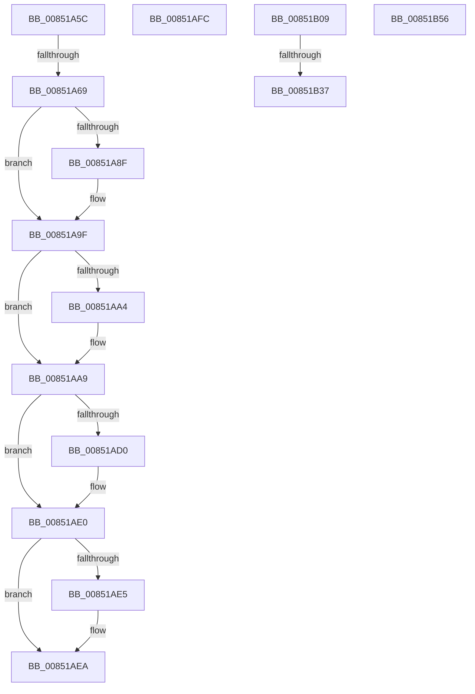

# sub_00851A5C

- RVA: `0x00851A5C`–`0x00851B76` (길이 `282` bytes)
- VA: `0x0000000140851A5C`
- 실행 섹션: `PAGE`
- PDB 이름 있음: `아니요`; PDB Function 태그: `아니요`
- unwind 정보 RVA: `0x00069E1C`
- 디코드: `67`개 명령, `282/282` bytes 표시
- 미해석 바이트: `0` (있으면 어셈블리에 `.byte`로 보존)

> 이 문서는 커널 이미지의 기계어와 PDB 기호를 분석해 생성했습니다. 4번과 5번은 함수 원형과 자료형을 바이너리 사용 방식에서 추정한 C 해석이며 원본 소스 복구 결과는 아닙니다.

## 1. Dependencies

- 직접 호출 지점: **8**; 고유 호출 대상: **6**
- 직접 호출자로 확인된 함수: **0**
- RIP 상대 이미지 참조: **0**

### Outgoing calls
- `0x00851A70` → [CmpUnlockKcb](../../pagecmrc/BC/CmpUnlockKcb_function_00BC92C0.md) (function, `0x00BC92C0`)
- `0x00851A7E` → [KeAbPreAcquire](../../text/21/KeAbPreAcquire_function_00210230.md) (function, `0x00210230`)
- `0x00851A9A` → [ExfAcquirePushLockExclusiveEx](../../text/20/ExfAcquirePushLockExclusiveEx_function_0020FC90.md) (function, `0x0020FC90`)
- `0x00851ABF` → [KeAbPreAcquire](../../text/21/KeAbPreAcquire_function_00210230.md) (function, `0x00210230`)
- `0x00851ADB` → [ExfAcquirePushLockExclusiveEx](../../text/20/ExfAcquirePushLockExclusiveEx_function_0020FC90.md) (function, `0x0020FC90`)
- `0x00851AFF` → [ExfReleasePushLock](../../text/26/ExfReleasePushLock_function_002638D0.md) (function, `0x002638D0`)
- `0x00851B1E` → [KeBugCheckEx](../../text/4F/KeBugCheckEx_function_004FD660.md) (function, `0x004FD660`)
- `0x00851B5F` → [CmpDelayDerefKeyControlBlock](../84/CmpDelayDerefKeyControlBlock_function_0084FA50.md) (function, `0x0084FA50`)

### Direct callers
- 이 함수 시작 RVA로 연결되는 직접 call은 확인되지 않았습니다. 간접 호출은 완전히 역산할 수 없습니다.

### Static image references
- 디코드된 RIP-relative 메모리 참조가 없습니다.

## 2. Other-region calls and transfers

- 다른 실행 섹션으로 향하는 call: **7**
  - `0x00851A70` → [CmpUnlockKcb](../../pagecmrc/BC/CmpUnlockKcb_function_00BC92C0.md) (`PAGE` → `PAGECMRC`)
  - `0x00851A7E` → [KeAbPreAcquire](../../text/21/KeAbPreAcquire_function_00210230.md) (`PAGE` → `.text`)
  - `0x00851A9A` → [ExfAcquirePushLockExclusiveEx](../../text/20/ExfAcquirePushLockExclusiveEx_function_0020FC90.md) (`PAGE` → `.text`)
  - `0x00851ABF` → [KeAbPreAcquire](../../text/21/KeAbPreAcquire_function_00210230.md) (`PAGE` → `.text`)
  - `0x00851ADB` → [ExfAcquirePushLockExclusiveEx](../../text/20/ExfAcquirePushLockExclusiveEx_function_0020FC90.md) (`PAGE` → `.text`)
  - `0x00851AFF` → [ExfReleasePushLock](../../text/26/ExfReleasePushLock_function_002638D0.md) (`PAGE` → `.text`)
  - `0x00851B1E` → [KeBugCheckEx](../../text/4F/KeBugCheckEx_function_004FD660.md) (`PAGE` → `.text`)
- call이 아닌 외부 분기/꼬리 이동: **6**
  - `0x00851A63` → [sub_008513AF + 0x107](Unknown_function_008513AF.md) (`tail-transfer`)
  - `0x00851AF7` → [sub_008513AF + 0x107](Unknown_function_008513AF.md) (`tail-transfer`)
  - `0x00851B04` → [sub_008515D5 + 0x33E](Unknown_function_008515D5.md) (`tail-transfer`)
  - `0x00851B31` → [sub_008515D5 + 0x23B](Unknown_function_008515D5.md) (`tail-transfer`)
  - `0x00851B51` → [sub_008515D5 + 0x203](Unknown_function_008515D5.md) (`tail-transfer`)
  - `0x00851B71` → [sub_008515D5 + 0xD4](Unknown_function_008515D5.md) (`tail-transfer`)

## 3. Assembly (complete function range)

```asm
00851A5C  48 8B 48 18                     mov rcx, qword ptr [rax + 0x18]
00851A60  48 85 C9                        test rcx, rcx
00851A63  0F 84 4D FA FF FF               je 0x1408514b6
00851A69  4C 8B 79 10                     mov r15, qword ptr [rcx + 0x10]
00851A6D  48 8B CB                        mov rcx, rbx
00851A70  E8 4B 78 37 00                  call 0x140bc92c0
00851A75  45 33 C0                        xor r8d, r8d
00851A78  49 8D 4F 30                     lea rcx, [r15 + 0x30]
00851A7C  33 D2                           xor edx, edx
00851A7E  E8 AD E7 9B FF                  call 0x140210230
00851A83  F0 49 0F BA 6F 30 00            lock bts qword ptr [r15 + 0x30], 0
00851A8A  4C 8B E8                        mov r13, rax
00851A8D  73 10                           jae 0x140851a9f
00851A8F  4D 8D 47 30                     lea r8, [r15 + 0x30]
00851A93  48 8B D0                        mov rdx, rax
00851A96  49 8D 4F 30                     lea rcx, [r15 + 0x30]
00851A9A  E8 F1 E1 9B FF                  call 0x14020fc90
00851A9F  4D 85 ED                        test r13, r13
00851AA2  74 05                           je 0x140851aa9
00851AA4  41 C6 45 0A 01                  mov byte ptr [r13 + 0xa], 1
00851AA9  65 48 8B 04 25 88 01 00 00      mov rax, qword ptr gs:[0x188]
00851AB2  48 8D 4B 30                     lea rcx, [rbx + 0x30]
00851AB6  45 33 C0                        xor r8d, r8d
00851AB9  49 89 47 38                     mov qword ptr [r15 + 0x38], rax
00851ABD  33 D2                           xor edx, edx
00851ABF  E8 6C E7 9B FF                  call 0x140210230
00851AC4  F0 48 0F BA 6B 30 00            lock bts qword ptr [rbx + 0x30], 0
00851ACB  4C 8B F0                        mov r14, rax
00851ACE  73 10                           jae 0x140851ae0
00851AD0  4C 8D 43 30                     lea r8, [rbx + 0x30]
00851AD4  48 8B D0                        mov rdx, rax
00851AD7  48 8D 4B 30                     lea rcx, [rbx + 0x30]
00851ADB  E8 B0 E1 9B FF                  call 0x14020fc90
00851AE0  4D 85 F6                        test r14, r14
00851AE3  74 05                           je 0x140851aea
00851AE5  41 C6 46 0A 01                  mov byte ptr [r14 + 0xa], 1
00851AEA  65 48 8B 04 25 88 01 00 00      mov rax, qword ptr gs:[0x188]
00851AF3  48 89 43 38                     mov qword ptr [rbx + 0x38], rax
00851AF7  E9 BA F9 FF FF                  jmp 0x1408514b6
00851AFC  48 8B CB                        mov rcx, rbx
00851AFF  E8 CC 1D A1 FF                  call 0x1402638d0
00851B04  E9 0A FE FF FF                  jmp 0x140851913
00851B09  41 B9 01 00 00 00               mov r9d, 1
00851B0F  48 89 7C 24 20                  mov qword ptr [rsp + 0x20], rdi
00851B14  4D 8B C6                        mov r8, r14
00851B17  41 8D 51 33                     lea edx, [r9 + 0x33]
00851B1B  8D 4A 1D                        lea ecx, [rdx + 0x1d]
00851B1E  E8 3D BB CA FF                  call 0x1404fd660
00851B23  CC                              int3
00851B24  48 8B 4C 24 48                  mov rcx, qword ptr [rsp + 0x48]
00851B29  48 8D 54 24 40                  lea rdx, [rsp + 0x40]
00851B2E  48 39 11                        cmp qword ptr [rcx], rdx
00851B31  0F 85 D9 FC FF FF               jne 0x140851810
00851B37  48 89 48 08                     mov qword ptr [rax + 8], rcx
00851B3B  48 8D 54 24 40                  lea rdx, [rsp + 0x40]
00851B40  48 89 10                        mov qword ptr [rax], rdx
00851B43  48 89 01                        mov qword ptr [rcx], rax
00851B46  48 89 44 24 48                  mov qword ptr [rsp + 0x48], rax
00851B4B  41 80 4C 24 40 01               or byte ptr [r12 + 0x40], 1
00851B51  E9 82 FC FF FF                  jmp 0x1408517d8
00851B56  48 8B 4B 68                     mov rcx, qword ptr [rbx + 0x68]
00851B5A  48 8D 54 24 40                  lea rdx, [rsp + 0x40]
00851B5F  E8 EC DE FF FF                  call 0x14084fa50
00851B64  B9 F7 FF 00 00                  mov ecx, 0xfff7
00851B69  48 89 7B 68                     mov qword ptr [rbx + 0x68], rdi
00851B6D  66 21 4B 08                     and word ptr [rbx + 8], cx
00851B71  E9 33 FB FF FF                  jmp 0x1408516a9
```

## 4. C-style interpretation (structured pseudocode)

```c
__int64 __fastcall sub_00851A5C(__int64 a1, int a2, int a3)
{
    __int64 result;
    unsigned __int64 v_stack_p20;
    unsigned __int64 v_stack_p40;
    unsigned __int64 v_stack_p48;

    result = CmpUnlockKcb(v_rbx, a2, a3, a4);
    a3 = 0;
    a2 = 0;
    result = KeAbPreAcquire(*(unsigned __int64 *)(*(unsigned __int64 *)(result + 24) + 16) + 48, a2, a3, a4);
    if (!(condition_is_above_or_equal)) {
        a3 = *(unsigned __int64 *)(*(unsigned __int64 *)(result + 24) + 16) + 48;
        a2 = result;
        a1 = *(unsigned __int64 *)(*(unsigned __int64 *)(result + 24) + 16) + 48;
        result = ExfAcquirePushLockExclusiveEx(a1, a2, a3, a4);
    }
    if (result != 0) {
        *(unsigned __int8 *)(result + 10) = 1;
    }
    a3 = 0;
    *(unsigned __int64 *)(*(unsigned __int64 *)(*(unsigned __int64 *)(result + 24) + 16) + 56) = *(unsigned __int64 *)(gs_base + (0 + 392));
    a2 = 0;
    result = KeAbPreAcquire(v_rbx + 48, a2, a3, a4);
    if (!(condition_is_above_or_equal)) {
        a3 = v_rbx + 48;
        a2 = result;
        a1 = v_rbx + 48;
        result = ExfAcquirePushLockExclusiveEx(a1, a2, a3, a4);
    }
    if (result != 0) {
        *(unsigned __int8 *)(result + 10) = 1;
    }
    *(unsigned __int64 *)(v_rbx + 56) = *(unsigned __int64 *)(gs_base + (0 + 392));
}
```

## 5. (Beta) C Style

```c
int64_t sub_00851A5C(int64_t Arg1, int32_t Arg2, int32_t Arg3)
{
    int64_t result;
    uint64_t v_stack_p20;
    uint64_t v_stack_p40;
    uint64_t v_stack_p48;

    result = CmpUnlockKcb(local_rbx, Arg2, Arg3, a4);
    Arg3 = 0;
    Arg2 = 0;
    result = KeAbPreAcquire(*(uint64_t *)(*(uint64_t *)(result + 0x18) + 0x10) + 48, Arg2, Arg3, a4);
    if (!(condition_is_above_or_equal)) {
        Arg3 = *(uint64_t *)(*(uint64_t *)(result + 0x18) + 0x10) + 48;
        Arg2 = result;
        Arg1 = *(uint64_t *)(*(uint64_t *)(result + 0x18) + 0x10) + 48;
        result = ExfAcquirePushLockExclusiveEx(Arg1, Arg2, Arg3, a4);
    }
    if (result != 0) {
        *(uint8_t *)(result + 0xA) = 1;
    }
    Arg3 = 0;
    *(uint64_t *)(*(uint64_t *)(*(uint64_t *)(result + 0x18) + 0x10) + 0x38) = *(uint64_t *)(gs_base + (0 + 0x188));
    Arg2 = 0;
    result = KeAbPreAcquire(local_rbx + 48, Arg2, Arg3, a4);
    if (!(condition_is_above_or_equal)) {
        Arg3 = local_rbx + 48;
        Arg2 = result;
        Arg1 = local_rbx + 48;
        result = ExfAcquirePushLockExclusiveEx(Arg1, Arg2, Arg3, a4);
    }
    if (result != 0) {
        *(uint8_t *)(result + 0xA) = 1;
    }
    *(uint64_t *)(local_rbx + 0x38) = *(uint64_t *)(gs_base + (0 + 0x188));
}
```

## 6. Execution-region graph

[열기: 2D/3D 그래프와 함수 탐색 컨트롤 패널](../../../control-panel.html?section=page&rva=0x00851A5C&view=graph)

- 2D 그래프는 위에서 아래로 흐르고, 3D 그래프는 빈 공간을 드래그해 회전합니다. Shift+드래그는 이동, 휠은 확대·축소, 함수 노드 선택은 대상 보고서 이동입니다.

### Static fallback


